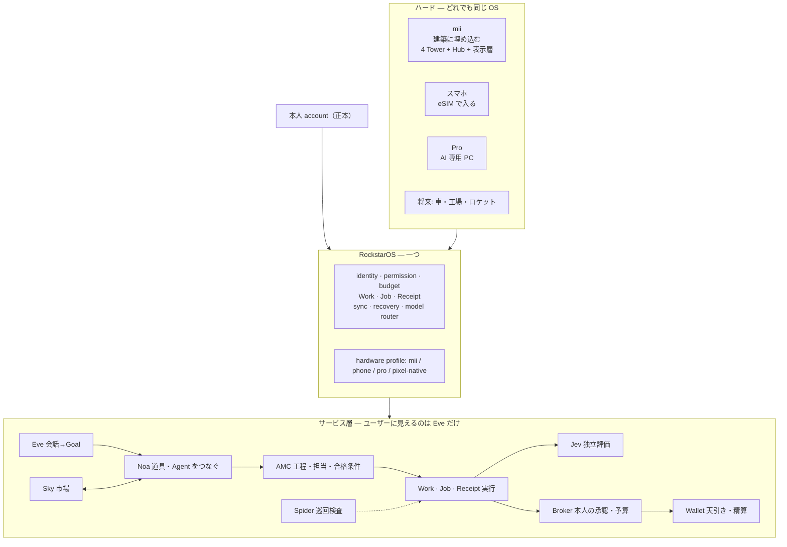

# rock — avokado の正本リポ（中の人向け）

<p align="center">
  
</p>

このリポは Noelle と Kaiya のためのもの。公開向けの説明は sites/ と PDF に置く。
**一つの account、一つの OS（RockstarOS）、どのハードでも続きから動く。** 話す相手は Eve。Eve が目的を決め、Noa が道具をつないで形にし、それを mii で見て触る。

| 知りたいこと | どこ |
| --- | --- |
| 設計の正本（世界観 → 製品 → システム → 事業） | [docs/structure/](docs/structure/00-overview.md) |
| Codex にやらせること | [codex/tasks/00-index.md](codex/tasks/00-index.md) |
| Codex の作業規則 | [AGENTS.md](AGENTS.md)（57 行） |
| いつ・何を変えたか | [CHANGELOG.md](CHANGELOG.md)（旧 README 冒頭の日付ノート全文を含む） |
| 整理前の README / AGENTS / project.md / PROJECTS.md | [archive/root-snapshot-20261029/](archive/root-snapshot-20261029/)、branch `archive/pre-restructure-20261102-main-1daf5c3` |
| 旧 393 件のタスク台帳 | [全タスクの進捗](archive/root-snapshot-20261029/project.md#全taskの作業進捗)（`npm run project:update` が更新し続ける） |
| 製品ごとの長い説明（Mini / OS / Eve / Sky / Pro の旧 README 本文） | [archive/root-snapshot-20261029/README.md](archive/root-snapshot-20261029/README.md#mini) |

---

## 1. 全体の絵



## 2. 製品（外から見える名前は 6 つだけ）

| 名前 | 何か | 正本 | 状態 |
| --- | --- | --- | --- |
| avokado | 会社・ブランド | — | — |
| **mii**（旧 avocadoMini） | 建築に埋め込む端末。Column / Puck / Slot の 3 筐体、中身は同じ Tower。1 本でも Eve 端末、4 本で空間 | [01-mii.md](docs/structure/01-mii.md) | R5を現行設計世代として維持（[R5 設計](docs/avocado-mini-r5/README.md)）。製造承認は**保留中**、R5実機試験の完了実績は0件。Gen1 試作へ（task 21）。Material Invention のシミュレーション・実験室接続は未実装 |
| **RockstarOS** | 全ハード共通の実行基盤 | [02-rockstaros.md](docs/structure/02-rockstaros.md) | Buildroot native・Android native・cloud runtime の 3 系統が動作中 |
| **Eve** | 話しかける相手 | [04-eve-noa-amc-sky.md](docs/structure/04-eve-noa-amc-sky.md) | Web 動作中 |
| **Sky** | Agent・Tool・情報の市場 | 同上 | Web 動作中、lib 104 本 |
| Pro | AI 専用 PC | 旧 README | 今回の整理の対象外 |

配布できるものは **eSIM** — [03-esim.md](docs/structure/03-esim.md)。GB を売らず、RockstarOS の鍵付き回線を月額で。

## 3. 名前

内側の名前（Eve / Noa / AMC / Jev / Spider / Sky / Work / Broker / Wallet）とコードの場所は下の表。正本と旧名の対応は [06-naming.md](docs/structure/06-naming.md)。

## 4. フォルダ地図（直すときはこの行だけ開く）

| 役割 | 設計 | コード | テスト | check |
| --- | --- | --- | --- | --- |
| mii | docs/structure/01, **docs/mii/design/**（設計書 V1）, docs/avocado-mini-* | systems/rock-star-os/targets/avocado-mini(→mii), lib/mii-*, contracts/avocado-mini-* | tests/mii-*, tests/avocado-mini-* | `avocado:r5:check` |
| RockstarOS | docs/structure/02, docs/native-os-integration.md, systems/rock-star-os/docs/ | lib/rockstar-*, systems/rock-star-os/os, android/, os/ | tests/rockstar-* | `android:architecture:check`, `device-support:check` |
| eSIM | docs/structure/03 | app/api/esim, lib/esim-*, lib/esimgo-*, app/connect, toolkits/esim-bootstrap | tests/esim-* | `npm test -- esim` |
| Eve / Noa | docs/structure/04 | lib/eve-*, lib/zema-chat-session.ts, app/chat, app/api/eve, app/api/llm | tests/eve-*, tests/zema-* | — |
| AMC | docs/mission-control.md, docs/amc-*.md | lib/amc-*, lib/jennifer-*, app/amc, app/api/amc, data/amc/ | tests/amc-*, tests/jennifer-* | `mission:check` |
| Jev / Spider | docs/jev-*.md | lib/jev-*, lib/spider-*, android/jev-provider, toolkits/spider-guard | tests/jev-*, tests/spider-* | — |
| Sky | docs/service-design/, docs/sky-*.md | lib/sky-*, app/sky, app/api/sky, services/sky-*, sites/sky-live | tests/sky-* | `sky:check` |
| Work / Broker | docs/agent-control-plane.md | lib/work-*, lib/workflow.ts, lib/a2a-broker-*, lib/agent-control-plane.ts | tests/work-*, tests/a2a-* | `work:check` |
| Wallet | docs/structure/05 | lib/wallet*, lib/settlement.ts, services/sky-billing, shared/stripe.mjs, app/wallet | tests/wallet-*, tests/settlement-* | `billing:check` |
| Game | docs/gx0*-*.md | lib/game-*, sites/avocado-mini/creator-kit | tests/game-* | `test:avocado-mini-site` |
| DB | docs/database-status.md | db/schema.ts, drizzle/, drizzle-main/, drizzle-legacy/（task 06 で 1 本に） | — | `database:check`, `schema:check` |
| サイト | — | sites/avocado-mini（Astro）, sites/sky-live, public/, public-release/ | — | — |
| 歴史（既定で読まない） | — | archive/, docs/evidence/（212 件）, workspaces/, toolkits/mr, vendor/mr, drizzle-legacy/ | — | — |

詳細版: [09-repo-layout.md](docs/structure/09-repo-layout.md)。文書の地図: [docs/README.md](docs/README.md)。確定要望 RQ01〜RQ50 は [docs/product-baseline.md](docs/product-baseline.md)（docs/structure と矛盾したら structure が勝ち、07 に日付を足して baseline を直す）。

## 5. 動かす

```bash
npm install
npm run dev            # Web（Eve / Sky / Wallet）
npm run verify         # PR 前。task 02 後は typecheck + lint + test（5 分以内が目標）
npm run verify:full    # 旧 40 段チェーン（task 02 後に用意）
```

native RockstarOS（Buildroot/QEMU）は systems/rock-star-os/README.md、Android は docs/native-os-integration.md、mii の試作は codex/tasks/21。

## 6. 今の優先（2026-11）

1. この構造整理を main に入れ、`verify` を短くする（task 01, 02）。
2. eSIM を esim-go sandbox で一周させ、Stripe 月額をつなぐ（task 11）。provider RFQ を本人が送る（task 10）。
3. 名前の統一（task 03, 04）。
4. mii Gen1 試作「1 プロジェクター＋1 壁＋頭追跡」（task 21）。
5. サービス書式で最初の 3 枚（task 32）。

収益と 1 ヶ月 / 1 年の計画は [05-business.md](docs/structure/05-business.md)。議事録から抜いた日付付きの決定は [07-decisions-from-minutes.md](docs/structure/07-decisions-from-minutes.md)。Kaiya の PDF への指摘は [08-pdf-review.md](docs/structure/08-pdf-review.md)。

---

# 製品の説明（写真・設計・コードの場所・開発状況）

製品ごとに、写真、何のためか、設計の考え方、コードの場所、いま何ができていて何がまだか。名前は旧表記のまま（Mini = mii、Smith = Noa、Jennifer = AMC、Zema = Eve/Work。対応は [docs/structure/06-naming.md](docs/structure/06-naming.md)）。PR 単位の細かい作業メモは [CHANGELOG.md](CHANGELOG.md) に原文のまま移した。**Mini → OS → Eve → Sky → Pro** の順に、何のための製品か、どう使うか、どこまで開発できているかを説明する。

[Mini](#mini)　／　[OS](#os)　／　[Eve](#eve)　／　[Sky](#sky)　／　[Pro](#pro)

<a id="mini"></a>

## Mini — 暮らしとまちづくり


<p align="center">
  
</p>

<p align="center"><sub>Mini R5の形状を踏まえて制作したコンセプトビジュアル。実機写真や性能の受入証拠ではありません。</sub></p>

<br>


### 目的と使う場面

Miniは、家庭や地域の空間に置いて使うことを考えた端末です。暮らしとまちづくりに貢献することを目的にしています。

R5を現行設計として、1本で使える構成を目指し、Proや建物Hubを必須にしません。

たとえば家庭では、声や手の動きを入口に、連絡や創作、遊び、許可した機器の操作を助けることを考えています。地域の施設では、案内や学び、住民が場所の使い方について意見を伝える入口などを活用案にしています。

まちづくりへの貢献は、機器を置くだけで成立するものではありません。その場所を使う人と管理する人が用途を決め、同意やプライバシー、手動で操作できる方法を含めて、一つの場所から確かめていく設計です。

### 声と指先で依頼内容を編集する

仕事の「mii連携のソフト試用」で同じ仕事を読み、依頼内容を選択します。対応ブラウザーの端末内日本語音声、または文字で修正案を入れ、変更前後を確認して保存します。カメラでの指先選択には[ローカルモデルの準備](docs/avocado-mini-r5/spatial-computer-use-design.md#voice-point-edit)が必要です。保存済みの依頼は同じ仕事を読み直して再開できます。写真・サイト本文の編集、実空間表示、実機での入力精度は未受入です。

### 設計の考え方

Miniは1本で使えることを基本にし、必要に応じて同型のMiniやProと連携する方向です。建物に取り付ける場合も、住民個人の情報と施設共通の設定を分けます。

- [R5の設計](docs/avocado-mini-r5/README.md)

- [製品目的・住民と施設の責任・受入条件](docs/service-design/03-product-profiles.md#mini-pro-purpose)

- [Material InventionとMiniの詳細](docs/rockstaros-avocado-mini-complete-design.md)

200mm以内の目標、任意の建築一体型取付、任意の国内LTE/IoT data SIMを扱います。

### コードの場所

現在公開している製品紹介と、ブラウザで動くゲーム制作・投稿受付のコードです。実機を動かす完成済みファームウェアを示す一覧ではありません。

- [製品ページ](sites/avocado-mini/src/pages/mini/index.astro)

- [ゲーム制作ページ](sites/avocado-mini/src/pages/create/index.astro)

- [動くブラウザゲームの雛形](sites/avocado-mini/creator-kit/)

- [投稿受付Worker](sites/avocado-mini/worker/participation.mjs)

ブラウザの制作機能とMini実機のソフトウェアは別の受入対象です。

### 現在の開発状況（2026-11 時点）

| できている | まだ | 次の一手 |
| --- | --- | --- |
| [公開サイト](https://avocadomini.si/)に R5 と製品目的を掲載。ブラウザゲームとアイデア投稿の受付 | 実機の表示・入力・電源・熱・保存/復旧、建築への施工、地域での実証（**R5 実機試験の完了実績は 0 件**） | [設計書 V1](docs/mii/design/00-README.md)に沿って Gen1 試作（1 プロジェクター＋壁＋頭追跡）— [task 21](codex/tasks/21-mii-motion-parallax-prototype.md) |
| カメラの手指入力の preview（ブラウザ上、表示の選択・移動・回転だけ） | 実空間の校正、実行の承認、実機精度 | 4 Tower の校正手順（設計書 08 章） |
| 衛星回線を Wi-Fi 共有する制御の試作（架空回線で許可・通信量・料金上限・再起動復旧を試せる）、メッセージ用の共通 adapter | 実衛星・実 modem・実請求。製造承認は**保留中**、価格・発売日は未確定、予約・決済は停止中 | 回線は eSIM に一本化（[03-esim.md](docs/structure/03-esim.md)）。衛星はオプション |
| Material Invention（物質候補の 2D 比較、Sky/Zema 接続） | シミュレーション・実験室接続は未実装 | 用途の一つとして維持（設計書 01 §6） |

公開した版と確認結果は[公開確認の記録](data/mini-pro-purpose-publication.json)。作業単位の細かい記録は [CHANGELOG.md](CHANGELOG.md)。

<br>

---

<a id="os"></a>

## OS — RockstarOS


<p align="center">
  
</p>

<p align="center"><sub>RockstarOSの世界観を表す既存GIF。OSの動作録画や実機受入の証拠ではありません。</sub></p>

<br>


### 目的と使う場面

RockstarOSは、各製品とサービスに共通する実行基盤です。本人性、権限、AI・Agentの実行、費用上限、端末適合、保存・復旧を共通のルールで扱います。製品名は **RockstarOS 1.0**、内部識別子は `dev.rock`、最初の配布ラベルはDeveloper Previewです。

OSは、誰の依頼なのか、どの機能を動かしてよいのか、費用はいくらまでか、結果をどこに保存するかを共通に扱います。別々の製品でも、こうした確認や仕事の引継ぎを最初から作り直さずに済む基盤を目指しています。

利用できる形は端末によって異なります。今あるPCやスマートフォンから使うWeb/clientと、端末そのものへ導入するnative OSを分けて開発しています。

### 設計の考え方

端末内のAI、本人用Linux、許可したCloudなど、仕事を実行する場所が異なっても、本人確認・権限・予算・成果の扱いを揃える設計です。ローカルLLMは対応端末の能力の一つで、全機種の必須条件ではありません。

- [全設計ポータル](docs/rockstaros-design-portal.md)

- [OS本体の詳細](docs/rockstaros-complete-design.md)

- [1.0構成](docs/rockstaros-1.0-architecture.md)

- [端末別設計](docs/device-support-architecture.md)

- [「RockstarOSを再設計」チャット](codex://threads/01a14d54-daee-7c30-87a8-faea84641a40)

OS本体の設計は、上記の「RockstarOSを再設計」チャットで確定した方針を大元にしています。

### コードの場所

端末で動くOSのコードと、既存OSやWebから使う画面・接続層のコードを分けて保存しています。対象端末に合う系列から確認してください。

- [native/Linux・QEMU](systems/rock-star-os/)

- [Android](android/)

- [OS接続層](os/)

- [Webの画面](app/)

- [共通業務の状態遷移](lib/workflow.ts)

- [native統合手順](docs/native-os-integration.md)

- [Linux toolkit](toolkits/sky-linux-local/README.md)

native統合手順にはOS系列ごとの実装・検証方法、Linux toolkitには開発用の接続手順をまとめています。

### 現在の開発状況（2026-11 時点）

| できている | まだ | 次の一手 |
| --- | --- | --- |
| Web runtime、Linux/service、Pixel/Lab adapter のコードは main に統合済み。Pixel 10 で純正 OS 上の試験署名 APK が実機再起動の受入 23/23 | 全 OS build、正式署名、flash/boot、データ全損からの復元 | hardware profile（mii / phone / pro / pixel-native）に整理 — [task 31](codex/tasks/31-hardware-profiles.md) |
| QEMU Developer Preview（Buildroot native）: A/B 起動、署名ストア、Wallet simulator が仮想機で動く | 実機での起動・復旧 | — |
| eSIM の service setup（発行・QR・導入証明・端末束縛・再開）が sandbox で動く | 実 issuer、本番 D1、実課金 | eSIM を「RockstarOS の鍵付き回線」として一周させる — [task 11](codex/tasks/11-esim-first-live.md) |
| Game の結果 JSON から仕事の下書きを作れる（本人が「仕事を作成」を押すまで保存しない） | — | — |
| account の続き（別端末で同じ Job を再開） | 実アカウントの別端末引継ぎは未受入 | [task 30](codex/tasks/30-account-continuity.md) |

eSIM に OS 本体は入れない。回線・SIM profile・利用権・client 導入・OS 導入は別の状態として扱う（[03-esim.md](docs/structure/03-esim.md)）。

---

<a id="eve"></a>

## Eve — 会話から仕事と成果へ


<p align="center">
  
</p>

<p align="center"><sub>Eveの仕事の流れを表した設計図。実際の画面や自動実行の成功を示す画像ではありません。</sub></p>

<br>


### 目的と使う場面

会話、依頼、承認、進捗、停止、成果、利用額を同じ本人・同じ仕事に結び付け、対応端末へ引き継ぐ窓口です。

Eveは「話して終わり」にせず、その会話から依頼した仕事が今どうなっているか、何を承認する必要があるか、成果はどこにあるかを追える窓口を目指しています。

たとえばSkyで見つけたAgentへ仕事を頼む場合、Eveから依頼内容や条件を確認し、進捗を見て、必要なら停止し、できた成果と使用額を確認する、という流れです。会話したこと自体を、外部送信や有料実行の許可にはしません。

### 設計の考え方

会話の履歴と実行中の仕事は結び付けつつ、別の状態として扱います。保存した履歴を開く操作と、仕事をもう一度動かす操作を分け、再読込や端末の変更で意図せず再実行しないようにします。

- [Eveを含むOSの最新設計](docs/rockstaros-complete-design.md#redesign-thread-home-sky-eve)

- [サービス間の共通契約](docs/service-design/02-system-contracts.md)

- [Agent・Toolと仕事の詳細](docs/sky-tools-complete-design.md)

既存Zema系の仕事・承認・費用契約を再利用します。

### コードの場所

会話を表示する画面、本人別に履歴を保存するAPI、暗号化や仕事の状態管理を行う処理が主な入口です。

- [会話と仕事の画面](components/sky-chat-workspace.tsx)

- [履歴パネル](components/eve-history-panel.tsx)

- [履歴API](app/api/eve/history/route.ts)

- [暗号化履歴](lib/eve-history.ts)

- [仕事の状態遷移](lib/workflow.ts)

- [Eveモデルの学習・比較・Pixelクライアント試験用toolkit](toolkits/eve-model/README.md)（開発用。品質・Pixel本体での推論は別受入）

### 開発プレビューで今できること

- 「自分の担当を作る」: 名前・目的・入力・期待成果を決め、必要な Tool と実行先を選ぶ。Tool の入出力の型を照らし合わせてから仕事を作る。
- 資料を 2〜4 本付けて依頼し（合計 8,000 文字）、保存・読み戻し・料金の見積り比較。見積りは確認だけで、生成も課金もしない。
- 作った仕事を mii のソフト試用で読み戻し、同じ仕事の Tool 確認へ渡す。
- 作者向け SDK 0.1.5 で能力宣言と Tool の接続を試せる（[作例](toolkits/sky-tool-sdk/README.md#非推論の追加例)）。

どれも「確認」であって「実行許可」ではない。実行は別に承認する。

### 現在の開発状況（2026-11 時点）

| できている | まだ | 次の一手 |
| --- | --- | --- |
| 会話の保存・読み戻し・削除、成果の HTML 持ち出し | 実アカウントの別端末引継ぎ | account 継続の契約 — [task 30](codex/tasks/30-account-continuity.md) |
| Tool の能力確認（接続先・版・観測期限）、担当の入出力型と permission の照合 | 本番 Provider の単価・認証・課金 | — |
| Smith（→ Noa）の保存会話と Agent 参照 | 名前の統一 | Smith→Noa、Zema→Eve/Work — [task 03](codex/tasks/03-naming-display-strings.md) |

保存・復旧コードの統合範囲は[統合記録](data/runtime-integration-audit.json)。

<br>

---

<a id="sky"></a>

## Sky — 情報とAgent・Toolの発見・接続

<p align="center">
  
</p>

<p align="center"><sub>発見と接続を表す既存GIF。実際の画面録画ではありません。</sub></p>

<br>


### 目的と使う場面

Skyは、情報やModel・Agent・Toolを投稿から見つけ、追加・接続するサービスです。仕事の依頼はEveへ引き継げます。Sky単体でも利用できる設計です。

Skyは、どんな機能があるかを知り、誰が作ったものか、何に接続するのか、どの権限と費用が必要かを確認する場所です。情報の投稿から、使ってみたいModel・Agent・Toolを見つける体験を目指しています。

見つけた機能を追加すること、サービスへ接続すること、実際に仕事を実行することは、それぞれ別の操作です。必要な設定や条件を確認したうえで、Eveへ依頼を引き継ぎます。

### 設計の考え方

Skyを使うためにMiniやProの購入、native OSの導入を必須にはしません。既存OSやブラウザからの単体利用も想定し、接続先ごとの互換性・権限・費用を確認します。

- [Tool全体の詳細](docs/sky-tools-complete-design.md)

- [MCPと接続の設計](docs/sky-mcp-architecture.md)

- [料金・usage・上限の契約](docs/sky-billing.md)

投稿の出典、作者・版・互換性、権限、費用、保存・復旧を扱います。

### コードの場所

画面、接続先を管理するAPI、コミュニティーで共有するOS版、配信・データ移行の処理をそれぞれ確認できます。

- [Sky画面と各Tool](app/sky/)

- [投稿型Home](components/home-screen.tsx)

- [接続hub API](app/api/sky/hub/route.ts)

- [共有OS版API](app/api/sky/community-os/route.ts)

- [Web配信とmigration](services/sky-web/)

### 現在の開発状況（2026-11 時点）

| できている | まだ | 次の一手 |
| --- | --- | --- |
| 投稿型の Home/Sky、本人別の保存、コミュニティ OS の版と鍵。[総合・Sky 入口](https://avoado.si/) | 実 X 投稿、独自 For You、実 MCP Provider の接続、本番の料金・請求 | lib/sky-*.ts 104 本の整理 — [task 08](codex/tasks/08-sky-lib-foldering.md) |
| Cloud 利用は事前見積・上限承認・明細が前提。許可済み予算を超えて実行しない | — | 月額 ¥600 候補と手数料 0 の形を決める（[05-business.md](docs/structure/05-business.md)） |

機能の追加、商品の購入、仕事の実行、外部送信、課金は別の操作。モデルの出力や作者の署名を権限の承認に昇格させない。

<br>

---

<a id="pro"></a>

## Pro — AI専用PCと半導体・関連部品の確保

<p align="center">
  
</p>

<p align="center"><sub>Studio筐体のコンセプトビジュアル。最初の試作候補A4-H2Oの実機写真ではありません。</sub></p>

<br>


### 目的と使う場面

Proは、AIモデルやAgent、制作・計算のための専用PCです。その製造・販売事業を通じて、半導体と関連部品を継続的に確保できる調達基盤を育てます。Miniなしで使う独立PCです。

利用者にとっては、AIモデルやAgent、制作処理を動かすための専用PCです。どのような仕事をしたいかに合わせて構成を考え、実際の性能・冷却・消費電力・保守性を確かめて製品にしていきます。

事業としては、PCの需要を把握し、検証した構成を継続的に製造・販売することで、GPU、CPU、メモリーなどの半導体と関連部品の調達につなげることを目指します。必要な部品や量を明確にし、供給元との関係や供給の継続性を育てる考え方です。

### 設計の考え方

ProはMiniの必須Hubではなく、単独で使うPCです。構成候補、見積、発注、納品、動作確認を分けて管理し、候補に挙げた部品をすでに確保した在庫として表示しません。

- [Proの詳細設計](docs/avokado-pro-pc-design.md)

- [製品目的・調達の責任と受入条件](docs/service-design/03-product-profiles.md#mini-pro-purpose)

- [部品・販売準備の台帳](data/avocado-pro-sales-readiness.json)

需要把握、構成検証、供給元との調整、発注・納品・品質検収を分けて扱います。

### コードの場所

公開ページの部品選択や構成保存、購入希望の受付を実装しているコードです。PC実機の組立・性能検証の完了を示すものではありません。

- [製品ページ](sites/avocado-mini/src/pages/pro/index.astro)

- [部品・構成選択](sites/avocado-mini/src/components/ProAssemblyWorkbench.astro)

- [構成操作と保存](sites/avocado-mini/src/pro-experience.js)

- [購入希望受付Worker](sites/avocado-mini/worker/pro-interest.mjs)

Miniと同じWebソース内にあります。

### 現在の開発状況（2026-11 時点）

| できている | まだ |
| --- | --- |
| [公開サイト](https://avocadopro.si/)で構成の検討・保存・購入希望の受付。最初の実機候補は銀色の Lian Li A4-H2O | 実機組立、部品適合、供給契約、在庫、最終価格、決済、配送。有料注文は未開始 |

今回の構造整理の対象外。公開した版と確認結果は[公開確認の記録](data/mini-pro-purpose-publication.json)。

<br>

---

## 開発と検証

Node.js 22.13 以降と npm。Web のローカル起動:

    npm ci
    npx wrangler d1 migrations apply DB --local --config wrangler.local.jsonc
    npm run dev

変更の検証（PR の前）:

    npm run verify          # 今は 40 段。task 02 の後は typecheck + lint + test
    npm run design:check    # 設計 JSON を触ったとき

Mini/Pro の Web は [sites/avocado-mini](sites/avocado-mini/) に共通で置く（`npm ci --prefix sites/avocado-mini`）。細かい試験手順（eSIM 復旧試験、Pixel 診断、Game 旧 UI の固定 main など）は [CHANGELOG.md](CHANGELOG.md) の「旧 README の開発と検証メモ」に原文のまま。

## 権利と公開・実機の境界

公開サイトは、総合・Skyの [avoado.si](https://avoado.si/)、Miniの [avocadomini.si](https://avocadomini.si/)、Proの [avocadopro.si](https://avocadopro.si/) です。各サイトの配備・DNS/TLS・表示の証拠と、実機・実Provider・本番課金の受入を区別します。本人用localhost Labや秘密情報は公開サイトへ移しません。

端末初期化・bootloader解除・flash、契約、実資金、外部送信は対象ごとの条件を確認します。Gitへ秘密鍵、原稿、本人データを保存しません。[配布計画](docs/release-minimum-gates.md) / [権利と配布物](public-release/rockstaros/README.md)。

<sub>進捗 JSON の自動要約（`npm run project:update` が書き換える。読まなくてよい）</sub>
<!-- project-overview:start -->
Updated: 2026-11-02 / 393 task records (32 parents, 192 children, 169 standalone; 361 execution units excluding parents): 114 done, 48 in progress, 230 planned, 1 blocked
<!-- project-overview:end -->

### avoado.si のEveとNoah

[Noah](https://avoado.si/#timeline)で記事・Tool・担当を選び、[Eve](https://avoado.si/os/eve)へ渡して仕事と成果を確認します。旧 `/chat` は選択内容を保ってEveへ移動します。公開先は既存avoadoサイト。公開SQLは `drizzle/` と `drizzle-main/`、旧mainのSQLは `drizzle-legacy/github-main-before-avoado-alignment/` に保全し自動適用しません。
