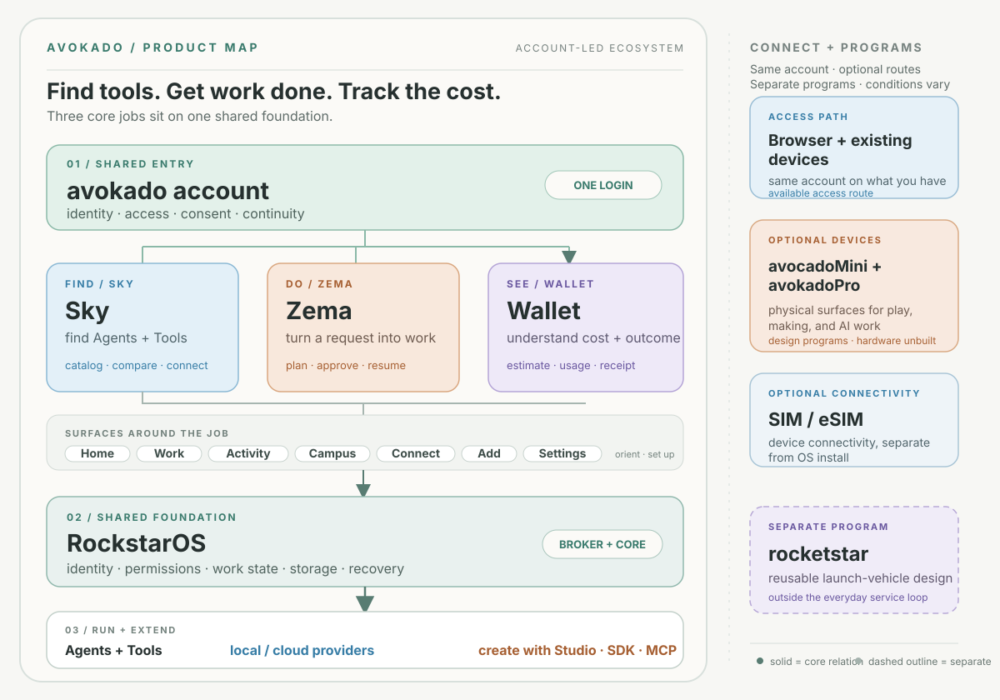
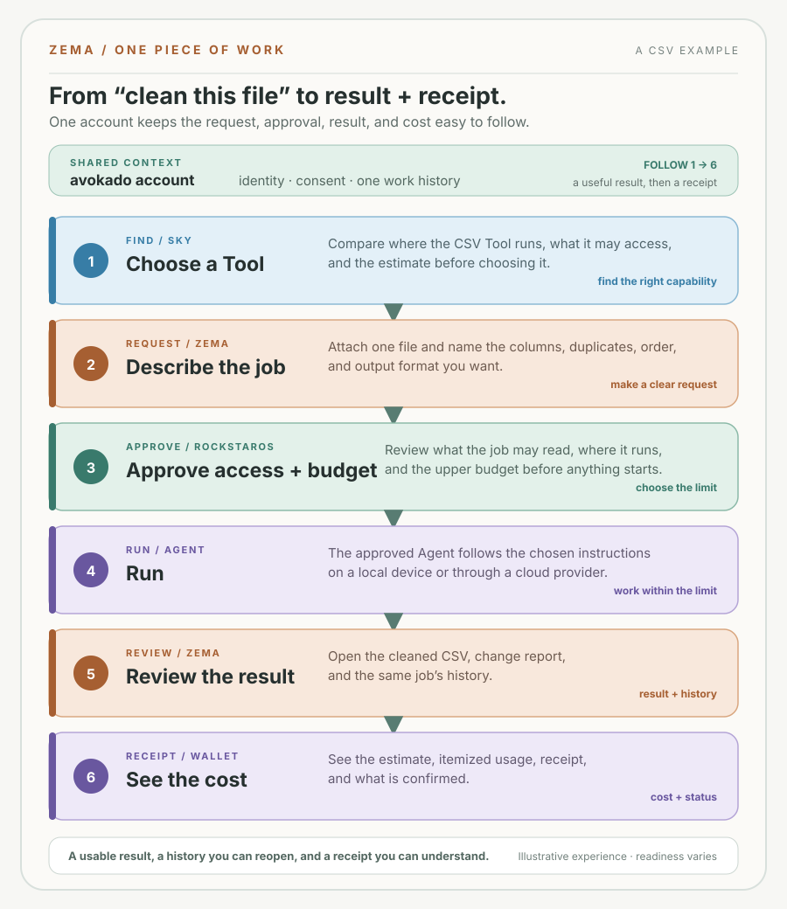
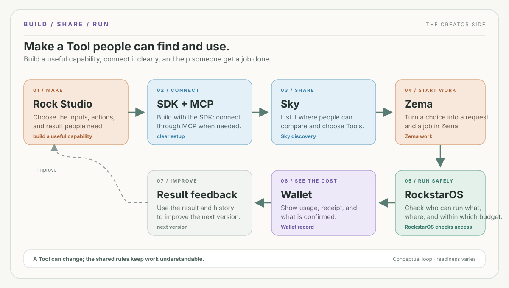
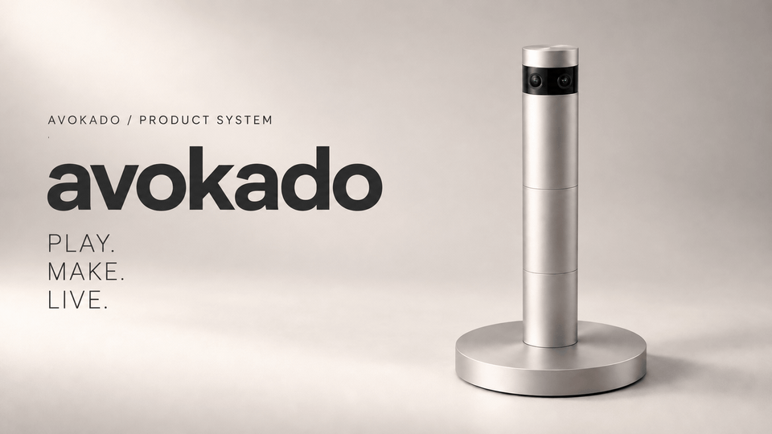

<div align="center">

# avokado

### One account. More ways to play, make, and get things done.

Find Agents and Tools in **Sky**, keep a piece of work moving in **Zema**, and follow its costs in **Wallet**. **RockstarOS** provides the shared foundation for identity, permissions, records, and recovery.

[Read the service design](docs/service-design/README.md): Jennifer coordinates your goal, Sky supplies capabilities, Zema manages the work and its cost, and RockstarOS enforces identity, permission, storage and recovery. Mini is an independent R5 spatial device; Pro is an NVIDIA si PC; rocketstar has its own engineering and flight-safety gates. The design covers the user journey, shared contracts, product profiles, delivery order, all 50 requirements and 12 cross-system acceptance scenarios.

[Open RockstarOS Home](https://avoado.si/os) · [Open Sky](https://avoado.si/os/sky) · [Run it locally](#start-developing)

Skyの第一者[出典整理Agent](app/sky/agents/citations/page.tsx)は、サインインした本人がブラウザだけで引用を整理し、その結果を[成果一覧](app/sky/outputs/page.tsx)へ保存する。Sky HomeとMarketplaceから開き、言語とMarkdownを入力して「実行して成果を保存」を選ぶ。無料の有限処理であり、LLM推論・外部検索・リンク先の真偽判定は行わない。Cloud Agentの本番実行と一般Marketplace決済は別受入。[詳細設計](docs/sky-tools-complete-design.md#sky単体の第一者agent縦断経路2026-10-13)。

The new `/os/sky/outputs` page shows a signed-in person's saved Agent results. `/fitness` demonstrates a first-party app displaying a typed `sky.fitness.plan/1` result from Sky; `/fitness?preview=1` is an explicitly labeled display sample. RockstarOS Home is at `avoado.si/os`, and Sky stays under `avoado.si/os/sky`. The product homepage at `/` links to `avocadomini.si` and `avocadopro.si`. A real Fitness Agent, cross-origin app SDK, and production Provider output are not yet accepted. See [Sky App Output Plugins](docs/sky-launch-design.md#sky-app-output-plugins).

[The promise](#the-promise) · [System map](#system-map) · [From a request to a result](#from-a-request-to-a-result) · [Service atlas](#service-atlas) · [Tool catalog](#sky-tool-catalog) · [Status](#where-it-stands) · [Develop](#start-developing)

</div>

> **Current direction** — avokado starts with an account, not a device. Sign in once and carry identity, work, permissions, results, and usage across a browser, PC, supported device, or cloud job. A physical SIM or eSIM is optional device connectivity for products such as avocadoMini; it is not where the OS is stored.

> **Where it stands** — this repository contains web app source, selected runnable Tools, software previews, and device designs. There is no live billing, carrier contract, full phone OS flash, or manufactured avocadoMini yet.

## The promise

The product should feel like one continuous handoff:

1. Sign in once with an avokado account.
2. Ask for an outcome in ordinary language, or find a matching Agent or Tool in Sky.
3. Let Zema keep the request, plan, approvals, progress, stop state, result, and history together.
4. See the estimate before paid cloud work, approve a limit, watch usage while it runs, and read the receipt in Wallet.

Sky helps a person choose and connect the right Tool. **Jennifer** is the project chief of staff in front of Zema: she turns a broad request into a Goal Contract, asks AMC to work backwards into bounded leaf tasks, assigns each leaf to a project or specialist si, and returns one integrated report. Zema remains the execution ledger for approvals, progress, evidence, artifacts, signed usage receipts, independent review, incomplete work, and stop state. Wallet explains estimates, usage, and receipts. RockstarOS Core checks permission and keeps identity, records, storage, and recovery consistent across clients; an LLM may suggest a plan, but it does not grant itself authority to run it.

The implemented coordination path is:

`Owner → Jennifer (COLOMBIA + Goal Contract) → Zema / AMC decomposition → specialist A2A Agent → artifact + signed Receipt → independent reviewer → Jennifer final report → owner acceptance`

Open `/chat`, choose a project, enable **計画を整理**, and send the desired outcome. Jennifer first presents the Goal and decomposition without executing anything. After the owner saves the Goal, each ready leaf can be opened as a Zema Cloud Agent job. Actual remote dispatch still requires a connected Agent, a verified quote, a Broker authorization proof, a budget reservation, and explicit owner approval. A remote “completed” state is not enough: Zema records the artifact and Receipt, and a separate reviewer must accept the leaf before Jennifer can include it as completed. See [Jennifer coordination and execution](docs/jennifer-coordination.md).

## System map

Clean a file, prepare a listing, develop a material idea, find a community, or build a Tool someone else can use. The breadth is deliberate; the same account and permission boundary should make each path understandable.

The map is deliberately drawn from the largest promise down to the smallest implementation unit. A Tool is useful because it participates in the same account, work, permission, and receipt contract.



| Zoom level | What a person should understand | The named pieces |
| --- | --- | --- |
| **1 / Account** | One identity and one history follow the person across surfaces and devices. | Account, Home, Connect, Add, Settings, Campus |
| **2 / Work** | A request becomes visible work with an owner, a boundary, a result, and a receipt. | Jennifer → Zema / AMC → specialist si → reviewer → Wallet |
| **3 / Foundation** | Every execution path checks the same identity, permission, storage, recovery, and stop rules. | RockstarOS Core, Broker, Runner, Storage, Recovery |
| **4 / Capability** | A bounded Agent or Tool performs one useful job where it is allowed to run. | Local, PC/MCP, Cloud, Provider, native registry |

Device programs sit alongside the service: avocadoMini R5 and avokadoPro. Material Invention uses the service stack for digital candidate work, with physical and laboratory extensions still in development. rocketstar is a separate design program.

## Try it now

The fastest public preview is [Sky via RockstarOS Home](https://avoado.si/os/sky). Choose **SPIDER**, paste code or text, and review the flagged lines and suggested responses; its bounded browser check does not send or save the original input. The browser stays on `avoado.si`. For a reproducible local run, start the app below and open `/sky` or `/zema/tools/rockstar-spider`.

In Zema, **Compose work** (`/zema/compose`) combines connected text or CSV Tools with explicit checks. Save the intermediate results, review the final output, then reuse its steps as a recipe for new material. Compare and edit a saved artifact in a separate recheck job; the original result and its approvals remain intact. Recipes contain the processing graph and safe defaults; they do not copy the old manuscript, results, approvals, or payment evidence. The first candidate is under local verification; public deployment and authenticated production acceptance are recorded separately in [the development evidence](docs/evidence/work-composition-development.json).

The preview may require an account and its provider-connected paths are at different stages. The local SPIDER path and the CSV flow below are the clearest ways to see the product contract without treating a design preview as a finished commercial service.

For a local Zema conversation, run Ollama on `127.0.0.1:11434`, install `qwen3:0.6b`, build and start this repository, then open `http://localhost:8787/chat`. Choose **Ollama** and model ID `qwen3:0.6b` in the conversation-model panel. The model is an untrusted planner: only three bounded, side-effect-free local functions are allowlisted, and there is no cloud fallback. The public `chatgpt.site` Worker cannot reach a model on your PC loopback; a future companion/bridge is required for that path.

## From a request to a result

Here is the smallest useful mental model: “Please clean this CSV and show me exactly what changed.” The same shape also applies to writing, a security inspection, a market PAPER check, or a material candidate comparison. **This illustrates the intended end-to-end experience; individual Tools and provider connections are at different stages.**



| Step | What the person does | What they get back |
| --- | --- | --- |
| **Find** | Open the CSV Tool in Sky and check its target, permissions, and estimate. | A clear choice about what will run and where. |
| **Request** | Give Zema one file and the column, whitespace, duplicate, ordering, and encoding rules. | A visible request with an owner and a defined boundary. |
| **Approve** | Review the plan, data boundary, price range, and spending limit. | An explicit go/no-go decision before paid cloud work. |
| **Run** | Let a bounded local, PC, or cloud runner transform the file; stop or reconnect when needed. | A transformed file with progress and a known stop or completion state. |
| **Review** | Open the output, change report, independent check, and history. | Confidence about what changed and whether it passed. |
| **Receipt** | Read usage and confirmed amounts separately from a self-reported or PAPER result. | A plain-language explanation of cost, status, and next action. |

The current CSV Tool already has a bounded local/Web path for one file and an explicit change report. Cloud dispatch and live billing are not yet live.

When a Wallet or CSV save has an unknown result, keep the page open and use its same-operation recovery action. Signing in opens a separate tab so the original operation can be retained; a different account cannot retry it. Wallet and CSV hide private drafts until the original account is confirmed again. Unsubmitted input is protected during in-app navigation; only the confirmed original account can explicitly discard it. The pending input is held in memory, so it is not a backup against closing the browser. CSV work abandoned in `processing` after a server process stops still requires operator investigation.

Workbench, Material, Mercari and Coconala also keep private draft recovery tied to the original account. In Coconala, closing and reopening the editor retains unsaved terms. If someone else changes the case while you edit, saving stops with the original input intact; review the newer case before starting a replacement edit. Use the explicit discard action only when you no longer need that account’s unsaved input. No external orders, payments or messages are sent by these recovery controls. Material also protects incomplete local JSON and title edits before they can be exported; save or explicitly discard the current draft before leaving. Empty or unchanged saved work does not block navigation.

If a Zema Tool finishes but its progress record is unconfirmed, use the record’s recovery controls instead of running the Tool again. A failed state reload keeps the original command; it is cleared only after the same account’s saved history confirms it. An unsent Cloud si prompt also blocks accidental navigation until it is saved or explicitly discarded. The existing citation, free-article and Coconala checker inputs and generated results, plus Mr. Delivery’s review JSON, selected files and result, remain in memory for the same account, job and step while the Workbench reconnects. These Tool drafts also block accidental same-tab navigation. Save or export any result you need, then use the per-Tool discard action shown with its job and step to leave; it clears only that Tool’s in-memory input and generated output, not saved Library results or job records. The original confirmed account can discard a retained draft even after its job is cancelled or another step is selected. Forced reload or tab closure can still lose unsaved memory. For Mr. Delivery, an expired sign-in hides private inputs until the Workbench confirms the original account again; reconnect in a separate tab, then reload the work list. A child connection check alone cannot restore the old account’s inputs. This does not cover the internal state of other specialized runners.

Zema asks before discarding unsent text when changing conversations or following an internal link. Back/Forward uses the same check in browsers with the Navigation API; older browsers retain only the existing link and unload protection.

## Service atlas

The names below are organized by how a person meets them: core surfaces, supporting surfaces, separately deployed services, and independent programs. A route or folder is an implementation location; its stage is shown beside it.

### The core loop

| Service / source | What a person does and why it matters | Stage |
| --- | --- | --- |
| [**Account / Home**](app/page.tsx) · [RockstarOS service](app/rockstaros/) | Signs in once, sees the next useful action, and enters the same service from a browser or device. | Web source + local checks |
| [**Sky**](app/sky/) · [guide](docs/sky.md) | Finds, compares, connects, publishes, or changes a Tool or Agent. | Web source + bounded Tool paths |
| [**Zema / Work**](app/zema/) · [Work route](app/work/) | Describes a job, approves it, watches progress, stops it, and opens the result. | Web source + local checks |
| [**Activity**](app/activity/) | Reopens what happened and checks the timeline. | Web source |
| [**Wallet**](app/wallet/) · [`lib/rock-wallet.ts`](lib/rock-wallet.ts) | Understands estimates, reservations, usage, receipts, refunds, and confirmed earnings. | Source + fixtures; no live billing |
| [**RockstarOS Core**](systems/rock-star-os/) · [`contracts/`](contracts/) | Explains why a job was allowed or stopped, with shared identity, permission, storage, update, and recovery rules. | Linux/QEMU preview + web/native source |

### The surrounding surfaces

| Surface | What it is for | Stage | Source |
| --- | --- | --- | --- |
| **Connect** | Start an account/device connection and, in the retained onboarding flow, keep carrier/SIM entitlement separate from client/OS install state. | Source + fixtures; no carrier or service-offer launch is accepted | [`app/connect/`](app/connect/) |
| **Add** | Add Sky, selected data recovery, or LLM entry points to an existing OS client or PWA. | Source path; device and provider acceptance separate | [`app/add/`](app/add/) |
| **Settings** | Manage account, devices, providers, model choices, and recovery settings. | Web source | [`app/settings/`](app/settings/) |
| **Jennifer / Chat** | Turn a broad outcome into a Goal Contract and bounded AMC leaf tasks, dispatch ready leaves through Zema, and integrate verified results and unfinished work. | Web source + owner-gated A2A path; production Provider setup remains separate | [`app/chat/`](app/chat/) · [`docs/jennifer-coordination.md`](docs/jennifer-coordination.md) |
| **Library** | Reopen saved results and private work artifacts. | Web source + owner-scoped storage rules | [`app/zema/library/`](app/zema/library/) |
| **Campus** | Find people, projects, opportunities, events, communities, portfolios, resources, and NFC/QR entry points. The five campus Sky hubs open at `https://avoado.si/os/sky/campus/{nyu|fit|columbia|fordham|johnjay}/hub`; NFC stickers store that HTTPS URL as an NDEF URI. | Web source + published route check; physical tag writing remains separate | [`app/campus/`](app/campus/) |
| **AMC** | Turns Jennifer's Goal Contract into dependency-ordered leaf tasks and records start, submission, independent review, and owner acceptance. | Catalog `ready`; Jennifer can create the Goal and A2A jobs, while every remote dispatch remains explicitly gated | [`app/amc/`](app/amc/) · [`toolkits/amc-agent/`](toolkits/amc-agent/) |
| **Rock Studio** | Authors a Tool, declares its inputs and permissions, packages it with SDK/MCP, and prepares publication to Sky. | Authoring source; publication and execution still have separate gates | [`app/studio/`](app/studio/) · [`app/sky/publish/`](app/sky/publish/) |
| **Sky Marketplace / Network / Purchases / Sell** | Finds published Tools, manages connections, and separates buying, selling, and refunds from execution. | Source + fixtures; provider and commercial acceptance are separate | [`app/sky/marketplace/`](app/sky/marketplace/) · [`app/sky/network/`](app/sky/network/) · [`app/sky/purchases/`](app/sky/purchases/) · [`app/sky/sell/`](app/sky/sell/) |
| **CSV** | Handles one bounded file from request through transformation, inspection, and delivery. | Ready bounded Web path; cloud dispatch and live billing are not live | [`app/csv/`](app/csv/) · [`rockstar-csv-cleanup`](lib/catalog.ts) |
| **Market** | Registers value units and walks through a simulated market's proposal, approval, PAPER execution, and receipt without real orders or funds. | PAPER (simulated market) only | [`app/market/`](app/market/) |
| **Automation Fund** | Groups ready Tools into a user-owned fund view and shows how revenue sharing is intended to work. | Revenue pricing and external payout are on hold | [`app/fund/`](app/fund/) |
| **Compute Grid** | Matches fixed, short compute lots to eligible idle Android hosts and independently verifies the result. | Synthetic host fixture; workers, cluster, and real settlement are not connected | [`app/sky/compute-grid/`](app/sky/compute-grid/) · [`lib/sky-compute-grid.ts`](lib/sky-compute-grid.ts) |
| **Coconala / Mercari** | Keeps opportunity, listing, delivery, and proceeds preparation in named Tools while the person performs official external actions. | Bounded Tool paths; external Provider acceptance is separate | [`app/coconala-team/`](app/coconala-team/) · [`app/income/mercari/`](app/income/mercari/) |

The creator side follows the same contract as the user side:



Rock Studio is the developer-facing Tool SDK surface. **Material Invention Studio** is a separate composite application that combines material candidate work, safety, XR, simulation, patent, and lab capabilities; its 2D candidate comparison and Sky connection are implemented, while the broader physical and laboratory system remains unfinished.

<details>
<summary><strong>Implementation atlas</strong> · separately deployed services and execution environments</summary>

### Separately deployed services

These live under `services/` and have their own runtime or deployment boundary. They are support services for the core loop, not extra user-facing products to count as additional Tools.

| Service | Role | Current deployment state |
| --- | --- | --- |
| [`sky-agent-runtime/`](services/sky-agent-runtime/) | Cloud Agent text work, A2A delegation, and one-minute expiry sweep. | Local Workflow fixtures; production D1, secrets, and cron are not configured. |
| [`sky-billing/`](services/sky-billing/) | Fee and revenue reconciliation and billing boundary. | Real sales, payment, and payout Providers are not connected. |
| [`sky-web/`](services/sky-web/) | Deployment adapter for the dedicated Sky site and authenticated API. | Adapter source and launch documentation; it does not replace the OS database. |
| [`operator-dock/`](services/operator-dock/) | Operations-only device management, separated from user OS screens and data. | Owner-controlled hostname, Access, D1, and WebAuthn remain to be configured. |
| [`android-attestation-verifier/`](services/android-attestation-verifier/) | Verifies Android Key Attestation before a device gateway registers a key. | Independent JVM service source and guide; device production acceptance is separate. |

### Where work can run

| Environment | What it means | What it does not prove |
| --- | --- | --- |
| **Browser / PWA** | Sky, Zema, Wallet, Campus, and bounded local Tools. | A browser result is not an OS or production acceptance. |
| **PC / MCP** | Explicitly connected local tools such as Fashion Brand Ops, Ledger, and delivery checks. | A connector or mock does not authorize third-party external actions. |
| **Cloud / Worker** | Queueing, remote si, A2A, and continuity after explicit estimate and approval. | Local Worker fixtures are not live Provider billing. |
| **Linux / QEMU** | RockstarOS Developer Preview and native registry packages. | QEMU acceptance does not transfer to a Pixel or physical device. |
| **Android / Pixel 10** | Test-signed app, Broker/Shell, limited offline planning, storage, and restart experiments. | It is not a flashed, production-signed RockstarOS image. |

</details>

### Devices and independent programs



| Program | Intended role | Current stage |
| --- | --- | --- |
| **avocadoMini R5** | A 200 mm stand-alone spatial-input, display, game, and everyday-help device that can use the account and services. | **R5 is the current design baseline.** Design and calculation checks exist; no physical-device tests, manufacturing drawings, or manufacturing approval are complete. |
| **avokadoPro** | A compact NVIDIA desktop for local si, services, and PC games, optionally paired with Mini. | Candidate design and planning only; no purchase or assembly. |
| **Material Invention** | Reproducible digital candidate comparison, then a larger path toward XR, sensors, simulation, patent, and lab work. | 2D candidate comparison and Sky/Zema connection exist. Simulation and laboratory connections are not implemented. |
| **rocketstar** | A separate reusable small-satellite launch-vehicle and A-LINK design program. | Design archive only; no manufacturing, launch, or flight acceptance. |

## Sky Tool catalog

The catalog source is [`lib/catalog.ts`](lib/catalog.ts). At this commit it contains **37 entries**: **15 `ready`** entries that have a Sky path or bounded local fallback, and **22 `candidate`** entries that are listed for future integration. `ready` does not mean external credentials, production payments, live Provider contracts, physical-device acceptance, or autonomous execution are complete. A candidate is not an executable standard Tool.

### The 15 ready entries

| Tool | ID | What a person uses it for | Where to look |
| --- | --- | --- | --- |
| **Material Invention** | `rockstar-material-invention` | Compare deterministic material candidates, missing safety conditions, and owner-scoped saved work. | [`lib/material-invention.ts`](lib/material-invention.ts) |
| **SPIDER** | `rockstar-spider` | Inspect pasted code or text for secret, personal-data, and dangerous-processing candidates in the browser without sending or saving the source. | [`toolkits/spider-guard/`](toolkits/spider-guard/) |
| **AMC** | `rockstar-amc` | Prepare a Goal plan and record manual work, submission, review, and acceptance. | [`app/amc/`](app/amc/) |
| **CSV Cleanup** | `rockstar-csv-cleanup` | Transform, inspect, and deliver one bounded CSV with a change report and independent check. | [`app/csv/`](app/csv/) |
| **Market Scanner** | `rockstar-markets-analysis` | Register typed value objects and inspect avocadoOS Market PAPER history. | [`app/market/`](app/market/) |
| **Mercari Revenue** | `mercari-revenue` | Prepare a listing and estimate net proceeds from owned inventory; the person completes official selling actions. | [`app/income/mercari/`](app/income/mercari/) |
| **Fashion Brand Ops** | `fashion-brand-ops` | Plan an approval-gated brand workflow across content, conversations, orders, production, and improvement. | [`toolkits/fashion-brand-ops/`](toolkits/fashion-brand-ops/) |
| **Coconala** | `coconala` | Check a Coconala opportunity and keep representative order, delivery, and payment records. | [`app/coconala-team/`](app/coconala-team/) |
| **Mr. Free Article** | `mr-free-article` | Turn an owned long article into a free introduction while keeping the person in control of publication. | [`vendor/mr/`](vendor/mr/) |
| **Mr. Citations** | `mr-citations` | Collect Markdown source links into a readable reference list. | [`vendor/mr/`](vendor/mr/) |
| **Mr. Delivery** | `mr-delivery` | Compare contract conditions, artifacts, production notes, and a separate review before delivery. | [`vendor/mr/`](vendor/mr/) |
| **Rockstar Ledger** | `rockstar-ledger` | Inspect subscriptions, renewal dates, failed payments, and recurring-charge candidates in a local ledger. | [`toolkits/rockstar-ledger/`](toolkits/rockstar-ledger/) |
| **Jev Evaluation** | `jev-evaluation` | Request an explicitly approved remote evaluation receipt for a minimized output. | [`lib/jev-evaluation.ts`](lib/jev-evaluation.ts) |
| **Legal Intake** | `rockstar-legal-intake` | Organize a legal situation and point to official information or free help; it does not provide legal advice. | [`lib/legal-intake.ts`](lib/legal-intake.ts) |
| **Patent Assistant** | `rockstar-patent-assistant` | Organize an invention, research prior-art candidates, and draft material for expert review. | [`lib/patent-assistant.ts`](lib/patent-assistant.ts) |

### The 22 candidate entries

These are useful ideas, existing source inventories, or third-party candidates with a catalog identity. They need their own source, permissions, storage, external-action, result, and acceptance boundary before they become executable through Sky.

<details>
<summary><strong>Rock candidate</strong> · 1 entry</summary>

- **IP Studio** (`rockstar-ip-studio`) — character/skin production, social and game expansion, and optional LiveKit connection setup. The main call and phone integration are not connected.

</details>

<details>
<summary><strong>Mr. inventory</strong> · 11 entries</summary>

- **Coconala Proposal Draft** (`coconala-proposal-draft`) — draft a proposal and check list from an opportunity.
- **Gig Workflow** (`gig-workflow`) — move through application, negotiation, production, delivery, and sales confirmation.
- **Coconala Inbox** (`coconala-inbox`) — organize a person’s request text and attachments.
- **YouTube Script Writer** (`youtube-script-writer`) — create title options, hooks, scripts, and filming cues.
- **SEO Blueprint** (`seo-blueprint`) — organize search intent, keywords, and an article outline.
- **Landing Page Sprint** (`landing-page-sprint`) — plan information architecture, copy, screens, and pre-publication checks.
- **Sales Objection Reply Builder** (`sales-objection-reply-builder`) — draft a reply and questions from confirmed product conditions.
- **User Interview Synthesizer** (`user-interview-synthesizer`) — turn interview statements into themes, evidence, hypotheses, and next tests.
- **Calendar Coordination** (`calendar-coordination`) — interpret schedules and connect an authorized calendar.
- **Telegram Notifications** (`telegram-notifications`) — connect a verified Bot to notifications, progress, and approvals.
- **Product Hunt Discovery** (`producthunt-discovery`) — search Product Hunt candidates through its official API boundary.

</details>

<details>
<summary><strong>Third-party research candidates</strong> · 10 entries</summary>

- **Faster Whisper** (`faster-whisper`) — local speech-to-text on a PC.
- **Transformers.js** (`transformers-js`) — browser model execution for tasks such as classification or summarization.
- **Playwright** (`playwright`) — permitted browser automation and repeatable tests.
- **Jev Ultrafast** (`jev-ultrafast`) — choose one permitted browser action from structured options.
- **Jev Trader** (`jev-trader`) — evaluate market decisions in RockstarOS PAPER/replay only.
- **TypeSafe Computer Use** (`typesafe-computer-use`) — deterministic Mac observation with separately controlled actions.
- **Jev Review** (`jev-review`) — staged Jev-assisted code review for a fixed repository scope.
- **Jev Router** (`jev-router`) — route turns to an allowed fast or strong model while preserving CLI permissions.
- **Jev Browser** (`jev-browser`) — choose page elements inside a brokered browser observation loop.
- **Mobile Jev** (`mobile-jev`) — research candidate for controlled Android test-device actions.

</details>

The three research references **OpenJev**, **Jevlike**, and **Awesome Jev by TypeSafe** appear in design material but are not catalog entries. They are not included in the 37.

<details>
<summary><strong>Native OS package inventory</strong> · six families, nine development versions</summary>

### Native OS packages are a separate inventory

Linux/QEMU has **six package families and nine development versions** in [`systems/rock-star-os/examples/registry/`](systems/rock-star-os/examples/registry/). They use public RFC test keys and only text input/output permissions; they are not extra Sky catalog entries:

- `org.example.action-checklist`
- `org.rockstar.citation-organizer`
- `org.rockstar.proposal-draft`
- `org.rockstar.text-tidy`
- `org.rockstar.unique-list`
- `org.rockstar.utf8-sha256`

The Android `article-tool` and native `hello` example are implementation examples, not additional catalog IDs. The [full Tool and Agent inventory](docs/agents-and-tools.md) has the detailed inputs, limits, and role boundaries.

</details>

<details>
<summary><strong>Toolkits and implementation pieces</strong> · reusable packages and adapters</summary>

## Toolkits and implementation pieces

The `toolkits/` folders are reusable packages, adapters, SDKs, and bounded experiments. They are not automatically separate products or separate members of the si team.

| Toolkit | Role | Stage |
| --- | --- | --- |
| [`amc-agent/`](toolkits/amc-agent/) | Codex commander, executor, and independent verifier for explicit development Goals. | Local CLI; autonomous Web execution is not connected. |
| [`avokado-llm/`](toolkits/avokado-llm/) | Random-init CPU training, save, and resume host experiment. | Research/host prototype; not the product model. |
| [`esim-bootstrap/`](toolkits/esim-bootstrap/) | eSIM provider host fixture and adapter. | Integration fixture; it does not define a physical-SIM or carrier boundary. |
| [`fashion-brand-ops/`](toolkits/fashion-brand-ops/) | Independent approval-gated brand MCP service. | Mock/browser path; external Provider acceptance is separate. |
| [`mini-game-client/`](toolkits/mini-game-client/) | Explicit launcher into an official Remote Play path. | Diagnostic launcher; game/console acceptance is separate. |
| [`mr/`](toolkits/mr/) | Adapter for the fixed `Mr.` source snapshot. | Source and local adapters; third-party external actions remain manual. |
| [`rockstar-ledger/`](toolkits/rockstar-ledger/) | Local subscription ledger used by the Ledger Tool. | Read-only local package. |
| [`sky-mcp-connector/`](toolkits/sky-mcp-connector/) | Manage MCP servers, connection, preparation, execution, and permissions. | PC connector source; each external action needs its own approval. |
| [`sky-tool-sdk/`](toolkits/sky-tool-sdk/) | Packages, examples, and contracts for Tool authors. | Public SDK source and examples. |
| [`spider-guard/`](toolkits/spider-guard/) | Shared secret/data inspection and pre-send protection component. | Bounded inspection; not whole-device surveillance or a guarantee of safety. |

</details>

## Where it stands

| Track | Verified or present | Still open |
| --- | --- | --- |
| **Web / Sky / Zema / Wallet** | Source for screens, catalog, work, approvals, history, Wallet boundaries, and Tool runners. | Current-version readback for each deployment, external Providers, and production commercial acceptance. |
| **Pixel 10 GL066** | Existing-OS pre-tests with a test-signed app for offline planning, limited Tools, storage, and restart. | Full RockstarOS image, production signing, first flash/boot, OTA, and total-loss recovery; all four first-flash gates are failing. |
| **Linux / QEMU** | Independent RockstarOS Developer Preview and acceptance records. | Release gates for the current artifact; results do not transfer to Android or a physical device. |
| **avocadoMini R5** | R5 is the current design baseline, with integrated design and calculation checks ([R5 design](docs/avocado-mini-r5/README.md)). | Zero physical-device tests have been completed, and manufacturing approval is **on hold**. Still open: input/display adapter, sensors, enclosure, thermal/power, and manufacturing drawings. |
| **Material Invention** | Sandbox core, candidate comparison in Sky/Zema, owner-scoped saved work, and digest-checked recovery. | Physical R5 adapter and sensors. Simulation and laboratory connections are not implemented. |
| **avokadoPro / rocketstar** | Public source includes product pages and design-program boundaries. | Purchase, assembly, manufacturing, flight, and physical acceptance. |

Task counts are not a measure of product completion. [All task progress](project.md#%E5%85%A8task%E3%81%AE%E4%BD%9C%E6%A5%AD%E9%80%B2%E6%8D%97) · [Evidence](docs/evidence/)

<!-- project-overview:start -->
Updated: 2026-10-13 / 393 task records (32 parents, 192 children, 169 standalone; 361 execution units excluding parents): 114 done, 48 in progress, 230 planned, 1 blocked
<!-- project-overview:end -->

## Find the next level

| If you want to… | Open |
| --- | --- |
| understand Sky and Zema as a user | [Sky guide](docs/sky.md) |
| see every Tool, Agent, native package, and toolkit | [Agent and Tool inventory](docs/agents-and-tools.md) |
| find source code by product or implementation unit | [Project guide](PROJECTS.md) |
| find a document without scanning the repository | [Public document map](docs/README.md) |
| author a Tool | [Sky Tool SDK](docs/sky-tool-sdk.md) · [Rock Studio](app/studio/page.tsx) |
| inspect public RockstarOS packages | [Public release](public-release/rockstaros/README.md) · [native OS guide](systems/rock-star-os/README.md) |
| inspect the separately deployed Workers | [services/README.md](services/README.md) |
| see the product preview site | [avocadomini.si](https://avocadomini.si) |
| try the public Sky preview | [Sky via RockstarOS Home](https://avoado.si/os/sky) |
| read the confirmed requirements and how they changed | [Product baseline](docs/product-baseline.md) · [Current product direction](docs/product-baseline.md) |

Most design and work documents are written in Japanese. The README, source contracts, public SDK, and public previews are the intended starting points for a new contributor.

## Start developing

Use Node.js 22.13 or later and npm.

```sh
npm ci
npx wrangler d1 migrations apply DB --local --config wrangler.local.jsonc
npm run dev
```

To preview the built Worker locally:

```sh
npm run build
npm start
```

`npm start` applies local D1 migrations and starts the preview only after migration succeeds. Migrations and the preview use the same project-root `.wrangler/state` directory, outside generated build output. Choose a port with `npm start -- --port 8788`, or a separate complete local store with `npm start -- --persist-to /absolute/local-store --port 8788`. Both stages receive that store; rebuilds retain its D1 and R2 data. `--env`/`-e` and `--config`/`-c` select the same environment and configuration for both stages. Change projects with `cd /path/to/project && npm start`; the wrapper rejects `--cwd` and remote mode before migrations. This does not deploy the Worker or run remote migrations. The Operator Dock uses the same local runtime through its separate command: `npm run operator-dock:dev`.

Sky Web/Sites is the sole migration owner for the shared production `site-creator-d1`. Its build and local preview use [`services/sky-web/migrations/`](services/sky-web/migrations/), which preserves the filenames and exact SQL bytes from the last successful RockstarOS Site source. The separate Sky Agent Runtime binds that database but has no production `migrations_dir`; repository-root [`drizzle/`](drizzle/) remains the application-schema and isolated-test history. Do not let two services apply independent histories to one physical database, renumber published Web migrations, or point the Web build back at the root lineage. Add each production schema change as a forward-only Web migration and keep the root schema history compatible for tests and generation.

The preview uses the builder’s lockfile-pinned Wrangler, which may differ from the root CLI used by direct `npx wrangler` commands. `node scripts/spider-web-runtime.mjs cli` prints the selected preview CLI; this selection does not install a newer version.

If an older preview left data in `dist/server/.wrangler/state`, build and start stop before changing it. Stop the preview, back up that **whole directory** outside `dist` (including D1, R2, SQLite WAL/SHM and blobs), then move it to an unused persistent directory and select it with `--persist-to`. If `.wrangler/state` already exists, preserve both stores and choose one; do not merge or overwrite database files. The diagnostic prints the exact paths. The guard cannot recover data already deleted by an earlier rebuild.

To diagnose CSV process interruption on POSIX, run `node scripts/check-csv-process-crashes.mjs`. It uses synthetic input and temporary persisted local D1/R2, kills its own Node/workerd process group, and restarts against the same store. Logs default to a temporary directory outside Git; set `CSV_CRASH_ARTIFACT_DIR` to choose a parent directory outside the repository. Each run creates a new private randomly named child directory and prints the exact summary path when it finishes. A passing diagnostic confirms the observed contract, **not recovery of abandoned processing**: the three processing checkpoints still cannot resume or delete through the current API, and expired processing is excluded from cleanup. Completed output readback and interrupted-cleanup retry are checked separately. This does not test production authentication, Providers or payments.

Before opening a pull request, run all checks:

```sh
npm ci --prefix sites/avocado-mini
npm run verify
```

After changing progress records or generated status, run the repository-prescribed update/check commands. Rules for people and si coding agents are in [AGENTS.md](AGENTS.md).

`npm run metadata:update` synchronizes project, Mission Control, database status, and workspace records. `project:update` and `mission:update` remain aliases; `metadata:check` checks without writing. Encryption is currently disabled; if encrypted records are restored in a future change, these commands stop before reading or writing locked records.

## Safety, rights, and images

Recording, external publication, appliance operation, purchasing, and payment each need their own permission. RockstarOS 1.0 is a Developer Preview. Packages in `public-release/rockstaros/` are MIT-licensed; a reuse license for the rest of the proprietary code has not been selected. Bundled open-source software, models, and external services keep their own terms. Images and GIFs are concept material, not product photographs or evidence of a working spatial display, manufacturing approval, safety performance, carrier availability, live billing, or production integration. [Distribution requirements](docs/release-minimum-gates.md) · [Sources and licenses](docs/mr-integration.md)
