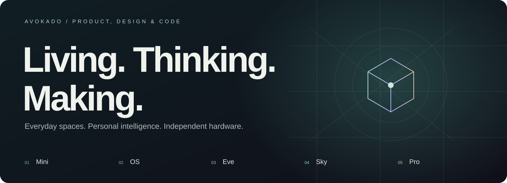
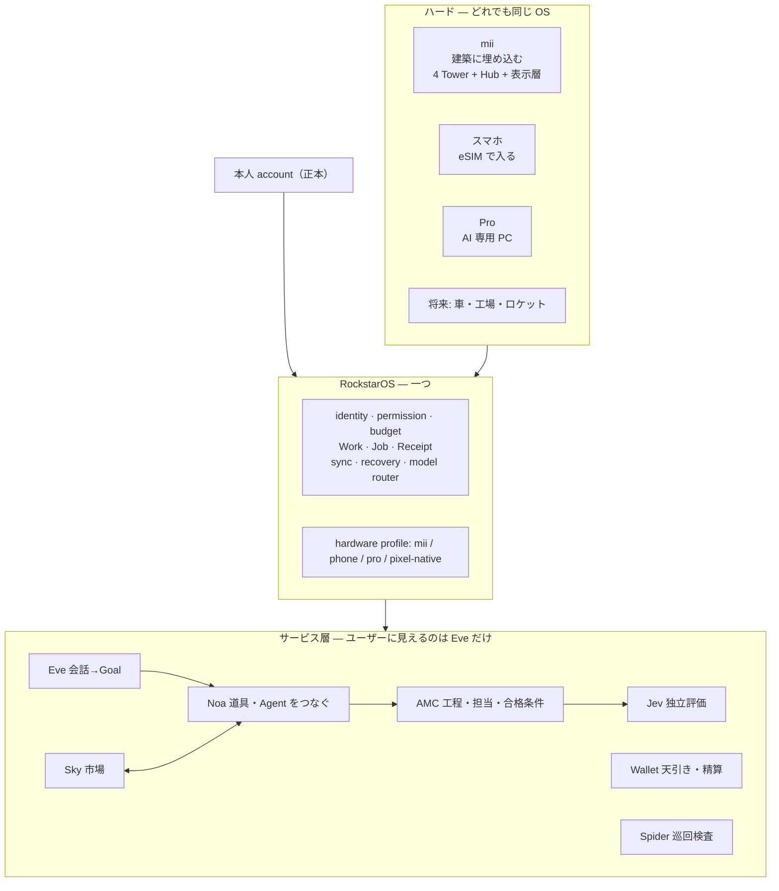
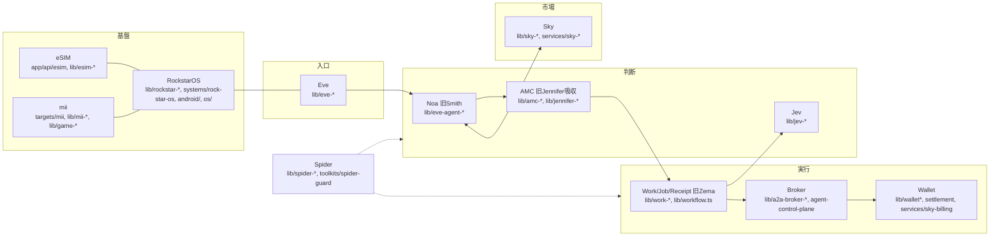

# rock — avokado の正本リポ（中の人向け）

<p align="center">
  
</p>

このリポは Noelle と Kaiya のためのもの。公開向けの説明は sites/ と PDF に置く。
**一つの account、一つの OS（RockstarOS）、どのハードでも続きから動く。** 話す相手は Eve。Eve が目的を決め、Noa が道具をつないで形にし、それを mii で見て触る。

| 知りたいこと | どこ |
| --- | --- |
| 設計の正本（世界観 → 製品 → システム → 事業） | [docs/structure/](docs/structure/00-overview.md) |
| Codex にやらせること | [codex/tasks/00-index.md](codex/tasks/00-index.md) |
| Codex の作業規則 | [AGENTS.md](AGENTS.md)（57 行） |
| いつ・何を変えたか | [CHANGELOG.md](CHANGELOG.md)（旧 README 冒頭の日付ノート全文を含む） |
| 整理前の README / AGENTS / project.md / PROJECTS.md | [archive/root-snapshot-20261029/](archive/root-snapshot-20261029/)、branch `archive/pre-restructure-20261102-main-1daf5c3` |
| 旧 393 件のタスク台帳 | [全タスクの進捗](archive/root-snapshot-20261029/project.md#全taskの作業進捗)（`npm run project:update` が更新し続ける） |
| 製品ごとの長い説明（Mini / OS / Eve / Sky / Pro の旧 README 本文） | [archive/root-snapshot-20261029/README.md](archive/root-snapshot-20261029/README.md#mini) |

---

## 1. 全体の絵



## 2. 製品（外から見える名前は 6 つだけ）

| 名前 | 何か | 正本 | 状態 |
| --- | --- | --- | --- |
| avokado | 会社・ブランド | — | — |
| **mii**（旧 avocadoMini） | 建築に埋め込む端末。Column / Puck / Slot の 3 筐体、中身は同じ Tower。1 本でも Eve 端末、4 本で空間 | [01-mii.md](docs/structure/01-mii.md) | R5を現行設計世代として維持（[R5 設計](docs/avocado-mini-r5/README.md)）。製造承認は**保留中**、R5実機試験の完了実績は0件。Gen1 試作へ（task 21）。Material Invention のシミュレーション・実験室接続は未実装 |
| **RockstarOS** | 全ハード共通の実行基盤 | [02-rockstaros.md](docs/structure/02-rockstaros.md) | Buildroot native・Android native・cloud runtime の 3 系統が動作中 |
| **Eve** | 話しかける相手 | [04-eve-noa-amc-sky.md](docs/structure/04-eve-noa-amc-sky.md) | Web 動作中 |
| **Sky** | Agent・Tool・情報の市場 | 同上 | Web 動作中、lib 104 本 |
| Pro | AI 専用 PC | 旧 README | 今回の整理の対象外 |

配布できるものは **eSIM** — [03-esim.md](docs/structure/03-esim.md)。GB を売らず、RockstarOS の鍵付き回線を月額で。

## 3. 内側の部品（コードの名前）



名前の正本と旧名の対応は [06-naming.md](docs/structure/06-naming.md)。

## 4. フォルダ地図（直すときはこの行だけ開く）

| 役割 | 設計 | コード | テスト | check |
| --- | --- | --- | --- | --- |
| mii | docs/structure/01, docs/avocado-mini-* | systems/rock-star-os/targets/avocado-mini(→mii), lib/mii-*, contracts/avocado-mini-* | tests/mii-*, tests/avocado-mini-* | `avocado:r5:check` |
| RockstarOS | docs/structure/02, docs/native-os-integration.md, systems/rock-star-os/docs/ | lib/rockstar-*, systems/rock-star-os/os, android/, os/ | tests/rockstar-* | `android:architecture:check`, `device-support:check` |
| eSIM | docs/structure/03 | app/api/esim, lib/esim-*, lib/esimgo-*, app/connect, toolkits/esim-bootstrap | tests/esim-* | `npm test -- esim` |
| Eve / Noa | docs/structure/04 | lib/eve-*, lib/zema-chat-session.ts, app/chat, app/api/eve, app/api/llm | tests/eve-*, tests/zema-* | — |
| AMC | docs/mission-control.md, docs/amc-*.md | lib/amc-*, lib/jennifer-*, app/amc, app/api/amc, data/amc/ | tests/amc-*, tests/jennifer-* | `mission:check` |
| Jev / Spider | docs/jev-*.md | lib/jev-*, lib/spider-*, android/jev-provider, toolkits/spider-guard | tests/jev-*, tests/spider-* | — |
| Sky | docs/service-design/, docs/sky-*.md | lib/sky-*, app/sky, app/api/sky, services/sky-*, sites/sky-live | tests/sky-* | `sky:check` |
| Work / Broker | docs/agent-control-plane.md | lib/work-*, lib/workflow.ts, lib/a2a-broker-*, lib/agent-control-plane.ts | tests/work-*, tests/a2a-* | `work:check` |
| Wallet | docs/structure/05 | lib/wallet*, lib/settlement.ts, services/sky-billing, shared/stripe.mjs, app/wallet | tests/wallet-*, tests/settlement-* | `billing:check` |
| Game | docs/gx0*-*.md | lib/game-*, sites/avocado-mini/creator-kit | tests/game-* | `test:avocado-mini-site` |
| DB | docs/database-status.md | db/schema.ts, drizzle/, drizzle-main/, drizzle-legacy/（task 06 で 1 本に） | — | `database:check`, `schema:check` |
| サイト | — | sites/avocado-mini（Astro）, sites/sky-live, public/, public-release/ | — | — |
| 歴史（既定で読まない） | — | archive/, docs/evidence/（212 件）, workspaces/, toolkits/mr, vendor/mr, drizzle-legacy/ | — | — |

詳細版: [09-repo-layout.md](docs/structure/09-repo-layout.md)。文書の地図: [docs/README.md](docs/README.md)。確定要望 RQ01〜RQ50 は [docs/product-baseline.md](docs/product-baseline.md)（docs/structure と矛盾したら structure が勝ち、07 に日付を足して baseline を直す）。

## 5. 動かす

```bash
npm install
npm run dev            # Web（Eve / Sky / Wallet）
npm run verify         # PR 前。task 02 後は typecheck + lint + test（5 分以内が目標）
npm run verify:full    # 旧 40 段チェーン（task 02 後に用意）
```

native RockstarOS（Buildroot/QEMU）は systems/rock-star-os/README.md、Android は docs/native-os-integration.md、mii の試作は codex/tasks/21。

## 6. 今の優先（2026-11）

1. この構造整理を main に入れ、`verify` を短くする（task 01, 02）。
2. eSIM を esim-go sandbox で一周させ、Stripe 月額をつなぐ（task 11）。provider RFQ を本人が送る（task 10）。
3. 名前の統一（task 03, 04）。
4. mii Gen1 試作「1 プロジェクター＋1 壁＋頭追跡」（task 21）。
5. サービス書式で最初の 3 枚（task 32）。

収益と 1 ヶ月 / 1 年の計画は [05-business.md](docs/structure/05-business.md)。議事録から抜いた日付付きの決定は [07-decisions-from-minutes.md](docs/structure/07-decisions-from-minutes.md)。Kaiya の PDF への指摘は [08-pdf-review.md](docs/structure/08-pdf-review.md)。

<sub>進捗 JSON の自動要約（`npm run project:update` が書き換える。読まなくてよい）</sub>
<!-- project-overview:start -->
Updated: 2026-10-29 / 393 task records (32 parents, 192 children, 169 standalone; 361 execution units excluding parents): 114 done, 48 in progress, 230 planned, 1 blocked
<!-- project-overview:end -->
