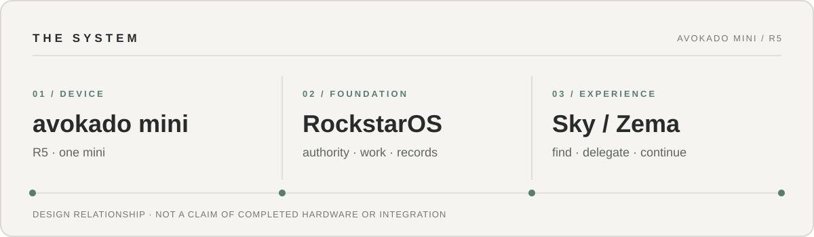

<!-- built-environment-stronghold:start -->
avocadoは建築・インテリアの専門家・事業者と組み、**architecture・interior・soundと自然なITで生活の質を豊かにする領域**を最初の産業上の根城とします。avocadoMiniは生活空間との物理node候補、RockstarOSは本人性・権限・Agent・保存・復旧・費用の共通runtime、SkyはTool／専門家への接続、Zemaは空間projectのrevision・承認・進捗・成果を扱います。資格判断、許可、施工責任をAIへ移さず、生成・simulation・見積を実測や専門家承認へ自動昇格しません。最初の空間・partner・Device Profile・価格は未決定で、提携・実機・施工・市場獲得は未受入です。[製品方針と受入条件](docs/rockstaros-avocado-mini-complete-design.md#0-建築インテリアサウンドを中核領域にする)。
<!-- built-environment-stronghold:end -->

<!-- sky-shared-entry:start -->
Skyの共通入口仕様を更新: 通常URL・大学NFC/QR・任意eSIMから同じSkyのAgent選択、購入・接続、Zema管理へ進む。大学版も既存Skyを共用し、OS/eSIMを単独Web利用の必須条件にしない。iPhoneはbrowser/PWAが初期対象で、追加は本人操作。eSIM自動インストールやnative iOS連携の完成を意味しない。[現行仕様・進捗・実装順](docs/sim-led-product-architecture.md#sky-shared-entry)。
<!-- sky-shared-entry:end -->

Skyの保存済みAgent成果は [成果一覧](app/sky/outputs/page.tsx) で本人が確認し、対応する第一者アプリ内でも表示できる。OS版のZemaは仕事・承認・停止・費用の管理役。Sky単体は各アプリへAgentを組み込むplatformとして扱う。[Fitness×Agentの第一者plugin例](app/fitness/page.tsx) は既存の本人別成果APIと型付き出力 `sky.fitness.plan/1` を使い、実Agent成果が保存されている場合だけ運動プランを表示する。外部アプリSDK、Fitness Agentの実行、cross-origin認証、本番Provider連携は未受入。[設計](docs/sky-launch-design.md#sky-app-output-plugins)。

<!-- campus-sky:start -->
大学別Skyのbrowser入口は `/sky/campus/nyu`・`fit`・`columbia`・`fordham`・`johnjay`。登録済みSky NFCタグのHTTPS URL `/t/{tagId}?source=nfc` は、端末で開くと `/sky/campus/{id}/hub` へ進む。そこでは別のLPではなく既存SkyのAgentフィード・役割選択・Marketplaceを大学名と大学別おすすめ付きで使い、購入履歴、接続管理、Sky内Zemaへ移動できる。大学別briefとPeople/資料は補助入口に残す。iPhoneではNFC通知のタップ、PWA追加には本人操作が必要で、自動インストールや学生資格付与はしない。購入は既存Stripe Checkoutへ進み、Apple Payは適格端末と設定で提供される場合だけ利用可能。購入済みPackageと実行可能なAgentは別確認。一般MCP5枠、対象大学の確認済み学生は6枠。追加有料枠の価格・checkout、スマホ単独cloud MCP、実決済と実機NFC、本番配備は未受入。枠APIにはmigration `0063_sky_mcp_slots.sql` が必要。[仕様・検証・残る条件](docs/sky-tools-complete-design.md#大学別nfc-sky2026-10-12)。
<!-- campus-sky:end -->

GrapheneOS reuse direction: the Pixel edition builds on its Android platform, isolation and verified updates, while Terminal/Linux is a candidate development environment and optional Tool execution target. Rockstar Home/Sky/Zema keep the shared identity, approval, job and usage contracts. Linux integration and full OS acceptance remain unverified. See the [design and acceptance sequence](docs/device-support-architecture.md#graphene-reuse).

<!-- native-output-tests:start -->
Pixelアプリ内の登録不要テストは **RockstarOS → ホーム → テストモードを開く**。全17項目をサンプル実行、または入力を変えて実行できます。8項目は端末内の実処理、9項目は明示した模擬結果。通信・外部登録は不要です。コピー・全結果JSON保存・リセットに対応。通常の仕事や残高には反映せず、画面を閉じると入力・結果は消えます。本物のAI推論や外部サービス連携は別途準備が必要です。[実機受入記録](docs/evidence/pixel-native-testing.json)。
<!-- native-output-tests:end -->

<!-- output-tests:start -->
登録せずに出力を確認するには、画面上部の **出力テスト**（`/test`）を開き、**サンプルを全部実行**を押してください。入力変更・コピー・ファイル保存に対応。実処理と模擬データ、接続待ちを表示し、本番の仕事・残高・課金には反映しません。入力はサイトの処理サーバーに送られ、結果は画面内だけで保持されます。クラウドAIの本物の生成には接続鍵と利用枠の設定が別途必要です。
<!-- output-tests:end -->

<!-- pixel-app-refresh:start -->
Pixelの試験アプリは **RockstarOS** を開いてください。2026-10-09に旧avocadoOSと連携アプリを更新し、起動・端末内接続・Tool選択の保持を確認しました。クラウド接続先と端末内AIモデルは未設定です。これは既存Android上の試験アプリで、OS本体の入れ替えではありません。[実機確認と残る設定](docs/evidence/pixel-app-refresh-20261009.json)。
<!-- pixel-app-refresh:end -->

<!-- pixel-shell-design:start -->
Pixel版Shellは下部の **ホーム・Sky・仕事・設定** から操作します。Web版と共通の配色・枠線・選択表示を使い、ホーム末尾の「Web版を開く」から公開サイトの6画面へ進めます（ブラウザ側のサインインは別です）。[Pixelへの反映記録](docs/evidence/pixel-unified-design.json)。「依頼を準備する」で仕事の編集画面へ進み、Toolと同意を確認してから実行します。タブ移動で入力を保持し、既存下書きの置換は確認してから行います。アカウント・端末内AI・バックアップは設定へ、クラウド見積は仕事／Skyの展開欄へまとめました。2026-10-09に保存データを維持して実機更新し、UI7試験・端末情報表示を確認しました。Cloud接続とmodel準備は別の未完了項目です。[改修と実機検証](docs/evidence/pixel-shell-design-20261009.json)。
<!-- pixel-shell-design:end -->

<!-- home-intent-refresh -->
Home・Sky・Zema・Wallet・Market・設定は共通ヘッダーと配色を使い、上部からアプリを切り替えられます。
ホームで依頼を入力し、矢印でZemaへ引き継いで内容を確認します。「最近の仕事」で保存した仕事を確認できます。ツール一覧は上部ボタンまたは⌘/Ctrl K、全主要アプリに共通の上部ナビゲーションがあります。「入力に集中」で説明・入力例を畳めます。下書きは同じタブで一度だけ引き継ぎ、自動送信しません。

Git audit (2026-10-07): inspection is complete; consolidation is still pending. Latest main CI and local verification pass, but five PRs and changes in three worktrees remain. See [findings and integration order](docs/workstreams/10-git-ci-operations.md#2026-10-07-git全体監査g04--rock).

eSIMに結び付く端末鍵でのCloud APIアクセスを追加しました。対応clientは、購入画面で有効化した利用権の公開キーIDと登録済みgateway鍵を使い、`signEsimCloudRequest`で各要求へ署名します。先にmigration `0061`を適用してください。署名の使い回し・改変・失効したキーを拒否します。実eSIM内鍵/端末adapterの受入はまだ必要です。[client接続・復旧手順](docs/sim-led-product-architecture.md#esimに結び付く端末鍵でのcloud-apiアクセス2026-10-07)。

Main-SIM cloud service design: reuse one RockstarOS/Sky/Zema service template over the user’s existing main SIM or Wi-Fi, with metered cloud agents. Real eSIM onboarding is a separately accepted provider/device adapter; a new carrier plan is not required for ordinary cloud access. This is a design update, not live eSIM or billing acceptance. See the [architecture and implementation sequence](docs/sim-led-product-architecture.md#main-sim-cloud-service).

AWS collaboration funding condition: **zero out-of-pocket cost or payment liability for avokado** for this initiative. Seek sponsored capacity and technical collaboration; no self-funded deployment or automatic paid conversion. See the [partnership conditions](docs/provider-contract-readiness-20260930.md#aws-partnership-preparation).

AWS cloud adoption and partnership preparation: avokado llc (US, owner-provided) is preparing a technical-review and bounded agent-pilot inquiry. See the [architecture, responsibilities and acceptance plan](docs/provider-contract-readiness-20260930.md#aws-partnership-preparation). This is a proposal; AWS outreach, partnership, deployment and credit approval are pending.

<!-- amc-codex-registration:start -->
AMCはこのチャットで **「AMCで、〇〇を進めて」** と依頼して使います。スキル選択では `$amc` を指定できます。司令官が任務を分け、実行担当と独立検収担当へ引き継ぎます。Web画面や別CLIの起動は不要です。設定や保存の問題は `npm run amc -- doctor` で確認できます。[使い方と復旧](toolkits/amc-agent/README.md)。Webとの自動同期は未接続です。
<!-- amc-codex-registration:end -->

<!-- install-entry:start -->
RockstarOSの導入入口: [avocadomini.si/install](https://avocadomini.si/install/)。Web版の起動・ホーム画面追加手順を案内します。実eSIM発行とPixel/Mini/Pro/QEMUの公開OS配布はそれぞれ受入待ちです。
<!-- install-entry:end -->

Custom domain: **avocadomini.si** is registered for the [deployed GitHub homepage](https://avocadomini.noellesugar1.chatgpt.site); DNS/TLS validation is pending. See the [deployment and DNS record](docs/workstreams/05-web-pwa-sites.md#avocadominisi2026-10-05web13).
<!-- sky-access-recovery:start -->
Skyが接続を確認している間や、通信失敗・サインイン切れの間は実行を停止します。画面を開いたまま別タブでサインインし、戻って「接続を確認」してから改めて実行してください。再確認だけでは再実行や課金をしません。未保存入力は開いている画面に保持されますが、再読み込みでは消える場合があります。接続設定の復旧時も編集した入力を保持し、保存済み設定を読み直せない間は保存できません。
<!-- sky-access-recovery:end -->
## Skyの公開判定

`npm run sky:launch:check`で不足を確認できます。`node scripts/check-sky-launch.mjs --require-stage focused`は、既存の本人隔離・復旧条件に加え、実クラウドAI、公開版の両端末試験、全Tool分類、Apple Payが未受入なら失敗します。CSVの既存50円決済成功は、これら全部の合格を意味しません。

## Skyの回答取得・会話引継ぎ（v28配備、実AIは準備中）

OpenAIを選んだ会話で「この依頼文を仕事へ引き継ぐ」を押し、仕事を選んで見積を確認します。この操作だけではAI送信や課金は始まりません。保存した回答にはMarkdown取得と本文削除の確認画面を用意しました。未送信の依頼文はreloadで消えるため、必要な内容は手元に保持してください。実AIの接続は準備中です。

<!-- sky-cloud-text-preview:start -->
Zemaの「仕事」からクラウドAIの依頼準備・見積履歴を確認できます。仕事は再読込後も同じURLへ戻り、認証期限切れは同じ仕事へのサインインを案内します。回答のクラウド保存は初期offです。現在、実Provider資格情報・信頼済み料金・請求照合は未受入のため、AI実行は準備中です。入力してもAIへの送信や課金は始まりません。料金未設定時は見積もりも保存できません。
<!-- sky-cloud-text-preview:end -->

PAPER市場は検証用です。提案後に同じ画面で内容を承認し、実行したレシートは「PAPER実行履歴」から再読込後も確認できます。サンプル価格は実売買の実績ではありません。
ココナラの案件管理では、サインイン切れ時も開いている入力画面を保持します。ダイアログの別タブでサインインし、「サインイン後に接続を確認」してから保存します。再確認だけで案件を再送しません。
<!-- sky-service-recovery:start -->
CSV受付の完了結果・検査・ダウンロードは `/csv` の同じ画面で確認できます。認証が切れた場合はサインイン表示から `/csv` へ戻り、保存済み受付を再取得してください。Stripe診断はHTTP status・許可済みerror code・request IDのみを記録し、秘密値・入力本文・Provider messageを記録しません。50円本番CSV試験は支払い照合・成果物保存・再取得まで確認済みです。クラウドAIの実接続は未受入です。
法務・特許の端末内処理は、任意チェックで本文を含まない実行履歴を保存できます。未ログインや履歴保存失敗でもローカル結果を保持し、別タブのサインインから復旧します。
履歴保存の失敗時は固定の診断コードと、完了通知の場合は受付IDを表示します。本文や元例外の内容を診断へ送らず、ローカル計算の例外を自動再実行しません。
IP StudioはPCで起動してから専用画面を開きます。スマートフォンからPCへの接続は準備中のため、PC内アドレスへのボタンは表示しません。
ココナラの案件管理は、17項目の案件内容と変更履歴を本人別にサーバーへ保存します。実機で下書きの作成・編集・再読込を確認済みですが、ココナラへの契約送信や送金を代行しません。
発注前の案件は「下書きを削除」で対象を確認してから削除できます。担当開始後の案件は削除せず、通信失敗時は一覧を再読込して結果を確認します。
クラウドAIは料金見積・支出上限・利用明細の接続まで実行を停止します。オンライン法務・特許には20秒の通信上限を用意し、結果不明時に自動再送しません。実Providerの応答・使用額は未受入です。
接続状態は一般商品の購入・販売とCSV専用50円試験を分けて表示します。CSV決済の設定を、一般商品の販売開始とみなしません。
クラウド文章生成の料金表v2は通常入力・キャッシュ読込・キャッシュ作成・出力を分けます。見積は最高入力単価を使い、実使用量やtierが不明なら費用確定を止めます。本文を含まないrequest-bound quote、親jobで共有する予算予約、一度だけの送信claim、利用明細と任意成果保存は正本ローカルで接続しました。会話UI・公開環境への接続と実Provider受入は残り、クラウド実送信は無効です。内部予算は入金済みWallet残高ではありません。
Toolのサインイン切れでは、元の画面を開いたまま別タブでサインインし、「サインイン後に接続を確認」を押してください。接続確認だけでは実行せず、未保存の入力を保持します。
掲載候補の下書きは、入力を添えた定型テンプレートです。AI分析や外部サービスの実行ではありません。顧客インタビューと予定調整は、根拠・テーマ・日時などを本人が確認して記入します。候補の本文・結果はサーバーへ保存しないため、必要な内容はMarkdownで手元へ保存してください。
<!-- sky-service-recovery:end -->

# avokado

### One SIM/eSIM. One Rockstar account. Cloud AI and agents with clear usage costs.

Our primary service is SIM/eSIM-led access to **RockstarOS**, **Sky**, **Zema**, and integrated agents. A SIM purchase is intended to include service access; the OS binary itself is installed only through a supported device path and is not stored on the SIM. 
The dedicated **avocadoMini R5** and small-satellite launch vehicle **rocketstar** are separate design programs, not prerequisites for using RockstarOS services.

[Start RockstarOS service access](app/connect/page.tsx) · [Product experience](#product-experience) · [Feature details](#feature-details) · [Current status](#current-status) · [Design library](#design-library) · [Still image](docs/brand/avokado/avokado-r5-editorial-hero.png)

> **About the image** — The R5 visual above is concept art based on the intended industrial design. The animated lines are a brand treatment, not a photograph of working hardware or proof of a spatial display.

**Open the design documents:** [avocadoMini R5 PDF](docs/avocado-mini-r5/package/avocadoMini_RockstarOS_R5_Integrated_Design.pdf) · [RockstarOS v1.0 PDF](docs/rockstaros-complete-design-v1.0.pdf) · [rocketstar R1.0 PDF](docs/rocketstar-design/outputs/rocketstar_Complete_Design_R1_0/rocketstar_Complete_Design_R1_0.pdf) · [Complete design index](#design-library)

### Optional eSIM access and cloud agent usage — clarified October 5, 2026

Local implementation: open `/connect` → `/sky/purchases`, inspect an eligible eSIM order, and choose **クラウドアクセスを開始** after signed installation and device/Starter Pack confirmation. The purchase view shows key/service expiry and supports explicit reissue/revocation; the secret is held only in an HttpOnly cookie. Apply migration `0059` and configure `ESIM_CLOUD_ACCESS_POLICIES_JSON` for each exact purchased package/hash, agreed duration and scopes before enabling this optional path. Missing configuration keeps issuance disabled. Normal sign-in is required for key management. See [configuration, recovery and acceptance](docs/sim-led-product-architecture.md#optional-esim-cloud-access-implementation).

On accepted compatible devices and channels, RockstarOS may offer an eSIM-led cloud service as one access pattern. This does not replace native OS/local LLM and offline agents, ordinary app/Web access without eSIM, or hybrid operation. Users choose Sky agents, approve a usage estimate and spending limit, run work in the cloud, and recover progress, results and itemized usage through one account. For this optional offering, the intended revenue model is metered Sky cloud-agent usage with a service margin. Connectivity supports access; the OS and LLM do not execute inside the eSIM. Pricing units, rates, cost allocation and margins are undecided, and real onboarding, provider billing and device acceptance remain separate gates. See the [service and revenue contract](docs/sim-led-product-architecture.md#2026-10-05-cloud-os-business-direction).

## The RockstarOS service avokado is building

The lead product is **SIM/eSIM-led access to RockstarOS services**: a physical SIM or eSIM purchase is intended to include access to RockstarOS, Sky, Zema, and integrated agents. The OS image does not have to live on the SIM. Supported devices can use an approved RockstarOS installation path; other devices use a compatible app or browser client. This service is the primary customer entry. avocadoMini R5 and other hardware concepts remain separate device programs, not prerequisites for using the service.

The product promise is fast access to cloud LLMs and agents, clear usage-based prices, and a short path to Sky/Zema. A single Rockstar identity should carry across these services. Users see a price estimate and approve a budget before paid work, follow current spend while it runs, and receive itemized usage after. The software already contains local workflow, recovery, identity, capability, and synthetic usage-ledger parts, but carrier service, production billing and supported-device installation are not accepted yet.

| Audience | Intended value | Product or system |
| --- | --- | --- |
| SIM/eSIM customers | Start using cloud LLMs, agents, Sky and Zema with one account and transparent costs | RockstarOS SIM/eSIM service access |
| Players and families | Play in a way that fits them—using body movement, hands, Japanese voice input, and other methods—and resume later | avocadoMini game experiences and RockstarOS |
| Creators and learners | Change rules and works, compare conditions, sources, and versions, and preserve invention candidates with evidence | Game creation, learning, Material Invention, and the Asset Registry |
| People getting work done | Find tools, ask AI teams for help, and keep track of results, costs, and failures | Sky, Zema, Tools, and Wallet |
| Tool developers and businesses | Deliver capabilities with explicit versions, permissions, execution locations, and outcomes | Sky catalog, SDK, and MCP/provider connections |

**Delivery is staged.** The web app, Linux/QEMU Developer Preview, and test-signed Pixel APK running on an existing OS are separate validation tracks. The dedicated R5 device remains at the basic-design stage and has not been approved for manufacturing, sale, or general distribution. The business goals and validation order are documented in the [product north star](docs/product-north-star-20260915.md) and [product and business strategy](docs/rockstaros-1.0-strategy.md).

### Revenue and participation

- First, we measure whether useful games, creation tasks, and work actually complete. Tool completion, delivery, revenue, and provider-confirmed payment are separate events.
- Sky keeps registration, connection, publication, and base usage free for developers and businesses. When a verified Tool sale occurs, Sky's marketplace commission is 10%; external payment, model, cloud, and other pass-through costs are shown separately.
- **The proposed USD 8.88 user revenue fee is on hold.** No new fee will be accrued or billed until the revenue path, fee basis, calculation, cap, collection method, and consent are defined. Earlier USD 8.88 calculations are historical design and test records, not current pricing. Live billing and live payouts have not started.
- The R5 hardware price, release date, and reservation terms are undecided. Pricing from the older Tower20 E3 design does not carry over to R5.

See [Sky Tool teams and economy design](docs/sky-network-economy.md) and [Wallet/provider responsibility boundaries](docs/external-wallet-fund-provider-boundary-20260913.md).

## Product experience

The primary service flow is **choose a supported SIM/eSIM offer → activate the carrier service → sign in once and claim RockstarOS access → install the signed OS only on a validated device or use its compatible client/browser → open Sky and Zema → submit an agent task with a visible estimate and spend limit → reconnect to review progress, results and itemized use**. Purchases from the proposed carrier, device-retail and online channels will include RockstarOS service access. Those fulfillment, activation and billing connections remain unaccepted.

| 01 — PLAY | 02 — MAKE | 03 — LIVE |
| --- | --- | --- |
| Select, move, collide, combine, and separate particles. Undo recognition errors, save, and continue later. | Edit game rules and creative work. Compare scientific-model conditions and preserve versioned invention candidates and evidence. | Extend the same interaction model to lower-risk everyday assistance such as procedures, timers, interruption and resumption, and the last observed time and location of an object. |

This is the **planned order of experience development**. It does not mean that all three stages already work on physical R5 hardware. The product is not designed to release physical particles or manufacture physical compounds.

### avocadoMini R5 — separate hardware-program requirements

The PLAY / MAKE / LIVE flow below describes the separate R5 hardware experience program. It is not the entry requirement for the SIM/eSIM-led RockstarOS services product described above.

**R5 is the current design baseline.** It begins with a single unit capable of the basic functions.

| Area | R5 design baseline |
| --- | --- |
| Appearance | No more than 200 mm tall in use; a slim silver cylinder with a black camera band and low circular base. Final dimensions, mechanisms, and hole locations are undecided. |
| Stand-alone operation | One unit handles input, local compute, game state, storage, voice, and stopping. A separate Edge Hub, PC, or continuous internet connection is not a basic-function requirement. |
| Expansion | Additional identical minis may collaborate after owner approval, device authentication, and clock and coordinate calibration. Performance will be measured separately with one, two, and four units. |
| Power | External power is required. The current design does not use a battery. The connector, rating, and thermal design will be finalized together with the display method. |
| Display | The requirement is to show particles in the surrounding real space without glasses, but the method and safety remain research topics. Infrared sensing light, a television, AR glasses, or wall projection do not count as proof that this requirement is met. |

The [51-page integrated R5 basic design](docs/avocado-mini-r5/README.md) ([PDF](docs/avocado-mini-r5/package/avocadoMini_RockstarOS_R5_Integrated_Design.pdf) · [Word](docs/avocado-mini-r5/package/avocadoMini_RockstarOS_R5_Integrated_Design.docx) · [complete ZIP](docs/avocado-mini-r5/avocadoMini_R5_Integrated_Design_Package.zip)) contains requirements, candidate components, comparative calculations, drawings, and assembly and acceptance plans. Fourteen automated checks reproduce arithmetic and decision conditions; **zero physical-device tests have been completed, and manufacturing approval is on hold**. The “four units plus a separate hub” Tower20 E3 material still visible on the public product site is classified as a [historical design](docs/avocado-mini-tower20-e3/README.md).

### Schoolbag safety-size RockstarOS device — P0 design

avocado is designing **avocado Companion** (working name), a schoolbag-alarm-size RockstarOS device that hangs from a bag, detaches with one hand, and can be held for conversation. The removable body carries the physical SOS control and an independent local alarm. V0 voice sessions require explicit activation and use a guardian phone relay or Wi-Fi to reach an approved Cloud Agent; cellular, location sharing, and family calling need separate acceptance. The two-eye face and shell are visual concepts, and the 70 × 45 × 25 mm / 80 g envelope is only a mockup target. Physical prototypes, child-product safety, voice performance, alarm performance, radio and battery acceptance, manufacturing, and sale are pending. [Read the design and acceptance gates](docs/avocado-schoolbag-safety-device.md).

For an early Pixel 10 interaction preview, start `python3 -m http.server 8765 --bind 127.0.0.1 --directory public`, run `adb reverse tcp:8765 tcp:8765`, then open `http://127.0.0.1:8765/companion-preview/index.html` in Vanadium on the connected Pixel. Press “エージェントを起動” to run the [bounded local agent](public/companion-preview/agent.js): it tracks a multi-turn word game, holds an unsent message draft, and prioritizes safety guidance. Test it with `node --test tests/companion-agent.test.cjs`. This is not an LLM or Cloud Agent, Android APK, real alarm, or guardian notification service. Browser speech recognition may use an external provider and is restricted to adult test audio. [Pixel observation](docs/evidence/avocado-companion-pixel-preview-20261014.json).

The V0.2 Pocket Console revision places the two-eye face inside a compact screen study with mode, microphone, Agent/guardian connection, SOS-test state, and an ephemeral UI event log. It responds to the [user-supplied handheld-screen reference](https://www.instagram.com/reel/DecnZE8CPLP/); a physical information display has not been selected or safety-tested.

## 現実とGTAの橋渡し（設計）

RockstarOSで扱う作品・仕事・Agentの出力を現実のサービスとGTA内へ届け、結果をZemaへ戻す[接続仕様](docs/gta-reality-bridge.md)を追加しました。最初の候補は管理権限のあるFiveM環境への自作カード表示と結果返却です。GTA adapter・実ゲーム受入は未完了で、利用できる公開機能ではありません。3D Asset・NPC・現実側の実行は別々に承認・検証し、通貨交換を自動で有効にしません。

## Feature details

### 1. Input, Japanese voice, and accessibility

The design translates hand and body position, short Japanese commands, and physical input into semantic operations: select, move, confirm, cancel, and stop. Nearby targets use hand position; distant targets use direction. Multiple candidates are never confirmed automatically. If tracking is lost, the system does not misinterpret the loss as a release; it cancels the hold or pauses instead.

- From first-run setup, users can choose seated operation, one-handed operation, small movements, or non-voice input. Body calibration is not a condition of participation.
- Voice validation begins with short local commands. Recognition and execution approval remain separate; an ambiguous “yes” never authorizes billing or an external action.
- Camera and microphone indicators, a physical stop control, and guest settings are part of the design. Raw image and audio storage and external transmission are off by default.

[Interaction states and error prevention](docs/avocado-mini-r5/package/integrated_design.md#17a-%E7%A9%BA%E9%96%93%E3%81%AE%E4%B8%AD%E3%81%A7%E9%81%B8%E3%82%93%E3%81%A7%E5%8B%95%E3%81%8B%E3%81%99%E6%93%8D%E4%BD%9C) / [Startup and input-selection diagram](docs/avocado-mini-r5/package/drawings/R5-U01-startup.png)

### 2. Games

The default particle sandbox uses the smallest loop of “select → move → release → collide/combine/separate → undo → save/resume.” It preserves rules, random seeds, and work versions so a state can be reproduced. Shared use accounts for clock and coordinate drift, disconnection, and one participant stopping. The author SDK receives semantic operations so a game does not automatically gain raw-image or payment authority.

**Commercial-game support is evaluated title by title.** This input design alone does not mean that games such as GTA run, can be modified, or have official integration. [Game features and acceptance conditions](docs/avocado-mini-r5/package/integrated_design.md#03-%E3%82%B2%E3%83%BC%E3%83%A0%E3%81%A8%E5%88%B6%E4%BD%9C%E3%81%AE%E5%9F%BA%E6%9C%AC%E6%A9%9F%E8%83%BD) / [Game and Wallet workstream](docs/workstreams/08-game-market-fund.md)

### 3. Creation, learning, and asset management

The concept supports editing a game's appearance, rules, and stages and saving the result as a versioned work that can be rolled back. Learning use distinguishes an interesting result from a scientifically correct one and shows the model, units, initial conditions, and limits. Before a work leaves the system, the Asset Registry records its author, source material, generation and edit history, version, license basis, cost, and publication scope. Generation completion and publication success are separate states.

### 4. Material Invention

This application track creates reproducible digital candidates from two or more materials, ratios, and processes; checks hazardous conditions and evidence; and hands candidates to simulation or Patent AI. Material Invention Core manages the candidate graph, versions, and provenance. What exists today is an **equipment-disconnected sandbox Core and an integrated design**. **The Material Invention interface and Sky connection are not implemented**; R5 physical sensors, the spatial interface, simulation providers, and external laboratories are not connected. A candidate is not proof of a material's physical performance or patentability.

[Material Invention system design](docs/rockstaros-avocado-mini-complete-design.md) / [Core design](docs/material-invention-core.md) / [Ownership and acceptance](docs/workstreams/11-material-invention-avocado-mini.md)

### 5. Everyday assistance

Short interactions learned through games are extended gradually to next/back steps, timers, interruption and resumption, and the last observed time and location of an object. Compatible device actions such as lighting are accepted individually only after checking the target device, effect, authority, and result. The product does not promise the current location of an unseen object, physical completion of household chores, medical judgment, or unattended operation of locks or heating devices.

### 6. RockstarOS / Local AI

RockstarOS centralizes user and component authentication, capabilities, approvals, work, receipts, storage, and recovery in the Platform Core and Broker. The on-device LLM is an **untrusted planner that returns plan candidates**; it does not decide whether a Tool may run. An Agent advances only through finite procedures allowed by the Broker and handles stopping, awaiting confirmation, and safe recovery after a restart. Models and runtimes are designed to be replaceable in the future, but general replacement is not complete.

[Current OS v1.0 source and appendices](#rockstaros-v10--current-os-design) / [Complete OS design](docs/rockstaros-complete-design.md) / [Shared AI-native OS architecture](docs/ai-native-os-architecture.md) / [LLM implementation and open work](docs/llm-evaluation-architecture.md)

### 7. Sky, Zema, and Tools

**Sky** is the entry point for discovering Tools and AI teams and comparing their author, version, permissions, execution location, and cost before connecting. **Zema** takes a request and manages input confirmation, planning, progress, stopping, user approval, deliverables, and history as one unit of work. Chat text and AI answers are not themselves approvals.

[Sky Market](/sky/marketplace) is the searchable AI and automation Tool storefront, including LLM entries. It separates the 12 built-in catalog entries, 22 integration candidates, and externally reviewed Registry packages, and links built-in entries to their individual Sky pages. A listing is not proof of connection or production operation. Third-party packages appear only after a valid `verified` review. Eligible reviewed packages can now use the Stripe Checkout integration described below; one-click external installation remains a separate integration.

Sky home and Market use the same Tool cards and keep search visible. Select a Tool's icon or “機能・利用条件” to see its purpose, connection state, supported environment, and cost. On Sky home, the action for a built-in browser Tool opens its dedicated app or input page without a separate Sky registration step; required sign-in and execution checks remain in that page. PC-only Tools retain their PC connection step, while integration candidates distinguish Sky registration from a working external runtime. Market actions open the individual Sky page. The icon there opens the same overview, and “使い方・ライセンス” expands the full instructions. Opening an overview does not install or run the Tool.

Sky home and the market hide only tools that are clearly incompatible with the browser's device class by default; in the market, expand the environment details to review the filter and reveal excluded tools with reasons. This does not verify installed software or external accounts. In particular, Jev Router remains a PC CLI candidate, not a Sky one-click connection.

Tool providers can open [Sky registration](/sky/register) directly from the market. Previous provider name and support URL can be reused from their own submissions, and remote MCP inspection can fill the server name for review. Pricing must be selected and described explicitly; the market shows the pricing model before opening a package. [Rock Studio](/sky/publish) remains the separate SDK setup flow. No checkout or developer payout is activated by registration.

**Sky Market payments:** providers use [Sell](/sky/sell) to register a Stripe Express receiving account, then set a JPY price, sale terms and refund policy for their own reviewed `external_contract` package. Buyers select the package, check its terms, pay on Stripe, and return to [Purchased tools](/sky/purchases). Sky verifies Stripe's payment before showing purchased access and connection information. This supports one-time purchases of eligible automation or LLM packages; listing a built-in Tool or model provider does not automatically make it purchasable. Sky takes a 10% application fee; payment-provider costs are separate, so that fee is not Sky's net profit. Card and bank details stay with Stripe. Providers can refund the remaining unrefunded amount from their sales page.

The implementation and local mocked-provider tests are present. Stripe credentials, provider sandbox acceptance, live payments and deployment have not been completed. Configure the four server-only `SKY_PAYMENTS_MODE`, `SKY_STRIPE_SECRET_KEY`, `SKY_STRIPE_WEBHOOK_SECRET` and `SKY_PAYMENT_ORIGIN` settings and apply Web D1 migration `0018_sky_commerce.sql` following the [payment setup and acceptance guide](docs/sky-billing.md#sky-market決済2026-09-27実装). Test and live data are isolated. Purchase access is a Sky record; a third-party paid MCP service must enforce its own access and revocation. The live Web server relies on the trusted Sites identity gateway, while Stripe's signed webhook path must be publicly reachable. This purchase flow does not enable the retired USD 8.88 revenue fee or prove bank payout completion.

Zema lists the 22 catalog candidates as separate, searchable Bots with distinct icons. The sidebar shows a short selection first; use search or “すべて表示” to open the full list. The selected Tool's actual connection state and next action appear before sending a message. The 11 former Mr. candidates can produce local drafts; 10 external research candidates produce only tool-specific connection plans; IP Studio opens its local app when available. These entries are not evidence that an external runtime or provider is connected.

**Managed local runtime — first local milestone verified; overall work in progress.** The goal covers usable Tools across Sky, Zema, and the OS without users starting each server separately, with local inference preferred. The local Web runtime now starts the bundled MCP Connector and Fashion service when needed. Browser checks confirmed a synthetic Fashion Producer plan saved to the database and matched by readback, plus a Zema delivery sample automatically connecting and returning a real verification `PASS`; nothing was delivered externally. The 34-entry source inventory contains 6 browser-deterministic base functions, 3 Web API/database applications, 2 separate-PC-service Tools, 1 external-AI Tool, and 22 candidates (11 template drafts, 10 connection guides, and 1 separate-app launch). An LLM does not implement their missing adapters. Fashion's four providers remain mock/unconnected, and restoring its result after a page reload is not implemented. No local model was installed; installation awaits the owner's response. Ledger, IP Studio, individual adapters, real providers, hosted-Web-to-PC relay, and native OS acceptance remain open. Focused runtime tests passed 35/35 and isolated API regression passed 172 assertions; the full suite remains 378/389 passing and full verification stops at the existing visual baseline. [Executor inventory, evidence, and remaining scope](docs/sky-tools-complete-design.md#13-%E5%85%A8tool%E3%81%AE%E5%AE%9F%E8%A1%8C%E5%99%A8%E6%A3%9A%E5%8D%B8%E3%81%97%E3%81%A8%E7%AE%A1%E7%90%86runtime%E9%80%B2%E8%A1%8C%E4%B8%AD)

The Web Preview uses avokado's graphite, silver, and pale-blue appearance across Home, Sky, Zema, Studio, Wallet, Market, Settings, and CSV. Home's former default lime accent is migrated to pale blue; other colors chosen in Home settings remain yours. This visual update does not change Tool availability, native OS builds, or the published product site.

| Representative Tool or team | Function | Boundary |
| --- | --- | --- |
| CSV Operations | Clean CSV data, run an independent review, and generate delivery artifacts | Sales, customer sharing, and payment are separate |
| Mercari Revenue Starter | Draft listings for owned items and organize costs and expected net proceeds | The owner lists, communicates, and ships; revenue is real only after provider confirmation |
| Fashion Brand Ops | Prepare campaigns, DM and quote drafts, post-order production, and analysis | Posting, advertising, sending DMs, billing, and refunds require action-specific approval |
| Citation Organizer / Free Article | Organize URLs and produce a free introduction from the user's draft | Does not perform fact-checking, autonomous writing, or external posting |
| Legal Intake / Patent Assistant | Organize information and prepare drafts based on official sources for experts or filings | Does not make legal determinations, determine patentability, or file automatically |
| Market Scanner / Fund | Estimate prices and demand, record PAPER activity, and compare configurations against evidence | Live orders, returns, and live-fund operation require separate acceptance |

CSV inputs stay intact when a request is retried or submitted concurrently. Requests older than seven days cannot be processed or retried; start a new request.

The catalog also includes Tools for checking Coconala opportunities, reconciling delivery records, and subscription advisory work. A candidate Tool is not considered operational merely because it is listed. [Complete Tool inputs, outputs, storage, and failure behavior](docs/sky-tools-complete-design.md) / [Project guide](PROJECTS.md)

[Coconala in Sky](/sky/tools/coconala) combines the pre-application check with an owner-scoped record for prime-contractor orders and separately agreed worker compensation. Its 3% helper is an estimate; it neither contracts on Coconala nor verifies receipts or sends payments.

### 8. External AI, IP, games, and destinations

The design does not lock creation or game destinations to a single service. Providers are selected by capability, destination, commercial terms, cost, region, and quality. Image, video, 3D, and audio generation; social publication; game submission; and reward assignment are separate effects. External transmission, publication, and purchases require owner approval that fixes the target, content, and spending limit. If the result is unknown, the system queries and stops.

Higgsfield, Roblox, YouTube, and GTA are examples of possible destinations. **This is not a list of supported products, official partnerships, or guaranteed compatibility.** [IP Studio connection contract](docs/sky-tools-complete-design.md#85-ip-studio--%E4%BA%A4%E6%8F%9B%E5%8F%AF%E8%83%BD%E3%81%AA%E5%88%B6%E4%BD%9C%E9%85%8D%E4%BF%A1%E3%82%B2%E3%83%BC%E3%83%A0%E5%B1%95%E9%96%8B)

### 9. Wallet, costs, and verified earnings

Wallet treats cost estimation, reservation, and finalization; signed Earning Receipts; and refunds and reconciliation as separate concerns. Finishing work alone does not create displayed earnings. Owner assets and external-provider payment, custody, and identity verification remain external responsibilities under the shared contract. Game-currency exchange, ATM, Fund, and live payouts each have their own gates; PAPER or fixture success is never treated as live-money acceptance.

[Wallet, billing, and provider workstream](docs/workstreams/03-wallet-billing-providers.md) / [Game-exchange boundary](docs/game-wallet-release-checkpoint-20260910.md)

## Current status

| Track | Verified | Incomplete |
| --- | --- | --- |
| avocadoMini R5 | Integrated basic design, 51 pages, eight design-study diagrams, and 14 calculation checks | Zero physical-device tests; unaided full-space display, precise 3D input, final enclosure, thermal and power design, manufacturing drawings, and safety acceptance |
| Schoolbag safety-size device | P0 design, two prototype variants, bounded Device Profile, independent local-alarm architecture, and explicit safety/privacy gates | Benchmark measurements, mockups, powered bench, firmware, physical prototype, child-product/alarm/radio/battery acceptance, pilot, manufacturing, and sale |
| RockstarOS v1.0 | Current 41-page, 32-chapter OS/system-software design; five deployment profiles, 13 logical services, 60 requirements; 43/43 appendix structure and DDL checks | New OS image, R5 Device Profile and adapter, and physical-device, onboard, and field acceptance. Document checks are not operational tests. |
| rocketstar R1.0 | Current 44-page, 35-chapter integrated rocket design with 60 requirements and 18 system interfaces | Manufacturing drawings, physical performance, and flight certification. Comparative calculations are not final performance. |
| Web / Sky / Zema | Source for screens, catalog, work, approvals, history, and the Tool foundation | Current-version readback for each deployment, external providers, and production commercial acceptance |
| Pixel 10 GL066 | Pre-tests on an existing OS with a test-signed APK for offline planning, limited Tools, storage, and restart | Full RockstarOS image build, production signing, first flash and boot, OTA, and total-loss recovery |
| Linux / QEMU | Independent Developer Preview implementation and acceptance records | Release gates for the current artifact; not transferable to Pixel physical-device acceptance |
| Material Invention | Reproducible sandbox Core and integrated design | R5 input/display adapter, interface, physical sensors, and simulation/Patent AI connections |

R5 manufacturing approval is **on hold**, and **all four Pixel first-flash gates are failing**. Task counts are not a measure of product completion.

<!-- project-overview:start -->
Updated: 2026-10-14 / 163 tasks: 104 done, 42 in progress, 16 planned, 1 blocked
<!-- project-overview:end -->

[All task progress](project.md#%E5%85%A8task%E3%81%AE%E4%BD%9C%E6%A5%AD%E9%80%B2%E6%8D%97) / [Pixel pre-tests](docs/evidence/android-pixel-10-prefull-physical-20260916.json) / [First-flash gates](docs/android-first-flash-gate-20260916.md) / [R5 preservation and verification record](docs/avocado-mini-r5/verification.json)

## Design library

**The current device design is avocadoMini R5, the current OS/system-software design is RockstarOS v1.0, and the current rocket design is rocketstar R1.0.** Their source documents and appendices are linked below. The existence of a design document does not prove physical operation, manufacturing approval, or flight certification.

[Device R5](#avocadomini-r5--source-and-verification-materials) · [OS v1.0](#rockstaros-v10--current-os-design) · [Rocket R1.0](#rocketstar-r10--current-rocket-design) · [Design domains](#rockstaros-and-services--all-design-domains) · [Historical designs](#historical-and-alternate-research-profiles)

### avocadoMini R5 — source and verification materials

| What to read | File |
| --- | --- |
| Overview and reading order | [R5 design entry point](docs/avocado-mini-r5/README.md) / [Package guide](docs/avocado-mini-r5/package/README.md) |
| Read, edit, or download everything | [51-page PDF](docs/avocado-mini-r5/package/avocadoMini_RockstarOS_R5_Integrated_Design.pdf) / [Word](docs/avocado-mini-r5/package/avocadoMini_RockstarOS_R5_Integrated_Design.docx) / [Complete ZIP](docs/avocado-mini-r5/avocadoMini_R5_Integrated_Design_Package.zip) |
| Full text, requirements, prototypes, and acceptance conditions | [Integrated design Markdown](docs/avocado-mini-r5/package/integrated_design.md) |
| Comparative calculations | [Results](docs/avocado-mini-r5/package/calculation_results.json) / [Verification program](docs/avocado-mini-r5/package/verify_calculations.py) |
| References | [Reference index](docs/avocado-mini-r5/package/reference_index.json) / [Everyday requirements](docs/avocado-mini-r5/package/references/01-life-needs.md) / [Interaction studies](docs/avocado-mini-r5/package/references/02-interaction-studies.md) / [Compute and display](docs/avocado-mini-r5/package/references/03-platform-and-display.md) |
| Research history | [Research report](docs/avocado-mini-r5/research/README.md) / [Research audit](docs/avocado-mini-r5/research/RESEARCH_AUDIT.md) |
| Source verification | [Package SHA-256 ledger](docs/avocado-mini-r5/package/package_manifest.json) / [Preservation and verification record](docs/avocado-mini-r5/verification.json) |

The **eight design-study diagrams** are viewable as PNGs in a browser and scalable as SVGs. They explain layout and behavior; they are not manufacturing CAD or final circuit diagrams.

| ID | Subject | Open |
| --- | --- | --- |
| M01 | Overall height and envelope comparison | [PNG](docs/avocado-mini-r5/package/drawings/R5-M01-envelope.png) / [SVG](docs/avocado-mini-r5/package/drawings/R5-M01-envelope.svg) |
| M02 | Functional zones inside the device | [PNG](docs/avocado-mini-r5/package/drawings/R5-M02-functional-stack.png) / [SVG](docs/avocado-mini-r5/package/drawings/R5-M02-functional-stack.svg) |
| V01 | Camera field-of-view and depth comparison | [PNG](docs/avocado-mini-r5/package/drawings/R5-V01-camera-geometry.png) / [SVG](docs/avocado-mini-r5/package/drawings/R5-V01-camera-geometry.svg) |
| E01 | Power and independent stopping | [PNG](docs/avocado-mini-r5/package/drawings/R5-E01-power-safety.png) / [SVG](docs/avocado-mini-r5/package/drawings/R5-E01-power-safety.svg) |
| S01 | Adding identical minis and dividing regions | [PNG](docs/avocado-mini-r5/package/drawings/R5-S01-scaling.png) / [SVG](docs/avocado-mini-r5/package/drawings/R5-S01-scaling.svg) |
| U01 | Startup, input selection, and shutdown | [PNG](docs/avocado-mini-r5/package/drawings/R5-U01-startup.png) / [SVG](docs/avocado-mini-r5/package/drawings/R5-U01-startup.svg) |
| O01 | OS service architecture | [PNG](docs/avocado-mini-r5/package/drawings/R5-O01-services.png) / [SVG](docs/avocado-mini-r5/package/drawings/R5-O01-services.svg) |
| O02 | Owner approval and external jobs | [PNG](docs/avocado-mini-r5/package/drawings/R5-O02-consent.png) / [SVG](docs/avocado-mini-r5/package/drawings/R5-O02-consent.svg) |

### RockstarOS v1.0 — current OS design

The attached `RockstarOS_Complete_Design_v1.0.pdf` has the same SHA-256 as the source preserved in the repository. This **41-page, 32-chapter document is the current OS design baseline**. It covers identity, state, work, evidence, and versions shared by rocketstar, A-LINK, avokado, and a future colony. Device-specific control and independent protection remain on each device.

| What to read | File |
| --- | --- |
| Complete version and editable text | [41-page source PDF](docs/rockstaros-complete-design-v1.0.pdf) / [Editable text](docs/rocketstar-design/outputs/RockstarOS_Complete_Design_v1_0/RockstarOS_Complete_Design_v1_0.md) / [Full-text search extract](docs/rockstaros-complete-design-v1.0.txt) / [Appendix ZIP](docs/rocketstar-design/outputs/RockstarOS_Complete_Design_v1_0_package.zip) |
| What deploys where | [Five deployment profiles and 13 logical services](docs/rocketstar-design/outputs/RockstarOS_Complete_Design_v1_0/design_catalog.json) / [Architecture](docs/rocketstar-design/outputs/RockstarOS_Complete_Design_v1_0/architecture.svg) / [60 requirements and acceptance conditions](docs/rocketstar-design/outputs/RockstarOS_Complete_Design_v1_0/requirements.csv) |
| Command, storage, and connection contracts | [Seven schema types, composition examples, and five-table DDL](docs/rocketstar-design/outputs/RockstarOS_Complete_Design_v1_0/contracts/README.md) / [Command state diagram](docs/rocketstar-design/outputs/RockstarOS_Complete_Design_v1_0/command_lifecycle.svg) / [Capacity assumptions](docs/rocketstar-design/outputs/RockstarOS_Complete_Design_v1_0/capacity_example.json) |
| Verification and implementation mapping | [43/43 structure and DDL checks](docs/rocketstar-design/outputs/RockstarOS_Complete_Design_v1_0/evidence/contract_checks.json) / [Source and appendix integrity](docs/rocketstar-design/outputs/RockstarOS_Complete_Design_v1_0/manifest.json) / [Existing implementation mapping](docs/rockstaros-complete-design.md) / [Appendix guide](docs/rocketstar-design/outputs/RockstarOS_Complete_Design_v1_0/README.md) |

**Relationship to R5:** The source `EDGE-HUB-v1` material and architecture diagram retain the historical avokado E3 layout of “four units plus a separate hub.” That is not the current avocadoMini R5 envelope, unit-count, or hub requirement. R5 takes precedence: **one unit must provide basic functionality, and a separate Edge Hub is not required**. Integration of the R5 Device Profile and adapter is incomplete. The 43/43 result covers document and contract checks, not completion of a new OS image, physical-device acceptance, flight acceptance, or habitat operational certification.

### rocketstar R1.0 — current rocket design

The attached **rocketstar_Complete_Design_R1_0.pdf** has the same SHA-256 as the source preserved in the repository. R1.0 is the current 44-page, 35-chapter integrated design for uncrewed small-satellite transport with **recovery of both stages and reuse of the same vehicle**. It covers the vehicle, propulsion, thermal protection, flight dynamics, avionics, payload integration, ground systems, maintenance, and reuse.

| What to read | File |
| --- | --- |
| Complete version | [Source PDF](docs/rocketstar-design/outputs/rocketstar_Complete_Design_R1_0/rocketstar_Complete_Design_R1_0.pdf) / [Searchable and editable text](docs/rocketstar-design/outputs/rocketstar_Complete_Design_R1_0/rocketstar_Complete_Design_R1_0.md) / [All appendices ZIP](docs/rocketstar-design/outputs/rocketstar_Complete_Design_R1_0_package.zip) |
| Overview and contents | [R1.0 package guide](docs/rocketstar-design/outputs/rocketstar_Complete_Design_R1_0/README.md) / [Archive entry point](docs/rocketstar-design/README.md) |
| Requirements and interfaces | [60 requirements](docs/rocketstar-design/outputs/rocketstar_Complete_Design_R1_0/requirements.json) / [18 system interfaces](docs/rocketstar-design/outputs/rocketstar_Complete_Design_R1_0/system_interfaces.json) / [Mission profile](docs/rocketstar-design/outputs/rocketstar_Complete_Design_R1_0/mission_profile.json) |
| Inherited material and audits | [40 C3 design items](docs/rocketstar-design/outputs/rocketstar_Complete_Design_R1_0/reference_c3/design_register.md) / [13 payload interfaces](docs/rocketstar-design/outputs/rocketstar_Complete_Design_R1_0/reference_c3/payload_interfaces.md) / [Mass and performance audit](docs/rocketstar-design/outputs/rocketstar_Complete_Design_R1_0/mass_audit/mass_performance.md) |
| Diagrams and integrity | [Vehicle arrangement](docs/rocketstar-design/outputs/rocketstar_Complete_Design_R1_0/rocketstar_system.svg) / [Functional layout](docs/rocketstar-design/outputs/rocketstar_Complete_Design_R1_0/rocketstar_functional_layout.svg) / [Appendix ledger](docs/rocketstar-design/outputs/rocketstar_Complete_Design_R1_0/manifest.json) / [Complete file ledger](docs/rocketstar-design/inventory.json) / [Verification record](docs/rocketstar-design/verification.json) |
| Related communications and operations designs | [A-LINK auto-connect PDF](docs/rocketstar-design/outputs/A-LINK_Avokado_Auto_Connect_Design_v0.3.pdf) / [Receiver prototype](docs/rocketstar-design/outputs/A-LINK_Avokado_Receiver_Prototype_v0.4/README.md) / [Colony operations](docs/rocketstar-design/outputs/RockstarOS_Colony_C0_1/README.md) / [Device button design](docs/rocketstar-design/outputs/Avokado_Power_Button_Engineering_v1/README.md) |

**Current status:** Integrated system design only. Manufacturing drawings, physical performance, and flight certification are incomplete. The 618.6 t and 819.7 t values in the PDF are historical comparative calculations, not final launch capability or vehicle dimensions. Rocket R1.0 and device R5 are separate product design baselines.

### RockstarOS and services — all design domains

The [complete design portal](docs/rockstaros-design-portal.md) covers 17 domains, and the [machine-readable design index](data/design-document-index.json) lists their documents. Because the complete OS source includes the historical E3 device layout, **R5 takes precedence for avocadoMini's envelope, unit count, and hub requirements**.

| Domain | Designs, contracts, and records |
| --- | --- |
| Product requirements and business | [Product baseline](docs/product-baseline.md) / [Requirements JSON](data/product-baseline.json) / [Product north star](docs/product-north-star-20260915.md) / [Business strategy](docs/rockstaros-1.0-strategy.md) / [Product/service/system map](docs/rockstaros-product-system-map.md) |
| Complete OS source | [PDF](docs/rockstaros-complete-design-v1.0.pdf) / [Search extract](docs/rockstaros-complete-design-v1.0.txt) / [Integrity record](data/rockstaros-complete-design-v1.0.json) / [Schema, DDL, and appendix guide](docs/rocketstar-design/outputs/RockstarOS_Complete_Design_v1_0/README.md) / [Appendix contracts](docs/rocketstar-design/outputs/RockstarOS_Complete_Design_v1_0/contracts/README.md) / [Appendix ledger](docs/rocketstar-design/outputs/RockstarOS_Complete_Design_v1_0/manifest.json) |
| OS architecture and implementation mapping | [Complete design](docs/rockstaros-complete-design.md) / [Shared AI-native architecture](docs/ai-native-os-architecture.md) / [1.0 architecture](docs/rockstaros-1.0-architecture.md) |
| Platform Core and work | [Platform Core](docs/platform-core.md) / [Platform API contract](contracts/platform-api.json) |
| Web and PC | [Web architecture](docs/architecture.md) / [Backend design](docs/backend-design.md) |
| Linux and QEMU | [Native integration](docs/native-os-integration.md) / [Validation](docs/native-os-validation.md) / [Release audit](data/qemu-release-audit.json) |
| Android and Pixel | [Production OS architecture](docs/android-production-architecture.md) / [Device Preview](docs/phone-preview-20260911.md) / [Device support design](docs/device-support-architecture.md) / [Release policy](data/android-release-architecture-policy.json) |
| Local AI and memory | [Shared AI-native architecture](docs/ai-native-os-architecture.md) / [Decision Fabric](docs/jev-local-qwen-decision-fabric-design.md) / [On-device AI integration](docs/local-ai-os-integration-20260915.md) / [Runtime contract](contracts/local-ai-runtime.json) / [Provider contract](contracts/decision-provider.json) / [Decision policy](data/decision-fabric-policy.json) |
| Sky, Zema, and Tools | [Complete Tool design](docs/sky-tools-complete-design.md) / [Sky](docs/sky.md) / [Tool SDK](docs/sky-tool-sdk.md) / [Conversation and MCP control](docs/chat-mcp-control-room-20260913.md) / [Jev ecosystem](docs/jev-ecosystem-integration-design.md) / [Jev Ultrafast](docs/jev-ultrafast-integration-design.md) |
| MCP and external providers | [MCP architecture](docs/sky-mcp-architecture.md) / [MCP Connector](docs/sky-mcp-connector.md) / [External-provider boundary](docs/external-wallet-fund-provider-boundary-20260913.md) |
| Storage, backup, and recovery | [Storage boundaries](docs/data-storage-boundaries.md) / [Android backup and recovery](docs/android-backup-recovery.md) / [Recovery policy](data/android-backup-recovery-policy.json) |
| Wallet, Market, and Fund | [External-provider boundary](docs/external-wallet-fund-provider-boundary-20260913.md) / [Market and Fund](docs/everything-market-and-autonomous-fund-20260913.md) / [Wallet production rail](docs/rock-wallet-production-rail-20260913.md) |
| Safety, operations, and distribution | [Incident response](docs/security-incident-response.md) / [Release gates](docs/release-minimum-gates.md) / [Emergency-action policy](data/device-emergency-access-policy.json) / [Release decision](data/release-readiness.json) |
| Game and IP | [Game API draft](docs/game-api-contract-draft.md) / [GX01 plan](docs/gx01-contract-implementation-plan.md) / [SDK sandbox](docs/gx01-reference-sdk-sandbox-20260910.md) |
| Material Invention and spatial interaction | [Integrated design](docs/rockstaros-avocado-mini-complete-design.md) / [Core](docs/material-invention-core.md) / [XR](docs/material-invention-xr.md) / [Spatial invention](docs/avocado-mini-spatial-invention.md) / [Full-scale hardware design](docs/avocado-mini-hardware-design.md) |
| Validation and operations | [Validation policy](docs/validation.md) / [Database status](docs/database-status.md) / [Progress JSON](data/project-status.json) |

### Historical and alternate research profiles

Historical designs remain available to preserve the design history. They do not override R5 requirements.

| Track | Design material |
| --- | --- |
| Mini200 E1 | [Entry point](docs/avocado-mini-mini200-e1/README.md) / [Design text](docs/avocado-mini-mini200-e1/design.md) / [Game-to-life expansion](docs/avocado-mini-mini200-e1/game-first-life-connectivity.md) |
| Mini200 E2 | [Four-unit plus central-unit integration record](docs/avocado-mini-mini200-e2/README.md) |
| Tower20 E3 | [Four-unit plus separate Edge Hub design record](docs/avocado-mini-tower20-e3/README.md). The source PDF/DOCX is not included in this repository, so the full source document cannot be read here. |
| Alternate research profile | [Four-direction, full-scale hardware design](docs/avocado-mini-hardware-design.md) / [Spatial invention](docs/avocado-mini-spatial-invention.md) |

## Design and code entry points

| Goal | Entry point |
| --- | --- |
| Read business and product decisions | [Product baseline](docs/product-baseline.md) / [Product north star](docs/product-north-star-20260915.md) / [System map](docs/rockstaros-product-system-map.md) |
| Read avokado hardware and OS material | [Complete R5 design](docs/avocado-mini-r5/README.md) / [Searchable text](docs/avocado-mini-r5/package/integrated_design.md) / [Drawings](docs/avocado-mini-r5/package/drawings/) |
| Read the complete RockstarOS design | [Design portal](docs/rockstaros-design-portal.md) / [Complete v1.0 source PDF](docs/rockstaros-complete-design-v1.0.pdf) / [Implementation mapping](docs/rockstaros-complete-design.md) |
| Find Tools and development areas | [Complete Sky, Zema, and Tool design](docs/sky-tools-complete-design.md) / [Project guide](PROJECTS.md) / [Workstream guide](docs/workstreams/README.md) |
| Read the current rocket design | [rocketstar R1.0 source PDF](docs/rocketstar-design/outputs/rocketstar_Complete_Design_R1_0/rocketstar_Complete_Design_R1_0.pdf) / [Appendix entry point](docs/rocketstar-design/README.md) / [Public HTML reader](https://avocado-mini.kirin-999.chatgpt.site/rocket-star/design/). Manufacturing and flight acceptance are separate. |

| Source | Role |
| --- | --- |
| [app/](app/), [components/](components/), and [lib/](lib/) | Web screens, shared UI, Tools, work, and Wallet |
| [services/](services/) | Separated Sky Billing and Operator Dock services |
| [android/](android/) and [os/](os/) | Android app/Broker and Pixel configuration |
| [systems/rock-star-os/](systems/rock-star-os/) | Native OS for Linux/QEMU |
| [toolkits/](toolkits/) and [contracts/](contracts/) | SDKs, connectors, and shared contracts |
| [sites/avocado-mini/](sites/avocado-mini/) | Product-site source, distinct from a public deployment |

## Start developing

Use Node.js 22.13 or later and npm. The following starts the web app locally. Pixel, QEMU, Workers, and the product site have separate instructions and gates.

    npm ci
    npx wrangler d1 migrations apply DB --local --config wrangler.local.jsonc
    npm run dev

The public avocadoMini site is built with Astro; its reservation and payment API is staged separately as a Cloudflare Worker.

    cd sites/avocado-mini
    npm ci
    npm run dev
    npm test
    npm run build

After updating documents or progress, run the following checks. The final calculation command regenerates JSON; it does not represent physical-device acceptance.

    npm run project:update
    npm run verify
    npm run test:public-preview
    npm run test:avocado-mini-site

Shared AI, MCP, storage, payments, and Sky/Zema contracts use one implementation per responsibility. Full verification also checks standalone copies and both PC download ZIPs. See the [integration record](docs/git-consolidation.md#2026-10-02-共通実装の統合g04).
    python3 scripts/verify-avocado-r5-package.py
    python3 docs/avocado-mini-r5/package/verify_calculations.py

[Linux/QEMU](docs/workstreams/06-native-qemu-release.md) / [Android/Pixel](docs/workstreams/07-android-device-local-ai.md) / [avocadoMini](docs/workstreams/11-material-invention-avocado-mini.md)

## Safety, rights, and images

Purpose-specific permission is designed for recording, external publication, appliance operation, purchasing, and payment. Information about housemates or visitors is not stored based only on the purchaser's consent. Medical decisions, emergency monitoring, and unattended operation of locks or heating appliances are not initial targets. RockstarOS 1.0 is a Developer Preview, and the reuse license for proprietary code has not been selected. Bundled open-source software, models, and external services each have their own terms. [Distribution requirements](docs/release-minimum-gates.md) / [Sources and licenses](docs/mr-integration.md)

Images and GIFs are concept material for explaining the product. They are not product photographs or evidence of a working spatial display, manufacturing approval, or safety performance.

## eSIM development preview

The eSIM integration path is one prototype within the broader physical-SIM/eSIM-led service offer. It has a host fixture, signed eSIM Go Callback V3 inbox, Sky paid-order/profile binding, provider API v2.5 adapter contract, and authenticated owner-only issue, status, install-material delivery, and read-only reconciliation endpoints backed by a server-owned plan catalog. Reconciliation uses the original order's pricing snapshot and known provider reference; it does not create another carrier order. Install material is AES-GCM encrypted at rest, owner/order bound, returned only through an authenticated delivery request, and erased after matching acknowledgement; retrying the same request key is idempotent. Provider debit remains disabled unless an operator explicitly enables it. Local SQLite and mocked-response tests do not contact a carrier or debit a provider balance. Physical-SIM fulfillment and cross-channel purchase claims, live provider credentials, real eSIM activation, RockstarOS installation, and hardware LLM acceptance are not connected. Run `npm run esim:demo` or `npm run esim:test` with Node.js 22.13+. See the [development guide](toolkits/esim-bootstrap/README.md) and [provider contract readiness](docs/provider-contract-readiness-20260930.md).

Cloud jobs are intended to continue within prior authorization, budgets, and deadlines while the device is offline. The [continuity contract](docs/sky-cloud-continuity.md) defines acceptance receipts, approval waits, stop acknowledgment, and reconnect reconciliation; the [operator runbook](docs/sky-cloud-operations-runbook.md) covers configuration, release gates, monitoring, and recovery. This is a development requirement; cloud execution acceptance has not been completed.

### Skyの文章ツール

Sky／Marketで文章ツールを選び、サインインして実行します。「この端末に保存」で成果を同じツールから開き直せます。保存はこのブラウザだけ（全体20件）で、共有端末の他利用者も閲覧可能です。別端末へ移す場合はMarkdownで保存してください。本番配備は公開範囲の確定待ちです。

### Sky as a standalone app

Open `/sky/marketplace` to use the same marketplace outside the OS home. Sky pages provide their own install manifest, which launches the marketplace; installing the OS is not required. Sign-in and each tool’s connection requirements still apply. Public deployment and device installation acceptance remain separate from local development.

## Skyサービスの利用とローンチ設計

Skyの単独マーケットは `/sky/marketplace`、利用方法・保存/削除・接続状態・対応環境は `/sky/help`。OS導入は必須ではありません。外部AIや購入/販売は必要な接続設定と本人の条件が揃ってから利用できます。[サービス設計と受入](docs/sky-launch-design.md)・[段階別の受入記録](data/sky-service-launch.json)・[運用と作者/決済の受入手順](docs/sky-launch-operations.md)を参照してください。設定あり・コード試験・本番合格は別の状態です。

### Payments across Sky and cloud access

Open `/sky/payments` from Sky purchases to see your Tool/eSIM orders, CSV receipts, cloud usage calculations, and collection/refund status. eSIM access does not authorize a charge. Cloud usage collection currently supports **Stripe test mode only** and requires a separate review of the saved usage amount; production cloud charges remain disabled. Existing A2A Wallet settlement is not charged again by card. Mini and Fashion reuse the same Stripe transport, while their separate customer/order records remain separate. Setup and acceptance requirements: [common payments](docs/sky-billing.md#共通決済2026-10-05).

### 現実とFiveMをつなぐMac試験

`npm run game:bridge` → `http://127.0.0.1:5216/`。現実側のカード保存・承認→同一NUIのゲーム側試験表示→確認→現実側検収を試せます。ゲーム側からの依頼は未承認下書きで届きます。`/game`はこの試作の入口へ変更しました。本文と履歴はGit管理外の試験SQLiteへ保存。既存workflowを再利用しますが、本番Zema・Cloud Agent・実FiveM・GTA VI・実機対応ではありません。[起動・停止・復旧・実resource候補](toolkits/fivem-bridge/README.md)。

Mac bridgeのAgent試験: `npm run game:bridge` → http://127.0.0.1:5216/ 。ゲーム側でAgentと素材を選んで依頼し、現実側で実行・同じ仕事の継続・共有・検収。詳細は[bridge手順](toolkits/fivem-bridge/README.md)。外部Sky Agent実行は未接続。

FivePlay用の仕事端末adapterは[導入・解析手順](toolkits/fiveplay-adapter/README.md)。`node --experimental-strip-types toolkits/fiveplay-adapter/start.mjs`で専用Mac gateway（5217）を起動。Chrome拡張導入は別途必要、ゲームengine起動やGTA VI対応は未受入。

avocadoMiniの現行R5には[Webゲーム実行・RockstarOS連携設計](docs/avocado-mini-r5/game-runtime-design.md)を追加。Mini単体の演算/描画、Sky/Zema仕事継続、入力、熱、保存と復旧の受入条件を定義しています。FivePlay・Mini実機対応は未受入。

avocadoMiniの[建築埋込・着脱・携帯Wi-Fi設計](docs/avocado-mini-r5/embedded-portable-connectivity.md)を追加。固定dock＋可搬core、取り外し後の電源、衛星WANとWi-Fi共有、仕事継続を設計目標にしています。直接衛星通信・電池・実機は未受入。

Agent料金は[月次後払い・未払い管理の設計](docs/sky-billing.md)を追加。見積/利用上限/明細を維持し、通知・有料Agent実行制限・入金復旧を定義。実引落しや銀行口座制限は未実施。
