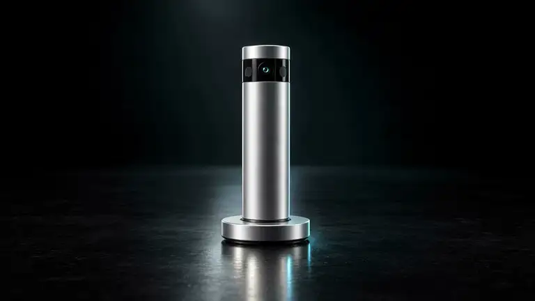
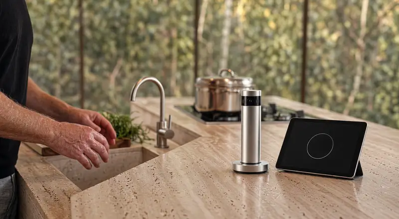
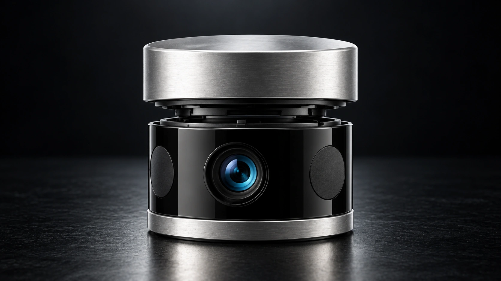
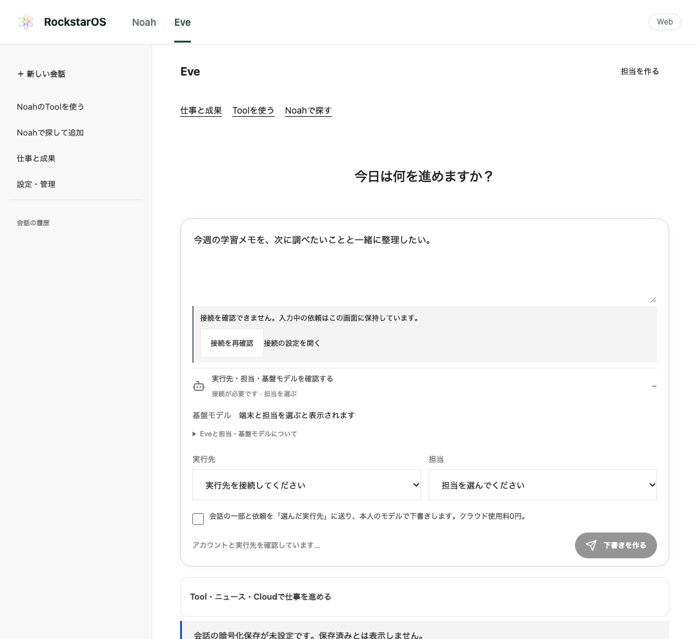
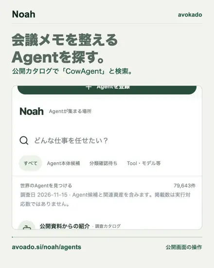
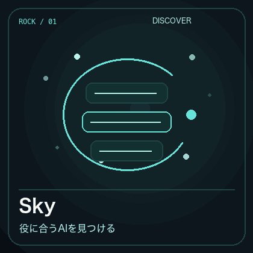
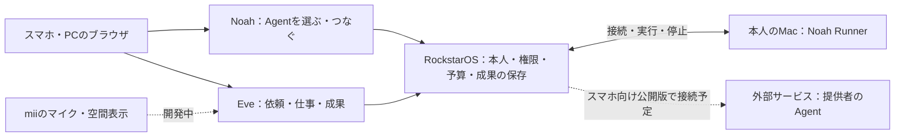
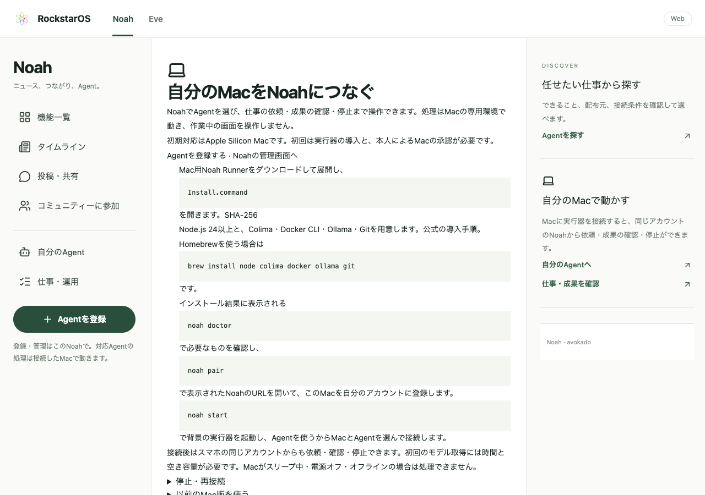

# avokado / mii

miiは、声でEveに頼み、部屋に映った成果を手で操作するために開発している空間コンピューターです。

**[NoahでAgentを試す](https://avoado.si/noah/agents)**　·　[18秒で操作を見る](#catalog)

<a href="https://avocadomini.si/#technology">
  <picture>
    <source media="(prefers-reduced-motion: reduce)" srcset="docs/assets/readme/mii-tower-on-dock.webp">
    
  </picture>
</a>

*miiの外観と内部構造を描いたコンセプト映像。* [公式サイトで構造を見る](https://avocadomini.si/#technology)

<a name="contents"></a>

[暮らしの短編](#films) · [miiの構造](#mii) · [Eveに頼む](#eve) · [Noahで探す](#catalog) · [Macで試す](#noah-mac) · [全体構成](#architecture) · [開発状況](#status) · [コードと検証](#development)

<a name="films"></a>

## 暮らしの中のmii

料理で両手がふさがっているとき、手を止めずに残り時間を確かめる。公式サイトの短編「料理」は、その使い心地を描いています。

[](https://avocadomini.si/#quick-scenes)

*公式サイトの5本の短編。朝の光、集中するときの日よけ、外での制作、料理中のタイマー、夜の足元の灯りを描いたコンセプト映像です。*

[朝](https://d8j0ntlcm91z4.cloudfront.net/user_3ImsN7zDg5XAxCTCNf16qVkxzVQ/hf_20261028_201649_fe60d9fe-0cb2-4101-b833-4afbc7cfe769.mp4)　·　[集中](https://d8j0ntlcm91z4.cloudfront.net/user_3ImsN7zDg5XAxCTCNf16qVkxzVQ/hf_20261028_201649_1efcbbf2-15f6-4650-8089-16a7679b7ce3.mp4)　·　[創作](https://d8j0ntlcm91z4.cloudfront.net/user_3ImsN7zDg5XAxCTCNf16qVkxzVQ/hf_20261028_202029_48890df7-1fdf-49bf-b749-eae800aacdd5.mp4)　·　[料理](https://d8j0ntlcm91z4.cloudfront.net/user_3ImsN7zDg5XAxCTCNf16qVkxzVQ/hf_20261028_201647_7fafb347-3f1d-47e2-97fd-67e407a11d1c.mp4)　·　[夜](https://d8j0ntlcm91z4.cloudfront.net/user_3ImsN7zDg5XAxCTCNf16qVkxzVQ/hf_20261028_201650_242a20a0-0837-4b0a-827b-c90c76088834.mp4)

<a name="mii"></a>

## 声と手を受け取る、4本のTowerとHub

部屋の中で表示を指すと、四方向のTowerが手の位置を捉えます。別体のHub上でRockstarOSが入力をまとめ、表示層に渡す設計です。表示層は使う空間に合わせて差し替えられます。Towerが1本のときは、Eveの機能を限定して使う想定です。

[](https://avocadomini.si/#product-details)

*Tower上部のセンサー帯のデザイン案。* [miiの構造](docs/structure/01-mii.md) · [R5設計](docs/avocado-mini-r5/README.md) · [V2の比較研究](docs/mii/design/v2-study/README.md)

<details>
<summary>空間入力とMaterial Inventionの実装を見る</summary>

空間入力の実装と機種設定から、手の入力がどこで処理されるかを追えます。Material Inventionには再計算用sandboxと設計資料があり、シミュレーション・実験室接続は未実装です。[空間入力のコード](lib/mii-spatial-input.ts) · [機種設定](systems/rock-star-os/targets/avocado-mini/) · [Material Inventionの設計](docs/rockstaros-avocado-mini-complete-design.md) · [製品サイトのコード](sites/avocado-mini/)

</details>

<a name="eve"></a>

## Eveに、やりたいことを伝える

「今週の学習メモを、次に調べたいことと一緒に整理したい」。Eveでは、まず依頼を自分の言葉で書きます。入力欄の下で実行先・担当・基盤モデルを確認し、その仕事をどこに任せるか選びます。



*Web版の実画面。依頼を書いたところで、実行先はまだ接続していません。* 会話は履歴から、依頼した仕事と成果は「仕事と成果」から開けます。実行には本人確認とToolへの接続・権限が必要です。[Eveを開く](https://avoado.si/os/eve)

<details>
<summary>Eveが依頼を工程に分け、成果を検収する仕組み</summary>

### 仕事の工程と検収


Eveが目的を受け取り、Noaが道具とAgentをつなぎ、AMCが工程・担当・合格条件を決め、Jevが結果を検収します。下のデモでAMCの実行、別プロセスでの検収、差し戻しと再計画を試せます。成果の編集・持ち出しは、その仕事の保存方式に従います。

```sh
npm run amc:cycle -- demo
```

工程の組み合わせ、見積り、会社受注の分配を計算するライブラリと、募集文面を判定するCLIがあります。外部への応募・契約・納品・送金までの接続は開発中です。[仕事の計画](docs/sky-work-loop.md) · [実行・停止・復旧](docs/amc-goal-orchestrator.md#goalから逆算するローカル実行と再計画)

</details>

<details>
<summary>Eveのコードと担当設定</summary>

| コード | 内容 |
| --- | --- |
| [app/os/eve/](app/os/eve/) / [components/sky-chat-workspace.tsx](components/sky-chat-workspace.tsx) | 会話・仕事・Toolの画面 |
| [lib/workflow.ts](lib/workflow.ts) / [lib/work-store.ts](lib/work-store.ts) | 状態遷移・本人別保存・revision競合判定 |
| [docs/structure/04-eve-noa-amc-sky.md](docs/structure/04-eve-noa-amc-sky.md) | Eveと担当構成・実行・評価の責任 |

担当設定は[全社役割台帳](data/company-role-map.json)、[営業担当台帳](data/revenue-role-map.json)、[担当別の設定](.cursor/agents/)にあります。

</details>

<a name="catalog"></a>

## Noahで、仕事に合うAgentを探す

Noahはmiiの最小構成です。会議のメモを整理したいなら、公開カタログで「CowAgent」と検索して「詳細を見る」を開きます。配布元・費用・ライセンスを確認し、「Noahで接続して使う」から自分のMacを選ぶ画面へ進めます。

<a href="https://avoado.si/noah/agents">
  <picture>
    <source media="(prefers-reduced-motion: reduce)" srcset="docs/assets/readme/noah-first-agent-poster.jpg">
    
  </picture>
</a>

**[NoahでAgentを試す](https://avoado.si/noah/agents)**。閲覧・検索はスマホからできます。仕事を実行するには、サインインして自分のApple Silicon MacにRunnerを設定します。[Macの接続手順](#noah-mac)

[CowAgentをMacで試す準備](https://avoado.si/noah/guides/cowagent-mac)では、18秒の操作例と最初に頼む会議メモの例を確認できます。

[CowAgentの操作動画（18秒）](https://raw.githubusercontent.com/k999ln/rock/main/docs/assets/readme/noah-first-agent.mp4) · [スマホで配布元を確かめるCM（20秒）](https://raw.githubusercontent.com/k999ln/rock/main/docs/assets/readme/noah-cm-phone-source.mp4) · [Macをつなぐ準備のCM（20秒）](https://raw.githubusercontent.com/k999ln/rock/main/docs/assets/readme/noah-cm-mac-runner.mp4) · [サロン用の投稿文](docs/noah/online-salon-trial.md)

<a name="noah-tools"></a>

<details>
<summary>タイムライン、本人のライブラリ、セレクト・リセール</summary>

### タイムラインと本人のライブラリ

**ホームはピンタレスト風（task 115。2026-11-22）。** 今動かせる Agent（取り込んで握手が通った物）を、分野の色の面と頭文字のカードで 2〜6 列に敷き詰め、「保存」で自分のボードへまとめます（ボードは公開も選べ、公開ボードはフォローできる）。並びは学習なし・乱数なしで、X の For You の作りの形・Reddit の hot・Pinterest の Pixie を、数えた事実（保存した人・成果が返った人・表示しない人）だけで使います。上の帯に検索とメニュー。一般公開（`NOAH_INTAKE_PUBLIC`）までは審査者だけがグリッドを見て、一般の人には下のタイムラインが出ます。実装は `lib/noah-pins.ts`・`lib/noah-boards-store.ts`・`lib/noah-pins-api.ts`・`components/noah-pin-home.tsx`・`components/noah-pin-grid.tsx`・`components/noah-boards.tsx`、表は migration 0054。設計は `docs/noah/spec-115-pin-grid.md`。本番の migration・配備はしていません。

個人の感想・発見・評価の本文と作者を主役にしたタイムラインです。フォロー中の投稿と通常投稿をAgent紹介より先に表示し、紹介情報は「Agent紹介」と区別します。既定で全件表示し、「Agent」で絞り込んだ時だけ「すべてに戻る」を表示します。ニュースとコミュニティーは表示しません。検索・詳細から、利用したい担当やToolを確認できます。機能一覧は設けず、メニューからタイムライン・Agentを探す・実行中・成果データへ直接進みます。会社の正式花形ロゴを使用し、白地・チャコールの文字・紫のアクセントで、Xのような左ナビ・中央フィード・右検索/Agent欄の3カラムにしています。スマホ下部は現在地付きの「メニュー」1ボタンで、開くと4画面をアイコンと用途説明付きで選べます。Agentの探索は `/noah/explore` から行えます。「実行中」タブ（`/noah/activity`）に依頼入力・接続・Agentの実際の処理状態・成果・停止・ファイル保存を集約しました。旧 `/noah/launch` は選択Agentを保持して移動します。接続手順はAgent選択→Mac接続→依頼の順に案内し、接続案内から戻っても選んだAgentを維持します。フロントと登録Agent導線の開発は [PR #337](https://github.com/k999ln/rock/pull/337)、全体verify成功、本番配備は未実施です。 投稿やフォローにはサインインが必要です。[タイムライン](https://avoado.si/noah)



*Noahの発見と接続を表すコンセプト。* 公開カタログは公開資料を使います。個人が登録したAgentは固定版を保存し、別の権限を持つ担当が審査してから公開版に追加します。公開審査には担当の設定、決済にはサービス接続と個別の確認が必要です。

AgentごとにNoahで実行完了を確認した利用人数、1アカウント1票の王冠、公開コメントと返信を表示します。感想は通常タイムラインにも流れます。閲覧は登録不要、保存には本人確認、コメントには公開名を使います。外部単独利用や未同期の実行は人数に含めません。[評価とフィードバック](docs/services/noah-agent-feedback.md)。

開発者向けの `/noah/developers` では、ユーザーの声の整理・改善提案・承認後のリファクタリング・回帰試験・PR納品を運用パッケージとして案内します。相談・見積もりは **smash@avoado.si** へのメールで受け付け、ページから対象Agentを添えたメールを作成できます。Webの申込フォーム・受付履歴・運営一覧は廃止。価格・SLA・課金・作業自動実行は未設定です。[継続改善パッケージ](docs/services/noah-developer-maintenance.md)。

閲覧・検索は会員登録なし。外部Agentで登録が必要な場合は `/noah/registration` で必要項目と送信先・規約を確認し、登録Agentへ依頼できます。実際の登録先アダプターと秘密設定は未接続で、未設定時は入力欄を出しません。[登録Agentの設定・契約](docs/services/noah-registration-agent.md)。Mac接続など認証が必要な操作ではアカウント確認・ログイン・再確認を案内し、認証後は登録やMac承認の元の画面へ戻ります。登録・接続・実行・停止の本番通し受入と、別Macの実機受入は未完了です。現在の受入範囲と残件は[Noah単体ローンチ](codex/tasks/71-noah-standalone-launch.md)を参照してください。

Agentの成果データは `/noah/data` で検索・JSON/ファイル出力できます。Webに保存済みのNoah実行成果を本人のWorkから読み、本人が選択・同意した成果だけを運営の品質確認・不具合調査へ提供します。撤回は運営向けの写しを削除し、元の仕事を削除した後でも本人の提供履歴から取り消せます。進捗は [PR #334](https://github.com/k999ln/rock/pull/334)。本番の表の適用・配備は未実施です。[範囲と提供条件](docs/services/noah-result-data.md)。

### 本人用セレクト・リセール

ストリート、アーカイブ、オブジェの3担当が、候補・採算・共有予算・在庫・出品原稿・収支を扱います。Webの入口は `/noah/resale`。CLIのデモは外部通信なしで動きます。

```sh
npm --prefix toolkits/noah-resale-agent run demo
```

初期予算は0です。実購入・実出品にはAPI利用権、接続設定、予算、具体的条件を確認した記録が必要です。WebはD1、CLIはSQLiteに保存します。入金同期と無人運用は未検証です。[CLIの使い方](toolkits/noah-resale-agent/README.md) · [実行・停止・照合の仕様](docs/services/noah-select-resale.md)

</details>

<details>
<summary>Noahの画面・接続・Toolのコード</summary>

| コード | 内容 |
| --- | --- |
| [app/noah/](app/noah/) / [components/noah-timeline.tsx](components/noah-timeline.tsx) | 公開タイムラインと機能画面 |
| [限定共有](app/noah/invites/)、[送信履歴](app/noah/outbox/)、[利用状況](app/noah/usage/) | 登録Agentの招待を受け取る、送信内容を確認する、提供したAgentの利用記録を読む。外部Agentからの[利用報告の手順](toolkits/noah-agent-client/README.md) |
| [lib/noah-surface.ts](lib/noah-surface.ts) | 公開側とMac側の遷移 |
| [services/sky-web/noah-page-routes.mjs](services/sky-web/noah-page-routes.mjs) | 現行URLと互換URLの対応 |
| [Mac API接続](scripts/noah-local-api.mjs) / [コード取得](scripts/noah-source-bytes.mjs) | 既存機能で共有する通信・容量照合。本人・招待・公開版の条件は各経路で保持 |
| [Tool詳細設計](docs/sky-tools-complete-design.md) | 入出力・権限・保存・失敗・復旧・受入 |

</details>

<a name="architecture"></a>

## 部屋、Mac、外部サービスのつながり

**Noah** でAgentを選び、**Eve** で依頼や成果を扱います。どちらも **RockstarOS** の本人確認・権限・予算・保存を使います。RockstarOSから右に伸びる実線が本人Mac、点線がスマホ向け公開版で使う提供者のAgentです。[全体の設計と各層の役割](docs/structure/00-overview.md)



<details>
<summary>製品ごとの入口と開発状況</summary>

| 製品 | 役割 | 入口・現在の範囲 |
| --- | --- | --- |
| Noah | miiへ進む最小構成。Agentを集める・つなげる・載せる | [avoado.si/noah](https://avoado.si/noah)。公開カタログ・Agentの選択 |
| Eve | 依頼、担当設定、仕事、成果、停止、使用量の確認 | [avoado.si/os/eve](https://avoado.si/os/eve)。実行には本人確認と対象Toolの接続・権限が必要 |
| RockstarOS 1.0 | 本人性、権限、予算、仕事の状態、保存・復旧を共有するruntime | Developer Preview。Web、Linux/QEMU、Android/機種別OSを別々に受入 |
| mii | 声・手・表示・センサーを共通の仕事へつなぐ空間端末 | [avocadomini.si](https://avocadomini.si)。設計・ソフト試作段階 |

</details>

<a name="noah-mac"></a>

## 選んだAgentを、自分のMacで動かす

最初の実行先は本人のApple Silicon Macです。Runnerを入れ、自分のアカウントとMacを結ぶと、Noahの管理画面でAgentへの依頼、成果の確認、停止に進めます。



*Web版のMac接続画面。中央にRunnerの入手先と、Macを承認する手順が並びます。* [Macを接続する](https://avoado.si/noah/mac)

<details>
<summary>Macの導入・実行・停止コマンドを開く</summary>

**画面**　[自分のMacをNoahにつなぐ](https://avoado.si/noah/mac)　·　**対象**　Apple Silicon Mac

1. 接続画面で「Mac用Noahをダウンロード」を選び、ZIPを展開して `Install.command` を開きます。
2. ターミナルで次のコマンドを順に使います。`noah doctor` の診断で不足したものがあれば、接続画面の導入手順を確認します。`noah pair` で表示されたURLを開き、自分のアカウントでこのMacを承認します。

```sh
noah doctor
noah pair
noah start
```

### 仕事を実行し、成果を確認して停止する

[Agentを使う](https://avoado.si/noah/launch)で自分のMacとAgentを選びます。「実行中」から「仕事の詳細を開く」を選ぶと、その仕事の進捗を確認し、実行中は停止を依頼できます。完了後は同じURLで成果を読み直し、Agentが返したファイルを保存できます。初めてサインインする場合は、本人確認を終えると登録やMac承認の画面に戻ります。

実行器全体を止めるには `noah stop` を使います。回線が切れた仕事は自動で再実行されません。再接続したら `noah receipts` で同じ仕事の報告を照合できます。

```sh
noah stop
noah status
noah receipts
```

</details>

<a name="noah-public"></a>

## スマホから頼んで、成果を受け取る

スマホ向けの公開版では、利用者がブラウザでAgentを選び、提供者のサーバーが処理を引き受ける設計です。「接続」を押し、入力を送り、成果を開き、使い終わったら接続を切る。この一周を公開に向けて開発しています。

<details>
<summary>スマホでの操作と、手元で試せる検索例</summary>

1. **選ぶ。** カードを開き、提供者と「入力はどこへ送られるか」を読みます。
2. **つなぐ。** 「接続」を押します。サインインが必要な場合は、認証後に同じ操作へ戻ります。
3. **頼む。** 道具を選び、必要な項目だけを埋めます。初回に確認が必要な道具は、送る内容を確かめてから依頼します。
4. **受け取って切る。** 仕事の一覧から成果を開きます。使い終えたAgentとの接続を切った後も成果は残ります。

### 入力が成果になる例

参照試験の検索用Tool `lookup` に、検索語 `mizan` と上限 `５` を入力すると、上限は数値に直して次の形で渡されます。

```json
{"name": "lookup", "arguments": {"query": "mizan", "limit": 5}}
```

この試験の接続先が返す表示は「mizan は 3 件」と「（画像 1 件）」です。手元で次を実行すると、外部に入力を送らずに同じ例を確認できます。

```sh
node --experimental-strip-types --test docs/design-validation/noah/noah-loop.test.mjs
```

公開の条件は、初めての利用者が自分のスマホで一周できることです。[公開までに作る順番](docs/noah/mvp-launch.md) · [各機能の仕様書](docs/noah/README.md)

</details>

<details>
<summary>公開版の作りと、手元で確かめたこと（MVP L1〜L9）</summary>

開発時は `npm run noah:screenless:check` で、固定Agent・登録コード・VMの起動引数を検査します。画面・音・hostファイルへアクセスする変更を通常の `npm run verify` で検出します。画面を閉じた後の成果保存はローカルDBの回帰試験で確認し、Mac実機での画面観測は未実施です。

接続要件の検査・接続計画・状態遷移の純関数は `lib/noah-connect-requirements.ts` と `lib/noah-connect-plan.ts` に置いています。MVP L2 の開発範囲で、画面・APIとの接続は後続のL5です。計画の計算だけでは権限や利用権は発行しません。

公式MCP台帳の取り込み・一覧・運営画面（MVP L3）は `lib/noah-intake-*.ts` と `/api/noah/intake` に実装しています。初回全件と毎時差分を再開可能な巡回で保存し、運営の画面から件数・準備の要否・取り下げを確認できます。実台帳68,964件の初回取り込みと差分巡回、合成65,000件のローカルD1受入を通過しています。本番の表の適用・配備・切り替えは行っておらず、Agentとの接続確認は後続L4です。進捗は [PR #332](https://github.com/k999ln/rock/pull/332) を参照してください。

握手までの接続試験（MVP L4）は `lib/noah-mouth-mcp-remote.ts`・`lib/noah-probe.ts`・`lib/noah-intake-probe.ts` に実装しています。巡回の合図のたびに、鍵の要らない「相手のサーバー」の候補へ握手して道具の一覧を読み（道具は呼びません。定義の本文も保存しません）、通った物を「まだ誰も動かしていない」の段へ載せます。同じ接続先へは 1 時間に 1 回まで、別の接続先への転送には従いません。実在の接続先 100 件での受入は、通った 51・相手の許可が要る 35・応答しない 11（`scripts/check-noah-probe.mjs`）。本番の配備・切り替えはしていません。進捗は [PR #335](https://github.com/k999ln/rock/pull/335) を参照してください。

Agentの継続収集はGitHub Actionsのクラウド実行で5分ごとに進み、Macの起動を必要としません。途中状態はNoahの非公開R2へ保存し、次の実行で再開します。手元での検証には `npm run noah:collect -- --watch` を使えます。公式MCP台帳・GitHub・Hugging Face・X に加え、Hacker News・npm・DockerのMCP一覧・awesome一覧・Smithery（鍵がある時）からも集め（task 121）、頁位置・待機・握手の記録を保存して再開します。`--publish https://avoado.si` と掲載キーの設定で 公開トップ `/noah` と `/noah/agents` の紹介欄へ自動掲載します。開いている画面も60秒ごとに読み直します。Xは運営のAPIキー設定後に取得します。GitHubのスター・Hugging Faceのいいねなども出典付きで更新し、Noah内の評価とは別に表示します。Mac常駐は停止・自動起動無効化済みで、`scripts/noah-collector-service.mjs` は手元での検証用に保持します。`--status` で状態を確認でき、接続確認済みの `work/noah-collector/import.json` は既存の掲載管理から取り込みます。候補数と接続確認済みの数は別です。利用者の端末や画面の操作は不要です。紹介は「新しく使いやすい順」（出た時・話題の数・スマホから押すだけで動くか）に並び、カードに動かし方を出します。握手の済んだ物は収集機が1日400系列まで一覧へ自動で入れます。X・Reddit・Blueskyは運営のCodexが読んだリンクを `scripts/noah-collector-social.mjs` で受け取ります。[運用と範囲](docs/services/noah-agent-collection.md)。

つなぐ（MVP L5）は、表・API を `lib/noah-connect.ts`・`lib/noah-connect-source.ts`・`lib/noah-connect-plan-api.ts`・`lib/noah-user-handshake.ts` に、画面を `/noah/ready`（すぐ使える Agent の一覧）と `/noah/ready/agent`（詳細）に実装しています。一覧のカードの「接続」を 1 回押すと「頼む」に変わり、詳細には、送り先（入力が送られる接続先）・道具の一覧・「切る」が出ます。未サインインの人が押した時は、サインインから戻った画面が、押し直さずに続けます。入口は「Agentを探す」の一番上に 1 つ（menu は変えていません）。画面と入口は、切り替えが開くまで、審査者にだけ出ます。計画を読む（`GET /api/noah/connect-plan`）、1 回の要求で握手まで終えてつなぐ（`POST /api/noah/connect`）、やり直す・切る、つないだ相手の道具の一覧（`GET /api/noah/connect/[id]/tools`）です。つなげるのは、一覧に載せている系列だけ。送るのは握手だけで、道具は呼びません。本人の端末では何も動きません。同じ操作の再送は握手をやり直さず、1 つの接続先へは全員合わせて 60 秒に 60 回まで、相手が「混んでいる」と返したら、その時刻まで送りません。同意した時から接続先が変わった接続は、黙って新しい相手へ送りません。道具を選んで頼む所は、次の L6 です。カードと詳細には、成果が出た人の数（「n 人が利用」。1 人 1 回）も出ます。出す場所（別の画面と、探す画面の入口）と、つなぐ時にサインインを求める事は、本人の返事を待ちながら、既定で作っています（`docs/noah/spec-74-one-click-connect.md` の 11.5）。表（`noah_connections`）の本番への適用・配備・切り替えはしていません。進捗は [PR #342](https://github.com/k999ln/rock/pull/342) を参照してください。

頼む（MVP L6）は、`lib/noah-ask.ts`・`lib/noah-ask-store.ts`・`lib/noah-remote-work.ts` と、詳細の画面の中（`components/noah-ask.tsx`・`components/noah-work-list.tsx`）に実装しています。つないだ相手の道具を選び、入力欄を埋めて「頼む」を押すと、相手のサーバーで道具が 1 回動き、成果が Work に残ります（`POST /api/noah/ask`。応答を返した後に続けるので、画面を閉じても進みます）。呼ぶ前に、その道具の定義が、本人が入力欄を開いた時と同じ事を確かめます。読み取りだけと宣言されていない道具は、最初の 1 回、入力の一覧を見せて、確かめてから送ります。失敗しても呼び直しません。止めた後に届いた成果は採りません。相手が返した内容を Noah は確かめていないので、Work は確認待ちのまま・費用は 0 です。動かした Agent は、一覧の「動いた」の段に移ります。手元の D1 での受入は `scripts/check-noah-ask.mjs`（相手は合成の物で、外へは通信しません）。成果は、Agent の詳細の「仕事」のほか、「実行中」（接続したAgentの仕事）と「成果データ」（接続したAgentの成果）にも、Agent をまたいで出ます。成果データの書き出し・運営への提供と、1 文で頼む機能は、まだです。表（`noah_asks`）の本番への適用・配備・切り替えはしていません。進捗は [PR #344](https://github.com/k999ln/rock/pull/344) を参照してください。

見回りを保つ（MVP L7）は、`lib/noah-sweep.ts` に実装しています。巡回の合図のたびに、終わりに、途中で落ちた依頼・始まらなかった依頼・つなぐ途中で止まった接続を片付けます（相手のサーバーへは、何も送りません）。道具を呼ぶ直前に、依頼へ「相手へ送る」の印を付けるので、実行の場が落ちた時、相手へ送る前なら「途中で止まりました。相手のサーバーへは、送っていません。もう一度頼んでください。」、送った後なら「結果を確かめられませんでした。相手のサーバーで実行されたかは分かりません。」と、分けて出します。取り直して、呼び直す事はしません。運営の画面には、「つながると確かめた数」（動いた・握手まで・本人の Mac で動かす物）が出ます。握手が 2 回続けて通らない相手を一覧から外す所と、同じ接続先への握手を 1 時間に 1 回までにする所は、L4 から入っています。手元の D1 での受入は `scripts/check-noah-patrol.mjs`（相手は合成の物で、外へは通信しません）。索引を 1 つ足す migration（0049）の本番への適用・配備・切り替えはしていません。進捗は [PR #345](https://github.com/k999ln/rock/pull/345) を参照してください。

出すための運用（MVP L8）は、`lib/noah-launch-status.ts`・`lib/noah-bot-notice.ts` と、運営の画面（`/noah/review` の「取り込み」の節）・使い方の頁（`/noah/help`）に実装しています。運営の画面には「見張る数」が出ます: 切り替えの状態、台帳の巡回が止まっていないか、まだ握手していない数（0 になったら、最初の 1 巡が終わっています）、握手の結果、同じ接続先へ 1 時間に 2 回以上握手していないか、直近 24 時間と 7 日の接続と依頼の数、失敗の多い接続先。出すのは数だけで、本人の ID・依頼の中身は出しません（接続先の名前を出すのは、依頼が 5 件以上あり、失敗がある物だけ）。使い方の頁には、外の道具・Agent を提供している方への説明（名乗り・送る物・回数・止め方）の節 `#bot` があり、取り下げ・報告の窓口は **smash@avoado.si** です（2026-11-21 に本人が決めました。宛先は `lib/noah-bot-notice.ts` の 1 行）。一覧と詳細の下の「報告・取り下げの申し出」から、この節へ進めます。巡回を起こす専用の Worker の配備・止め方・鍵の替え方は [services/noah-patrol-wake/README.md](services/noah-patrol-wake/README.md)、切り替えと戻し方は [docs/noah/spec-97-launch-ops.md](docs/noah/spec-97-launch-ops.md) です。本番への配備・migration の適用・切り替えは、行っていません（本人の許可の後）。進捗は [PR #346](https://github.com/k999ln/rock/pull/346) を参照してください。

受入（MVP L9）は、スマホだけの一周の自動試験 `tests/noah-phone-loop.test.mjs`（取り込む → 見つける → 接続 → 道具 → 頼む → 受け取る → 切る を、画面が呼ぶのと同じ入口だけで通します。相手は合成の物で、外へは通信しません）と、画面の決まりの試験（`tests/noah-ready-ui.test.mjs`。画面を覆う部品が無い・提供者の文は字のまま・画面に出さない言葉が無い、を一周の全部の段で見ます）です。実機の確かめの表（[docs/noah/spec-90-phone-only-loop.md](docs/noah/spec-90-phone-only-loop.md) の 5 章）は、手元の開発サーバーと幅 390 のブラウザで通し、結果を 9.4 に書いてあります。**本番と、本物のスマホでは、まだ確かめていません。** この通しで、「切る」と、受け取った成果が画面から読めなくなる所を見つけて、直しました: Agent の詳細の「仕事」は、つないでいない時・切った後も、その Agent への前の依頼と成果を出します。進捗は [PR #347](https://github.com/k999ln/rock/pull/347) を参照してください。

棚（task 110）は、`lib/noah-shelf.ts`・`lib/noah-shelf-store.ts`・`lib/noah-shelf-api.ts` と、`/noah/ready` の一番上の段（`components/noah-shelf.tsx`）・運営の画面の「棚」の節（`components/noah-shelf-review.tsx`）に実装しています。7 万件から選ばせずに、「稼ぐ・仕事を省く」「教育」「暮らし」の 3 段に、1 つの仕事を最後までやるカードを並べます。並びは学習なしの運営の順で、載るのは、運営が自分で動かして成果を確かめた、今動く相手のサーバーの道具のカードだけです（相手が止まる・道具が変わると、次の握手の後に外れ、運営の画面に理由が出ます）。カードを押すと、その道具を選んだ状態で詳細が開きます。表は migration 0050（`noah_packages`・`noah_package_steps`）。最初の 12 枚の案はローンチの範囲の外なので、別に、実在の Agent の道具を実際に呼んで確かめた 17 枚の下書き（`data/noah-shelf-first-cards.json`。運営の画面の「カードを置く」へそのまま貼る）を用意しました。運営が本番で 1 回ずつ動かして「確かめた」を押すと棚に出ます（`docs/noah/spec-110-shelf.md` の 18 章）。本番への適用・配備・切り替え（`NOAH_SHELF_PUBLIC`）はしていません。設計は `docs/noah/spec-110-shelf.md`。

300 人の試行（task 114）は、`lib/noah-trial.ts`・`lib/noah-trial-api.ts` と、入口（`/noah/ready` と詳細の `?via=<札>`）・カードの詳細の下の本人の報告・運営の画面の「試行」の節に実装しています。経路の札は運営が登録した物だけを受け付け、本人 1 人につき入口は 1 行です。運営の画面に、段（30 → 100 → 300）ごとの 4 つの数と割合、次へ進むのに足りない条件、経路ごとの数、カードごとの報告の合計が出ます（5 人未満の経路とカードは出しません）。本人の報告は任意で、4 つの数（出品したか・売れた件数・手取り・掛けた分）だけ。金額は約束せず、5 人以上の測った合計だけを出します。表は migration 0051。本番への適用・配備・切り替え（`NOAH_TRIAL_OPEN`）と、投稿・動画・人への連絡はしていません。設計は `docs/noah/trial-300.md`。

棚の並び（task 111）は、学習なしで、数えた実績だけを使います（切り替え `NOAH_SHELF_RANK` が開いている時）。見込み ＝ つながる率 × 成果が返る率 × 検収に通る率 × また使う率（控えめな見積り `(当たり+1)÷(全体+2)`、5 人未満の実績は使わない）。5 枚に 1 枚は実績の無いカードを試しに出し、同じ領域を 3 枚続けません。実績は、巡回の合図の中で 1 日 1 回、直近 90 日を数え直します（`lib/noah-shelf-store.ts` の `rollup`）。カードに「成果が返った割合・また使った人・最初の成果までの時間」を出し、サインインした本人は「表示しない」を押せます。見せた記録（切り替え `NOAH_SHELF_SEEN`）は、全員を合わせた日・カード・位置の区分の数と、履歴の利用に同意した本人の分だけで、履歴を消すと消えます。棚のカードは、タイムライン（`/noah`）にも「Noah の棚」として流れます。表は migration 0052。本番への適用・配備・切り替えはしていません。

つなげる数（task 113）は、無料 6・有料 50 を、カードの数で数えます（同じカードの中の接続は 1）。7 枚目は「無料でつなげるのは 6 個までです。使っていないものを切ると、空きができます。」（409）で、もうつないである物は切りません。「つながっているもの」の見出しに「6 個のうち 4 個」が出ます。どの利用権を有料と見るか（値段・月額に含めるか）は本人が決めるまで置いていないので（`lib/noah-plan.ts`）、切り替え `NOAH_PLAN_LIMITS` を開けても、今は全員 50 のままです。表は migration 0053。本番への適用・配備・切り替えはしていません。

</details>

<a name="rockstaros"></a>

## RockstarOSが仕事と端末をつなぐ

Eveに頼んだ仕事を別の画面で開くために、RockstarOSは本人のアカウントに権限・予算・仕事・成果を結び付けます。部屋のHub、Web、機種別OSで共有するのはこの仕組みです。端末ごとの入力・表示・更新・復旧は個別に検証します。

<details>
<summary>RockstarOS 1.0の対応端末と次の実機試験</summary>

**配布段階**　Developer Preview　·　**内部識別子**　`dev.rock`

| 対象 | 現在の範囲 | 次の受入 |
| --- | --- | --- |
| Web / 既存OS client | Eve・Noahと共通の仕事・保存・権限の実装 | 本人アカウント、外部Tool、別端末引継ぎの同条件確認 |
| Linux / QEMU | 独立したDeveloper Preview系列 | 配布する同一artifactの導入・保存・再起動・復旧 |
| Pixel 10 GL066 / frankel | Android clientと機種別OS準備 | 現候補での接続・復旧、正式署名、全OS build、flashと同一image受入 |
| mii | 共通runtimeへ接続するprofileと設計 | 実機の入出力・電源・停止・保存・復旧 |

端末内モデルの出力を外部操作に使う際も、実行先の権限と本人の承認を確認します。[native OS](systems/rock-star-os/README.md) · [Androidとnativeの区分](docs/native-os-integration.md) · [対応機種](docs/device-support-architecture.md) · [リリース条件](docs/release-minimum-gates.md) · [モデルの評価](docs/llm-evaluation-architecture.md)

</details>

<a name="esim"></a>

<details>
<summary>OS導入時のSIM・eSIMと使用料金</summary>

SIM/eSIMはRockstarOS導入時の回線に使います。対象機種と署名・復旧条件がそろった端末にはnative OSを案内し、そのほかの対応端末ではclientやブラウザを使います。OS本体は端末に置き、本人確認・回線・サービス利用権・インストール状態をそれぞれ管理します。

Cloud agentの実行前に単価・見積りと予算上限を確認し、実行後に項目別の使用量を照合します。商品料金、通信料、si使用料、外部実費、利用者自身の鍵での費用は個別に扱います。回線発行・本番決済は各providerとの接続試験が残っています。[SIM/eSIM設計](docs/structure/03-esim.md) · [料金と使用量](docs/sky-billing.md) · [導入試作](toolkits/esim-bootstrap/README.md)

配給は運営Dockで受取人・品目・数量・受取場所と日時を指定します。利用者は模擬専用回線で自分の配給を開き、受け取ったら「受け取りました」を押します。[Macで両方の画面を試す](toolkits/esim-bootstrap/README.md#noah-free-trial)

同じ模擬専用回線の「クラウドでAgentを使う」から、文章を渡して他のアプリに戻れます。提供元の専用クラウド・登録済みの接続先・Noahクラウドを別々のローカルWorkerで試せます。結果が届くまでサーバーが同じ依頼を照会し、仕事ごとに成果・未達・未確認を表示します。


</details>

<a name="status"></a>

## 今どこまで動くか

| 対象 | 確認できていること | 次に確かめること |
| --- | --- | --- |
| mii | R5を現行設計として試作中。製造承認は**保留中**です。R5実機試験の完了実績は0件です。 | 同じ実機で光学、熱、電源、停止、取り付け、警報を確認する。V2・天井型は比較研究の段階 |
| Noah・本人のMac | ローカルAPIと実コンテナで接続・実行・成果受領・停止を確認。配布ZIPは空の保存領域で導入を確認 | 初めて導入する別のMacと本番HTTPSを通して同じ一周を確認する |
| Noah・スマホ公開版 | 公式台帳の取り込み・握手・接続・入力欄からの依頼・見回り・運営の数（MVP L1〜L9）を実装。手元の開発サーバーと幅390のブラウザで、選ぶ→接続→頼む→受け取る→切るの一周を確認。切り替えは閉じたまま | 本番の表の適用・配備・切り替えの後、初めての利用者が本番で接続・依頼・成果受領・切断まで進めることを確認する |
| Eve・RockstarOS | Webの会話・仕事・成果の画面と共通の保存処理を実装。RockstarOS 1.0はDeveloper Preview | 本人アカウントと実行先を接続し、端末を替えて同じ仕事を再開する |

miiの販売・予約は受け付けておらず、価格と発売日は未定です。MacのRunnerは電源が入り、ネットワークにつながっている間に動作します。 [導入と実行の仕様](docs/services/noah-standalone-launch.md) · [検証記録](codex/tasks/71-noah-standalone-launch.md) · [進捗](project.md) · [mii公式の開発状況](https://avocadomini.si/#status)

<a name="development"></a>

## 開発と検証

### この作業フォルダで始める

複数の作業フォルダを使うときは、最初に `git status -sb` で現在のブランチと未コミットの変更を確認します。共通の作業方針は[GitHubのmainのREADME](https://github.com/k999ln/rock/blob/main/README.md)で確認できます。

リポジトリのルートで依存を入れて開発サーバーを起動し、ターミナルに表示されたURLの `/noah` または `/os/eve` を開きます。Node.js・npmと依存の指定は[package.json](package.json)と[package-lock.json](package-lock.json)にあります。

```sh
npm ci
npm run dev
```

### 変更した内容を検証する

`project:update` は進捗文書を同期します。`verify` は型、lint、テスト、設計、ビルド、ローカルAPIを検査します。本人の秘密情報は環境変数かGit外の保存先に置きます。

```sh
npm run project:update
npm run verify
```

macOSでHomebrewのOpenSSL 3を使う場合は `PATH=/opt/homebrew/opt/openssl@3/bin:$PATH npm run verify` で実行できます。DBやproviderの設定は対象機能の手順に従います。

| 作業 | 入口 |
| --- | --- |
| 製品要件・現在の名称 | [product-baseline](docs/product-baseline.md) / [名称正本](docs/structure/06-naming.md) |
| 現在の作業と設計 | [Codex task一覧](codex/tasks/00-index.md) / [文書地図](docs/README.md) |
| 分野別の実装・検証 | [workstreams](docs/workstreams/README.md) / [責任分界](docs/workstreams/00-responsibility-boundaries.md) |
| DBのschema・適用状態 | [database status](docs/database-status.md) |
| 製品全体・Tool詳細 | [design portal](docs/rockstaros-design-portal.md) / [Tool詳細](docs/sky-tools-complete-design.md) |

<!-- project-overview:start -->
更新日: 2026-11-20。現在の受入範囲と次の作業は[進捗](project.md)、全タスクは[全タスクの進捗](project.md#全taskの作業進捗)を参照してください。
<!-- project-overview:end -->

個々の変更とPRは[変更履歴](CHANGELOG.md)にあります。コードに残る `sky`・`zema` は互換性のための識別子です。公開サービス名はEveとNoahです。

ページの途中から別の項目に移るときは、GitHubのファイル上部にある「Outline」から各章や操作の見出しを選べます。[GitHubの目次の使い方](https://docs.github.com/ja/repositories/managing-your-repositorys-settings-and-features/customizing-your-repository/about-readmes#auto-generated-table-of-contents-for-markdown-files)

[目次に戻る](#contents)
