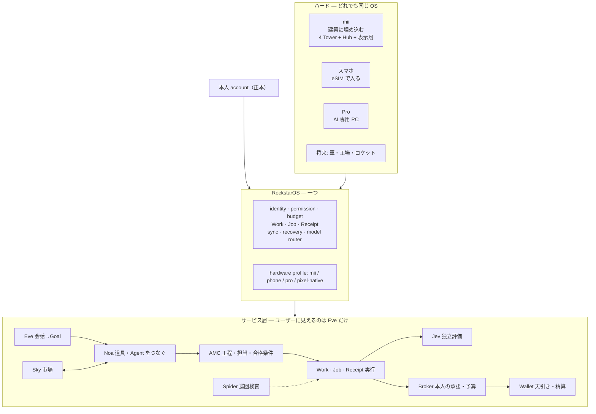
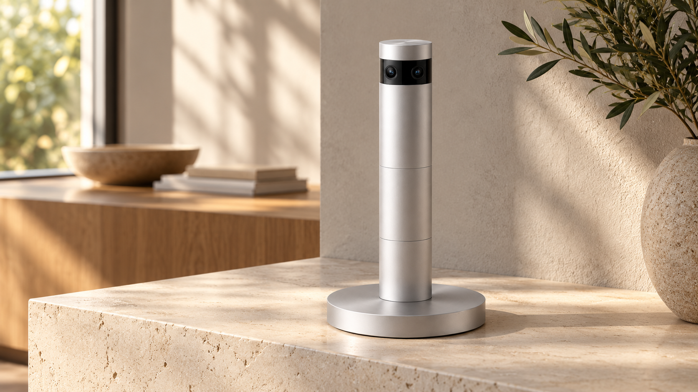
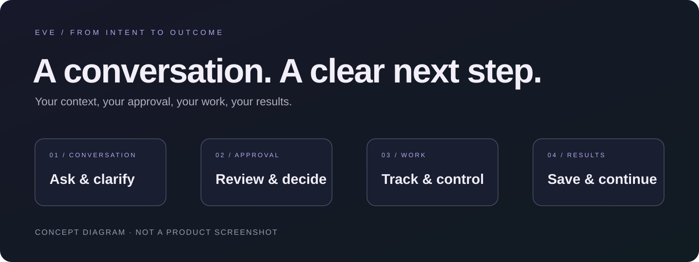
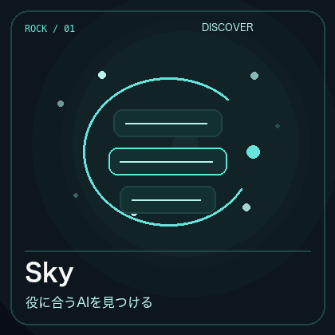
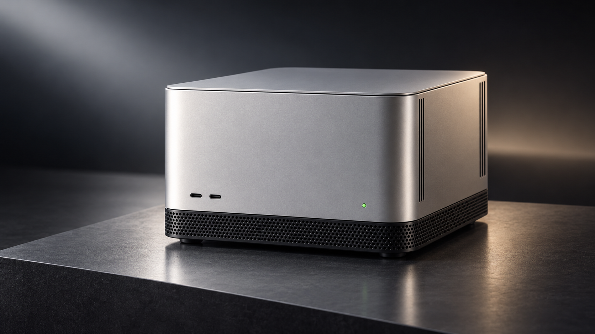

# rock — avokado の正本リポ（中の人向け）

<p align="center">
  
</p>

このリポは Noelle と Kaiya のためのもの。公開向けの説明は sites/ と PDF に置く。
**一つの account、一つの OS（RockstarOS）、どのハードでも続きから動く。** 話す相手は Eve。Eve が目的を決め、Noa が道具をつないで形にし、それを mii で見て触る。

| 知りたいこと | どこ |
| --- | --- |
| 設計の正本（世界観 → 製品 → システム → 事業） | [docs/structure/](docs/structure/00-overview.md) |
| Codex にやらせること | [codex/tasks/00-index.md](codex/tasks/00-index.md) |
| Codex の作業規則 | [AGENTS.md](AGENTS.md)（57 行） |
| いつ・何を変えたか | [CHANGELOG.md](CHANGELOG.md)（旧 README 冒頭の日付ノート全文を含む） |
| 整理前の README / AGENTS / project.md / PROJECTS.md | [archive/root-snapshot-20261029/](archive/root-snapshot-20261029/)、branch `archive/pre-restructure-20261102-main-1daf5c3` |
| 旧 393 件のタスク台帳 | [全タスクの進捗](archive/root-snapshot-20261029/project.md#全taskの作業進捗)（`npm run project:update` が更新し続ける） |
| 製品ごとの長い説明（Mini / OS / Eve / Sky / Pro の旧 README 本文） | [archive/root-snapshot-20261029/README.md](archive/root-snapshot-20261029/README.md#mini) |

---

## 1. 全体の絵



## 2. 製品（外から見える名前は 6 つだけ）

| 名前 | 何か | 正本 | 状態 |
| --- | --- | --- | --- |
| avokado | 会社・ブランド | — | — |
| **mii**（旧 avocadoMini） | 建築に埋め込む端末。Column / Puck / Slot の 3 筐体、中身は同じ Tower。1 本でも Eve 端末、4 本で空間 | [01-mii.md](docs/structure/01-mii.md) | R5を現行設計世代として維持（[R5 設計](docs/avocado-mini-r5/README.md)）。製造承認は**保留中**、R5実機試験の完了実績は0件。Gen1 試作へ（task 21）。Material Invention のシミュレーション・実験室接続は未実装 |
| **RockstarOS** | 全ハード共通の実行基盤 | [02-rockstaros.md](docs/structure/02-rockstaros.md) | Buildroot native・Android native・cloud runtime の 3 系統が動作中 |
| **Eve** | 話しかける相手 | [04-eve-noa-amc-sky.md](docs/structure/04-eve-noa-amc-sky.md) | Web 動作中 |
| **Sky** | Agent・Tool・情報の市場 | 同上 | Web 動作中、lib 104 本 |
| Pro | AI 専用 PC | 旧 README | 今回の整理の対象外 |

配布できるものは **eSIM** — [03-esim.md](docs/structure/03-esim.md)。GB を売らず、RockstarOS の鍵付き回線を月額で。

## 3. 名前

内側の名前（Eve / Noa / AMC / Jev / Spider / Sky / Work / Broker / Wallet）とコードの場所は下の表。正本と旧名の対応は [06-naming.md](docs/structure/06-naming.md)。

## 4. フォルダ地図（直すときはこの行だけ開く）

| 役割 | 設計 | コード | テスト | check |
| --- | --- | --- | --- | --- |
| mii | docs/structure/01, **docs/mii/design/**（設計書 V1）, docs/avocado-mini-* | systems/rock-star-os/targets/avocado-mini(→mii), lib/mii-*, contracts/avocado-mini-* | tests/mii-*, tests/avocado-mini-* | `avocado:r5:check` |
| RockstarOS | docs/structure/02, docs/native-os-integration.md, systems/rock-star-os/docs/ | lib/rockstar-*, systems/rock-star-os/os, android/, os/ | tests/rockstar-* | `android:architecture:check`, `device-support:check` |
| eSIM | docs/structure/03 | app/api/esim, lib/esim-*, lib/esimgo-*, app/connect, toolkits/esim-bootstrap | tests/esim-* | `npm test -- esim` |
| Eve / Noa | docs/structure/04 | lib/eve-*, lib/zema-chat-session.ts, app/chat, app/api/eve, app/api/llm | tests/eve-*, tests/zema-* | — |
| AMC | docs/mission-control.md, docs/amc-*.md | lib/amc-*, lib/jennifer-*, app/amc, app/api/amc, data/amc/ | tests/amc-*, tests/jennifer-* | `mission:check` |
| Jev / Spider | docs/jev-*.md | lib/jev-*, lib/spider-*, android/jev-provider, toolkits/spider-guard | tests/jev-*, tests/spider-* | — |
| Sky | docs/service-design/, docs/sky-*.md | lib/sky-*, app/sky, app/api/sky, services/sky-*, sites/sky-live | tests/sky-* | `sky:check` |
| Work / Broker | docs/agent-control-plane.md | lib/work-*, lib/workflow.ts, lib/a2a-broker-*, lib/agent-control-plane.ts | tests/work-*, tests/a2a-* | `work:check` |
| Wallet | docs/structure/05 | lib/wallet*, lib/settlement.ts, services/sky-billing, shared/stripe.mjs, app/wallet | tests/wallet-*, tests/settlement-* | `billing:check` |
| Game | docs/gx0*-*.md | lib/game-*, sites/avocado-mini/creator-kit | tests/game-* | `test:avocado-mini-site` |
| DB | docs/database-status.md | db/schema.ts, drizzle/, drizzle-main/, drizzle-legacy/（task 06 で 1 本に） | — | `database:check`, `schema:check` |
| サイト | — | sites/avocado-mini（Astro）, sites/sky-live, public/, public-release/ | — | — |
| 歴史（既定で読まない） | — | archive/, docs/evidence/（212 件）, workspaces/, toolkits/mr, vendor/mr, drizzle-legacy/ | — | — |

詳細版: [09-repo-layout.md](docs/structure/09-repo-layout.md)。文書の地図: [docs/README.md](docs/README.md)。確定要望 RQ01〜RQ50 は [docs/product-baseline.md](docs/product-baseline.md)（docs/structure と矛盾したら structure が勝ち、07 に日付を足して baseline を直す）。

## 5. 動かす

```bash
npm install
npm run dev            # Web（Eve / Sky / Wallet）
npm run verify         # PR 前。task 02 後は typecheck + lint + test（5 分以内が目標）
npm run verify:full    # 旧 40 段チェーン（task 02 後に用意）
```

native RockstarOS（Buildroot/QEMU）は systems/rock-star-os/README.md、Android は docs/native-os-integration.md、mii の試作は codex/tasks/21。

## 6. 今の優先（2026-11）

1. この構造整理を main に入れ、`verify` を短くする（task 01, 02）。
2. eSIM を esim-go sandbox で一周させ、Stripe 月額をつなぐ（task 11）。provider RFQ を本人が送る（task 10）。
3. 名前の統一（task 03, 04）。
4. mii Gen1 試作「1 プロジェクター＋1 壁＋頭追跡」（task 21）。
5. サービス書式で最初の 3 枚（task 32）。

収益と 1 ヶ月 / 1 年の計画は [05-business.md](docs/structure/05-business.md)。議事録から抜いた日付付きの決定は [07-decisions-from-minutes.md](docs/structure/07-decisions-from-minutes.md)。Kaiya の PDF への指摘は [08-pdf-review.md](docs/structure/08-pdf-review.md)。

---

# 製品の説明（写真・設計・コードの場所・開発状況）

ここから下は 2026-10-29 版 README の製品説明をそのまま残したもの（名前は旧表記のまま: Mini = mii、Smith = Noa、Jennifer = AMC、Zema = Eve/Work。対応は [docs/structure/06-naming.md](docs/structure/06-naming.md)）。**Mini → OS → Eve → Sky → Pro** の順に、何のための製品か、どう使うか、どこまで開発できているかを説明する。

[Mini](#mini)　／　[OS](#os)　／　[Eve](#eve)　／　[Sky](#sky)　／　[Pro](#pro)

<a id="mini"></a>

## Mini — 暮らしとまちづくり

Miniの[カメラ手指入力preview](systems/rock-star-os/targets/avocado-mini/gesture/README.md)は端末内追跡から表示の選択・移動・回転・取消だけを提案します。開始は本人操作とbrowserのcamera許可、停止/非表示/期限でtrackとworkerを閉じます。VIEW_ONLYの開発fixtureで、実空間の校正・実行承認・好み推定や実機精度の受入は別です。 model準備は対応するmacOS/LinuxのUID/O_NOFOLLOW/hardlinkを使い、既存対象を上書きしません。Windows等の未対応環境と旧残骸の手動確認条件は技術READMEを参照してください。

Miniの[開発用message service](systems/rock-star-os/targets/avocado-mini/tethering/MESSAGES.md)をPR238でmainへ限定採用。Broker/APの有限local入口・scheduler/停止・保存済み受信の確認を共通adapterへつなぎます。実製品identity、実modem/回線、Job取込み・実機の受入は別gateです。

日米のsi・メッセージ・小ファイル向け[共通message adapter](systems/rock-star-os/targets/avocado-mini/tethering/MESSAGES.md)を追加。有限分割・認証付き再組立・再送・TTL・共通通信量/料金予約をhostで検証する。実transport/常駐scheduler/Job引渡し・実機は未受入。Mini単体、表示4条件と既存料金gateを維持。 最新main同期の製品4/Pixel fixture2は固定検収hash一致、新host全verify3025件失敗0。[採用段階](docs/evidence/development-execution/mini-08-message-main-adoption.json)でheadCI/mainCIを原機能検収と別追跡。 Miniの共通message adapterはPR229/main a58c6ffaへ限定採用し、head全14CI・main全13CI成功。[現行受入](docs/evidence/development-execution/mini-08-message-main-current.json)。

[内蔵衛星modem・電池・回線候補と実機試験準備](docs/avocado-mini-r5/satellite-hardware-trial-plan.md)で比較条件とP0〜P5の記録項目を確認できます。 初期対象は日本・米国のsi／メッセージ／小ファイル通信に確定し、国別に検証します。実機通信・契約・閉箱携帯は未受入です。

衛星回線をWi-Fi共有する[制御prototype](systems/rock-star-os/targets/avocado-mini/tethering/README.md)を追加しました。`python3 -B systems/rock-star-os/targets/avocado-mini/tethering/demo.py` で、架空回線の接続許可・持ち出し・送受信量・料金上限・再起動復旧を試せます。実衛星/APはまだ接続していません。 host制御は[PR211](https://github.com/k999ln/rock/pull/211)でmain統合・同SHA全12CI成功。Linux制御も[PR212](https://github.com/k999ln/rock/pull/212)でmain `41ee45d7`へ統合し、同SHA全13CIの成功を確認しました。

[AP認証・網側上限adapter](systems/rock-star-os/targets/avocado-mini/tethering/ACCESS.md)を追加。 [PR215](https://github.com/k999ln/rock/pull/215)でmain `52b3d1d9`へ統合し、同SHA製品CI全13件成功。端末固有鍵と網側予約の確認後だけ転送を許可し、応答喪失や停止失敗を未確認として残します。事業者・modem未定の共通protocolで、実無線・実衛星・請求には未接続です。

Linux側の[転送制御と試験手順](systems/rock-star-os/targets/avocado-mini/tethering/LINUX.md)を追加。通常hostのcompiler試験と、使い捨てLinux VM上のroot namespace packet試験を分けて実行できます。Linux packet gate候補では、同一grantのIPv4/IPv6・送受信を共有quotaで強制し、停止・離脱・再起動時に旧許可を閉じる。隔離Linuxの実packet20件とcompiler4件に合格し、独立静的/host検収mustFix0。counterは最終確定とせず予約を保持する。実衛星/AP/Broker認証・Provider請求・電池の受入は別途必要。

<p align="center">
  
</p>

<p align="center"><sub>Mini R5の形状を踏まえて制作したコンセプトビジュアル。実機写真や性能の受入証拠ではありません。</sub></p>

<br>


### 目的と使う場面

Miniは、家庭や地域の空間に置いて使うことを考えた端末です。暮らしとまちづくりに貢献することを目的にしています。

R5を現行設計として、1本で使える構成を目指し、Proや建物Hubを必須にしません。

たとえば家庭では、声や手の動きを入口に、連絡や創作、遊び、許可した機器の操作を助けることを考えています。地域の施設では、案内や学び、住民が場所の使い方について意見を伝える入口などを活用案にしています。

まちづくりへの貢献は、機器を置くだけで成立するものではありません。その場所を使う人と管理する人が用途を決め、同意やプライバシー、手動で操作できる方法を含めて、一つの場所から確かめていく設計です。

### 設計の考え方

Miniは1本で使えることを基本にし、必要に応じて同型のMiniやProと連携する方向です。建物に取り付ける場合も、住民個人の情報と施設共通の設定を分けます。

- [R5の設計](docs/avocado-mini-r5/README.md)

- [製品目的・住民と施設の責任・受入条件](docs/service-design/03-product-profiles.md#mini-pro-purpose)

- [Material InventionとMiniの詳細](docs/rockstaros-avocado-mini-complete-design.md)

200mm以内の目標、任意の建築一体型取付、任意の国内LTE/IoT data SIMを扱います。

### コードの場所

現在公開している製品紹介と、ブラウザで動くゲーム制作・投稿受付のコードです。実機を動かす完成済みファームウェアを示す一覧ではありません。

- [製品ページ](sites/avocado-mini/src/pages/mini/index.astro)

- [ゲーム制作ページ](sites/avocado-mini/src/pages/create/index.astro)

- [動くブラウザゲームの雛形](sites/avocado-mini/creator-kit/)

- [投稿受付Worker](sites/avocado-mini/worker/participation.mjs)

ブラウザの制作機能とMini実機のソフトウェアは別の受入対象です。

### 現在の開発状況

処理中も、同じ画面内の「メインコンテンツへ」から操作欄へ戻れるよう修復中です。別画面への移動抑止は維持し、仕事や料金状態を変更しません。局所試験と合成ブラウザーfixtureで確認し、source/metadata独立検収とhost全体verifyが成功し、Git保存・最終同SHA CIへ引き継いでいます。[検証範囲と残条件](docs/evidence/development-execution/smith-running-skip-link.json)。

[Mini公開サイト](https://avocadomini.si/)にR5と製品目的を掲載。ブラウザゲームとアイデア・ゲーム投稿の受付があります。製造承認は**保留中**で、R5実機試験の完了実績は0件です。

実機の表示・入力・通話・電源・熱・保存/復旧、地域での実証、建築施工は未受入。R5の価格・発売日は未確定で、予約・決済は停止中です。

公開した版と確認結果は[公開確認の記録](data/mini-pro-purpose-publication.json)に保存しています。

Material Inventionは2D候補比較とSky/Zema接続がある段階で、シミュレーション・実験室接続は未実装です。

<br>

---

<a id="os"></a>

## OS — RockstarOS

Shellの[local capability観測](docs/rockstaros-complete-design.md#os02-capability-observation-freshness)は未来時刻・期限切れ・30秒超を未評価へ戻す修復をPR237でmainへ限定採用しました。host試験は `OS02_JAVA_HOME=<既存JDK17> python3 -m unittest tests.test_device_capability_freshness -v`。実機・全OSの受入は別gateです。

既存eSIM service setupの[provision再開fixture](docs/evidence/development-execution/esim-provision-recovery-main-adoption.json)は `node --experimental-strip-types --test tests/rockstar-service-setup.test.mjs` で検証します。file SQLiteの制御中断・明示再接続試験であり、実issuer・本番D1・電断・実課金の受入は別gateです。

<p align="center">
  
</p>

<p align="center"><sub>RockstarOSの世界観を表す既存GIF。OSの動作録画や実機受入の証拠ではありません。</sub></p>

<br>


### 目的と使う場面

RockstarOSは、各製品とサービスに共通する実行基盤です。本人性、権限、AI・Agentの実行、費用上限、端末適合、保存・復旧を共通のルールで扱います。製品名は **RockstarOS 1.0**、内部識別子は `dev.rock`、最初の配布ラベルはDeveloper Previewです。

OSは、誰の依頼なのか、どの機能を動かしてよいのか、費用はいくらまでか、結果をどこに保存するかを共通に扱います。別々の製品でも、こうした確認や仕事の引継ぎを最初から作り直さずに済む基盤を目指しています。

利用できる形は端末によって異なります。今あるPCやスマートフォンから使うWeb/clientと、端末そのものへ導入するnative OSを分けて開発しています。

### 設計の考え方

端末内のAI、本人用Linux、許可したCloudなど、仕事を実行する場所が異なっても、本人確認・権限・予算・成果の扱いを揃える設計です。ローカルLLMは対応端末の能力の一つで、全機種の必須条件ではありません。

- [全設計ポータル](docs/rockstaros-design-portal.md)

- [OS本体の詳細](docs/rockstaros-complete-design.md)

- [1.0構成](docs/rockstaros-1.0-architecture.md)

- [端末別設計](docs/device-support-architecture.md)

- [「RockstarOSを再設計」チャット](codex://threads/01a14d54-daee-7c30-87a8-faea84641a40)

OS本体の設計は、上記の「RockstarOSを再設計」チャットで確定した方針を大元にしています。

### コードの場所

端末で動くOSのコードと、既存OSやWebから使う画面・接続層のコードを分けて保存しています。対象端末に合う系列から確認してください。

- [native/Linux・QEMU](systems/rock-star-os/)

- [Android](android/)

- [OS接続層](os/)

- [Webの画面](app/)

- [共通業務の状態遷移](lib/workflow.ts)

- [native統合手順](docs/native-os-integration.md)

- [Linux toolkit](toolkits/sky-linux-local/README.md)

native統合手順にはOS系列ごとの実装・検証方法、Linux toolkitには開発用の接続手順をまとめています。

### 現在の開発状況

PR213はmain `2a9828b2`へ通常統合済みで、採用head全7CIと同mergeSHAの製品CI6件成功を確認しました。[統合証拠](docs/evidence/development-execution/esim-eve-ui-main-merge.json)。 eSIMサービス管理では、保存ackの後に現在の権限・同じ契約/実行を再読込できるまで操作を保留します。null・読込失敗・権限変更時は以前の私有情報や操作を隠し、「状態を再確認」でGETだけを行います。画面復帰時も再確認し、自動で申込・課金・再送しません。[契約と検収範囲](docs/rockstaros-complete-design.md#esim-ack-reconciliation)。

[PR209](https://github.com/k999ln/rock/pull/209)はmain `8f646ff3`へ通常統合済み。同一mergeSHAの製品CI7件成功、Linux実verify2938試験/2936成功/0失敗/2skipと専用Python cache6/update23を確認しました。8f時点のDependabot自動更新1件失敗は履歴として保持し、同8fの全check成功とは扱いません。後続PR216/main d2222dc5でundici制約修正を採用済みで、当時の別の自動更新失敗はzodで、後続PR225/main f4ed492cで制約修正を採用し、同SHAの製品7・自動更新2成功を確認しました。[現在の統合証拠](docs/evidence/development-execution/pixel-cache-main-merge.json)。PR213 UIはmain `2a9828b2`へ通常統合済みです。新c43 guardの限定実機試験と元codeへの復元は独立検収済みで、[PR223](https://github.com/k999ln/rock/pull/223)へ証拠保存済み（head2c0f3dfeの7CI成功）。追加証拠はPR223/main1ec70d62へ通常統合済み（採用head7e21の7CI、merge同SHA6CI成功）。端末は元code7fへ復元済みで、新c43の常設配備とは区別します。P02全体・全OS・実金融・一般公開は未受入、公開・配備・616一括公開は保留です。

PR218は検収済みhead2f737579（8CI成功）をmain7edbb9beへ通常統合し、同mergeSHAの8check成功（製品7/補助collect1）、Linux2993/2991pass/0fail/2skipを確認。PR225/mainf4の製品7・Dependabot2成功とZod修正を別証拠で確認した。root10/Mini2は旧監査snapshotで、後続PR225 receiptではroot7/Mini1（新規監査ではない）。原receiptの失敗・pendingは保持、公開/配備/616保留。 [現在の統合証拠](docs/evidence/development-execution/pixel-esim-prepared-work-main-merge.json)。

cache-only準備は取得済みbytesのversion/capabilitiesだけを確認し、原request/scope/model/hashに束縛した保存・再確認・取消を行います。不一致/不明時に取得・修復・推論へ切り替えず、同FDの限定metadata読込と固定payload更新fenceを使います。旧f3の限定物理測定/元code復旧は新c43の受入へ転用しません。[契約](docs/rockstaros-complete-design.md#pixel-cache-only-main-port)。

Web runtime、Linux/serviceとPixel/Lab adapterのコードをmainへ統合済み。Pixel 10 GL066 / frankelでは純正OS上の試験署名APKで非破壊の実再起動受入23/23が根拠です。

全OS build・正式署名・flash/boot・data/Keystore全損復元は未完了。[Pixelの境界](docs/phone-preview-20260911.md)。QEMU Developer Previewは独立した系列として保持し、最新候補の配布受入は[QEMU担当](docs/workstreams/06-native-qemu-release.md)で管理します。

eSIMは本人用Cloud Sky・Eve・Linuxサービスへの入口です。OS binaryをeSIMへ格納しません。既存OSのclient/browserと、機種ごとに署名・起動・復旧が受け入れられたnative OSを分けます。回線、SIM profile、利用権、client導入、OS導入も別の状態です。

<br>

### Game結果から仕事の下書きを作る

仕事画面で既存host fixtureのGame結果JSONと依頼を入力し、「仕事の下書きに入れる」で申告版・入力hash・目的を確認できます。取り込みだけでは保存せず、本人が「仕事を作成」を押して既存の未実行WorkJobへ保存します。入力/名前/templateの編集、破棄、本人scopeの再読込で古いGame下書きを無効にします。不明な保存結果は同じID/内容を明示確認し、自動再送しません。Game申告は完了・実行・予算承認になりません。[契約と検証範囲](docs/game-api-contract-draft.md#game-work-draft)。

---

<a id="eve"></a>

## Eve — 会話から仕事と成果へ

開発プレビューでは、Eveの「自分の担当を作る」で名前・目的・入力・期待成果を確認して保存し、続いて必要能力・Tool・PC実行先を選びます。Toolの入出力schemaと必須項目を希望と照らして確認します。Toolが追加の必須入力を求める場合は、担当の必要入力に追加してください。同じ担当でTool・実行先・入力・提供者申告の料金を確認してから仕事を作り、その後、別の実行内容の確認と承認を行うと、対応するToolの結果を同じ仕事に保存できます。料金申告は独立検証済みの見積ではなく、作成時の確認は実行許可ではありません。仕事の確認履歴では、作成時と実行直前の条件の違いを確認できます。旧仕事で記録がない場合は未記録と表示します。仕事の「mii連携のソフト試用」で同じ仕事を確認し、合成テキストを入力して「同じ仕事のTool確認へ渡す」を押すと、上のTool確認画面で引数を確認・承認できます。観測期限は30秒で、失効や停止要求時には古い表示を隠します。保存した仕事は残り、再表示には明示的な読直しが必要です。同じ仕事のソフト試用で「委任予算を読み直す」を押すと、既存A2Aの上限・予約・利用量記録を取得時点として確認できます。MCP料金や請求確定額ではなく、観測失効時は非表示になります。保存された応答はEveの仕事とmiiの両方で読み直せます。仕事からのTool実行は、既存`local-preview:` IDを設定した隔離loopback環境に限定され、通常account/eSIM・実mii・有料実行は未受入です。Tool結果は独立未検証として扱います。[契約と試験範囲](docs/service-design/02-system-contracts.md#eve-smith-miiの同じ仕事)。

miiソフト試用の「追加の必要能力」には、例 `{"executor":["model.inference"],"output":["audio.render"]}` のように能力IDを指定できます。空欄なら追加条件なし。観測宣言が不足または未確認なら入力を渡さず、保存済みの仕事は引き続き読めます。宣言は実行承認や実機の証明ではありません。

作者向けSDK 0.1.5の非推論作例は、配布archiveを展開して能力宣言とToolの接続を試せます。通常のpackはdistをbuildし、旧0.1.3・0.1.4 archiveも維持します。[作例と設定手順](toolkits/sky-tool-sdk/README.md#非推論の追加例)。宣言は実行権限ではなく、公開や課金を開始しません。 合成hostではEve・Smithで作成した仕事をmiiで読み戻し、承認済みの別remote委任の停止・使用量を同じ仕事で検証しています。実機・本番の受入は別です。

既存担当に保存された対象物・希望入出力の設定は、Skyの設定画面で名前や役割を編集しても保持されます。これは実機接続や実行許可ではありません。[互換契約](docs/service-design/02-system-contracts.md#eve-smith-miiの同じ仕事)。

Toolの能力確認では、接続先・Tool・申告版と観測日時・期限を確認できます。接続中の観測が期限切れの場合は「選択した実Toolを再確認」してください。接続先の宣言変更が検出された場合は接続画面で明示的に再接続し、内容を再照合・再承認してください。既存の仕事や結果は残ります。Tool申告は安全性や実行権限を保証しません。[照合契約](docs/service-design/02-system-contracts.md#eve-smith-miiの同じ仕事)。

担当の能力確認では、項目名に加えて「期待する入力型」「期待する成果型」をJSON object（例 `{"text":"string"}`）で入力し、「必要な処理能力ID」をJSON配列、「許容permissionとscope」を `[{"permission":"network","scopes":["origin:example"]}]` のように明示します。「使用する接続と操作」で実Toolを選び、Toolと実行先を選択して宣言を照合・保存します。空欄は未指定、`{}` と `[]` は明示した空条件です。対象が必要なpermissionのscopeが空なら未確認になります。旧担当は新条件を本人が設定するまで未確認です。これは提供者の宣言の照合であり、権限・安全性・料金の保証ではありません。実行には別の確認と承認が必要です。[照合契約](docs/service-design/02-system-contracts.md#eve-smith-miiの同じ仕事)。

Eveの資料付き依頼はPR232でmainへ限定採用した2〜4資料対応です。「資料を追加」「資料Nを外す」で準備し、合計8,000文字以内で保存・復元・見積比較します。2資料の既存保存は互換維持。3・4資料は新版形式で、生成・課金は開始しません。[契約と残gate](docs/rockstaros-complete-design.md#eve-multi-material)。

Eveの[保存資料の料金見積](docs/rockstaros-complete-design.md#eve-saved-source-estimate)を限定候補へ追加。`npm run dev`の`/os/eve/remix`で2〜4資料と依頼を無料準備・保存・読戻し後、「保存した資料で料金を見積もる」から必要なmodel/通貨/比較上限を選び、別の資料利用同意後に「見積のみ確認」を押します。比較上限は未承認で、生成・費用承認・課金は行いません。信頼できる単価がなければ利用不可を表示します。実local UIの保存/復元・503確認は既存2資料の履歴です。採用前の3・4資料検証はhost/API/VMのみでした。その後、実Reactと合成API/RAMによる3・4資料の保存・復元、見積表示/自然失効、owner切替を追加観測し、独立documentary検収しました。[現行証拠](docs/evidence/development-execution/eve-multi-material-main-current.json)。実認証・本番保存・Provider利用の受入は別gateです。数値正常/期限はfixtureと区別し、最新mainのSmith navとの復元・表示切替・入力保持も限定確認しました。実Provider単価・本番認証/保存・本番見積/課金・公開は別gateです。初回CIが指摘したテスト表現1箇所を修正し、製品動作は維持しています。Smith navはPR203でmainへ限定統合済みです。

<p align="center">
  
</p>

<p align="center"><sub>Eveの仕事の流れを表した設計図。実際の画面や自動実行の成功を示す画像ではありません。</sub></p>

<br>


### 目的と使う場面

会話、依頼、承認、進捗、停止、成果、利用額を同じ本人・同じ仕事に結び付け、対応端末へ引き継ぐ窓口です。

Eveは「話して終わり」にせず、その会話から依頼した仕事が今どうなっているか、何を承認する必要があるか、成果はどこにあるかを追える窓口を目指しています。

たとえばSkyで見つけたAgentへ仕事を頼む場合、Eveから依頼内容や条件を確認し、進捗を見て、必要なら停止し、できた成果と使用額を確認する、という流れです。会話したこと自体を、外部送信や有料実行の許可にはしません。

### 設計の考え方

会話の履歴と実行中の仕事は結び付けつつ、別の状態として扱います。保存した履歴を開く操作と、仕事をもう一度動かす操作を分け、再読込や端末の変更で意図せず再実行しないようにします。

- [Eveを含むOSの最新設計](docs/rockstaros-complete-design.md#redesign-thread-home-sky-eve)

- [サービス間の共通契約](docs/service-design/02-system-contracts.md)

- [Agent・Toolと仕事の詳細](docs/sky-tools-complete-design.md)

既存Zema系の仕事・承認・費用契約を再利用します。

### コードの場所

会話を表示する画面、本人別に履歴を保存するAPI、暗号化や仕事の状態管理を行う処理が主な入口です。

- [会話と仕事の画面](components/sky-chat-workspace.tsx)

- [履歴パネル](components/eve-history-panel.tsx)

- [履歴API](app/api/eve/history/route.ts)

- [暗号化履歴](lib/eve-history.ts)

- [仕事の状態遷移](lib/workflow.ts)

- [Eveモデルの学習・比較・Pixelクライアント試験用toolkit](toolkits/eve-model/README.md)（開発用。品質・Pixel本体での推論は別受入）

### 現在の開発状況

PR213はmain `2a9828b2`へ通常統合済みで、採用head全7CIと同mergeSHAの製品CI6件成功を確認しました。[統合証拠](docs/evidence/development-execution/esim-eve-ui-main-merge.json)。 保存資料のEve料金見積では、各単価の「100万token当たり」を1回だけ表示します。見積・上限比較・有効期限の扱いは従来どおりで、この画面から有料実行は開始しません。

会話の明示保存・読戻し・削除と、本人の成果をHTMLへ持ち出すコードをmainへ統合済み。

アカウント履歴には本人認証と運営側の `EVE_HISTORY_KEYRING` 設定が必要で、設定不足を保存成功と表示しません。履歴を開いても仕事は再実行しません。

実アカウントの別端末引継ぎは未受入です。

保存・復旧コードの統合範囲は[統合記録](data/runtime-integration-audit.json)を参照してください。

<br>

---

<a id="sky"></a>

## Sky — 情報とAgent・Toolの発見・接続

<p align="center">
  
</p>

<p align="center"><sub>発見と接続を表す既存GIF。実際の画面録画ではありません。</sub></p>

<br>


### 目的と使う場面

Skyは、情報やModel・Agent・Toolを投稿から見つけ、追加・接続するサービスです。仕事の依頼はEveへ引き継げます。Sky単体でも利用できる設計です。

Skyは、どんな機能があるかを知り、誰が作ったものか、何に接続するのか、どの権限と費用が必要かを確認する場所です。情報の投稿から、使ってみたいModel・Agent・Toolを見つける体験を目指しています。

見つけた機能を追加すること、サービスへ接続すること、実際に仕事を実行することは、それぞれ別の操作です。必要な設定や条件を確認したうえで、Eveへ依頼を引き継ぎます。

### 設計の考え方

Skyを使うためにMiniやProの購入、native OSの導入を必須にはしません。既存OSやブラウザからの単体利用も想定し、接続先ごとの互換性・権限・費用を確認します。

- [Tool全体の詳細](docs/sky-tools-complete-design.md)

- [MCPと接続の設計](docs/sky-mcp-architecture.md)

- [料金・usage・上限の契約](docs/sky-billing.md)

投稿の出典、作者・版・互換性、権限、費用、保存・復旧を扱います。

### コードの場所

画面、接続先を管理するAPI、コミュニティーで共有するOS版、配信・データ移行の処理をそれぞれ確認できます。

- [Sky画面と各Tool](app/sky/)

- [投稿型Home](components/home-screen.tsx)

- [接続hub API](app/api/sky/hub/route.ts)

- [共有OS版API](app/api/sky/community-os/route.ts)

- [Web配信とmigration](services/sky-web/)

### 現在の開発状況

投稿型Home/Sky、本人別保存、コミュニティーOSの版と鍵を扱うWebコードはmainへ統合済み。[総合・Sky入口](https://avoado.si/)があります。

実X投稿・独自For You・実MCP Providerの接続や、本番の料金・請求受入を一括で完了とは扱いません。[Web担当と公開記録](docs/workstreams/05-web-pwa-sites.md)。

機能の追加、商品の購入、仕事の実行、外部送信、課金は別の操作です。Cloud利用は事前見積・上限承認と明細を必要とし、許可済み予算を超えて実行しません。モデルの出力や作者の署名を権限承認へ昇格させません。mainと旧作業branchの料金案の差は[Git統合監査](docs/workstreams/10-git-ci-operations.md#redesign-thread-git)で別に照合します。

<br>

---

<a id="pro"></a>

## Pro — AI専用PCと半導体・関連部品の確保

<p align="center">
  
</p>

<p align="center"><sub>Studio筐体のコンセプトビジュアル。最初の試作候補A4-H2Oの実機写真ではありません。</sub></p>

<br>


### 目的と使う場面

Proは、AIモデルやAgent、制作・計算のための専用PCです。その製造・販売事業を通じて、半導体と関連部品を継続的に確保できる調達基盤を育てます。Miniなしで使う独立PCです。

利用者にとっては、AIモデルやAgent、制作処理を動かすための専用PCです。どのような仕事をしたいかに合わせて構成を考え、実際の性能・冷却・消費電力・保守性を確かめて製品にしていきます。

事業としては、PCの需要を把握し、検証した構成を継続的に製造・販売することで、GPU、CPU、メモリーなどの半導体と関連部品の調達につなげることを目指します。必要な部品や量を明確にし、供給元との関係や供給の継続性を育てる考え方です。

### 設計の考え方

ProはMiniの必須Hubではなく、単独で使うPCです。構成候補、見積、発注、納品、動作確認を分けて管理し、候補に挙げた部品をすでに確保した在庫として表示しません。

- [Proの詳細設計](docs/avokado-pro-pc-design.md)

- [製品目的・調達の責任と受入条件](docs/service-design/03-product-profiles.md#mini-pro-purpose)

- [部品・販売準備の台帳](data/avocado-pro-sales-readiness.json)

需要把握、構成検証、供給元との調整、発注・納品・品質検収を分けて扱います。

### コードの場所

公開ページの部品選択や構成保存、購入希望の受付を実装しているコードです。PC実機の組立・性能検証の完了を示すものではありません。

- [製品ページ](sites/avocado-mini/src/pages/pro/index.astro)

- [部品・構成選択](sites/avocado-mini/src/components/ProAssemblyWorkbench.astro)

- [構成操作と保存](sites/avocado-mini/src/pro-experience.js)

- [購入希望受付Worker](sites/avocado-mini/worker/pro-interest.mjs)

Miniと同じWebソース内にあります。

### 現在の開発状況

[Pro公開サイト](https://avocadopro.si/)で構成検討・保存・購入希望受付と事業目的を案内。最初の実機は銀色Lian Li A4-H2Oで試作する候補です。

実機組立・部品適合・供給契約・在庫確保・最終価格・決済・配送は未受入。半導体確保は事業目的であり、確保済みの実績ではありません。有料注文は開始していません。

公開した版と確認結果は[公開確認の記録](data/mini-pro-purpose-publication.json)に保存しています。

<br>

---

## 開発と検証

[eSIM復旧試験・Mini設計の現行受入](docs/evidence/development-execution/esim-mini-ready-design-main-current.json)はPR240/main c3c4845cへ通常統合済みです。head7/main6CI成功、Linux3075試験失敗0。PDF58頁はGit外、実開通/実課金・光学/PCB・実機/全体受入・公開は別gateです。

[eSIM ready復旧試験](docs/evidence/development-execution/esim-ready-recovery-review.json)は `node --experimental-strip-types --test tests/rockstar-service-setup.test.mjs` で実行します。制御中断後のSQLite再open試験で、実開通・実課金の受入ではありません。

[Mini空間OS設計v0.10](docs/avocado-mini-r5/spatial-computer-use-design.md)は `python3 docs/avocado-mini-r5/render-spatial-design.py output/pdf/avocado-mini-spatial-os-design.pdf` で再生成します。Python/reportlabと埋込可能な日本語TrueType fontを用意し、必要なら `MINI_PDF_JAPANESE_FONT` を指定します。PDFはGit外、旧local研究の参照可用性と採用済み実装は第1.2章で区別します。

準備済みPixel/Miniの[現行受入](docs/evidence/development-execution/prepared-device-mini-main-current.json)はPR238/main440fへ通常統合済みです。最終head14/main13CI、Linux3074試験失敗0・common103/packet26成功を確認。旧231/234は238経由の採用として区別し、元失敗・修復・検収receiptを保持します。Developer Previewの限定範囲で、実機・実回線・実camera精度・全OS・公開は別gateです。

Pixel診断の正常fixtureは、実empty観測からstdout出力を順序付けて時刻・hash・CPU・privacyのassertionを維持します。`python3 -B tests/test_pixel_worker_diagnostics.py` を入口とし、[独立検収と採用段階](docs/evidence/development-execution/pixel-empty-observation-main-adoption.json)でLinuxとhost、初回CI失敗と同SHA retryを分けます。OS237とSmith235の現行Git/CI受入は各current receiptに記録し、実機・全OS・公開は別gateです。

Gameの旧UI反例は固定main `ee9b88010c4ccb20be1db46177e3805380995c4b` を参照します。浅いcloneで検証する場合は `git fetch --no-tags --depth=1 origin ee9b88010c4ccb20be1db46177e3805380995c4b` で準備します。CIもこのcommitだけを取得し、旧WorkbenchのSHA256 `d93e120c16b86f136cada419a500a4b192e71319fafc597024bab701f6b7f6c2` を照合してから反例を実行します。

undiciはrootで修正版7系（`^7.30.1`）、Miniサイトで修正版8系（`^8.12.2`）をoverrideで許容し、各lockfileで実版を固定します。`npm ci` と `npm ci --prefix sites/avocado-mini` 後に `node --test tests/undici-dependency-security.test.mjs tests/undici-tls-options.test.mjs` で依存先とTLS設定の保持を確認できます。[修正・検証記録](docs/evidence/undici-security-constraint.json)。

Node.js 22.13以降とnpmを使用します。Webのローカル起動:

    npm ci
    npx wrangler d1 migrations apply DB --local --config wrangler.local.jsonc
    npm run dev

Mini/ProのWebソースは [sites/avocado-mini](sites/avocado-mini/) に共通で保存します。正式ドメインのrootはWorkerで各製品へ振り分け、旧 `/mini/`・`/pro/` は正式URLへ転送します。

変更の検証:

    npm ci --prefix sites/avocado-mini
    npm run project:update
    npm run design:check
    npm run verify

実装の承認・受入gate、次の作業、検証結果は [project.md](archive/root-snapshot-20261029/project.md)、[進捗JSON](data/project-status.json)、[作業分野](docs/workstreams/README.md)を確認してください。[全タスクの進捗](archive/root-snapshot-20261029/project.md#全taskの作業進捗)も参照できます。作業数は製品の完成率を表しません。GitHub保存、mainへの統合、各サイトの配備は別に記録します。


## 権利と公開・実機の境界

公開サイトは、総合・Skyの [avoado.si](https://avoado.si/)、Miniの [avocadomini.si](https://avocadomini.si/)、Proの [avocadopro.si](https://avocadopro.si/) です。各サイトの配備・DNS/TLS・表示の証拠と、実機・実Provider・本番課金の受入を区別します。本人用localhost Labや秘密情報は公開サイトへ移しません。

端末初期化・bootloader解除・flash、契約、実資金、外部送信は対象ごとの条件を確認します。Gitへ秘密鍵、原稿、本人データを保存しません。[配布計画](docs/release-minimum-gates.md) / [権利と配布物](public-release/rockstaros/README.md)。

Development: the explicit offline D1 alias helper is documented in [Git operations](docs/workstreams/10-git-ci-operations.md#git-04-explicit-local-d1-filename-alias-compatibility). It does not perform remote migrations or complete the Root/main schema union.

The offline alias helper requires SQLite authorizer/serialize/deserialize APIs (tested Node26.12.1), reviewed reference profiles and a second independently reviewed candidate before adoption. It never executes source SQL during planning.

Repository verification (`npm run verify`) uses Node26.12.1, matching the verify workflow and the accepted offline SQLite helper API boundary. `package.json` retains the existing application engine floor; it does not declare older engines capable of the offline helper. Tests are not skipped to emulate missing authorizer/serialization APIs.

Offline apply now requires an owned private0700 parent for both source copy and backup, trusted directory ancestry and a single-link complete rollback-journal SQLite copy with no recovery/WAL sidecars. It does not repair or modify a live database into that state. Backup snapshot bytes are saved, synced and restored through one O_EXCL/no-follow fd, held through the guarded commit; detected namespace replacement/disappearance refuses the operation. Single-operator offline copies are the scope; arbitrary root/same-UID host code is not isolated by this helper.

開発者向け: PR248でmain統合・同SHA CI確認済みのservice attachment検証は、入力から分離したsnapshotを返します。フィールド・署名wire・API引数・TTLは維持し、object identityの同一性を前提にせずfieldを扱います。成功値をdispatch許可にせず、現在factsと既存atomic gateを確認してください。[契約](docs/rockstaros-complete-design.md#esim-attachment-async-binding)。

開発の現在primaryはmiiの成立判断1件です。実行queueと所有・証拠段階は[data/development-model-routing.json](data/development-model-routing.json)のcurrentExecution、運用と残gateは[Git作業入口](docs/workstreams/10-git-ci-operations.md#execution-recovery-20261028)を参照してください。`npm run mission:check`は宣言の矛盾を拒否しますが、実GitHub/物理受入の証明は独立検収で確認します。

<sub>進捗 JSON の自動要約（`npm run project:update` が書き換える。読まなくてよい）</sub>
<!-- project-overview:start -->
Updated: 2026-10-29 / 393 task records (32 parents, 192 children, 169 standalone; 361 execution units excluding parents): 114 done, 48 in progress, 230 planned, 1 blocked
<!-- project-overview:end -->
