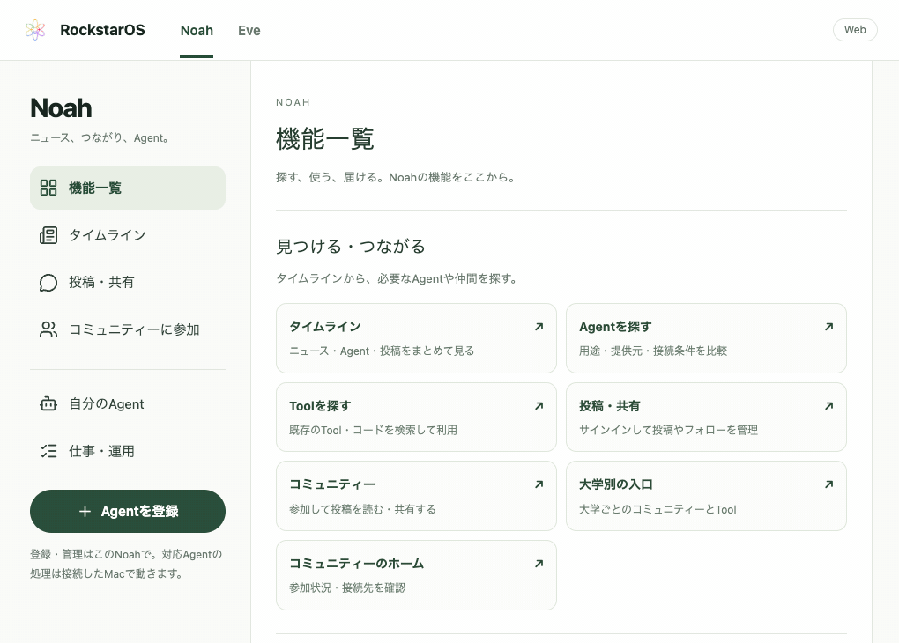
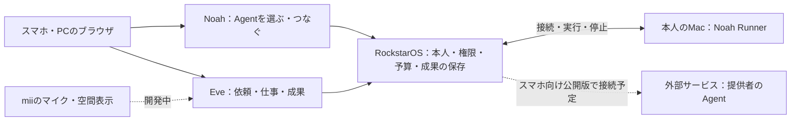
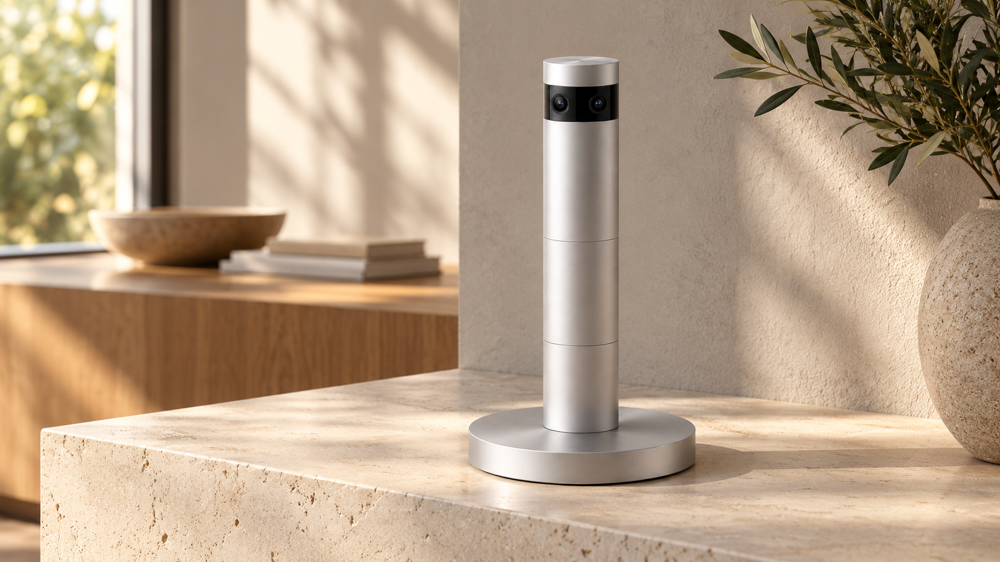
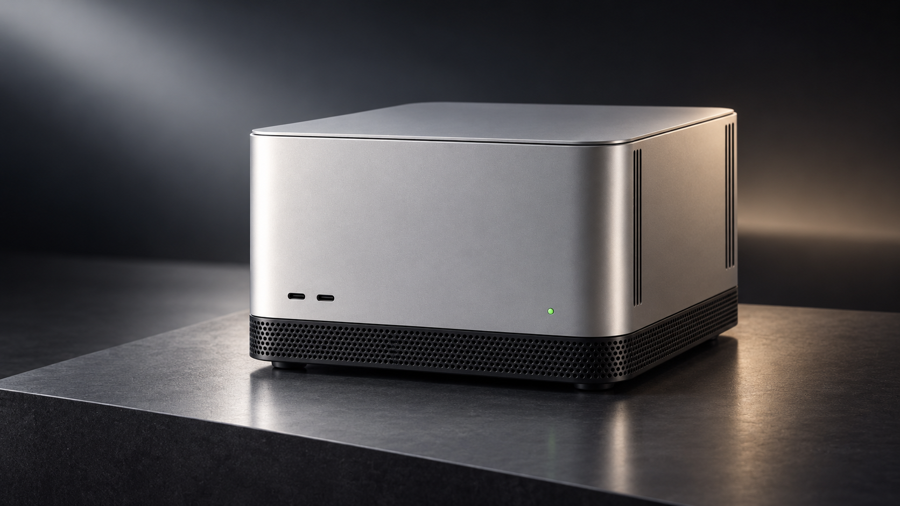

# avokado 開発ノート

*2026年11月20日更新*　·　[Noahを開く](https://avoado.si/noah)　·　[Eveを開く](https://avoado.si/os/eve)

avokadoの主商品 **mii** は、声でEveに頼み、部屋に表示された成果を見たり触ったりして仕事を進める端末です。その最小構成が **Noah** です。まずは自分のMacで、Agentを選んで動かし、成果を受け取って停止するところまで確かめます。スマホから使う公開版では、提供者のサーバーがAgentを動かします。

> ### 開発ハイライト
>
> - **[Agentを探す](#catalog)** — Noahの「機能一覧」から名前で検索し、提供元と接続条件を確認できます。実際の操作を短いデモにしました。
> - **[自分のMacをつなぐ](#noah-mac)** — Apple SiliconのMacにRunnerを入れ、本人のアカウントで接続し、仕事と実行器の状態を確かめます。
> - **[スマホで頼む](#noah-public)** — 接続して入力を送り、成果を受け取り、接続を切る。公開前に確かめる一周を入出力の例で紹介します。
> - **[Eveに依頼する](#eve)** — 会話に依頼を書き、実行先・担当・モデルを選びます。仕事と成果をもう一度開く場所も確認できます。
> - **[miiで空間を使う](#mii)** — 声と手の動きを4本のTowerとHubで受け取り、部屋の表示を操作する設計です。

開発環境がある方は[起動と検証](#development)へ。進行中の作業と次の実機試験は[進捗](project.md)で確認できます。

ページの途中から別の項目に移るときは、GitHubのファイル上部にある「Outline」から各章や操作の見出しを選べます。[GitHubの目次の使い方](https://docs.github.com/ja/repositories/managing-your-repositorys-settings-and-features/customizing-your-repository/about-readmes#auto-generated-table-of-contents-for-markdown-files)

---

<a name="contents"></a>

<table>
<tr>
<td valign="top" width="24%">

**このページの目次**

[Agent検索](#catalog)<br>[全体構成](#architecture)<br>[本人のMac](#noah-mac)<br>[スマホ公開版](#noah-public)<br>[Noahの機能](#noah-tools)<br>[Eveの仕事](#eve)<br>[RockstarOS](#rockstaros)<br>[SIM・eSIM](#esim)<br>[mii](#mii)<br>[Pro](#pro)<br>[開発と検証](#development)

</td>
<td valign="top">

<a name="catalog"></a>

## NoahでAgentを探す

### 提供元と接続条件を開く

**画面**　`機能一覧` → `Agentを探す` → `詳細を見る`

「Agentを探す」を開き、検索欄に `Anicca` と入力します。「詳細を見る」には、配布元、確認状況、費用、ライセンスの情報と、Macで接続するための入口が並びます。



*開発環境の操作デモ。検索結果を開くところまでを収録しています。* [カタログを開く](https://avoado.si/noah/agents)

</td>
</tr>
</table>

<a name="architecture"></a>

## 全体の接続構成

**Noah** でAgentを選び、**Eve** で依頼や成果を扱います。どちらも **RockstarOS** の本人確認・権限・予算・保存を使います。RockstarOSから右に伸びる実線が本人Mac、点線がスマホ向け公開版で使う提供者のAgentです。[全体の設計と各層の役割](docs/structure/00-overview.md)



<details>
<summary>製品ごとの入口と開発状況</summary>

| 製品 | 役割 | 入口・現在の範囲 |
| --- | --- | --- |
| Noah | miiへ進む最小構成。Agentを集める・つなげる・載せる | [avoado.si/noah](https://avoado.si/noah)。公開カタログ・Agentの選択 |
| Eve | 依頼、担当設定、仕事、成果、停止、使用量の確認 | [avoado.si/os/eve](https://avoado.si/os/eve)。実行には本人確認と対象Toolの接続・権限が必要 |
| RockstarOS 1.0 | 本人性、権限、予算、仕事の状態、保存・復旧を共有するruntime | Developer Preview。Web、Linux/QEMU、Android/機種別OSを別々に受入 |
| mii | 声・手・表示・センサーを共通の仕事へつなぐ空間端末 | [avocadomini.si](https://avocadomini.si)。設計・ソフト試作段階 |
| Pro | siモデル・Agent・制作・計算の専用PC | [avocadopro.si](https://avocadopro.si)。構成・実機・販売の受入は個別管理 |

</details>

<a name="noah-mac"></a>

## Noahを自分のMacで動かす

### Runnerを入れて本人のMacを登録する

**画面**　[自分のMacをNoahにつなぐ](https://avoado.si/noah/mac)　·　**対象**　Apple Silicon Mac

1. 接続画面で「Mac用Noah Runnerをダウンロード」を選び、ZIPを展開して `Install.command` を開きます。
2. ターミナルで次のコマンドを順に使います。`noah doctor` の診断で不足したものがあれば、接続画面の導入手順を確認します。`noah pair` で表示されたURLを開き、自分のアカウントでこのMacを承認します。

```sh
noah doctor
noah pair
noah start
```


### 仕事を実行し、成果を確認して停止する

[Agentを使う](https://avoado.si/noah/launch)で自分のMacとAgentを選びます。依頼した仕事の成果と停止操作は同じ管理画面にあります。初めてサインインする場合は、本人確認を終えると登録やMac承認の画面に戻ります。

実行器全体を止めるには `noah stop` を使います。回線が切れた仕事は自動で再実行されません。再接続したら `noah receipts` で同じ仕事の報告を照合できます。

```sh
noah stop
noah status
noah receipts
```

> **検証状況**　ローカルAPIと実コンテナで接続・実行・成果受領・停止を確認済みです。配布ZIPは空の保存領域で導入を確認しました。未導入の別Macと本番HTTPSを使った一周が次の実機試験です。動作にはMacの電源と通信が必要です。[導入と実行の仕様](docs/services/noah-standalone-launch.md) · [検証記録](codex/tasks/71-noah-standalone-launch.md)

<a name="noah-public"></a>

## Noahをスマホから使う（公開に向けて開発中）

### 接続して依頼し、成果を受け取る

**操作する場所**　スマホのブラウザ　·　**Agentが動く場所**　提供者のサーバー

1. **選ぶ。** カードを開き、提供者と「入力はどこへ送られるか」を読みます。
2. **つなぐ。** 「接続」を押します。サインインが必要な場合は、認証後に同じ操作へ戻ります。
3. **頼む。** 道具を選び、必要な項目だけを埋めます。初回に確認が必要な道具は、送る内容を確かめてから依頼します。
4. **受け取って切る。** 仕事の一覧から成果を開きます。使い終えたAgentとの接続を切った後も成果は残ります。

### 入力が成果になる例

参照試験の検索用Tool `lookup` に、検索語 `mizan` と上限 `５` を入力すると、上限は数値に直して次の形で渡されます。

```json
{"name": "lookup", "arguments": {"query": "mizan", "limit": 5}}
```

この試験の接続先が返す表示は「mizan は 3 件」と「（画像 1 件）」です。手元で次を実行すると、外部に入力を送らずに同じ例を確認できます。

```sh
node --experimental-strip-types --test docs/design-validation/noah/noah-loop.test.mjs
```

公開の条件は、初めての利用者が自分のスマホで一周できることです。[公開までに作る順番](docs/noah/mvp-launch.md) · [各機能の仕様書](docs/noah/README.md)

<a name="noah-tools"></a>

## Noahのその他の機能

### タイムラインと本人のライブラリ

タイムラインの「Agent」「ニュース」「コミュニティー」で表示を切り替え、検索欄で絞り込めます。投稿やフォローにはサインインが必要です。保存した担当、端末、成果、購入・販売は「機能一覧」から開きます。[タイムライン](https://avoado.si/noah) · [機能一覧](https://avoado.si/noah/features)


*Noahの発見と接続を表すコンセプト。* 公開カタログは公開資料を使います。個人が登録したAgentは固定版を保存し、別の権限を持つ担当が審査してから公開版に追加します。公開審査には担当の設定、決済にはサービス接続と個別の確認が必要です。

### 本人用セレクト・リセール

ストリート、アーカイブ、オブジェの3担当が、候補・採算・共有予算・在庫・出品原稿・収支を扱います。Webの入口は `/noah/resale`。CLIのデモは外部通信なしで動きます。

```sh
npm --prefix toolkits/noah-resale-agent run demo
```

初期予算は0です。実購入・実出品にはAPI利用権、接続設定、予算、具体的条件を確認した記録が必要です。WebはD1、CLIはSQLiteに保存します。入金同期と無人運用は未検証です。[CLIの使い方](toolkits/noah-resale-agent/README.md) · [実行・停止・照合の仕様](docs/services/noah-select-resale.md)

<details>
<summary>Noahの画面・接続・Toolのコード</summary>

| コード | 内容 |
| --- | --- |
| [app/noah/](app/noah/) / [components/noah-timeline.tsx](components/noah-timeline.tsx) | 公開タイムラインと機能画面 |
| [lib/noah-surface.ts](lib/noah-surface.ts) | 公開側とMac側の遷移 |
| [services/sky-web/noah-page-routes.mjs](services/sky-web/noah-page-routes.mjs) | 現行URLと互換URLの対応 |
| [Mac API接続](scripts/noah-local-api.mjs) / [コード取得](scripts/noah-source-bytes.mjs) | 既存機能で共有する通信・容量照合。本人・招待・公開版の条件は各経路で保持 |
| [Tool詳細設計](docs/sky-tools-complete-design.md) | 入出力・権限・保存・失敗・復旧・受入 |

</details>

<a name="eve"></a>

## Eveで依頼・仕事・成果を扱う

### 依頼を書いて実行先を確かめる

**画面**　[Eveを開く](https://avoado.si/os/eve) → `Eveに依頼する` → `実行先・担当・基盤モデルを確認する`

「今週の学習メモを、次に調べたいことと一緒に整理したい」と入力した例です。入力欄の下を開くと、会話の一部と依頼がどの実行先に送られるかを確認できます。


*開発環境で依頼を書き、送信する前の状態です。この例では実行先が未接続なので、接続設定の案内が出ています。* 会話を続けるときは履歴から、依頼した仕事と成果は「仕事と成果」から開きます。実行には本人確認と、使うToolへの接続・権限が必要です。

### 仕事の工程と検収


Eveが目的を受け取り、Noaが道具とAgentをつなぎ、AMCが工程・担当・合格条件を決め、Jevが結果を検収します。下のデモでAMCの実行、別プロセスでの検収、差し戻しと再計画を試せます。成果の編集・持ち出しは、その仕事の保存方式に従います。

```sh
npm run amc:cycle -- demo
```

工程の組み合わせ、見積り、会社受注の分配を計算するライブラリと、募集文面を判定するCLIがあります。外部への応募・契約・納品・送金までの接続は開発中です。[仕事の計画](docs/sky-work-loop.md) · [実行・停止・復旧](docs/amc-goal-orchestrator.md#goalから逆算するローカル実行と再計画)

<details>
<summary>Eveのコードと担当設定</summary>

| コード | 内容 |
| --- | --- |
| [app/os/eve/](app/os/eve/) / [components/sky-chat-workspace.tsx](components/sky-chat-workspace.tsx) | 会話・仕事・Toolの画面 |
| [lib/workflow.ts](lib/workflow.ts) / [lib/work-store.ts](lib/work-store.ts) | 状態遷移・本人別保存・revision競合判定 |
| [docs/structure/04-eve-noa-amc-sky.md](docs/structure/04-eve-noa-amc-sky.md) | Eveと担当構成・実行・評価の責任 |

担当設定は[全社役割台帳](data/company-role-map.json)、[営業担当台帳](data/revenue-role-map.json)、[担当別の設定](.cursor/agents/)にあります。

</details>

<a name="rockstaros"></a>

## RockstarOSで仕事を引き継ぐ

### 対応端末と次の実機試験

**配布段階**　Developer Preview　·　**内部識別子**　`dev.rock`

RockstarOS 1.0は、本人のアカウントに権限・予算・仕事・成果を結び付けます。端末ごとの入出力と更新・復旧の違いはhardware profileとadapterで扱います。下の表から、試したい環境の検証段階を確認できます。

| 対象 | 現在の範囲 | 次の受入 |
| --- | --- | --- |
| Web / 既存OS client | Eve・Noahと共通の仕事・保存・権限の実装 | 本人アカウント、外部Tool、別端末引継ぎの同条件確認 |
| Linux / QEMU | 独立したDeveloper Preview系列 | 配布する同一artifactの導入・保存・再起動・復旧 |
| Pixel 10 GL066 / frankel | Android clientと機種別OS準備 | 現候補での接続・復旧、正式署名、全OS build、flashと同一image受入 |
| mii / Pro | 共通runtimeへ接続するprofileと設計 | 実機の入出力・電源・停止・保存・復旧 |

端末内モデルの出力を外部操作に使う際も、実行先の権限と本人の承認を確認します。[native OS](systems/rock-star-os/README.md) · [Androidとnativeの区分](docs/native-os-integration.md) · [対応機種](docs/device-support-architecture.md) · [リリース条件](docs/release-minimum-gates.md) · [モデルの評価](docs/llm-evaluation-architecture.md)

<a name="esim"></a>

### OSを導入するときのSIM・eSIM

SIM/eSIMはRockstarOS導入時の回線に使います。対象機種と署名・復旧条件がそろった端末にはnative OSを案内し、そのほかの対応端末ではclientやブラウザを使います。OS本体は端末に置き、本人確認・回線・サービス利用権・インストール状態をそれぞれ管理します。

Cloud agentの実行前に単価・見積りと予算上限を確認し、実行後に項目別の使用量を照合します。商品料金、通信料、si使用料、外部実費、利用者自身の鍵での費用は個別に扱います。回線発行・本番決済は各providerとの接続試験が残っています。[SIM/eSIM設計](docs/structure/03-esim.md) · [料金と使用量](docs/sky-billing.md) · [導入試作](toolkits/esim-bootstrap/README.md)

<a name="mii"></a>

## miiで声と手を使う

### 部屋に表示した仕事を操作する

声でEveに依頼すると、4本のTowerが部屋や手の動きを捉え、別体のHub上のRockstarOSが入力をまとめ、差し替え可能な表示層へ渡す設計です。表示を見たり触ったりしながら、連絡、創作、遊び、許可した機器の操作を進めます。Towerが1本の構成では、Eveの機能を限定して使う想定です。



*部屋に組み込んだmiiのコンセプト。* R5を現行設計として試作を進めています。製造承認は保留中で、R5の実機試験は完了0件です。次に実機で確かめる項目は、光学・熱・電源・停止・取り付け・警報です。V2・天井型は比較研究の段階です。[miiの構造](docs/structure/01-mii.md) · [R5設計](docs/avocado-mini-r5/README.md) · [V2の比較研究](docs/mii/design/v2-study/README.md)

空間入力の実装と機種設定から、手の入力がどこで処理されるかを追えます。Material Inventionには再計算用sandboxと設計資料があり、シミュレーション・実験室接続は未実装です。[空間入力のコード](lib/mii-spatial-input.ts) · [機種設定](systems/rock-star-os/targets/avocado-mini/) · [Material Inventionの設計](docs/rockstaros-avocado-mini-complete-design.md) · [製品サイトのコード](sites/avocado-mini/)

<a name="pro"></a>

## Pro — si専用PC



モデル・Agent・制作・計算を動かす独立PCの開発計画です。用途ごとに構成、実性能、冷却、消費電力、保守性、調達を確認します。miiを持つことを利用条件にしません。販売・出荷・一般機種対応は、正確なSKUと同じ実機の検証が必要です。

[Proの機種適合](docs/device-support-architecture.md) / [公開入口](https://avocadopro.si)。

<a name="development"></a>

## 開発と検証

### この作業フォルダで始める

複数の作業フォルダを使うときは、最初に `git status -sb` で現在のブランチと未コミットの変更を確認します。共通の作業方針は[GitHubのmainのREADME](https://github.com/k999ln/rock/blob/main/README.md)で確認できます。

リポジトリのルートで依存を入れて開発サーバーを起動し、ターミナルに表示されたURLの `/noah/features` または `/os/eve` を開きます。Node.js・npmと依存の指定は[package.json](package.json)と[package-lock.json](package-lock.json)にあります。

```sh
npm ci
npm run dev
```

### 変更した内容を検証する

`project:update` は進捗文書を同期します。`verify` は型、lint、テスト、設計、ビルド、ローカルAPIを検査します。本人の秘密情報は環境変数かGit外の保存先に置きます。

```sh
npm run project:update
npm run verify
```

macOSでHomebrewのOpenSSL 3を使う場合は `PATH=/opt/homebrew/opt/openssl@3/bin:$PATH npm run verify` で実行できます。DBやproviderの設定は対象機能の手順に従います。

| 作業 | 入口 |
| --- | --- |
| 製品要件・現在の名称 | [product-baseline](docs/product-baseline.md) / [名称正本](docs/structure/06-naming.md) |
| 現在の作業と設計 | [Codex task一覧](codex/tasks/00-index.md) / [文書地図](docs/README.md) |
| 分野別の実装・検証 | [workstreams](docs/workstreams/README.md) / [責任分界](docs/workstreams/00-responsibility-boundaries.md) |
| DBのschema・適用状態 | [database status](docs/database-status.md) |
| 製品全体・Tool詳細 | [design portal](docs/rockstaros-design-portal.md) / [Tool詳細](docs/sky-tools-complete-design.md) |

<!-- project-overview:start -->
更新日: 2026-11-20。現在の受入範囲と次の作業は[進捗](project.md)、全タスクは[全タスクの進捗](project.md#全taskの作業進捗)を参照してください。
<!-- project-overview:end -->

個々の変更とPRは[変更履歴](CHANGELOG.md)にあります。コードに残る `sky`・`zema` は互換性のための識別子です。公開サービス名はEveとNoahです。

[このページの目次に戻る](#contents)
