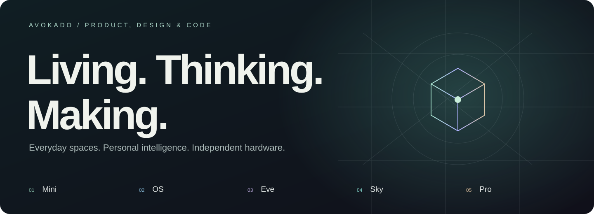
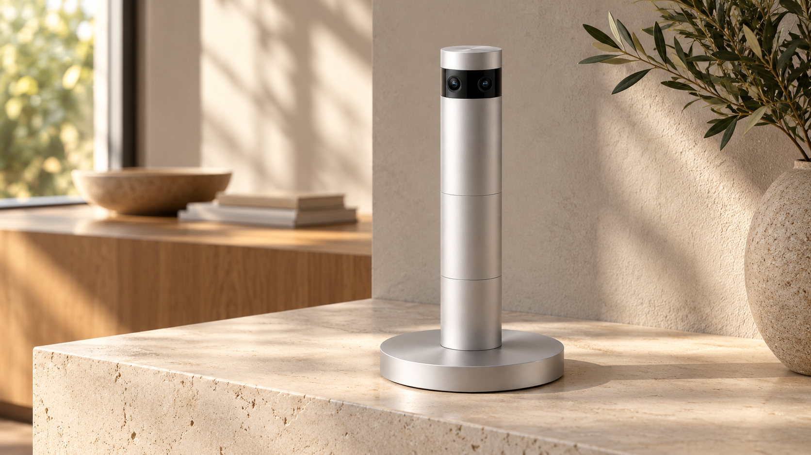
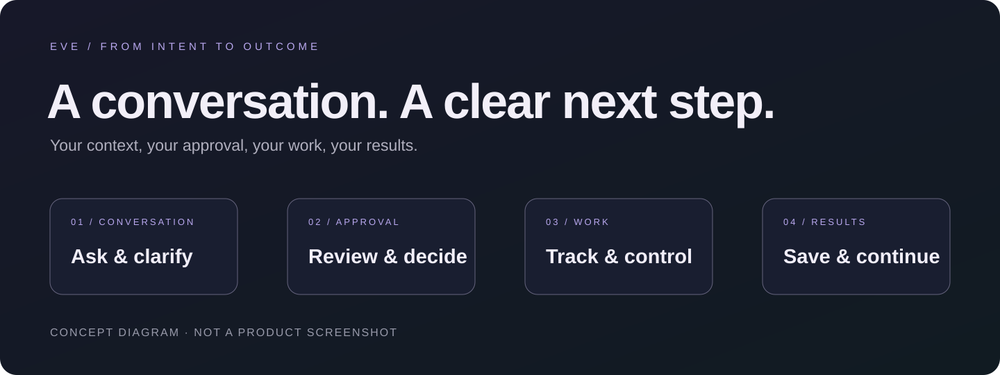
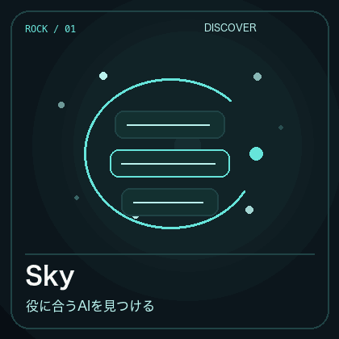
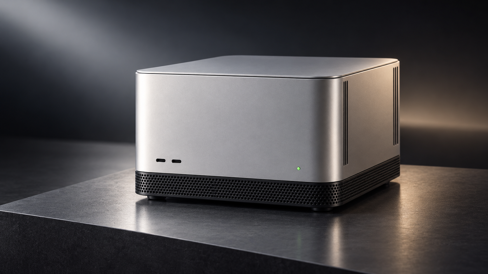

[PR207](https://github.com/k999ln/rock/pull/207)はmain `0d726717`へ通常統合済みで、同一SHAのCI6件成功を確認しました。公開・配備・616件一括公開は保留です。採用済みの[Wallet process復旧fixture](docs/sky-billing.md#wallet-process-recovery-fixture)は `node --experimental-strip-types --test tests/billing-process-recovery.test.mjs` で実行できます。合成local SQLiteの子processを13点で強制終了し、再接続・再送の一意性を検査します。POSIX限定でWindowsはskip。本番金融の受入ではありません。 [PR208](https://github.com/k999ln/rock/pull/208)はmain `2854d069`へ通常統合済みで、同mergeSHAの全6CIとLinux実verify（2911試験・2909pass・0fail・2skip）が成功しました。原本の記録時pendingと現在のGit受入を分けた[統合証拠](docs/evidence/development-execution/wallet-process-recovery-main-merge.json)を保存しています。

Proの[私有原本archiveへの入口](docs/rockstaros-complete-design.md#pro-original-archive-entry)を限定候補へ追加。Proの「Move private notes safely」でpreview・別のfile export同意・downloadを行い、「Open private archive on avoado.si」から既存`/account/import/pro`へ進みます。sign in後に同fileを手動で選び直し、保存先accountと別の保存同意を確認します。原文は元browserとfileへ保持し、自動転送・仕事化・native移行は行いません。Chromeのlocal1512/390表示とpreview/cancelを限定確認。認証済server保存・公開先実click・配備は別gateです。Wallet DB復旧test-onlyはPR206/mainb1b0で限定統合済み。[11lane/95unit/履歴42成果の引継ぎ要約](docs/evidence/development-execution/all-lanes-main-handoff-summary.json)を参照してください。

Walletの[DB復旧fixture](docs/sky-billing.md#wallet-legacy-db-recovery-fixture)をtest-only候補へ追加。`node --experimental-strip-types --test tests/billing-worker.test.mjs tests/earning-bridge.test.mjs tests/wallet-deposit-provenance.test.mjs`で、合成receiptのSQL中断/ack喪失後の同file再open・同key再送・上限照合を確認します。実Worker・料金・鍵・888ルール・default ToC holdは変更していません。実収益/認証端末/Cloudflare並行/本番金融は別受入です。Game host fixtureはPR205でmainへ限定統合済みです。

Game作者向け[host fixture CLI](docs/game-api-contract-draft.md#game-creator-host-fixture)を限定候補へ追加。`node --experimental-strip-types scripts/game-creator-fixture.mjs --help`から、所有するprivate temp directoryで固定粒子sessionのstart/read/resumeを試せます。既存save形式で再開・同一retryを照合し、不明な保存やlockは自動削除しません。合成ownerのhostサンプルで、任意engine・認証owner保存・fullSDK・金融・実機・公開の受入ではありません。Eve見積onlyはPR204でmainへ限定統合済みです。

Eveの[保存資料の料金見積](docs/rockstaros-complete-design.md#eve-saved-source-estimate)を限定候補へ追加。`npm run dev`の`/os/eve/remix`で2資料と依頼を無料準備・保存・読戻し後、「保存した資料で料金を見積もる」から必要なmodel/通貨/比較上限を選び、別の資料利用同意後に「見積のみ確認」を押します。比較上限は未承認で、生成・費用承認・課金は行いません。信頼できる単価がなければ利用不可を表示します。実local UIは保存/復元と503を確認し、数値正常/期限はfixtureと区別、最新mainのSmith navとの復元・表示切替・入力保持も限定確認しました。数値/expiry実browser、最終CI/検収・公開は別gateです。初回CIが指摘したテスト表現1箇所を修正し、製品動作は維持しています。Smith navはPR203でmainへ限定統合済みです。

小型画面の[下部ナビ](docs/rockstaros-complete-design.md#smith-mobile-bottom-navigation)を限定候補へ更新。`npm run dev`のHomeや既存WorkspaceShellで、幅700px以下にSmith・Eve・コミュニティーの3入口を表示します。見つける／自分のSkyはHomeの「その他」メニューから開けます。入力中はナビを隠して入力を保ちます。限定local実UIを確認済みですが、実機keyboard・認証後composer・本番公開等は別受入です。Billing service最終claimはPR202でmainへ限定統合済みです。

Cloud textの[最終service確認](docs/sky-billing.md#billing-required-service-authority)を限定候補へ追加。既存server設定がrequiredの場合は送信直前にも本人の有効な利用権と期限を確認します。previewは既存試験/legacy経路として区別し、結果不明時は予約を保持して自動再送しません。価格・設定値・schemaは変更していません。最終CI/独立採用検収・実Provider/課金/公開は別gateです。eSIM本文開示はPR201でmainへ限定統合済みです。

Sky Linuxの[保存本文の読取確認](docs/rockstaros-complete-design.md#esim-owner-response-disclosure)を限定候補へ更新。既存の`/sky/linux`で、本人の保存データ読取と新しい実行許可を区別します。保存後に本文を確認できない場合は再実行せず最新状態を読み戻し、APIは既知commitのackと本文なしを区別して返します。独立保存ACL/期限・本番DB/auth・公開の受入は別です。Mini有限cone探索はPR200でmainへ限定統合済みです。

Miniの[有限cone-aware探索](docs/rockstaros-avocado-mini-complete-design.md#mini02-cone-aware-search)をhost研究候補へ追加。既存の有限joint solverへinside edgeだけを渡し、found・finite impossible・unknown・unavailableを区別します。[研究APIと実行例](docs/avocado-mini-r5/factory-development/mini-02-cone-aware-search.md)からJSON入力で検査できます。物理出力・低眩しさ・眼安全・全域・停止・製造や公開の受入ではありません。Pro原本archiveはPR199でmainへ限定統合済みです。

Pro原本archive候補はPR199で継続検証中です。既存の本人確認・保存同意・全bytes/SHA読戻し契約を保ち、test登録のlint互換修正を追加しました。新head CIと独立再検収が完了するまでmain採用は保留です。

Proの[原本私有archive](docs/rockstaros-complete-design.md#pro-account-original-archive)を限定候補へ追加。`npm run dev`のローカルアプリで`/account/import/pro`を開き、Pro exportを選択してpreview・保存先account確認・別の保存同意を行います。保存後は読戻した全bytes/SHAを確認してdownloadします。既存Eve履歴の認証/暗号化keyring準備が必要です。仕事やモデルは実行しません。実account/browser/native・公開の受入は別です。Eve資料準備はPR198でmainへ限定統合済みです。

Eveの[資料付き依頼保存](docs/rockstaros-complete-design.md#eve-text-preparation)を限定候補へ追加。`npm run dev`で起動したローカルアプリの`/os/eve/remix`から2つの文章を選ぶか入力し、goalを確認して準備・仕事保存・素材保存への同意・保存処理を進めます。同じ仕事から原文と成果を読み戻して確認します。無料の準備jobで、生成した草稿ではありません。未保存入力はtabを閉じると失われます。公開サイト/実browser/モデル生成の受入は別gateです。

Billingの[最終send claim](docs/sky-billing.md#billing-final-send-claim)はPR196でmainへ限定統合済み。送信直前にcurrent parent/price/owner/held budgetを同じSQLで確認し、不明時は送信せずholdを保持します。既存料金・888c・台帳を変更しません。共通authority/issuer epoch・本番D1/実課金は未受入です。95台帳のGIT08 metadataはPR195でmain反映済み、本番配備/95whole受入とは区別します。

[95unit再開台帳](data/development-unit-progress.json)と[handoff](data/development-source-handoff.json)をmain向けに同期。fixed9aの分類を保持し、PR194のeSIM限定採用は別overlayです。95全体の完了は0、Root旧80not_startedは現在の未実装数ではありません。次は実装中のBilling finalclaim、eSIM残gate、Eve02 bounded text。runtime/source/testは変更せず、metadata保存と本番公開は区別します。

eSIM/Linuxの[保存時authority契約](docs/rockstaros-complete-design.md#esim-runtime-commit-authority)を限定採用候補へ更新。依頼の読取後に利用権/setup/reviewが変われば保存を拒否し、同一依頼の重複予約を防ぎます。本人の既存sessionによる保存データ読取と、新しい実行許可を区別します。汎用attachment・独立保存ACL期限・本番D1/実課金は未受入です。PR193はmain9a617fabへ統合済み、最終検証は同83aのLinux CI成功で、追加host全verify待ちではありません。

Pixel Linuxの[worker診断・親寿命の候補](docs/rockstaros-complete-design.md#pixel-main-worker-diagnostics)と独立r2済み[Mini有限cone検査](docs/rockstaros-avocado-mini-complete-design.md#mini02-finite-cone-inspection)を別scopeで保存。旧jobの512tokens/180秒wall/170秒CPUを維持し、追加期限/token契約を厳密検証。任意私有診断は成功/停止・権限を変えません。新候補のLinux/実機・背景/P02全体/全OS・Mini実光学は別受入です。

Pixel Linuxの[限定実機証拠要約](docs/evidence/development-execution/pixel-worker-diagnostics-physical-summary.json)を保存。1jobとPC/Pixel exportの一致を確認した範囲で、PC UI reload・背景実行・P02全体・全OSは未受入です。原文/私的state/鍵/モデル/APKは含めません。

MINI-02の[有限同時光線割当](docs/avocado-mini-r5/factory-development/mini-02-joint-allocation.md)を採用。排他的poseと共有sourceの仮定内で証人/反例を返し、対象33試験と全verifyに合格したhost研究で、実光学・低眩しさ・全域・実viewer・停止・製造の受入ではありません。

MINI-02の[固定domain光学study](docs/avocado-mini-r5/factory-development/mini-02-candidate-assessment.md)を採用。板膜なし・少ない表示部・上下全範囲・低眩しさを保持した対象20試験と固定候補全verify成功の有限幾何比較で、実光学・人体・同時viewer・PCB/製造は未受入です。

Miniの場所条件検証、Pro私有ノートpreview/export、保全dialogのkeyboard/focus、保存済みAgent参照、Game静的導入診断の限定subsetを採用しています。対象69+Pro7と固定候補全verifyに合格。実機・実engine・認証server import・一般公開は別gateです。[設計](docs/rockstaros-complete-design.md#reviewed-client-game-subsets)／[main対応の開発引継ぎ](data/development-source-handoff.json)。

Billing契約snapshot/月次draft binding、service access eligibility、Wallet署名fixture proposalのpure helperを採用しています。対象113試験と固定候補の全verifyに合格。既存画面/APIへは未接続です。新料金・実課金・残高変更・一般公開は有効にしていません。[設計と未受入gate](docs/rockstaros-complete-design.md#reviewed-service-contracts)／[採用証拠](docs/evidence/development-execution/service-contract-adoption.json)。

# avokado

  

avokadoは、暮らしや空間で使うMini、共通の実行基盤となるOS、会話と仕事をつなぐEve、情報や機能に出会うSky、AI専用PCのProを開発しています。

Miniは暮らしとまちづくりへの貢献を目指します。ProはAIを使うためのPCを届け、その事業を通じて半導体や関連部品を確保できる基盤づくりを目指します。OS・Eve・Skyは、それぞれの製品やサービスを本人の権限と仕事につなぐ役割を持ちます。

このページでは **Mini → OS → Eve → Sky → Pro** の順に、何のための製品なのか、どう使うのか、どこまで開発できているのかを説明します。

[Mini](#mini)　／　[OS](#os)　／　[Eve](#eve)　／　[Sky](#sky)　／　[Pro](#pro)

詳しい確定要望は[製品ベース](docs/product-baseline.md)と[製品方針JSON](data/product-baseline.json)、全体の進捗は[project.md](project.md)にあります。設計があること、コードがあること、公開されていること、実機や本番で使えることは、それぞれ分けて説明します。

 

---

## Mini — 暮らしとまちづくり

衛星回線をWi-Fi共有する[制御prototype](systems/rock-star-os/targets/avocado-mini/tethering/README.md)を追加しました。`python3 -B systems/rock-star-os/targets/avocado-mini/tethering/demo.py` で、架空回線の接続許可・持ち出し・送受信量・料金上限・再起動復旧を試せます。実衛星/APはまだ接続していません。 host制御は[PR211](https://github.com/k999ln/rock/pull/211)でmain統合・同SHA全12CI成功。Linux制御は[別Draft PR212](https://github.com/k999ln/rock/pull/212)へ保存し、source headの全14CIでhost32件/実packet20件を確認しました。

Linux側の[転送制御と試験手順](systems/rock-star-os/targets/avocado-mini/tethering/LINUX.md)を追加。通常hostのcompiler試験と、使い捨てLinux VM上のroot namespace packet試験を分けて実行できます。Linux packet gate候補では、同一grantのIPv4/IPv6・送受信を共有quotaで強制し、停止・離脱・再起動時に旧許可を閉じる。隔離Linuxの実packet20件とcompiler4件に合格し、独立静的/host検収mustFix0。counterは最終確定とせず予約を保持する。実衛星/AP/Broker認証・Provider請求・電池の受入は別途必要。

  

Mini R5の形状を踏まえて制作したコンセプトビジュアル。実機写真や性能の受入証拠ではありません。

 

### 目的と使う場面

Miniは、家庭や地域の空間に置いて使うことを考えた端末です。暮らしとまちづくりに貢献することを目的にしています。

R5を現行設計として、1本で使える構成を目指し、Proや建物Hubを必須にしません。

たとえば家庭では、声や手の動きを入口に、連絡や創作、遊び、許可した機器の操作を助けることを考えています。地域の施設では、案内や学び、住民が場所の使い方について意見を伝える入口などを活用案にしています。

まちづくりへの貢献は、機器を置くだけで成立するものではありません。その場所を使う人と管理する人が用途を決め、同意やプライバシー、手動で操作できる方法を含めて、一つの場所から確かめていく設計です。

### 設計の考え方

Miniは1本で使えることを基本にし、必要に応じて同型のMiniやProと連携する方向です。建物に取り付ける場合も、住民個人の情報と施設共通の設定を分けます。

- [R5の設計](docs/avocado-mini-r5/README.md)

- [製品目的・住民と施設の責任・受入条件](docs/service-design/03-product-profiles.md#mini-pro-purpose)

- [Material InventionとMiniの詳細](docs/rockstaros-avocado-mini-complete-design.md)

200mm以内の目標、任意の建築一体型取付、任意の国内LTE/IoT data SIMを扱います。

### コードの場所

現在公開している製品紹介と、ブラウザで動くゲーム制作・投稿受付のコードです。実機を動かす完成済みファームウェアを示す一覧ではありません。

- [製品ページ](sites/avocado-mini/src/pages/mini/index.astro)

- [ゲーム制作ページ](sites/avocado-mini/src/pages/create/index.astro)

- [動くブラウザゲームの雛形](sites/avocado-mini/creator-kit/)

- [投稿受付Worker](sites/avocado-mini/worker/participation.mjs)

ブラウザの制作機能とMini実機のソフトウェアは別の受入対象です。

### 現在の開発状況

[Mini公開サイト](https://avocadomini.si/)にR5と製品目的を掲載。ブラウザゲームとアイデア・ゲーム投稿の受付があります。製造承認は**保留中**で、R5実機試験の完了実績は0件です。

実機の表示・入力・通話・電源・熱・保存/復旧、地域での実証、建築施工は未受入。R5の価格・発売日は未確定で、予約・決済は停止中です。

公開した版と確認結果は[公開確認の記録](data/mini-pro-purpose-publication.json)に保存しています。

Material Inventionは2D候補比較とSky/Zema接続がある段階で、シミュレーション・実験室接続は未実装です。

 

---

## OS — RockstarOS

  

RockstarOSの世界観を表す既存GIF。OSの動作録画や実機受入の証拠ではありません。

 

### 目的と使う場面

RockstarOSは、各製品とサービスに共通する実行基盤です。本人性、権限、AI・Agentの実行、費用上限、端末適合、保存・復旧を共通のルールで扱います。製品名は **RockstarOS 1.0**、内部識別子は `dev.rock`、最初の配布ラベルはDeveloper Previewです。

OSは、誰の依頼なのか、どの機能を動かしてよいのか、費用はいくらまでか、結果をどこに保存するかを共通に扱います。別々の製品でも、こうした確認や仕事の引継ぎを最初から作り直さずに済む基盤を目指しています。

利用できる形は端末によって異なります。今あるPCやスマートフォンから使うWeb/clientと、端末そのものへ導入するnative OSを分けて開発しています。

### 設計の考え方

端末内のAI、本人用Linux、許可したCloudなど、仕事を実行する場所が異なっても、本人確認・権限・予算・成果の扱いを揃える設計です。ローカルLLMは対応端末の能力の一つで、全機種の必須条件ではありません。

- [全設計ポータル](docs/rockstaros-design-portal.md)

- [OS本体の詳細](docs/rockstaros-complete-design.md)

- [1.0構成](docs/rockstaros-1.0-architecture.md)

- [端末別設計](docs/device-support-architecture.md)

- [「RockstarOSを再設計」チャット](codex://threads/01a14d54-daee-7c30-87a8-faea84641a40)

OS本体の設計は、上記の「RockstarOSを再設計」チャットで確定した方針を大元にしています。

### コードの場所

端末で動くOSのコードと、既存OSやWebから使う画面・接続層のコードを分けて保存しています。対象端末に合う系列から確認してください。

- [native/Linux・QEMU](systems/rock-star-os/)

- [Android](android/)

- [OS接続層](os/)

- [Webの画面](app/)

- [共通業務の状態遷移](lib/workflow.ts)

- [native統合手順](docs/native-os-integration.md)

- [Linux toolkit](toolkits/sky-linux-local/README.md)

native統合手順にはOS系列ごとの実装・検証方法、Linux toolkitには開発用の接続手順をまとめています。

### 現在の開発状況

PR213はmain `2a9828b2`へ通常統合済みで、採用head全7CIと同mergeSHAの製品CI6件成功を確認しました。[統合証拠](docs/evidence/development-execution/esim-eve-ui-main-merge.json)。 eSIMサービス管理では、保存ackの後に現在の権限・同じ契約/実行を再読込できるまで操作を保留します。null・読込失敗・権限変更時は以前の私有情報や操作を隠し、「状態を再確認」でGETだけを行います。画面復帰時も再確認し、自動で申込・課金・再送しません。[契約と検収範囲](docs/rockstaros-complete-design.md#esim-ack-reconciliation)。

[PR209](https://github.com/k999ln/rock/pull/209)はmain `8f646ff3`へ通常統合済み。同一mergeSHAの製品CI7件成功、Linux実verify2938試験/2936成功/0失敗/2skipと専用Python cache6/update23を確認しました。Dependabot自動更新1件はundici更新経路未解決で失敗しており、全check成功とは扱いません。[現在の統合証拠](docs/evidence/development-execution/pixel-cache-main-merge.json)。新c43 guardの実機/P02/全OS、PR213 UIは限定採用済みで、公開配備・616一括公開は保留です。

cache-only準備は取得済みbytesのversion/capabilitiesだけを確認し、原request/scope/model/hashに束縛した保存・再確認・取消を行います。不一致/不明時に取得・修復・推論へ切り替えず、同FDの限定metadata読込と固定payload更新fenceを使います。旧f3の限定物理測定/元code復旧は新c43の受入へ転用しません。[契約](docs/rockstaros-complete-design.md#pixel-cache-only-main-port)。

Web runtime、Linux/serviceとPixel/Lab adapterのコードをmainへ統合済み。Pixel 10 GL066 / frankelでは純正OS上の試験署名APKで非破壊の実再起動受入23/23が根拠です。

全OS build・正式署名・flash/boot・data/Keystore全損復元は未完了。[Pixelの境界](docs/phone-preview-20260911.md)。QEMU Developer Previewは独立した系列として保持し、最新候補の配布受入は[QEMU担当](docs/workstreams/06-native-qemu-release.md)で管理します。

eSIMは本人用Cloud Sky・Eve・Linuxサービスへの入口です。OS binaryをeSIMへ格納しません。既存OSのclient/browserと、機種ごとに署名・起動・復旧が受け入れられたnative OSを分けます。回線、SIM profile、利用権、client導入、OS導入も別の状態です。

 

---

## Eve — 会話から仕事と成果へ

  

Eveの仕事の流れを表した設計図。実際の画面や自動実行の成功を示す画像ではありません。

 

### 目的と使う場面

会話、依頼、承認、進捗、停止、成果、利用額を同じ本人・同じ仕事に結び付け、対応端末へ引き継ぐ窓口です。

Eveは「話して終わり」にせず、その会話から依頼した仕事が今どうなっているか、何を承認する必要があるか、成果はどこにあるかを追える窓口を目指しています。

たとえばSkyで見つけたAgentへ仕事を頼む場合、Eveから依頼内容や条件を確認し、進捗を見て、必要なら停止し、できた成果と使用額を確認する、という流れです。会話したこと自体を、外部送信や有料実行の許可にはしません。

### 設計の考え方

会話の履歴と実行中の仕事は結び付けつつ、別の状態として扱います。保存した履歴を開く操作と、仕事をもう一度動かす操作を分け、再読込や端末の変更で意図せず再実行しないようにします。

- [Eveを含むOSの最新設計](docs/rockstaros-complete-design.md#redesign-thread-home-sky-eve)

- [サービス間の共通契約](docs/service-design/02-system-contracts.md)

- [Agent・Toolと仕事の詳細](docs/sky-tools-complete-design.md)

既存Zema系の仕事・承認・費用契約を再利用します。

### コードの場所

会話を表示する画面、本人別に履歴を保存するAPI、暗号化や仕事の状態管理を行う処理が主な入口です。

- [会話と仕事の画面](components/sky-chat-workspace.tsx)

- [履歴パネル](components/eve-history-panel.tsx)

- [履歴API](app/api/eve/history/route.ts)

- [暗号化履歴](lib/eve-history.ts)

- [仕事の状態遷移](lib/workflow.ts)

### 現在の開発状況

PR213はmain `2a9828b2`へ通常統合済みで、採用head全7CIと同mergeSHAの製品CI6件成功を確認しました。[統合証拠](docs/evidence/development-execution/esim-eve-ui-main-merge.json)。 保存資料のEve料金見積では、各単価の「100万token当たり」を1回だけ表示します。見積・上限比較・有効期限の扱いは従来どおりで、この画面から有料実行は開始しません。

会話の明示保存・読戻し・削除と、本人の成果をHTMLへ持ち出すコードをmainへ統合済み。

アカウント履歴には本人認証と運営側の `EVE_HISTORY_KEYRING` 設定が必要で、設定不足を保存成功と表示しません。履歴を開いても仕事は再実行しません。

実アカウントの別端末引継ぎは未受入です。

保存・復旧コードの統合範囲は[統合記録](data/runtime-integration-audit.json)を参照してください。

 

---

## Sky — 情報とAgent・Toolの発見・接続

  

発見と接続を表す既存GIF。実際の画面録画ではありません。

 

### 目的と使う場面

Skyは、情報やModel・Agent・Toolを投稿から見つけ、追加・接続するサービスです。仕事の依頼はEveへ引き継げます。Sky単体でも利用できる設計です。

Skyは、どんな機能があるかを知り、誰が作ったものか、何に接続するのか、どの権限と費用が必要かを確認する場所です。情報の投稿から、使ってみたいModel・Agent・Toolを見つける体験を目指しています。

見つけた機能を追加すること、サービスへ接続すること、実際に仕事を実行することは、それぞれ別の操作です。必要な設定や条件を確認したうえで、Eveへ依頼を引き継ぎます。

### 設計の考え方

Skyを使うためにMiniやProの購入、native OSの導入を必須にはしません。既存OSやブラウザからの単体利用も想定し、接続先ごとの互換性・権限・費用を確認します。

- [Tool全体の詳細](docs/sky-tools-complete-design.md)

- [MCPと接続の設計](docs/sky-mcp-architecture.md)

- [料金・usage・上限の契約](docs/sky-billing.md)

投稿の出典、作者・版・互換性、権限、費用、保存・復旧を扱います。

### コードの場所

画面、接続先を管理するAPI、コミュニティーで共有するOS版、配信・データ移行の処理をそれぞれ確認できます。

- [Sky画面と各Tool](app/sky/)

- [投稿型Home](components/home-screen.tsx)

- [接続hub API](app/api/sky/hub/route.ts)

- [共有OS版API](app/api/sky/community-os/route.ts)

- [Web配信とmigration](services/sky-web/)

### 現在の開発状況

投稿型Home/Sky、本人別保存、コミュニティーOSの版と鍵を扱うWebコードはmainへ統合済み。[総合・Sky入口](https://avoado.si/)があります。

実X投稿・独自For You・実MCP Providerの接続や、本番の料金・請求受入を一括で完了とは扱いません。[Web担当と公開記録](docs/workstreams/05-web-pwa-sites.md)。

機能の追加、商品の購入、仕事の実行、外部送信、課金は別の操作です。Cloud利用は事前見積・上限承認と明細を必要とし、許可済み予算を超えて実行しません。モデルの出力や作者の署名を権限承認へ昇格させません。mainと旧作業branchの料金案の差は[Git統合監査](docs/workstreams/10-git-ci-operations.md#redesign-thread-git)で別に照合します。

 

---

## Pro — AI専用PCと半導体・関連部品の確保

  

Studio筐体のコンセプトビジュアル。最初の試作候補A4-H2Oの実機写真ではありません。

 

### 目的と使う場面

Proは、AIモデルやAgent、制作・計算のための専用PCです。その製造・販売事業を通じて、半導体と関連部品を継続的に確保できる調達基盤を育てます。Miniなしで使う独立PCです。

利用者にとっては、AIモデルやAgent、制作処理を動かすための専用PCです。どのような仕事をしたいかに合わせて構成を考え、実際の性能・冷却・消費電力・保守性を確かめて製品にしていきます。

事業としては、PCの需要を把握し、検証した構成を継続的に製造・販売することで、GPU、CPU、メモリーなどの半導体と関連部品の調達につなげることを目指します。必要な部品や量を明確にし、供給元との関係や供給の継続性を育てる考え方です。

### 設計の考え方

ProはMiniの必須Hubではなく、単独で使うPCです。構成候補、見積、発注、納品、動作確認を分けて管理し、候補に挙げた部品をすでに確保した在庫として表示しません。

- [Proの詳細設計](docs/avokado-pro-pc-design.md)

- [製品目的・調達の責任と受入条件](docs/service-design/03-product-profiles.md#mini-pro-purpose)

- [部品・販売準備の台帳](data/avocado-pro-sales-readiness.json)

需要把握、構成検証、供給元との調整、発注・納品・品質検収を分けて扱います。

### コードの場所

公開ページの部品選択や構成保存、購入希望の受付を実装しているコードです。PC実機の組立・性能検証の完了を示すものではありません。

- [製品ページ](sites/avocado-mini/src/pages/pro/index.astro)

- [部品・構成選択](sites/avocado-mini/src/components/ProAssemblyWorkbench.astro)

- [構成操作と保存](sites/avocado-mini/src/pro-experience.js)

- [購入希望受付Worker](sites/avocado-mini/worker/pro-interest.mjs)

Miniと同じWebソース内にあります。

### 現在の開発状況

[Pro公開サイト](https://avocadopro.si/)で構成検討・保存・購入希望受付と事業目的を案内。最初の実機は銀色Lian Li A4-H2Oで試作する候補です。

実機組立・部品適合・供給契約・在庫確保・最終価格・決済・配送は未受入。半導体確保は事業目的であり、確保済みの実績ではありません。有料注文は開始していません。

公開した版と確認結果は[公開確認の記録](data/mini-pro-purpose-publication.json)に保存しています。

 

---

## 開発と検証

undiciはrootで修正版7系（`^7.30.1`）、Miniサイトで修正版8系（`^8.12.2`）をoverrideで許容し、各lockfileで実版を固定します。`npm ci` と `npm ci --prefix sites/avocado-mini` 後に `node --test tests/undici-dependency-security.test.mjs tests/undici-tls-options.test.mjs` で依存先とTLS設定の保持を確認できます。[修正・検証記録](docs/evidence/undici-security-constraint.json)。

Node.js 22.13以降とnpmを使用します。Webのローカル起動:

    npm ci
    npx wrangler d1 migrations apply DB --local --config wrangler.local.jsonc
    npm run dev

Mini/ProのWebソースは [sites/avocado-mini](sites/avocado-mini/) に共通で保存します。正式ドメインのrootはWorkerで各製品へ振り分け、旧 `/mini/`・`/pro/` は正式URLへ転送します。

変更の検証:

    npm ci --prefix sites/avocado-mini
    npm run project:update
    npm run design:check
    npm run verify

実装の承認・受入gate、次の作業、検証結果は [project.md](project.md)、[進捗JSON](data/project-status.json)、[作業分野](docs/workstreams/README.md)を確認してください。[全タスクの進捗](project.md#全taskの作業進捗)も参照できます。作業数は製品の完成率を表しません。GitHub保存、mainへの統合、各サイトの配備は別に記録します。

<!-- project-overview:start -->
Updated: 2026-10-25 / 393 task records (32 parents, 192 children, 169 standalone; 361 execution units excluding parents): 114 done, 48 in progress, 230 planned, 1 blocked
<!-- project-overview:end -->

## 権利と公開・実機の境界

公開サイトは、総合・Skyの [avoado.si](https://avoado.si/)、Miniの [avocadomini.si](https://avocadomini.si/)、Proの [avocadopro.si](https://avocadopro.si/) です。各サイトの配備・DNS/TLS・表示の証拠と、実機・実Provider・本番課金の受入を区別します。本人用localhost Labや秘密情報は公開サイトへ移しません。

端末初期化・bootloader解除・flash、契約、実資金、外部送信は対象ごとの条件を確認します。Gitへ秘密鍵、原稿、本人データを保存しません。[配布計画](docs/release-minimum-gates.md) / [権利と配布物](public-release/rockstaros/README.md)。

Development: the explicit offline D1 alias helper is documented in [Git operations](docs/workstreams/10-git-ci-operations.md#git-04-explicit-local-d1-filename-alias-compatibility). It does not perform remote migrations or complete the Root/main schema union.

The offline alias helper requires SQLite authorizer/serialize/deserialize APIs (tested Node26.12.1), reviewed reference profiles and a second independently reviewed candidate before adoption. It never executes source SQL during planning.

Repository verification (`npm run verify`) uses Node26.12.1, matching the verify workflow and the accepted offline SQLite helper API boundary. `package.json` retains the existing application engine floor; it does not declare older engines capable of the offline helper. Tests are not skipped to emulate missing authorizer/serialization APIs.

Offline apply now requires an owned private0700 parent for both source copy and backup, trusted directory ancestry and a single-link complete rollback-journal SQLite copy with no recovery/WAL sidecars. It does not repair or modify a live database into that state. Backup snapshot bytes are saved, synced and restored through one O_EXCL/no-follow fd, held through the guarded commit; detected namespace replacement/disappearance refuses the operation. Single-operator offline copies are the scope; arbitrary root/same-UID host code is not isolated by this helper.
