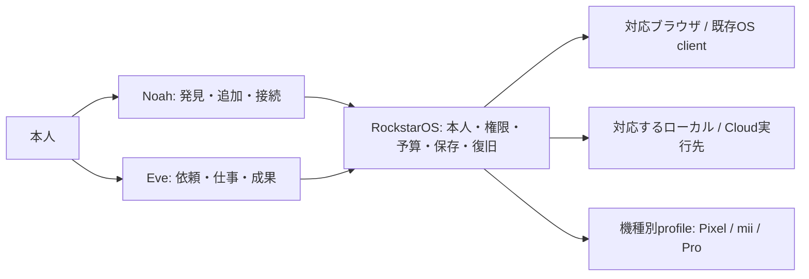

# avokado / mii / Noah

avokadoの主商品は、声でEveへ依頼し、空間の表示を見たり触ったりして仕事を進める **mii** です。最小構成から始める商品が **Noah**。まず自分のMacでAgentを選び、接続・実行・成果受領・停止まで使える状態を完成させます。**RockstarOS** はこれらを支える共通実行基盤、**Eve** は依頼と仕事の窓口です。

[Noahを開く](https://avoado.si/noah) · [Eveを開く](https://avoado.si/os/eve) · [現在の進捗](project.md) · [設計の入口](docs/structure/00-overview.md)

このREADMEには現在の利用方法・コード・受入範囲を記載します。変更履歴は[CHANGELOG](CHANGELOG.md)で管理します。

## 製品と入口

| 製品 | 役割 | 入口・現在の範囲 |
| --- | --- | --- |
| Noah | miiへ進む最小構成。Agentを集める・つなげる・載せる | [avoado.si/noah](https://avoado.si/noah)。公開カタログとMacの実行先を区別 |
| Eve | 依頼、担当設定、仕事、成果、停止、使用量の確認 | [avoado.si/os/eve](https://avoado.si/os/eve)。実行には本人確認と対象Toolの接続・権限が必要 |
| RockstarOS 1.0 | 本人性、権限、予算、仕事の状態、保存・復旧を共有するruntime | Developer Preview。Web、Linux/QEMU、Android/機種別OSを別々に受入 |
| mii | 声・手・表示・センサーを共通の仕事へつなぐ空間端末 | [avocadomini.si](https://avocadomini.si)。設計・ソフト試作段階 |
| Pro | siモデル・Agent・制作・計算の専用PC | [avocadopro.si](https://avocadopro.si)。構成・実機・販売の受入は個別管理 |

正式ドメインは `avoado.si`、`avocadomini.si`、`avocadopro.si` です。サイトの存在は、すべての機能・機種・金融操作の本番受入を意味しません。



## Noah — 情報と担当を見つける


最初の目的は教育と身の回りの生活を便利にすること。接続の手軽さ・登録で離脱させない導線・画面を奪わない実行を優先します。[全体設計](docs/noah-design.md)・[詳細設計](docs/noah-detailed-design.md)・[スマホ向けMVP](docs/noah/mvp-launch.md)に従い、提供者側のAgentへ接続し、入力欄から依頼して成果を受け取る経路を開発します。以下の本人Mac版とは受入を分け、Mac導入をスマホ向け公開の前提にしません。

個人の感想・発見・評価の本文と作者を主役にしたタイムラインです。フォロー中の投稿と通常投稿をAgent紹介より先に表示し、紹介情報は「Agent紹介」と区別します。既定で全件表示し、「Agent」で絞り込んだ時だけ「すべてに戻る」を表示します。ニュースとコミュニティーは表示しません。検索・詳細から、利用したい担当やToolを確認できます。機能一覧は設けず、メニューからタイムライン・Agentを探す・実行中・成果データへ直接進みます。会社の正式花形ロゴを使用し、白地・チャコールの文字・紫のアクセントで、Xのような左ナビ・中央フィード・右検索/Agent欄の3カラムにしています。スマホ下部は現在地付きの「メニュー」1ボタンで、開くと4画面をアイコンと用途説明付きで選べます。Agentの探索は `/noah/explore` から行えます。「実行中」タブ（`/noah/activity`）に依頼入力・接続・Agentの実際の処理状態・成果・停止・ファイル保存を集約しました。旧 `/noah/launch` は選択Agentを保持して移動します。接続手順はAgent選択→Mac接続→依頼の順に案内し、接続案内から戻っても選んだAgentを維持します。フロントと登録Agent導線の開発は [PR #337](https://github.com/k999ln/rock/pull/337)、全体verify成功、本番配備は未実施です。

AgentごとにNoahで実行完了を確認した利用人数、1アカウント1票の王冠、公開コメントと返信を表示します。感想は通常タイムラインにも流れます。閲覧は登録不要、保存には本人確認、コメントには公開名を使います。外部単独利用や未同期の実行は人数に含めません。[評価とフィードバック](docs/services/noah-agent-feedback.md)。

開発者向けの `/noah/developers` では、ユーザーの声の整理・改善提案・承認後のリファクタリング・回帰試験・PR納品を運用パッケージとして案内します。相談・見積もりは **smash@avoado.si** へのメールで受け付け、ページから対象Agentを添えたメールを作成できます。Webの申込フォーム・受付履歴・運営一覧は廃止。価格・SLA・課金・作業自動実行は未設定です。[継続改善パッケージ](docs/services/noah-developer-maintenance.md)。

公開カタログは公開資料を使います。私有Agent、仕事、MacのDBを公開カタログへ移しません。私有登録、固定版の保存、別権限の審査、公開版の追加・接続・実行・停止を既存のPackage・利用権・Workへ接続しています。本番の審査と公開には審査担当の設定と個別受入が必要です。

本人MacのRunnerは認証付きの要求取得、重複防止、停止確認を実装しています。ローカルAPIと実コンテナで接続・実行・停止を検証していますが、本番HTTPS・別Mac間の通し試験は未受入です。Macのスリープ・電源断中は動きません。Holland Villageのメンバー100人への先行体験は、上記MVPを基準に用途・訴求・操作性の調査を補足しています。スマホ実行の受入・募集・配布は未完了です。Mac接続はWebからNoah.appを開き、「接続する」で準備・本人承認へ進む方式です。コマンド入力は不要。Apple Silicon / macOS 15以降向けの開発プレビューで、配布公証・未導入の別Mac・本番HTTPSでの通し受入は残っています。[導入・実行・停止の契約](docs/services/noah-standalone-launch.md)。

閲覧・検索は会員登録なし。外部Agentで登録が必要な場合は `/noah/registration` で必須項目を入力し、次の画面で送信先・内容・規約を確認して登録Agentへ依頼できます。任意項目は展開式、確認から編集への往復は入力を保持し、完了後は元Agentの利用画面へ戻ります。実際の登録先アダプターと秘密設定は未接続で、未設定時は入力欄を出しません。[登録Agentの設定・契約](docs/services/noah-registration-agent.md)。Mac接続など認証が必要な操作ではアカウント確認・ログイン・再確認を案内し、認証後は登録やMac承認の元の画面へ戻ります。登録・接続・実行・停止の本番通し受入と、別Macの実機受入は未完了です。現在の受入範囲と残件は[Noah単体ローンチ](codex/tasks/71-noah-standalone-launch.md)を参照してください。

接続要件の検査・接続計画・状態遷移の純関数は `lib/noah-connect-requirements.ts` と `lib/noah-connect-plan.ts` に置いています。MVP L2 の開発範囲で、画面・APIとの接続は後続のL5です。計画の計算だけでは権限や利用権は発行しません。

Agentの成果データは `/noah/data` で検索・JSON/ファイル出力できます。Webに保存済みのNoah実行成果を本人のWorkから読み、本人が選択・同意した成果だけを運営の品質確認・不具合調査へ提供します。撤回は運営向けの写しを削除し、元の仕事を削除した後でも本人の提供履歴から取り消せます。進捗は [PR #334](https://github.com/k999ln/rock/pull/334)。本番の表の適用・配備は未実施です。[範囲と提供条件](docs/services/noah-result-data.md)。

公式MCP台帳の取り込み・一覧・運営画面（MVP L3）は `lib/noah-intake-*.ts` と `/api/noah/intake` に実装しています。初回全件と毎時差分を再開可能な巡回で保存し、運営の画面から件数・準備の要否・取り下げを確認できます。実台帳68,964件の初回取り込みと差分巡回、合成65,000件のローカルD1受入を通過しています。本番の表の適用・配備・切り替えは行っておらず、Agentとの接続確認は後続L4です。進捗は [PR #332](https://github.com/k999ln/rock/pull/332) を参照してください。

投稿・フォローにはサインインが必要です。画面表示の確認と、本人アカウントでの送信・外部接続・決済の受入を区別します。決済サービスが未接続の機能は接続待ちとして扱います。

| コード | 内容 |
| --- | --- |
| [app/noah/](app/noah/) / [components/noah-timeline.tsx](components/noah-timeline.tsx) | 公開タイムラインと機能画面 |
| [lib/noah-surface.ts](lib/noah-surface.ts) | 公開側とMac側の遷移 |
| [services/sky-web/noah-page-routes.mjs](services/sky-web/noah-page-routes.mjs) | 現行URLと互換URLの対応 |
| [Mac API接続](scripts/noah-local-api.mjs) / [コード取得](scripts/noah-source-bytes.mjs) | 既存機能で共有する通信・容量照合。本人・招待・公開版の条件は各経路で保持 |
| [Tool詳細設計](docs/sky-tools-complete-design.md) | 入出力・権限・保存・失敗・復旧・受入 |

### 本人用セレクト・リセール

ストリート、アーカイブ、オブジェの3担当で、候補・採算・共有予算・在庫・出品原稿・収支を管理します。本人用のWeb入口は `/noah/resale`、ターミナル用は[CLIテンプレート](toolkits/noah-resale-agent/README.md)です。外部通信をしないデモを実行できます。

```sh
npm --prefix toolkits/noah-resale-agent run demo
```

初期予算は0です。実購入・実出品にはAPI利用権・接続設定・予算と、具体的条件を固定した確認書が必要です。WebのD1とCLIのSQLiteは独立した保存先です。実売買と入金自動同期、完全無人運用の受入は未完了です。[実行・停止・照合の契約](docs/services/noah-select-resale.md)。

## Eve — 会話から仕事と成果へ


目的、入力、担当、実行先、必要な権限と予算を確認し、仕事と成果を同じ本人の状態として扱います。Eveの仕事・成果・Tool・接続の入口から、既存の会話を続けられます。Toolの接続先・版・観測期限を確認し、実行中の不用意な画面移動や、結果不明の操作の自動再送を防ぎます。

成果の編集・持ち出しは、対象の仕事と保存方式に従います。接続済み、設定保存済み、実行成功、成果の検収完了は別の状態です。

| コード | 内容 |
| --- | --- |
| [app/os/eve/](app/os/eve/) / [components/sky-chat-workspace.tsx](components/sky-chat-workspace.tsx) | 会話・仕事・Toolの画面 |
| [lib/workflow.ts](lib/workflow.ts) / [lib/work-store.ts](lib/work-store.ts) | 状態遷移・本人別保存・revision競合判定 |
| [docs/structure/04-eve-noa-amc-sky.md](docs/structure/04-eve-noa-amc-sky.md) | Eveと担当構成・実行・評価の責任 |

### 工程計画と担当の実行

工程の組合せ、見積り、会社受注の分配を計算するライブラリと、募集文面を判定するCLIがあります。計画・計算の実装であり、外部の案件取得・応募・契約・納品・送金の一周は未接続です。計算値を入金・記帳・収益実績として扱いません。[仕事の計画](docs/sky-work-loop.md)。

AMCはGoalから工程・担当・前提・合格条件を組み、有限の実行・別processの検収・差し戻し・再計画を扱います。

```sh
npm run amc:cycle -- demo
```

[実行・停止・復旧](docs/amc-goal-orchestrator.md#goalから逆算するローカル実行と再計画)。担当設定は[全社役割台帳](data/company-role-map.json)、[営業担当台帳](data/revenue-role-map.json)、[.cursor/agents/](.cursor/agents/)にあります。設定ファイルの存在だけで常駐実行・外部作用・会社運営の完成とはしません。

## RockstarOS — 共通の実行基盤

RockstarOS 1.0の内部識別子は `dev.rock`、配布段階はDeveloper Previewです。本人成果の保存、権限、予算、更新・復旧を共通契約にし、端末の差はhardware profileとadapterで扱います。すべての機種へ同じOS imageを書き込む方式ではありません。

| 対象 | 現在の範囲 | 次の受入 |
| --- | --- | --- |
| Web / 既存OS client | Eve・Noahと共通の仕事・保存・権限の実装 | 本人アカウント、外部Tool、別端末引継ぎの同条件確認 |
| Linux / QEMU | 独立したDeveloper Preview系列 | 配布する同一artifactの導入・保存・再起動・復旧 |
| Pixel 10 GL066 / frankel | Android clientと機種別OS準備 | 現候補での接続・復旧、正式署名、全OS build、flashと同一image受入 |
| mii / Pro | 共通runtimeへ接続するprofileと設計 | 実機の入出力・電源・停止・保存・復旧 |

APK、QEMU、fixture、CIの成功を物理OSや本番金融の合格へ置き換えません。端末内モデルは対応端末の能力の一つであり、モデル出力は権限や本人承認を持ちません。

- [native OS](systems/rock-star-os/README.md) / [Androidとnativeの区分](docs/native-os-integration.md)
- [対応機種](docs/device-support-architecture.md) / [リリース条件](docs/release-minimum-gates.md)
- [AI・LLMの境界](docs/llm-evaluation-architecture.md)

### SIM / eSIM・使用料金

SIM/eSIMはOSを導入する際に使う仕組みです。主商品はmii、最初に完成させるのはMac上のNoahです。回線とサービス利用権を扱う既存契約は別々に確認します。OS binaryをSIMへ格納しません。回線、サービス利用権、本人確認、OS/clientの導入状態を別々に管理します。native OSは正確な機種と署名・復旧条件が通った場合に案内し、それ以外は対応clientやブラウザを使います。

Cloud agentは事前単価・見積り、上限承認、実行中の費用・予約、項目別usageを示し、許可済み予算を超えて実行しません。商品料金・通信料・si使用料・外部実費・BYOKを混同しません。実回線発行・本番決済の受入は各providerの接続と個別条件が必要です。

[SIM/eSIM設計](docs/structure/03-esim.md) / [料金とusage](docs/sky-billing.md) / [導入試作](toolkits/esim-bootstrap/README.md)。

## mii — 暮らしと空間で使う端末


声でEveに依頼し、空間の表示を見たり触ったりして仕事を進める主商品です。連絡、創作、遊び、許可した機器の操作を共通の仕事として扱います。基本構成は4本のTowerと別体のHubです。Towerが部屋や手の動きを捉え、Hub上のRockstarOSが入力をまとめて表示層へ渡す設計です。Towerが1本の構成ではEveの機能を限定して使う想定です。

R5を現行設計として、[R5設計](docs/avocado-mini-r5/README.md)と[現行構造](docs/structure/01-mii.md)を保持し、[V2・天井型の設計研究](docs/mii/design/v2-study/README.md)を比較候補として管理します。V2研究の追加はR5の要件変更や実機合格を意味しません。方式・製品化案は本人の決定と同一実機の受入を経て採用します。

製造承認は**保留中**です。 R5実機試験の完了実績は0件です。光学・熱・電源・停止・取り付け・警報の安全性、認証、販売価格は未受入です。研究資料の原価は積算であり、調達見積や製品保証ではありません。

- [miiの入力・編集](lib/mii-spatial-input.ts) / [機種profile](systems/rock-star-os/targets/avocado-mini/)
Material Inventionの再計算用sandboxと設計資料はあります。シミュレーション・実験室接続は未実装です。

- [空間・Material Invention詳細](docs/rockstaros-avocado-mini-complete-design.md)
- [製品サイトsource](sites/avocado-mini/)

## Pro — si専用PC


モデル・Agent・制作・計算を動かす独立PCの開発計画です。用途ごとに構成、実性能、冷却、消費電力、保守性、調達を確認します。miiを持つことを利用条件にしません。販売・出荷・一般機種対応は、正確なSKUと同じ実機の検証が必要です。

[Proの機種適合](docs/device-support-architecture.md) / [公開入口](https://avocadopro.si)。

## 開発する

使用するNode.js・npmと依存は[package.json](package.json)・[package-lock.json](package-lock.json)を基準にします。本人の秘密情報は環境変数またはGit外の保存先を使います。

```sh
npm ci
npm run dev
```

DB、provider、端末の設定は対象機能の手順に従います。検証のために本番DBへmigrationを適用しません。

```sh
npm run project:update
npm run verify
```

`project:update`は現在の進捗・派生メタデータを同期します。`verify`は現在の設定にある型・lint・テスト・設計・build・ローカルAPI等の全チェックです。未実装の短縮コマンドを案内しません。macOSでOpenSSL 3が必要な検証は `PATH=/opt/homebrew/opt/openssl@3/bin:$PATH npm run verify` を使います。

| 作業 | 入口 |
| --- | --- |
| 製品要件・現在の名称 | [product-baseline](docs/product-baseline.md) / [名称正本](docs/structure/06-naming.md) |
| 現在の作業と設計 | [Codex task一覧](codex/tasks/00-index.md) / [文書地図](docs/README.md) |
| 分野別の実装・検証 | [workstreams](docs/workstreams/README.md) / [責任分界](docs/workstreams/00-responsibility-boundaries.md) |
| DBのschema・適用状態 | [database status](docs/database-status.md) |
| 製品全体・Tool詳細 | [design portal](docs/rockstaros-design-portal.md) / [Tool詳細](docs/sky-tools-complete-design.md) |

<!-- project-overview:start -->
更新日: 2026-11-20。現在の受入範囲と次の作業は[進捗](project.md)、全タスクは[全タスクの進捗](project.md#全taskの作業進捗)を参照してください。
<!-- project-overview:end -->

コードの `sky`・`zema`等は互換性のため保持する識別子です。公開画面の製品名はEveとNoahに揃えます。画像・GIFはコンセプトであり、実機性能や製造承認の証拠ではありません。
