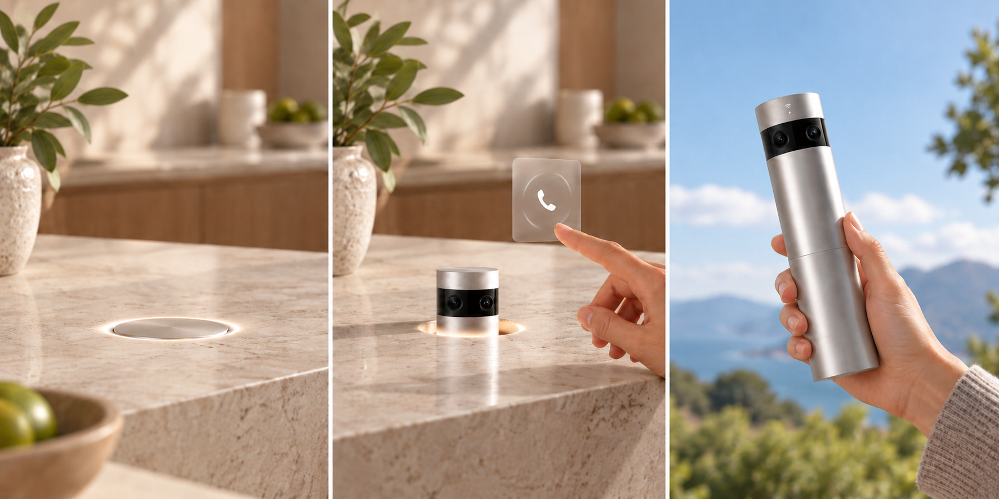

# avocadoMini — 統合基本設計（内部設計版 R5）

## 暮らしの機器から学ぶ着脱体験

壁から外せるNest Thermostatの実物写真をきっかけに、住宅機器・携行機器・空間入力・携帯通信の[31件の製品・技術参照比較](embedded-portable-connectivity.md#既製デバイスを参照する方法2026-10-21)を追加した。壁側dockと持ち出すcore、戻すだけの充電、頭上設置の二次保持、場所を移した時の権限と校正をMini自身の設計課題として扱う。他社製品の寸法や電池、投影や通信をMiniの完成根拠にはしない。追加調査ではHolo Industriesの空中像＋指入力、Beosound Levelの壁掛け充電、Garminの携帯なし通信、Starlink Miniの衛星IP→Wi-Fi APと上空視界、Humane Ai Pinのサービス終了時の復旧を優先比較へ上げた。

## 空間に建築を見せ、共同で設計する

利用者の2026-10-19の補足では、空の場所に建築物のデモや設計案が見え、本人たちが歩いて複数方向から確認し、手・声で候補を変えて精密な図面へ戻す体験が中心にある。「トンネルの中の蝋燭」のように、選んだ共同観察域の中にいる自分たちが同じ空間を見て、外へ設計情報を広げないことも目標。[空間建築表示とAS01〜06](phone-spatial-interface.md#21-何もない場所に建築を見せそこで設計する)で、測定sensor、位置合わせ、裸眼の光学出力、複数視点、閲覧範囲の漏れ、CAD/BIM成果を別々に検証する。近距離の着信カードはこの建築空間表示の合格証拠ではない。実機試験と光学的秘匿の合格は0件。 2026-10-21に参照された200構想×5視点の建築研究は、[一つの実在空間での調査・案比較・専門家判断・事後評価](phone-spatial-interface.md#23-建築構想を実際の場所へ結ぶ2026-10-21)へつなぐ用途として具体化した。敷地未選定の構想や生成図版を現場の実測・許可へ昇格させない。

## 工場向けの内部回路・設計開発入力

2026-10-19の明示指示を受け、[工場の設計開発部門へ渡すR0一式](factory-development/README.md)を追加した。電気機能分担、停止経路、工場が作るべき回路/PCB成果、寸法・電池の再計算、E0〜E3の試作/製造gateを明記。これは**開発見積と実現性判定の入力**であり、回路図/Gerber/採用BOMを伴う製造リリースではない。既存OI/MPの実機合格は0件。

## Orbit L-T — 5時間の製品発明・1ページ要約

2026-10-19 00:16:53〜05:19:03 UTC、実経過302分10秒で比較・反証した研究結果（300分到達05:16:53 UTC）。以下の外形と機構は試作受入前の設計仮説である。

**一つのMiniを家から外へ持ち出しても、本人の通話・仕事・通信を続ける。** 初回試験の姿は、銀色の細い円筒と上端の黒いsensor帯を持つD76×H186mmの**設計仮枠**。乾いた手元高さの05模擬アイランドでは面一に収まり、着信時は匿名の端面合図から始まる。本人が自動動作を有効にし安全が確認できれば、下部の可動cupも一緒に約50mm上がり、黒帯を露出する。本人確認後、近距離の裸眼空中カードを一択ずつ出し、空間tapで応答・拒否する。声と物理操作は失敗時の経路として残す。黒帯の顔・手sensor、指紋/PIN、対応設備との連動は本体内の本人鍵と場所別の明示権限で扱い、いずれも実機受入前の候補。[L-Tの使用体験図](assets/orbit-lt-experience.svg)、[伸縮機構の寸法模式図](assets/orbit-telescoping-sleeve.svg)、[光学四分割の干渉研究図](assets/orbit-lt-optical-quadrant-study.svg)は実機図面ではない。

外した**同一本体**へ電池、RockstarOS、本人鍵、地上電話、直接の双方向衛星IP候補、Wi-Fi APを残す。dockは固定・給電・場所校正だけを担当する。Skyへ短いGame会話作品を頼み、Zemaの同じ`jobId`で見積、途中修正、両結末の試遊、検収・保存を終える。屋外では本人が回線と費用を確認してから衛星WANをWi-Fiへ共有し、再装着時に家の権限を再照合する。最初の衛星通信検証地域は**米国**。屋内の島やポケットの中で衛星が通ると表示せず、建物WAN／地上回線と区別する。衛星IPだけで通常の電話番号へ圏外でも着信できるとは扱わず、番号・音声・転送契約と実着信を別に受け入れる。短文の送受信も宛先・本人の意思・Provider到達・料金をMini単体で確認する。02天井・10軒裏は同型本体の別profileで、手の届く05の空間tap合格を転用しない。

**研究選定の理由:** F密閉前面は可動部が少ないが面一の小端面だけで空中像と指入力を成立させる必要がある。Sの既製Iridium 9770は衛星IP／voiceの比較に強いが、仮の200mm収納と450g携行目標に衝突する。L-Tは本体とcupを同時に動かすことで、仮の下端余裕5mm（底壁込み、内部すき間未計上）・公差3mmでは使用時全高194mmの**幾何だけ**を描け、動画に近い「その場に現れて外せる」体験を試せる。固定全長sleeveから50mm上げる旧L-Aは最小236mmとなり、現外形では除外した。L-Tも実寸の光学、RF、保護電池、第二保持爪、空dock cover、施工、熱を入れた200mm閉箱は未成立である。上昇中に本体だけ先行する量`δ`も高さへ足され、内部隙間`g`と襟軸伸び`e`を含めて`g+δ+e≤6mm`が必要。



**製品化を止める条件:** 米国でMini型式に許された衛星双方向IP→任意client Wi-Fi共有と料金上限、同じ閉箱で読める空中像・誤応答のないtap、実着信・番号・音声、安全な伸縮・離脱、24時間待受等の公称電池profileを個別に証明する。小型のIridium 9523を用いる既製IP基板でも幅75mmあり、L-Tの理想内径72mmへ平置きできない。仮の上端RF20mm＋光学42mm配置では、Readyで光学区画の下端12mmが天板開口内に残り、斜めの視線を遮る可能性もある。四分割光学板も襟壁を片側2mmと仮定すると、D136mm内径に対して板の対角135.8mmで直径方向の余白は約0.2mmだけ。Readyで光学区画の露出30mmへ板厚25.6mmを寄せても残り4.4mmで、hinge・封止は未配置。`OI01〜07`と既存`MP01〜06`の物理受入は**0件**。最初は実寸CADと低出力光学／回線bench、次に乾いた模擬アイランド、同一200mm閉箱、米国の正式回線と本人の一周へ進む。[比較・一次資料・停止条件を含む製品設計](product-invention-r1.md)を正本とし、映像・構想CG・仮寸法を製品完成や衛星契約へ読み替えない。

**自己反証:** [十六の失敗場面と試験・停止条件](product-invention-r1.md#260300分の独立自己反証2026-10-19)を追加した。Stowの隠れたsensor、15秒着信、共有空間の漏えい、屋内／ポケット内の衛星遮蔽、Game転送、誤tap、離脱後の旧権限に加え、cup固着で仮244mm、光学板と襟の干渉、無線・電池・通常番号・料金上限・電話なし初期化、元R5の全空間裸眼3Dとの違い、Miniから離れた本人へ像とtapが届かない問題を別判定する。机上の反例であり、試験合格ではない。[三段の停止・検証図](assets/orbit-lt-stop-gates.svg)で次の判定順を示す。

**分岐:** L-Tで光学・米国衛星IP共有・200mm閉箱が同時成立しなければ、同じ試験でFの密閉前面を評価する。Fも失敗したら、どの最低要求と寸法が衝突するかを数値で示して外形・方式の再選択へ戻す。衛星messageのみ、地上回線のみ、音声のみ、別の衛星箱を達成品と呼ばない。

## 製品発明案「Orbit」（仮称・2026-10-18）

利用者が指定した最低機能を同じ着脱本体へ収める[製品発明案](product-invention-r1.md)を保存した。住宅CMの完成映像、細い銀色の円筒と黒いセンサー帯の製品参照、02天井・05アイランド・10軒裏の設置候補を照合し、**建築面一の円形見切りから本体が軸方向にせり出して外せる形**を第一の外観基準にした。卓上の低台座は据付dock、壁の二重筒は旧案として区別する。均一D96mm径は収納比較案であり、確定外観ではない。面一の匿名合図とReadyの近距離空中着信カード、手による選択、指紋/PIN、RockstarOS／Sky／Zema、直接衛星WANからのWi-Fi共有、dock外の携行電源を、外形・熱・権限・通話・Gameの一周として設計する。[概念断面](assets/orbit-concept-section.svg)、[初期包絡の衝突図](assets/orbit-feasibility-envelope.svg)、[壁正面／携行側面の二出口仮説](assets/orbit-optical-ports.svg)、[三つの携行外形比較](assets/orbit-form-factors.svg)、[着信から通話成立の四段階](assets/orbit-call-flow.svg)、[PCなし制作と通話割込](assets/orbit-pc-free-creation.svg)は設計比較で、[参照意匠に合わせた住まいの構想CG](assets/orbit-reference-aligned-render.png)、[均一径の収納比較CG](assets/orbit-concept-render.png)、[屋外での構想CG](assets/orbit-portable-concept-render.png)、[壁sleeveからの着脱構想CG](assets/orbit-sleeve-sequence-render.png)は質感・使い方の比較であり、実機証拠ではない。光学・衛星・電池・通話の同一閉箱受入は未実施で、元R5の全空間裸眼3D達成や製造承認を示さない。

追加の明示目的は、**PCの前に立たずにものを作り、携帯を持たずにやり取りすること**。Orbitは手元に設置した同じMiniから、声・短い空中カード・物理操作で制作brief、Sky／Zemaの実行・途中修正・成果検収、着信／発信／短い送信を完結する体験をOI07で試す。音声入力やAgent起動だけを作品完成と呼ばず、実Toolの成果、費用、秘匿、保存・停止・再開を一周で測る。Miniの届かない場所や受け入れていない精密制作まで達成済みとはしない。

利用者が示したHiggsfieldの二つの映像集を見て、[Scene Core発明追補](product-invention-r1.md#発明追補--一台を空間携行へ切り替える-scene-core)を追加した。最初に試すのは手が届く乾いたアイランドdockで、同一本体を面一収納・安全にせり出した操作・持出しの三位置で使う。dockの場所情報と設備scopeは着脱で失効し、本人の通話・仕事・通信は本体に残る。住宅・空間Game・PCなし制作は同じScene Contractで接続する。映像の白い小箱・丸い照明・四本の長いポールを採用外形にせず、Readyの空中像・tap、面一端面の匿名合図と直接衛星IP＋Wi-Fiを同一閉箱で受け入れるまで製品完成としない。

## 最低機能：空間で使う携帯の新しい形（2026-10-18）

利用者の明示指示により、センサー、生体認識、対応機器との連動、RockstarOS／Sky／Zema、Mini自身が受ける衛星WANからのWi-Fi共有、取り外し後のポケットWi-FiをR5の**最低機能要求**にする。着信が空間に現れ、本人が空間をタップして応答・拒否する操作を、生活・Game・制作にも共通の入力／出力として設計する。提供された映像は発光する円筒と重なる表示の見え方の参考であり、表示方式や空間タップの実機証拠ではない。[携帯代替と空間インターフェースの詳細設計](phone-spatial-interface.md)に責任、状態、保存・復旧、MP01〜06の受入、未決定の決め方を記録した。直接衛星通信、空間表示・入力、通話、Mini実機は未受入で、最低機能の達成宣言には使わない。


## 目的から使うMini：住まい・ゲーム・制作・携行を一つの製品体験にする（2026-10-18）

利用者の追加指示は、Miniを住まい専用の機器やゲーム専用機に固定せず、本人が「何をしたいか」から使える製品にすること。建築・インテリアに溶け込む着脱式hardware、ゲーム、創作、空間の仕事、携行時の通信を、確認済み能力に応じて選べるようにする。既存のR5寸法・単体動作・増設要求、RockstarOS／Sky／Zemaの共通契約を維持する。GTA VI調査はゲーム体験・作者導線・状態表示の参考であり、GTA VI連携やMini上での起動が成立した証拠ではない。[ゲームとの橋渡し調査](../gta-reality-bridge.md)と[Webゲーム受入](game-runtime-design.md)を別々に追跡する。

| 利用場面 | 本人の入口 | Miniが返すもの | 能力が足りない場合 |
| --- | --- | --- | --- |
| 遊ぶ | 対応ゲームを選ぶ、または遊びの中からSkyを開く | Mini上のゲーム操作、許可されたAgentへの依頼、同じZema仕事の継続 | 対応可否と不足条件を示し、対応する画面・端末へ引き継ぐ |
| つくる | 作品や空間のアイデアを始める | 下書き、比較案、出所付き成果、次に試す操作 | 2D画面・controller・専門家へのhandoffを提示する |
| 暮らす | 部屋や生活上の困りごとを伝える | 対応設備と本人設定の範囲で候補・小さな可逆応答を提示する | 設備・sensor・権限がなければ案だけを示し、実動作と区別する |
| 持ち出す | 正規にdockから外し、本人が通信を選ぶ | 同じ仕事の続き、対応WANとWi-Fi共有の実状態 | WANなしでも保存済み成果とlocal機能を示す |

最初の画面は固定した用途別modeへ閉じ込めず、**「何をしたい？」、前回の続き、使える能力、停止**を主導線にする。遊ぶ・つくる・暮らす等は探しやすい入口であり、一つの仕事を移動するときに別accountや説明のやり直しを要求しない。Agent提案、実行、外部送信、設備操作、購入・課金を別状態で見せる。ゲーム画面やsensor推定を本人承認へ昇格させない。

入力は本人の選択、ゲームの許可済みcontext、明示的に有効化したsensor、Device Profileの能力証拠。出力は画面・音・空間adapter・型付きartifactで、機種と接続先が受け入れたものに限る。RockstarOSはowner・権限・予算・job/revision・保存/復旧を強制し、Skyは対応Agent／Toolと接続条件を示し、Zemaは遊びから制作・生活へまたがる仕事の依頼、進捗、承認、成果を持つ。外部game・設備・通信Providerは自身の正式な接続口と動作を担当し、OWNERは共有・費用・設置・実行を選ぶ。

状態は少なくとも`AVAILABLE`、`NEEDS_SETUP`、`NEEDS_PERMISSION`、`UNSUPPORTED`、`RUNNING`、`PAUSED`、`STOPPED`、`RESULT_UNKNOWN`を区別する。jobとartifactにはowner、device、capability版、入力source、revision、費用と承認、digestを残す。ゲーム終了、dock着脱、通信断、Agent失敗、再起動時には確定済みの続きから復元し、結果不明の作用を自動再実行しない。本人は機能ごとに停止・失効・成果回収を行える。

最初の製品受入は、初心者が説明なしで一つの遊びを開始し、Skyへ一件の仕事を依頼し、結果を確認して再開できること、および一室の可逆な生活課題とdock着脱で同じ仕事・権限境界を保てることを同一候補で測る。初回成功までの時間、完了率、誤操作、停止到達時間、再開時間、本人の理解を記録する。対象ゲーム、表示・入力方式、最初の設備、携行WANと価格は実測・権利・予算を踏まえて選ぶ。これは製品体験の設計であり、Mini実機、GTA VI、衛星通信、住設連携の受入ではない。

2026-10-18追補: RockstarOSはPixel、avocadoMini、avocadoProで同じSI／Sky／Zemaのowner・job・承認・成果契約を使う方針。R5の単体hardwareで成立した入力・出力だけを機種能力として公開し、Pixel用GrapheneOS imageやTerminal／Linux VMの搭載をR5に自動適用しない。avocadoProのhardware仕様も別途確定する。[共通CoreとDevice Profile](../device-support-architecture.md#shared-si-device-profiles)。

2026-09-24時点の入口: 使用時200mm以内・1本自律・同型mini増設・全空間裸眼表示を目指す、ハードウェアとOSの設計です。当時はゲームを主な入口としていたが、2026-10-18の明示方針では上記のとおり、住まい・ゲーム・制作・携行を本人の目的から選ぶ単一製品体験に更新する。元の全空間表示研究gateは維持する。

**製造承認は保留です。** 表示エンジン、精密3D入力、最終収納・熱・電源・専用NPU、確定回路・加工図は未決を含みます。本資料だけで加工・通電・光源実験・量産へ進めません。

## WebゲームとRockstarOSの連携設計

2026-10-15の利用者指示と、ゲームを**作る・他者の作品を持ち込む両方**の確定方針を反映した[Miniゲーム実行・Sky/Zema連携の設計追補](game-runtime-design.md)。Mini単体のWASM/WebGPU実行、入力focus、2D表示surface、部品選定と熱、同一仕事の継続、MG01〜07の受入に加え、作品ID/版、持込み後の機種別診断、起動・操作・save/復旧を別判定にする。Mini自身で合格したゲームは単体で遊び、重い制作やゲームは対応するPro/正式remote経路へ渡す。Mini上の汎用取込み、Pro/Mini互換、FivePlay/GTA VI対応は未受入。原本PDF/Word/ZIPは保存時点のまま保持します。

## 建築への埋込・着脱・携帯Wi-Fi

2026-10-15の新しい明示要求は[着脱・衛星WAN・携帯Wi-Fi設計](embedded-portable-connectivity.md)に反映。建築/家具側dockと持ち出すcoreを分け、携帯電源を必須設計項目へ更新しました。直接衛星通信・電池方式・hotspot性能は未確定/未受入です。

## 一式を開く

- [閲覧用PDF — 51ページ](package/avocadoMini_RockstarOS_R5_Integrated_Design.pdf)
- [編集用Word](package/avocadoMini_RockstarOS_R5_Integrated_Design.docx)
- [全文Markdown](package/integrated_design.md)
- [設計書・図面・計算・参考資料のZIP](avocadoMini_R5_Integrated_Design_Package.zip)
- [設計検討図8点 — SVG/PNG](package/drawings/)
- [計算結果](package/calculation_results.json) / [再計算](package/verify_calculations.py)
- [参考資料索引](package/reference_index.json) / [資料別の根拠と限界](package/references/)
- [30分調査の報告](research/README.md) / [調査の監査記録](research/RESEARCH_AUDIT.md)
- [保存・検証記録](verification.json) / [原本のファイル照合表](package/package_manifest.json)

ZIPは前回渡した27ファイルの配布パッケージをそのまま保存しています。Gitで追加した調査報告・この入口・検証記録はZIPの外です。全体を取得する場合はこのディレクトリを取得してください。package内のREADMEにある「この作業ではGitHubを変更していない」は設計書作成時点の記録であり、その後の今回のGit保存とは別です。

## 収録範囲

| 分野 | 内容 |
| --- | --- |
| 製品要求 | 200mmの測り方、銀色円筒、1本自律、同型増設、ゲームから生活への展開 |
| ハードウェア | 候補型番、比較包絡、内蔵区画、カメラ視野・深度、電源・熱・通信・安定性の計算 |
| OSと操作 | 入力・ゲーム・表示の契約、日本語音声、起動・停止・復旧、複数台協調、権限と更新 |
| AIと作品 | Capability Adapter、本人承認、費用上限、結果不明照合、Asset Registry、権利と出所 |
| 試作と検証 | 組立・校正の段階、受入試験、未確定事項、製造リリースに必要な成果物 |

14件の自動チェックは算術・比較条件・判定フラグの検証です。実機試験は0件。全空間表示・ASR・ゲーム性能・光安全・製造可能性が合格した意味ではありません。

## 過去の資料と既存OSの扱い

同時期にmainへ追加された[OS設計書完全版 v1.0](../rockstaros-complete-design-v1.0.pdf)も原本のまま保持します。同書p4・17・30のE3「4本＋別Hub」配置はR5へ適用せず、OS共通運用設計とのDevice Profile・adapter統合は未完了です。

- R5はこのタスクで利用者が指定した新しい製品要求です。E3の「4本＋別Edge Hub必須」を現行必須構成としません。
- 原本時点では外部給電必須・電池未採用。2026-10-15追補で取り外し後の携帯電源を必須設計項目へ変更。電池部品は未選定。通信設備と外部演算Hubを混同しません。
- 以前の価格、実装候補、外形寸法、TV/ARへの表示をR5へ自動継承しません。P0.2・E1・E2・E3の資料と実験記録は削除しません。
- 既存の[Material Invention研究契約](../rockstaros-avocado-mini-complete-design.md)、[OS共通設計](../rockstaros-complete-design.md)、Pixel/QEMU/Walletの受入は独立です。R5のサービス名・API案を実装済みと扱いません。
- GitHub保存と公開商品サイトの配備は別です。サイト・OS image・外部AI・決済環境はこの保存作業で変更していません。

## 担当と次の作業

資料保存はMAT14（ROCK）。製品化はMAT15（JOINT）として、まず単体の表示方式・通常室内の成立範囲・安全条件と、精密3D入力・実部品収納の証拠を集めます。方式確定前に架空のpin表や加工図を完成扱いにしません。[担当分野](../workstreams/11-material-invention-avocado-mini.md)に判断境界を記録します。

確認コマンド（リポジトリ直下）：

```sh
python3 scripts/verify-avocado-r5-package.py
python3 docs/avocado-mini-r5/package/verify_calculations.py
npm run project:check
npm run baseline:check
npm run design:check
```


## 範囲全体を操作するOSの実現設計

本人の設計書依頼に応じた[空間コンピュータOS実現設計書](spatial-computer-use-design.md)。20章の基本設計と計算入力/再計算プログラム、実装候補のmessage契約を含む。範囲全体の裸眼光学は未確定、実機・製造合格は増えていない。
