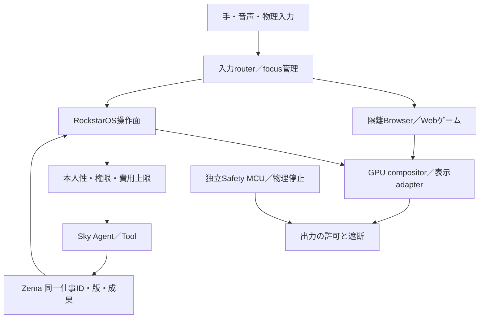

# avocadoMini R5 — Webゲームと現実をつなぐ実行設計

更新: 2026-10-15。利用者の「FivePlay等をminiでも動かせる仕様に」「avocado miniの設計」を反映。主担当はMaterial Invention / avocadoMini、MAT15（JOINT）。Game / AI06はadapterを担当する。R5原本パッケージは保存時点のまま維持し、本追補を現行設計入口から参照する。

## 1. 製品の決定と未決定

**Mini自身でWebゲームを起動し、遊びながらSkyへ仕事を依頼し、ゲームを閉じても同じ仕事を続けられる構成を設計する。** 使用時200mm以内、1本自律、同型mini増設、別Edge Hub不要、設置中の外部給電というR5要求を維持する。2026-10-15追加の[着脱・携帯通信設計](embedded-portable-connectivity.md)では、取り外した後の携帯電源も必須設計項目とする。外部PCでのみゲームが動く構成を「Mini単体対応」と表示しない。

FivePlayは互換性評価対象の一つ。特定の外部サイトが停止しても、Miniの標準ゲーム、OS、保存済みの仕事、物理停止は独立して使える構成とする。FivePlay/GTA VI対応は未受入、部品・性能・寸法収容・光学方式は未確定。子供用Companion P0への同じGPU構成の適用はしない。

## 2. 1本の内部構成

CPU/メモリ/GPU/ストレージ/ネットワークとOSはMini内部に置く。Browser rendererとSky Tool executorは別process・別resource上限。ゲームから直接shell、root、Wallet、現実の機器へ到達させない。安全MCUは汎用OSやGPUの応答に依存せず停止を処理する。NPUが存在してもWebGPU描画性能の代わりにはしない。

外部PC/スマホは開発・任意の処理移送に使える。将来のstreamingは別profileとし、接続先、遅延、費用、切断時の状態を表示する。現段階でstreaming機能を実装済みとは扱わない。同型Mini増設でブラウザのGPUやRAMが自動的に合算される前提は置かない。

## 3. Webゲームから逆算する部品選定

| 項目 | 設計要件・比較方法 | 固定する条件 |
| --- | --- | --- |
| CPU/OS | 候補SoC上の更新可能なBrowser、WASM threads、worker起動を測る。Linux系を既存R5候補として評価 | CPU名や命令セットだけで合格にせず、同じOS/browser/driverでworld到達 |
| GPU | WebGPU adapter/deviceの生成、必要feature/limits、shader compile、device lost復旧を試験 | GPU名や理論演算量ではなく同じゲームsceneのframetime・消費電力 |
| RAM | 8/16/32GiBを比較点とし、OS・browser・WASM heap・共有GPU memory・入力・Agentの同時peakを計測 | 暫定目標は同時peak後20%の余裕。最低RAMを現時点で断定しない。UMAはGPU領域を二重計上しない |
| 保存 | OS A/B、更新用空き、モデル、ゲームcache、本人作品、仕事journalを分ける | 必要容量を同一buildで測る。旧候補eMMC32GBを最終容量にしない。cache削除で本人のsaveを消さない |
| 電源/熱 | ゲーム＋入力＋表示＋Agentを閉箱で測る。P入力=(compute+表示+sensor+その他)/変換効率 | R5既存熱計算へ実測値を戻し、200mm収納、定格、冷却、騒音、接触温度を満たした候補だけ残す |
| 通信 | 初回DLとwarm cache、断線、DNS/配信失敗を分ける | インターネット必須の外部ゲームとoffline標準ゲームを区別。eSIMがゲーム性能を保証するとはしない |

8/16/32GiB、20%余裕は比較用の工学目標であり、部品採用・販売仕様・FivePlayの公式必要条件ではない。SoC選定は実測→熱/電源→収納→更新期間/供給→価格の順に候補を絞り、GPU対応を犠牲にして筐体だけ先に確定しない。GPUの負荷を下げてもゲーム起動失敗が解消するとは限らない。

## 4. 描画と操作

FivePlayの初期試験設定は `low=1&res=1280x720&fps=30`。1280×720はゲーム描画surfaceの設定であり、裸眼空間表示の光学解像度ではない。既存2Dゲームはまず2D surfaceとして扱う。depth/scene APIが未確認のゲームを、自由視点3Dや空間全体への表示へ自動変換する仕様にはしない。R5の裸眼表示成立と独立に開発用monitorで入力/描画を検証する。

入力routerはgame focus、OS focus、停止を分ける。手操作はゲームが扱える有限actionへ変換し、精密3D入力の合格を別に測る。最初は物理controller/keyboard相当でも同じfocus契約を検証する。OSの仕事パネルを開くとゲームへkey/buttonを送らず、閉じる際は押下状態を解放してから戻す。マイクは明示起動・物理OFFを維持する。任意Webページの文字やゲーム内の台詞を本人命令にしない。

## 5. ゲーム内と現実側で同じ仕事

1. ゲーム中にOSパネルを開き、本人がAgent、目的、渡す素材を選ぶ。
2. RockstarOSがowner、device、game session、agent、job ID、revisionを結び付ける。Webページには必要なsession scopeだけを渡す。
3. Skyは接続状態と必要権限、外部処理なら見積・予算を提示する。ローカルToolと外部LLMを区別する。
4. 本人承認後、既存 `lib/workflow.ts` の仕事を実行する。ゲーム側から実行承認を偽装できない。
5. ゲームを終了してもZemaで同じjob IDの次の版を作れる。成果をゲームへ戻すときは共有対象を選ぶ。
6. ゲーム/仕事/Agentの停止を独立して扱う。結果不明は同じ操作IDで照合し、勝手に再課金/再実行しない。

現在のMac gateway（SQLite、single owner、5216/5217）は契約試験の参照実装であり、Mini本番Brokerではない。Chrome拡張はMacでの移行用adapter。Mini製品ではOS側の仕事面と権限brokerへ移植し、localhostの開発tokenを恒久的な本人認証にしない。原稿・履歴・資格情報はゲームへ公開せず、明示共有成果のみ返す。ゲームsaveとZema仕事は別保存単位であり、許可されたexport APIなしにゲームsaveを取得・同期しない。

## 6. 状態・失敗・復旧

| 状態 | 表示と処理 |
| --- | --- |
| 未検査 | 必要capabilityを確認。「対応済み」は表示しない |
| 実行条件不足 | 不足API/driver/メモリを示す。OSと標準ゲームは継続 |
| 読込中 | engine報告、受信bytes、経過時間を分ける。進捗%を起動証拠にしない |
| world到達・未受入 | 画面と本人操作への反応を確認。scene/描画/入力試験へ進む |
| 実行中 | 入力・熱・メモリ・frametimeを監視。Agent生成を先に制限 |
| 過負荷/切断 | 生成を延期し、許可された画質変更、ゲームpause/停止を案内。外部ゲームが保存不能ならその旨を示す |
| GPU/browser crash | rendererを止め、OS操作面へ戻る。確定済み仕事をjournalから復元、未確定操作を照合 |

異常停止時に架空のゲームcheckpointを作らない。本人のsaveが提供元のoriginに残る場合、browser更新・origin変更・cache処理前に保存制約を説明する。工場resetとcache掃除を同じ操作にしない。

## 7. 同一候補の受入表

以下は設計目標、すべてMini実機ではNOT_RUN。端末SKU、OS/browser/driver版、ゲームbuild/URL/scene、電源/環境温度、表示方式、Agent負荷、測定法を同じ記録へ固定する。

| Gate | 合格条件（暫定目標を含む） | 担当 |
| --- | --- | --- |
| MG01 capability | WASM threads、cross-origin isolation、OffscreenCanvas、WebGPU device/必要limitsの実生成。存在フラグだけで通さない | ROCK/EXTERNAL |
| MG02 boot | cold/warm各3回world到達と実入力。起動秒数・DL量を記録。起動時間の上限は初回実測後に固定 | JOINT |
| MG03 sustained | 同sceneを720p/30fpsで30分、median FPS≥30、p95 frametime≤50msを暫定目標。端末内Tool同時実行でOOM/crashなし | JOINT |
| MG04 focus | game↔OSを20往復、入力漏れ/押しっぱなし0、入力から表示のp95≤100msを暫定目標 | JOINT |
| MG05 work | 同一jobの依頼→承認→実行→継続→成果共有→再起動復元。別owner/別sessionアクセス拒否 | ROCK/JOINT |
| MG06 failure | 通信断、GPU loss、renderer kill、電源復旧、容量不足で仕事二重実行0・確定済みjournal復元。ゲームsaveは別判定 | JOINT |
| MG07 enclosure | 採用部品の連続定格と別途確定する接触温度/騒音/光安全基準を閉箱で満たす。基準未確定ならHOLD | JOINT |

MG03の性能値はFivePlay保証値ではない。基準を後から下げる場合は理由と版を残し、同一試験を取り直す。上表合格も裸眼空間表示、安全認証、製造・販売の合格を代替しない。

## 8. 現在の根拠と実装順

FivePlay build `8b0b5899ed` の公開HTML/loader/GPU/IO workerからWASM/WebGPUとIndexedDB構成を確認した。Macの指定URLは6%・進捗なしでworld未到達。原因未確定であり、これをRAM不足と断定して部品を決めない。詳細は[解析・adapter](../../toolkits/fiveplay-adapter/README.md)。同サイトをGTA VI公式実行環境と扱わない。

先に参照browserで起動の停止段階を特定し、許可された軽量のWebGPU/WASM試験と標準ゲームで候補boardを比較する。次にMG01〜06をbench、最後にMG07とR5表示/入力/収納gateを同一試作機で実施する。FivePlayの提供元修正が必要でもMiniの独立した標準ゲーム・OS設計を止めない。外部サイトを複製・再配布する方式は採用しない。

Git正本は `k999ln/rock`。本追補はローカル設計変更で、GitHubへのpush/main統合・製品サイト公開・Mini実装/実機受入を意味しない。
