# avocadoMini R5 — 製品発明案「Orbit」（仮称）

作業開始: 2026-10-18 18:44 UTC。主担当: Material Invention / avocadoMini、MAT15（JOINT）。これは最低機能を同じ本体で成立させるための候補設計であり、製造仕様、特許性の判断、実機合格ではない。[明示された最低機能](phone-spatial-interface.md)とR5原本を維持する。

5時間の再発明作業は**2026-10-19 00:16:53 UTC**に開始し、同日**05:16:53 UTC**に実時間300分へ到達した。上の18:44 UTCは以前の3時間作業でこの文書を作り始めた時刻である。[実行順と終了条件](../prompts/avocado-mini-five-hour-invention.md)に沿って利用場面、三方式の発散、一次資料と数字による反証、L-Tへの研究収束、十六の独立自己反証を実施した。本稿は**5時間の設計研究成果**であり、製造仕様、実機合格、衛星回線契約の成立ではない。

最終確認を**05:19:03 UTC**に終え、実経過は**302分10秒**。選定案は研究構成で、OI01〜07とMP01〜06の物理受入は**0件**。文書・原本・既存host実装の検証結果とGitHub／公開の状態は[担当記録](../workstreams/11-material-invention-avocado-mini.md)へ残す。

**現在の採否を先に読む:** 後段で比較した`L-T`（coreと一定長の可動cupが一緒に50mmせり出す）を、次の実寸研究へ渡す**体験・機構候補**に選んだ。以下に残る初期`L-A`（固定全長sleeveからcoreだけせり出す）、四枚光学板、既製9523 IP基板の記述は検討履歴と棄却理由であり、L-Tへの採用指定ではない。OI01〜07の実機合格は0件で、L-Tにも組立可能な閉箱CADはない。

形状参照の追補（2026-10-18）: 利用者が示したチャット `codex://threads/01a135ff-4d40-77c3-bf40-e614db076b0e` の住宅CM EP04を再生し、製品参照画像 `04-mini-product-reference.png`、着脱画像 `16-removable-mini-dock-colombia-v3.png`、設置候補 `embedded-mini-10-mocks/shortlist-02-05-10/design-direction.md` と02天井・05アイランド・10軒裏の各画像を確認した。別チャット `codex://threads/01a15082-9371-7d30-a75f-6745dc248ec0` のarchive 43本は代表フレームを確認した。**最初の追補では住宅CMと製品自体の動画を取り違え、卓上台座と旧二重筒を主要な形として書いた。以下が訂正した製品側の読み取りである。**

## 映像から読み取った見た目と設置の方向

製品参照の核は、**細い銀色の可搬円筒、上部の黒いセンサー帯、抑えた加工面**。参照写真の低い円形台座は卓上設置の表現で、建築埋込から外して持ち出すcoreには含めない。直径D96mmの均一な太い筒も収納を試す工学比較案であって、優先意匠ではない。

製品側で選び直された最新の設置候補は**02 木天井、05 石のアイランド、10 深い軒裏**。収納中は小さな円形見切りが建築面に揃い、必要なときに同じ銀色のMiniが**自身の軸方向へまっすぐせり出し、手で外せる**。天井・軒裏は下へ、アイランドは上へせり出す。三基を一軒へ必ず並べる仕様ではなく、一台に対応する設置先の比較である。各場面の手の届く高さ、落下防止、水・熱・汚れ、防滴、RF窓と光学窓は個別に受け入れる。

杉柱の大きな外筒へ内筒を上から差し込む旧ヒーローカットと、壁の受け筒から引き抜く画像は**旧案の形状参考**として残す。製品側の `design-direction.md` は二重筒への差し込みを採用せず、面一収納から軸方向にせり出す形へ更新している。設計本文の壁sleeveや二出口光路は比較案として検討を続けるが、現在選ばれた建築意匠と同義にはしない。

住宅CMでは軒裏と室内のMiniを別個体として固定し、各位置の機器が暮らしを支える。これは同型複数設置の生活像として採用する。一方、利用者の最低要求は一台を外してポケットWi-Fiにすることなので、携行用core一台でも通話・仕事・本人鍵・電池・衛星を持ち出せる設計条件を維持する。複数設置した住宅機器が家に残ることと、携行coreの単体能力は別に検証する。軒裏や高い天井を、毎日取り外す主dockの位置にはしない。

EP04の約10秒の実映像では、指定した細い円筒が**小さな丸い照明器具に変わっている**。映像生成の結果を形状確定や光学実証に使わない。住宅CMに空中像が映らないことも、利用者が求めた着信空間表示を取り下げる理由にはしない。archiveの43本は主に縦型の反応・遊びの演出で、ある動画には人の背丈に近い太い光る柱も現れる。これはMiniの携行寸法や実機構成を決める証拠ではない。

### 利用者が直接示したHiggsfieldの二つの映像集（2026-10-18追補）

[avocadoMiniの映像集](https://higgsfield.ai/ja/asset/projects?projectId=2895ffaf-daf4-4c00-8508-26eb7895ff1a)には住宅での利用を描く12本がある。プロンプトを照合し、実映像ではEP03（荷物で両手が塞がった帰宅）、EP08（濡れた手での音声タイマー）、EP13（来客との食卓）を抜粋視聴した。住まいへの埋込、本人の許可に基づく玄関操作、既存の調理器具・照明・音響との静かな連動が体験の核である。EP13の着席検知は「席が埋まった」信号であり、座った人の本人認識ではない。実映像のEP08ではMiniが白い小箱、EP13では軒裏が丸い照明状に生成されており、指定された銀色円筒の外形を正確に再現していない。

[体験例の映像集](https://higgsfield.ai/ja/asset/projects?projectId=289d1861-f105-41a2-9b1a-4568d9686405)は、利用者が**製品形状を特に意識していない例**と明示した。各プロンプトにはゲーム・生活・作業の多様な場面があり、実映像では親子のテーブル上バスケットボールと、床に光で部品の組立順を示す場面を視聴した。コントローラーや電話を握らず、体の動きと実際の家具・床・机を入力面／出力面にする方向を採る。映像中の四本の背丈ほどの銀色ポール、AR眼鏡、空中像や投影の出来栄えは、可搬Mini一台の外形・必要台数・実機性能を確定する根拠にしない。空間Game、暮らしの操作、PCなし制作は同じ本人性・権限・停止・成果保存の契約へ接続し、表示方式と設置数は用途ごとの検証条件として残す。

## 発明追補 — 一台を空間・携行へ切り替える Scene Core

利用者の「発明して」に対する製品候補を、**一本の可搬Mini、場所だけを受け持つdock、同じ操作契約**に定める。発明の焦点は新しい光や衛星moduleが既に小型化できたと仮定することではない。本人の連絡・制作・Gameの状態が同じ本体に残ったまま、建築面に納まる時だけその場所の設備と表示校正を安全に使い、外すと場所の権限を手放して通信を持ち出す構造である。製品・機構の仮説であって、特許性や製造可能性の認定ではない。

### 三位置の同軸機構「Aperture Lift」

銀色の同一本体を、**収納 Stow → 操作 Ready → 携行 Carry**の三位置で使う。最初に作る設置profileは、濡れる流し・熱いコンロから離れた**手が届くアイランドの乾いた区画**とする。施工前は同じ高さの模擬カウンターで確認する。02天井と10軒裏は同型Miniを置く別profileとして残すが、毎日の着脱・空間タップの最初の合格場所にしない。

1. **Stow:** 円形の端面と見切りが建築面に揃う。端面には低電力の匿名通知光、短い空中着信像に必要な光学出口と近接入力窓、音声孔を置く設計とする。外周の黒いセンサー帯が埋まっている間は、その帯を使う広視野の手追跡や表面投影を有効扱いにしない。Stowで「着信を見る→本人確認→空間タップで応答」を成立させるには、端面だけで同一閉箱の像・指位置・照度・覗き見を実測しなければならない。満たせない場合は端面の光路を設計し直し、着信最低機能を達成したと表示しない。
2. **Ready:** 35〜50mmの本体せり出しを当初の把持・sensor視野の仮説とした。しかし後段の寸法鎖で、全長収納sleeveを含めるとL本体186mm＋せり出し35〜50mmだけで組立全高は最低221〜236mmとなり、厳格なR5の200mm要求を超える。現案のL-A自動せり出しと手動大strokeを使うReadyは**採用保留**。先に面一capだけで匿名合図・本人入力・一択空中操作を試し、取り外し用の短い解除と、完全に外した後の卓上cupでの襟展開を別状態として比較する。短い解除でも第二latchの落下防止と公差込み全高を実物で測る。
3. **Carry:** 本人が第二latchを解除して同じ本体を外す。演算、本人鍵、電池、マイク・スピーカー、地上WAN、直接衛星WANの採用候補、Wi-Fi APをcoreに残す。dockは給電・固定・位置校正だけを担い、別の必須Edge Hub、本人鍵、衛星modemを隠さない。服で光学窓が覆われれば発光を止め、触覚・小音量の通知へ移る。衛星は屋外の見通しと端末姿勢が成立する時だけ接続するため、ポケットに入れたまま衛星接続が続くとは約束しない。

### 場所の権限を機械動作と一緒に切る「Place Passport」

各dockは`placeId`、設置方向、光学／手入力の校正、接続できる設備の候補だけを持ち、本人秘密を持たない。coreとdockの接点には**保持状態より先に離脱を知らせる接点**を設ける案を採る。離脱を検出したRockstarOS Brokerは、場所に束縛した設備scopeと入力座標を先に無効化し、通話・本人job・成果・予算だけを持ち出す。接点故障でも旧scopeが残らないよう短命tokenと期限を重ねる。再装着時は`placeId`、owner、校正、設備の状態を読み直し、過去の操作を自動再送しない。この一連の順序をlatchのバウンス・停電・通信断で検証する。

### 用途を固定しない「Scene Contract」

Miniはアプリの一覧よりも、本人が今したいことを短い**scene**として受ける。sceneには`trigger`（観測事実と出所）、`ownerIntent`、`placeId`、入力方法、出力先、必要scope、費用／通信上限、有効期限、結果receipt、停止・戻す方法を記録する。センサーの値や生成AIの提案は`trigger`や候補にとどまり、本人性・許可・成功の証拠へ昇格させない。Brokerが作用を確定し、Skyは許可されたTool／Agentに接続し、Zemaが仕事と成果を版付きで持つ。住まいの可逆操作、非金融Game、制作、通話はこの契約で見た目の操作語彙をそろえるが、設備・ゲーム・外部送信・課金の権限は混ぜない。

- **生活:** 濡れた手で「3分」と話すと、対応タイマーと換気の候補を短く返す。既に許可された局所routineだけ実行し、施錠・支払い・公開は別の本人確認と承認を要する。食卓の着席sensorは着席事実だけを伝え、誰が座ったかを推定しない。
- **連絡:** 共有空間では匿名の着信合図から始め、本人が指紋／PINで開いた後だけ発信者と応答カードを出す。校正された空間タップは同じ通話eventへ入り、providerの接続receiptが届いて初めて「通話中」とする。歩行中・強い日光・他人が近い場面では物理crownや私的音声へ縮退する。
- **制作:** 声で作品や道具の目的を言い、Miniが資料・権限・上限を読み返す。Agentの途中版を短い空中カードと音で選び、机／床の実物に必要な順序を光で示す出力を別試験する。採用した成果は同じZema jobへ版付き保存し、PCを操作せず停止・修正・検収できる。精密な設計図や安全な施工は専門家／大きな出力面の検収を要する。
- **Game:** 人の動きと実物の机・床を入力／出力へ使う。最初は一台のMiniで小さい卓上sceneを試し、部屋全体や複数人への拡張は同型Mini増設・受入済み出力先の別gateとする。参考映像の四本のポールやAR眼鏡を必須機材にしない。外部Gameは公式の権利・APIとDevice Profileを確認する。

### 通信を持ち出す「Route Guardian」

同じcoreのWi-Fi APを地上eSIM、許可された建物WAN、直接衛星IPの**実際に通る回線**へつなぐ。衛星側の双方向IPとtethering契約が必要で、衛星を受信した表示だけでclientのInternetを有効にしない。切替時はAPを一度Internetなしへ止め、料金式・byte／時間上限・優先trafficを本人へ短く示し、承認したclientだけ再開する。長い作品、動画、Game更新は衛星へ無断で流さず、同じjobの小さい版付き持ち出し包にする。[Iridium 9770](https://www.iridium.com/products/iridium-certus-9770)の公開上限は下り88Kbps／上り22Kbps、module単体140×60×16mm・185gであり、この候補をそのまま細いcoreへ入れられたとは言えない。[Iridium 9704](https://www.iridium.com/products/iridium-certus-9704-module)は小型だがmessage輸送用で、任意clientへの連続IP共有の代役にしない。IP対応RF・antenna・光学・電池が同一200mm以内に入らなければ、この最低機能を備えたMiniの製造へ進めない。

最初の**一続きの受入場面**は、アイランドに面一収納したMiniの匿名着信合図に気づき、上昇してReadyとなった同一本体の空中カードを本人がタップして通話し、声から一件の小さなGame／作品をSky・Zemaで作って検収し、Miniを外して屋外の衛星IPをWi-Fiへ共有し、帰宅して同じjobを再開すること。途中で通話、設備権限、費用、成果を勝手に作り直さない。先にStow端面の匿名合図、Readyの保持・空中像・指入力、Carryの直接衛星IP＋APを**別々の実部品**で切り分け、その後同じ閉箱・同じ署名runtimeで一周する。Stow端面からの空中像はF／H0比較として別に測る。どれかが不成立なら候補形状・部品・光路を再設計し、動画や個別benchの成功を製品合格へ繰り上げない。

設計・サイト・広告で形を伝えるときは、**建築面に揃う円形見切り→同じ銀色の本体が軸方向にせり出す→手で外す→空の受け部が残る→本人の通信／仕事が続く**順に示す。`avocadomini.si` の体験導線は、着信応答、PCなし制作、取り外し後の通信、住まいとGameへの接続を具体的な行動から示す。これらは要件と設計案であり、公開済みサイトや生成映像が実機動作を証明したことにはしない。

## 5時間再検討 — 第一段階の利用基準（2026-10-19開始）

開始時刻は2026-10-19 00:16:53 UTC。以下は[5時間発明プロンプト](../prompts/avocado-mini-five-hour-invention.md)の実行中に記録する設計判断で、時間満了や物理合格を意味しない。最初の比較は**一人の本人、手の届く乾いたアイランド、一台のMini、一件の短いGame会話作品**に固定する。家じゅう・多人・長時間Gameは拡張gateとし、基本機の不足を増設台数で埋めない。

| 連続場面 | 現在のスマホ／PCなら必要な行動（比較台本、実測前） | Miniで目指す行動 | 観測する摩擦と漏えい |
| --- | --- | --- | --- |
| 初回の5分 | 電話・PCで接続案内、account、回線、通知、作品Toolを別々に開く | Miniの物理停止、本人登録、地上／衛星／通話／Skyの可否を一つずつ確認 | 必須の外部端末0、失敗理由の理解、誤った「全部使える」表示0。契約長文は店舗／任意画面の別受入 |
| 着信と返事 | 電話を探す→持つ→画面を起こす→発信者を見て応答 | 匿名合図→手元へ来る→本人確認→空中の応答／拒否→通話状態の確認 | 電話把持0、見逃し、誤応答、同居人に見える発信者名、通話相手の音漏れ |
| 思いつきから小作品 | PCを開くか電話で制作アプリを探し、依頼・途中版・成果を別々に確認 | 声で短いGame会話の目的→Sky見積と資料scopeを聞く→本人承認→Zema途中版を聞き一回修正→版付き成果を受け取る | PC前必須操作0、電話把持0、修正成功、停止到達、作品の内容理解、他人への音声漏れ |
| Gameと暮らし | Game用端末と家のタイマー／照明操作を持ち替える | 小さな卓上Gameと濡れた手のタイマーを別sceneとして扱い、同じ「選ぶ／戻す／止める」を使う | 操作対象の取り違え、Gameから住設へ権限が漏れないか、割込後の復帰 |
| 外す→屋外→帰宅 | モバイルルーターを追加で持ち、アプリの作業と回線を手で探し直す | 同じMiniを外し、場所権限を切り、衛星IPが実際に通れば本人が上限付きWi-FiをONにし、再装着後に同じjobを開く | 携行物の数、落下、屋外の見通し、接続までの時間、byteと請求、重複送信、古い家の権限 |

これは従来機の全利用者に共通する操作数の調査結果ではなく、同じ台本で比較するための仮説である。試作時には現行機器とMiniで同じ仕事を行い、初回成功までの秒数、手に持った機器の数、誤答／見逃し、停止と復旧の秒数、費用理解、翌日同じ仕事を再開できたかを測る。本人の声を部屋の常時記録にせず、匿名合図前の着信詳細、来客の顔、Game会話、作品原稿、衛星client通信は既定非公開・最小保存にする。

操作数を比較する時は、**本人が意図して行う入力一回**（タップ、発話、指紋接触、latch操作、手に取る）を一手と数え、画面を読む、端末の探索、待ち時間、長文読解は別の時間・理解指標にする。たとえば台本を「今そばにある既に開通済みのスマホ」と「設置済みMini」に揃えると、着信はスマホを手に取る→画面をwake→応答の3手、Miniの匿名合図を見る→指紋→空中tapの2手＋本人確認待ちという**比較仮説**になる。作品一件はPC解錠→制作Toolを開く→依頼入力→見積承認→候補を選ぶ→修正入力→検収／保存の7手、Miniのwake→声で目的→scopeと上限を承認→候補を選ぶ→声で修正→検収の6手を仮台本にする。帰宅して衛星APを使う場面ではMiniのlatch解除→持出し→屋外に置く→費用上限承認→AP招待の5手が必要で、既存スマホのhotspot起動より**手数が増える可能性**を明記する。初回設定は契約、本人登録、回線開通、緊急連絡先、プライバシーの読解が必要で「5分で必ず完了」とはしない。P4では同じ参加者に各台本を実行してもらい、手数だけでなく実時間、持替え、誤操作、どこで諦めたかを採り、仮数を実測値へ置き換える。

上の着信2手はFまたはLの**面一H0から空中応答できた時だけ**の比較仮説である。旧Lの35〜50mm手動せり出しならlatchを足して3手となり、L-A自動せり出しなら待ち時間が増えるうえ、どちらも後段の厳格200mm寸法鎖で現行外形のままは不合格となった。従来の電話より手数が少ないと宣伝する前に、面一H0で同じ初見利用者の取り逃しと完了秒数を測る。

選定L-Tの実験台本では、ownerが自動上昇を有効にした場合でも**本人確認→「応答／拒否」の候補選択→別の空中tap**で少なくとも3回の意思ある入力を要する。自動上昇の5秒仮値と校正・Provider待ちは入力回数に含まれない。手で上げる設定ならrelease操作も増える。したがって「Miniの方がスマートフォンより一手少ない」という先の仮説はL-Tへ継承しない。P4では同じ着信時間で実際の完了秒数・取り逃し・誤応答・周囲への漏えいを比較し、L-Tの手数や待ちが便利さを損なうならFの面一H0か操作順を再検討する。

**ここでの使いやすさ判定:** 電話・PCなしで短い制作成果を最後まで検収し、電話を手に持たずに実着信へ応答でき、Miniを外した後も同じ本人の仕事を失わないこと。この三つのうち一つでも実機・実Providerで未受入なら「携帯の新しい形として完成」と呼ばない。衛星共有は別の最低gateであり、地上回線で一周しても代替合格にはしない。

**同じ本人・同じ一件を追う台本。** 初回起動では物理停止を本人へ示し、RockstarOS利用権、地上回線、衛星回線、電話番号、Skyの可否をそれぞれ「未設定／有効／失敗理由あり」で読む。端末の画面や音声だけで本人登録と回線開通を最後まで行えるかを測る。eSIM発行や本人確認が別端末・店頭・事前契約を要するなら、その作業を隠さず初回5分の未達として記録する。電話着信時は匿名合図、本人の指紋またはPIN、本人が選んだ開示範囲、空中応答、providerの接続までを一つの`callEventId`で追う。通話中に「短いGame会話を作る」と頼んだら、Zemaの`jobId`を一件だけ作り、Skyの利用範囲と上限を確認してから二つの台詞候補を生成し、声と短い空中選択で一つを修正・検収する。これはGame本編を起動した実績とは区別する。濡れた手のタイマーは別sceneとして割り込み、住設scopeと作品scopeを交換しない。Miniを外した瞬間は家のscopeと座標を破棄し、屋外で**Mini本体の**衛星IPが通った場合だけ本人が上限付きAPを開く。帰宅後は同じ`jobId`と版を照合し、未送信分だけ同期する。比較試験では「スマホ／PC操作回数」「Miniの発話・空中tap・物理操作回数」「完了秒数」「他人に聞こえた内容」「実際の通信量・請求」を、成功時だけでなく失敗・復旧時も同じ様式で採る。

**電話なし初期化を独立して試す。** 最初の店頭／配送pilotでは、契約済みの物理SIMと印刷した利用権票を受け取った人がMiniだけで本人鍵を登録し、契約状態を聞き、物理停止と料金上限を設定できる構成を候補にする。eSIM経路ではMini自身の明示操作で印刷QRを読む、または本体のcrownで発行codeを入力する案を試すが、実際のcarrier開通・身元確認・端末認証と画面に表示すべき契約全文の提供方法は未決。スマートフォンを「初回だけ必須」の隠れた条件にしない。販売員や印刷物を要する場合はその手間と費用を測り、導入の選択肢として明示する。SIM購入によるRockstarOS利用権、通信回線、衛星回線、通話番号、Mini OS導入状態を一つの「開通済み」表示へ畳まない。

**最初に「作れた」と判定する小作品。** 利用者が「家の音を題材に、選択で結末が変わる三場面の短いGame会話を作りたい」とMiniへ話す。Skyは必要なTool、使う資料、Cloud Agentの見積・上限を声と短いカードで返す。本人が許可するとZemaに一件の`jobId`を作り、三場面・少なくとも一つの分岐・二つの結末を持つ版付きartifactを生成する。本人はMiniだけで両方の結末を**実際に試し**、一つの台詞を声で直し、変更差分と費用を確認して検収する。翌日または着脱・回線断の後に同じ版を開いて遊び直せることまでをOI07へ含める。成功は音声下書きの表示ではなく、受入済みのMini上Game runtimeでの実行、本人の内容評価、保存receipt、停止・復旧で示す。外部Gameの公式連携や画像・動画生成までをこの小作品の成功に含めない。静かな住まいの提案と一室の可逆タイマー操作は別sceneで試し、Gameの権限が設備へ漏れないことを確かめる。

## 製品の一文

**Orbitは、住まいに納まり、電話もPCも手にせず連絡し、作品を仕上げ、外すと本人の通信と仕事を持ち出せるRockstarOS端末である。** 銀色の円筒本体に、本人を確かめる入力、手の位置を読む入力、近距離の空中表示、音声、RockstarOS、衛星を含むWAN、Wi-Fi AP、携帯電池を持たせる。固定dockは保持・給電・場所の識別を担い、設置条件により受動antennaや建物WANを接続する。演算・衛星modem・携行時antenna・本人鍵は本体に残す。Game、制作、住まいは同じ「選ぶ／確認／戻す／止める」とjob／artifact契約を使う。

操作は三層とする。遠く・ポケット中では光／音／触覚の**気づく層**、手元では短い裸眼空中カードと手・声・crownの**選ぶ層**、長い原文や映像には順送りの読み上げ・要点カードと本人が選ぶ対応画面の**深く読む層**。電話、短い返信、予定、移動の合図、通信共有、Sky／Zemaの開始・進捗・停止の基本操作は、対応する契約・実機が受け入れられればMini本体だけで完了できる製品要件にする。外部画面は長文精読・動画・大型Gameの任意の出力先であり、Miniの演算・本人鍵・WANを隠れた外部Hubへ移す理由にしない。現時点ではいずれも製品要件とUI案であり、実機合格ではない。

| 利用者の最低条件 | Orbitで固定した責任 | 現時点の成立判定 |
| --- | --- | --- |
| センサーと生体認識 | 近接・手追跡・姿勢、端末内の指紋照合とPIN復旧 | 構成候補。小型筐体・屋外・提示攻撃は未試験 |
| 他機器との連動、RockstarOS／Sky／Zema | 本体のDSPと既存owner／job／権限／費用契約、住設とGameの個別adapter | 契約案。Miniの同一実機でnative runtime・driverは未受入 |
| 直接衛星受信とWi-Fi共有 | 本体modemから衛星へ双方向IP、同じ本体のAPからclientへ共有 | 最大の未解決項目。小型部品のIP経路と使いやすい共有を同時に示せていない |
| 外してポケットWi-Fi | 電池・antenna・WAN・APを本体に残し、dockを抜いてもownerとjobを継続 | 機構・電源・契約・実通信は未試験。衛星は屋外見通しが必要 |
| 着信を空間に出し、空間タップで応答 | 裸眼近距離空中像、校正した手入力、通話状態と物理復旧 | 光学・操作・実網の同一閉箱試験待ち |
| 暮らし・Game・制作に使う | 同じ短い操作語彙、Gameと住宅設備は個別権限、成果はZemaへ | 適用設計。GTA VIや全アプリの実対応は未確認 |
| PCから離れて制作し、携帯を手に持たず連絡 | dock中の声・空中カード・物理操作からSky／Zemaの一件を開始・修正・検収し、電話／メッセージを扱う | OI07の実利用一周は未試験。周囲の人、音声到達、成果の見え方、Tool契約を確認する |

**製品判断:** この表の7行を同一200mm以内の閉箱本体で通すまで、Orbitは「最低機能を実現した製品」ではなく発明案である。優先順は①衛星IP＋Wi-Fi共有を許す回線と小型modemの実物選定、②裸眼空中像・入力の実寸光路、③両者と電池・熱・アンテナの同時CAD、④着脱と通話・RockstarOSの一周実証。①または②が包絡へ入らなければ外形や方式を設計し直し、③以後を完了扱いにしない。

用語は次の意味で使う。**core**は外して持ち出す一本のMini本体、**dock/sleeve**は建築・家具へ残る給電・保持部、**空中像**は裸眼で本体近くに見える平面の実像候補、**全空間3D**は元R5に残る別の高い研究目標、**衛星WAN→Wi-Fi**はMiniから衛星へ双方向に通信し、同じMiniのWi-Fiへ接続した端末がそのWANを利用する経路である。「候補」「設計」「実機合格」を混ぜない。

製品の統合案は、着脱による場所権限の切替、本人を確かめるまで秘匿する空間通知、空間操作と物理操作の同一通話状態、衛星WANの能力に合わせた仕事の継続を、一つの本体・一つの状態機械へ結ぶことにある。個々の空中結像や手検知には先行研究・特許があるため、新規性・実施自由を主張しない。

本人が選ぶ理由の仮説は四つある。住まいでは機器を探さず手元の場所で応答できる。外すと同じ本人・仕事・予算・通信設定を持ち出せる。通信が遅い／高い時も「今できること」と費用を見て選べる。Gameや制作では現実の成果をZemaの同じjobとして回収できる。これは需要の証明ではない。画面の豊富なスマートフォンと比較し、初回の操作時間、見逃し、誤答、持ち出し回数、費用理解、継続利用を測って価値を判定する。

先行技術の簡易調査では、空中像＋gesture、衛星接続＋Wi-Fi hotspot、携帯電話と家庭用dockの組合せだけでなく、[携帯型の空中表示](https://patents.google.com/patent/US20260227596A1/en)や[空中表示で手の生体認証を誘導する構成](https://patents.google.com/patent/WO2024105974A1/en)も公開公報にある。[EP0390988A1](https://patents.google.com/patent/EP0390988A1/en)には台所天板に面一で埋める固定housingと、そこから出る伸縮section・案内軸・半／全自動駆動の記載がある。L-Tの「天板から伸縮して現れる」機構一般を新規と呼ばない。今回比較するのは、**本体と同じ長さのcupを一緒に持ち上げて固定喉との重なりを増やし、全組立包絡を200mm以内に保ったうえで、本人・仕事・通話・費用・携行通信を一つのcoreへ残す**具体的な製品契約である。それにも既存公報が及ぶ可能性を排除できない。「空中をタップできる」「衛星をWi-Fi化できる」「dockから外せる」「空中像と生体認証を組み合わせる」の各要素を独占点と置かない。製品として試す価値は、場所・本人・回線・仕事・費用を一つの使いやすい状態遷移にしたときに生じるかで判断する。公開公報の存在は権利の有効性や侵害の判定ではなく、正式な先行技術調査と権利専門家の検討は別途必要。

## 205〜260分の収束 — L-Tを一つの研究構成に選ぶ

**選定は設計研究の優先順位であり、製品仕様・製造承認ではない。** 初回の乾いた05模擬アイランドで、同じ銀色のD76×H186mm仮coreを面一Stow→黒帯を出すReady→一本のCarryへ移す**L-T伸縮受け皿**を一つの統合構成として選ぶ。最初の匿名合図は端面、本人確認後の空中応答はReadyの実光路で試す。外したcoreには本人鍵、電池、演算、地上電話、衛星modem／antenna、Wi-Fi APを残し、dockは保持・給電・位置校正だけを担う。02天井と10軒裏は同じcoreの別設置profileで、05の保持・視線・施工結果を移植しない。物理受入はOI 0/7、MP 0/6である。

| 比較の軸 | F 密閉前面 | L-T 伸縮受け皿 | S 9770背骨 | 選定への意味 |
| --- | --- | --- | --- | --- |
| 使いやすさ | 可動部が少なく携行しやすいが、面一の小端面だけで空中着信・指選択を読む必要 | 面一の匿名合図後、上昇した黒帯で本人と手を読み、襟の視域を増やす経路を試せる。上昇待ち・騒音・挟み込みは負債 | 大径と質量が携行と設置の手間を増やす | L-Tを先に人の一周で試し、FのH0光路を同じP1aで比較する |
| 最低機能と200mm | 仮Stow198mm、固定収納では使用時stroke≤2mm。H0光学が失敗すると空間tap経路がない | 仮Stow194mm、50mm上昇と50mm下部cup移動でReady194mm。ただし光学襟軸増分≤6mm、施工外径≥88mmは理想値 | 仮Stow208mmで原案失格。9770自体のIP／voiceは実在 | 幾何と利用場面の両方を同時に救う仮説としてL-Tを残す。実部品CADで200mmを超えれば即停止 |
| 部品・米国契約 | 小型IoT-NTN素子はあるが、一般IP／Wi-Fi共有／通常電話を証明しない | 同じ小型radioと実寸光学・二段保持を要し、調達・licensed partner・Mini向け米国planは未取得 | 9770系はIP／voice／既製hotspotの比較証拠が強いが、Mini閉箱とtethering契約にはならない | **三案とも調達gate未通過**。L-T選定でIridium／Skyloの権利や回線を得たことにはしない |
| 安全・privacy | 可動部が少ないが、狭い端面で物理停止／指紋／光とRFが競合 | 匿名合図と本人確認、早切れ接点、第二爪、空dock coverを分離できる設計余地。指挟み・熱・眼／RF曝露は増える | 大きい放熱面候補はあるが、重量・保持・転倒とRF曝露が残る | L-Tのliftはownerが有効化した05だけ。途中位置・他人・異物・停電で光と家の作用を閉じる |
| 電力・熱 | 可動機構分は少ないが、狭い殻の熱面積と24時間待受は未成立 | 二電力領域・M65A二本46.8Wh公称の仮予算を置けるが、保護packと8W AP・0.804W待受の同日profileは未実測 | 9770の12V railと送信peakに昇圧／熱路を要し、仮450g携行目標を部品組合せで超える | L-Tの優先は電力の優位を意味しない。P0電源railとP2閉箱熱を先に合格させる |
| 製造への道 | 最少の機械要素だがH0可読空中像と取外しが製品化の入口 | 二重摺動、石天板開口、清掃、空dock、latch公差、襟とantennaの共存が追加。実寸dummy→閉箱へ段階化できる | 既製moduleを使えても細身意匠と200mmには大きな再設計 | L-Tは**最も作りやすい案ではない**。人の体験と機構幾何の両方を検査できる順番として選ぶ |

この表の「仮194mm」は採用部品を積んだ最大高さではない。特に四枚の48mm角光学板は、D140襟へ片側2mmの仮壁を入れると内径136mmと板の対角135.8mmの差が約0.2mmしかなく、hinge・sealを足す前に**現寸法の四枚案を採用設計として止める水準**である。光学方式を差し替えられなければL-Tの空中応答も成立しない。L-TがP0の全姿勢CAD、P1aの近距離空中像／入力、P1bの米国衛星IP→Wi-Fi、P1cの安全な伸縮と空dock、P2の同一閉箱に進めないなら**L-Tを製品化しない**。その場合、Fが同じ端面光学・通話・衛星gateを通ればFへ設計を戻し、通らなければユーザー最低条件と200mmが同時に成立しない箇所を数値で示して外形・方式を再検討する。Sは通信の工学対照であり、200mmのMini候補として残さない。

### L-Tの最初の光学・入力動作を一つに絞る

Stow時は端面から**匿名の着信合図**だけを出し、本人が有効化した安全な伸縮で黒帯を露出させる。Readyで本人確認後に**一択ずつの短い空中カード**を出す。最初は中立の「着信」で、手の横移動・声・crownのいずれかで「応答」または「拒否」を候補にし、対象と指位置を音と像で予告してから**別の空中tap**で確定する。手が横切っただけや顔照合だけでは既定の「応答」を送らない。二つの50mm領域を同時に並べる130mmカードは拡張目標に下げる。これなら二択の同時判別に要る横幅を最低機能へ隠して押し込まず、空中通知・空中tapという本人要求を保ってP1aで実測できる。二動作のため拒否までの操作秒数や見逃しが増えるなら一択順送りも失格とし、130mmを無検証で復活させない。H0の面一空中像は比較benchに残すが、採用L-Tの呼出し一周は**Readyで像が立つまで**を必要時間に含める。Readyに到達しない時は音声とcap物理操作で復旧し、空中gate合格には数えない。

光学襟はReadyで外径最大D140mm、軸方向増分は仮`e≤6mm`とする。大きな既製plateをそのままD76本体へ畳めるとは考えない。P0の**機構だけの境界案**として、48mm角・厚みを6.4mmと仮置きした四枚の独立光学区画を、上端RF20mmの直下にある42mm bay（Stowの`z=20〜62mm`）内に積み、Readyで2×2の96mm角へ半径方向に開く配置を検討する。各一枚の対角は約67.9mmで理想内径72mmへ描け、四枚の厚みだけで25.6mm、残る軸長は**16.4mm**。開いた96mm角の対角は約135.8mmで、D140襟の外形内に理想上は入る。襟壁を仮に片側2mmとすると内径は136mmとなり、対角との直径方向余白は**約0.2mm**だけ。各辺に1mmの縁を設けた98mm角の対角は約138.6mmで、もう内径136mmへ入らない。上端RF20mmの直下へこの42mm bayを置く軸案では、Readyで`z=−30〜12mm`のうち天板より上へ出るのは30mmだけ。四枚の厚み25.6mmをすべて露出側へ寄せても**4.4mm**しか残らず、仮D88mm程度の天板開口内ではD140襟を半径方向に展開できない。軸方向の追加許容`e≤6mm`も光学・hinge・封止・指安全の実配置を証明しない。ただし蝶番、縁、保護、配線、光源、反射光路、面精度、位置検知、遮光、sensorは**残り16.4mmにも外径の4.2mm差にも計上していない**。既製ASKA3D板の切断、四分割後の結像、板同士の継ぎ目を越えた可読像を保証する資料もない。[メーカーはplate面積に対する表示画像の約70%を案内する](https://aska3d.com/ja/products.html)が、それを幅70%の比例則、四分割可否、130mm像の証明へ流用しない。この四枚案は発明の**機械干渉を検査する寸法標的**で、P1aで一枚でも必要像・視域・明るさ・安全を出せないなら別光路へ戻す。四枚が収納できても衛星RF窓と同時に開けなければ不合格である。

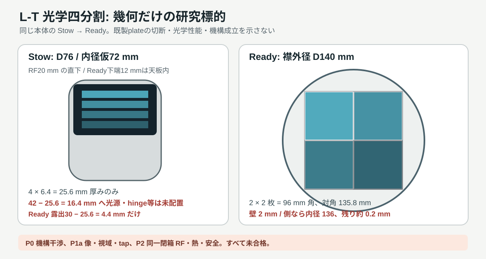

### 選定L-Tの配置図面へ渡す座標と空欄

座標`z=0`はStowで天板と揃うcore端面、正方向は下向き。負の値はReadyで天板より上へ出る部分。これは**外形を先に固定した干渉台帳**であり、型番と寸法を足した完成CADではない。[可動cupの模式断面](assets/orbit-telescoping-sleeve.svg)と同じ原点でP0へ渡す。

| 部位／区間 | Stowでの理想座標 | Readyでの理想座標 | 同じ区画の競合と未取得値 |
| --- | --- | --- | --- |
| core銀色殻・黒帯 | 端面0〜186mm、D76mm。sensor黒帯は`z=20〜62mm`の光学区間に重ねる | −50〜136mm。黒帯の光学区間は`z=−30〜12mm`となり、下端12mmは天板開口内。顔cameraと空中光路の有効視野をP1cで測る | 0.8mm Al側壁の約95gは側面だけ。radome、冷却、cap、握る部分、指紋・停止は未配置 |
| RF／光学／演算／電池／保持の軸仮枠 | 上から20／42／28／76／20mm、合計186mm | coreと一緒に50mm平行移動。襟の軸増分`e≤6mm` | 上端RF窓と光学が隣接。地上voice、Wi-Fi antenna、GNSS、衛星antenna ground、熱路は独立した軸枠を持たない |
| 電池と衛星基板の径断面 | 理想内径72mmへM65A二本＋仮58×16mm基板。二本の長さは各最大71mm | 同じ | 76mm電池bayの軸端は5mmだけ。pack保護・端子・耐熱隔壁なし。小型NR-NTNの一般Web共有が未確認で、9770はこの70mm基板に代用不可 |
| 光学襟 | 理想D76mm内の上側42mm区画`z=20〜62mm`へ折り畳む | 半径方向に最大D140mmへ展開し、軸増分≤6mm | 四分割48mm板の仮幾何は光学・hinge・封止・RF同時成立の証拠なし。Readyでも光学下端は開口内12mmで石・喉・襟の遮蔽を受け得る。視域・照度と共にP1a／P1cで測る |
| 固定喉 | 仮20mm石天板の裏面から`z≈20〜130mm`に置き、開口縁との接続は別。少なくとも外径約88mmを要する仮stack | 同じ。coreの上方50mmを固定喉で覆わない | 石材の割れ止め、開口縁／seal、配管・引出し、駆動・火災／水まわりの施工余白なし |
| 可動cup＋底 | 上縁約80mm、外底約191mm。core底186mmから外底までの差5mmに底壁を含み、内側すき間は未計上 | 上縁約30mm、底約141mm。固定喉との重なり約100mm | 空dock cover、第二爪、手を挟まない検知、停電手動解除、接点と掃除経路なし |
| 全体高さ | 端面0〜cup底191mmに公差仮3mmを足して194mm | core端面−50〜cup底141mmで191mm、同じ仮3mmで194mm。襟の軸増分を加え最大200mm | これらは部品未搭載の同一幾何。足・ねじ・襟・機構が最大値を超えればOI01不合格。Carryの本体186mm、卓上cupも別の200mm計測を要する |

上の五区間は衛星modem、地上voice、Wi-Fi、antenna、GNSSを**実装できた配置ではない**。さらに上からRF20mmを優先した軸stackでは、50mm Ready上昇後も光学42mm区画の下端12mmは天板面より下にあり、開口の壁・固定喉・可動襟が斜めの光路や顔cameraを遮る可能性がある。露出50mmという数字だけで光学42mm全体を自由空間に出せたとは言わず、石開口と襟を含む断面ray traceおよび立位／座位の実寸光学治具で検査する。Iridium 9770を選ぶなら140mm長／12V rail、外部受動antennaの再設計が必要で、現在の186mm軸枠では直列化だけで202mmになる。小型NR-NTNへ進むならモジュールの小ささではなく、米国でMini型式に一般双方向IP、Wi-Fi client共有、通常通話または地上電話とのhandoffを許す契約を先に確認する。どの候補でも同一CAD内で電池、光学、RF、音声、止める入力を退避させずに置けるまで、L-Tを実現可能な閉箱と呼ばない。

質量も**450gという利用感比較用の仮目標**へ同じ部品で積む。D76×H186mmのAl 0.8mm側壁約95g、M65A二本最大149g、四枚48mm角の光学材をASKA3D-200NTの280g／200mm角から面積比例させた**未保証の感度**約64.5gだけで約308.5g。ここへ9770裸module185gを足すと**約493.5g**となり、cap、光源、計算、Wi-Fi、地上voice、antenna、pack保護、hinge、爪を一切含む前に仮450gを約43.5g超える。9523裸module32gなら同じ部分和約340.5gで残約109.5gだが、[9523を使うIP対応OEM基板の実例](https://www.iridium.com/products/planet-9523-oem-board)は2026-10-19に開ける公式ページで**90g・Wi-Fiオプション**、同じ公式URLの過去の索引表示で**98g・Wi-Fiあり**と値が食い違うが、どちらも112×75×20mmであり、理想内径72mmへそのまま横置きできない。仮の四枚光学材を残したまま基板90〜98gで置き換える単純和でも**398.5〜406.5g**で、残りは**51.5〜43.5g**しかない。構成差・掲載改訂の理由と実際のWi-Fi付き質量は未確認で、この残量へRockstarOS演算、地上voice、antenna、保護pack、hinge、爪、cap、光源を入れた証拠はない。裸moduleの余量を量産部品表にしない。面積比例で切断できるという前提は採用せず、質量合格は実際に供給される光学部品と製造部品表を量って決める。450gは利用者が固定した上限ではないため、この結果は携行目標と9770の組合せの排除であり、200mmや空中tapの不可能性の証明ではない。

### 同じ着信・場所・回線を切らずに扱うL-Tの状態機械

`callEventId`、`ownerId`、`dockId`、`placeEpoch`、`airFrameVersion`、`wanSessionId`、`jobId/revision`、`budgetReservationId`を独立した型付き記録とする。センサー推定、本人照合、本人が選んだ操作、Providerの成功を同一の「できた」状態へ畳まない。以下は既存Broker契約に渡す**設計中の状態**であり、実装済みAPIではない。

| 入口→出口 | 本体と本人がすること | 示す言葉・費用 | 止める条件と復旧 |
| --- | --- | --- | --- |
| `STOW_LOCKED`→`RING_PRIVATE` | 契約済みProvider eventで低電力側が起き、端面は匿名の短い輪郭のみ。ownerが05で設定した場合だけlift準備 | 「着信」。発信者名・本文・通話料を周囲へ見せない | 規格外の衝撃、異物、電池低下、mic／camera OFFならliftを始めずcap物理操作と近接音声へ。これを空中応答成功に数えない |
| `RING_PRIVATE`→`LIFTING`→`READY_LOCKED` | 可動cupとcoreを最大50mm一体移動し、第二爪で捕らえる。位置・挟み力・端子・上限を別検知。移動中は光源と住設作用OFF | 成功後も「着信」。上昇時間・停止理由を後で読める | 途中位置、停電、爪未係止なら安全に停止。勝手に押し戻して指を挟まず、手で解除できる経路を設計する。呼出し期限切れは見逃しとして記録 |
| `READY_LOCKED`→`READY_VERIFIED` | 黒帯の顔照合候補または指紋/PINで本体鍵を活性化し、RockstarOS Brokerがownerと設置scopeを確認。AirFrameを新しい姿勢で校正 | 対応可能な空中一択だけを出し、詳細名は本人が明示して開くまで隠す | calibration不明、他人の手、提示攻撃、共有室の覗き見ならdetailとtapを閉じ、物理／近接音声へ |
| `READY_VERIFIED`→`CALL_REQUESTED`→`CONNECTED` | 一択カードを巡り、指の予告→空中tap→Brokerが`callEventId`で応答／拒否を一度だけProviderへ要求。接続receiptを待つ | 「応答を送信中」→receipt後だけ「通話中」。契約が通話料を持つ時は発信前／転送前に別の単価を出す | 結果不明なら再tapで二重要求せずProvider照合。高リスク外部作用は声や顔推定で自動確定しない |
| `READY_*`→`DETACHING`→`CARRY_LOCKED` | coreだけ第二爪を外し、早切れ接点が給電／家の`placeEpoch`と旧AirFrameを失効。本人鍵・call・`jobId`はcore内に継続 | 「家から外しました」。通話中なら音声経路を明示し、光学校正まで空中操作を消す | 接点状態不明なら設備作用を止める。call継続が失敗した場合は切断を示して自動再発信せず、仕事は同じrevisionを保持 |
| `CARRY_LOCKED`→`SAT_IP_READY`→`AP_SHARED` | 屋外で本体antennaの見通し・RF安全・米国契約・双方向IPを確認し、本人がclient／料金上限を選ぶ。Provider側hard cutoff／prepayが確認できる時だけ有料APを開く | まず「Wi-Fiのみ」、実clientのDNS/TLS成功後だけ「衛星で共有中」。商品料金、satellite料金、Sky使用額、外部実費を別行。予約・実使用・残額も別行 | 契約・単価・上限・IP・tetheringの一つでも不明なら`COST_UNKNOWN`／`AP_LOCAL_ONLY`。切替や圏外で有料共有を止め、clientの裏通信を許可なく再開しない |
| `CARRY_*`→`ATTACH_CHECK`→`STOW_LOCKED` | 新dockのID、爪、端子、owner、設備状態を確認し、新しい`placeEpoch`を発行。同じZema jobの確定revisionだけを同期 | 「前の仕事の続き」。未確定通信／請求は照合中と示す | 古い設備scope・空中座標・外部作用を再生しない。異物のある空dockや接点不良なら充電／収納を停止し、手動復旧へ |

この状態機械で「空間へ現れた」時刻と「電話がつながった」時刻は別。50mmのliftを仮10mm/sで動かすだけでも5秒かかるので、低電力wake、校正、本人確認、選択、Provider receiptを足した分布を実着信のring期限と比較する。費用表示の数値・単位は米国のMini向け正式契約を得るまで空欄にし、他端末の料金から推測して埋めない。Sky／ZemaのCloud Agentには既存の事前単価・見積、上限承認、実行中使用／予約、項目別明細を適用し、衛星回線の請求とは独立のledgerで照合する。

**着信時間の机上反証:** 速度を仮10mm/sとしたliftだけで5秒。さらに本人照合2秒、カードを認識して候補を選ぶ2秒、tapとProvider receiptを合計4秒と仮置きすると**13秒**で、低電力wake、像の点灯／校正、話し始めるまでの遅れはまだ0秒としている。15秒で呼出しが終わる試験profileなら残り2秒しかなく、一択順送りが便利という判断はできない。P1c／P3では15／30／60秒の試験着信を同じMiniへ入れ、`ring開始→匿名合図→Ready係止→本人確認→候補確定→Provider受付→双方音声`の各時刻、見逃し率、本人が物理経路へ移った回数を採る。15秒等は**試験用のring条件**であり、米国の通話Providerの公称ring長ではない。短い着信で一択経路が失敗するならlift速度、光学校正、操作順、着信UIを見直し、音声／物理で取れただけを空間tap達成と数えない。

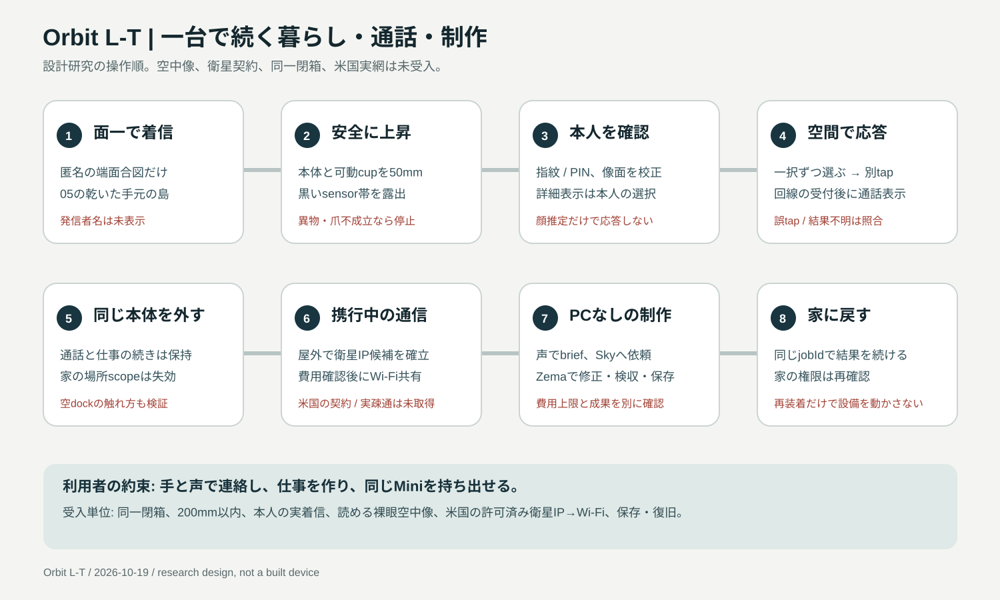

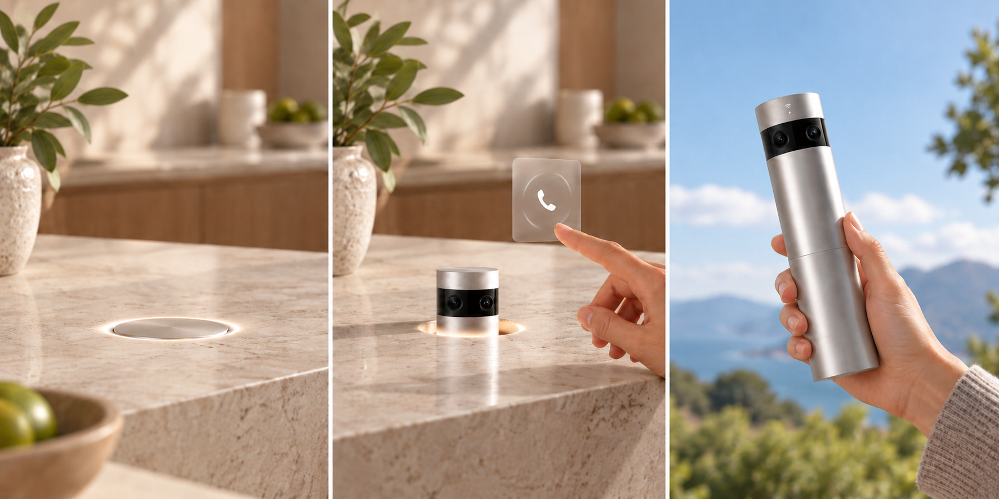

この構想画は2026-10-19に画像生成で作成した工業意匠の比較資料。Readyが約50mmだけ見える方向を表すが、生成画像の遠近法、像の位置、機械寸法、上端RF窓、手の届き方、発光、安全、衛星／Wi-Fi接続を計測・実証していない。製造図面とゲート判定には上記の座標台帳、実CAD、同一閉箱測定だけを使う。画像生成の指示は「既存の銀色円筒CGを質感参照に、乾いた石の島で面一の匿名合図、短くせり出す同じ本体と一択の空中着信、屋外で持つ同一本体の三場面。大きな別dock、電話／PC、二択画面、文字やlogoは描かない」。生成後、中央だけ見える長さを約50mmへ短縮する編集を一度行った。

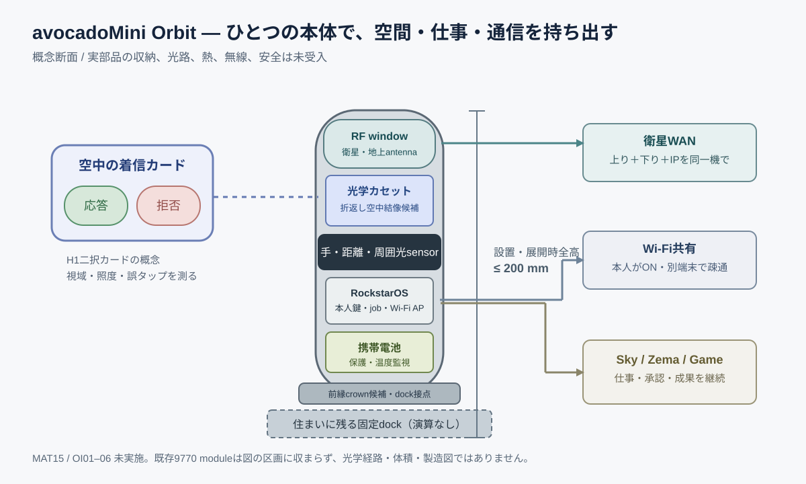

構想CGは使い方と質感の検討用。細い本体の卓上CGの円形台座は可搬coreの部品ではなく据付dock候補で、建築面一から軸方向にせり出す設置案を描いた画像ではない。顔と応答ボタンは本人確認後の操作を仮に描いたもので、共有空間のロック中に顔を見せる仕様ではない。均一径の旧CGは収納比較案で、優先意匠ではない。人物とのscale、内部構造、光学、空中像の実在、衛星接続やWi-Fi疎通を証明せず、製造図面の寸法にも使わない。電話画面のWi-Fi記号は利用場面の表現であり通信試験結果ではない。連続場面の壁sleeveの開口形状と縁の段差も生成上の表現で、ジャストフィット、公差、flush仕上げの成立を示さない。

## 発明として検証する三つの結び方

ここでいう「発明」は製品構成の仮説であり、特許の新規性・進歩性・実施自由の認定ではない。部品単体の採用ではなく、利用者が端末を着脱しながら同じ電話・仕事・本人性を安全に続けられる結び方を検証する。

1. **場所を外すと操作座標と場所権限を同時に捨てる。** dock ID、光学校正、住宅設備scopeを一つの着脱epochへ結ぶ。機械的に外れた時、通話eventと本人領域のjobは維持しつつ、旧AirFrameと住宅操作tokenは失効する。移動先で本体相対のAirFrameを校正するまで空中入力を受け付けない。効果の仮説は、同じ身振りが古い場所の設備操作や意図しない通話操作へ変わる事故の低減。検証はOI05の着脱途中・遅延event・再装着・通話中の同時試験で行う。
2. **個人情報のない合図から、本人確認後の短い空中操作へ進む。** 共有空間の着信は匿名の光と音だけで知らせる。本人照合、対象call event、観察位置と他人の存在、指と像面の校正を確認してから詳細と操作領域を開く。視線・手・照度の信頼が下がれば詳細を閉じ、通話の接続結果は保持する。効果の仮説は、通知を見つけやすくしながら第三者への漏えいと誤応答を抑えること。空中像に他人が視線を向けられる以上、秘匿はsensor推定だけに依存せず、owner設定で名前・本文を常時非表示にもできる。検証はOI02／03の共有空間試験で行う。
3. **回線の実能力と費用を仕事の形へ反映する。** 地上WAN、衛星IP、Wi-Fi LANを別状態とし、衛星へ切り替わるとSky／Zemaのjobを小さい版付き「持ち出し包」へ変える。大きな添付やGame更新を無断で送らず、clientごとのbyte予約と費用上限を見せ、承認した用途だけAPを共有する。通信断でも同じjob IDの成果を後から照合する。効果の仮説は、遅い高費用回線でも利用者が仕事を失わず、意図しない料金を避けられること。実IP、任意Webの利用可否、契約上のtetheringはOI04で別々に検証する。

三つの結び方のどれかが既存公報に含まれる可能性を排除できない。製品価値は、特許取得の有無だけでなく、最初の一周で使いやすさと安全性が実測で改善するかでも判断する。

場所scopeの失効は画面表示だけでは足りない。住宅adapterへ渡すaction能力は短命でdock ID・epoch・対象設備・期限に束縛し、離脱後にMiniが新しい指令を作れないようOSのBrokerで強制する。外部設備やCloudへ既に渡した長命資格情報があれば、Miniの局所失効だけでは止まらないため、常設の広いtokenを与えず、Provider側の失効・期限到来をOI05で別に検査する。圏外離脱中に遠隔Providerへ即時失効が伝わったとは表示しない。

**Lのlatchと権限を一緒に検証する順序。** これは製品実装済みの状態機械ではなく、P1cへ持ち込む機構・Broker間の試験契約である。Readyで襟を開いている間はdockへの再収納を機械的に塞ぎ、襟を閉じて発光を止めた後だけStow方向へ動く。通話中の抜き取りは使える音声経路へ先に移るが、接続維持の成否はproviderで測る。

| 本人の動作／状態 | 機械・給電の順序 | RockstarOSが先に切るもの | 合格を記録する観測 |
| --- | --- | --- | --- |
| `STOW_LATCHED`→解除要求 | 押す／短く回す操作で第一latchのみ解除。第二保持爪は質量を保持 | 解除要求だけでは住設scopeを増やさない | 子どもの偶発解除、指挟み、停電時の手順 |
| `SHORT_RELEASE_CAPTURED`→手で把持 | 面一H0からの短い解除だけを第一保持爪で止め、光源を消して抜去準備。底厚5mm・公差3mmの仮枠ではstroke≤6mmで、35〜50mmの旧Readyは不合格 | 旧Stow AirFrameを破棄。旧場所scopeを増やさない | 第二保持の落下防止、光学窓を触らず把持、sleeve込み全高≤200mm |
| `STOW_LATCHED`→`LT_READY_CAPTURED`（L-T別案） | ownerが有効化した場合だけ、coreと長さ一定の可動cupを一体で50mm上げ、固定喉との重なりを≥44mm増やし、独立第二爪で捕える。途中は光源OFF、障害物と停電時は安全停止 | Stow AirFrameを失効。上昇完了・校正後だけ新しいReady AirFrameを発行し、場所scopeを増やさない | cup底からcapまで実寸≤200mm、指挟みなし、意図しない射出・落下なし、実着信の時間内に完了 |
| `DETACH_ARMED`→第二保持解除 | まずcharge電流を制限し電池へ移る。早切れ接点で離脱を検知してから電源接点を離す寸法鎖にする | `placeEpoch`を進め、旧dock座標と設備scopeを失効 | 接点bounce・電源瞬断・通話継続・旧設備指令0。電源接点のアークを測る |
| `CARRY`→`TABLETOP_READY` | 完全に外した同じ本体を低いcupへ固定してから光学襟H1を開く。開閉中の光源はOFF | 新しいtabletop AirFrameを校正。旧住宅scopeは戻さない | cup＋core＋襟＋公差で全高≤200mm、転倒・RF・手の同時試験 |
| `CARRY`→別dockへ挿入 | 襟を閉じ、光源OFF。keyが合い保持爪が掛かるまで給電を始めない | 挿入だけで旧設備tokenを再利用しない | dock ID違い、左右逆挿入、濡れ／汚れ、接点短絡を拒否 |
| `ATTACH_CHECK`→`STOW_LATCHED` | owner、dock、電源、熱、校正を照合してからcharge開始 | 新しい場所scopeは本人条件とProvider側期限を満たして発行 | 同じjob/revisionの継続、旧作用の再送0、二重通話応答0 |

早切れ接点の信号にsoftwareが応じる前に本体が物理的に抜け得るなら、latchの寸法鎖が失敗である。停電・broker crash時に遠隔Providerへ失効信号を送れないため、設備側にも短命資格の期限確認が必要。これを支えない住宅設備は、Miniの着脱で即時停止できる設備としてcatalogへ載せない。人体が触れる接点は充電停止と絶縁を別に評価し、上の順序だけで電気安全を合格にしない。

## 三つの方式を比較した判断

| 案 | 操作像 | 利点 | 未解決 | 判断 |
| --- | --- | --- | --- | --- |
| A 自由空間の体積像 | 円筒の周囲に大きな3D物体 | 元R5の全空間要求に近い | 200mm、携行電池、光安全、視域、熱の同時成立の証拠がない | R5研究gateに残す |
| B 折返し光路の近距離空中像 | 本体の斜め上の限られた視域に着信カード | 実在する光学原理で空中通知とタップを検証できる | 大きさ、明るさ、視域、日光・歩行中の利用 | Orbitの最初の試験構成 |
| C 表面投影＋手検知 | 机・壁に表示して手で操作 | 大きい情報を読みやすい | 表面を要し、空中に現れる最低要求を満たさない | 補助出力のみ |

BはAの要求を消さない。近距離空中像を元R5の「周囲実空間に分布する裸眼3D」の合格に数えない。Bが成立せずCだけなら最低要求を満たす製品とは呼ばない。
Bの最低判定では、眼鏡型端末や壁・机の投影面を必須にせず、本体の近くに現れた像を裸眼で読み、手で指定した応答／拒否を選べることを同一機で示す。写真で空中に見えるだけ、映像合成、外部displayで見えるだけでは合格しない。

### 5時間再検討：同じ最低機能を狙う三つの物理構成（発散段階）

以下の外形値は**2026-10-19の設計用包絡**であって部品実装済み寸法ではない。三案とも一本のcoreにRockstarOS、本人鍵、電池、電話、Wi-Fi AP、双方向衛星IP用modemと携行antennaを置き、dockは固定・給電・場所校正だけを受け持つ。`Place Passport`、`Scene Contract`、`Route Guardian`は共通契約にする。回線が未契約・IP非対応なら、外観が成立してもOI04は不合格である。

| 構成 | 携行／展開包絡の仮枠 | 光学とStowの出口 | 保持・着脱 | 衛星RF／握る位置／音声 | 残る決定的な反例 |
| --- | --- | --- | --- | --- | --- |
| **F 前面封止** | 銀色D68×H190mm、上端黒帯。展開径なし | 上端の密閉光路から70〜90mm一択像を50〜100mm前へ結ぶ仮説。黒帯が隠れるStowでは端面の別近接窓だけで手を読む | 元の二段push-latch＋35〜50mmせり出しは全長sleeve込み上限に抵触。面一H0と短い解除へ再設計し、第二保持爪・端面の指紋/PIN・物理停止を残す | 樹脂の上端RF窓と本体内antenna、中央下部を握る。下向きmicと側面近接speaker。NR-NTN系modemは型番・体積・網・tethering未選定 | D68の開口と短い折返し光路で可読像・視域・指誤差が成立する証拠がない。2本電池と送信時の熱・手の遮蔽も未解決 |
| **L 展開襟** | 銀色D76×H186mm、操作時の襟最大D140mm。Carry本体はH200mm内を狙うが、全長sleeve＋せり出し時の組立全高は現案で超過 | Stowは正面capから匿名合図と一択空中像を試す。Readyで上部の遮光襟とplateを開き余白込み幅130mmの二択像を試す。二つの光路／校正を別々に受け入れる | key付きbayonetと独立した保持爪。本人が短く回して軸方向へ引く。襟の展開とdock解放を別動作にし、発光中の動きは遮光 | 元案は上端radome。対案L-Rは側面RF窓と軸方向groundを使い、屋外では横置き。双mic＋近接speaker、地上VoLTE・Wi-Fi・衛星のRF共存は未選定 | 全長収納＋35〜50mm liftは厳格200mm上限に抵触。光学襟がantennaの視界・手の到達・落下安全を奪う。Stow前面光路が失敗すると面一のままの空間応答は未達。回線のIP共有も未証明 |
| **S Certus背骨** | D96×H200mm上限で比較。細身意匠・450g目標からは大きく後退 | [9770](https://www.iridium.com/products/iridium-certus-9770)の140mm軸長と並列に電池を置き、残る軸端へ折返し光学／sensor／端面入力を置く。光路の重なりはCAD待ち | H200mm本体へ仮の底5mm＋公差3mmを足すと**Stowだけで208mm**。旧二段引出しはさらに増える。coreの短縮または底なしの別保持方式が先 | antennaは金属殻と離した上端の受動窓、RF cableを短くする。下部握り、側面mic／speaker。9770は実在する双方向IPとvoiceの部品候補 | moduleだけ140×60×16mm・185g。光学、電池、antenna、外殻、放熱、latchを足した閉箱CADと質量がなく、細い携行形・空中操作・450g目標へ適合したとは言えない。22/88Kbps上限は用途を強く制限 |

**三案に同じ一日の台本を当てる。** 共通の合格には実Providerの着信、本人確認、空中の応答／拒否、双方音声、声で作る短い作品の検収、Mini本体の衛星IPから別clientへWi-Fiで実疎通、再装着後の同じ`jobId`が全て必要。以下は設計上の通路であり、機能が動いた記録ではない。

| 同一場面 | F 前面封止 | L 展開襟 | S Certus背骨 |
| --- | --- | --- | --- |
| 05島に面一収納、着信 | 端面38mm前後の像・指紋・停止／近接入力が全て可視でなければ失格。側面speakerは収納中に塞がる可能性 | 端面40mm一択像を先に成立させ、指紋後に二択襟を開く。襟がないStowで応答できるかも別採点 | 端面を広くできるが、140mm radio軸長と光学・latchの重なりが未解決。面一でのfront音声路が必要 |
| 会話からGame会話作品をつくる | 小さい一択を順送りし、声で修正、crownで検収。表示情報量不足なら一件の作品完結に失敗 | Readyの余白込み130mm二択で分岐と費用を確認する仮説。開襟・校正待ちが操作負担なら失敗 | 低速satellite側へ重い素材を送らず地上WANを使うが、Mini内の制作・保存の証拠は別に必要 |
| 外して屋外へ持ち出す | 襟なしで引っ掛かりが少ない。antennaが端面の光学／指と競合し、握りでshadowが起こる | 襟を閉じて携行し、AP使用時は地面／机へ置く。開襟のまま衛星と空中入力を同時使用できるかが厳しい | 衛星IP／voiceの実modemは強みだが外径・質量・peak電源を含めた携行性が弱い |
| 衛星WANをWi-Fiで共有 | IoT-NTN小型radioのIP／tethering契約が見つかるまで未達。APだけ立ってもInternet表示は禁止 | Fと同じ契約障害に加えて襟／radomeの遮蔽がある。展開姿勢もOTAで測る | 9770のIP仕様をbench比較できるが、同じ閉箱のWi-Fi client疎通・契約・料金・アンテナは未達 |
| 戻して同じ仕事を開く | latchの接点を先に切り、場所scopeを失効。光路が固定なので位置校正候補は少ない | 接点と襟閉鎖を独立検出し、襟が閉まらない場合にflush収納させない。場所scopeを再承認 | 重い本体の保持爪と停電解除を別評価。仕事は共通契約で引き継ぐ |

三案で「自分の電話が鳴る」の意味を変えない。Miniの端末が正式に持つ番号／音声serviceまたは本人が承認した明示的な着信転送があり、provider event・Miniへの到達・応答要求・接続確定を追跡する。スマートフォンからのBluetooth通知だけを本体着信へ置換しない。Wi-Fi APのSSIDが見えても衛星IPは証明されず、衛星網登録だけでもInternet共有は証明されない。

**着信で姿を現す方法の対案。** 手動Lでは面一capの匿名合図を見て本人が35〜50mmせり出させ、黒帯を露出させた後に空中操作へ進む。これは日常の着信に一動作を増やし、「鳴るとその場に現れる」体験を弱める。L-Aとして**dock給電の低速auto-lift**で第一保持爪に捕まったまま35〜50mmだけ上げ、本人確認までは匿名合図だけを出す候補を別に置く。dockはmotor／保持と位置検知のみで、着信判断・本人鍵・通話・Sky／Zema・衛星WANは全て本体に残す。ownerの明示設定、物で塞がれたcapの荷重検出、子どもの手・濡れた場面での停止、停電時の手動解除、意図しない持出し防止、夜間の音、漏水／清掃、10,000回級の耐久候補を試験条件にする。自動的に発信者名を出したり、auto-liftだけで応答を確定しない。L-Aも光学襟の開閉、端面光路、衛星RFの同居を解決しないため、**便利そうな動作映像だけでLの合格に加算しない**。02天井と10軒裏へのauto-lift適用は高所保持・降雨・施工を別評価し、最初は05模擬アイランド限定とする。

L-Aを450g比較目標で50mmだけ鉛直に上げる時の重力仕事は`0.45kg×9.81m/s²×0.05m≈0.22J`、自重だけで必要な保持力は約4.4Nとなる。motor効率、摩擦、封止、偏荷重、保持爪を加えていない**下限**であり、小さい仕事量から指挟み安全や静音を証明できない。着信呼出しの残り時間、障害物で止まる距離・力、停電時に戻る／留まる動作を実測してからauto-liftを選ぶ。高所設置は本体が落下しない独立した保持を必要とする。
**全高の測定原点を隠せない。** [R5原本](package/integrated_design.md)のREQ01／ME01は使用時の台座・脚・cap・展開機構を含む200mm上限である。186mm coreを全長収める固定sleeveは理想化しても軸長186mm以上で、coreを35〜50mmせり出した時の**組立全体の軸包絡は少なくとも221〜236mm**（底面から出た先端まで）となる。これはdockの底厚・latch・公差なしの下限であり、L-A／手動せり出しを「全状態≤200mm」とする現行寸法案は**不合格**である。厳格なR5測定を維持するなら、50mm stroke時のcore＋保持基部の重なりを含む全長を≤200mmに設計し直す必要があり、単純な全長収納式では底厚・公差をゼロとしてもcoreを≤150mm、後段の仮5mm＋3mmを入れると**≤142mm**まで短縮しなければならない。Lの現在の186mm区画案からは少なくとも44mmを部品の安全な重ね合わせか方式変更で削る計算になる。建築の奥に入る固定sleeveを製品の全高から除く扱いは既存要求から導けないので、勝手に採用しない。P0ではCarry本体、卓上dock＋Ready、埋込sleeve＋Readyの三つの測定原点を図面へ明記し、短縮・別latch・面一条件の見直しを比較する。現時点でLの200mm適合はHOLDである。

同じ底厚5mm・公差3mmを全案へ仮に当てると、**固定全長sleeveで面一収納した時点**でFは`190+5+3=198mm`、Lは`186+5+3=194mm`、Sは`200+5+3=208mm`。Fの使用中stroke余地は2mm、Lは6mm、Sは収納姿勢でも8mm超過である。Sは比較用のH200本体を短縮するか、底面のない全く別の保持方式にしなければ、元の面一埋込の最低形態へ進めない。5mm・3mmは選定部材や製造公差の実値ではなく、余裕をゼロにして見せないための同一仮条件である。

救済するなら、組立寸法鎖を`H_core + H_operating_stroke + H_sleeve_bottom + H_tolerance ≤200mm`で再設計する。H_core=186mmのままなら、底厚と公差を**ゼロとした非現実的な上限でもstroke≤14mm**。仮に底厚5mm・公差余裕3mmを取るとstroke≤6mmしかない。外へ35〜50mmせり出して黒帯全体を露出させるL-Aは使えず、面一cap自身に匿名合図・本人入力・一択空中tapの成立を求める。短い6mmの機械解除またはcap面内の折り畳み把手で引き抜く案はP0の別候補とし、光路・指・指紋・音孔を邪魔せず取り外せるか実物で測る。**取り外し途中の移動包絡**は安全／施工の別図面へ記録し、通常のReady姿勢をその途中状態として公称しない。完全に引き抜いてから卓上cupへ置く場合も、同じ厳格な寸法鎖を適用する。coreがcupの上に載るだけでcup底面からcore下端まで15mmある仮例では`186+15=201mm`となり失格。cupに挿入した長さを`d`、cupの底から開口までを`h`、襟の軸方向増分を`e`、公差余裕を`t`とすれば卓上全高は`186-d+h+e+t≤200mm`。つまり`h-d+e+t≤14mm`をCADと実測で満たさなければ、卓上Readyも200mm適合とは呼べない。光学／RF／転倒安定も同じ姿勢で測る。

**第三の機構L-T：底が一緒に上がる伸縮収納筒。** 上の失格は固定長sleeveに対する結論である。固定の家具側「喉」と、core下端を受けて喉の内側へ収納できる可動cupを分け、着信時はcupとcoreを同時に上げる対案を残す。ここで`c`は**cupが物理的に短くなる量ではなく、上昇によって固定喉の下へ突き出る長さが減る量**と定義する。単純な使用時包絡は`H_core + stroke + 下端余裕 + 公差 − c ≤200mm`となる。L core186mm、着信時上昇50mm、core底からcup外底までの仮5mm（底壁を含み、内側すき間は未計上）、公差仮3mmなら**c≥44mm**が必要。同じ長さのcupを50mm上げて`c=50mm`なら仮包絡194mm、coreの136mmは**天板下**に残り、固定喉と可動cupが重なって受ける。ただし内部の必要すき間が`g`mm増えれば仮包絡は`194+g`mm、襟の軸余裕は`6−g`mmへ減る。coreの上昇量がcupより`δ`mm先行する故障では遷移中の包絡が`194+g+δ+e`mmとなるため、全状態で**`g+δ+e≤6mm`**が要る。cupが止まったままcoreだけ50mm上がれば仮で244mmとなり、完成姿勢194mmだけを測っても足りない。50mmの安全な重なり、guide、motor／spring、第二保持爪、接点、排熱、清掃、石の天板の施工余裕、停電手動復旧、異物挟み込みを一切入れていない理想図であり、**寸法達成の証拠ではない**。固定喉だけで全coreを覆う旧構造へ戻した途端に先の221〜236mm失格へ戻る。L-Tでの自動上昇は本人が有効化した05乾式模擬島だけを研究し、02天井・10軒裏は重力と落下方向が変わるため別の安全機構と施工受入を要する。匿名合図は面一capから、上昇後に露出した黒帯で本人を確認し、同一coreの空中応答へ進む。この経路でも通話成立・光学・顔照合・衛星IPは未受入である。

L-Tは**可動cupとcoreが一緒に50mm上がり、固定喉の中へ重なる**構成であり、cupそのものが圧縮される意味ではない。着脱時には両者を分ける第二latchを要する。状態と機械責任を先に分ける。

[模式図](assets/orbit-telescoping-sleeve.svg)の縦寸法を読むと、固定喉は天板下約130mm、可動cupは長さ約111mm、Stow時は天板下約80〜191mm、Ready時は約30〜141mm。喉とcupの軸重なりはそれぞれ**約50mm／約100mm**になる。これは描画を成立させる一例で、guideの実寸、ベアリングの隙間、偏荷重・摩耗、異物排出と保持力の計算ではない。黒帯への指接触や本体を斜めに引く力がある状態で、50mmの重なりだけで支えられると推定しない。断面CADでは前面の空中光路・背面RF窓・cupの二重壁が同じ高さに重なる箇所を切り分ける。

| 機構状態 | 物理動作と検知 | RockstarOSで許すこと／止めること |
| --- | --- | --- |
| 面一Stow | coreがcupに係止、cupは下端、端面だけ露出。空の穴を塞ぐ部材は未設計 | 匿名着信・停止をcapから扱う。黒帯の顔camera・側面hand sensorを有効と誤表示しない。capのPIN／物理応答が露出していなければ、lift故障中に電話を取れないためOI03は失格 |
| 上昇中 | cup＋coreが一体で最大50mm移動。位置、力、障害物、保持爪を別検知 | 個人情報表示・空中確定を待つ。障害物、停電、位置不一致なら停止し、H0／物理操作の復旧へ移る |
| Ready保持 | cupが上限で係止し、core黒帯を露出。襟を開く時は軸増分`e≤6mm`の仮枠 | 新しい姿勢で手／顔を校正し、本人確認後にだけ着信詳細と選択を表示。像面未校正ならtapは閉じる |
| 離脱開始 | coreだけを第二latchから外し、早期接点を切る。cupは急に落ちない | 家のscopeと旧入力座標を先に失効し、本人の`jobId`・成果だけを持ち出す。切断不明なら住設操作を止める |
| 空dock | coreがないことを検出し、指や異物のない時だけcupを下げ、開口・給電接点を保護 | 場所操作はできず、dock秘密を持たない。coverが閉じない／異物があるなら機構と充電を停止 |
| 戻し途中 | 位置合わせ→cup保持→core係止→給電→姿勢校正の順を確認 | `placeId`だけで旧権限を復活させず、owner・revision・設備状態を再照合。古い作用を自動再送しない |

この表は接点、ばね、motor、coverの実装案を確定しない。特に空dockの開口は食材・液体・指・掃除道具が入るので、開いたままの構想CGを安全な住宅施工の証拠にしない。P0で実寸干渉、P1cで異物・停電・manual recovery、OI06で完成機の保持と電気安全を受け入れる。

L-Tで襟を同時展開する場合は軸方向増分`e`を足し、`186+50+5+3−c+e≤200`となる。上の仮`c=50mm`かつ未計上の内部すき間`g=0`なら**e≤6mm**で、実際は**`e+g≤6mm`**を満たす必要がある。cupの長さは一定なので、固定喉との重なりを無制限に増やして余裕を作れるわけでもない。core下端からcup外底までの仮5mmには底壁を含み、内側に必要なすき間はまだ加えていない。cupをcoreより大きく上昇させれば底壁との干渉を別に解かなければならない。したがってH1は単にD140へ開ければよいのではなく、展開中も軸方向6mm以内・指挟みなし・RF窓を遮らない実機構が必要。収まらないならL-T Readyは黒帯を露出しても空中像を完成できない。面一H0、L-T Ready、離脱後の卓上H1のどれで**着信中の空中選択**を成立させるかをP1a／P1cで別記する。

[ASKA3D-200NTの既製plate外形](https://aska3d.com/common/pdf/aska3d-200-design.pdf)の厚さだけで6.4mmあり、これをcapの上へ水平に置くだけでも上の**仮6mm残高を0.4mm超える**。しかも横幅200mmは襟D140へ入らない。別方式または光学面を軸外へ畳む構成を必要とする強い反例であり、既製plateを切断・薄板化して同じ像になるとは推定しない。実際の`e`は開く機構・保護・製造公差まで含めた最大値をCADと測定で定める。

半径方向にも施工寸法を出す。仮のcore外径76mmに、内側すき間1mm／側、可動cup壁2mm／側、摺動すき間1mm／側、固定喉壁2mm／側を積むだけで外径は`76+2×(1+2+1+2)=88mm`。seal、guide rail、駆動、配線、指を掛ける縁、石材の割れ止めはまだ外側へ要る。したがってL-Tを「76mmの穴だけで既存の石天板へ入る」と説明しない。仮の20mm天板でStow組立全高194mm（core0〜186、cup底191、公差仮3）なら、最大占有域の底は**上面から194mm、天板下面から174mm**ほど下に来る。引出し・補強・配管の実位置と保守アクセスがなければ、最初の05でも施工gateを通さない。

**外した後の空の受け部**も製品状態に含める。深い開口へ水滴、食材、指、小物が落ちるなら、同じ乾いた島で使いやすいと言えない。上面に自閉する薄いcoverを置く案は、開閉部・seal・清掃口・軸方向増分・挟み込み・再挿入のkey合わせを新たに増やす。coverなしで深い穴を残す案は、使用場所と清掃負担を利用者観察で評価し、住宅仕様の受入前に選ばない。どちらでも空dockの占有、満水・異物時の充電停止、給電接点の触れ防止をP1c／OI06で測る。coverを別の持ち歩く部品として要求し、一本自律の使いやすさを隠さない。

露出した黒帯が顔を**本当に見る**かは寸法と別である。05仮カウンター高さ900mmから50mm上昇したsensor中心を地上950mmと近似すると、眼高さ1500mm・水平300／500／700mmでは必要な上向き仰角は約61／48／38°、眼高さ1200mmでは約40／27／20°。試験したい二姿勢・三距離だけでも約20〜61°の鉛直方向と、島の利用側への水平向きが必要になる。仮に視野の上下端へ各10°の余白を求めるなら鉛直有効FoVは**最低61°**（20−10〜61＋10°）となり、光軸は約40.5°上向きに置く幾何である。これはレンズ選定の境界計算で、顔の大きさ、端面の遮蔽、歪みや認識精度は含まない。一個の水平方向固定cameraを黒帯に付けただけでは、手ぶら本人確認の視野が成立したとは言えない。利用側へkeyで向きを固定するか、複数の光学窓を使うか、端面へ振るかをP0の前面・RF・privacy配置と一緒に検証する。眼が見えても他人が同じ範囲へ入る場合は詳細表示と空中確定を閉じる。

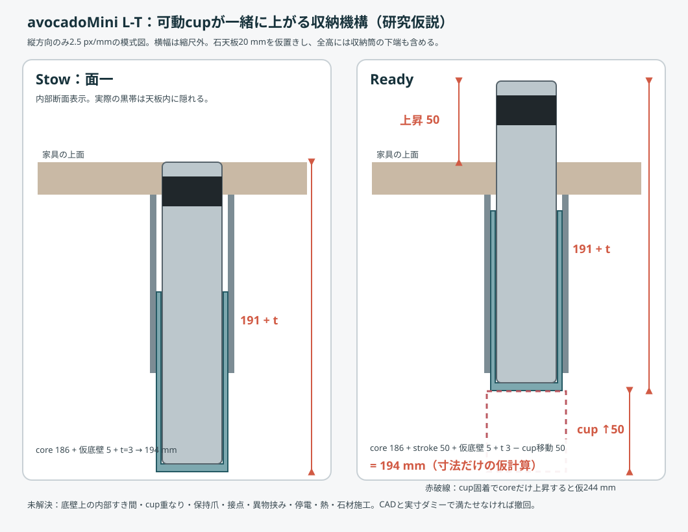

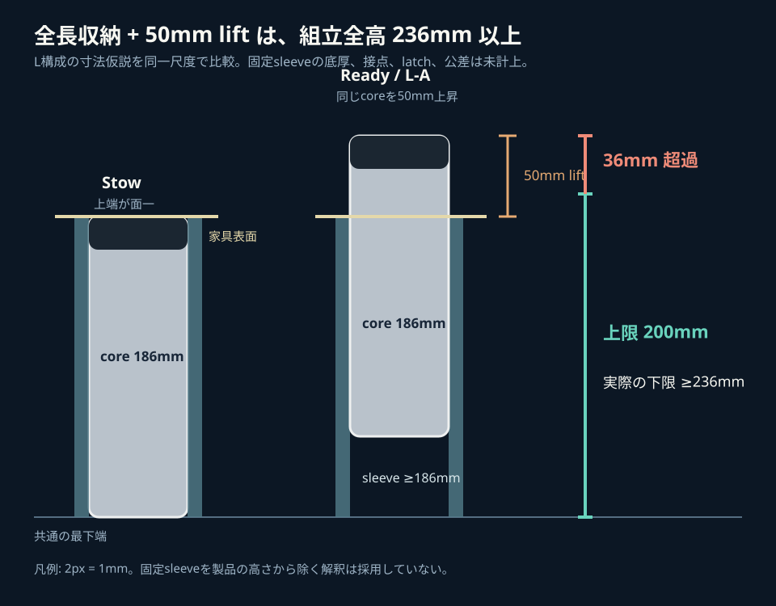

時間の感度も置く。50mmを仮に10mm/sで動かすだけで5秒、20mm/sでも2.5秒を使い、ここに起床、黒帯sensor校正、本人確認、指の選択、provider応答確定が続く。安全な移動速度や実providerの呼出し残時間は未取得なので、速く動かせばよいとは判断できない。`ringEvent時刻→lift開始／停止→表示成立→認証→tap→provider接続`を一つのtraceへ記録し、障害物停止や再呼出し時にも相手が切る前に本人が操作を終えられるかを測る。

現段階の**方式決定を遅らせない分岐**は次の通り。面一capの密閉前面で着信の可読像と安全な指選択が成立し、同じ筐体へRFが入るなら、展開部品を持たないFと、少し大きいcapを持つL-H0を同じ人間工学試験へ進める。H0が両方で失敗した場合、固定長sleeveの旧L-Aを35〜50mm上げてH1で代替する元案は厳格200mm上限に抵触するため、現寸法のまま救済としない。**別機構L-T**で長さ一定のcupがcoreと共に50mm上がり、固定喉との重なりが≥44mm増え、保持・光学・安全を全て通せるなら、黒帯を出したReadyでの空間電話を再検討できる。L-Tも未実証なので、それまでは音声・物理ボタンが使えても元の空間電話最低機能はHOLDする。L-H0が合格すればH1は作品確認を楽にする追加状態として試す。衛星IPの一般Wi-Fi共有が契約・端末・帯域で不成立なら、いずれの光学案も**ポケットWi-Fi最低機能を満たした製品にはならない**。これらの独立したgateを一つの総合CG評価へ畳まない。

| 比較軸（同じ使用日・同じ契約条件） | F | L | S | 次の反証実験 |
| --- | --- | --- | --- | --- |
| 面一の着信像＋本人の空中応答 | **HOLD**：38mm窓と前面sensorが未実証 | **HOLD**：H0の前面実証、または伸縮L-Tで上昇後Ready実証が必要。固定sleeveの35〜50mm L-Aは全高FAIL | **HOLD**：端面光学と長いradioが競合 | 実寸capとL-T可動cupを05模擬島で別試験し、呼出し中に初見利用者が応答／拒否できるか測る |
| 取り外した同一本体の衛星IP→Wi-Fi client | **HOLD**：IPとtetheringの契約がない | **HOLD**：RF窓・姿勢・襟との干渉もある | **bench候補**：9770のIP仕様はあるが閉箱のclient通信はない | 現行契約／modemの回答を得て同一筐体でDNS・TLS・上下1MBを実測 |
| 一日の電池・手持ち性 | **HOLD**：bayと送信波形が未測定 | **HOLD**：電池bay・襟・短いrelease／L-T可動部が未測定 | **450g仮目標ではFAIL**：既知部品だけで約464g | 実CAD質量表と待受・通話・衛星転送時のrail／熱を測る |
| 最初に潰すべき独自の危険 | 端面へ光学・認証・停止・antennaを集中、固定sleeveでrelease≤2mm仮 | RF窓と展開光学の衝突。L-Tはguide・第二爪・挟み込み・空dock保護・光学襟e≤6mm仮 | 本体H200に底5mm＋公差3mmでStow208mm、質量、電源peak、RF／光学の軸長 | 前面の全部品と固定／伸縮dockを同一配置図に重ね、干渉を実寸で撮影する |

**HOLDは未合格であり低い評価点ではない。** この表から販売候補の順位は決めない。現時点の調査順は、開口を増やせるLでH1と機構の成立限界を探り、同じH0治具でFに戻れるかを測り、Sで衛星IPの厳しい電力・速度をbench参照する順である。FがH0を満たせばLの複雑さは不要になる可能性がある。Lが像だけ成功しても衛星共有を満たせなければ、利用者が求めたMiniの発売案にはならない。

携行時の外接円筒だけを比べた**占有包絡**は、F約0.69L、L約0.84L、S約1.45L。LはFの約1.22倍、SはFの約2.10倍の外形空間を占める。これは内部の使える体積ではなく、くびれ・保持爪・外装・光路を引いていない。Lの襟を開くと直径140mmになり、卓上の隣の皿や手に触れる空間も別に必要。上着のポケットへ収める時は襟を閉じ、突出・引っ掛かり、実質量、30分携行の評価を受ける。

比較機のSatSleeve Hotspotは142×69×38mmの直方体包絡で約0.372L。形状が違うので内部体積や性能の優劣にはできないが、Lの外接包絡0.84Lは**約2.3倍**で、厚みも最大76mm対38mmとなる。より自律的なX5-Touchは145×78×24mmの直方体包絡で約0.271L・262g。Lの直径76mmの断面へX5全体を横向きのまま入れることは幅78mmだけでも不可能で、内部回路を再配置する別製品開発になる。X5の小さい外接体積をもって光学と電池の追加余地が証明されたとはしない。Lを「ズボンのポケットで軽く持つ」と描写せず、まず上着・鞄・手持ちの30分携行、片手で取り出す時間、座位での当たり、落下を観察する。携行性で通常のhotspotに劣るなら、空中電話・PCなし制作・住まいとの一周でそれを上回るかを本人に評価してもらう。

Sの質量比較も早く切る。9770裸module185g＋M65A二本149gで既に**334g**。D96×H200mmの側面を密度2.7g/cm³のAl、板厚0.8mmの薄い円筒と**単純化**しても、側壁だけで約130g、合計約464gとなり、端面、光学、地上radio、SoC、Wi-Fi、配線、保持、塗装を足す前に仮の450g目標を超える。0.8mm側壁が強度・放熱・RF窓を満たす証拠もない。この部品組合せのSを450g携行案としては**棄却**し、Sは衛星IP benchと質量上限を緩めた工学対照に限定する。ユーザーの固定要件は200mm全高と一本自律であり、450gを勝手な製品要求にしない。
電源も別に重い。[9770入りRockREMOTE Mini OEMの公開値](https://www.iridium.com/products/rockremote-mini-oem)では12V時の送信peakは1.66A未満、すなわち入力側約20W未満の瞬間値で、10% duty条件が添えられる。仮に3.7V packから90%効率でこの上限付近を作るなら電池側は約6Aとなる計算で、boost、瞬断防止、BMS、配線・熱をSの図から省けない。このpeakはMiniの実測値でも連続平均でもない。電池と光学を入れた閉箱で電源railの最低電圧、通信中のreset、接触温度を測るまでSの実稼働時間を出さない。

Fの**対案用の軸方向上限**はRF20＋密閉光学40＋演算／Wi-Fi35＋電池bay77＋latch／接点18＝190mm。Lと同じく黒いsensor帯は光学区間へ重ねて数え、別部品の実寸余裕はない。Fの内径64mm理想円にはM65A二本を中心`(-11,0),(+11,0)mm`で置く断面は描ける（最外点は半径約21.9mm）。36mm角の小型SoMも平面対角約50.9mmで描けるが、採用carrier・connector・antenna・固定まで入ることは示さない。電池bay77mmからcell最大71mmを引いた6mmはpack端子と保護に足りると断定できない。Fには可動襟の面積がない分、**端面の38mm程度の光学窓でStow／Carryの一択像を成立させることが唯一の光学勝ち筋**である。RF20mmと光学40mmの境界、アンテナ放射体の置き場はL同様未解決。FとLの同じH0光学benchでFが必要な読取と空中tapを満たすなら、利用動作と故障点の少ないFを再優先する。

**数値で切り分ける初期排除。** 壁厚を各側2mmと仮定するとFの内径は64mmで、円形開口に平板正方形を完全に入れる一辺は最大約45mm、LのD76閉鎖時は内径72mmで約51mm、SのD96は内径92mmで約65mmとなる。Lの展開襟D140でも同じ仮定なら約96mmである。これはplateの上限だけで、像の大きさ・輝度・視域は導かない。[既存ASKA3D製品](https://www.asukanet.co.jp/contents/news/2025/20250909.html)の98×160mm plateをF/L閉鎖中へそのまま置くことはできない。一方、光学倍率や別方式の可能性まで否定する計算ではない。FとLの衛星候補には小型IoT-NTN moduleの外寸・公称送信電流の公開値があるが、これだけでは採用基板、GNSS、antenna、網の一般IP・tethering条件まで収納・成立したとは判定できない。

[ASKA3Dの組込用ユニット仕様](https://aska3d.com/ja/aska3d-unit.html)では、7インチ像のKC-W1が本体262.1×127.8×239.8mm・1.73kg、最大36Wである。別売りの[200mm角樹脂plate図面](https://aska3d.com/common/pdf/aska3d-200-design.pdf)でもplate単体280g。これらは**異なる大きさの既製機・plate**の値で、Miniの空中像が36W必要だという意味ではない。ただし既製ユニットや200mm角plateを200mm高のF/Lへ丸ごと入れる工程ではないことを示す。H0の40mm級開口とH1のD140襟は、専用光学の実寸、視域、消費電力、保護部材、量産先をゼロから確かめるP1a条件とする。

小型の像源自体には[ソニーECX350F公式発表（2024）](https://www.sony-semicon.com/en/news/2024/2024092401.html)の0.44型・11.235mm対角、1,920×1,080、panel公称最大10,000cd/m²という実例がある。これはAR眼鏡用microdisplayの**panel出力**であり、Miniの空中像がその輝度・視域・解像度になる証拠ではない。折返しmirror／plateの光量損失、50〜100mm浮遊距離、眼位置、駆動電力、発熱、保護窓を加えた実機光学benchが必要。小さいpanelが見つかっただけでH0の約40mm出口を合格にしない。

光学の別候補として、[Optical Review掲載のTCAP研究（2025）](https://link.springer.com/article/10.1007/s10043-025-00948-1)は切頭円柱配列で空中像を作る論文である。実作成は直径5mmのアクリル棒20×20配列なので素子面は概ね100mm角。**正方形の対角は約141.4mmで、壁なしでもD140の丸い襟へそのままは入らない**。仮に襟壁2mm／側なら有効内径136mm、内接正方形の最大辺は約96.2mmで、素子辺より約3.8mm小さい。点光源実験では光源から素子40／50／60／70mmと、反対側の焦点位置を測っている。一方、本文は**鉛直視域が狭く像がぼける**ことを明記し、実物で文字の二択カード、明るい住宅、50〜100mm先の指tap、電池動作、量産精度は示さない。研究のシミュレーションで使った200mm角・0.5mmピッチの素子と、実作成100mm角・5mm棒の素子も同じ解像度ではない。P1aではAIRR、既製MMAP／ASKA、TCAP系を同じ輝度・視域・指重ね条件で比較するが、TCAPの既製実験寸法をLの光学部品として選ばない。縮小や角の切除で性能が保たれるかは新たな実験を要する。

**小型衛星部品の発見は、通信要求を解決しない。** [Quectel CC660D-LS specification V1.2](https://www.quectel.com/content/uploads/2024/03/Quectel_CC660D-LS_Satellite_Communication_Module_Specification_V1.2-1.pdf?wpId=114714)のmodule本体は17.7×15.8×2.0mm、約1.2gで、F/Lの基板廊下へ描ける可能性がある。ただし同仕様は別GNSS moduleの併用を要求し、衛星通信の参考上限は上り8.6kbps／下り8.3kbps、protocolはIPv4／UDP／NIDD／DNSと記載する。TCPは列挙されない。V1.2の送信時293mA@3.3Vはmoduleの典型約0.97Wに過ぎず、GNSS、RF feed、Wi-Fi AP、CPU、表示を含まない。さらに[Quectelの後発掲載資料](https://www.quectel.com/blog/document/cc660d-ls-satellite-communication-module/)はB255の23dBm送信値を55mAと記載し、**版によって値が食い違う**。電力予算にはどちらも確定値として採用せず、現物のfirmware／条件付きdatasheetと電流波形を取得する。十進1MB＝8,000,000bitを8.3kbpsで下ろす算術下限は約964秒＝16.1分で、接続、再送、protocol overhead、網混雑、費用を足せば延びる。この部品で小さい本人jobをUDPで運ぶ研究はできるが、一般のWebを任意clientへ共有する「ポケットWi-Fi」、通話、Game更新の成立は未証明である。

[Skyloの公開技術資料](https://www.skylo.tech/knowledge-base/skylo-introduction)はIP（UDP）とNIDD、MTU 256bytes、50bytesの最低課金単位、50bytes packetで約5〜15秒、装置あたり毎分2 messageという公開サービス特性を示す。毎分2 messageの記述を一般IP packet全ての恒久上限と解釈せず、対象plan／APN／traffic classを事業者と確認する。同社の[接続説明](https://www.skylo.tech/knowledge-base/enabling-global-connectivity-skylo-ntn-connectivity)はMNOとの認証・請求連携とIP/NIDDの網能力を説明するが、**Mini固有のIP PDP、TCP/HTTPS、NAT、Wi-Fi tethering、電話番号と音声、単価を保証しない**。この小型経路はOI04の候補として残すだけで、Skylo認証済みmoduleを搭載するだけではOI04を通さない。専用proxyでUDPの小作品を運べても、一般Internet用Wi-Fiを約束したことにはならない。

さらにSkyloの[端末適合資料](https://www.skylo.tech/knowledge-base/device-conformance)はIoT plan向けbest practiceとして送信packet最大256bytes、送信間隔30秒超、message片道遅延を最大30秒として設計することを示す。これを全契約の強制的なIP速度制限へ読み替えないが、一般Webの多数の要求をそのまま通す想定には強い反証である。同社は携帯型に近いType 2のfree-space RF目標を各bandでTRP≥16dBm・TIS≤−108dBmと示し、筐体・手・襟込みのOTAで評価する必要がある。[認証案内](https://www.skylo.tech/skylo-certification-program)は認証済みmodule搭載の完成端末にもdevice認証が必要とし、B23／B255／B256の三band対応を期待する。現在の標準Skylo認証費を統合端末4,000米ドル、module／chip-on-board 7,500米ドル（第三者lab、各国規制費別）と掲げ、Type 2携帯型のservice料金は相対的に高いとも説明する。この額はMiniの通信月額・製造原価ではなく、米国pilotの型番・antenna・partnerで見積を取り直す事業gateの参考値である。

同じ端末適合資料はSkylo接続前の**有効なGNSS fix**を要求し、内蔵または外付けGNSSからmodemへ位置情報を供給する経路を示す。したがってCC660D-LSの小さい本体寸法だけを使う案には、GNSS受信素子、antenna、衛星送信との共存、屋内から屋外へ出た直後のfix取得時間が別に要る。資料の95% CEP≤100mは網向け位置条件であり、Miniの「部屋の中の位置校正」精度ではない。位置を回線開通へ使う場合は本人に目的・送信先・保持期間を示し、Place Passportの部屋権限や生活sensor履歴へ無断結合しない。Skylo以外の網へこのGNSS条件を一律適用せず、候補回線ごとに正式仕様を取得する。

**面一端面の競合。** Lで内径72mmの円の理想面積は約4,072mm²。最大約51mm角の平板を仮に置くと約2,601mm²を占め、残りの**総面積**は約1,471mm²にすぎない。この残りは細い一定幅の輪ではなく、保持縁、前面の手検知、匿名通知、物理停止／PIN、指紋接触、RF窓、封止、公差が同じ面を奪う。面積が合計で足りても視野・光路・指の届き・antenna keep-outは成立しない。優先配置は**前面の一択像と低電力近接窓、前縁から触れるcrown／生体入力、上肩の樹脂RF窓**という分担で検証し、金属見切りと開いた襟が空方向を塞がないかを測る。crownへ手が届かない完全flushならStowは電話応答profileとして失格とする。Stowの一択像が無理な時、旧案の35〜50mmせり出しReadyへ逃げることは現寸法では200mm上限に反する。H0の方式かcore／sleeveを再設計し、満たせるまで空間着信をHOLDする。

| 同じ一本で奪い合う面／通路 | Fの面一Stow | Lの面一Stow → 完全離脱後の卓上Ready | 携行Carryでの再試験 |
| --- | --- | --- | --- |
| 空中像と眼の視線 | D68の密閉端面38mm仮開口のみ。顔からの斜め視線で見切りが像を遮るか | D76端面40mm仮開口 → 完全離脱後の卓上cupで襟を開いたH1。旧L-A liftは全高で失格のためStowの代替にしない | 縦持ちと横置きの像位置、屋外照度、服や手による遮光を別測定 |
| 手と本人入力 | 端面の近接窓、指紋/PIN、停止を同じ細い輪へ置く。黒帯は隠れる | Stowの前面近接窓だけで一択tapができるか → 離脱後Readyでは黒帯を露出して再校正 | 持つ手がsensorや指紋を隠すか、本人以外の手と区別できるか |
| 衛星・地上・Wi-Fi RF | 上面patchと光学は重なるため側面RFを研究 | L-Rの軸方向RF窓・groundを研究。襟を開いた姿勢の影を測る | 手、体、横置き、衛星方位、同時送信時の通信と曝露を測る |
| 音声と機械停止 | 端面mic／側面speakerがdockに塞がれないか、物理停止に届くか | capの合図と音声孔、第一保持爪、第二解除爪を別にする | 落下・過熱・回線切替時も通話終了とAP OFFに触れられるか |

この表はCADで配置済みという意味ではなく、**同じ位置・姿勢で同時に成り立つか**を試すための干渉表である。個別部品の寸法が小さくても、視線・光路・音孔・RF keep-out・防水縁と保守手順を含めた3D占有域をP0で固定する。

RFの平板寸法も光学と競争する。[Taoglas CGSP457.A](https://www.taoglas.com/product/cgsp457-gnss-satcom-1542-1643-mhz-45-x-45-x-7-mm-patch-antenna/)はNTN n255／Iridium／GNSS向け45×45×7mm patch、32gで、公開特性は**70×70mm ground plane上**で試験されている。45mm角patchの対角約63.6mmはFの理想内径64mmで周囲約0.2mmずつしか残さず、L内径72mmでも周囲約4.2mmずつしか残さない。70mm角ground planeの対角約99mmはF／Lの円断面へ平板のまま入らない。これは当該antennaの参照条件と断面の衝突であって、全てのcustom antennaを不可能にする証明ではない。光学用端面をpatchでも使う前提にはせず、側面または上肩の曲面／分割antenna、別ground形状、偏波、人体近接と襟開閉の効率をRF担当が実測し、選定網のOTA条件へ適合させる。型番だけの机上配置ではOI01とOI04を通さない。

より小さい[Taoglas IP.1621.25.4.A.02の公式仕様](https://cdn.taoglas.com/datasheets/IP.1621.25.4.A.02.pdf)はIridium帯patch本体25×25×4mm・10g、参照測定は50×50mm ground plane、同antennaのIridium商用認証を記す。Lの仮内径72mmに50mm角を平らに入れると対角70.71mm、理想円との半径方向余白は**約0.65mm**だけで、外殻・保持・絶縁・公差をまだ引いていない。上端の同じ平面へ直径40mm級の空中像開口を貫通させると、その50mm角の連続groundという参照条件も変わる。したがって「25mm patchを見つけたので9770＋H0光学が同居する」という短絡は棄却する。側面や別層へ置く、新しいgroundと光学開口を一体設計する余地はあり、これらは偏波・sky view・手・金属殻・襟の全姿勢で再測定する。antenna単体の認証を9770、完成Mini、米国網・契約の承認へ転用しない。

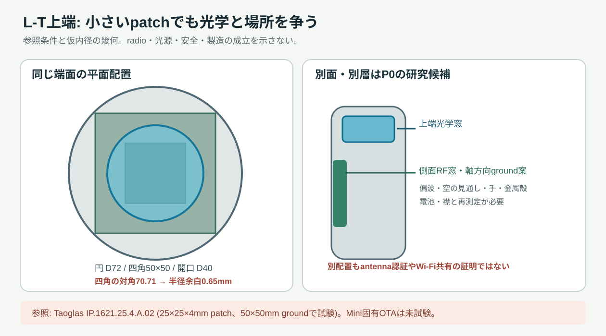
Sの内径92mmへも70mm角groundの対角約99mmは収まらない。Sが9770のIP部品を持てても、外部受動antennaの搭載、給電、放射patternと光学の干渉は残る。比較用moduleが実在することと一本の完全なsatellite radioが閉箱内で使えることを分ける。

F/Lの**別のRF配置候補**として[Taoglas PCS.26.A](https://www.taoglas.com/product/pcs-26-a-havok-penta-band-cellular-low-profile-lte-cellular-smd-dielectric-antenna-including-600mhz/)はNTN B23/n255/n256を掲げる54.6×13×3mmの線状SMD antennaで、最大効率には長さ100mm以上のground planeを推奨する。長手をMiniの軸方向に置けば端面光学と重ならない可能性がある。Lの76mm電池bayだけでは100mmの基準planeが収まらないため、演算bayへ跨ぐ**連続した軸方向ground**とRF透過窓をCAD候補とする。銀色の見かけを保つために金属塗装で窓を塞がず、非導電仕上げを材料試験する。屋外APでは本体を寝かせてRF窓を空へ向け、短い平坦面で転がりを防ぐ案も試す。これなら手でantennaを覆わずに通信できるかもしれないが、横置きで空中像・手操作が見えるか、襟・金属殻・電池・groundの性能、偏波、屋内受信と契約通りの上りは全て未測定である。部品がn255等を列挙することをSkyloや別網の完成端末認証とみなさない。
[Taoglas NLA.01の公式datasheet](https://www.taoglas.com/datasheets/NLA.01.pdf)は別のS帯n256向け5×3×0.5mm loopを示すが、推奨ground planeは80×40mmである。放射素子が5mmでも80mm辺をLの72mm内径へ横置きできず、軸方向へ置く試案となる。NLA.01は対象band・偏波・gainがPCS.26.AやX5級GmPRS網と違い、同社が示すIoT用途での寸法比較に限り、実際の通信方式と速度は選定modem・網次第である。**小さいantenna素子を見つけてもRF系全体と契約を小さくできたことにはならない。**
「RF窓を空へ向ける」は**試験姿勢の一つ**にすぎない。候補がGEO網なら衛星の方位・仰角とantennaの偏波、LEO網なら追尾中の姿勢変化を対象地域で扱う。窓が上を向いても放射patternのnullに衛星が入れば接続できず、筐体を転がらないように置くだけではpointingを解決しない。OI04では位置・方位・傾き・手の有無・展開襟の状態を記録し、本人が設置できる姿勢の幅を製品条件として測る。
RF窓の近くへ指を入れる空中操作と、衛星送信を同時に行う人体曝露も独立の安全gateとする。[大型のThuraya IP NEO M利用者マニュアル](https://www.thuraya.com/-/media/thuraya/products/land-data/ip-neo-m/ip-neo-m-user-manual_april-2026.ashx/)は送信時に前面antennaから0.6m離れる警告を持つ。これは**別機種の条件**でありMiniの距離や危険度へ転用しないが、「Wi-Fi共有中にその同じ面へ空中tapを促す」配置を無条件に安全としない理由になる。Mini自身の周波数、最大送信、実antenna、姿勢、同時送信を確定し、対象地域のRF曝露評価で許可された操作距離を満たせなければ、AP送信中の空中入力を無効化するかRF／光学の位置関係を設計し直す。これを使用説明だけで解決した扱いにしない。

この配置を**L-R（軸方向RF spine）**として数字を置く。これは選定L-Tの「上端RF20mm」案とは**代替のRF配置**で、同じ閉箱で両方の空間を使えたとは数えない。上端を`z=0`とした仮の186mmで、端面／入力`0–20`、光学・黒帯`20–62`、演算・Wi-Fi`62–90`、二本電池`90–166`、保持・接点`166–186`を使う。satellite用の連続したground候補を`z=62–166`の**104mm**に通し、その側面の`z≈62–117`へ54.6mm antennaを置く。電池脇の縦基板を演算bayまで延ばすので、`z=62–90`で主SoC基板と干渉する。主SoCを同じspine両面に再配置するか、基板を立体接続する必要がある。`z≈120–166`を握り位置の仮枠にすればsatelliteの主要窓から手を離せるが、手が短い本体へ届くか、重心とcrown操作が安定するかは人間工学dummy待ち。**外装に見えないRF窓を描いただけで104mmの有効groundを得たことにはならない**。導電殻と窓の境界、battery pack絶縁、製造公差、熱経路を一枚の3D CADへ入れる。

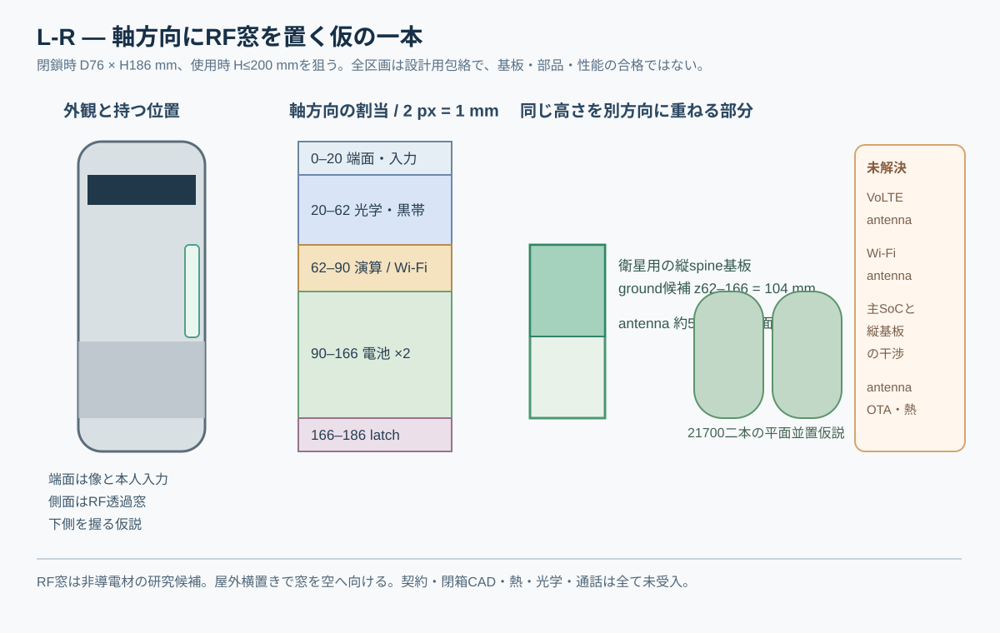

さらにL-Rには少なくともsatellite、地上VoLTE、Wi-Fi APの三つの無線放射経路が必要で、採用するsatellite radioがGNSSを兼ねなければ四つ目も要る。それぞれのradio本体の面積より、**別周波数のantenna位置・feed・ground・同時送信の自己妨害**が限界になり得る。`z=62–117`を衛星窓へ与えた後、地上とWi-Fiを黒帯／下部へ置く案は寸法・人体遮蔽・受信感度の試験前仮説である。どちらかのantennaを同じradiatorで共用するなら許容band、filter、切替と同時通話を設計図に示し、providerのOTAを受ける。共有可能と無根拠に部品数を減らさない。

この画像は上記の配置と利用姿勢を話し合うための生成構想画で、端面から見えるカード、開いた襟、側面RF窓が**実際に同じ閉箱で結像・通信できた証拠ではない**。寸法、光学距離、antennaの向き、材質、冷却、横置き安定は次のCADと実測で決める。

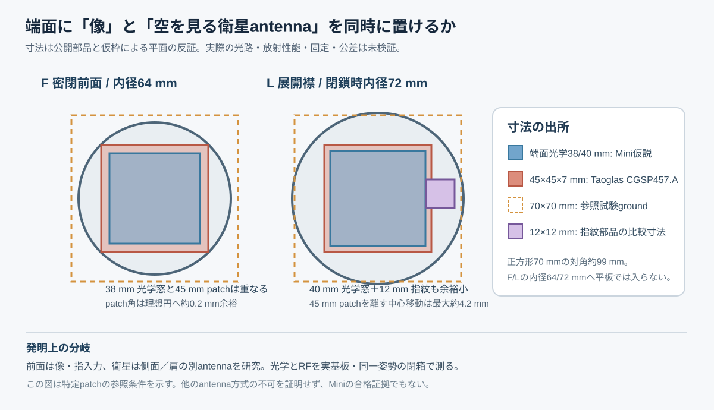

指紋をStow中にも使えるかの**二次元配置試算**として、[Goodixの前面capacitive製品表](https://www.goodix.com/en/product/sensors/fingerprint_sensors/capacitive_fingerprint_sensors)にある12×12×0.65mm級のsensor寸法を参照する。内径72mmの円へ中央40×40mmの光学窓と、辺に接する12×12mmの指紋面を置く平面図なら、指紋面の最遠角は中心から約32.6mmで半径36mmには入る。Fの内径64mmでは同じ配置が半径32mmを約0.6mm超え、光学窓を38mm角へ縮めると最遠角が約31.6mmでようやく入る。この計算は固定・配線・封止・指の接触面積・ToF窓・ボタンを**全て除いた上限**であり、Goodix部品の認証・防滴・RockstarOS driverを確定しない。前面を51mm開口で描いた構想図はこの指紋配置と同時には使えない。P0で40mm以下の前面開口から本当に一択像を読めるかを測り、できなければStowでの生体／空間応答を再設計する。

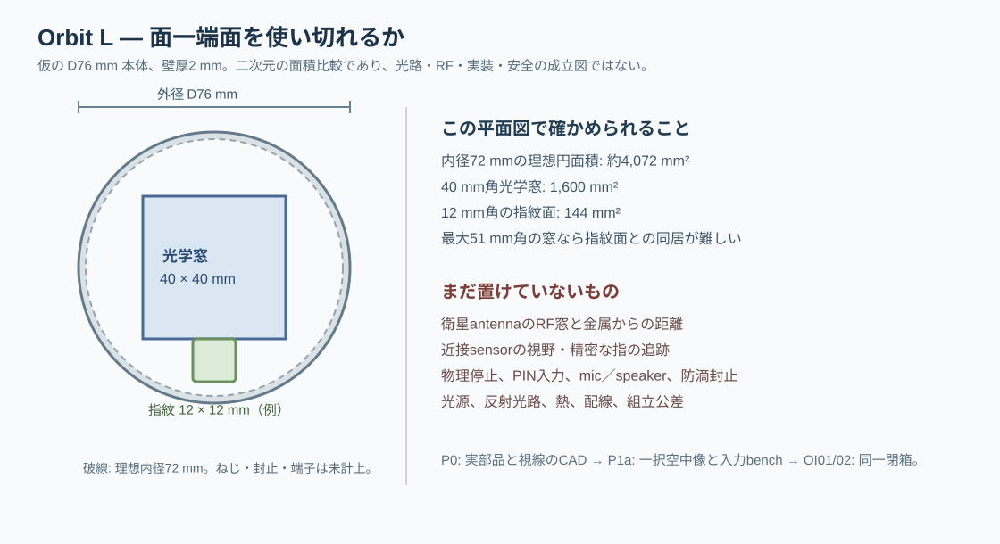

Sの9770を軸端へ直列に置く単純stackは、module 140mm＋仮の光学45mm＋保持／接点15mmで**200mmを使い切り**、外装端面・公差・RF窓の余裕が0mmとなる。光学や電池を径方向へ重ねるしかないが、干渉、放熱、antenna離調、組立順は未検討である。仮の36Whを2本の[P50B](https://www.molicel.com/product/inr-21700-p50b/)で作ると最大142g、9770と合わせ327gになり、450g比較目標まで残るのは123g。質量と単純stackだけでSを**現行の細身商品案から外し、通信benchの対照構成に留める**。これはD96でも実装不可能という証明ではなく、要件を満たした製品と呼ぶ根拠がないという判断である。

径方向の上限を試すと、D96で各側2mmの理想内径92mmへ、9770の60×16mm断面を`x=-30…30、y=-24…-8mm`、M65A二本（最大径21.7mm）の中心を`(-11,+12),(+11,+12)mm`に置く平面図なら、module角は中心から約38.4mmで内半径46mmに入り、cellとmoduleの平面隙間は約9.2mmになる。従ってSは**moduleと電池が断面上同居不能とまでは言えない**。ただし140mm軸長のmoduleに対し残る高さ60mmに、端面光学、保持、RF／antenna、給電、演算、音響を割り当てねばならず、隔壁・配線・冷却と組立まで通したCADはない。重い既存moduleを細いF/Lへ無理に転用しないためのbench比較として残す。

完成度を少し上げた比較でも余裕は細い。[Iridiumが掲載するGround Control製RockREMOTE Mini OEM](https://www.iridium.com/products/rockremote-mini-oem)は9770入りsubassemblyで175×60×37mm、287g、外部antenna接続、外部10〜30V給電。これへM65A二本の最大149gを**単純加算**すると436gで、450g目標の残りは14g。光学、Wi-Fi、本人鍵、speaker、閉箱外装、antenna、保持部品をこの14gへ収める仮定は現実的でない。これはOEM製品を使うSの質量排除であり、9770裸moduleや別設計の全可能性を否定しない。同資料の送信時peak電流上限1.66A@12Vは約19.9W相当で、上の平均8W仮説からpeak電源・蓄熱・接触温度を推定できない。RockREMOTEの低待機電力もMini全体の値ではない。

**外殻だけの質量感度。** 450gは携行性を比較する設計目標であり、確定した製品質量ではない。端面cap・rib・窓・ねじ・latchを除いた完全な円筒**側壁だけ**を `π[(D/2)²−(D/2−t)²]Hρ` で計算する。密度は[Aluminum Associationの6063試験報告](https://www.aluminum.org/sites/default/files/2021-10/6063CombustibilityReport.pdf)の公称2.7g/cm³と[Covestro Makrolon 2605](https://solutions.covestro.com/en/products/makrolon/makrolon-2605_000000000000894068?SelectedCountry=US)の1.20g/cm³を比較用に使い、cellはM65A二本の最大149gを置く。

| 外形と仮側壁 | 側壁だけ | 側壁＋二本cell | 450gまでの残り |
| --- | ---: | ---: | ---: |
| F D68×H190、Al 2mm | 約213g | 約362g | 約88g |
| L D76×H186、Al 2mm | 約234g | 約383g | 約67g |
| L D76×H186、Al 0.8mm | 約95g | 約244g | 約206g |
| L D76×H186、PC 2mm | 約104g | 約253g | 約197g |
| S D96×H200、Al 2mm | 約319g | 約468g | 約−18g（9770以前に超過） |

Al 2mmのLへ光学、通信radio、演算、Wi-Fi、音響、端面、生体、保持を67gで加える筋は現時点で立たない。0.8mm金属や銀色の樹脂外装は質量余地を作る**仮説**だが、強度、放熱、遮蔽、RF窓、塗膜の電気特性、落下、修理性を失う可能性がある。銀色の見た目を全面金属と同一視せず、金属構造と非導電RF窓の割付を実部品CADとOTAで決める。側壁だけの数値を完成機の質量見積とは呼ばない。

完成した製品の対照である[Iridium GO! exec](https://www.iridium.com/products/iridium-go-exec-portable-wireless-access-device)は同じ9770系で衛星InternetをWi-Fiへ出し、本体のmic/speakerと接続管理も持つが、外形203×203×25mm、質量1,200gである。これは別の形状・antenna・機能を持つ製品の実績であり、Sをこのまま小型化できる証拠ではない。[同社FAQ](https://ifp.iridium.com/go-exec-faqs/)はantennaを立て、ほぼ全空の見通しを求める。Miniの上端radomeが机・人の手・展開襟で空を遮ったまま通信できると仮定せず、Carry時は屋外で安定面へ置く姿勢を先に試す。ユーザーがポケットへ入れた**まま**衛星接続できるという表示はしない。

このFAQは既製GO! execについて、屋外でantennaを鉛直にし、地平線上およそ8°まで空を見渡せると性能上有利で、近くの建物・樹木・山で劣化すると説明する。これはMiniの受入角ではないが、05の石アイランドに埋めた本体へ**屋内で直接衛星を受信して通話できる**という体験を描く反証になる。屋内の着信・Sky／Zemaは受入済みの地上回線または建物WANへ分岐し、Miniが屋外でsatelliteを再確立した時だけ衛星APを表示する。住宅側の有線外部antennaを必須にすると「外した一本が自律して衛星Wi-Fi」という要求を満たさないため、外部antennaは施工profileの補助研究とし、携行時OI04は本体内antennaで独立に通す。

Lは携行時の細さを守りつつ光学開口を試せるので、**発明の優先試験構成**とする。ただし選定部品と契約のない暫定判断であり、販売仕様の選定ではない。Fは可動光学を減らせるため同じ表示・指入力台本で先に光学benchを行い、成立すればLの複雑な襟を外す。LのStow前面光路、同一閉箱内antenna、双方向衛星IP共有のいずれかが失敗したら、採用を取り消す。Sの通信bench合格をLへ移せたとは記録しない。

L-Rの外装候補は、全面2mm金属から**薄い金属の構造熱路＋非導電の長手RF窓＋銀色仕上げ**へ改めて比較する。これは質量感度とantennaの長手ground要件を同時に満たすための配置仮説で、銀色仕上げの導電塗膜がRFを再び遮る可能性まで試す。無線のためだけに全面を樹脂にすると内部熱が逃げにくく、熱のためだけに全面を金属にするとantennaが使えない。電池・演算・RF前段の熱をどの金属部へ逃がし、使用者の手をどこに置くかを断面図に含める。仮の0.8mm金属側壁の質量値は曲げ・落下・保持に耐える厚みを意味しない。

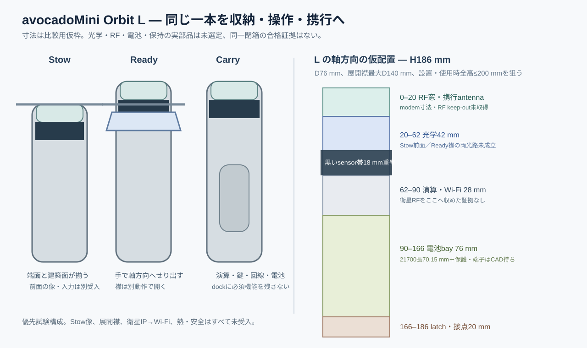

構想画は形状と動作順の比較用。**中央のせり出し表現を全長固定sleeve＋H186mm coreで作れば、200mm上限を超えて採用できない**。寸法判断は[固定sleeveの失格図](assets/orbit-l-height-chain.svg)と[伸縮cupの対案図](assets/orbit-telescoping-sleeve.svg)を優先する。中央の展開襟は光学性能・開閉安全・antenna共存が未成立で、写真の黒い帯のcamera風表現は生体認識・手追跡の実装証拠ではない。左右の製品が実際に同一個体・同一寸法で製作された写真ではなく、dockの奥行・公差・電気接点も確定していない。

Lの仮の186mmはRF窓20、光学42、演算・Wi-Fi 28、電池bay76、latch・接点20の合計である。黒いsensor帯18mmは光学42mmの下部へ**重ねて**数えている。別枠として足すと204mmになり、200mmを超える。重畳部に手追跡の視野、迷光防止、構造、放熱を実際に置ける証拠はない。電池bay76mmもM65Aのdatasheet最大長71.00mmに対し残り5.00mmしかなく、保護・接点・膨張余裕を含むpackとして採用できるとは言えない。H186mmと200mm上限の差14mmは**携行本体自体の**襟の軸方向展開・公差へ割り当てる仮枠である。固定sleeveを含めた35〜50mmの本体せり出しを吸収する余裕ではなく、全状態での厳格200mm適合は前述の通りHOLDである。

この軸方向表には**衛星modemの独立した高さ枠がない**。隠して採用部品を置くことはできないため、Lを成立させる未検証配置仮説として、電池bay76mmの同じ軸区間へ二本の21700 cellと**別のradio基板廊下**を断面方向に並べる。内径72mmの理想円へ、最大直径21.70mmのM65A二本の中心を`(x,y)=(-11,+15),(+11,+15)mm`、仮の基板外包を`x=-29…+29mm、y=-20…-4mm`と置けば、基板の58×16mm断面の角は中心から約35.2mmで理想半径36mm内、cellと基板の最短平面間隔は約8.2mmになる。**角の残り約0.8mmは固定や絶縁に使えない**ので、この58×16mmは製造設計値でなく幾何上限である。これを軸方向70mm程度の基板候補へ縮小できれば、外形上は電池とradioを**同じ76mm区間へ描ける**。しかし実NR-NTN modem／RFFEの外寸、connector、基板固定、絶縁、電池保護、交換、熱隔離と上端antennaまでの配線損失を一つも満たした証拠ではない。M65Aの長さ71mmを引くと軸端子へ5mmしかなく、ここが足りなければこの仮説は即棄却する。電池に隣接するradio熱が逃げず、RF窓から離れ過ぎてもLを棄却する。9770裸moduleは長さ140mmでこの廊下の候補に入らない。

小型IoT-NTN候補を使うなら、もう一つの仮説は**上端RF20mmへradio本体を近接配置**し、電池bayの基板廊下を保護・配線へ回すことである。[Nordic nRF9151の設計指針](https://docs.nordicsemi.com/r/bundle/nwp_056/page/wp/nwp_054/ant_if.html)はANT pinからantennaまでの伝送路を短くし、最大0.5dBの損失と50Ω整合、整合部品、ESDを扱う。nRF9151 SiPは[公称12.1×11.1×1.2mm](https://docs.nordicsemi.com/r/bundle/nwp_056/page/wp/nwp_054/physical_characteristics.html)でGNSSを内蔵し、Skylo NTN認証も公開されている。ただし20mmはantenna放射体そのもの、ground plane、GNSSとWi-Fiの分離、金属殻、光学襟と手からのkeep-outを同時に置けた寸法ではない。上端をradioで使うと前面光路の42mmとRFの境界が競合し、Lの二択襟を開いた姿勢で特に悪化し得る。**小さいSiP面積をもって上端RF区画合格にしない**。実基板・antennaの3D keep-outと姿勢別link budgetがP0／OI01の条件である。nRF9151もSkylo経路ではIoT-NTNであり、Miniの一般Web共有契約や速度を証明しない。

電池bayの反例を減らす別配置として、[Molicel M35A](https://www.molicel.com/product/inr-18650-m35a/)三本も比較する。公称は各3.6V×3.5Ah＝12.6Wh、最大径18.6mm、最大長65.2mm、最大質量48g。三本で**37.8Wh／144g**のcellだけの値となり、二本P50Bの36Wh／142gに近いエネルギー・質量だが、76mm軸区画からcell長を引いた残りは**10.8mm**になる。内半径36mmの理想円でcell中心を`(-20,+12),(0,+12),(+20,+12)mm`、仮の小型基板を`x=-26…+26,y=-20…-4mm`と置けば、cellの外縁は半径約32.6mm、基板角は約32.8mm内へ描ける。ただし隣接cell間は**1.4mm**、外殻まで約3.2mmで、保持・絶縁・熱隔離・組立には狭すぎる可能性が高い。実部品とpack保護を置く前に「三本が入る」とは言わない。二本M65Aの46.8Wh候補より一日余裕が減り、衛星APを8W×2時間使った後に22時間の待受を残すと、負荷側27.2Wh仮枠から待受平均は約**0.51W以下**となる。P0では「二本M65Aの軸端5mm問題」と「三本M35Aの径方向1.4mm問題」を同時にCADで比較し、どちらもpack安全を示せなければ電池bayと全外形を作り直す。

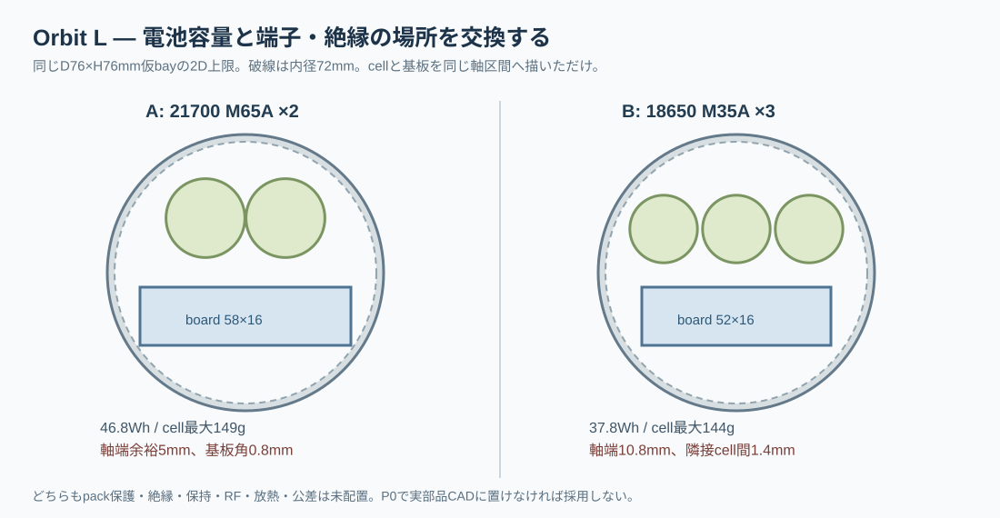

通常の番号着信にも別の見落としがある。[Nordic公開のnRF91x1 MNO承認票](https://www.nordicsemi.com/-/media/Software-and-other-downloads/Certifications/nRF91-Series-certifications/nRF9151-Certifications/MNO/Nordic-Semiconductor_nRF91x1_Family_v2-1.pdf)は、その対象審査で4G Voice／VoLTEとWi-Fi hotspotを「No」と記載する。これは全地域の全サービスを否定する一般規格ではないが、nRF9151一つでMiniの通常電話と衛星APを満たしたとは言えない具体的な反証である。たとえば[SIMCom A7672X](https://www.simcom.com/product/A7672X.html)はVoLTEを掲げる24×24×2.4mmのLTE Cat 1 moduleで、**地上音声専用の追加候補**になる。ただし地域・MNO認証、SIM/eSIM、PCM音声、主SoCとの通話制御、別antennaとRF共存、待受電力を満たした採用品ではない。F/Lの軸方向表は地上音声moduleとそのantennaの区画を明示していないため、上端RF／電池横基板／光学のどこに重ねるかCADで決められなければ一本自律の電話gateもHOLDとする。

さらに上表で言う**40〜50mmの握り用くびれは、この断面配置と同時には割り当てられていない**。二本の21.70mm cellを横に置くだけで43.4mmを使うため、50mm外径・壁厚2mmなら内径46mmに残るのは2.6mm。電池bayをくびれに含める設計を正当化できない。くびれを電池bayの外だけへ置くなら手のひらが触れる軸長が足りるかをdummyで評価し、使える握りができなければLの外形を見直す。現時点で「片手で快適」と主張しない。

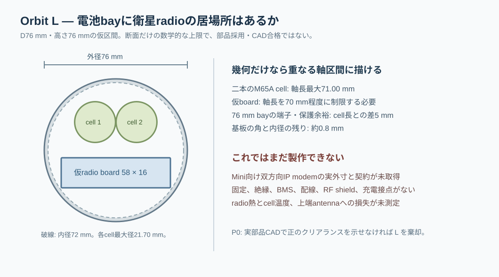

**同じ仮定での電力・熱の反証。** 30Whの仮電池から使用可能率0.80・変換効率0.90を引くと負荷側は21.6Wh。一日で衛星APを8Wで2時間使う仮定なら、残り22時間の待受へ5.6Wh、平均**0.255W以下**しか残らない。18Whの1-cell案なら負荷側12.96Whで、同じ衛星APだけで16Whとなり一日profileは算術上不成立。36Whの2-cell案なら負荷側25.92Whで、2時間共有後の22時間待受は平均**0.451W以下**でなければならない。実機のRF送信・Wi-Fi・光学・電話待受・SoC消費はまだ測っておらず、これらは電池を選ぶための上限条件である。特に衛星APの8Wは測定値ではない。

演算を具体的に当てると、[Raspberry Pi Compute Module 5の公式datasheet](https://datasheets.raspberrypi.com/cm5/cm5-datasheet.pdf)は基板40×55mm、接続後高さ4.94または7.44mm、5V供給でidle典型400mA、動作典型900mAとする。idleだけで**2W**、22時間なら44Whで、上の2本M65Aの負荷側33.7Whを超える。よってCM5級Linux moduleを24時間通電したまま、2時間衛星APと22時間の着信待受を一日profileとして実現する案はこの電池では算術上棄却する。常時の着信・sensorは低電力側で待ち、必要時だけ主SoC／光学を起こす二電力領域を設計候補にするが、OSの安全な休止／復旧時間、電話providerのpaging、実modem待受、wake喪失を実測するまで「一日使える」としない。CM5の55×40mm平板対角は約68mmでLの理想内径72mmに数mmしか余裕がなく、Fの内径64mmには平板として入らない。さらに公式datasheetは内蔵Wi-Fi antenna周囲の空隙と金属切欠きを要求する。CM5は**電力と基板面積の比較基準**であって採用SoMではない。

二電力領域を単なる「sleepで節電」と言わず、**電話の間に合うか**で反証する。低電力側が契約済みの番号着信eventと匿名合図、crown／指紋入力を受け持ち、主SoCと高輝度光学、Sky／Zema、Gameは必要時だけ起こす配置を候補にする。ただし低電力側だけで通話承認や音声を実行するなら、既存RockstarOS Brokerの本人・権限・結果照合と同等の強制境界を設計し直す必要がある。主SoCを起こしてからしか安全に応答できないなら、**着信発生→Mini合図→本人確認→像の校正→provider応答成立**を通話の呼出し時間内に実測し、途中で切れた割合を記録する。静止CGで応答cardを見せる速度と、冷起動から実電話へ応答できる速度を混同しない。低電力制御器の鍵・journal・起動経路は次のruntime設計gateへ送り、この設計案だけでOS component追加済みとしない。

各通話traceには`provider着信到達→低電力controllerへのwake→RockstarOS Broker復帰→（L-Tなら安全な伸縮lift）→像の校正→本人確認→本人選択→provider接続receipt`の時刻を別々に残す。低電力controllerは匿名合図と機構安全だけを担当し、modelやmodemのeventだけで本人鍵・外部Tool権限を付与しない。**合計時間**がその呼出しの残り時間を超えれば「画面上で応答を押せた」回でも通話失敗である。P3ではcold/warm、dock電源断、低電池、回線切替、光学校正し直し、他人の近接での各分布を測る。契約Providerのring timeoutを得る前に「何秒以内なら合格」と作らず、timeoutと十分な余裕を正式試験前に固定する。旧固定sleeve L-Aの便利さを合格理由へ残さず、L-Tを使うなら面一H0と比較して実通話の取り逃しを減らし、挟み込み・驚き・騒音を増やさなかった時だけ採用する。

小さい別の比較基準である[phyCORE-i.MX93 SoM](https://www.phytec.com/product/phycore-i-mx-93/)は36×36mm、メーカー掲示の典型0.80W、最大1.62W、RAM最大2GBである。理想的なF内径64mm円へ36mm角（対角約50.9mm）は描けるが、carrier、connector、Wi-Fi、放熱、RF間隔は入れていない。典型0.80Wを待受22時間続ければ17.6Whを消費し、2本M65Aを仮に8W衛星AP×2時間使った後の17.7Whをほぼ使い切る。sensor・modem・電話待受を加える余地がないため、これも常時起動案ではない。低電力SoMは短い会話Gameの試験候補になっても、[MG01〜07のWebGPU・WASM・30分Game](game-runtime-design.md)を合格にしたことにはならない。高いGame負荷と携行電池の両立は別Device Profileとして測り、Miniの標準小作品を外部GTA VI対応と混同しない。

高容量側の比較として[Molicel M65A datasheet 80153-0.1（2025-08-05）](https://www.molicel.com/wp-content/uploads/Product-Data-Sheet-of-INR-21700-M65A-80153-0.1_250805.pdf)は典型23.4Wh／cell、最大直径21.70mm・長さ71.00mm・質量74.5g。2本46.8Whを同じ0.80×0.90で計算すると負荷側33.7Wh、8W×2時間後の22時間待受には平均**0.804W以下**を割ける。2本のcellだけで最大149gとなり、450g比較目標には全ての他要素へ301g。Lの仮電池bay76mmからcell長を引くと5mmしか残らず、端子・絶縁・保護・組立公差を入れたpackは未成立である。D76断面へ採用済みとせず、packの向き・保護・充電時の熱とmassを実寸で比較する。回線の実消費が8Wを超えれば余裕はさらに減る。

**Whだけで給電成立としない。** M65Aの公開datasheetは充電上限4.2V、放電下限2.5V、連続放電26Aをセル単体の試験条件として示す。二本直列の2Sなら公称7.2V、満充電8.4V、両セル下限で5.0Vとなる。一方[Certus 9770の入力指定](https://www.iridium.com/products/iridium-certus-9770)は12V±2.5V、つまり9.5〜14.5Vであり、Sで9770を使う場合は全放電域で昇圧・電圧保持、瞬間送信電流、低温始動を検証する必要がある。二本並列の2Pでも電池側は2.5〜4.2Vで、9770への昇圧比と配線電流がさらに変わる。Lの小型[CC660D-LS仕様書v1.2](https://www.quectel.com/content/uploads/2024/03/Quectel_CC660D-LS_Satellite_Communication_Module_Specification_V1.2-1.pdf?wpId=114714)は2.2〜3.6Vを指定するため、**満充電の単セル4.2Vを直結できない**。同仕様書の293mA@3.3V・23dBm送信は特定bandの典型値であり、受信・探索・電源突入・Wi-Fi AP・光源まで含むpeakではない。2Sならセル監視・balance・充電制御、2Pでもセルの組合せ・保護・短絡時遮断が要る。8Wという上の算術はシステム平均の仮置きで、converterのrail別効率や瞬間peakを決めていない。P0で候補ごとに2S/2Pの回路・保護・dock充電・RF送信時の電圧降下と熱を設計し、供給停止時に通話と保存がどう終わるかを記録するまで、46.8Whを「使える電池pack」と呼ばない。[M65A製品ページ](https://www.molicel.com/product/inr-21700-m65a/)には最大長70.2mmとありdatasheetの71.00mmと一致しないため、この仮配置では長い方を採用する。

小さい9523裸moduleを選び直しても電源は省略できない。[Iridiumの公開9523製品表](https://www.iridium.com/products/iridium-core-9523)は本体入力3.2〜6Vに加えてVBOOSTの公称27Vを掲げる。掲載の`Calling Current Peak 300 peak A`は単位が不自然なので、peak電流の設計値へ採らず正式datasheetと評価基板で確認する。2S／2P電池から必要railを供給するconverter・蓄電・配線・熱をP0へ入れ、32gのmoduleだけを「低電力でそのまま搭載できる部品」と扱わない。

24時間を**発明比較用の目標**として置いた時の感度は次の通り。どの行も2本M65Aの公称46.8Whから仮の使用可能率0.80と変換効率0.90を引いた33.7Whを出発点にし、AP平均8W、Game平均12Wを未測定の仮定とする。本人が要求した実稼働時間や製品保証ではない。

8Wの仮値を単一の「衛星端末標準電力」にしない。[Iridium掲載のSTREAM+端末](https://www.iridium.com/products/stream-midband-terminal)は9770を含む別製品で、外形205×105×48mm・620g、外部10〜40V給電、掲載値はidle 0.25W／平均送信3Wである。0.25WをMiniの電話待受、3WをWi-Fi AP＋光源＋SoC込みに転記できないが、送信dutyと装置構成で比較値が大きく変わることを示す。先の8Wは、Miniに同時に必要なradio・Wi-Fi・計算・光・給電損を**まだ測っていないシステム仮置き**のまま保持し、各railの実電流で置き換える。

仮に別端末のidle 0.25Wと、M65A二本で2時間AP後に22時間へ残せる平均0.804Wを**単純に差し引く感度**では、主SoC・地上着信radio・sensor・保存・standby表示へ約0.554Wしか残らない。[phyCORE-i.MX93の掲示典型0.80W](https://www.phytec.com/product/phycore-i-mx-93/)をそのまま連続通電すれば超える。各値の条件と機能が違うため完成機の寿命予測ではないが、**低電力の常時待受controllerと、必要時だけ起きる主SoC**をP0の電源domain候補にし、着信wake後に空中像と通話が間に合う時間を測る理由になる。

| 脱着後の仮profile | AP/Gameで使うWh | それ以外の時間に許される平均W | 読み方 |
| --- | ---: | ---: | --- |
| 8時間携行、AP 2時間 | 16Wh | 残り6時間に約2.95W | 短時間の持出しなら24時間より余地がある。ただし電話待受・光源・SoCが実測で収まる証拠なし |
| 24時間携行、AP 2時間 | 16Wh | 残り22時間に約0.80W | CM5を2W idle通電する案は不成立。低電力電話待受とwakeの設計が必要 |
| 24時間携行、AP 2時間＋Game 30分 | 22Wh | 残り21.5時間に約0.54W | 作品をその場で試す30分も待受の余裕を削る |
| 24時間携行、AP 4時間 | 32Wh | 残り20時間に約0.085W | 通常の常時着信・sensor・保存を含めるには極めて厳しい。AP時間を制限するか容量／外形を再設計 |

衛星、地上VoLTE、Wi-Fi、sensorのidle・接続・送信電力が空欄のため、この表のどれも達成判定ではない。受入時は同じMiniで各power domainの電流波形を取り、温度・電池劣化・再送・圏外探索、call中断を含む実際の利用分布を測る。dockで給電されていた時間を携行電池の持続時間へ加えない。

電池を短くして軸寸法を救う案にも反証を置く。[M35Aの公称値](https://www.molicel.com/product/inr-18650-m35a/)は1本3.6V×3.5Ah＝12.6Wh、最大長65.2mm・48g。二本25.2Whを上と同じ仮0.80×0.90で負荷側18.14Whとすると、仮8Wの衛星APを2時間使った後は**2.14Wh**だけで、残る22時間の平均は約**0.097W**。実測値ではないが、短いcellへ替えるだけでは「一日待受＋2時間AP」の仮目標を救えないことを示す。容量を戻す、AP時間を短くする、24時間目標を変える、dock外の携行時間を分ける選択を、実測の前に黙って決めない。

| 仮の外径・高190mm | 側面＋端面を全て空気へ出した面積 | 12W連続時の表面―外気差の算術 | 判断 |
| --- | ---: | ---: | --- |
| F、D68 | 約0.0479m² | 約31K | 小径化は放熱面を削る。RF・光・Gameの同時連続動作を許可しない |
| L、D76 | 約0.0544m² | 約28K | 展開襟が熱を遮る場合はこの計算より悪化する可能性 |
| S、D96 | 約0.0718m² | 約21K | 面積は有利でも手持ち重量と機構負担を解消しない |

この温度差は平均熱伝達率8W/(m²·K)、全面が露出、内部熱が均一に表面へ出るという**非現実的に単純な感度計算**で、皮膚安全や最高温度ではない。dockに半分覆われれば露出面積も変わり、実機では放射・接触・風・hot spot・送信peakが加わる。光学、Wi-Fi、衛星の同時負荷を閉箱で測るまでは安全な連続W数を公称しない。通話・停止・journalを優先し、熱でGame／光源／APを縮退させた時は本人へ理由と残る通信経路を示す。

**空中UIの光路の数字。** 仮に像面が開口から75mm、余白込みカード幅130mmなら、開口中心からカード両端への単純な幾何角は約82°。80mm一択でも約56°である。これは必要な光線の広がりの目安であって観察者の視域・plate倍率・輝度の測定値ではない。Fの約45mmの平板開口とLの展開時約96mmの平板開口の双方で、像端の輝度、眼の位置300〜700mmの読取率、50mm目標への指位置誤差を同じ照度条件で測る。強い屋外光で読めない場合、物理・音声経路は使えても「携行時の空間応答」gateは未合格とする。
05アイランドに上向きのcapを置くと、本人は必ずしも光軸上から見ない。試験治具でcap高さ900mm、像面をその75mm上、眼高さ1500mm、水平距離500mmと**仮置き**すると、眼から像への視線は水平から約46°下（像から眼を見ると約46°上、鉛直から約44°）になる。ここで「真上からしか見えない」光路なら、立った本人の着信操作に使えない。H0固定光路とH1の斜め向き光路を、立位／座位の眼高さ・カウンターからの水平距離・左右移動を変えて比べ、眼を一点へ合わせる作業を必要にしないか測る。Lの襟を傾ける案も展開高さ200mm、RFの見通し、手の到達と保持へ再計上する。

同じ像面高さ975mmから眼への角度を幾何だけで振ると、上向きcapの鉛直光軸からのずれは次の幅になる。眼の高さ1200mmは座位の**試験仮定**で、身体条件の代表値や製品対応範囲ではない。

| 眼高さ／水平距離 | 300mm先 | 500mm先 | 700mm先 |
| --- | ---: | ---: | ---: |
| 1500mm | 約30° | 約44° | 約53° |
| 1200mm | 約53° | 約66° | 約72° |

一つの固定光路がこの全範囲で見えるとは仮定しない。特に座位で70°前後の斜め視線が必要なら、眼を上へ移さないと見えない設計は初回の使いやすさに失敗する。P1aでは像の正面だけでなく各眼位置で文字／応答記号の認識率と迷光を測り、傾斜光路・操作位置・設置profileを決める。

同じ05の**面一収納を家具断面で試す**。Lの本体長186mmに対し、仮に天板厚20mmの模型なら、capを上面に合わせた時に少なくとも約166mmが天板の下へ入る。これはdockの底・接点・配線・手で解除する空間を除いた値であり、実際の設置奥行はさらに必要となる。収納引出し、補強材、配管、コンセント、点検口と干渉するなら「石に穴を開ければ付く」とは扱わない。模擬カウンターで下側の保守空間と熱の出口まで確認し、住宅への実施工寸法は施工者と対象家具を決めてから固定する。

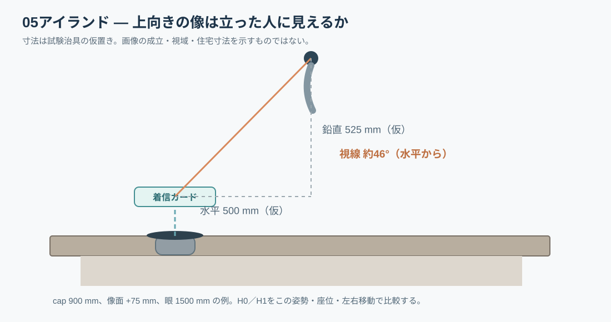

像を本人へ傾けると、像面に対する中央ToFの見掛け距離と左右端の距離が同じでなくなる。前述の62／87／115mmという視野幅は**sensor正面に垂直な平面**の計算なので、斜めカードへそのまま適用しない。視線を広げる改良が手の校正とRF窓を悪化させないよう、実角度の像面と指先を同じ座標治具で測る。

[アスカネットの方式説明](https://www.asukanet.co.jp/contents/product/aerialimaging.html)はplateの大きさが像の大きさと結像距離を決めると明記し、[同社の公開製品一覧](https://www.asukanet.co.jp/contents/ir/pdf/2025/20250708-vision.pdf)の単体plateは200mm角以上である。[現行の小型完成品Home](https://aska3d.com/ja/ukuu-livestage_home.html?lang=en)でも98×160mm plateをW220×H130×D95mmの筐体へ入れ、映像源には別のスマートフォンを置く。これは小型な空中像の実製品例だが、Miniの一本自律、PC・電話不要、面一収納の先行達成例ではない。[メーカーのplate一覧](https://aska3d.com/ja/products.html)は表示画像の大きさをplate面積の約70%と記すが、これはMiniで使う像の幅・視域・輝度を寸法比例で保証する式ではない。これらをFの38〜45mm端面へ単純縮小して80mmの可読一択像を出せるとは言えない。Lの展開径140mmも既製plateを無加工で収める根拠がない。F／Lは別の折返し自由曲面や専用微細光学を探索する**発明研究候補**であり、H0で必要像幅・読取率が測れなければ棄却する。

別方式として挙げた[自由曲面mirrorの原著（Optics Letters 51, 5753–5756、2026）](https://opg.optica.org/ol/abstract.cfm?uri=ol-51-20-5753)の公開表は、**91×54mmの空中像**に対し**160×100mm mirror**、76×45mm LCD、浮遊距離70mm、600mm先の100×50mm eyebox、中心輝度160.8cd/m²を示す。このmirrorの160mm辺はLの展開外径140mmにもFのD68にもそのまま入らず、同研究をMini適合と読んではいけない。しかも像の輝度むら62%が残る。独自縮小光路を探す余地は残るが、これら公開一次資料のどれもH0の端面38〜40mmから可読一択像を実証していない。最初の光学benchは**開口38／40／50mmごと**に像面・距離・視域・室内照度を固定し、候補方式が一つも実測に達しなければFとLのStow最低機能を同時にHOLDする。
屋外で読めるかの感度も別に置く。20,000lxの光が反射率0.2の**完全拡散背景**へ当たる仮定なら、背景輝度は`0.2×20,000/π≈1,270cd/m²`となる。別装置の中心像160.8cd/m²を単純比較すると背景の約13%にすぎず、そこから携行屋外の文字可読性を肯定できない。ただし実際の空中像は背景、偏光、視線、遮光、眼の順応で見え方が変わり、これはMiniのcontrast測定や安全輝度ではない。窓際・晴天・曇天で**背景と像面を同時測光し、人が応答／拒否を読み分けた率**を記録する。

この原著のmirrorは**連続した一枚の自由曲面**である。160×100mm長方形の対角は約189mmなので、仮のD140襟に回しても同じ部品を無加工で収められない。発散案として、持出し時は円筒側面へ分割収納し、Readyで約200mm幅へ展開する「光学翼」も机上で比べる。ただし分割後の面形状・継ぎ目・校正、手と襟の接触、転倒、光学部品が衛星RF窓を覆うことをすべて新たに検証する必要がある。展開径200mm案は**元の論文装置を折り畳めると示した案ではなく、H1の代替研究**とする。これだけが空中像を作れる場合は、200mm高は守っても卓上占有と携行操作が変わるため、ユーザー試験でLより良いかを決める。先にD140での独自小型光路をbench測定し、光学翼の仮CGを達成証拠にはしない。

**保持機構の荷重入口。** 質量450gの比較目標なら自重は約4.4N。仮に10g相当の短い加速度を受けた時の慣性力は約44Nで、天井／軒裏の落下防止を単なる磁石の静的4.4Nで設計するのは不十分である。ただし10gは製品規格の採用値ではなく、実質量・設置方向・想定衝撃を決めるためのscreening値。Lのbayonetと独立保持爪、F/Sの二段latchは、引抜力・解除力・疲労・指挟み・停電時の手動解除を**同じ質量dummy**で測る。05の乾いたアイランドで成立しても、高所の02天井／10軒裏へ保持合格を移さない。手の届かない高さは毎日の携行dockとして不合格にし、天井・軒裏を使うなら施工者の保守profileと手元の別dockを明示する。別dockは給電・保持のみで必須計算機を足さない。

Aを続ける理由と距離も明記する。[光で粒子を保持して走査する体積表示](https://www.nature.com/articles/nature25176)は本当に自由空間の発光点を作る研究だが、粒子制御と走査・光安全を96mm級の携行閉箱へ移した証拠ではない。[光活性化色素の体積表示](https://www.nature.com/articles/ncomms15239)は発光媒体を要し、「何もない部屋の空気へ像を出す」方法ではない。[広視域の裸眼3D display](https://www.nature.com/articles/s41586-025-09752-y)は視覚的奥行きの進歩だが、手が触れる自由空間像と同一ではない。Aの研究では「実像が空気中のどの体積を占めるか」「多視点で同じ対象を見られるか」「手をそこへ安全に入れられるか」を最初に測り、Bの電話UIとは別のR5合格記録を作る。

[Kumagai／Mori／Hayasakiの一次論文（2025）](https://doi.org/10.1002/jsid.2025)はfemtosecond laserで媒体なしの空気中に実発光体積を作り、横方向平均68mm・軸方向42mmの描画範囲を報告する。これは元R5の自由空間3Dに対して近い物理先例で、Bの平面空中カードとは区別する。一方、描画体積は部屋全体ではなく、論文の光学系・laser・電源・安全機構が一本H≤200mm・携行電池・人の指と同居した証拠もない。元R5へ適用する研究に限り、光安全の専門評価と密閉・停止設計がない段階で住宅や携行製品の光源候補として採用しない。100mm焦点距離を装置全長100mmと読み替えない。

## 一体の外形と断面候補

R5原本の銀色で細い軸・黒いcamera帯は意匠条件として残る。原本の低い円形台座は卓上dock候補で、建築から外すcoreの必須部品にはしない。D30mm軸＋D96mm台座は過去の**比較寸法**であり、承認済み最終径ではない。OrbitのD96mm級の携行円筒は、電池・衛星・光学を全長へ分散させる工学比較案で、細身意匠の確定変更ではない。**優先形状は、建築の面一収納から軸方向にせり出して外せる細い一本のcore**。全機能をそのcoreへ入れられるかを先にCADで調べ、均一径・くびれ案と持ちやすさ、光学／RF開口、同一200mm包絡で比較する。見た目の好みだけで収納不能を隠さない。

携行のしやすさを考えると**太径coreのまま握る設計にも明確な弱点がある**。[NIOSH収録の24人の円筒handle実験](https://stacks.cdc.gov/view/cdc/197408)では25〜50mmの対象のうち30〜40mmが最大握力課題で比較的快適だった。これは工具の強い握りの研究であり、Miniの96mm・450g・電話動作へ外挿した快適径ではない。それでもD96の全長を握るのが容易とは宣言できない。P0では原本に近い細軸案、全長D96案、**40〜50mm程度の握り用くびれを中央に残して上下に光学／RF／電池を置く案**を、同じ質量・重心・表面温度のダミーで比較する。くびれ案も配線・電池・音響体積を奪うので収納合格ではない。手の大きさ、片手でのcrown／指紋到達、落下しやすさ、30分携行を測り、握れない場合は外径だけを小さく見せるCGで採用しない。

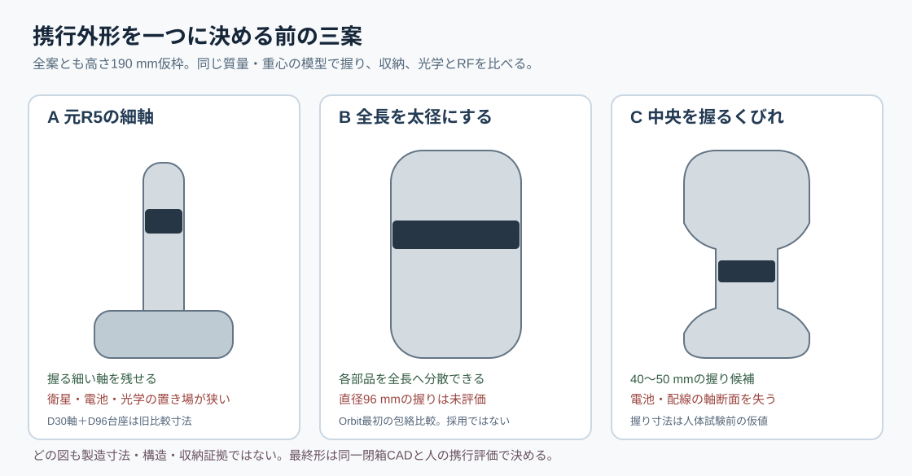

| 外形比較 | 本人が握る場所 | 光学・RF・電池の置き方 | dockでの見え方 | 次の判断 |
| --- | --- | --- | --- | --- |
| 細軸core＋卓上では低台座dock | 細軸は把持しやすい可能性 | 建築から外すcore内に全機能を残す。台座には給電・保持だけを割り当てる | 建築では面一の円形見切りから軸方向にせり出す | P0で細軸coreへ大きい部品と電池を実寸配置。収まらなければ機能をdockへ移して合格にしない |
| ほぼ均一なD96 core | 最大径を全長の配置に使える | 9770の軸長、光学窓とRF窓の分離、熱が残る | sleeveへ納めやすいが前面光路は別に必要 | 質量・片手保持・落下を実物ダミーで評価。径だけで「ポケット向き」としない |
| 中央が40〜50mmのくびれ | 指とcrownを中央に置く案 | 上下に大きい部品を分け、くびれの配線・放熱・構造が制約 | 側面形状が変わり、flushな壁施工の開口を再設計 | 実寸CADと同質量の把持試験を両方通すまで優先しない |

三案とも本体に演算、電池、衛星modem／antenna、本人鍵、通話・Wi-Fiを残す。同じ最低機能を守る比較なので、配置に困る部品を固定dockへ逃がして一案を合格にしない。意匠選択はOI01の閉箱とP4の利用観察を見てから行う。

機構比較箱は**携行本体の最大高190mm**、設置または展開中の**製品全高200mm以内**（dockの露出分・脚・cap・光学展開・公差を含む）、携行時最大径96mm、卓上展開時最大径140mmと仮置きする。dockが棚面へ沈まない場合は、露出する高さを本体と合算し、200mmを超える設置は不合格。直径は元R5でも未承認なので製造公称値ではない。「上着のポケットに入る」を携行性仮説とし、ズボンのポケットは合格宣言しない。質量・落下・保持荷重は部品確定後に測る。

手で持つ製品として、電池・antenna・光学を含む**質量450g以下を比較目標**に置く。一般的な電話と同じ快適さを保証する値ではなく、実際の重心、握りの太さ、上着ポケットへの出し入れと引っ掛かり、30分携行、階段・移動、着脱時の落下、左右の手での操作を人で評価して決める。H1展開案が径140mmや質量目標を超える場合は、展開仕様とポケット用途を別々に再判断する。閉箱の使用時最大高は展開中も200mm以内という元R5要求から外さない。

最初の**軸方向の割当実験**はRF窓25mm、光学50mm、sensor帯20mm、演算・無線30mm、電池45mm、crown／接点15mm、組立余裕5mmで合計190mm。これは断面CADへ入力する予算であり、選定部品の実寸ではない。mic／speaker、触覚、指紋sensor、保護窓、配線、ラッチや防滴部材の独立した余裕も未確保で、初期割当は楽観的な上限比較である。2mmの壁を仮定した96mm外径の内径は92mm、円筒全高190mmの単純な内側体積は約1.26Lだが、光路・放熱・配線・ラッチ・構造材・異形cellを引く前の上限である。どれかの区画が予算を超えたら他区画を静かに圧縮せず、部品・方式・持ち方を再設計する。元R5で比較したCM5裸基板55×40mmの必要内径約68mmも、コネクタ・冷却込みの収納合格ではない。

**既存の衛星部品を当てた時点で上の割当は破綻する。** IP通信対応の[Iridium Certus 9770](https://www.iridium.com/products/iridium-certus-9770)はmodule単体で140×60×16mm、185g。30mmの演算・無線区画にも25mmのRF区画にも収まらず、縦置きすると190mmのうち140mmを占める。単体moduleに光学、antenna、保護回路、電池、外装は含まれない。公開入力電圧は12V±2.5Vなので、仮の2-cell packに直結できるとも扱わず、電源変換・送信peak・損失の設計を要する。比較用の[Molicel P50B cell](https://www.molicel.com/product/inr-21700-p50b/)は1本18Wh、最大71g。2本で公称36Wh・最大142gとなり、9770と合わせるだけで327g、仮の450g目標には他の全要素へ123gしか残らない。したがって9770をこの図の「採用部品」として扱わない。薄い専用RF／基板の共同開発、外径・質量の見直し、または対応するNR-NTN moduleの実物選定なしにOI01は合格できない。

9770をLへ押し込む別の机上反証も行う。Lの仮外径76mmから左右2mmずつの側壁を引いた**理想内径72mm**に、9770の60×16mm断面を中心へ置くと四隅の半径は約31.05mmで、内半径36mmには入る。直径21.70mmのM65A二本を断面の上下へ中心`(0, ±23mm)`に置くと各cellの最外半径は33.85mm、moduleとの最短間隙は`23−10.85−8=4.15mm`。**断面の数字だけでは3部品の理想配置を否定できない**。しかしこの4.15mmへ保持、絶縁、配線、RF分離、熱の逃げをまだ置いていない。軸方向に9770の140mm、H0光学仮42mm、下端latch／接点仮20mmを単純に直列化すると**202mm**となり、L本体186mmより16mm長く、使用時上限200mmも2mm超える。実部品での安全な軸重畳を図示できない限り、9770採用Lは寸法gate不合格とする。断面の局所的な収納可能性を閉箱全体の成立と取り違えない。

単純な**斜め置き**でこの16mmを削る案も排除計算する。9770の60mm幅を円筒の横方向、16mm厚を傾きの方向へ置いた理想配置では、幅の半分30mmを内半径36mmから引いた傾き方向の端許容は`√(36²−30²)≈19.90mm`。部品長の半分70mmと厚みの半分8mmを使うと、`70 sinθ＋8 cosθ≤19.90`から最大傾きは約**9.89°**。この時の軸方向外接長は`140 cosθ＋16 sinθ≈140.67mm`で、直立140mmよりむしろ約0.67mm長い。これは中心配置・単純な一軸傾斜の理想比較であり、全ての異形基板・積層方法の不可能証明ではない。しかし既製9770を数十度傾けて光学の場所を作る近道は、D72円断面と幅60mmの条件では取れない。電池・antenna・connectorを足す前の反証である。

電池45mm区画も、P50Bを2本選ぶなら未成立。[メーカー公表外寸](https://www.molicel.com/product/inr-21700-p50b/)は1本の最大径21.55mm・最大長70.15mm。2本を横倒しで軸方向へ重ねるとcell直径だけで43.1mmを使い、45mm枠には絶縁、保持、端子、保護基板、膨張余裕がほぼ残らない。縦向きなら70.15mmが軸長の最低値になる。30Whの計算はこの2本packを収納できた証明ではない。専用pack形状や別cellを再比較し、容量・供給・安全・交換方式を実寸CADで決める。

銀色の外観も全体を厚い金属筒にする仕様ではない。直径96mm・高190mmの側面積約0.057m²を、仮に厚さ2mm・密度2,700kg/m³の連続アルミニウムで覆うと**側面だけで約309g**になる。P50B二本の最大142gと足すと約451gで、端面・光学・演算・RF・締結を入れる前に450g比較目標を超える。したがって軽い構造材と部分的な金属仕上げ、RF透明窓、放熱路を分けて設計する。計算は粗い排除用で、実材料・肉厚・剛性・接触温度の採用値ではない。

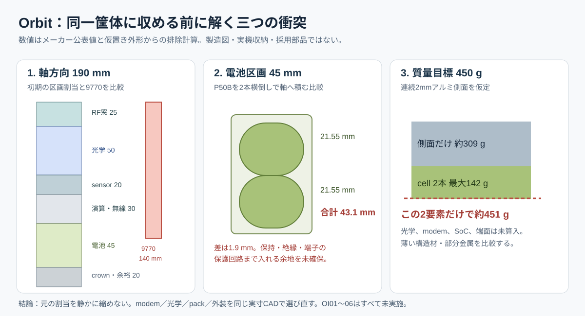

上から、樹脂製RF windowと衛星／地上アンテナ、折返し光学カセット、黒いsensor帯、RockstarOS演算・保護鍵・Wi-Fi、電池・充電保護・放熱脚を置く。金属外装はRF windowから離す。衛星送信・Wi-Fi・光学・手の握り位置の干渉は実CADと電波試験で決める。各区画の熱を皮膚接触面へ集中させない。収納図・部品表・配線・熱経路は未確定。

住宅での最初の設置profileは、本人が本体と空中操作面へ安全に手を伸ばせる**家具／壁の手元高さ**とする。高さと設置面、光学方向、電源、換気、来客の視線を現地で決める。天井／軒裏dockは建築表現として維持するが、そこから50〜100mm離れた像を手でタップするのは通常届かない。天井profileは合図・音声・本体着脱を先に検討し、天井設置のまま空間タップができたとは扱わない。遠方操作を成立させるなら別の表示位置・別校正と誤操作評価が必要で、外部投影器や別Miniを必須機材に変更する場合は元の一本自律要求との関係を再審査する。

建築の中では**固定sleeveへ円筒coreがジャストに納まり、縁と仕上げ面が揃う**外観を目標にする。壁、家具、軒裏の各sleeveは施工部材であり、取り外すcoreは同じ型とする。導入は先端を誘導するテーパー、回転位置を決めるkey、仕上げ面と荷重を受ける肩、奥の二段latch、交換できる給電接点で制御し、磁力だけを落下防止にしない。面の「ぴったり感」と、熱膨張・塗装厚・汚れ・手袋での挿抜を両立するクリアランスを公差解析と実物で決める。壁・天井の耐火、結露、配線、保守、落下範囲は施工profileごとに建築側が審査する。天井にある同型Miniを家じゅうの手元操作の代わりに見せかけない。

完全に面一なら指を掛ける縁がなく、外せる製品という約束と衝突する。壁sleeveでは、本人が前面の解除操作を行うとcoreを少しだけ押し出し、**第二のlatchが落下を止めた状態で握って抜く**機械案を比較する。停電時も本人が安全に外せる手順を用意し、ばねの力、指挟み、子どもの誤解除、天井からの落下、接点のアークと摩耗を実物で評価する。外観がflushに見えるだけ、CGで簡単に抜けるだけでは「取り外しやすい」としない。一般家庭で届かない高さは日常的な携行dockの配置として採用しない。

完全にflushな壁sleeveでは、本体側面の光学窓とhand sensor帯を壁が塞ぐ。そこで家具／手元高さの最初の試験は**窓とsensorを露出した縦置きcup型dock**とし、壁の埋込型は(1) 前面capから空中像を出す折返し光路、(2) 着信時にcoreを保持したまま手動または安全な機構で操作位置へ引き出す方式を比較する。(2)では作動中の突出寸法も200mm包絡へ入れ、保持・指挟み・落下・通話中に戻す動作を測る。両方が成立しなければ壁へ完全収納したままの空間タップを提供しない。映像やCGに現れる光だけで光路が壁を通ると扱わない。天井profileは手が届く位置との関係を別受入にする。

壁に収めた際は物理fallbackも隠してはならない。携行中のcrown／停止ボタンを本体の見える前縁から使える位置へ割り当てるか、壁から安全に少し引き出して触れる機構を必要とする。指紋sensorも本人が無理なく触れる位置へ残す。前面光路が見えても、空中入力失敗時に電話を止める物理操作ができなければ壁profileは不合格。天井sleeveは本人が手で届かない限り、この直接操作を備えた電話設置としては受け入れない。

(1)の具体的な発明仮説は、**同じcoreの光学engineを、装着中は前面capの開口、携行中は側面の開口へ導く二出口カセット**である。dockの機械keyと接点状態が出口の選択・遮光shutter・AirFrame版を同時に切り替える。遷移中は両出口を消灯し、前面側の手sensorが使えない設置なら空間タップも無効にする。これは部屋ごとに別の演算箱を追加せず、完全flushと携行時の一体性を両立するための比較案である。ただし光源、plate、反射面、二つの開口、sensor視野が50mmの仮光学区画へ入る証拠はない。出口ごとの輝度・像位置・漏光・迷光・校正ずれをP1aで測り、前面出口が不成立なら引出し案と正面capを備えた別の外形案を比較する。二出口の可動部を安全機構や特許上の独自性が成立したものとして扱わない。

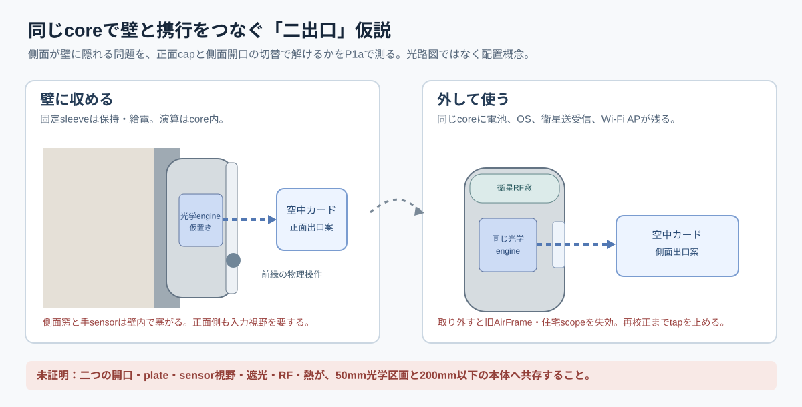

軒裏／壁内のcoreの内部antennaは屋根材、断熱材、金属下地、人体によって衛星方向を失う場合がある。設置中のWANは許可済みの建物WANか、別途審査した**受動的な屋外antenna＋RF給電接点**も比較できるが、配線損失、ESD、取り外し時の切替、antenna認証を測るまで採用しない。受動antennaを付けてもmodemとOSはcore内に残す。外した後の衛星受信はcoreの内部antennaだけでOI04を満たす必要がある。設置中に外部antennaや屋外terminalで接続できたことを、ポケットWi-Fiの証拠へ流用しない。

Dockは電源の支えであり、機能を保管する箱ではない。解除には意図した二段操作と落下防止の保持を用意し、抜ける前に電池側へ給電経路を移してjournalを確定する。接点が開いた瞬間に住宅設備の場所scopeとdock相対AirFrameを失効し、通話中でも現在の接続結果を保ったまま物理操作へ移れることを受け入れる。再装着では端子保護、給電方向、対象dock ID、熱、ownerを確認し、旧権限を自動再生しない。電源切替に短い停止が必要なら、通話や通信を継続できたと表示せず実測から設計をやり直す。

光学カセットの比較技術はmicrodisplay、分岐光学素子、再帰反射体を折り返して近距離に平面空中像を作るAIRR系。3D体積を生成する部品とは呼ばない。130mmの「応答」「拒否」2領域同時表示はP1aの拡張比較であり、選定L-Tの初回は70〜90mmの一択を順送りして深度sensorが指と像面の相対位置を読む。歩行・車内・強い日光・不適切な持ち方では像を消し、音声と側面物理ボタンで同じ通話状態を操作する。代替操作は復旧経路であり空中像gateの代替合格ではない。

手の入力は二段にする。低電力の多zone ToFは人が近づいたことと大まかな距離だけを判定する。[ST VL53L8CX](https://www.st.com/en/imaging-and-photonics-solutions/vl53l8cx.html?id=DB4884&rt=db)は8×8距離zoneなので、これ単独で指先と隣接する50mm選択領域を分離できたと推定しない。精密な像面交差にはstereo IR等の高分解能hand trackingを別に評価する。比較用の[Ultraleap Leap Motion Controller 2 datasheet](https://www.ultraleap.com/datasheets/leap-motion-controller-2-datasheet_issue13.pdf)は手の追跡範囲10〜110cmを示すが、Orbitへの収納、低電力、RockstarOS driver、日光下の動作や識別性能の証拠ではない。指先の座標、画像面との深さ誤差、他人の手、遮蔽、照度を同一治具で測る。

[VL53L8CX DS14161 Rev12](https://www.st.com/resource/en/datasheet/vl53l8cx.pdf)の検出範囲は仕様条件下で水平・垂直各45°。sensorが像面の中心と同軸で75mm離れる単純な幾何なら、その面で見える幅は約62mm（`2×75×tan(22.5°)`）で、余白込み130mm二択カードの端に届かない。100mmでも約83mmに過ぎない。これは近距離における実測FoVの代わりではないが、**単一の中央ToFを二択tapの全域sensorとして選ぶ案を棄却**するには十分な設計警告である。低電力wake用として残し、精密入力は前面と襟に置ける別の広角・高解像手段を実部品で比較する。広角化のためにToFのlaserへ集光光学を足すことは同datasheetの安全条件に反するので採らない。

広角側の実部品候補は[ST VL53L7CX DS13865 Rev8](https://www.st.com/resource/en/datasheet/vl53l7cx.pdf)で、公称は水平／垂直60°・対角90°、8×8 zone、6.4×3.0×1.6mm。STの[STSW-IMG035](https://www.st.com/en/embedded-software/stsw-img035.html)は同sensorとL8CX向けに手の位置追跡・single/double tapの例を提供する。像面まで75mmなら幾何幅は約87mm、100mmでも約115mmで、130mmカードを中央一個で覆うにはsensor面から約113mm以上の距離が要る。ただしdatasheetの60°検出範囲は白色88%反射体を1m先の暗所で測った条件であり、75〜113mmの指先と明るい島でその幅が有効という実測ではない。sensorを像面から遠ざけると黒帯・cap・展開襟が視野を遮る可能性があり、8列で130mmを分ければ1列あたり約16mmの粗さになる。datasheetの20〜200mm、8×8・15Hzの測距精度も反射率と照度により±11〜20mmの表値であり、Miniの指先目標誤差10mmを満たした証拠ではない。L7CXと公式gesture kitを**入力benchの第一候補**にし、二地点のtapを識別できなければ別配置・別sensorへ分岐する。公式の「tap対応」を空中電話の誤応答率へ読み替えない。

中央一個で130mmを覆えない対案として、**面一capの左右に二個置く**幾何もP0へ持ち込む。像面75mmで各L7CXが水平60°を理想通り使えると仮定し、sensor中心を左右±25mmへ置くと各視野幅は約86.6mm、左右を合わせた幅は約136.6mm、中央重なりは約36.6mm。D76の理想内半径36mmへ6.4mm幅のpackageを左右中心25mmで描けば最外x≈28.2mmで入り、仮の中央光学開口D40の端x=20mmとの水平方向隙間は約1.8mmしかない。これはcover、配線、seal、光学迷光、RF窓、黒帯との干渉、実FoV、縦方向の手位置、複数人の手、指先精度を全て**無視した上限配置**。二個にしただけで±10mm追跡や誤応答防止が成立したとは言わず、一個案と同じ実像面で比較する。顔camera・指紋・停止までこの端面へ載せる空間は別途必要である。

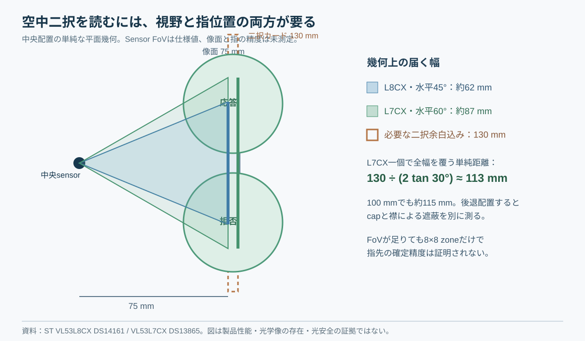

**操作面の幾何を先に固定する。** 二択案の選択領域2個を各直径50mm、領域間隔10mmにすると、占有幅だけで110mm。左右に最低10mmずつ余白を置いた**空中カード全幅の仮目標は130mm**となる。一択案は幅70〜90mmで直径50mm以上の1領域を表示し、「応答／拒否」を手の移動またはcrownで切り替えてから空中タップで確定する。像面まで本体から50〜100mm、本人の眼まで300〜700mmを実験範囲とする。R5原本の誤差仮説「追跡10mm＋校正5mm＋表示5mm＋余裕10mmなら直径50mm」を仮の下限にした。光学系が130mm幅やこの視域を作れる証拠はない。特に96mm径内の固定開口では2個の50mm領域が難しい可能性が高い。携行時の展開機構を含む実CADと、一択案の操作時間・誤操作を比較して決める。小さな文字やタップ領域に縮めて帳尻を合わせない。

空中像の**奥行の知覚**も独立した入力誤差になる。[Miyazaki／Takemuraの浮遊タッチ研究（2024）](https://www.jstage.jst.go.jp/article/mta/12/1/12_2/_article/-char/en)は、像面の深さが分かりにくいため指での指定操作が難しくなると報告し、指と像の視覚的重なりをfeedbackに使った。Miniでは表示が読めても「指がどこまで進めばtapか」が不明なら電話操作は失敗である。H0/H1の両方で、指先位置を音・触覚・像の状態変化で予告し、確定前に対象と奥行を本人が判断できるかを、初回使用・利き手・眼の位置・室内外照度ごとに測る。視線が外れた時や通話通知を横切っただけの手の動きで応答しないことも同じ試験に含める。この研究の別装置のfeedback方式や成績をMiniの達成値へ転用しない。

[空中像のtouch研究](https://www.jstage.jst.go.jp/article/mta/12/1/12_2/_article/-char/en)は像の奥行位置を人が掴みにくく、視覚feedbackで精度が変わる点を扱う。このため指が像面へ近づくにつれて領域の輪郭を変え、候補選択時は音・触覚でも返す。ただしfeedbackは入力の成功を意味しない。上肢疲労を扱った[CHI一次研究](https://hci.cs.umanitoba.ca/publications/details/consumed-endurance-a-metric-to-quantify-arm-fatigue-of-mid-air-interactions)を踏まえ、空中操作は短い確認・選択に絞る。長時間のGame操作や長文入力はcontroller、音声、対応画面のいずれかを利用者が選べるようにし、腕を上げ続ける設計にしない。

光学方式の選定は、折返しAIRR、円柱配列の空中結像plate、既存の単一結像plate、単一自由曲面mirror、表面投影を同じcall cardと照度で比較する。AIRRでは光源から半鏡・再帰反射体を経て像面までの光路、観察角ごとの輝度／ぼけ、手が光路を塞ぐ時の像の欠落を測る。結像plateではplate幅と像幅・飛出距離がほぼ一緒に増えるため、収納径・展開径を先に計る。単一mirror方式は[Optics Letters 2026の一次研究](https://opg.optica.org/ol/abstract.cfm?uri=ol-51-20-5753)が半鏡と再帰反射体を省き、中心輝度160.8cd/m²を報告するが、公開表のmirror160×100mmはLの展開径140mmにも収まらない。別設計の光路を実測せずMiniに適合したとは扱わない。表面投影は視認性の比較対照であり、空中表示gateの候補にはしない。どれも最初は低出力の遮光benchで評価し、光安全の区分と機構の保持が明らかになるまで人体への照射試験・装着試験に進まない。市販の空中像機器の仕様をMiniの実現証拠としない。
[Chenらの2024年一次研究](https://opg.optica.org/ao/abstract.cfm?uri=ao-63-3-636)はmicro-aperture arrayによる別のAIRR装置での解像改善を示すため、H0/H1の比較試料として検討できる。ただしその結果は38〜40mmの端面への収納、輝度・視域・電力の同時達成を示さない。追加素子を入れると光路と製造公差が増えるので、像を読める人数と照度を測らずに採用しない。

[TCAPの一次研究](https://link.springer.com/article/10.1007/s10043-025-00948-1)は、5mm径の棒を20×20並べた約100mm角の試験素子で点像の形成を確認し、200mm角のシミュレーションで視域を比較した。これはOrbitの96mm径内で文字の読める70〜130mmカード、低消費電力、空間タップを示したものではない。円筒周囲の視域には[BCAPの360°方位研究](https://doi.org/10.1364/OE.597509)もあるが、方位から像が見えることと部屋に体積像を広げることは違う。R5全空間3Dの実証へ読み替えず、A研究gateの比較資料に留める。

幾何だけでも、直径96mmの円形断面へ平らな正方形plateを完全に収められる一辺の上限は96/√2≒68mmで、壁厚・保持材を引けばさらに小さい。約100mm角の研究素子をそのままH0へ収納しない。展開径140mmでも平らな正方形の上限は約99mm。像の大きさは光学倍率と視域にも依存するため、これを「130mm像は絶対に不可能」という証明には使わず、H1の開口・結像・光量を同時に測る前提にする。

質量も同じ制約に当てる。[ASKA3D-200NTの公式外形図](https://aska3d.com/common/pdf/aska3d-200-design.pdf)は200×200×6.4mmで280g。**面積に比例すると仮定しただけの感度**では、140mm展開円へ入る最大約99mm角のplateでも約69gとなる。Lの薄いAl側壁約95gとM65A二本149gへ足すだけで約313g、450gの仮携行目標まで137gで、SoC、衛星／地上／Wi-Fi、光源、sensor、speaker、端面、latch、保護packは未計上。200mm plateを切って同じ結像性能が出るとも、99mm plateで130mm像が作れるとも言えない。襟を折り畳むなら素子の継ぎ目・平面度・汚れが増す。P1aでは**実際に入る寸法・質量の素子**だけで像と光量を採り、縮尺CGや市販大型unitの像を合格へ転用しない。

各benchの記録は、光源・半鏡・再帰反射体／plateの外寸と相互距離、像の実測幅・浮上距離、視点の水平・垂直範囲、室内・窓際・屋外の背景照度、像面の輝度と文字／境界のcontrast、発光電力、光路遮蔽、長時間のずれを同じ型で取る。[2026年のAIRR画像モデル研究](https://link.springer.com/article/10.1007/s10043-026-01034-w)は再帰反射素子の大きさと回折・散乱による像の広がりを扱うため、単に「明るいmicrodisplay」を置けば小型化できるとは考えない。[LeAIRRの3D実験](https://sid.onlinelibrary.wiley.com/doi/10.1002/jsid.2056)は光学素子間に150mm、75mm、450mmの距離を使っている。これは研究方式の実寸例で、Orbitへそのまま収納できる証拠ではない。H0/H1は実寸断面と観察者による読取を揃えてから選ぶ。

開口機構も二案にする。**H0密閉カセット**は携行時も展開不要で、70〜90mmの1操作領域を見せる。着信ではまず中立の「着信」を出し、crown／声／明示した手の移動で「応答」か「拒否」を候補にしてから、別の空中tapで確定する。既定の「応答」は置かない。対象を切り替えた直後の短い手の通過は入力を受けず、現在どちらを選ぶかを音・表示で明確に返す。この順番と動作回数がかえって誤応答や見逃しを増やすならH0を採用しない。**H1手動展開する光学collar**は本体上部から光学面を放射状に開き、余白込み130mm二択カードを狙う。Lでの試験順は軸方向へ少しせり出す操作と襟を開く操作を分ける。H1も高さ200mm以内に収め、閉じたまま携行できるが、展開径・接触安全・落下・汚れ・光学継ぎ目・片手操作の負担が増す。H0で本人が短時間に誤りなく操作できればH1を必須にしない。H0が読めずH1も閉箱へ収まらない場合は、空中UI達成を保留する。
H1の「開閉できるplateと遮光部材」は[2026年公開の携帯型空中表示公報](https://patents.google.com/patent/US20260227596A1/en)に具体的な記載がある。H1を独自機構と主張せず、試作・権利の両面で方式を確認する。特定の実施形態を回避できるかどうかは、この机上比較では結論を出さない。

### 実部品を置いた時の判定

| 系統 | 一次資料で確かめられる値 | Orbitへの判断 |
| --- | --- | --- |
| 衛星midband | Iridium 9770は140×60×16mm・185g、最大22／88Kbps | 当初の25＋30mm割当とは衝突。現外形と450g目標では採用保留 |
| 衛星narrowband | Iridium 9523は70.44×36.04×14.6mm・32g、RUDICS IP候補。IPを掲げるOEM基板例は112×75×20mm・90〜98gの掲載差があり、Wi-Fiも現行表示ではオプション、過去表示ではあり。掲示data power 8W | 裸moduleは寸法比較へ進めるが、OEM基板幅75mmはL-T理想内径72mmへ入らず、一般Web用hotspotの使いやすさと契約も未証明 |
| 衛星IoT-NTN | Quectel CC660D-LSは17.7×15.8×2.0mm・約1.2g、IPv4／UDP、下り8.3kbps参考値。Nordic nRF9151は12.1×11.1×1.2mmでSkylo認証あり | 小さな本体は上端RF／電池脇のCAD候補。antenna、契約上の一般IP共有、TCP／Web、通話と実速度が未証明。製品用hotspotとは判定しない |
| 衛星IoT message | Globalstar RM200Mは28.3×50.8×3.6mm・11g、上り9〜144bytes／下り9〜128bytesの衛星message | 米国を含むIoT機器の双方向message候補。一般IP／DNS/TLS／任意client Wi-Fiを示さずOI04の最低要件へ採用しない |
| Wi-Fi AP | [村田Type 1YN](https://www.murata.com/ja-jp/products/connectivitymodule/wi-fi-bluetooth/overview/lineup/type1yn)は6.95×5.15×1.1mmの2.4GHz Wi-Fi 4 moduleで、[同社発表](https://www.murata.com/ja-jp/news/connectivitymodule/wi-fi-bluetooth/2022/0825)がSoftAP対応を明記 | 通信IC本体は演算bayへ描ける候補だが、内蔵antennaなし。主SoC／driver、地上・衛星radioとのアンテナ共存、AP security、clientからの実WANを別に受け入れる。Mini採用品ではない |
| 携行電池 | Molicel P50Bは1本18Wh・最大71g、M65Aは23.4Wh・74.5g、M35Aは12.6Wh・48g | 二本P50B=36Wh／142g、二本M65A=46.8Wh／149g、三本M35A=37.8Wh／144gはいずれもcellだけ。軸端と径方向の隙間・pack保護・熱は別受入 |
| 粗い距離入力 | ST VL53L8CXは8×8 zone | 起動・存在検知のbench候補。指先確定は担当させない |
| 手追跡 | Ultraleap Controller 2は追跡距離10〜110cmの比較機 | 収納・OS driver・屋外・照明条件は未受入 |
| 空中像 | ASKA3Dの既存6インチ機は幅220mm・plate幅160mm | 既存製品を96mm径へそのまま収納する案を排除。小型光学の実測待ち |

この表は発注表ではない。module、antenna、電源回路、driver、利用権を同一機へ揃えた合格を一行の製品公称値へ足し合わせない。最初の比較では収納できるが細い回線の案と、IPは速いが収まらない案の両方を残し、実物の質量・寸法・利用用途を同時に評価する。

### 空間操作が持ち出せる仕組み

Orbitでは「空中のどこか」を無制限に押すのでなく、**本体に対する局所的な操作体積**を定義する。`AirFrame`は光学カセットの校正版、像面、手sensorの座標変換、利用者の観察位置候補、現在の本体姿勢、遮蔽を一緒に持つ。観察位置はIR／depth等から粗く推定する比較案で、眼球や顔の生体照合とは別。観察位置を取れない、複数人を分離できない時は詳細表示と空間入力を止める。raw映像は既定保存しない。dock中は既知のdock poseへ紐付け、外した瞬間に旧`AirFrame`を無効化する。携行中は本体のIMUとsensorで本体相対の新しい`AirFrame`を作る。再校正の間は光の合図だけで、操作要求は受けない。移行中の着信は側面ボタン・音声で続けられる。旧位置への指の動きを新しい通話操作として再解釈しない。

本体が揺れる、落ちる、手や物で光路が塞がれる、表示面と深度sensorの校正がずれる場合は`LOW_CONFIDENCE`へ戻す。外部の部屋カメラを必須にせず、一本自律を保つ。ただしこの局所体積だけで部屋全体の裸眼3Dや遠距離の天井操作を達成したことにはならない。`AirFrame`の入力／出力はOSの権限境界内に閉じ、GameやSkyへは承認済みの抽象化された選択eventだけを渡す。

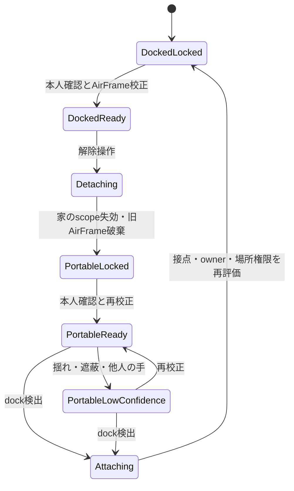

この図はUI入力の許可状態であり、通話接続や衛星IPの成功状態ではない。`Detaching`と`Attaching`で空中タップは無効、側面の停止／通話操作だけを残す。本人確認tokenはdockをまたいで場所の権限を自動再付与しない。

共有空間の誤応答を減らす追加仮説は**本体に触れた手から空中の手までの連続性**を短く追うこと。側面の指紋確認で短命のcall event tokenを作り、その手がsensor視野へ移る軌跡を見失わなかった場合だけ該当カードを操作可能にする。人の手が重なる、手を交換する、カメラが遮られる、時間切れになるとtokenを消し、物理ボタンへ戻す。これだけで「同じ人の手」と証明できるわけではなく、別人の手による誤操作、片手しか使えない人の到達性、手を離す負担をOI02／03で実測し、採用を決める。支払・解錠のような作用はこの連続性だけで承認しない。

## 電源と無線の成立条件

衛星は下りだけでなくMini本体からの上りとIP疎通が必要。modem、antenna、回線契約、対象地域、共有可否を一組で選ぶ。D2D／NTNの細いリンクで短文が通っても、任意のWebゲーム、映像通話、Cloud Agent、複数端末の一般インターネットを約束できない。Wi-Fi APはLAN、衛星はWAN。「衛星検出」「網登録」「IP接続」「共有端末から疎通」を別々に示す。地上回線とdock有線WANは高速経路として併用できるが、直接衛星gateの合格には転用しない。建築内やポケット内の衛星リンクを保証しない。

**初回の通信検証地域は米国**（2026-10-19の利用者指定）。[T-MobileのT-Satellite現行案内](https://www.t-mobile.com/support/coverage/satellite-support)は対応する衛星向け**phone**と選択されたapp／dataを前提にし、屋外の空の見通しや州ごとの制約も記す。通常の携帯hotspot案内を衛星tethering許可へ流用できず、Miniの端末適合も未証明。[Skyloの認証案内](https://www.skylo.tech/skylo-certification-program)はIoT NTN端末の別の適合入口だが、短いpacket経路を一般Web共有へ拡大しない。[Iridium Certus 100](https://www.iridium.com/services/iridium-certus-100/)は9770を使うIP／音声の調査入口だが、Miniの新規機器向け米国plan、antenna、Wi-Fi再共有権利を公表例だけで決めない。[FCCのSCS機器認可命令](https://docs.fcc.gov/public/attachments/DA-26-380A1.pdf)と[RF曝露指針](https://apps.fcc.gov/oetcf/kdb/forms/FTSSearchResultPage.cfm?id=20676&switch=P)を、選んだradio方式・携行姿勢・複数送信機の専門審査に持ち込む。[Thurayaの機種別比較表](https://www.thuraya.com/-/media/thuraya/rebranded/x5-touch_comparison-sheet.pdf)が米州を含めない旧X5 Touch／SatSleeveは過去の比較先例であり、米国pilotの回線候補から除く。同社の[FAQ](https://www.thuraya.com/en/faq/)には別のMDR M2M北米serviceもあるため、「Thuraya全製品が米国不可」とは書かない。米国での試験地点、事業者、SIM／資格情報、契約文書、双方向IP、Wi-Fi共有、実料金、端末認証を揃えるまでは衛星AP gateはHOLD。

調達経路も分ける。[Iridium開発者向け公式案内](https://ifp.iridium.com/developer-resources/)は完成IoT端末利用、組込module、ライセンス済みcore設計、端末上app開発を別の経路として示し、共同開発はlicensed partnerを通す。9770を購入できそうという情報だけではMini独自機器の網利用権・製品認証・長期供給を確定できない。[NordicのnRF9151／Skylo発表](https://www.nordicsemi.com/Nordic-news/2025/12/Nordic-Semiconductor-secures-Skylo-certification-for-nRF9151-module-enabling-global-IoT-connectivity)は小型radioの網認証を示すが、同記事の用途はIoT接続であり、Miniの一般Internet Wi-Fi再共有と電話番号を証明しない。米国pilotでは、Iridiumの端末開発／IP経路を双方向Web共有の第一照会、Skyloを小packet低電力対照、T-Mobileを対応phone限定の比較基準として照会し、書面回答が出るまでどれも採用網とは呼ばない。

本体のWANは二層で設計する。(1) 対応する物理SIM/eSIM＋地上回線で通常の通話・Web・Game・Agent、(2) Mini内蔵の双方向衛星modemで屋外の接続を補う。Wi-Fi APは本人の選択した許可済みWANだけへ橋渡しする。RockstarOS service access、地上回線契約、衛星契約、電話番号／音声権限、端末内modem適合は別状態で追跡する。衛星用の資格情報をSIM購入に含めたと推定しない。satelliteと地上の切替時に通話・game TCP sessionが維持されるとは約束しない。Zema jobと成果はrevision／event IDで照合して再開する。

| 接続状態 | 着信カードの根拠 | 通話の条件 | Wi-Fi共有の表示 |
| --- | --- | --- | --- |
| 地上回線または許可済み建物WAN | 契約した音声／data providerからの着信event | 番号、VoLTE／VoIP、音声経路と対象機種の受入 | 地上／建物WANとして共有、別契約を明示 |
| 衛星IP | 対応する衛星音声またはdata通話serviceが実際に通知した場合だけ | voice line／対応appと契約、双方向音声・遅延・途切れを別受入 | 実IPとtethering許可があれば衛星として共有、対象用途を制限 |
| 圏外／未契約 | 新たな外部着信は受けたと表示しない | 保存済み履歴とlocal下書きのみ | APが動いても「localのみ」、Internetありと表示しない |

空中に「電話が鳴った」と見せるため、providerが発した着信event、Miniに届いた時刻、本人へ提示した時刻、受諾／拒否要求、provider側の実成立を別々に保存する。地上番号への着信が衛星へ自動で転送されるとは仮定しない。番号転送、複数回線、発信者識別、緊急通報の仕様は選んだ地域・partner・契約で固定してから受け入れる。

電話の入口には三つの接続方式を同じ試験で比べる。**Miniへ正式に割り当てた番号と音声契約**を製品の第一候補とし、試験網が未選定の間は方式を確定しない。

| 音声の経路 | 成立させる具体条件 | 製品としての限界 |
| --- | --- | --- |
| 地上VoLTEの本体module | 対象MNO・型式・SIM/eSIM、番号、着発信event、音声DSP、内蔵antenna、実網の双方音声 | [A7672X](https://www.simcom.com/product/A7672X.html)等のmodule表記だけでは端末認証・通話成立にならない。もう一つのradioと電池待受が増える |
| Miniのdata回線上の番号付きVoIP | 正式な番号／着信service、Miniの安全なpaging・着信継続、音声品質と契約、地上／建物WAN | Wi-Fiが切れた時、遅い衛星IP、緊急通報の扱い、端末再起動時の着信喪失を別受入。単なるAgent会話を電話とは呼ばない |
| 本人が既存番号を明示転送 | 通信事業者の転送契約、caller ID／応答／拒否の整合、失効・解約手順 | 初期移行の選択肢であり、これだけをMini自律の番号・携帯代替と表示しない。元端末側の状態にも依存し得る |

三経路とも、ring→匿名合図→本人確認→空中tap→provider接続→双方音声→終了を**同じcallEventId**で測る。実際の着信が届かずCloud通知だけ届く場合、電話gateは未合格とする。衛星を使っている間の通話は、選んだ衛星providerがvoiceとdataを同時に認めるかを別に確認する。通常の電話、緊急通報、衛星音声を一つの「通話OK」にまとめない。

公式の比較機は[Iridium GO! exec](https://www.iridium.com/products/iridium-go-exec-portable-wireless-access-device)が203×203×25mm、1,200g、衛星IP最大88Kbps、待機最大24時間で、Wi-Fiを使える。衛星→Wi-Fi自体は既存の製品能力だが、F／L／Sいずれかの閉箱に光学・Game・生体・電池を合わせて入る証拠ではない。既存[Starlink Miniの仕様](https://www.starlink.com/public-files/specification_sheet_mini.pdf)も別形状・別電力であり、これらを部品として採用済み、またはMiniの性能値として扱わない。比較から、広帯域の普通のインターネットを細いD2D経路へ勝手に約束しないこと、ポケット寸法・massとsatellite能力の両立を最初に問うことを決める。

米国pilotに関係する同じ9770系の別比較例として、[Iridium掲載のMcQ CONNECT](https://www.iridium.com/products/mcq-connect-satellite-hotspot)は**203.2×127×38.1mm、1,000g**で衛星IPの公称上り22／下り88kbpsを示す。最長辺はR5の使用時全高200mmを3.2mm超え、仮の携行目標450gの約2.22倍。公表値だけでWi-Fi再共有の契約条件やMiniへの転用は分からない。[同じくSKYTRAC DLS-100](https://www.iridium.com/products/skytrac-dls-100-data-link-gps-system)は221mm長、742.8g、Wi-Fi enabledと記載するが、公開時点のFCC認証はpendingとされる。これらは「moduleに認証表記があるから完成機も認可済み」という推論の反例である。Miniでは9770本体の140mm軸長に光学・電池・安全・RFを重ねる現物CADと、新しい完成機の米国認可を別に満たす必要がある。

後者の公式仕様を数字で見ると、Starlink Miniのantenna本体は298.5×259×38.5mm・1.10kg、平均25〜40W、入力12〜48V/60Wで、統合Wi-Fiを持つ。最大辺はR5の200mmを超え、Lの仮2×M65Aで負荷側33.7Whを用意しても、**他の全負荷をゼロとした**25〜40W平均では約1.35〜0.84時間しか持たないという感度になる。Starlinkの方式・antenna・回線能力はIridium／Thuraya／NB-NTNと異なるため、これはMiniの必要W数でも採用候補でもない。「Starlink Mini相当の高速衛星Internetを細い円筒へ載せる」という読み替えを排除する比較である。

小型側には[Thuraya SatSleeve Hotspotの公式factsheet](https://www.thuraya.com/-/media/thuraya/downloads/products-downloads/land-voice/satsleeve-plus/thuraya-satsleeve-hotspot-factsheet.pdf)がある。本体＋standの公表寸法は142×69×38mm、290g、衛星data公称下り60／上り15kbps、Wi-Fi連続時の待機最大9時間で、同社[製品説明](https://thuraya.com/en/products-list/legacy/thuraya-satsleeve-hotspot/)は衛星経由でemail／Internet閲覧ができるとしている。しかし[取扱説明書](https://www.thuraya.com/-/media/thuraya/downloads/products-downloads/land-voice/satsleeve-plus/satsleevehotspotusermanual.ashx/)は衛星利用中のantenna完全展開と接続前GPS取得を求め、新しい場所では数分かかり得ると説明する。**antenna展開を含む使用時全高の公式値は未取得**で、R5の200mmを満たした先例とは数えない。これは小さい本体で衛星InternetをWi-Fiへ出した過去の例であり、旧世代の対象網／地域、専用phone app、現行供給・契約に依存する。RockstarOS、空中光学、指／本人入力、Miniの本体実行を同居させた証拠でもない。これをそのまま採用基板の体積・電力に換算しない。

同製品の[公称電池](https://thuraya.com/en/products-list/legacy/thuraya-satsleeve-hotspot/)は3.7V・2,440mAhで約9.0Whであり、Wi-Fi連続「待機」最大9時間を単純に割ると電池側平均は約1W以下が必要という概算になる。これは接続待機時の先例であって、衛星へ連続送受信しながらRockstarOS・空中光学・Game・Wi-Fi clientを動かす電力ではない。Miniの仮8W AP平均をこの先例で肯定も否定もできず、待機と実転送の二つの電流波形を分けて測る。

より近い**単体端末の反例**は[Thuraya X5-Touch](https://www.thuraya.com/en/products-list/legacy/thuraya-x5-touch/)である。[同社brochure](https://www.thuraya.com/-/media/thuraya/rebranded/x5-touch-brochure.pdf)による**phone bodyだけ**の筐体は145×78×24mm・262g（外接箱約0.271L）。Android端末自身で衛星電話を使い、[取扱説明書の設定手順](https://www.thuraya.com/-/media/thuraya/rebranded/thuraya-x5-touch-user_guide.ashx)は衛星GmPRSをpersonal Wi-Fi hotspotとして他機器へ渡せると明記する。[FAQ](https://www.thuraya.com/en/faq/)のGmPRS公称最大は下り60／上り15kbit/sで、地上4Gの速度値とは分ける。この一台は**端末自身に電話・衛星packet data・Wi-Fi APが同居する**強い先行証拠であり、SatSleeveのphone app依存とは違う。ただし衛星接続では同取扱説明書がSAT antennaを**完全に伸ばす**ことを求め、brochureの145mmはphone body寸法なので、antenna展開を含めたR5使用時200mmの先行達成例には数えない。展開全高の公式数値は未取得。旧製品の平たい形状、屋外での衛星見通し、Thurayaの対象地域・網・契約にも依存する。**body幅78mmだけでもLの外径76mmより2mm広い**ため、X5筐体そのものをLへ収める比較にはならない。公式brochure／FAQに示す衛星対象地域は欧州・アフリカ・アジア・豪州であり、米州を対象としていない。米州を初回販売地域に選ぶなら、この先例の回線をMiniのOI04へ採用できない。X5の内部設計・antenna・認証を76mm径の銀色円筒やRockstarOSへ転用できる根拠はなく、空中光学・近距離tap・生体認証・Game負荷を加えたMiniの成立証拠でもない。初期の部品／事業者調査ではこの自律機の設計規模を比較点とし、OEM向けRF／modem供給・統合条件・現行service継続を照会する。X5そのものを採用構成としない。

一方、現行の[Thuraya One公式factsheet](https://www.thuraya.com/thuraya-one/Space42_Thuraya%20One_Fact%20Sheet_EN%20AR.pdf)は167×76.5×11.6mmのAndroid 14端末に衛星通話・SMSと指紋sensorを示すが、**衛星packet data／衛星からのWi-Fi共有を掲げていない**。薄い現行衛星phoneという言葉だけではX5の旧GmPRS hotspot能力を引き継いだとは判断できない。提供者に現行端末の実data service・APN・hotspot条件を直接確かめるまで、OneをOI04の候補部品へ数えない。

[親会社Space42の現行通信説明](https://space42.ai/en/lp/secure-connectivity.html)は、2026年2月にThurayaの既存voice／SMS／legacy packet dataをThuraya-4へ移したと述べる。これは**網側のservice継続情報**であり、Oneの端末がpacket dataを開けることや、新規Miniへhotspot権利を売ることの証明ではない。対象footprintも中東・アフリカ・中央アジア・欧州で、米州向け初号機の結論には使えない。

北米向けの過去例も供給継続の罠を示す。[Globalstarの2016年Sat-Fi2発表](https://investors.globalstar.com/news-releases/news-release-details/globalstar-prepares-release-next-generation-sat-fir-satellite-wi)はsatellite Wi-Fiで通話・Webを掲げ、2019年の[米加向け発表](https://investors.globalstar.com/news-releases/news-release-details/globalstar-expands-usability-sat-fi2r-satellite-hotspot-new)もある。しかし[同社の2021年業績説明](https://investors.globalstar.com/news-releases/news-release-details/globalstar-announces-2021-financial-results-and-business-update)は、Sat-Fi2等の一部Duplex機器について販売と加入者serviceを一時停止したと記す。この過去例を2026年の可用なMini回線候補、または現在の月額・無制限dataへ読み替えない。候補事業者には**新規OEM端末を受け付けるか、製品寿命中の契約・保守をどう維持するか**まで確認する。Sat-Fi2の専用phone appをMiniの単体利用の達成にも数えない。

速度を上げる方向の別比較である現行[Thuraya IP NEO M](https://thuraya.com/en/products-list/land-data/thuraya-ip-neo-m/)は衛星IP最大1,024kbit/sとWi-Fi AP／routerを掲げるが、電池込み225×225×61.5mm・2.2kg。これはMiniの200mm全高・軽い携行という包絡から外れる。X5の低速小型、IP NEO Mの高速大型、IoT-NTNの小型message用途は**別製品・別網の観測点**であり、単純な比例則やMiniの達成速度ではない。ユーザーへ「一般Webに接続できる」と「速く快適に全アプリが動く」を同義に示さず、最初の販売地域と実契約で共有速度・料金・使えるtrafficを決める。
[Iridium GO! exec公式仕様](https://www.iridium.com/products/iridium-go-exec-portable-wireless-access-device)も、同じ9770を使う実在の衛星Wi-Fi端末として203×203×25mm・1.2kg、衛星IPの上限88kbpsを示す。これは衛星Wi-Fiが実際に売られている証拠である一方、Miniの細い一本へそのまま縮小できる証拠ではない。独立したspeakerとmicを持つが、携帯端末appとの役割も残る。単体Android電話のX5とこの大きいaccess deviceの両端を、F/L/Sの質量・寸法・自律UIの比較点にする。

[同社FAQ](https://www.thuraya.com/en/faq/)はSatSleeveの通話／data利用を最大3時間、Wi-Fiを切った着信待機を最大70時間とし、**音声通話とdata sessionは同時に一つしか成立しない**と説明する。Miniでは「衛星APで作品を送っている途中に電話が鳴る」場面を同時利用可と仮定せず、契約網の同時session仕様を取得し、接続できないなら保存済み仕事・発信者への折返し・Wi-Fi clientへ中断理由と費用を示す。一方、通常の屋内通話は地上回線／建物WANを別に受け入れる。衛星事業者の[設置説明](https://www.thuraya.com/-/media/thuraya/rebranded/satsleeve-plus-brochure.pdf)もantennaを伸ばし上空の見通しを得る手順であり、面一の島・天井・軒裏内に埋めたまま直接衛星リンクが使える証拠ではない。

[同社FAQ](https://www.thuraya.com/en/faq/)と[利用者マニュアル](https://www.thuraya.com/-/media/thuraya/downloads/products-downloads/land-voice/satsleeve-plus/satsleevehotspotusermanual.ashx/)は、SatSleeve Hotspotアプリをスマートフォンで起動する利用手順を示す。したがって「小型衛星Wi-Fiの前例」と「電話を持たずにMini自身が通話・契約操作・制作を完結する」の間には、端末内UIとservice制御の大きな差がある。さらに同社の[XT-Hotspot](https://thuraya.com/en/products-list/legacy/thuraya-xt-hotspot/)は複数Wi-Fi機器のInternet接続を明記するが、別の衛星電話機をWANとして要求するため、Miniの一本自律の証拠にはならない。この二製品を混同せず、SatSleeve級のRF／data経路をMiniへ組み込めるかは型式・供給・契約・認証を事業者に確認する。

衛星candidateを用途別に分ける。[Iridium Core 9523](https://www.iridium.com/products/iridium-core-9523)は70.44×36.04×14.6mm・32gで、[RUDICS](https://www.iridium.com/services/iridium-rudics)はIP接続を扱う。一方でnarrowband用途であり、Wi-Fiへ橋渡しできたとしても一般のWeb／Game／Cloud Agentが使いやすいポケットWi-Fiである証拠にはならない。9770は最大送信22Kbps／受信88KbpsのIP候補だが、上記の収納・質量壁がある。小型の[NB-NTN wearable platform](https://www.qualcomm.com/wearables/products/snapdragon-w5-plus-gen-2-wearable-platform)はメーカーが緊急message向けと説明しており、IP tetheringの代用にしない。2026年の[NR-NTN modem方向](https://www.qualcomm.com/news/onq/2026/06/x105-5g-nr-ntn-satellite)は開発候補で、Miniの対応衛星、網、地域、契約、tethering権限、antennaの成立は未確認。この四経路のうち、同じ閉箱で実IPとclient疎通ができるものだけをOI04へ進める。

RUDICSの[公式説明](https://www.iridium.com/services/iridium-rudics)にはdirect IP、標準接続、PPP、複数channelのMLPPPがあるため、9523を「IPでないmessage専用」として捨てない。ただし[同網を使う別のSKYTRAC ISAT-200A](https://www.iridium.com/products/skytrac-isat-200a)の公開値は双方向2.4Kbpsであり、仮に1MBをその速度で連続転送しても理想下限は約56分、再送・接続・TLSはさらに要る。これは**その別端末の速度感度**で、9523のMini実速度ではない。9523＋RUDICSの米国でのMini向けPPP／任意宛先、Wi-Fi再共有権、課金単位、複数channelの機器・antenna・電力は取得していない。小さいのでL-TのP0基板対照には有用でも、2.4Kbps級の経路を普通のWeb用ポケットWi-Fiとして採用するにはP4の実利用で強い不利がある。持ち出し包と緊急の短文連絡は別能力として試し、ユーザーの最低衛星Wi-Fi要求の合格と混ぜない。

[Iridiumが掲載するPLANET 9523 OEM Board](https://www.iridium.com/products/planet-9523-oem-board)は、9523でIPを扱いWi-Fiの構成を掲げる具体的な先例だが、112×75×20mm・90〜98gの掲載差があり、外部9〜36V給電、掲示data power 8W。L-TのD76外殻の理想内径72mmより基板の75mm辺が長く、既製基板を平らに入れる案はP0で失格。antenna、電池、光学、地上音声はさらに必要で、8WをMini全体の測定消費へ置き換えられない。[同系の完成UAV端末](https://www.iridium.com/products/planet-9523-uav-terminal)は180×100×30mm・260g、Wi-Fi enabledだが内部電池なしの別製品。これらは9523のIPとWi-Fiを製品へ結ぶ工学対照を強める一方、L-Tの一体筐体・米国Mini型式の任意Web共有権・電池持続を立証しない。

「小さい衛星moduleがある」を即座にhotspotへ読み替えない。[Iridium 9704](https://www.iridium.com/products/iridium-certus-9704-module)は31.5×42.0×3.8mm・12gだが、公開仕様は最大100KBのmessage輸送で、任意clientへの連続IP共有の仕様ではない。逆に[Iridium 9810](https://www.iridium.com/products/iridium-certus-9810)は最大704Kbps下り／352Kbps上りのIPと音声を掲げるが、moduleだけで150.6×133.6×18.2mm・500gあり、仮の直径96mmには断面上入らず、450gの仮携行目標もmodule単体で超える。この両端の実例から、Orbitの採用品は「寸法」「双方向IP」「Wi-Fi共有権利」「回線速度」「電力」を同時に満たして選ぶ。

米国向けに[Globalstar RM200Mの現行sales sheet](https://www.globalstar.com/getmedia/932da082-c545-4ed1-b7fc-67ff34967651/rm200m-sales-sheet1.pdf)も照合した。28.3×50.8×3.6mm・11gで双方向と公称するが、衛星の一送信messageはmobile-originated **9〜144bytes**、受信は**9〜128bytes**。同社の[商用化発表（2025-10-21）](https://investors.globalstar.com/news-releases/news-release-details/globalstar-announces-commercial-rollout-rm200m-two-way-satellite/)は北米を含むIoT用途を述べる。これは小型の双方向伝言・センサー連携の候補を増やすが、HTTPやTCP/TLSの任意client IPとWi-Fi tetheringを証明しない。GNSS／BLE搭載を「電話を持たない一般Internet AP」とも読まない。OI04はmessageの往復だけで通さず、IP routingと米国のMini型式・共有契約を別に要求する。

2026年6月に市販化された[Iridium 9604](https://www.iridium.com/9604)は16×26×2.4mmの一体moduleでIridium SBD、LTE-M、GNSSを持つ。衛星側の公開上限は送信340bytes／受信270bytesの**message**で、地上LTE-MのIP能力を衛星Internetへ移せない。2026年10月14日の[Altair／IridiumのNTN Direct統合発表](https://investor.iridium.com/2026-10-14-Altair-Semiconductor-Integrates-Iridium-NTN-Direct-into-ALT1350-and-ALT1550-Cellular-IoT-Chipsets)もALT1350／ALT1550へNB-IoT・D2D系衛星能力を組み込む計画であり、Miniが米国で一般WebをWi-Fiへ再共有できる端末／契約／実速度の発表ではない。特にALT1550のAI wearable向け説明を「MiniのCloud AgentやGameが衛星で快適に動く」証明にしない。9604とNTN Directは低電力の連絡・状態同期の別比較として残し、OI04の一般Internet用ポケットWi-Fiを合格させない。

現行の[T-Mobile T-Satellite案内](https://www.t-mobile.com/support/coverage/satellite-support)も、対応端末と最適化されたアプリ、低帯域・遅延の条件を説明している。既存携帯で選択アプリが使える事実は、Miniの別端末へ一般Internetを共有できる契約・実装の証拠ではない。対象販売地域の正式な回線仕様を先に取る。

Qualcomm自身の[X105説明](https://www.qualcomm.com/news/onq/2026/06/x105-5g-nr-ntn-satellite)は、現在の狭帯域message対応と将来のより広い衛星接続への移行を分けている。chipのNR-NTN対応表記や地上5Gのpeak速度を、そのままMiniの衛星WANの実速度・利用開始日・Wi-Fi共有許可に使わない。採用品決定には、対象衛星網での実通信と事業者の端末・tethering条件を要する。
[MediaTekのMT8875発表（2026-08-25）](https://www.mediatek.com/tek-talk-blogs/mediatek-mt8875-our-next-gen-5g-iot-platform-for-genai-applications)は4nmのIoT計算基盤に5G、Wi-Fi 6E/7、AIと**optional** satellite NTNを掲げる。Lの演算bay・地上radio・Wi-Fiを統合できるかという第三の照会先にはなるが、公表の5.14Gbpsは地上5Gのpeakであり、衛星IP速度、音声番号、衛星からのtethering権利、部品外寸、電池負荷の数字ではない。採用するとしてもRockstarOSのboot／権限／driverと実providerでのclient疎通が必要で、「SoCがNTN対応」でOI04を通さない。

2026-10-12に公表された[QualcommのFWA Gen 6 Elite構想](https://www.qualcomm.com/news/onq/2026/10/dragonwing-fwa-gen-6-fixed-wireless-access-platform)は、X105のNR-NTN／NB-NTNとWi-Fi 8を一つのgateway platformへ組み合わせている。地上5Gを主経路とする据置gateway向けで、同社も衛星serviceの利用可能性は最終機器のRF、衛星partner、operator展開、地域規制に依存するとしている。Orbitの調達では「携行電池を含む96mm径への実装寸法」「本当に衛星IPをWi-Fi clientへ共有できる契約」を追加質問にする。platform発表をMini用の発売可能な部品一式や衛星Internetの実績としては数えない。

設計上の調達順は、**X5級の単体衛星電話／hotspotの現行OEM経路と、NR-NTN対応の携帯端末向けmodem／RF前段の両方について、事業者へMini用の寸法・電力・契約・tetheringの実回答を取ることを第一**とする。X5は旧製品なので現行供給を前提にしない。どちらも採用決定ではない。9523は小さい通信・音声の実験と「持ち出し包」の効果検証用、9770は双方向IP／Wi-Fi共有のbench構成用と位置づけ、どちらのbench結果も閉箱の販売仕様へ転用しない。これらの経路で一般のInternet共有が許されないなら、最低条件を満たす発売構成は未成立と判定する。外部terminalを見えない所へ置いて成立したように示さない。
X5級のGmPRS網とNR-NTN網はprotocol・認証・antenna仕様が異なるため、L-Rに描いたPCS.26.Aを**両経路共通の採用antenna**としない。各modemと対象網に対し、ground、放射効率、偏波、製品認証、RF曝露と本人の手の距離を一式で再選定する。どちらも契約文書と実基板がない今、L-Rの窓は配置候補にとどまる。

米国で第一照会するIridium 9770も[公式仕様](https://www.iridium.com/products/iridium-certus-9770)では**1616〜1626.5MHzの外部受動全方向antenna**を要求する。NR-NTN向けに図示したPCS.26.Aの細長い素子を、周波数・偏波・整合・認証を確認せずIridiumの携行antennaへ流用しない。9770を選ぶなら、Iridiumとpartnerが受け入れる実antenna／地板／同軸／人体近接条件を別CADとOTA試験へ載せる。側面にRF窓を描いたことは、米国IP回線の第一照会を閉箱に実装できた意味ではない。

事業者／module提供元へ渡す**同一質問票**は、対象国・端末識別子・必須認証、対象band・antenna／ground planeの設計条件、firmware版とTX/RX／idle peak電力、IP PDP／APNが与えるIPv4/IPv6・TCP/UDP・DNS/TLS・任意宛先、Wi-Fi NAT／複数clientの可否、音声番号と着発信／緊急通報、packet・session制限、料金の基本料／単位／最低額／上限／税、試験用SIM／sandboxと商用契約の差、端末単位の解約・資格失効で構成する。回答は契約文書または署名付き技術仕様の版と適用地域を保存し、一般向けWeb文言から転記した「対応」だけでは調達gateを通さない。問い合わせ文面の作成は設計作業に含めるが、実際の契約・購入・通信試験はOWNERとEXTERNALの準備後に行う。

例えば88Kbpsが全時間維持できたとしても、1MB（十進8,000,000bit）の受信には理想条件で約91秒、22Kbpsで同量を送るには約364秒かかり、実際は通信制御・再送・混雑で長くなる。これは比較機の公称上限からの算術でありOrbitの速度予測ではない。このため通信Brokerは転送前に見積bytes、測定済み回線速度、費用上限、急ぎ具合を見せ、文字中心の仕事を優先して画像／映像／Game更新を保留する。衛星を使っている間も本人は仕事を止めたり、地上回線に戻って再開できる。

Gameや作品で必要な転送量を具体的に分ける。**仮の10MB更新**を最大88kbpsで受信しても理想下限は約15.2分、60kbpsなら約22.2分。**仮の100MB更新**ならそれぞれ約2.53時間、約3.70時間となる。これらは実際のGame更新サイズでもMiniの回線速度でもないが、「衛星Wi-Fiだから任意のGameをその場で更新・配信できる」といった体験説明を止める十分なスクリーニングになる。Mini本体に保存済みの小Gameと、別の許可済み画面へ引き継ぐ大作を分け、衛星WAN中は更新を自動開始しない。作品の短いテキスト差分も、暗号化・同期・Agent応答を含む実byte数と料金で評価する。

使用感を誤読しないよう、**1MB＝十進8Mbitを理想的に一方向へ送る最短時間**を公開された公称bitrateだけで比較する。接続確立、IP/TLS overhead、再送、混雑、電波遮蔽、事業者制御をすべてゼロとした下限なので、実際の待ち時間やMiniの性能ではない。

| 比較経路 | 公称一方向速度 | 1MBの理想下限 | Miniの判断 |
| --- | ---: | ---: | --- |
| Iridium 9770受信 | 最大88kbps | 約91秒 | 閉箱へ入らず、benchの一般IP対照 |
| Iridium 9770送信 | 最大22kbps | 約364秒 | 制作物の全量同期を前提にしない |
| Thuraya SatSleeve受信 | 最大60kbps | 約133秒 | 旧製品・地域依存の比較 |
| Thuraya SatSleeve送信 | 最大15kbps | 約533秒 | 電話app前提の製品実績をMiniへ転用しない |
| Thuraya X5-Touch受信／送信 | 最大60／15kbps | 約133／533秒 | 単体hotspotの先例。ただし米州網・現行OEM・Miniへの転用は未確認 |
| Quectel CC660D-LS受信 | 掲載最大8.3kbps | 約964秒 | IoT-NTNのUDP/IP能力を一般Web共有と混同しない |

同じ算術では、10MBのGame素材を22kbpsで上げる下限は約61分、15kbpsなら約89分となる。1MBで数分の経路を「Gameが使える」と包括表示できない理由はこの桁差にある。実際の素材bytes、通信上限、Agentが先取りできる割合と、待てる時間を一件ずつ測る。

「衛星でもPCなしで作品を作れる」は、先に地上回線で取得したTool・素材、本人の**短いbrief／差分／承認receipt**と、切断後に照合できるartifact IDで設計する。ただし長い作品の生成、画像転送、Agentの返答が衛星だけで所定時間に終わるとは約束しない。端末の画面には`今は短文だけ送信可能`、`大きい成果は回線復帰後に受信`のように実測可能な能力を示す。Wi-Fi clientに対してはこの最適化を強制できないため、一般Internet共有の受入は別に残す。

**費用の見積を通信とAgentで分ける。** 衛星契約の料金式を`基本料F + max(通信量の課金単位×単価、session最低額) + 適用税・実費`として**構造だけ**持ち、実際の請求単位・上下合算、丸め、圏外再試行、無料枠、上限超過、対象国の税は正式条件を得て埋める。値が未取得なら金額を作らず`COST_UNKNOWN`として有料衛星APを自動で開かない。見積が得られてもAP clientが随意に通信するため、本人が`sessionBytes`、`sessionTime`、`sessionCharge`、clientごとの上限を選び、予約済み上限に収まる時だけ通す。上限到達ではroutingを先に止め、遅れて届く課金明細を照合する。Cloud Agentのmodel/tool usageは同じ画面で別行にして、通信料の見積と合算した残予算を示す。請求を確定するのはProvider明細との照合後であり、Miniのbyte counterだけで「実際の請求額」と呼ばない。

**「上限」を表示できる条件も分ける。** MiniのAP byte counterは電波側の再送、網側の丸め、session最低額、税を完全には観測しない。Providerが上限到達で課金通信を実際に遮断する機能、または前払い残高の枯渇で止まる条件を文書と試験で確認できた場合だけ、請求額のhard capとして案内する。それ以外は契約から得た最悪課金単位と余裕を加えた**端末側の見積上限**と表示し、再送や遅延明細で超える可能性を隠さない。最大課金単位・遅延・超過条件が不明なら安全な予約額を算出できないので`COST_UNKNOWN`のまま衛星APを閉じる。複数clientとRockstarOS/Sky/Zema自身の通信を同じ衛星予算へ含め、clientが切断しても未確定の使用額は解放しない。通話や緊急経路の契約が別なら、AP停止と同時にそれらまで誤停止させない。これを専用providerの明細で再現できるまで「予算を超えない衛星Wi-Fi」とは宣伝しない。

比較台本では50KBの持ち出し包を上り22Kbpsで送る理想下限が約18秒、1MB画像を下り88Kbpsで取る理想下限が約91秒。接続確立や暗号化を含まないため製品の待ち時間見積ではない。本人の制作品とGame updateの大きさを実byteで採り、衛星で送るのは本人が内容・宛先・時間・費用を理解した小包だけにする。接続clientが勝手にOS updateや動画を取得しないよう、client単位の初期閉鎖と用途別許可を受け入れる。

「ポケットWi-Fi」の最小試験では、**専用Mini appを入れていない市販スマートフォンとlaptop**をMiniのAPへ順に接続し、Mini以外がWANを持たないことをpacket traceで確かめる。その同じ衛星sessionから、①任意の許可された宛先のDNS、②証明書を検証したHTTPSで軽い本文の取得、③100KBと1MBの固定file送受信、④途中停止・上限到達・再接続、⑤Provider使用量とMiniのbyte／費用表示の照合を行う。両clientが同時に使えるかは別判定にし、できない場合は同時接続可能と広告しない。専用proxyへのmessage送受信だけなら`SATELLITE_APP_DATA`、任意宛先へTCP/TLSが使えても帯域・session条件により一般閲覧が現実的でなければ`SATELLITE_LIMITED_IP`と表し、**普通のInternetを配るportable Wi-Fiの合格を保留**する。これらの名称は設計用状態で、現時点の実装・provider権限ではない。

同じ小型筐体内では衛星antenna、地上antenna、Wi-Fi、GNSS候補、光学電源、手の握り位置が干渉する。RF窓と金属殻のkeep-out、dock近傍の離調、同時送信時の受信感度低下、手で覆う姿勢、送信peakと表面温度を一枚の共存matrixで測る。衛星modemだけのbench合格を閉箱OI04へ転用しない。Miniが登録できても契約でtetheringが禁止される場合はOI04不合格。

**直接衛星IPを満たす契約の採否。** 「衛星を受信」「SOS／messageを送れる」「最適化された数アプリがdataを使える」「Mini自身が双方向IPを使える」「MiniのWi-Fi clientへ一般のIPを共有できる」は五つの異なる能力である。最後の二つだけを組み合わせても、音声通話・番号の着信は別のサービス条件になる。[GSMAのD2D容量分析（2026-02-27）](https://www.gsma.com/connectivity-for-good/spectrum/gsma_resources/the-limits-of-d2d/)は、衛星D2Dを地上網の広帯域代替と見ることに物理的な制約を示している。この分析の人口／速度シナリオはMiniの個別速度の予測値ではない。回線候補を評価する時は以下を**同じ端末ID・地域・料金契約**で揃える。

| 事業者とmoduleへ取る一次回答 | 採用に必要な証拠 | 無い場合の表示・次手 |
| --- | --- | --- |
| 地域・衛星網・周波数・端末／antennaの認証と利用開始日 | Mini型式とRF構成への正式な受入条件 | `SATELLITE_UNAVAILABLE`。別地域の広告やスマホの実績を転用しない |
| 任意宛先との双方向IP、DNS／TLS、IPv4／IPv6、遅延と上り・下りの実測 | 屋外でMini自身が通信したpacket trace、料金内の許容用途 | messageや専用appだけなら「一般Internet」は提供しない |
| Wi-Fi clientへのNAT／routing／tethering許可、同時client数、制限用途 | 契約条項とclientからのDNS／TLS実疎通 | APはlocalまたは地上WANのみ。衛星ポケットWi-Fiの最低gateは不合格 |
| 月額・byte／分課金・上限・超過時・位置情報の扱い | 条件票と上限到達・請求突合の試験 | `COST_UNKNOWN`で自動共有しない。Sky使用料と通信料を別表示 |
| 音声／番号／着信通知／緊急通報の扱い | 対象国の正式条件と実着信・折返し試験 | 衛星IPだけで通常電話を受けたと表示しない。緊急経路を推測しない |

**同時動作のRF・光・姿勢matrix。** Lの襟は光路を広げる一方で、上端radomeの空を遮る可能性がある。襟を開くと衛星だけ停止する設計なら、通話の空中応答と屋外の衛星共有を同時に使う場面が欠ける。その制限を採用するには利用者要求との照合が要るため、現段階では同時成立の試験を必須にする。各姿勢で衛星modemの登録、packet loss、上り／下り、アンテナ整合、Wi-Fi clientの実疎通、光の読取率、指誤動作、電池peak、外装hot spotを**同時刻**に記録する。比較基準は選定した網・serviceの受入条件と、同じMiniを単独動作させた値から試験前に固定する。

| 状態・姿勢 | 特に競合するもの | 落とせない受入 |
| --- | --- | --- |
| 05石アイランドのStow／Ready | 石・金属下地、dock接点、襟とRF窓、濡れた手、他人の視線 | 通話像・tap・物理停止。屋内衛星は保証せず、建物WANの表示と混同しない |
| 屋外で机上のCarry、襟閉／開 | 襟が衛星視界を遮る、光源電源が受信器へ雑音、AP同時送信 | 開いた姿勢でも契約通りのIP共有と読める一択像。失敗ならLを再設計 |
| 手で握るCarry、左右の手／身体の近く | 手でantennaを覆う、人体近接、指がcrownへ届かない | 安全な送信制御と通話fallback。遮蔽中の衛星接続を偽表示しない |
| 上着ポケット／鞄のCarry | RF窓と光路が塞がる、蓄熱、誤tap | 光源停止、衛星高出力探索停止、通知の触覚経路。ポケット内衛星Internetは公称しない |
| 02木天井／10軒裏のStow | 高所保持、屋根材、見上げる像、手が届かない | 届く場所での空間tapを別途示す。高所profileだけでは電話操作の合格にしない |

L-Rでは「RF窓を上へ向ける」だけで屋外体験が完成しない。横置きの時に端面の像は軸方向へ出るため、本人の眼の位置と衛星側の空の見通しを同時に確保し、空中tapする指がRF窓を覆わない姿勢が必要である。転がりを止める非導電の接地面と、端面に向き合う場所の仮輪郭をCADへ描き、0°／90°／180°のroll、卓上高、左右手、太陽方向を変えた**同時**試験を行う。姿勢表示は「RF側を上にして置く」を短く伝えるが、利用者がその姿勢を探せず、像を見ながら触れないならL-Rの携行UIは不合格とする。専用の屋外台座を必須にして一本自律の欠落を隠さない。

空中tapの指と送信中antennaの距離は、通信性能だけでなく人体曝露の評価条件である。[別のThuraya IP NEO Mの取扱説明書](https://www.thuraya.com/-/media/thuraya/products/land-data/ip-neo-m/ip-neo-m-user-manual_april-2026.ashx/)は送信antenna前面から0.6mの距離を要求するが、これは同機種固有でありMiniの距離に転記しない。Mini候補の周波数、放射電力、antenna利得、使用国、握り／tap位置を固定し、専門担当が人体近接の送信条件を認めるまで、**衛星送信とそのRF窓近くの空中入力を同時に有効化しない**。許される配置がなければ、遠い指操作を求めて使いやすさを装うのではなく、antennaか光学・入力方式を戻す。

縦置きにも安定性の反例がある。仮の450g・D76mm本体を机に直立させ、重心位置ではなく**上端186mmへ横方向の力**を加える単純な静的転倒計算では、底の縁まわりで釣り合う力は`0.45×9.81×0.038/0.186≈0.90N`。仮の展開足がD140mmなら同じ計算で約1.66N。これは滑り、衝撃、手の加速度、内部重心、実足形状を無視する**理想静的値**で、どちらも転倒安全の合格値ではない。Carryの空中tap時に本体を握る手がsensor／RFを塞がず、置いた時にも指の小さな接触で倒れないよう、足を本体へ畳み込む案と横置きの転がり止めを実寸dummyで比べる。別売り台座なしでは衛星APと空中応答を使えないなら「一本自律」を満たしたとしない。

### 細い回線でも仕事を続ける「持ち出し包」

Orbit固有の使い勝手候補として、Zemaの一件の仕事を**小さな持ち出し包**で表す。中身はowner、job ID／revision、目的、入力の要約と出所、許可されたTool範囲、期限、残予算、送受信byte上限、結果を照合するdigest。RockstarOSはdock中や地上回線で必要な資料を本人領域へ先取りできる。外へ出た後は、本人が承認した短い仕事eventだけを衛星WANへ送る。戻る結果はまずreceiptと短い要約に限り、大きなartifactはWi-Fiや地上回線へ戻ったとき取得する。Gameのsaveや生活の未完了仕事も同じjob／revisionで継続するが、Gameの映像streamや住宅機器の即時操作を細い衛星回線で成立したと扱わない。

包の作成はLLM推論がなくてもできる型付き操作であり、端末内LLMが提案する場合も非信頼のplan候補に留まる。送信前に宛先、含める情報、送信量、回線単価／上限、結果が遅れることを本人へ示す。衛星課金契約が未設定、上限不足、回線断なら`QUEUED`で保存し、勝手に別の料金経路へ出さない。送った後の応答不明は同じevent IDで照合し、支払や設備操作を再送しない。包は本人鍵で保護し、別端末からWi-Fiへつながる人に内容を公開しない。この仕組みが有効かは、普通の仕事を持ち出して完了する時間、説明の理解、byteと費用、再接続後の重複0件で比較する。

ポケットWi-Fiの意味も状態で区切る。本体を取り外して持ち運べ、Wi-Fi APを起動できることと、**ポケット内で衛星の見通しが取れることは別**。屋外で本体のRF窓を空へ向け、机・手・鞄の上など姿勢を指定して使う場面を先に受け入れる。服や身体で遮蔽したままの衛星通信は保証しない。Wi-Fiには接続できるがWANがない場合は、clientにも「localのみ」を示す。一般のbrowserが使える通信量・待ち時間、短文だけが通る通信量・待ち時間を別々に測り、後者だけなら「一般のInternet用ポケットWi-Fi」と表示しない。

持ち運び中に光学窓が衣服で覆われたら発光を止める。衛星探索・送信は電池、接触温度、人体近接、アンテナ離調、地域のRF適合を同時に監視し、見通しを失っているのに高出力の再試行を続けない。利用者が屋外で適切な姿勢に置いた時だけ衛星WANを再確立し、Wi-Fi clientにはWAN復帰を実疎通後に示す。これは設計上の安全側遷移で、RF適合試験や製品SAR値を得た主張ではない。

電池は30Whを**計算用の仮枠**とする。使用可能率0.80、変換効率0.90なら負荷へ出せるエネルギーは21.6Wh。3W待機で7.2時間、8W通信共有で2.7時間、18Wの通信＋空中表示＋Gameで1.2時間という算術例になる。実部品、温度、劣化、衛星送信peakを含まず、製品の稼働時間ではない。探索／送信、AP、光源、演算、sensor、音声を同時に測り、瞬間電流と外装温度で縮退する。通信と表示が競合したら、通話状態・保存・停止を優先し、Game描画、演出光、Agent downloadを抑える。

**「携帯の新しい形」には待機が短すぎる。** 30Wh仮枠で24時間の通知待機を目標にするなら、平均負荷は21.6Wh÷24h=0.9W以下が必要になる。3W待機の単純案は失敗である。低消費電力の監視制御部が着信／電源／物理停止を担当し、主SoC・光源・高解像sensorを必要時だけ起こす二段電源構成を比較する。衛星paging、地上網への登録、Wi-Fi待受を含めて0.9Wを実測できなければ、24時間待機を表示しない。30Wh・24時間待機・2時間の衛星hotspotは**設計目標**であり、対応網と閉箱試験により見直す。

この二つの時間を**同じ一充電で続ける**なら、条件はさらに厳しい。仮に8Wの衛星共有を2時間使うと16Whを消費し、21.6Whの負荷側予算には5.6Whしか残らない。残り22時間の待機平均は約0.25W以下が必要で、通話・空中表示・Gameはこの残量からさらに使う。したがって「24時間待機」と「2時間共有」を個別の測定値として掲げても、両方を一日で達成したと誤読させない。利用者が欲しい携行日程を定め、同一使用profileで測った結果だけを稼働時間にする。

この二段案には小さな比較根拠がある。[ST VL53L8CXのdatasheet](https://www.st.com/content/st_com/en/technical-documents/DS14161.html)は特定設定で4×4・1Hzの自律計測を典型1.6mW、連続計測を典型215mWとしており、常時精密追跡でなく近接時だけ主系を起こす選択に意味がある。ただしこれはsensor単体の測定条件で、Mini全体の0.9W達成値ではない。着信はmodem／電話経路から別に起こし、1Hzの近接検出を着信eventの唯一の受信手段にしない。強い環境光では距離zoneの有効率も変わるため、屋外の空中tap成立をこの低電力値から推定しない。

熱についても早期の排除計算を置く。直径96mm・高さ190mmの単純円筒の側面積は約0.057m²、両端を含む面積は約0.072m²。仮に全面が空気へ放熱し、平均熱伝達率を8W/(m²·K)と**仮定**すると、18Wを連続で捨てるのに必要な表面と外気の差は約31Kになる。手やdockで覆われる実機では使える面積が減るため、これは安全温度の予測でなく、携行中の通信・光・Game同時peakを長時間許す設計が危険であることを示す感度計算である。接触面温度、充放電、送信duty、ファン騒音を実機で測るまで、連続18W modeを製品機能にしない。

LのD76×H186mm側面は約0.0444m²。同じ仮の8W/(m²·K)を置き、8Wを**側面全体だけ**で捨てる単純式なら必要温度差は約23K、握り・机・dockで半分の面積しか使えない場合は約45Kに増える。端面からの放熱・放射・内側の熱抵抗を無視した感度で、皮膚接触温度や安全値ではない。軽い樹脂殻へ全面置換すれば質量は減るが、[Makrolon 2605の公称熱伝導率](https://solutions.covestro.com/en/products/makrolon/makrolon-2605_000000000000894068?SelectedCountry=US)は0.2W/(m·K)であり、内部から外表面への熱路とRF窓・電池の熱隔離を再設計する必要がある。L-RはRF側を上にして置くため、地面に接する反対側を主放熱面と仮定せず、antenna・手・排熱を同じ姿勢の熱cameraと実温度で評価する。

## 本人が触れる一周

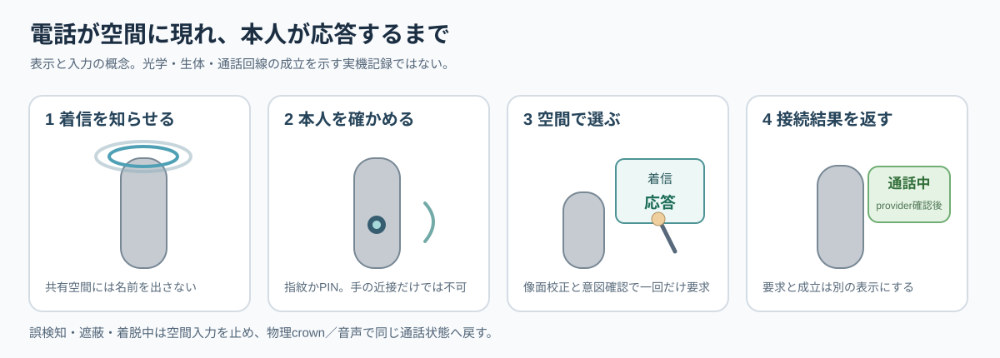

図の二択風カードは初期構想。選定L-Tの最初の受入はReadyで一択ずつ順送りし、空中tapの意思とProviderの接続receiptを分ける。図の表示形を実機のUI仕様や光学成果にしない。

Miniは常時人の注意を奪う看板にしない。**ポケット中は短い触覚、手に持ち上げると方向が分かる音、机や手元dockで姿勢が安定すると空中カード**という順に、同じ通知の出し方を変える。センサーは適した出力を選ぶ材料であり、録音・撮影・設備操作の常時許可ではない。通知の重要度と共有空間での出し方は本人が設定する。単一ownerの試作で始め、共同居住者にowner鍵や個人通知を見せない。

**何も持たずに空中応答する候補経路。** 指紋/PINだけでは島まで来て本体に触る必要があり、「空間をタップする」入口の手数が増える。本人が明示的に有効化した室内profileでは、匿名の着信合図の後、Miniの近くの指定範囲へ入った人にだけカメラ動作表示を点け、端末内の顔照合と生体提示攻撃検知を試す。照合が成功しても自動応答せず、発信者開示を本人設定と周囲の視線で制限し、独立した**本人の空中tap**で応答／拒否する。顔候補は本体の小窓、姿勢、照度、同居人、眼鏡・マスク、歩行中、携行中の電力を含む未選定の技術仮説であり、指紋/PINを残す。声だけ、近接だけ、認識modelの推定だけを本人照合にしない。カメラをOFFにした時はこの経路を隠し、撮像・生体原本の既定保存を行わない。OI02／03では「空中tapまで一切本体へ触れずに完了した割合」と、なりすまし・他人が横にいる時の誤開示／誤応答を別々に記録する。
面一Stowでは上部の黒いsensor帯が家具内に隠れるため、**そのcameraを顔照合に使う経路は成立しない**。選定L-Tでは安全な50mm上昇が完了し、黒帯の顔視野を実測できたReadyだけで手ぶら本人確認を試す。光学校正と本人確認を呼出し時間内に終えられない回は、見逃しとして数える。面一のまま顔照合が必要なら端面に別の小camera／光学窓を置く比較案を残すが、混み合う光学窓・指入力・音孔と衝突する。旧L-Aの固定全長sleeve liftは使用時200mmを超えるため**現寸法のまま採用不可**。同一200mm閉箱でのP0 CAD、初回利用者の顔・環境試験、呼出し時間内のprovider接続が揃うまで採用しない。Stowの手ぶら応答を、離脱後ReadyのCGや指紋後の空中tapだけで達成したとしない。

本人性の評価では、声や顔の「それらしさ」を権限へ昇格させない。[NIST SP 800-63B-4の生体節](https://pages.nist.gov/800-63-4/sp800-63b.html)は、生体単独をauthenticatorとせず、物理端末内の鍵を生体またはPINで活性化し、local照合と代替手段を用意する考え方を示す。Miniでは`Miniが保持する本人に結び付いた鍵→明示した生体/PINで活性化→Brokerが作用ごとに権限確認`を試作時の評価基準にし、顔認識だけで外部送信や家の設備作用を認めない。[ISO/IEC 30107-3:2023](https://www.iso.org/standard/79520.html)は提示攻撃検知の試験・報告方法であり、採用sensorのなりすまし耐性や端末全体の安全を自動保証しない。OI03では失敗回数制限、偽の指／顔、濡れた指、他人の同時視線、PIN復旧、鍵失効、raw生体データを保存しない経路を同じ端末で記録する。NISTの米国digital identity向け値を、対象国未定のMiniに法的認証済みとして表示しない。

携行中の空中tapは、本人が本体を安定して保持するか置き、もう一方の手を使える時の操作とする。片手がふさがる、歩行中、姿勢が不安定、屋外の照度で像を読めない場面は、持った手のcrown／側面キー、または周囲へ内容を漏らさない設定の音声へ切り替える。片手fallbackが速く安全でも、空中tapを必要とする最低要求の実機合格には数えない。最初の使用観察では置ける場所がない携行場面も測る。

暮らしでは、本人が毎回アプリ名を探す前に**必要そうな選択肢が静かに現れる**ことを核にする。時刻、室内照度、温熱、近接、設備状態、明示された予定からMiniの入力adapterが`intentCandidate`を端末内で作り、RockstarOSの既存Brokerに候補として渡す。これは思考の読取りではなく、外から測れる状況に基づく仮説であり、既存Brokerの権限や承認を変更しない。候補には根拠、推定の確かさ、期限、影響する設備と人、元へ戻せるか、費用を付ける。たとえば本人が起床してカーテンの近くへ来たら「開ける？」を一度だけ示す。事前に本人が対象・時刻帯・停止手段を限定して登録した可逆routineだけ自動実行を検討し、解錠、支払、外部送信、録音のような作用は空中／物理で対象を確認する。誤った推定、同居人の行動、sensor故障では提案を消し、理由と取り消しを残す。住まいのpilotでは提案の的中率だけでなく、邪魔だと感じた回数、誤作用、停止の容易さを評価する。

1. 自宅dockでは来客には輪郭の合図だけ。L-Tの安全なReady保持後、本人が指紋sensor、PIN、または有効化した近距離の顔照合で本人確認すると、中立の空中着信カードから「応答」か「拒否」を一択ずつ選ぶ。候補選択と空中tapによる確定は別動作。発信者名は本人が周囲を確認して明示的に詳細を開いた時だけ出す。顔や声の受動検出を意思確認にしない。
   共有空間では本人確認後でも他人から空中像を見られる可能性がある。人を検知した時や観察位置が不明な時は発信者名・本文を空中へ出さず、本人の近接音声経路へ伝える。空中カードの応答／拒否だけを表示し、秘匿が実測で成立するまで「自分だけに見える像」とは表示しない。
2. 指を像面へ近づけ、領域を選ぶ。追跡confidenceが足りないと作用しない。選択と回線の応答成立を別状態にする。物理ボタンと音声も同じ通話イベントを発行する。
3. Dockから外すと、部屋の設備操作・sensor閲覧scopeを失効する。同じownerの仕事・通知・予算はjournalで継続する。携行中に衛星登録できた場合、本人がWi-Fi共有をONにする。別端末からIP疎通できた範囲だけ「共有中」と表示する。
4. 対応GameはMiniの受入済み出力で開く。GameからSkyへ仕事を依頼する際、共有範囲・費用上限を提示し、Zemaが同じjob IDと結果を保持する。外部Gameは正式なAPIと権利の受入を要する。
   Game実行計算は単体Miniに残し、短い通知やmenuは空中カード、長いplay画面はR5で受け入れた2D出力または対応表示先へ出す。後者が必要なGameではその接続条件を開始前に示す。GTA VI、FiveM、FivePlayの対応済みとは表示しない。空中tapはGameによる支払い・外部送信・設備操作の承認へ転用しない。
5. 再装着時はdock ID、電源、owner、設備権限を再評価する。結果不明の通話、購入、設備操作を自動再送しない。

[TDK T5838の公式資料](https://www.invensense.tdk.com/en-us/news-media/press/tdk-introduces-worlds-lowest-power-pdm-microphone-acoustic-activity-detect)には3.5×2.65×0.98mmのPDM mic、[PUI Audioの20mm speaker製品表](https://puiaudio.com/product/speakers-and-receivers/sms-2008ms-r)には20×20×4.5mm・1.5gの発音体がある。Lの側面音孔と電池bay周囲へ描けるかを比較する実部品だが、mic／speaker単体寸法から1m通話の明瞭さ、echo除去、開襟時の反響、防滴・封止、販売時の供給継続は分からない。端面と側面の孔を塞いだStowでも聞こえるかを、上記の実使用試験へ含める。
音声は本体のマイク／スピーカーで成立させ、室内の遠距離ハンズフリー、携行中の近距離・小音量、許可された本人のaudio deviceへ出す場合を分けて測る。Game音と通話音を自動混合しない。マイクとカメラには物理OFFと状態灯の候補を置き、OFF時はAgentが有効化できない。筐体が密閉・防滴であると現段階で主張しない。
05模擬アイランドでの最初の音声試験は、本人の口とMiniのmicを約0.5m／1m／2mに置き、静かな部屋、換気・水音、二人の会話が重なる条件で、呼びかけ検出、相手の発話理解、echo、speakerからの他人への漏えい、物理mic OFFの効き方を同じ通話録で比較する。これらは設計用の試験距離であり到達公称ではない。1mで電話会話が聞き取りにくいなら「携帯を持たずに話す」範囲を明示し、外部speakerへ逃がしてMini本体の合格に数えない。軒裏・天井の高所から同じ音声品質が得られるとは扱わない。

参照映像の明るい都市看板から取るのは、情報が「現れた」と一瞬で分かる**時間的な表現**だけにする。家では待機中は暗く、着信時に本体近くへ短い無記名の輪郭が現れ、本人確認後に操作カードへ変わる。指が候補へ入ると輪郭と小さな音で選択を返し、providerの通話接続が成立して初めて別の接続表示へ移る。拒否・終了・切断・不明も見た目を変え、失敗を派手な成功演出で覆わない。光量と動きは周囲照度・夜間・来客に合わせて抑え、突然強い光で注意を奪わない。元映像の図柄・文字・音楽を商品素材へ取り込まない。

本人に見せる言葉は内部状態をそのまま並べない。空中カードは「着信」「応答を送信中」「通話中」「応答結果を確認中」、通信は「Wi-Fiのみ、Internetなし」「衛星へ接続中」「衛星で共有中」「上限に達したため共有停止」と短く区別する。結果不明の時は再タップで再発信させず、物理crownから確認・停止へ行ける。Sky／Zemaの費用カードは「今回の上限」「使った額」「まだ予約中」を分けて見せる。長い説明、請求明細、原文は音声か対応画面で開けるようにする。

### PCの前に座らず作り、電話を手に持たず話す

利用者が追加した製品の中心条件は、**PCの前に立たなくてもものが作れること**と、**携帯を持たなくてもやり取りできること**。Orbitの固定dockは単なる充電台ではなく、本人が部屋で思いついた時の制作と連絡の入口になる。ただし部屋全体に見える像や家じゅうの遠距離音声を既に実現した意味ではない。最初の設置は手が届き、音声が実測で届く一か所で受け入れ、別室は同型Miniの増設gateへ進める。携行時には本体をポケットや机へ置いて手を空けられるが、Miniが近くにない屋外で通信できるとは表示しない。

制作は**思いつく→依頼を形にする→Agentが作る→途中を見る／直す→本人が成果を受け取る**を、Miniの声・短い空中カード・物理操作とSky／Zemaの一件の仕事で閉じる。本人の最初の声をそのまま無制限に外部Agentへ投げず、Miniが目的、成果物の種類、使ってよい資料、相手、予算と期限を短い制作briefへ整理する。本人は聞き返しとカードで対象・費用を確認してから開始を承認する。Skyは能力と権限に合うTool／Agentへ依頼し、Zemaはjob ID、途中版、予約額、成果と止める手段を保持する。Miniが離席中に許された範囲で作業が続いても、公開、外部送信、購入、機械の作動を勝手に承認しない。

途中版や完了が届いたら、Miniは共有空間に作品名や本文を出さず、短い光／音の合図を一度だけ示す。本人が手元へ来て指紋/PINで開くか、明示的な呼びかけ／物理操作で「続き」を求めた時に、周囲の状態と本人設定に応じ、Zemaの同じjobの要点と次の選択を近接音声か短いカードで返す。周囲の会話を常時保存して制作指示に変えず、録音開始・処理中・OFFの状態を見えるようにする。本人が離れたままの自動実行と、本人が戻ってからの公開・送信・製作承認を分ける。

| つくるもの | PCなしの最初の操作と確認 | 成果の受け取り | 未成立の境界 |
| --- | --- | --- | --- |
| 短い物語・音声作品・ゲームの会話／分岐 | 声で場面と制約を伝え、Miniが3点以内のbriefを読み返す。途中版を音声で聴き、空中カードで採用／修正／停止 | 原文・音声・選択肢を版付きartifactに保存し、Miniで再生・共有先を確認 | 音声生成・権利・品質・予算、Miniでの再生は別受入。長文の細部確認は読み上げの分割や任意の大きな表示先を要する |
| 小さなGameの場面や道具 | Miniから目的、ルール、外見の方向を選び、Skyへ試作を依頼。短い動作と選択結果をMiniの受入済み表示・音で試す | ソース、asset、ライセンス、試遊結果と直す指示を同じZema jobへ保存 | MiniのGame runtime・出力・作者APIと作品の権利が受け入れられるまで「Miniだけで制作完了」としない |
| 暮らしの道具・部屋の改善案 | 本人が測定を明示許可し、寸法・目的・予算を声で伝える。専門家／Toolの案を短い空中見本と音声で比較 | 図面・寸法・見積・根拠を版付き成果へ保存。本人が確認した施工／製作先へ引き継ぐ | 空中カードは精密CADの検査面ではない。製作・発注・施工は寸法、安全、権利、専門家と本人の別承認が必要 |

最初の**PCなし制作の実機合格**は、一人の初回利用者が電話やPCを触らず、設置した同じMiniで上記の三場面・二結末のGame会話のbriefを作り、費用上限を承認し、途中版へ一回修正を返し、**完成版をMiniで試遊**して保存・停止・再開できることとする。制作Tool／Cloud Agentの実契約とMini上Game runtimeがない時はfixtureだけの結果を「ものが作れた」と言わない。暮らしの道具・精密な3D物体や大型Gameは、Miniを制作の指揮・確認の入口にできても、細部と物理安全を確認する出力が受け入れられるまで完了を称しない。PCは任意の編集手段として残すが、この最初の一周では必要機材にしない。

連絡は**誰に、何を、どの経路で送るか**をMiniが短く確認する。自宅の手元dockでは、着信の匿名合図→指紋/PIN→空中tapで応答という既述の流れを、スマートフォンを持たずに行う。発信は「〇〇に電話」の音声を候補に留め、同名の連絡先や番号を本人が確認してからproviderへ要求する。短いメッセージも音声下書きを読み返し、相手と本文を別に承認する。手が濡れた、発話しにくい、同居人に聞かれたくない時には近接音声、crown、空中カードを選べる。本人確認や通話・送信の成立を、声を聞き取っただけで確定しない。

制作中に電話が来た場合は通話eventが入力focusとmicを優先し、制作Agentには通話音声を渡さない。制作UIを一時停止して既存jobの状態とrevisionを保持し、通話後に本人が同じ途中版へ戻る。通信断やdock着脱でCloudの実行結果が分からなくなったら、job IDとrevisionで照合し、同じ制作・送信を重複起動しない。PCなし体験の価値は「声で依頼できた」だけでなく、**成果を検収して保存し、止めて戻れる**ところまで測る。

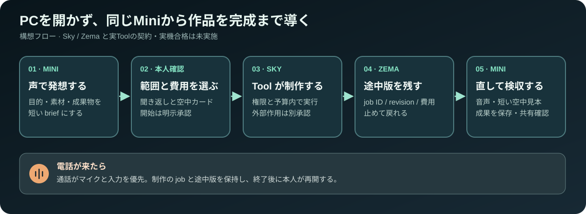

### 最初の5分と、紛失した後

購入時のRockstarOS利用権、物理SIM/eSIM、電話回線、衛星回線は別々に適用状態を確認する。Mini単体で初回起動・本人登録・PIN設定・空間像の大きな点への校正・テスト着信の受信・停止へ進める導線を設計し、既存スマートフォンを必須にしない。eSIM発行と初期データ接続をMiniだけで成立させるには販売チャネル／carrierの正式なactivation方式が必要なので、未選定。設定時には「通話OK」「衛星データOK」「Wi-Fi共有OK」を独立表示し、未成立のものは原因と次の行動を一つずつ示す。

本体だけでの開通案は、販売店で本人確認済みのprofileを事前割当する経路と、本人が紙や別画面のactivation QR／codeをMiniの明示起動cameraで読み、物理crownで確認する経路を比較する。どちらもcarrierの正式APIと再発行・失効手順が必要で、架空の汎用eSIM書込機能ではない。生体未登録でも初回の停止・PIN復旧を使え、音声または触覚で手順が分かるようにする。契約説明や本人確認が長文を要し空中カードで安全に読めない場合は、購入前に正規の店舗／browserへ明示的に移る。その場合は「Mini単体で全契約が完了」とは表示しない。

Hotspotは初期OFF。本人確認後、共有相手・時間・通信上限を選び、接続情報を一時的に見せる。GuestをRockstarOSの管理面から分離し、招待失効・紛失時の回線停止・接続鍵更新を本人が行えるようにする。衛星料金が高い場合、OS更新・Game download・Cloud Agentの大量転送を自動再開しない。端末を紛失した場合は別の認証済み経路から本人の利用権と回線を失効し、保存済みjobは暗号化した本人領域から回復する。生体原本をbackupして別Miniへ複製しない。圏外中の即時遠隔失効は保証できず、期限付きoffline leaseと再接続時照合が必要。

| Miniが短く示す状態 | 実際の条件 | 本人ができること |
| --- | --- | --- |
| 「近くのWi-Fiのみ」 | APは立っているが衛星IPまたは地上WAN未確認 | 接続端末と局所成果だけを扱う。Internetへ送った表示は禁止 |
| 「衛星を確認中」 | RF検出／網登録まで。IPと任意宛先の疎通は未確認 | 向き・屋外の見通しを変える。背景の自動課金転送はOFF |
| 「衛星で共有」 | Mini自身の双方向IP、契約上のtethering権利、clientからの疎通、単価・上限が揃う | 許可する端末と期限を選び、残りbyte・予約費用・実費・速度の実測値を確認して開始／停止 |
| 「上限で停止」 | 承認上限に達した、料金式が変わった、または見積不能 | WANを切って局所APと仕事を保存。新たな料金条件への別承認後だけ再開 |

「衛星で共有」は一般Webが速いという意味ではない。発明試作で用途別の転送時間と失敗率を測り、本人へ当該契約・姿勢の実測に基づく目安を示す。料金見積を作れない契約では有料衛星APを開始せず、無料と表示しない。衛星のbyte単価をCloud Agentのtoken単価と足して一つの不明な「AI料金」にしない。

Wi-Fi APの比較仕様は、地域で許された2.4／5GHz、client互換を踏まえた暗号化、使い捨て可能な招待情報、端末ごとの接続履歴・byte数、管理面との分離を一組で受け入れる。規格名や同時接続台数だけを掲げず、衛星antenna・地上radio・手の握りと共存する実速度を測る。接続端末からMiniの生体情報、Zema原稿、住宅設備の管理口へ到達できないことを検査する。

衛星へ経路が切り替わる時、接続済みclientのbackup、写真同期、OS更新がそのまま流れないよう、一度「衛星共有は停止中」に戻す。本人はclientごとの接続時間・byte上限・概算費用と、許可する用途を確認して再開する。Air cardで長い契約を読ませず、短い上限と「詳しく読む」経路を分ける。clientへ渡すネットワークは管理面と分離し、共有鍵は期限・失効可能にする。providerの課金計測が遅延するときはMini側のbyte計数と予約枠の安全余裕を使い、上限に達したらAPをlocal-onlyへ戻す。Wi-Fiへつながっただけで衛星料金が発生したかのように表示せず、WAN session・client traffic・provider請求を後から照合する。

任意のclientが暗号化して送る通信を、Miniだけで「写真同期」「Game更新」などのアプリ種別へ確実に分類することはできない。衛星へ切り替えた瞬間にAPのInternet経路を停止し、再開時はclientごとのbyte・時間上限をネットワーク層で強制する。用途別のきめ細かな制御はclient OSとの協調や正式なproxy契約がある場合だけ案内する。上限付き再開後にも大量転送が起こり得るので、byte計数と残予算の表示を最終の保護にする。

衛星の請求単位がbytes、接続時間、契約月額、message、最低利用料のどれかはProviderごとに異なる。byte上限だけで金額上限を守れると仮定せず、選んだ契約の単価式・最小課金・超過条件から事前見積と安全余裕を出す。金額の上限を評価できない有料回線はInternet共有を開始せず、契約・事前支払枠・本人承認を整えてから再試行する。Provider明細を後から照合し、差異を同じjob／通信sessionへ記録する。

料金表が未取得というだけでなく、**他端末の契約をMiniへ差し込めるとも言えない**。[Iridium GO! exec公式FAQ](https://ifp.iridium.com/go-exec-faqs/)は料金・利用planを公認Service Providerへ問い合わせるよう案内し、同製品専用にprovisionされたCertus SIM以外は動かないと明記する。[Thuraya公式の料金案内](https://www.thuraya.com/en/where-to-buy/pricing/)も卸売先Service Partnerが価格packageを作り、Prepay 100に100MBを含むなどの**別端末・別地域の枠**は示すが、Mini用の月額、超過単価、共有許可、供給地域を提示しない。`avoado.si`のRockstarOS利用権や地上eSIMと、Mini用satellite airtime／SIMの権利を同一契約として自動付与しない。事業gateでは対象国とmodem型番を固定し、公式または権限あるpartnerの見積に発行手数料・月額・課金単位・超過・中断・tethering・再販条件を埋めてから、本人へ実費とCloud usageを別行で示す。

同じ[GO! exec FAQ](https://ifp.iridium.com/go-exec-faqs/)は端末内のupload/download counterを**概算で請求用に使えない**と明記し、activity profileで背景trafficを遮断するよう勧める。[Iridiumの2025年告知](https://investor.iridium.com/2025-06-03-New-Iridium-Chat-App-Enables-Unlimited-Global-Messaging-via-Iridium-GO-exec)にはGO! exec向け無制限data planも記載されるが、Mini独自型番・再共有へ移せる条件はない。Miniのbyte meterを請求額の唯一の正本にせず、provider receipt・最低課金・超過と照合する。厳格な金額上限が必要なら、provider側のprepay／hard cutoffが書面で確認できる契約を選ぶ。端末内の推計停止だけしかない場合は「請求額を絶対に超えない」と約束できず、有料APの一般利用を開けない。

## 携帯の機能を空間操作へ移す台帳

「センサーで全部賄う」は、sensorが情報を作るという意味ではなく、手・声・環境を入力にして、端末が短い空中表示・音・触覚で選択肢を返す共通操作体系と解釈する。denseな文章や映像には十分な出力面が必要で、Miniの空中カードだけで既存スマートフォンの全アプリを読めるとは言えない。各行は最低要求の方向を保つための製品設計であり、今ある実装ではない。

| 機能群 | 最初の操作 | 同じ本体の出力・処理 | 追加の受入 |
| --- | --- | --- | --- |
| 電話 | 着信カードを空間タップ、または物理キー。発信は連絡先／番号を声か短い候補から選び、相手を明示確認 | 内蔵マイク・スピーカー／近接時の小音量経路、通話状態、ミュート・終了 | 正式な音声契約、実網、誤発信、音質、騒音、緊急通報の別審査 |
| メッセージ | 届いた種類を合図、本人確認後に短い要約 | 音声読み上げ、返信の音声下書き、空中カードで送信先・本文の確認 | 誤送信、共有空間の秘匿、長文編集、offline queue |
| 連絡先・予定・メール | 人／予定／件名を声か短いカードで探す | 本人領域の候補と要点を示し、送信・変更は相手と内容を確認 | account同期、招待の権限、長文・添付、オフライン競合 |
| 撮影・記録 | カメラを明示ON、対象を確認 | 原本と生成説明を別保存。撮影中の見える表示・物理遮断 | 画質、手ぶれ、第三者同意、保存先・削除 |
| 検索・browser | 声か空中カードで問い、結果を選ぶ | 出所付き要約、原文へ辿る短いカード列 | 複雑なWeb操作・長文読書は対応画面へhandoffが必要 |
| 文書・ファイル | 保存した成果を名前／仕事から呼び出す | 要約・音声・版付きfile manifestと、対応画面へのhandoff | 原文の精読・編集、添付、共有と削除の整合 |
| 地図・移動 | 目的地を声／選択 | 音と触覚の方向合図、次の曲がり角のカード | 位置精度、屋内外、歩行安全、地図Providerと利用権 |
| 決済・契約 | 金額と相手を明示表示 | 指紋/PIN＋本体の確定操作、itemizedな記録 | 金融・通信契約、返金、誤操作、地域法令の個別gate |
| 音楽・動画 | 再生先と作品を選ぶ | 対応する音声経路を使い、映像は受入済みの表示先へ | media権利、画面の大きさ、熱・電池、周囲への音漏れ |
| Game・制作 | 対応作を選ぶ、またはSkyへ依頼 | 小さい空中カードは状態・選択に使用。描画面が必要な内容は受入済み出力へ | Mini本体のWebGPU等、作者API、権利、入力遅延、画面の適合 |
| 住まい・設備 | 室内の状態候補を見る | 対応設備の状態・可逆操作を一つずつ確認 | 設備adapter、場所scope、同居人、施工・保守 |
| Wi-Fi共有 | 本人が通信をON | AP接続先、WAN種別、残予算、使用量を表示 | 直接衛星の上り下り・IP・共有契約・熱・電池 |
| アプリ・本人設定・復旧 | Sky／対応アプリを目的から探し、権限を見る | 対応機能、使う場所、費用、更新・停止・成果回収を提示 | Mini用の署名・配布・driver、本人再登録と紛失回復、未対応アプリの明示 |

最初の使用場面を四つに絞って同じ機構を評価する。**手ぶらの連絡:** 調理中の着信で匿名の合図を見つけ、本人確認後に空間で応答し、電話を持たずに話す。**PCなしの制作:** 思いついた短い作品のbriefを声で作り、Sky／Zemaで途中版を修正・検収して保存する。**携行:** 本体を外して屋外でWANを確立し、接続端末へ現在の回線・残量・費用上限を示してからWi-Fiを共有する。**Game:** Mini上の小さなゲーム状態を短い空中カードで選び、ゲームのfocusを解放してSkyへ制作依頼を出し、結果を同じZema jobから回収する。この四場面は同一ownerと同一端末で一周させる。一場面だけの成功を統合製品の成功にしない。

暮らしへの拡張はカーテンや照明の遠隔操作だけにしない。たとえば「この部屋の音と暑さを改善したい」と本人が伝えると、Miniは許可された室内の音・温熱・照度を測る。Skyは採寸、建築・内装・音響の専門家や対応serviceを**提案候補**として結び、Zemaは現状、目的、予算、設計案の版、本人承認、施工、実測、保守を一件の仕事にする。生の生活音や住所を既定で外部へ送らず、測定と推論と専門家判断を別に表示する。Air cardは「測る」「案を見る」「共有を許す」の短い選択に使い、図面や見積の精読は対応画面へ引き継ぐ。実際の施工や改善効果は専門家と現場測定の受入を必要とし、Miniのセンサー推定だけで完了にしない。

R5のWebゲーム実行設計にある720p描画surfaceは、Orbitの70〜130mm空中カードが720pを読めることを意味しない。短い通知・選択に向くGameは本体の空中UIで試す。密な世界や長時間の制作には、Mini自身での描画・入力・仕事継続を測ったうえで、受入済みの大きな表示先へhandoffする経路を別に設ける。外部画面しか使えないゲームを「本体の空中像で遊べる」と表示しない。GTA VIの公式連携・対応、ゲーム内資産への実権限、外部ゲームのsave取得は確認されていない。

GTA VIのような大型外部Gameについては三つを別gateで検討する。**Mini単体の直接実行**はゲームの正式な対象OS／配布条件とMiniのCPU・GPU・入力・表示・保存の一致が必要。**正規のremote play／stream**は権利・対応する実行元・画面・controller・十分な地上回線が必要で、88Kbps級衛星WANでの映像playを約束しない。**companion連携**はゲーム側の正式API／許可と、通知・制作jobなどの限定scopeを要し、画面を読むだけで実ゲーム状態や資産を変更できるとはしない。FiveM等の別作品・別platformでの試験をGTA VI対応へ転用しない。いずれも使用可否と費用をSky catalogのDevice Profileへ記載し、対応した経路だけをユーザーに示す。

MiniのGame体験は最初に非金融の遊び・制作・仕事継続から検証する。ゲーム通貨と実資金の交換、外部ゲーム資産の売買、予測市場はこの設計で有効化しない。後に扱う場合も既存Walletの予約・台帳・照合と別adapter／本人同意／Provider gateを通し、空中tapやGame内の達成表示だけで残高・権利・決済結果を確定しない。ゲーム作者がポイントを発行する権限と実資金を記帳する権限は分離する。

用途を増やすときは新しい専用modeを本体へ焼き込まず、既存のSky catalog／Game adapter／住宅adapterに、`対象`、`観測した事実と出所`、`利用者の目的`、`必要scope`、`費用・時間・通信量`、`戻せるか`、`結果の確かめ方`を持つ候補を登録する。Miniは同じ「気づく→候補を見せる→本人が選ぶ→結果を確かめる→止める／戻す」を使い、出力が密なら受入済み画面へ渡す。たとえば照明の調整、ゲーム内の制作案、旅先の通信共有、仕事の提出は**同じ操作語彙**で扱うが、設備操作・ゲーム作者権限・衛星課金・外部送信のscopeを共有しない。互換性のないServiceは「できる」と表示せず、不足する権利、機器、契約、表示先を一つずつ示す。新しいToolやadapterが本人確認・Brokerの承認・結果照合を飛ばすことはできない。

設定・復旧は本体の**回転式crown＋押し込み／触覚**を物理fallback候補とする。生体が失敗し空中像も見えない場合、別のスマートフォンを必須にせず本体でPIN・停止・通話拒否・hotspot OFFを完了できるようにする。crownの機構、入力時間、誤入力、秘密の覗き見、握りとRFの干渉は未評価。視覚・聴覚・上肢の異なる利用者にも、同じ基本操作へ到達できることを受入条件にする。

## 初回の「使いやすい」を測る条件

利用者が説明書なしで、スマートフォンを持たずに着信を見つけ、本人確認し、意図した応答／拒否を選び、通話終了する。PCを開かずに短い作品のbriefを作り、途中版を修正して成果を検収・保存する。さらにMiniを外して通信を共有し、Gameまたは住まいの一件を進める。一度の観察で、成功までの時間、誤答、意図せぬ公開、制作のやり直し回数と成果品質、停止までの時間、経路・費用の理解を記録する。試作前の比較目標として、選定L-Tの一択空中領域は直径50mm以上、130mmの同時二択は各領域直径50mm以上、低信頼の入力は0件実行、通話・Wi-Fi共有・制作の「要求」と「成立」を常に別表示する。成功率や時間の最終閾値は試験対象者と環境profileを固定してから事前登録する。結果を見て閾値を動かさない。

評価は二段にする。最初は腕の届く位置、利き手、眼鏡、座位、日中／夜間、他人のいる部屋、携行中の姿勢を変える探索観察で、見つけられない表示や言葉を修正する。その後、改訂版と試験手順を固定し、普段のスマートフォン／通常のhotspot／PC制作も同じ目的で測る。比較するのは「空中像が珍しいか」ではなく、初回成功、通話の取り逃し・誤接続、PCなしで作品の目的を満たし本人が検収できたか、費用を間違えずに共有できたか、Game／暮らしの仕事を続けられたか、翌日も自発的に使うかである。探索観察の被験者を販促用の成功率へ数えない。異なる身体条件で使えない場合は、音声・触覚・物理経路の同等性と、それでも残る制約を明記する。

## RockstarOS契約

Mini本体のDevice Support Package（DSP）は、起動chain、署名更新・rollback、暗号化したowner保存、journal、sensor・光学・音声・Wi-Fi／satellite driver、熱・電源制御、物理停止と復旧を一機種の実部品で受け入れる。Pixel 10向けGrapheneOS imageやAndroid Terminalをそのまま載せる設計ではない。RockstarOSのCore、Sky／Zemaとの共通owner・job・artifact・費用契約を使うことと、各Toolやlocal LLMをMiniで実行できることは別の能力。後者はCPU／GPU／NPU、memory、出力、networkと実測のDevice Profileから一件ずつ案内する。対応しないToolは理由とPixel／Pro／browserでの継続経路を示すが、Miniの電話・通信・基本停止を別端末へ依存させない。

「中身が使える」の最低UIは、本体だけでSky catalogのToolを目的から探し、Mini／Cloud／対応端末のどこで実行できるか、必要scopeと単価／今回の上限を知り、**Miniから実行できるToolについては**Zemaの仕事を一件始め、進捗・予約額・成果の要点を確認し、停止・失効し、保存済み成果へ戻れることとする。全catalogへの入口を用意することと、全ToolをMiniのCPUや衛星WANで完走できることを混同しない。Miniで完走しないToolも、理由と本人が許す引継ぎ先・費用を示し、同じjobと成果へ戻れるようにする。空中カードで読めない契約・長い成果は音声か明示した対応画面へ渡す。Cloud Agentは回線と使用量の合意がある時だけ動かし、局所LLMは対応hardwareがなければ必須にしない。Miniから機能を開けること、Toolを実行できたこと、外部の作用が成功したことはそれぞれ別の合格記録にする。

圏外中も目的を忘れないよう、最後に確認したSky catalogの名称・用途・必要権限・能力版を期限付きで本人領域にcacheし、Zemaの下書きjobを作れるようにする。古いcacheの料金・Tool可用性を現在値として見せず、Cloud実行、外部送信、有料の衛星経路へ進む前に最新の単価・scope・上限を再照合する。期限切れや照合失敗なら下書きを保持して`NEEDS_CONNECTION`と示し、モデルの推定で価格や実行成功を補完しない。

入力は`presenceHint`、`handPose + confidence + calibrationVersion`、`biometricUserVerification`、`physicalButton`、`callEvent`、`wanCapability`、`dockAttachment`、Mini adapterの`intentCandidate {evidence, confidence, expiresAt, affectedScopes, reversibility, costEstimate}`。出力は`publicLightCue`、`ownerScopedAerialCard`、`speech/haptic`、`callAction`、`wifiShareState`、`job/artifact`。sensor推定、本人確認、本人の意思、回線の成功は別イベントにする。候補は既存Brokerの承認済みactionへ自動昇格しない。

状態は`DOCKED/DETACHING/PORTABLE/ATTACHING`、`LOCKED/USER_VERIFIED`、`DISPLAY_UNAVAILABLE/CALIBRATING/READY/LOW_CONFIDENCE`、`WAN_SEARCH/REGISTERED/IP_READY/AP_LOCAL_ONLY/AP_INTERNET_VERIFIED/BUDGET_STOP`、`CALL_RINGING/DIAL_DRAFT/DESTINATION_CONFIRMED/ACTION_REQUESTED/CONNECTING/CONNECTED/RESULT_UNKNOWN/ENDED`を分ける。発信は宛先の音声認識候補や連絡先選択を`DIAL_DRAFT`へ留め、相手・番号を本人が確認した場合だけproviderへ要求する。`LOCKED`で個人名や本文は出さない。`LOW_CONFIDENCE`で空間操作を送信しない。`RESULT_UNKNOWN`は照合してから再試行する。通知・仕事・課金にはowner、device、dock、capability版、event ID、revision、経路、承認・結果、digestを残す。生体原本と通話音声は既定保存しない。Sky ToolやGameへ生体情報・回線資格情報を渡さない。

記録は暗号化した本人領域の通知／通話event、Zema job／成果、通信session／費用を分け、本人が種類ごとに閲覧・持出し・削除できる入口を用意する。課金事業者や回線Providerが独立に保持を要する明細は、Mini側の削除と同じ操作で消えたとは表示しない。各記録の既定保持期間、法定・契約上の例外、暗号化backupの場所と鍵の復旧、紛失後の失効猶予は最初の地域・契約を決めてからpilot前に版付きで確定する。生体原本や周囲の映像を汎用backupへ入れず、再登録が必要な場合は本人へ明示する。空間操作の誤認を調べる際も短い型付きeventを優先し、生のsensor映像収集は別の本人同意と期限を要する。

OS／radio firmware／光学校正／Device Profileの版を同じ起動記録へ残し、署名・機種適合・rollback経路をMini実機で確認する。更新や部品交換で像面が変われば旧AirFrameを破棄し、再校正まで空中操作を止める。job schemaが変わる場合は既存の確定成果と未完了eventを版付きで移し、更新失敗後に前版へ戻っても結果不明の通話・課金・設備操作を自動再実行しない。これはRockstarOS共通の保存／復旧契約をMiniの光学・radio driverへ適用する設計で、Mini向け署名済みimageと実機rollbackの合格ではない。

| 事故の入口 | Miniが観測できること | 安全側の結果と復旧 |
| --- | --- | --- |
| 他人の手・像面ずれによる誤応答 | 手追跡confidence、校正版、重なる手、provider event ID | 空中入力を止め、匿名合図と物理操作へ戻す。接続済みか不明ならprovider状態を照会し、同じtapを二度送らない |
| 共有室で着信詳細が見える | dock profile、観察者数の不確かさ、本人の詳細表示設定 | 発信者名・本文を出さず、本人の近接音声か私的な表示先へ。sensor推定だけで秘匿を保証しない |
| 衛星へ切替後にWi-Fi clientが大量送信 | WAN変更event、session／clientのbyte・時間、契約の料金式 | 有料Internet経路を一度止め、再承認・上限設定後だけ再開。請求不明ならlocal APのまま保持 |
| 通話・仕事中にcoreが抜ける | latch／接点、電池切替、dock ID、未確定event | 場所scopeと旧AirFrameを失効、本人の通話／jobは版付きで保持。物理操作へ移り、結果不明の外部作用は照合してから続ける |
| 過熱・電池低下・更新失敗 | 接触温度、電流、残量、起動／署名／driver版 | 新規描画・Game・Agent・Wi-Fi共有を順に抑え、通話状態・保存・停止を優先。起動失敗は受入済みの前版へ戻し、再校正まで空中作用を止める |

資源が競合したときはRockstarOSが通話と本人の停止操作を入力最優先にし、Gameが空中タップを横取りしない。通話中のmicrophoneと音声経路はGameやSkyへ混ぜず、本人が許可した場合だけ別の録音・送信経路を作る。衛星送信と光源とGame負荷で熱・電池予算に近づいたら、新規のAgent downloadと描画を先に抑え、Wi-Fi clientへ共有が縮退する見込みを事前表示する。通話・Wi-Fi共有・Gameの継続可否は各機能の独立した結果として示し、ひとつの機能停止を全体の故障と誤認させない。

空間タップは「見えた指先」だけで発火させない。本人確認済みのcall event IDに対し、校正済み像面との交差、手の軌跡と滞留、選択領域、同時に見えている他人の手、入力confidence、直前の実行tokenを評価して**一回だけ**`ACTION_REQUESTED`へ進める。必要なフレーム数・閾値はセンサーの実測後に決める。通話providerの受付応答が返るまで`CONNECTED`へ進めず、応答不明なら同じevent IDで状態照会する。利用者には「押した」「つながった」を異なる音と表示で返す。

### 同型のMiniを増やす時

一台で電話・通信・RockstarOS・空間操作・一件のPCなし制作を実行できることを先に受け入れ、増設はその後の能力とする。別室のMiniは別の`deviceProfileId`、光学校正、dock ID、場所scope、電池・回線状態を持つ。同じownerのZema jobを参照できても、部屋ごとのsensorと設備権限を合成して無断利用しない。本人が部屋を移った時、制作の途中版や着信合図は本人が選んだ優先端末へ移し、本人確認を引き継いだだけで別室の設備scopeは付与しない。着信はprovider event IDで一回だけ応答し、他端末は接続成立を見て着信カードを閉じる。切断時の二重応答、複数室への発信者名の露出、同時のsatellite課金とWi-Fi共有を検査する。複数台で可能になった表示範囲や電波性能を、一台の受入へ転用しない。

### 絶対に混ぜない状態

- 生体照合成功は本人の**存在確認**。支払・解錠・外部送信には、対象と結果が分かる別の**意思確認**が必要。
- 衛星のRF検出は通信可能の証拠ではない。登録、IP、Mini上の疎通、Wi-Fi側clientの疎通を順に記録する。
- Dock接点が外れたら場所scopeを停止する。再装着しただけで設備への許可を再付与しない。
- Air tapの結果はGame／Skyの権限を増やさない。Tool側の許可、job revision、費用上限はBrokerが確認する。
- 緊急通報は通常の通話試験から自動で合格にしない。国・回線・位置・failover・通報先の要件を別受入する。

## 試作と停止条件

### 七軸の定量反証台帳（120〜205分の一次資料照合）

この表は発明候補を**同じ一本の閉箱**へ戻すための入口である。数字は出典のある別製品値か明示した感度仮定に限り、Miniの測定値と区別する。空欄を都合のよい部品で補ったCADや、別回線・別形状・別契約の良い値の寄せ集めでは合格にしない。

| 軸 | 現在使える数値・観測 | Mini固有の未取得値 | 止める判断 |
| --- | --- | --- | --- |
| ① 200mm包絡・質量 | F D68×H190、L D76×H186／展開D140、S D96×H200は携行本体の設計仮枠。Lの全長**固定**sleeve＋35〜50mmせり出しは組立全高≥221〜236mmで**厳格200mm上限に衝突**。別機構L-Tは長さ一定の底部cupをcoreと一緒に50mm上げて固定喉との重なりを50mm増やせば、下端余裕5mm（底壁を含む、内部すき間未計上）・公差3mmの仮値で194mmという幾何だけの救済候補。L薄Al側壁95g＋M65A二本149g＝244gは端面なし。200mm角280gの既製plateを99mm角に面積比例させる仮感度約69gを加えると約313gで、450g**仮**携行目標の残りは137g。Sの9770＋同cell＋薄Al側壁≈464gは同目標超過 | Carry本体、卓上dock＋Ready、埋込sleeve＋Readyの測定原点と全状態CAD。L-Tは可動cupのguide／爪／接点／挟み込み、pack・antenna・光学・音声・端面・配線・構造、製造公差と実質量／重心 | 固定sleeveとliftを数字から除外しない。L-Tの194mmを実証にしない。plate縮小で性能を仮定しない。必須部品・RF keep-outを置けずH>200mmなら外形か方式を戻す。Sのこの組合せは細身携行案へ進めない |
| ② 電力・熱 | 2×M65A公称46.8Whから仮0.8×0.9なら負荷側33.7Wh。8W×2時間AP後に22時間待つには平均≤0.804W。L側面だけで仮8W・h=8W/(m²·K)を捨てる単純式は約23K差 | 全railのwake／idle／TX peak、実AP・光源・Gameの同時波形、握り／dock時hot spot、保護pack | 同じ一充電profile・接触温度・停止が受け入れられなければ公称時間を出さず、電池／熱路／負荷を再設計 |
| ③ 光路・指 | H0開口38〜40mmとH1襟D140は仮。L-Tの上端RF20mm＋光学42mm配置ではReadyで光学下端12mmが天板開口内に残る。別研究の91×54mm像に160×100mm mirror。05上向きcapは仮の視線が鉛直から約30〜72°。8×8 ToF 60°なら100mm先の正対視野幅約115mmで、130mmカードを覆わない | H0/H1の像幅・浮遊距離・視域・輝度・照度別読取率、指先誤差・誤作用、Mini組込後の光安全 | 本人が立位／座位で裸眼の着信と空中応答を一つの光路・入力で完了できなければ最低機能HOLD |
| ④ 衛星IP・姿勢 | 9770は140×60×16mm／185g・最大上り22／下り88kbps。旧X5は**bodyだけ**145×78×24mmの自律GmPRS hotspot、上り15／下り60kbpsだが米国回線候補から除外し、antenna展開全高も未取得。小型IoT-NTNのUDP仕様は一般Web証拠ではない | 米国の現行modem・antennaとground、GNSSが必要な網のfix時間、OTA、IP/TCP/TLS、屋外／手／襟姿勢、Wi-Fi NAT権利、同時通信と料金 | Mini単体の双方向IPから一般clientへ実疎通し、契約が共有を許さなければ衛星ポケットWi-Fiを称しない |
| ⑤ 本人・共有空間 | 12×12mm指紋sensorと40×40mm前面窓はL内径72mmの理想平面には描けるが、最遠角≈32.6mm／内半径36mm。端面sealと手sensorは未計上 | 提示攻撃、実指の到達、他人の視線、音漏れ、匿名合図から本人の意思確認までの誤開示／誤応答 | 本人照合だけで発信者名や応答を自動確定しない。漏えい・誤作用が出るprofileは詳細表示と空中確定を閉じる |
| ⑥ dock・場所scope | 05で仮20mm天板へL 186mm本体をflushに収めれば少なくとも約166mmが下側へ入る。L-A 50mm上昇は10mm/sで移動だけ5秒。02／10は高所で手が届かない | 実家具の空間、給電接点の瞬断、保持・落下・挟み力、座標失効と`jobId`継続のtrace | 着脱後に旧家scopeが生きる、未確定jobを重複実行する、高所落下があるなら一周／施工を止める |
| ⑦ 契約・料金 | IridiumとThurayaの公式案内はService Partner／Providerの契約に依存。別端末のプラン容量・価格をMiniへ移せない。比較回線の1MB理想上りは22kbpsで約364秒、15kbpsで約533秒 | Mini型式での月額、SIM発行、byte／分／session課金、最低額、tethering、税、超過、照合receipt、Cloud Agent別単価 | 料金式と上限を事前評価できない有料衛星APは`COST_UNKNOWN`で閉じ、購入・通信契約・公開へ進めない |

①〜⑦を通過したという記録はまだない。数字が埋まった項目も**別製品・仮定・机上配置**であり、P1個別benchからP2同一閉箱へ移した時に測り直す。出典と条件は後段の[一次資料台帳](#一次資料と適用範囲)に残す。

**代替できない三つの証拠。** 小型NR-NTN部品の外寸が入りそうでも、一般Webへの双方向IP・音声・米国のWi-Fi共有契約は得られていない。既製9770は双方向IPとvoiceの実在証拠だが、Lの電池・光学・保持を合わせた軸長と完成品の寸法／質量を解かない。既製の空中像装置や研究素子は裸眼像の物理証拠でも、L-TのD140襟・軸増分6mm・斜め視線・指入力までの証拠ではない。三つの別物を一つの「実現済み技術群」として加算せず、**同じ部品構成・同じ米国契約・同じ閉箱・同じ動作時刻**でOI01〜07を通すことを採否の単位にする。

| Gate | 同一候補に必要な証拠 | 不合格時 |
| --- | --- | --- |
| OI01 体積・干渉 | 実部品3D CAD、RF keep-out、光路、電池、熱、公差込み高さ<=200mm | 外形・方式を再設計 |
| OI02 空中通知・入力 | 縦置きdock中に加え、**外した同じ本体を安定させた携行profile**で指定照度・視点・手位置の読取率、誤応答、取消、第三者漏えい、光安全を実測。壁flush型は前面光路か操作位置への引出しを別試験 | 光学方式を変える。表面投影やdock中だけの成功を合格にしない |
| OI03 本人・通話・短文 | 指紋/PIN、他人・提示攻撃、複数人、実網の着信応答／拒否、発信先確認／発信、短文の宛先確認・送受信、終了／復旧 | 個人情報表示と電話代替の訴求を止める |
| OI04 衛星→Wi-Fi | 対象国・契約・本体modemで上り下り、IP、共有許可、接続端末の実通信、姿勢・熱・電池 | 直接衛星Wi-Fiを合格にしない |
| OI05 一周 | dock→携行→経路変更→Game／Sky／Zema→再装着でjob、権限、費用、停止、復旧 | 漏れ・重複作用を修正 |
| OI06 安全 | 電池・光学・RF・熱・落下・天井保持・充電・対象市場適合 | 製造・販売判断を保留 |
| OI07 手ぶら連絡・PCなし制作 | 同じMiniで電話・短いメッセージ、三場面の分岐Game会話をbrief→Sky／Zema実行→途中修正→**Mini上で両結末をplay**→成果検収・保存・停止まで、スマートフォン／PCを操作せず完走 | 声入力やAgent開始だけの成功を完成品体験へ換算せず、距離・周囲への漏えい・費用・成果品質を再設計 |

OI01〜07は既存MP01〜06、MG01〜07、DP01〜05、R5のME／OP／G-FITと相互参照し、置き換えない。実機合格は現在0件。計算や文献だけで合格したと記録しない。

OI06の試験計画は、米国pilotの実部品と後の販売国が決まった時点で専門担当が適用版を確定する。[IEC 62368-1:2023](https://webstore.iec.ch/en/publication/69308)は情報通信機器のエネルギー源と保護方策、[IEC 62133-2:2017＋AMD1:2021](https://webstore.iec.ch/en/publication/32662)は可搬リチウムcell／pack、[IEC 60825-1:2014](https://webstore.iec.ch/en/publication/3587)はlaserを使う光学入力の製品分類を調べる入口である。米国pilotでは[FCC KDB 447498](https://apps.fcc.gov/oetcf/kdb/forms/FTSSearchResultPage.cfm?id=20676&switch=P)に示されるportable／mobile機器のRF曝露・複数送信機の適合手順を、衛星・地上・Wi-Fiの同時利用姿勢へ適用するか専門担当が決める。規格名を挙げたことやmodule単体の証明は、Mini完成品の適合・販売許可の証拠ではない。

| Orbit gate | 既存gateとの接続 | 最初に必要な段階／同一閉箱で再確認すること | 失敗時の停止 |
| --- | --- | --- | --- |
| OI01 包絡 | DP01、DP04、MG07、MP05 | 実寸部品のCAD→固定sleeveとL-T可動cupの全状態、卓上cupも含む同一閉箱H≤200mm、質量・重心・光路・antenna keep-out・熱・接点 | L-Tの幾何194mmだけで合格にしない。機構やmoduleを変え、MP/MGの成功を本体能力と表示しない |
| OI02 空中操作 | MP01、MP02、MG04 | 遮光光学bench→乾いた模擬アイランド→閉箱のStow/Ready/Carry、実照度と第三者視点 | 端面が隠れる／誤応答／眩しさなら空中操作を止める |
| OI03 本人と電話・短文 | MP03、MP04 | 本人/PINのhost fixture→同じMiniと契約済み実網で着信・発信・双方音声・短文送受信・切断復旧 | provider成功がない間は電話・短文成立と表示しない |
| OI04 直接衛星AP | MP05、DP03、DP04、DP05 | modem bench→外した閉箱のantenna→Wi-Fi clientで実IP・DNS/TLS・料金・熱を確認 | messageのみ、外部terminal、tethering不可なら最低機能HOLD |
| OI05 着脱一周 | MP06、DP01、DP02、DP05、MG04〜06 | 模擬アイランドでlatchと接点→閉箱の同一`jobId`、epoch、権限、費用、再起動 | 古い家のscope、二重仕事、失効失敗が一つでも出たら一周HOLD |
| OI06 安全 | DP01、DP04、MG07、R5のME/OP | 機構・光・電池・RFの専門bench→同じ閉箱と設置profileの評価。L-Tの異物・停電・挟み込み・空dock・第二保持も含める | 適用規格・接触温度・落下・認証未了なら製造/公開HOLD |
| OI07 PCなし制作 | MP04、MP06、MG01〜06 | 一件の短いGame会話制作をSky/Zemaで開始・修正・検収し、電話/PC操作なしで復旧まで実利用 | app demoやfixtureだけなら商品体験HOLD。Game本編のMG02〜03は独立判定 |

**証拠の昇格順:** benchでは個々の部品値を取る。次に手が届く乾いた模擬アイランドで面一収納、指の届き方、匿名着信、意図した解除、場所scope切断を観察する。この段階は住宅施工や同一閉箱の代用ではない。続いて**同じ200mm以下の密閉した個体、同じOS image/firmware版、同じ電池・RF/光学配置**で各gateを再測定する。最後に対象国の実回線・実電話・実Sky/Zema・一人の本人と住宅/Game/制作/携行の一周を測る。部品を外部机上へ退避した成功、屋外antenna／別terminalの成功、Gameだけを高速PCで走らせた成功を次段の合格へ繰り上げない。

### 設計を閉じる順序

試作では別々の机上成功を足さず、各段の成果を**次段の同じ外形制約**へ渡す。先行段が失敗したら、後段のソフトだけを進めて完成率を上げたように見せない。部品の購入、通電、施工、回線契約はこの順序を書いたことで許可されたものではなく、機種・安全・費用・契約を別途確定してから実行する。

| 段 | 作る証拠 | 次へ渡す条件 |
| --- | --- | --- |
| P0 比較図面 | 細軸＋台座と均一径coreの実寸配置、持つ位置、壁sleeveと卓上cupの断面、200mm包絡の測り方 | 光学窓・RF窓・電池・放熱・指紋／crown・ラッチの空間を各案で同時に残す。L-Tは途中姿勢を含む`194+g+δ+e≤200mm`（`δ`はcore先行量）、仮D136襟内の135.8mm板対角＋hinge／seal、Readyの光学bay露出30mmを全姿勢CADで重ねる。収まらない案は寸法理由を記録 |
| P1a 光学bench | 38／40／50mm前面開口とD140襟を分け、実際のplate／microdisplay／遮光／手sensorを用いた像位置・視域・輝度・MTF・電力、05の斜め視線、H0／H1の操作記録 | 像が本体近くの空間で読め、裸眼の本人が誤作用なしに選べる候補を実寸光路として提出。L-Tは天板開口と襟・RF部を実寸で含めて斜め視線を測り、光学bay下端12mmの遮蔽を確認する。H0／H1どちらも失敗なら方式へ戻る |
| P1b 回線bench | 契約した衛星網でMini候補modemの双方向IP、Wi-Fi clientのDNS／TLS、実費、姿勢、peak電流、アンテナ占有域 | 対象地域と契約のtethering許可、および一般Internet共有か用途限定かを記録。messageだけなら最低機能の通信候補として進めない |
| P1c 乾いた模擬アイランド | 手の届く高さの仮カウンターへ実寸dummyと光学bench候補を置き、面一H0→短い解除→第二保持→完全取り外し→卓上cup/H1を記録。別治具L-Tはcoreと長さ一定のcupの50mm一体上昇、固定喉との重なり増分≥44mm、異物・停電・接点・第二爪を同じ断面で測る。指・眼・他人の視線・水/熱源からの距離も測る | 軸方向の取り出しと物理停止／指紋が届き、面一H0または安全なL-T Readyの像で実着信操作できる。上昇中の構想CGや卓上Readyだけの成功を建築中の空間着信の代わりに数えず、施工済み住宅や閉箱の合格にも数えない |
| P2 閉箱統合 | P1a／P1bの占有域をそのまま置いたCAD、配線・公差・充放電・熱・同時RF・光安全の試作体 | L-Tの仮core H186mmと全姿勢200mm上限を公差込みで検査。比較案の190mmをL-Tの確定寸法へ混ぜない。安全側停止を同じ個体で検査し、別箱・外部terminalの試験は未合格 |
| P3 本人の一周 | 実網着信・発信、匿名合図、本人確認、空中／物理応答、PCなしの制作一件、着脱、衛星共有、Sky／Zemaの成果、再装着と復旧 | 同じowner・同じMini・同じOS版でOI02〜05とOI07の結果を結び、要求とprovider成立、job版、課金を照合 |
| P4 使いやすさ | 初回利用者が説明なしで四場面を通す観察と、上着ポケットへの出し入れ、通常の電話／hotspot／PCでの同目的比較 | PCなしで作品を検収できたか、費用理解、誤応答、見逃し、携行負担、再使用意向から商品性を判断。物理gate未合格を好意的評価で埋めない |

**分岐規則:** P1bで小型の双方向IP＋共有契約が見つからなければ、Orbitを「衛星ポケットWi-Fi」として固定しない。P1aで屋外・携行時に読める空中像が成立しなければ、表面投影や音声だけを最低要求の達成とは呼ばない。P2で両者を同じ200mm包絡へ収められなければ、外形・重量・光学方式・通信方式を並べ直し、変更が利用者の最低要求へ及ぶ場合は選択肢と不成立理由を示す。この段階で形状案を最終仕様と扱わない。

**P0を受け取るためのCAD一式:** `z=0`天板上面と同じ部品原点で、Stow／上昇途中／Ready／取外し途中／Carry／卓上Readyの外形包絡と質量中心を出す。core・固定喉・可動cup・空dock cover・二つの保持爪・接点・電池保護pack・光学・衛星／地上／Wi-Fi antennaの実部品または供給元寸法を、各姿勢で干渉報告とともに示す。光学は天板開口、黒帯camera、D140襟、斜めの立位／座位視線を同じ断面でray traceし、仮四枚板のD136内径差0.2mm、露出30mmと厚み25.6mm、未計上内部すき間`g`、襟軸伸び`e`を表へ残す。RFはgroundの連続性、握る位置、石・金属殻、襟開閉時のkeep-outを別sheetへ出し、電気は送信peak・充電・lift中の電源切替・接点アークを同じ構成に結ぶ。どれかを測る部品と最終部品で入れ替えたら、**同一閉箱の証拠を引き継がない**。

### 一つの試作機で残す観察記録

最初に基準版を固定し、試作機のSKU、部品lot、OS／adapter版、光学校正、衛星網と契約、設置姿勢、照度、気温、電池状態を各記録へ付ける。空中像は読めたかだけでなく、**本人が何をしようとしたか、実際にどのeventが発火したか**を分ける。機器内の短いevent logと外部観察を照合し、生のcamera・biometric映像は既定で保存しない。

- `OI01`は閉箱CADの干渉報告を起点に、外形・質量・重心、手で握る位置、antennaと光学窓のkeep-out、組立順、交換可能部品、充電接点を記録する。9770寸法が最初のallocationに入らない事実を解消せず「収納見込み」としない。
- `OI02`は探索時の照度を50／300／1,000／5,000／20,000 lx、眼と像面の距離を300／500／700mm、左右15°・30°に加えて、05上向きcapの鉛直から約30〜72°ずれる仮の立位／座位視線を比較し、実利用地域・屋外条件を決めた後に正式な試験profileを固定する。これらは**試験条件の候補**であって製品が対応した照度・視域ではない。手の大きさ・左右・眼鏡・座位／立位を変え、H0一択ずつとH1同時二択を比較する。見えた割合、正しい応答／拒否、操作秒数、取消、腕の負担、眩しさ、第三者から見えた情報を記録する。偶然の手の通過による誤応答を特に測る。例えば不意の動き3000回で誤作用0件なら、単純な独立同分布仮定で誤作用率の片側95%上限は約0.1%だが、実生活の分布や連続した失敗はその仮定と異なるため、これだけで安全を宣言しない。標本数と合格閾値は試験前に版付きで決める。
- `OI03`は来客のいる住まい、本人一人、携行中、手が濡れた場合、指紋不可、電池低下、回線切断を含む。手ぶら通話の探索では本人とMiniの距離0.5／1.5／3m、静かな室内と換気扇が動く室内、Game音の有無を変え、相手と本人の双方の聞き取り、echo、第三者へ聞こえた内容を測る。3mを利用可能範囲として公称するのはその条件を受け入れた後に限る。着信ではproviderのring event、表示、本人確認、意思確認、音声接続、終了と復旧の各時刻・結果を分ける。発信では音声認識や連絡先から選んだ宛先、本人が確認した番号、providerへ送った番号、実接続先を照合し、誤発信と取消の試験を分ける。短文は受信event、本人への秘匿通知、宛先・本文の読み返し、送信意思、provider受付、相手への実到達、重複送信と料金を別々に追う。緊急通報は別の対象市場受入を要する。
- `OI04`は同じMiniのRF windowを使い、屋外の姿勢別にGNSSが必要な網では**建物から出た時点→有効fix→衛星登録→IP→Wi-Fi client疎通**の各時間を分ける。clientからDNS／TLSで独立した二つの一般Web宛先への到達、1KB／100KB／1MBの上り下り、1台と複数台のclientでの実費、遅延、途切れ、表面温度と電池を記録する。さらにAP利用中に実着信を入れ、同じ衛星radioまたは地上radioで**通話・APを同時に継続できるか、片方が中断するか、その時の料金と表示**を記録する。X5のhotspot先例だけではMiniの同時通話を証明しない。Providerの閉じた一宛先へ1KBだけ通る場合に一般Internet用のpocket Wi-Fiとしない。共有台数・速度・待ち時間の合格値は最初の利用場面と契約価格を固定してから事前登録する。契約がWi-Fi共有を許す証拠を付ける。
- `OI05`は住まい→携行→屋外衛星→地上回線→再dockの同一owner／job IDを追い、AirFrame無効化、場所scope失効、費用上限、結果不明照合、Gameのfocus復帰、Sky/Zema artifact hashを記録する。
- `OI06`は同一閉箱で、光出力、RF、充放電、熱、落下、雨・粉じん、dock保持、乳幼児の接触、更新・故障時の安全側遷移を専門家と対象市場規格に照らす。benchの一要素合格を販売認証に足し合わせない。
- `OI07`は本人の最初の一文、Miniが読み返したbrief、本人の開始承認、Sky Tool／Agentの実行receipt、Zemaの途中版・費用・修正event・最終artifact digestを同じjob IDで照合する。本人の手元にPC／スマートフォンを置かず、通話や短い送信もproviderの成立まで確認する。離席、来客、音声誤認、回線断、通話割込、空中像が見えない時に再開・停止・秘匿ができるかを観察し、fixtureだけの作品、長文を確認しないままの承認、受信していない通信を合格にしない。

### 最初に外部へ確認する仕様

1. 衛星網／modem提供者へ、双方向IPとMini→Wi-Fi tetheringが許される対象国・契約、voice番号、antenna姿勢、peak電力、供給継続期間を確認する。messageのみのserviceをIP候補へ数えない。
2. 光学提供者へ、優先研究候補Lの携行時D76mm／襟展開D140mm・dock/本体を含む使用時全高200mmの中で、70〜90mm一択または余白込み130mm二択像を50〜100mm前へ作れる光路、照度別輝度、視域、光安全、開口サイズ、単体質量を確認する。全長sleeve＋せり出しは現案で全高を超えるため、短縮できないならその機構を候補から外す。
3. hand tracking提供者へ、50mm目標での指先誤差、遮蔽／複数人／日光、電力、OS driver、校正・privacy条件を確認する。
4. 通話／carrier提供者へ、端末単体の初回開通、番号、着信event、衛星転送の有無、緊急通報、Wi-Fi通話とhandoffを対象国ごとに確認する。
5. 機構・安全の担当へ、外殻・dock込み200mm、重心、落下、熱、電池交換、独立停止・復旧、RF／光学同時実装の施工・保守条件を確認する。

米国を初回地域とした**通信事業者への照会票**は下表で固定する。回答はサービス説明のURLだけでなく、Miniと同じモジュール／完成機型番に結び付く書面・試験手順を求める。照会票の作成は問い合わせ送信や契約を意味しない。

| 米国で調べる経路 | 公開資料で得た足場 | L-Tでの現在の障害と次の判断 |
| --- | --- | --- |
| Iridium Certus 9770／GO! exec | 双方向IP・voice・既製衛星Wi-Fiの実例 | 9770裸module140mm／185gと外部antennaをL-Tの光学・電池・保持へ同居させる実CADなし。米国Mini向けの独自端末・tethering・価格・hard cutoffも未取得。まずRF/IPの工学対照として使う |
| Iridium Core 9523／RUDICS | 70.44mm長／32gの低帯域direct IP候補。IP＋Wi-Fiを掲示するOEM基板例は112×75×20mm | 既製基板幅75mmは理想内径72mmを超す。任意clientの一般Web共有権、実速度・料金と電話／光学の同時体験もなし。裸moduleが入りそうなだけで製品用APに採用しない |
| Skylo系NB-NTN／CC660D-LS等 | 小型moduleとIPv4／UDPの技術資料 | 任意宛先TCP/TLS・通常のWeb体験・複数client・音声番号の証拠なし。正式MNO／端末認証・契約へ照会し、message用途だけならOI04から外す |
| Globalstar RM200M | 2025年に商用化した小型双方向衛星IoT module | 公開仕様は上り144／下り128bytesまでのmessage。通信経路を短文用の比較に限り、一般IP/Wi-Fi採用には使わない |
| Starlink Mini | 完成した衛星IP＋Wi-Fiの比較機 | 298.5×259×38.5mm／1.10kg、平均25〜40WでL-T包絡の代用品ではない。速度だけをMiniへ移さない |

この表で米国内利用権、正式なOEM供給、同一閉箱での通信、料金上限が**全て通った行は0**。一つの行の良い値を別の行の小型moduleや光学部品へ足し合わせない。電話番号／緊急通報はIPとは別の通話gateとして扱う。

[Iridiumの開発者入口](https://ifp.iridium.com/developer-resources/)は既製terminal、組込module、licensed core technology、app開発を別経路として案内する。薄い専用RFを共同設計する場合はmodule購入だけでなく、licensed partner／coreの権利、reference design、認証、保守、米国の正式service planが必要になるかを確認する。小型化案に公開済みの供給権・実装権があるとは推定しない。

| 項目 | 米国pilotで求める回答と停止条件 |
| --- | --- |
| 対象網・地域 | 米国の試験地点で合法に使える衛星網、屋外の必要視界、州・地域の例外。米州を対象外とする網は候補から除く |
| 完成端末・RF | Miniに搭載するradio／antenna型番、端末統合認証、Wi-Fi・地上radioとの同時送信、手で握る姿勢とRF曝露。Skylo経路ならB23／B255／B256とType 2相当のOTA区分を確認。module単体のFCC記載だけでは停止 |
| 双方向IP | Mini自身に割り当てられるIP／gateway、DNS・TLS、任意の二つの一般Web宛先、上り下りとsession制限。message／閉域packetだけなら一般Wi-Fi共有候補から除く |
| 再共有の権利 | Mini内のWi-Fi APから第三者clientへInternetを共有できる契約条項、client台数、用途制限、再販の可否。通常の地上hotspot案内は回答にしない |
| 音声・番号・短文 | Miniへの実着信・発信、番号、短文の送受信と宛先確認、voice/data同時性、緊急通報・転送の米国内条件、通話／短文の別料金。data接続から一般電話やSMSを推定しない |
| 費用・停止 | SIM／開通、月額、byteまたは時間単価、最小課金、超過、請求遅延、provider側の事前停止／prepay可否。硬い金額上限を提供できなければ有料APを開始しない |
| 開発・供給 | 評価契約、API／driver、module・antenna供給寿命、修理・失効・転売時の契約再発行。正式回答前は調達・発売へ進めない |

## 260〜300分の独立自己反証（2026-10-19）

収束で選んだL-Tを、選定者の期待から切り離して破る。以下は実機試験の結果ではなく、**今ある資料・寸法から作る反例**である。製品としての最低要求を代替操作だけで合格にせず、各行で元の一周を止める条件を先に書く。試験値の最終閾値は参加者と環境を固定して事前登録し、結果を見て変更しない。

| 反例と破れる約束 | 今分かる根拠・未取得値 | 独立した試験と不合格時の扱い |
| --- | --- | --- |
| **01 面一Stowで本人sensorが見えず、電話を取り逃す**。黒帯cameraと手sensorは天板内に隠れ、Readyまで約50mm上げないと使えない | liftを仮10mm/sで5秒、本人照合2秒、候補2秒、tap＋Provider受付4秒なら合計13秒。wake／校正はまだ0秒としている。実Providerのring期限、異物・停電時のlift時間は未取得 | 15／30／60秒の着信を同じMiniで反復し、`ring event→匿名合図→係止→校正→本人→意思→Provider receipt→双方音声`を記録。呼出し中に空中tapで応答できないprofileをOI02／03不合格とし、物理キー成功を足さない。Stow顔照合を使えたと表示しない |
| **02 共有室で着信の人名や制作内容が見聞きされる**。生体照合後でも空中像は他人にも見える | 人数検知や視線推定は他人からの不可視性を保証しない。端面音声や通話speakerも漏れる。安全な表示距離・音量は未測定 | 同居人／来客を実際の立位・座位に置き、個人名、本文、音声、Gameの原稿が読め／聞こえるか測る。漏れるprofileは匿名輪郭と中立の応答／拒否だけに縮退。秘匿が必要な内容は近接音声も実測するまで開かず、OI03／07をHOLD |
| **03 石アイランド内・屋内では直接衛星が届かない**。家の着信を衛星必須にすると通話入口が消える | [GO! execの公式FAQ](https://ifp.iridium.com/go-exec-faqs/)は屋外の空の見通しとantenna姿勢を推奨する。Miniの天板・建物・metal／RF窓での損失は未測定 | 05の模擬島、家具の近傍、玄関、開けた屋外で同一個体の網登録、IP、双方音声、client疎通を区別する。屋内でsatelliteが通らない場合は許可済み建物WAN／地上回線を明示し、屋内直接衛星やsatellite-onlyの電話代替を称しない。屋外OI04は独立に残す |
| **04 手・体・ポケットがantennaを塞ぎ、携行Wi-Fiが成立しない** | 上端patchの50mm角参照groundは理想内径72mmとの半径余裕約0.65mmで光学窓と競合。側面spineは手で覆われ得る。服・人体・姿勢によるOTA、人体曝露のMini固有値は未取得 | 同じ閉箱を手持ち、衣服の各ポケット、鞄、屋外机、襟開／閉で登録、上り下り、client HTTPS、熱と曝露を測る。ポケット内で不可なら「ポケットに入れて運べる」と「ポケット内で通信できる」を別表示する。屋外で安全に置いても一般clientへ通らなければOI04不合格 |
| **05 低速・高額の衛星回線でGame／制作／普通のWebが止まる** | [9770公式上限](https://www.iridium.com/products/iridium-certus-9770)は上り22／下り88kbps。十進1MBの理想最短は上り約364秒、下り約91秒で、session／再送／課金は加えていない。Mini用料金・共有権は未取得 | 三場面二結末のGameの実manifest／音声／asset byte数を取り、地上・衛星で同じ`jobId`の開始、途中修正、両結末の試遊、検収を測る。一般clientのDNS/TLSと1KB／100KB／1MBを費用receipt付きで測る。messageや専用proxyだけなら一般の衛星ポケットWi-Fiと呼ばず、大きな作品を無断同期しない。OI04／07を別々に判定 |
| **06 空中で誤って応答・拒否する**。一択順送りでも選択とtapの取り違えが起こり得る | 仮のToF視野、光学像面、指先誤差、日光、複数人の手はMini閉箱で未測定。顔照合は本人の応答意思ではない | 指が通り過ぎる、料理中、複数人、幼児、外光、眼鏡、左右手で意図と実`callEventId`を照合。低confidence・校正不明では作用0とし、選択と別tapが同じ対象／有効期限を示せないならOI02／03不合格。物理／音声fallbackで得た通話を空中tap成功へ算入しない |
| **07 外した後も古い住宅設備scopeが残り、別の部屋へ作用する** | 早切れ接点と`placeEpoch`は設計のみ。接点bounce、OS crash、Cloudへ先に渡した長命token、遅延queueは局所失効より後に動き得る | 通話・Game／Sky仕事・設備commandの途中で抜去、瞬断、再挿入、別dock、圏外、Broker再起動を注入する。旧dockの設備へ一件でも新規作用が届けばOI05停止。設備側にも短命token・epochと失効受入がなければその設備を連動catalogから外す。結果不明のjobや通話を再送しない |
| **08 coreだけが動きcupが固着し、200mmを超える／指を挟む**。外した後の開口も生活の障害になる | 仮の完成姿勢は194mmだが、core先行差`δ`、内部すき間`g`、襟軸伸び`e`で`194+g+δ+e`mm。cupが止まってcoreだけ50mm上がると仮244mm。外径は壁と仮すき間だけで最低D88mm、空dock coverは未設計 | 途中位置を含む実CADと非通電実寸dummyで片側爪故障、異物、停電、斜め引抜き、子どもの手、空dockへの水・清掃を検査。`g+δ+e>6mm`、独立保持失敗、開口を安全に塞げない場合はL-T機構を停止。motorを速めてringを救済する前に力・音・停止距離を測る |
| **09 Readyの空中像が天板・襟・RFで見えず、四枚板が物理的に開けない** | 48mm角×四枚の仮板厚は25.6mm、RF20mm直下の光学42mm bayはReadyで30mmだけ天板上に露出。D140襟の仮2mm/側壁では内径136mm、96mm角の板対角約135.8mmとの差は約0.2mm。hinge、seal、光源をまだ置いていない | 現行四枚レイアウトを採用設計から外し、P0で別方式の実部品光路と全姿勢CADを要求。P1aで05の斜め視線、立位／座位、照度、像幅と指誤差を同じ実寸治具で測る。近距離一択の裸眼像とtapを同時に出せなければOI02停止。FのH0にも同じ試験を課す |
| **10 衛星radioを入れると光学・電池・antennaが同じ閉箱へ入らない** | 9770裸module140×60×16mm／185gはLの140mm軸と仮光学42mm＋保持20mmを直列化すると202mm。9523裸は小さいがIP対応既製OEM基板112×75×20mmの75mm辺が理想内径72mmを超える。Taoglas 25mm patchも参照ground50mm角の対角70.7mmが同円へほぼ接し、D40光学窓と競合 | 正式に供給される基板・antenna・pack・光学・SoC・音声・停止入力を同一3D CADと熱路へ置き、同じ配置でP1bのIP／Wi-Fi・P1aのair cardを試す。組込を別箱・外部antenna・messageだけで代用した場合はOI01／02／04をHOLD。部品寸法を変える時は新しい型番・認証・価格を取り直す |
| **11 二時間の衛星共有と一日の待受が電池・熱で両立しない** | 二本のM65A公称46.8Whへ仮0.8利用率と0.9変換効率を掛けると負荷側33.696Wh。8W APを2時間行うと残り22時間の平均待機限度は約0.804Wで、実際の地上／衛星paging、Wi-Fi、sensor、計算は未測定。cell bay76mmに最大長71mmのcellを置くと端子／保護余裕も5mmだけ | 同じ閉箱でcold/warm着信、地上圏外での衛星着信待受と網探索、2時間AP、空中表示、Game、充放電を組み、rail別電流波形・外装hot spot・pack保護と実待受を測る。測れない24時間待受や連続AP時間は公称しない。高温・保護不足・給電瞬断で通話／停止を失うならOI01／06停止 |
| **12 衛星dataは通っても通常番号の着信・発信とAP同時利用ができない** | [GO! exec仕様](https://www.iridium.com/products/iridium-go-exec-portable-wireless-access-device)のvoice/data例は別完成端末。Mini向け米国MNO、番号、VoLTE/VoIP、短文送受信、転送、緊急通報、同時radio資源は未契約・未測定。衛星を手で起動して発信できても、圏外時に受信待受できるとは限らない | 地上・衛星・建物WANごとにMiniへの実番号着信、本人の発信先確認、双方音声、短文の送受信・宛先・料金、AP利用中と地上圏外待受からの着信、切断／再接続、緊急通報の対象市場ルールを正式Providerと同一個体で受け入れる。IPだけの成功を電話gateへ移さず、通常番号や緊急通報の利用条件を示せない状態で「携帯の代わり」と販売しない |
| **13 通信量表示は出ても請求額が承認上限を超える** | [GO! exec公式FAQ](https://ifp.iridium.com/go-exec-faqs/)は端末のbyte counterを概算で請求用に使えないとする。Mini独自型番の米国satellite料金、最小課金、遅延請求、provider側prepay／hard cutoffは未取得 | Miniのsession meter、client別byte、Providerの確定receipt、価格式と停止の遅延を多数の短い／長いsessionで照合。Provider側で金額上限を強制できない有料契約なら一般APを開かず`COST_UNKNOWN`へ。Sky token使用料と衛星回線料を別明細にする |
| **14 初回設定や紛失復旧に結局スマートフォン／PCが必須になる** | 端末単体のeSIM/SIM開通、本人登録、PIN復旧、契約全文の確認、回線失効・新Miniへの暗号化成果復旧は経路案のみ。短い空中カードで長い通信契約を安全に読ませる案はない | 初回利用者に本人所有の電話・PCを渡さず、正規の販売／開通経路、Miniでのテスト着信、Tool見積、紛失模擬後の失効と再登録を一周させる。店舗／browser等の別経路を要する段階は事前に明示し、その範囲を「Miniだけで完了」と言わない。復旧不能・旧端末の回線や設備権限を止められないならOI03／05／07をHOLD |
| **15 一択の近距離空中カードが、R5の全空間裸眼3Dへすり替わる** | L-Tで研究する70〜90mmの一択像は一つの近距離像面の仮説で、部屋全体の体積像・複数視点・Game空間を作る物理証拠がない。[Takiyamaらの実験](https://sid.onlinelibrary.wiley.com/doi/10.1002/jsid.2056)は真の空中3D像を報告するが、5.5型displayと偏光分離面→lens75mm、lens→再帰反射体450mmという別規模。複数の同型Miniを置く場合も光路間の継ぎ目、同期、費用と熱は未測定 | R5原本の全空間表示を別gateとして保持し、一台と同型増設の両方で観察位置・視線・遮蔽・移動・照度の空間格子を記録する。近距離call cardや床への表面投影の成功を全空間裸眼3Dへ算入しない。未成立なら研究状態のまま表示し、Miniの既達成機能として宣伝しない |
| **16 本人がMiniから離れていて着信像にもtap領域にも届かない**。05で通った近距離操作を部屋のどこでも使える体験へ拡大してしまう | 仮の空中像面はMiniから50〜100mm、指入力もその周囲。本人とMiniが3m離れた時に像を手元へ移す光学、手を3m先から識別するsensorは設計されていない。02天井／10軒裏では日常の手動着脱も届かない場合がある | 同じ05の本人位置を0.5／1.5／3mへ変え、呼出し中に通知へ気付き、歩いて届き、本人照合し、空間tapで双方音声まで到達する時間と失敗率を測る。02／10は別の手の届き方と落下条件で試す。遠距離では音声で取れた通話を「その位置で空間tap成功」へ換算せず、成立する操作範囲を商品表示へ限定する。必要なら同型Mini増設のcost／同期を別に審査する |

この十六行のどれかが失敗しても、別行の成功を代替証拠として合算しない。各試験の対象型番、部品lot、OS版、owner、場所、契約、入力event、本人の意図、Provider receiptと費用を揃え、**同じ閉箱で再試験**する。15は最低機能OI01〜07と混ぜず、元R5の独立した全空間研究gateとして追跡する。

**自己反証後の設計判定を三段に分ける。** `K0`は現行寸法案そのものの衝突で、全長固定sleeve＋50mm上昇の仮236mm、Sの底付き仮Stow208mm、L-Tの四枚光学板とD136襟の残約0.2mm、既製9523 IP基板の75mm幅対理想内径72mmを含む。これらの**同じ部品・同じ図の採用は停止**する。`K1`は商品最低機能の未証明で、米国のMini型式に許された直接双方向IP→一般Wi-Fi共有と硬い料金上限、実番号／音声、近距離裸眼像＋空中tapの別方式を要する。`K2`は同じ閉箱でしか判定できない安全・商品性で、`g+δ+e`、挟み込み・空dock、電池／熱、RF曝露、誤tap、秘匿、仕事と場所scopeの失効が該当する。K0を別方式へ改め、K1に正式な外部回答とbench実測が入り、K2へ進める一組の部品をCADへ置けるまで**設計凍結・販売判断をしない**。これはL-Tという利用体験仮説を捨てず、失格した四枚光学・既製基板を無言で採用部品へ戻さないための境界である。

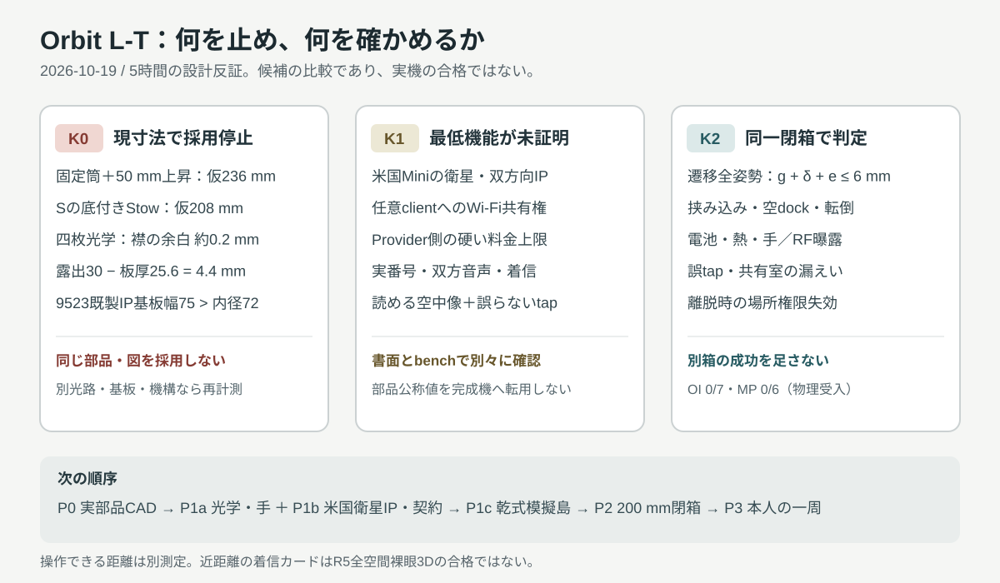

### 反証から戻す設計分岐

自己反証は「うまくいかなければ音声へ置換」で閉じない。最初の試作判断で以下の順番を使い、何を変えたかを構成版として残す。

1. **機構と光学の寸法衝突を先に解く。** 現在の四枚板案と既製9523 IP基板をL-Tの採用部品表から外す。面一capの別光路、単一展開素子、別の光源と指入力を、同一RF窓と`194+g+δ+e≤200mm`の全姿勢で比較する。外形の採否はP0の実CADとP1aの像・tap実測を結んで決める。
2. **13秒は最良側の紙上時間である。** 仮に15秒で切れる着信なら、上のlift5秒＋本人2秒＋選択2秒＋tap／Provider4秒の後に、wake、校正、網遅延、安全確認へ残るのは**計2秒以下**。試験は15／30／60秒を混ぜず別群にし、各群で最後に双方音声が始まった割合を記録する。15秒群が失敗しても匿名合図→物理ボタンの成功を空中応答の成功へ加えない。lift速度を上げる変更は挟み込みと騒音を同じ版で再審査する。
3. **通信の技術と販売権を別々に通す。** 大型の[GO! exec公式FAQ](https://ifp.iridium.com/go-exec-faqs/)は標準browserを衛星Wi-Fiで利用する経路を示す一方、重い画像・動画siteの非対応とactivity profileを明示する。Mini向け新型radioの一般client IP、Wi-Fi再共有条項、実請求の硬い上限が三つ揃わないなら、衛星APを最低機能として合格にしない。通信事業者から提供されない金額上限を端末側の概算meterだけで保証しない。
4. **一台だけの失敗を増設で覆わない。** 02天井や10軒裏、複数の同型Miniは広い住宅での補助profileであり、05にある一台の通話・PCなし制作・屋外衛星APを通した証拠の代わりにならない。近距離空中カードの合格もR5全空間裸眼3Dの研究gateには昇格させない。
5. **戻り先を明確にする。** L-Tの別光路と保護電池・直接衛星IPを同じ閉箱へ置けなければ、同じOI試験でFの密閉前面を評価する。Fも失敗したら、`≤200mm`、細軸意匠、直接衛星IP共有、空中着信tapのうち衝突した要求と寸法を列挙し、要求変更を勝手に行わず次の設計判断へ渡す。候補を選んだことを製品発売判断にしない。

**次の担当へ渡す最小証拠束。** 反証を別々の好成績で埋めず、同じ構成版`orbit-lt-r1`の図面・契約・実験結果へ結ぶ。ここに書く照会と図面要求は、送信済みの問い合わせ、購入、加工、通電の記録ではない。

| 担当境界 | 最初に受け取る資料 | その資料で止めること |
| --- | --- | --- |
| EXTERNAL 機構／光学 | Stow、途中、Ready、Carry、空dockの同じ原点による断面・公差・質量表。採用候補の実光源、単一／別光路、視点と指領域を含むray trace | `g+δ+e>6mm`、開口内で展開不能、Readyの斜め視線で一択が読めない構成をP0/P1aから外す |
| EXTERNAL 衛星／米国Provider | Mini型式に結び付くradio・antennaの供給／認証経路、双方向IPと一般client Wi-Fi再共有の書面、電話番号／同時通話、料金式とprovider側の硬い停止方法 | message専用、他端末のSIM／plan、概算byte meterだけの案をOI04候補から外す |
| EXTERNAL 電池／RF／安全 | 同じ筐体・握り・襟姿勢でのcell保護、送信peak、24時間待受＋2時間APのrail波形、外装熱、人体RF／光学曝露の評価手順 | 電池・antennaを外置きしたbench値や、別端末の安全距離をP2の合格へ移さない |
| ROCK runtime／Tool | `callEventId`、`placeEpoch`、`jobId/revision`、`budgetReservationId`の別記録、失効・結果不明照合・hard capを含む状態traceとMini Device Profile | センサー推定やAgent案を本人承認、Provider接続、住設作用、請求確定へ昇格させない |
| JOINT 一体受入／OWNER 判断 | 同一個体・同一OS版・同一米国契約・同一ownerで、05の面一着信から空中応答、PCなしGame作品、屋外衛星AP、帰宅復旧までのOI01〜07報告 | どれか未合格なら最低機能達成・携帯代替・販売を宣言せず、衝突する要求と変更選択肢をOWNERへ戻す |

## 事業・責任

既存のSIM/eSIMからRockstarOS service accessへ入る商品方針を維持する。Mini機器代、回線料、衛星接続料、Cloud Agent usage、外部実費を分ける。RockstarOS／Sky／Zemaの権限・費用契約はPixel、Mini、Proで共通にし、Miniの空中表示・衛星能力はMini Device Profileだけに記す。衛星通信の**初回検証地域は米国**、販売地域・価格・partner・通話番号・緊急通報・製造数は未決。正式契約・認証がない機能は対応可能と表示しない。

商品構成の比較案は**持ち出すcore一台＋給電・保持用の卓上／家具cup一つ**を基準にし、壁・天井sleeveは同じcoreに適合する施工部材として別に扱う。住宅への設置をしない人も電話・通信・Sky／Zemaの基本を使えること、住宅に設置する人も別の計算Hubを買わずに同じ本体を外せることを価値仮説にする。壁flush状態での空中tap、天井からの手操作、屋外衛星Wi-Fiはそれぞれ受入前に商品説明へ載せない。初期契約画面にはRockstarOS利用権、電話／地上通信、衛星通信、Cloud usageを別の行で示し、Miniを買えば無条件に衛星Internetと全Toolが使えると誤解させない。

最低機能として提示する最初の販売地域では、Mini hardwareに対応する衛星の実回線契約とWi-Fi共有許可を同時に用意できなければならない。modemだけ搭載して「衛星ポケットWi-Fi対応」と販売しない。端末購入、RockstarOS service access、地上通信、衛星通信、電話番号、Cloud Agent利用は別の契約状態として示し、購入者がどれを使い、何に課金されるかを初回起動時に読める形にする。衛星契約がない時にもlocal保存や承認済み地上機能は使えるが、それを最低機能の完全な提供と呼ばない。

ROCKは共通runtime、job、費用・停止・Device Profileを担当。EXTERNALは光学、RF、衛星・音声網、電池安全、施工を検証。JOINTは同一閉箱でOI01〜07を受け入れる。OWNERは米国内の具体的なpilot地点、最初の通話・PCなし制作・住まい・Game一周、ポケットの基準、月額予算、販売地域を決める。最重要判断は、**携行中の空中像の光学窓と衛星アンテナを同居させ、200mm以内の熱・電池へ収められるか**。示せなければ最低要求を満たす製品として完成とは呼ばない。

## 一次資料と適用範囲

### 5時間再確認の出典台帳（取得日 2026-10-19 UTC）

| 一次資料・版 | この比較へ使った事実 | ここからは言えないこと |
| --- | --- | --- |
| [Iridium Certus 9770製品仕様](https://www.iridium.com/products/iridium-certus-9770)、Web版・改訂番号の記載なし | 140×60×16mm、185g、12V±2.5V、送信最大22Kbps／受信最大88Kbps、voice 2系統、外部受動antenna | Miniの筐体、送信peak電力、回線単価、tethering権利、同時Wi-Fi実績 |
| [Iridium掲載のGround Control RockREMOTE Mini OEM](https://www.iridium.com/products/rockremote-mini-oem)、Web版・改訂番号の記載なし | 9770入りsubassemblyは175×60×37mm、287g、外部antenna、外部10〜30V電源、送信peak上限1.66A@12V | 完成Miniの電池・光学・Wi-Fi・筐体重量、Mini自身のpeak／待機電力、契約条件 |
| [Iridium掲載のSTREAM+ Certus 100端末](https://www.iridium.com/products/stream-midband-terminal)、Web版・2026-10-19取得 | 9770を含む別端末205×105×48mm・620g、外部10〜40V給電、掲載idle 0.25W／平均送信3W | MiniのAP＋光源＋電話＋Gameの合計電力、peak、携行電池持続。外部給電の別筐体値を8W仮値の測定結果に置き換えない |
| [Iridium GO! exec仕様](https://www.iridium.com/products/iridium-go-exec-portable-wireless-access-device)と[同社FAQ](https://ifp.iridium.com/go-exec-faqs/)、Web版・改訂番号の記載なし | 実製品では衛星dataをWi-Fiへ渡し、同時接続は最大4 client。同製品は2通話とdata sessionの同時動作を案内するが、音声品質が落ち得る。通常browserにも用途別profileが必要で、画像・動画中心のsiteは対象外 | この別製品の大きさ・電池・認証、同時通話仕様をMiniへ移せること |
| [Iridium掲載McQ CONNECT](https://www.iridium.com/products/mcq-connect-satellite-hotspot)／[SKYTRAC DLS-100](https://www.iridium.com/products/skytrac-dls-100-data-link-gps-system)、現行Web版・2026-10-19取得 | 同じ9770系の比較完成機はMcQ 203.2×127×38.1mm／1,000g、DLS-100長221mm／742.8g。後者はWi-Fi enabledとFCC pendingを併記 | 既製品が200mm・450g仮目標を満たすこと、module認可をMini完成機へ移せること、Miniの米国Wi-Fi共有契約 |
| [Starlink Mini公式仕様書](https://www.starlink.com/public-files/specification_sheet_mini.pdf)、PDF版・改訂番号の記載なし、2026-10-19取得 | 統合Wi-Fiを持つ別方式の衛星端末。antenna本体298.5×259×38.5mm・1.10kg、平均25〜40W、入力12〜48V/60W | Miniへ同速度・消費電力・antenna方式を縮小できること。2×M65A仮電池33.7Whとの算術は別製品の感度に過ぎない |
| [Thuraya SatSleeve Hotspot factsheet](https://www.thuraya.com/-/media/thuraya/downloads/products-downloads/land-voice/satsleeve-plus/thuraya-satsleeve-hotspot-factsheet.pdf)／[FAQ](https://www.thuraya.com/en/faq/)／[利用者マニュアル](https://www.thuraya.com/-/media/thuraya/downloads/products-downloads/land-voice/satsleeve-plus/satsleevehotspotusermanual.ashx/)、旧製品資料・2026-10-19取得 | 本体＋stand公表寸法142×69×38mm、290g、GmPRS公称下り60／上り15kbps、Wi-Fi連続時待機最大9時間。衛星使用にはantenna完全展開とGPS取得が必要で、通常操作にスマートフォン側専用appが登場する | antennaを伸ばした使用時200mm適合、現行調達・契約・対象地域、Mini単体でのservice制御、MiniのOS／光学／Game／生体との同居 |
| [Thuraya X5-Touch brochure](https://www.thuraya.com/-/media/thuraya/rebranded/x5-touch-brochure.pdf)／[取扱説明書](https://www.thuraya.com/-/media/thuraya/rebranded/thuraya-x5-touch-user_guide.ashx)／[FAQ](https://www.thuraya.com/en/faq/)、旧製品資料・2026-10-19取得 | 自律Android衛星電話の**phone body**145×78×24mm・262g。衛星GmPRS最大下り60／上り15kbit/sをpersonal Wi-Fi hotspotで他端末へ共有可能。衛星時はSAT antennaを完全展開する | antenna展開込み使用時200mm適合、現行OEM供給、米州を含む対象販売国の網・契約、Miniの円筒antenna・光学・熱・OS・生体・Game同居、Mini製品認証 |
| [Thuraya One公式factsheet](https://www.thuraya.com/thuraya-one/Space42_Thuraya%20One_Fact%20Sheet_EN%20AR.pdf)、現行端末資料・2026-10-19取得 | Android 14、167×76.5×11.6mm、衛星通話・SMS、指紋sensor。現行の薄い複合端末の比較 | 衛星packet data、IP、Wi-Fiへの衛星tethering。factsheetに記載がないことを製品に絶対ないとの断定へ使わない |
| [Space42の現行通信説明](https://space42.ai/en/lp/secure-connectivity.html)、現行Web版・2026-10-19取得 | 2026年2月にThuraya legacy voice／SMS／packet dataをThuraya-4へ移行。対象footprintは中東・アフリカ・中央アジア・欧州 | Thuraya One端末でのpacket data／hotspot、Mini向けOEM契約・単価、米州での通信 |
| [Globalstar Sat-Fi2の2016年発表](https://investors.globalstar.com/news-releases/news-release-details/globalstar-prepares-release-next-generation-sat-fir-satellite-wi)／[2021年のservice一時停止説明](https://investors.globalstar.com/news-releases/news-release-details/globalstar-announces-2021-financial-results-and-business-update)、歴史資料・2026-10-19取得 | 北米に衛星hotspotを提供した過去例。2021年にSat-Fi2等の一部Duplex販売・serviceを一時停止と公表 | 2026年の新規加入、OEM供給、データ権利、料金。旧発表の販促価格をMiniの計画値へ使わない |
| [Thuraya IP NEO M製品仕様](https://thuraya.com/en/products-list/land-data/thuraya-ip-neo-m/)、現行Web版・2026-10-19取得 | 衛星IP最大1,024kbit/s、Wi-Fi AP／router、電池込み225×225×61.5mm・2.2kgの高速側比較 | Miniへ速度や部品を移せること、同じ網が対象国で契約できること、200mm内の一般Internet共有 |
| [Iridium GO! exec公式仕様](https://www.iridium.com/products/iridium-go-exec-portable-wireless-access-device)、現行Web版・2026-10-19取得 | 9770を使うbattery powered satellite Wi-Fi access device、203×203×25mm・1.2kg、IP最大88kbps、内蔵speaker／mic | Mini 76mm径への小型化、同一OS・光学・生体との同居、自律制作、Mini向け契約・料金 |
| [Iridium GO! exec公式FAQ](https://ifp.iridium.com/go-exec-faqs/)、現行Web版・2026-10-19取得 | 契約料金は公認Service Providerへ問い合わせる仕組み。GO! execのCertus SIMは同機種用planへのprovisionが必要で他機種SIMを流用できない。標準Webもactivity profileを使い、重い画像・動画siteは利用できないと説明 | Miniに使えるSIM／料金／tethering権利、Miniの一般Web体験。GO! execの制約を全てのsatellite網へ一般化しない |
| [Thuraya IP NEO M利用者マニュアル（2026-04）](https://www.thuraya.com/-/media/thuraya/products/land-data/ip-neo-m/ip-neo-m-user-manual_april-2026.ashx/)、2026-10-19取得 | 別の大きなsatellite terminalは送信時のantenna前面から0.6mの安全距離を警告。人体曝露と空中入力の同時配置を審査する根拠 | Miniの必要距離、Miniが危険という結論、Mini用周波数・電力・antennaの合格判定 |
| [Thuraya公式料金案内](https://www.thuraya.com/en/where-to-buy/pricing/)、現行Web版・2026-10-19取得 | Service Partner経由の卸売・料金設定。Prepay 100には100MB枠がある。地域・端末・planが分かれる | Mini固有の月額・単価・対象国・共有許可・現行供給。Prepayの容量をMiniへ移せるという結論 |
| [Iridium Core 9523](https://www.iridium.com/products/iridium-core-9523)と[RUDICS説明](https://www.iridium.com/services/iridium-rudics)、Web版・改訂番号の記載なし | 70.44×36.04×14.6mm、32g。本体入力3.2〜6VのほかVBOOST公称27V。公開表のpeak電流欄は`300 peak A`と不自然で設計値に採らない。RUDICSはdirect IPに標準接続・PPP・MLPPPを案内する回線交換の低帯域data。[別端末ISAT-200A](https://www.iridium.com/products/skytrac-isat-200a)は2.4Kbps双方向を掲示 | 9523の正式電源datasheet・送信peakと蓄電、Mini固有の速度、PPP／任意宛先・Wi-Fi再共有権、複数channelの外形、一般browser／Game／Agent向け体験、Miniの料金。別端末2.4KbpsをそのままMini性能としない |
| [Iridium掲載PLANET 9523 OEM Board](https://www.iridium.com/products/planet-9523-oem-board)／[同旧版UAT](https://uat.iridium.com/products/atmosphere-planet-9523-oem-board/)／[同UAV Terminal](https://www.iridium.com/products/planet-9523-uav-terminal)、Web版・2026-10-19再取得 | OEM基板112×75×20mm・現行ページ90g／Wi-Fiオプション、過去の検索索引と旧版UATは98g／Wi-Fiあり。外部9〜36V、掲示data power 8W、IPを掲載。別の完成UAV端末180×100×30mm・260g、Wi-Fiあり・内蔵電池なし。既製基板75mm辺はL-T理想内径72mmを超える | 90／98gの差が構成違いか掲載改訂か、Wi-Fi付き納入品の実質量、Mini専用再設計での部品・RF・電源・製造、米国Miniの任意client Web共有権、実速度と課金・hard cutoff。別端末のIP/Wi-FiをMiniのOI04合格としない |
| [Iridium Certus 9704](https://www.iridium.com/products/iridium-certus-9704-module)、Web版・改訂番号の記載なし | 31.5×42.0×3.8mm、12g。最大100KBのmessageとJSPR/serial interfaceを掲げるIoT module | 任意clientへ連続双方向IPを出せること。100KB messageをTCP/IP hotspotの転送単位と読み替えない |
| [Globalstar RM200M sales sheet](https://www.globalstar.com/getmedia/932da082-c545-4ed1-b7fc-67ff34967651/rm200m-sales-sheet1.pdf)／[2025-10-21商用化発表](https://investors.globalstar.com/news-releases/news-release-details/globalstar-announces-commercial-rollout-rm200m-two-way-satellite/)、2026-10-19取得 | 28.3×50.8×3.6mm・11g、衛星messageは上り9〜144bytes／下り9〜128bytes。商用発表は北米のIoT導入を言及 | 任意宛先の一般双方向IP、DNS/TLS、Wi-Fi再共有、通常通話、Mini完成端末の認証・契約。小型双方向を一般Internetと同義にしない |
| [Iridium 9604製品仕様](https://www.iridium.com/9604)と[2026-06-23市販化発表](https://investor.iridium.com/2026-06-23-Iridiums-Next-Generation-Hybrid-IoT-Module-and-Development-Kit-are-Now-Commercially-Available)、2026-10-19取得 | 16×26×2.4mm。Iridium SBD＋LTE-M＋GNSSの三系統で、衛星SBDは送信340bytes／受信270bytesのmessage | 地上LTE-M側のIPを衛星側でも一般Webに使えること、Mini向けsatellite hotspot、電話／料金／端末認証 |
| [Iridium／Altair NTN Direct統合発表（2026-10-14）](https://investor.iridium.com/2026-10-14-Altair-Semiconductor-Integrates-Iridium-NTN-Direct-into-ALT1350-and-ALT1550-Cellular-IoT-Chipsets)、2026-10-19取得 | ALT1350／ALT1550へIridium NTN Directを組み込む計画。NB-IoT／D2D用途とAI wearable等を案内 | 米国のMini端末・一般Internet IP・Wi-Fi再共有契約、量産時期、実際の速度・通話・電力。発表の計画を実機合格にしない |
| [Quectel CC660D-LS specification V1.2（2024）](https://www.quectel.com/content/uploads/2024/03/Quectel_CC660D-LS_Satellite_Communication_Module_Specification_V1.2-1.pdf?wpId=114714)、2026-10-19取得 | module 17.7×15.8×2.0mm、約1.2g、上り最大8.6／下り8.3kbpsはbaseband参考値、IPv4／UDP／NIDD／DNS、別GNSS必須、TX典型293mA@3.3V（B255） | TCP／一般Web、Mini Wi-Fi tethering契約、採用基板とantenna込み寸法、通話、実速度。小型化だけをOI04合格にしない |
| [Nordic nRF9151設計指針](https://docs.nordicsemi.com/r/bundle/nwp_056/page/wp/nwp_054/physical_characteristics.html)／[ANT指針](https://docs.nordicsemi.com/r/bundle/nwp_056/page/wp/nwp_054/ant_if.html)と[Skylo認証発表（2025-12-12）](https://www.nordicsemi.com/Nordic-news/2025/12/Nordic-Semiconductor-secures-Skylo-certification-for-nRF9151-module-enabling-global-IoT-connectivity)、2026-10-19取得 | SiP公称12.1×11.1×1.2mm、GNSS／LTE-M／NB-IoT／NB-NTN、ANT伝送路の短さ・50Ω整合・損失最大0.5dBの設計指針 | Miniの放射体・ground・光学同居、実利用国・IP APN、一般Web共有、電話、製品認証 |
| [Nordic nRF91x1 MNO承認票](https://www.nordicsemi.com/-/media/Software-and-other-downloads/Certifications/nRF91-Series-certifications/nRF9151-Certifications/MNO/Nordic-Semiconductor_nRF91x1_Family_v2-1.pdf)、対象審査・2026-10-19取得 | 審査表では4G Voice/VoLTE、VoWiFi、tethering/Wi-Fi hotspotが「No」。nRF9151単体を通常電話＋APの採用品にしない理由 | 全地域・全module構成に対する普遍的な禁止。Miniへ別VoLTE moduleとWi-Fiを追加した時の認証結果 |
| [SIMCom A7672X製品資料](https://www.simcom.com/product/A7672X.html)、2026-10-19取得 | LTE Cat 1、VoLTE機能を掲げる24×24×2.4mmの地上音声部品候補 | 対象国・MNOでの番号着信、eSIM適合、Mini本体の音声品質・待受電力・antenna同居 |
| [Taoglas CGSP457.A NTN n255/Iridium/GNSS antenna資料](https://www.taoglas.com/product/cgsp457-gnss-satcom-1542-1643-mhz-45-x-45-x-7-mm-patch-antenna/)、2026-10-19取得 | patch45×45×7mm、32g、公開特性は70×70mm ground planeでの試験。F/Lの円断面と光学端面の幾何競合の具体例 | 同antennaを別groundへ変更した時の効率、Mini内の偏波・RF適合、他方式のcustom antennaまで不可能という結論 |
| [Taoglas IP.1621.25.4.A.02公式仕様](https://cdn.taoglas.com/datasheets/IP.1621.25.4.A.02.pdf)、SPE-11-8-017/H/SS・2026-10-19取得 | Iridium帯patch25×25×4mm・10g、50×50mm ground planeでの参照測定、antenna単体のIridium商用認証。50mm角groundの対角70.71mmはLの理想内径72mmへ極小余白で収まる | 直径40mm級の光学開口と同一平面での効率、9770との組合せ承認、完成Miniの米国RF・人体・ネットワーク適合、一般Internet共有 |
| [Taoglas PCS.26.A LTE/NTN線状antenna資料](https://www.taoglas.com/product/pcs-26-a-havok-penta-band-cellular-low-profile-lte-cellular-smd-dielectric-antenna-including-600mhz/)、2026-10-19取得 | 54.6×13×3mm、5g、B23/n255/n256を掲げ、最大効率には100mm以上のground planeを推奨。F/Lの軸方向RF窓候補 | Miniの長手groundと電池・光学・手の同居、網のOTA、衛星でのIP・tethering、製品認証 |
| [Taoglas NLA.01 datasheet SPE-25-8-095-A（2025-03-26）](https://www.taoglas.com/datasheets/NLA.01.pdf)、2026-10-19取得 | n256向けloop素子5×3×0.5mm、推奨ground plane80×40mm。小さい放射素子と大きい基板条件の差 | Miniの軸方向ground、X5級GmPRSまたは別網への適合、OTA、一般IP共有・通話 |
| [村田Type 1YN製品表](https://www.murata.com/ja-jp/products/connectivitymodule/wi-fi-bluetooth/overview/lineup/type1yn)と[SoftAPを明記した発表](https://www.murata.com/ja-jp/news/connectivitymodule/wi-fi-bluetooth/2022/0825)、2026-10-19取得 | 2.4GHz Wi-Fi 4／SoftAP対応、module 6.95×5.15×1.1mm。製品表はantenna内蔵なしと示す | Miniのantenna長・ground・筐体共存、主SoC driver、WPAと隔離、最終端末の無線認証、衛星WANを使えること |
| [Skylo Introduction v1.0（2024-07-01）](https://www.skylo.tech/knowledge-base/skylo-introduction)と[網接続説明](https://www.skylo.tech/knowledge-base/enabling-global-connectivity-skylo-ntn-connectivity)、2026-10-19取得 | IP（UDP）／NIDD、MTU 256bytes、50bytes最低課金単位、50bytesで約5〜15秒、MNO認証・請求・APN依存 | Mini固有の一般Internet routing、TCP／TLS、tethering、月額・byte単価、通信対象国、実端末認証。「2 messages/min」を全IP trafficの上限と断定しない |
| [Skylo端末適合資料](https://www.skylo.tech/knowledge-base/device-conformance)と[認証案内](https://www.skylo.tech/skylo-certification-program)、現行Web版・2026-10-19取得 | IoT best practiceは256bytes／packet、packet間隔30秒超、片道message遅延最大30秒への備え。接続前の有効なGNSS fixと95% CEP≤100mの網向け条件。Type 2 RFは各band TRP≥16dBm／TIS≤−108dBm。B23／B255／B256を期待し、Type 2のservice料金は相対的に高いと説明。統合端末の標準Skylo認証4,000米ドルは第三者lab・各国試験別 | Miniのplanへの適用、三band antennaとGNSS fix時間・位置情報の扱い、一般IP packetの実速度、筐体／手／襟込みOTA、契約とtethering、月額。金額はMini販売価格ではない |
| [Qualcomm X105 Product Brief 87-96660-1 Rev A（0226A）](https://docs.qualcomm.com/doc/87-96660-1/87-96660-1_REV_A_Qualcomm_X105_5G_Modem-RF_Product_Brief.pdf) | 対象にMobile Broadband・衛星を含み、NR-NTN／NB-NTNと対応RFFEを掲げる。14.8Gbpsは5G cellular peak | Mini用moduleの外寸・出荷・衛星IP速度・事業者受入・Wi-Fi tethering。cellular peakを衛星速度と混同しない |
| [MediaTek MT8875公式発表（2026-08-25）](https://www.mediatek.com/tek-talk-blogs/mediatek-mt8875-our-next-gen-5g-iot-platform-for-genai-applications)、2026-10-19取得 | IoT向け4nm計算基盤に5G、Wi-Fi 6E/7、AI、optional satellite NTNを掲げる。5.14Gbpsは地上5G peak | NTNの種別と衛星IP・voice・tethering、Mini用基板・driver・電力・外寸、対応網と契約。衛星Internetの実績ではない |
| [T-Mobile T-Satellite利用案内](https://www.t-mobile.com/support/coverage/satellite-support)、現行Web版・改訂番号の記載なし | 対応端末と選定app／data、屋外の見通し、地域条件、非加入者の対応phone向け月額例を示す | Miniが対応端末であること、任意Internetのsatellite hotspot許可、Miniの見積価格。掲載の電話向け料金をMiniの費用に使わない |
| [Aluminum Associationの6063試験報告](https://www.aluminum.org/sites/default/files/2021-10/6063CombustibilityReport.pdf)と[Covestro Makrolon 2605の物性](https://solutions.covestro.com/en/products/makrolon/makrolon-2605_000000000000894068?SelectedCountry=US)、2026-10-19取得 | 比較密度はAl6063公称2.7g/cm³、当該PCは1.20g/cm³。PCの熱伝導率は0.2W/(m·K)。単純な側壁質量・熱路の感度に使う | Mini殻の適正厚、加工・落下・難燃・接触温度、導電塗装のRF影響、実完成質量 |
| [ST VL53L8CX datasheet DS14161 Rev 12（2025-07-22）](https://www.st.com/resource/en/datasheet/vl53l8cx.pdf) | 8×8 zone、自律4×4・1Hzの典型1.6mW／連続動作の典型215mW。所定構成のClass 1で、放射光を別光学部品で集光しない注意がある | Miniの指先検知精度、組込後の光安全、Mini全体の待機電力 |
| [ST VL53L7CX DS13865 Rev8（2024-09）](https://www.st.com/resource/en/datasheet/vl53l7cx.pdf)／[STSW-IMG035](https://www.st.com/en/embedded-software/stsw-img035.html)、2026-10-19取得 | 公称60°×60°、対角90°、8×8、6.4×3.0×1.6mm。公式kitは手追跡とtap gestureを提供。近距離8×8・15Hzの測距表値は対象と照度により±11〜20mm | Miniの130mm像面全域、指先±10mm、誤応答率、黒帯・cover glass・襟の遮蔽、量産安全 |
| [Miyazaki／Takemuraの浮遊タッチ論文（2024、DOI:10.3169/mta.12.2）](https://www.jstage.jst.go.jp/article/mta/12/1/12_2/_article/-char/en) | 別装置の浮遊画像では像面の奥行の知覚が操作を難しくし、指と像の視覚feedbackを試した | Mini H0/H1の入力誤差、被験者成功率、採用するfeedback部品・外寸 |
| [Kumagai／Mori／Hayasakiの自由空間体積表示論文（2025、DOI:10.1002/jsid.2025）](https://doi.org/10.1002/jsid.2025) | femtosecond laserで空気中へ描き、横平均68mm・軸42mmの範囲を報告。R5全空間3D研究の実物理比較 | 一本200mm製品内への光源・光学・電源・熱・安全収納、生活空間全体への表示、人が指を入れる安全性 |
| [TakiyamaらのLeAIRR＋光場空中3D実験（2025）](https://sid.onlinelibrary.wiley.com/doi/10.1002/jsid.2056)、本文・2026-10-19取得 | 正面・左右視点で変わる実空中3D像と解像改善を報告。試験光源は5.5型4K display、偏光分離面からlensまで75mm、lensから再帰反射体まで450mm、浮遊距離150mm | 光学経路をL-TのRF20mm＋光学42mm、外径D76／全高200mmへ収納する方法、部屋全体の像、誤tap・電池・光安全。別装置の3D成立をMiniへ転用しない |
| [Goodix capacitive fingerprint製品表](https://www.goodix.com/en/product/sensors/fingerprint_sensors/capacitive_fingerprint_sensors)、現行Web版・改訂番号の記載なし | 前面型GF5288／GF3258のpackageは12×12×0.65mm、側面型GF3626は15×2.56×1.2mm。Stow端面の面積比較に使う | Miniの前面に光学と同居できること、本人照合・提示攻撃耐性・driver／鍵管理が合格したこと |
| [NIST SP 800-63B-4](https://pages.nist.gov/800-63-4/sp800-63b.html)と[ISO/IEC 30107-3:2023](https://www.iso.org/standard/79520.html)、公開Web版・2026-10-19取得 | 生体を単独authenticatorにしないlocal鍵活性化／代替手段の評価基準、提示攻撃検知の試験・報告方法 | Miniの鍵隔離・失敗回数制限・偽指／顔・共有空間の誤開示／誤作用試験。規格を読んだことは適合や認証ではない |
| [TDK T5838公式発表](https://www.invensense.tdk.com/en-us/news-media/press/tdk-introduces-worlds-lowest-power-pdm-microphone-acoustic-activity-detect)／[PUI Audio SMS-2008MS-R製品表](https://puiaudio.com/product/speakers-and-receivers/sms-2008ms-r)、比較部品・2026-10-19取得 | mic 3.5×2.65×0.98mm、speaker 20×20×4.5mm・1.5g。音声入力・出力の物理寸法の候補 | Stow／Ready／Carryでの音孔、声の到達、echo、音漏れ、防滴、駆動回路・供給継続、Mini完成機の通話品質 |
| [Molicel P50B](https://www.molicel.com/product/inr-21700-p50b/)、[M65A datasheet 80153-0.1（2025-08-05）](https://www.molicel.com/wp-content/uploads/Product-Data-Sheet-of-INR-21700-M65A-80153-0.1_250805.pdf)、[M65A製品表](https://www.molicel.com/product/inr-21700-m65a/)、[M35A製品表](https://www.molicel.com/product/inr-18650-m35a/) | P50Bは18Wh、最大径21.55mm・長70.15mm・71g。M65Aは典型23.4Wh、最大径21.70mm・datasheet長71.00mm・74.5g、充電上限4.2V／放電下限2.5V。M35Aは3.6V×3.5Ah、最大径18.6mm・長65.2mm・48g。M65A製品表の長70.2mmとdatasheetは不一致なので長い値を仮配置に使う | 保護・接点込みpackの外寸、2S/2Pと各railのpeak／低温／充電、Miniの熱／安全認証、実際の持続時間 |
| [Raspberry Pi CM5公式datasheet](https://datasheets.raspberrypi.com/cm5/cm5-datasheet.pdf)、2026-10-19取得 | 40×55mm、接続後高さ4.94／7.44mm、5V idle典型400mA／動作典型900mA、内蔵Wi-Fi antennaは金属切欠きと周囲空隙を要する | Miniの採用SoC、RockstarOS移植・安全起動、主SoC sleep／wake、筐体内RF、電話待受。CM5を常時2Wで使う一日profileは現電池仮説と衝突 |
| [phyCORE-i.MX93 SoM製品仕様](https://www.phytec.com/product/phycore-i-mx-93/)、現行Web版・2026-10-19取得 | 36×36mm、掲示典型0.80W／最大1.62W、RAM最大2GB。小型Linux演算の比較点 | Mini実装基板・sleep時電力、OS移植、WebGPU／MG01〜07、Wi-Fi／衛星と同時熱。典型値を待受実測値にしない |
| [アスカネット2025-09-09製品発表](https://www.asukanet.co.jp/contents/news/2025/20250909.html) | 約6インチの既存空中像製品でplateは98×160mm、外形幅220mm | 小型Miniの一択／二択像が不可能・可能という証明 |
| [ASKA3D Home現行製品詳細](https://aska3d.com/ja/ukuu-livestage_home.html?lang=en)／[plate一覧](https://aska3d.com/ja/products.html)、2026-10-19取得 | 卓上HomeはW220×H130×D95mm、plate98×160mm、別のスマートフォンを映像源に使う。plate一覧は表示画像の大きさをplate面積の約70%と説明 | Miniへの幅の単純比例、H0の一択像・H1の130mm幅像、空中tap、一本自律。現行製品のスマートフォン依存をMiniの要件達成に数えない |
| [ソニーECX350F発表（2024-09-24）](https://www.sony-semicon.com/en/news/2024/2024092401.html)、歴史資料・2026-10-19取得 | AR向けmicrodisplayの像源は0.44型／11.235mm対角、Full HD、公称panel最大10,000cd/m²。小型像源の存在を示す | Miniの空中像輝度・視域・光路の長さ・電力・熱・購入可能性。panel値を空中像の実測値へ置換しない |
| [切頭円柱配列TCAPの原著論文（Optical Review 2025）](https://link.springer.com/article/10.1007/s10043-025-00948-1)、本文・2026-10-19取得 | 実作成は5mm径アクリル棒20×20の概ね100mm角、対角約141.4mmで仮D140襟へそのまま入らない。点光源とscreenで40〜70mm光路を比較し、結像位置を確認。論文自身が鉛直視域の狭さとぼけを限界とする | 縮小／角切除後の性能、Miniの文字可読な70〜130mmカード、屋内照度、tap・指精度、光安全、携行耐久。200mm角・0.5mmピッチのシミュレーション像を100mm実作成品へ転用しない |
| [ASKA3D組込用ユニット仕様](https://aska3d.com/ja/aska3d-unit.html)／[200mm角樹脂plate図面](https://aska3d.com/common/pdf/aska3d-200-design.pdf)、現行Web版・2026-10-19取得 | KC-W1は7インチ像、本体262.1×127.8×239.8mm・1.73kg、最大36W。200mm角plate単体280g。既製組込部品のMiniとの寸法・電力差を示す | Mini専用40mm光学の必要電力・質量・実現可否。別方式を同じ寸法へ縮小できるという主張 |
| [Suwa・Morimoto, Optics Letters 51, 5753–5756（2026-10-07）](https://opg.optica.org/ol/abstract.cfm?uri=ol-51-20-5753)、公開abstract・Table 1/2、2026-10-19取得 | 自由曲面mirror160×100mm、LCD76×45mm、空中像91×54mm、浮遊70mm、600mmでeyebox100×50mm、中心160.8cd/m²、像輝度むら62%。既存研究の実測と構成寸法 | MirrorをFの38〜45mm端面やL展開D140へ入れられること。全文は閲覧権限外なので光路・公差・安全条件を補って推定しない |
| [Chenら, Applied Optics 63, 636–644（2024）](https://opg.optica.org/ao/abstract.cfm?uri=ao-63-3-636)、公開abstract・2026-10-19取得 | 別装置のAIRRでmicro-aperture arrayを用い、再帰反射光の広がりと像の解像を改善した研究 | Miniの40mm端面への収納、実像の可読幅・輝度・視域・光安全・電力 |
| [アスカネット2026-09-30可搬機発表](https://www.asukanet.co.jp/contents/news/2026/20260930.html) | 「ポータブル」と呼ぶ既存空中像機も本体約387×265×474mm、12.1インチ、plate420×200mm。運搬可能という語と携行Mini寸法を区別 | 200mm以内のMiniで同じ光学性能が得られるか、または別方式で不可能かという結論 |
| [GSMA NTN白書（2025-06）](https://www.gsma.com/solutions-and-impact/technologies/networks/wp-content/uploads/2012/10/Non-terrestrial-networks-%E2%80%93-opportunities-and-challenges.pdf)と[GSMA D2D容量分析（2026-02-27）](https://www.gsma.com/connectivity-for-good/spectrum/gsma_resources/the-limits-of-d2d/) | 小型端末でのantenna利得・広角受信・送信電力・電池の競合、D2D容量の全体的制約 | Mini固有の速度、地域・契約、同時client数、実装可能性 |

取得時に公開資料で**取得できなかった値**は、Mini用NR-NTN modem／RF一式の外寸とpeak電流、対象国のIP/tethering条項、satellite byte単価と最低料金、選定光学部品の外寸・効率・視域・光安全、閉箱の指誤差、実battery packの熱と保護、通話番号と緊急通報条件。代替製品の公称値で穴を埋めない。STのToFを黒帯や前面窓へ組み込む際は、メーカーのlaser安全条件と窓・反射・光学部材の干渉を光安全担当が評価する。

- [3GPP NTN解説](https://www.3gpp.org/ftp/Information/Highlights/3GPP_Highlights_Issue_6_DOWNLOAD.pdf): NR-NTNとIoT-NTNの区別。Miniの速度や網を保証しない。
- [FCCのSupplemental Coverage from Space決定](https://docs.fcc.gov/public/attachments/FCC-24-28A1.pdf): 対象地域のD2D運用に無線・事業者の枠組みが必要なことを確認する入口。Orbitの認可・対象国を示さない。
- [Iridium 9770 module](https://www.iridium.com/products/iridium-certus-9770)と[9523 module](https://www.iridium.com/products/iridium-core-9523): 実在部品の寸法・質量・通信能力の比較。採用契約やMini収納の証拠ではない。
- [Iridium 9704 message module](https://www.iridium.com/products/iridium-certus-9704-module)と[9810 broadband module](https://www.iridium.com/products/iridium-certus-9810): 小型message輸送と大型IP通信の異なる端を示す。小型で広帯域IPの採用可能性を証明しない。
- [Molicel P50B cell](https://www.molicel.com/product/inr-21700-p50b/): 仮電池の質量・容量の比較。packの安全・制御・収納は含まない。
- [NIOSH収録の円筒handle研究](https://stacks.cdc.gov/view/cdc/197408): 握り径を検討する参考。96mm携行端末への快適性や安全性を直接示す研究ではない。
- [T-MobileのT-Satellite利用案内](https://www.t-mobile.com/support/coverage/satellite-support): 対応アプリと遅い衛星dataの範囲。Miniがその網を利用・共有できる証拠ではない。
- [Qualcomm FWA Gen 6 Eliteの公式構想](https://www.qualcomm.com/news/onq/2026/10/dragonwing-fwa-gen-6-fixed-wireless-access-platform): X105のNTNとWi-Fiをgatewayで組み合わせる設計方向。Miniの携行形状・衛星IP共有契約・実機速度を保証しない。
- [ST VL53L8CX](https://www.st.com/en/imaging-and-photonics-solutions/vl53l8cx.html?id=DB4884&rt=db)と[Ultraleap Controller 2](https://www.ultraleap.com/datasheets/leap-motion-controller-2-datasheet_issue13.pdf): 粗い距離検知と精密hand trackingの比較。単体でAirFrame合格とはならない。
- [GSMA NTN白書](https://www.gsma.com/solutions-and-impact/technologies/networks/wp-content/uploads/2012/10/Non-terrestrial-networks-%E2%80%93-opportunities-and-challenges.pdf): 小型端末のantenna gain、視角、送信電力、熱、電池の競合。
- [Optical Review AIRR研究](https://link.springer.com/article/10.1007/s10043-024-00895-3): 空中像の明るさ・ぼけが視角で変わる。Mini内への収納を実証しない。
- [2026年AIRR画像モデル研究](https://link.springer.com/article/10.1007/s10043-026-01034-w)と[LeAIRR 3D実験](https://sid.onlinelibrary.wiley.com/doi/10.1002/jsid.2056): 再帰反射素子の像の広がりと研究用光路の実寸。小型閉箱にそのまま収められる証拠ではない。
- [TCAP小型光学素子の一次研究](https://link.springer.com/article/10.1007/s10043-025-00948-1)と[BCAP全方位研究](https://doi.org/10.1364/OE.597509): 円柱配列での空中像・視域の研究。読めるMini通話UI、全室体積像、製品内蔵の合格ではない。
- [粒子走査の自由空間体積表示](https://www.nature.com/articles/nature25176)、[発光媒体の体積表示](https://www.nature.com/articles/ncomms15239)、[広視域裸眼3D display](https://www.nature.com/articles/s41586-025-09752-y): R5の全空間研究で混同してはいけない三つの光学的な実現範囲。いずれもOrbitの閉箱に載った証拠ではない。
- [空中像touchの深さfeedback研究](https://www.jstage.jst.go.jp/article/mta/12/1/12_2/_article/-char/en)と[CHIの腕疲労研究](https://hci.cs.umanitoba.ca/publications/details/consumed-endurance-a-metric-to-quantify-arm-fatigue-of-mid-air-interactions): 操作面の視覚feedbackと短い使用時間を検討する根拠。Orbit利用者の合格ではない。
- [アスカネットのASKA3D原理と製品寸法](https://www.asukanet.co.jp/contents/news/2025/20250909.html): 既存の約6インチ空中像を作る製品は220mm幅で、使用plateは98×160mm。これは別光学方式の既存製品の寸法であり、Orbitの130mm像が96mm径に入る根拠にはならない。
- [W3C XR Accessibility](https://www.w3.org/TR/xaur/): gesture以外の入力経路を用意する判断。
- [NIST SP 800-63B](https://pages.nist.gov/800-63-4/sp800-63b.html): 生体と物理authenticator、非生体の代替手段。
- [IEC 62471-5](https://webstore.iec.ch/en/publication/22639): 投影光の安全評価。方式確定後に適合試験を指定する。
- [先行する空中像入力特許例](https://patents.google.com/patent/WO2021260989A1/en): 空中結像＋手入力単独を独自発明と呼べないことを示す例。権利調査の完了ではない。
- [携帯型空中表示の公開公報](https://patents.google.com/patent/US20260227596A1/en)と[空中表示＋手の生体認証の公開公報](https://patents.google.com/patent/WO2024105974A1/en): 組合せ要素の先行する記載。請求項・有効性・実施自由の結論ではない。
- [EP0390988A1の面一台所用伸縮housing](https://patents.google.com/patent/EP0390988A1/en): 固定housingと伸縮するpop-out section、案内、半／全自動駆動が先行して記載される。L-Tの200mm包絡を保つ下部cupの具体構造・製品契約が新規または実施自由という判定ではない。
- [衛星とWi-Fi hotspotを持つ携帯電話・家庭用本体の先行例](https://patents.google.com/patent/US20110158214A1/en): 衛星＋Wi-Fi＋家庭設置も新規の単純組合せとは言えない。記載・権利状態の最終判断ではない。
