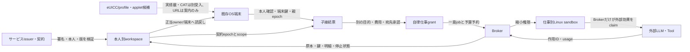
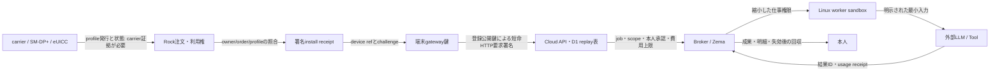

# SIM01: eSIM・端末鍵・Cloud仕事のセキュリティチェーン調査

状態: **正味300分の資料・source調査完了**（2026-10-20 11:53:27 UTC）。利用者が[5時間実行プロンプト](prompts/esim-security-chain-five-hour-research.md)を改めて提示し、2026-10-19 02:27:47 UTCに開始した。00:33:41〜00:37:59 UTCの事前確認4分、未確認中断、tool待ちと端数は300分に含めない。設計採用、実eUICC・専用Linux Cloud・実機・本番の受入を示さない。主担当は Security / Identity / Compliance（ROCK）、carrier/eUICC・実端末の証拠は EXTERNAL/JOINT、サービス条件と鍵運用は OWNER/JOINT。

**調査結論（2026-10-20の明示方針を反映。実環境の安全性受入ではない）:** 主商品のeSIMは、本人別RockstarOS環境を準備する**サービスprofile/利用権**であり、通信容量や「今この回線がactive」であることを全Cloud仕事の根拠にしない。安全性が上がる条件は、真正なサービスissuerの契約と本人、端末ごとの鍵、親子接続の失効版、仕事別承認、Linuxのowner/Agent隔離、Brokerが強制する送信先・費用・停止を同一jobへ結ぶこと。eSIMという名称やURLだけではこの条件を満たさない。旧native SI設計での実eUICC/通信profile現在状態は別の高保証条件として監査を残す。現行の導入receiptと登録鍵だけでは、現在のeUICC状態、本人のその場の意思、Cloud仕事の承認を一つに証明できない。「専用Cloud」はまずowner別の永続workspaceと仕事別sandboxを指す。別accountや物理hostは追加の脅威/契約に応じて選ぶ。本人別Linuxの実Cloud未配備なので改善率・停止秒数・費用差は未測定であり、方式名だけから「固くなった」と判定しない。

## 2026-10-20の指定チャットと新サービス契約への再照合

[指定チャット](codex://threads/01a14d54-daee-7c30-87a8-faea84641a40)の最新の明示要望と、[新しいサービス接続設計](sim-led-product-architecture.md#esim-service-attachment)、[機械可読の提案契約](../contracts/rockstar-service-attachment.json)を2026-10-20 10:55 UTC以降に再読した。この節は**既存実装からの差分分析**である。提案契約の状態は`proposed_protocol_not_runtime_or_industry_standard`、実装・issuer applet・iPhone自動起動・跨端末接続・本番はいずれも未受入。以下の「必要」は設計の受入条件であり、動作確認済みとは意味しない。

| 状態・境界 | 今回のサービス案で権威となるもの | 混同した時の破綻と受入条件 |
| --- | --- | --- |
| 商品・契約 | 真正なRockstarOSサービスissuerの契約ID/版、owner、支払/失効epoch | GSMA通信profileの電波・bundle・`active`を全仕事の権利へ直結すると、Wi-Fiで正当利用中の本人を止める。逆に販売画面や盗まれたURLだけでworkspaceを作ると他ownerへ紐付く。issuerの署名、発行/失効履歴、本人購入・契約確認を照合する |
| 通信/eUICC | 実carrier/eUICCのprofile/port、発行元と端末の観測証拠。サービスissuerとは別state | eSIMという商品名だけで実eUICC搭載やiPhoneの自動起動を宣言しない。通信profileに高保証を依存する**旧native SI job**だけ、実issuer契約と端末証拠のgateを別に要求する |
| 端末接続 | `rockstar.service-attachment/1`案のowner/contract/workspace/device key/親epoch/scope/audience/期限/nonceの署名束 | applet・QR・公開URLは発見/導線でありbearer権利にしない。browser鍵、OS keystore、受入済みattestationの保証級を分け、子端末は本人が相手鍵とscopeを確認して発行する |
| 本人別Linux | owner別の永続workspace・保存/鍵参照・費用台帳、job別の非信頼Agent sandbox | 同じLinux account/mount/env/Cloud credentialを二ownerや作者Agentへ渡さない。workspace IDの名前分離だけではcross-ownerアクセスを止められない。実Cloudのfile/network/secret/CPU/GPU/cacheの負例で判定する |
| 自律仕事 | durableな`autonomyGrant`の目的、入力revision、Tool/送信先、場所、最大額/予約、期限/step、要再承認の作用、停止/チェックポイント | 携帯がoffでも受領済みCloud jobは承認範囲で続けてよい。電話の無通信を失効と誤判定しない。executorが外部と通信不能なら新しい外部作用を成功扱いせず、本人不在を追加承認にしない |
| 失効と結果 | 親契約epoch、子接続、job受領、effect claim、Provider受信/取消、成果/usageを別の状態に置く | 親失効後の新dispatch/lease更新を拒否するが、既受領jobは承認済み停止方針とin-flight精算に従う。失効だけで外部作用を巻き戻したと表示しない。既存成果と請求の本人回収は別経路 |

**二つの信頼鎖を分ける。** 新標準サービスは`service issuer/契約→owner/一回だけworkspace準備→端末鍵とscope付きattachment→本人の仕事承認/autonomyGrant→Broker→job sandbox/外部Provider→成果・費用・失効`。旧native SI高保証はこれに`carrier/eUICC profile・portの現在証拠→受入済みAndroid端末/boot`を**対象jobについてのみ追加**する。前者のサービスissuerが実eUICC/アプレットへ接続できることは未証明であり、接続できない時はWeb/既存OSの入口を正直に表示する。双方とも端末の通信経路、本人のその場の意思、Cloud workerの権限は別証拠である。

Rockstar、carrier、端末販売店、onlineの販売チャネルが増えても、**購入レシートを誰でもservice issuer eventとして差し込める経路にはしない**。seller/order、支払/返金、真正なissuer contract、本人owner、通信eSIM profileの各IDと署名主体を分け、issuerが発行・停止した契約版を親epochの権威にする。代理店のメール/QR/請求画面だけでworkspaceと有料Cloudを準備しない。販売者とissuerが同じ組織の場合も、署名鍵用途、受入API、異議/取消の手順を分ける。実際の販売・発行契約は未指定なので、この段落はF42の受入案であり現行商流の事実ではない。

図の実線は設計で閉じる必要のある検証順、点線は物理eUICC/端末起動の未受入統合である。Cloud workerの存在は通信回線の`active`や電話のonline状態を保証しない。以下の「信頼境界（初期図）」は**旧native SIを監査した2026-10-19時点の履歴図**として読む。

**「eSIMで始める」の三つの実体を混同しない:**

| 区分 | 本人が得るもの・必要な証拠 | eSIM固有のセキュリティ増分を主張できる範囲 |
| --- | --- | --- |
| P0 商品コード/購入とWeb接続 | 真正なサービス契約、WebAuthn等の本人認証、端末鍵、Cloud workspace。通信eUICCへの搭載は未確認 | 強いSaaS入口になり得るが、**eSIMを使った増分**は立証できない。商品の呼称と実カードを分けて説明する |
| P1 発行元の実eUICC profile/appletが案内を出す | 採用issuer/SM-DP+/profile/端末の一周、applet署名とRAM鍵、CAT応答/画面、盗難URLへの耐性。Rockの本人/端末接続は別 | profileからの案内起動が実証された範囲。URLや通知はcredentialではないため、Cloud本人認証がcard-boundになったとは言えない |
| P2 現在のprofile保有をRock要求へ新鮮に結ぶ | issuer/carrierの署名付き状態/nonce照会または受入済みカード鍵証明と、Rock owner/注文/端末鍵/仕事を照合。再発行/失効上限も契約化 | 同じ強いWeb対照に対し、カード由来の独立した所持/停止証拠を加えた脅威だけ改善候補。通常browserがeUICC秘密を直接読む前提にはしない |

新しい[機械可読契約](../contracts/rockstar-service-attachment.json)はP0のCloud接続設計を主に書き、P1/P2の物理統合と自動起動は未受入と明示する。P0で実Cloud隔離が強くても、それを「eSIMハードウェアが仕事を守った」効果に割り当てない。P1/P2を製品要件にするなら、どの発行元/地域/端末/契約でカード・applet・認証が使えるかをEXTERNAL/JOINTから同一test profileで確認する。

**設計を壊しやすい差分:** 後半の既存source監査は`RockEsimProof`、eSIM Go商品、Pixel native SIとZema名を対象にした時点の事実であり、Eveと新サービスattachmentがそこへ実装された証拠ではない。新プロトコル実装時は既存`esim_device_install_receipts`をiOS向けに偽造せず、証拠kindを版付きで増やす。`attachment`を持たない通常Sky Web利用者に無断でeSIM必須gateを掛けず、高保証を表示する選択経路から通常Cookie/Bearerへ黙って降格させない。旧通信profileの現在状態による停止要件と新サービス契約epochによる停止要件は、商品/仕事由来を保持して適用する。

**指定チャットの最新UX修正（2026-10-20 11:14 UTC再読）:** iPhone/Androidに専用appを必須とせず、対応browserを標準入口とする。Miniの音声、時計の短い通知/承認、TV/ARの表示は端末能力に応じたadapterであり、全てが同じWeb画面やhardware鍵を使うとは仮定しない。本人には一つの入口を見せ、Eveの依頼・進捗・承認・成果とSkyのAgent探索/作者管理を役割で分ける。**AgentをSkyへ追加したreceiptを、そのAgentによる原稿送信・Tool実行・費用のEve承認へ昇格させない**。各端末が出せる本人認証・端末鍵・表示確認・停止操作の保証級を接続票に明記し、表示能力の弱いMini/時計の高額/不可逆承認は本人の強い別端末へのstep-upを要求する候補とする。これはS1/S3のUX/権限試験を増やすが、新UXや自動起動の実装済み証拠ではない。

**Web上の端末鍵の保証級:** [RFC 9449 §2、§3、§11.7](https://datatracker.ietf.org/doc/rfc9449/)のDPoPは漏れたtokenを別鍵で再利用しにくくする方式だが、DPoP proof自体は本人認証/アクセス認可ではなく、標準のproofはHTTP method/URIを結び本文や一般headerの完全性を直接保証しない。Web版で採用するなら、ownerの本人認証、attachmentの署名/親epoch、仕事のcanonical request digest・Broker承認を別々に検証する。[NIST SP 800-63Bの認証器説明](https://pages.nist.gov/800-63-4/sp800-63b/authenticators/)は、認証器秘密の同期/複製とdevice-bound鍵を分け、phishing resistanceをverifier/channel結合として扱う。browserが持つ鍵を「SIM内の鍵」「端末製造元のhardware attested鍵」へ名前で昇格させない。両資料は一般標準であり、Rockの新attachmentが実装/適合済みという証拠ではない。

ブラウザを標準入口にするなら、[W3C WebAuthn Level 3](https://www.w3.org/TR/webauthn-3/)のassertionがRPのchallenge・origin・RP ID/UP/UV等を検証することと、**本人が仕事の送信先・内容・金額を正しく見たこと**を分ける。serverが仕事digestをchallengeに含めても、通常の認証器画面がその取引内容を本人へ表示したとは限らない。[RFC 9449 §11.4](https://www.rfc-editor.org/rfc/rfc9449.html#section-11.4)は同一ブラウザ文脈の悪性codeがDPoP proofを作れる限界も扱う。従ってSkyのAgent追加画面やEveの仕事確認画面にXSS/悪性previewが混入したF14/F41では、WebAuthn/DPoP合格だけを高額・不可逆作用の意思証拠へ昇格させない。Rock側で正規origin、承認したcanonical digest、Brokerの現在版、必要時の独立確認経路を同一jobに残し、受入pilotで本人が見た内容と実作用を照合する。

**隣接するSky Linux 16 sourceを再照合:** 2026-10-20の[限定証拠](evidence/sky-linux-service.json)は、月額16 USDのサービスsource、synthetic使用量、mock Stripe、local SQLiteのhost試験とbuildを記録する。`lib/sky-linux-service.ts:20-105,225-309`にはowner、order、device、契約/issuer、仕事/請求を持つworkspace型があり、`lib/sky-linux-service-store.ts:50-53,173-193,305-356`にはowner hashの単一workspaceと既存`resolveEsimCloudGrant()`による**特定order・特定device**の`agents`権利再確認がある。したがって既存の一契約/一端末向け制御骨格は再利用候補だが、新提案の`rockstar.service-attachment/1`、二OSの子端末接続、service issuerと通信issuerの分離、owner別の実Cloud Linuxはこのsourceでは実装/受入済みと判断できない。`toolkits/sky-linux-service/worker.mjs`はLinux非root、鍵file権限、Broker originを確認し、`services/sky-linux-service/src/worker.ts`は請求controllerを持つが、[証拠](evidence/sky-linux-service.json)は実Linux namespace/CPU、Stripe sandbox、issuer、Cloud LLM、本番を未受入と明記する。新プロトコルを作る時は既存契約・料金・仕事/receipt・失効制御を破棄せず、正確な商品由来と複数端末の子接続を版付きadapterで加える。`workspaceId=hash(owner)`と`contractId`をどう対応づけるか、一owner複数契約または契約移行をどう扱うかは未決定。新商品の端末追加時に既存`deviceRef`を無理に上書きしない。

`drizzle/0064_sky_linux_service.sql`の`sky_linux_service_documents.id`は主キーで、現在のworkspace IDはowner hashで作られる。`accept()`は同じownerの旧workspaceがあれば`orderId/deviceRef/terms`が同じ場合だけ再利用し、別端末/別注文なら拒否する。これは初期の二重契約防止には働くが、新サービス案の**一契約でiPhoneとPixelを接続**する経路には未対応。次の実装差分は、既存workspace/請求/成果IDを保ったまま、契約IDとservice issuer由来を版付きで固定し、`deviceRef`を一次端末/子接続の集合へ分離し、親epochを全子とjobへ伝えること。既存owner hashをそのまま使うか`owner+contract`へ移すかは、同一ownerの旧契約移行・一人複数契約・既請求参照/成果復号を壊さないmigration fixtureで決める。第二端末の追加で新workspaceと基本料が生じないことをF30/F32/F38の独立台帳で確認する。

`accept()`は現在`get(owner)→createLinuxWorkspace()→INSERT`の順で、主キーは二行作成を拒むが、並行した二つの初回要求が**同じ成功receiptを返す**保証まではない。`createLinuxWorkspace()`はこの時点で純粋な文書生成であり、外部Cloud allocationを実施している証拠ではない。従って現sourceから二重Cloud課金の成立を推測せず、新しい外部allocationを追加する前に`owner+contract+operation`の耐久冪等性、DB衝突後の読戻し、allocation成功/応答消失の照合をF30で受ける。

**並行変更による同一source確認の制限（2026-10-20 11:30 UTC）:** [Sky Linux証拠JSON](evidence/sky-linux-service.json)のSHAと11:09 UTCのcheckout SHAは別であり、その時点の二sourceに限って`node --experimental-strip-types --test tests/sky-linux-service.test.mjs tests/sky-linux-billing.test.mjs`が14/14 host合格（Git外ログ`/private/tmp/esim-chain-sky-linux-focused-20261020.log`、SHA-256 `c59d880ab61fcbab53064623d75c0750204ae1d5f59212db4f94cfaaa6a839de`）した。11:28 UTCには二sourceがさらに変化し、その時点のSHAは`lib/sky-linux-service.ts=b382fa4f66b2a2c4ac2788786640b8b6f3762a1fdfb21305d92245418df0d278`、`lib/sky-linux-service-store.ts=9b6ad04581da22105211e7f4b25cde5489b49a0a374e8b684d8ccf05d82383ed`。その時点のsourceでの同じ限定試験は0/2、追加中`lib/rockstar-service-setup.ts:5`のTypeScript parameter propertyをNodeのstrip-only modeが解釈できない（ログ`/private/tmp/esim-chain-sky-linux-focused-final-20261020.log`）。11:30 UTCの`npm run verify`も、追加中`drizzle/0065_rockstar_service_setup.sql`と`drizzle/meta/_journal.json`不一致で`schema:check`停止（ログ`/private/tmp/esim-chain-verify-final-20261020.log`）。これらは共有checkoutの**並行実装中の現状**であり、11:14 UTCの旧source全体verifyや旧14/14を現SHA合格へ転用しない。後続の同一source再試験とfull verifyの結果は次段に記録する。

**11:38 UTCの再試験（別source snapshot）:** 並行実装の修正後、Sky Linux限定試験は14/14に復帰した（Git外ログ`/private/tmp/esim-chain-sky-linux-focused-recheck-20261020.log`、SHA-256 `afbc9aa743553f767275496419a0b4592fcfba963c6d8283b747132390533f15`）。`npm run verify`はNode 1,029 pass/2 fail/1 skipでexit 1。失敗は新migrationを数える`tests/database-status.test.mjs`の期待64対現65、追加ActivityをSoong/Gradle両manifestへ同期していない`tests/os-contracts.test.mjs`である（Git外ログ`/private/tmp/esim-chain-verify-current-20261020.log`）。同じrunで新`tests/rockstar-service-setup.test.mjs`の8 host caseは合格したが、fixture内のOS受入JSON/Stripe/issuer/Linuxであり実Pixel、実決済、実Cloudではない。両失敗は共有checkoutで進む別の実装変更に由来し、調査文書の合格条件を緩めない。

**11:44 UTCの全体再試験:** 並行実装でinventoryとmanifestが同期され、OpenSSL 3とlocalhost待受可能な条件で`npm run verify`がexit 0。Node 1,032 pass/1 skip、Worker/D1合成仕事API 1,330 assertions、CSV合成113 assertions、Web asset 188参照/欠損0。Git外ログ`/private/tmp/esim-chain-verify-postparallel-20261020.log`、SHA-256 `a6b8b46a14393e77ed144eaa2f1edf1b19cb64f6a70abc437c09750ba0565417`。11:43〜11:44 UTCの前後で主要Sky Linux/service setup二source・migration・Android manifestのSHAに変化がないことを確認したが、共有checkout全体はdirtyで実装担当が継続中。これは現ローカルsourceの回帰でありGitHub branchの同一SHA CI、実Pixel/eUICC、実Stripe、Cloud pilot、本番ではない。

**11:46 UTCの旧native監査source再hash:** `esim-cloud-grant.ts`、`esim-cloud-access.ts`、`esimgo-webhook.ts`、`sky-agent-runtime/src/worker.ts`、`check-work-api.mjs`のSHA-256は04:37 UTCに固定した五値とすべて一致。旧native SIのsource監査28行/限定合成試験については、その後のSky Linux/Pixel後付け編集で対象byteが変わっていない。ただしremote branch CI、実発行元/Pixel全OS/Cloud本番の証拠ではない。

**11:49 UTCの関連host試験:** `tests/rockstar-service-setup.test.mjs`のPixel後付け設定9件と既存Sky Linux service/billing 14件を同時に再実行して23/23 pass。Git外ログ`/private/tmp/esim-chain-focused-pre-final-20261020.log`、SHA-256 `747df600bc6e8042cef5c7aff7772926caed8c0c16736e998cca6db0a6f08d2b`。主要四source SHAは11:44 UTC全体verify時と一致。これは合成profile/Stripe/SQLite/worker fixtureであり、実Pixel/eUICC/Provider/Cloudの安全性を示さない。

**現checkoutの全体検証（2026-10-20 11:14 UTC）:** 最初の`npm run verify`はhostのOpenSSL 4.0.3により`release:signing:check`で停止。`PATH=/opt/homebrew/opt/openssl@3/bin:$PATH`で再実行した通常sandboxはlocalhost `listen EPERM`で停止。localhostを使える検証条件で同じ`PATH`と`npm run verify`を実行するとexit 0、主Node試験1023 pass/1 skip、Worker/D1 1330 assertions、CSV 113 assertions、build/API checkまで通過した。Git外ログ`/private/tmp/esim-chain-verify-escalated-20261020.log`のSHA-256は`82044ce7cbd011b24e14dfa0307a709edcaa606b7734464266e7921374d6654e`。検証中のsourceはdirty checkoutで、GitHub branchのCI結果でも実Cloud/実issuer/端末受入でもない。最終文書・進捗更新後に整合checkをやり直す。

**eUICC上のappletは追加攻撃面:** [GSMA AN-2025-07 v1.0](https://www.gsma.com/solutions-and-impact/technologies/esim/gsma_resources/an-2025-07-preventing-misuse-of-an-euicc-profile-and-installation-of-malicious-java-card-application-v1-0/)は、RAM鍵の悪用によるprofile内の悪意あるJava Card application導入を防ぐ業界向け勧告で、既存eSIM規格版に適用する第一段の推奨と位置づける。[ETSI TS 102 223 §6.4.26](https://www.etsi.org/deliver/etsi_ts/102200_102299/102223/18.02.00_60/ts_102223v180200p.pdf)の`LAUNCH BROWSER`は端末が実行できるかを判断する要求で、特定iPhoneが無操作で前面起動する保証ではない。従ってRock用appletを配る案は、issuerがそのprofileへ搭載/更新/失効できる権限、RAM鍵の保管/rotation、第三者appletの拒否、対象端末のCAT応答、URLが単なる案内であることを**同じtest profile**で受け入れてからの条件付き機能。もし発行元がサービス専用applet/profileを提供できなければ、商品上の「eSIMで開始」を実eUICC内実装と表示せず、購入・本人確認からWeb/clientへ案内する代替導線を検討する。ネットワーク資格、通信料、サービス利用権を契約上も分ける。

[Appleの`CTCellularPlanProvisioning`](https://developer.apple.com/documentation/coretelephony/ctcellularplanprovisioning)はcarrier app向けの`com.apple.CommCenter.fine-grained`/`public-cellular-plan` entitlementがある時の導入APIで、一般のSky Web/appにこの権限は自動ではない。[導入結果enum](https://developer.apple.com/documentation/coretelephony/ctcellularplanprovisioningaddplanresult)には`success/fail/unknown/cancel`があり、[Appleの説明](https://developer.apple.com/documentation/coretelephony/ctcellularplanprovisioning/addplan%28with%3Acompletionhandler%3A%29)ではiOS wizardが本人を導く。導入結果が`unknown`の時や本人が取消した時にworkspaceを`ready`と宣言したり基本料金を確定するなら、service issuerの独立readback・契約救済が必要。iPhoneの無操作前面起動をこのAPIだけで推論しない。

**既存Linux workerの安全境界の読み方:** `toolkits/sky-linux-service/metered-worker.py:27-63`は固定model childをbubblewrapでuser/PID/network等から隔離し、`toolkits/sky-linux-service/sky-linux-worker@.service:9-27`はworkerをworkspace名由来の非root user、systemdの資源/書込制限で起動する案を持つ。これは**固定文章モデル**の子process制限であり、ownerごとにOS user・home・鍵・backupを安全に払い出すprovisioner、二ownerでの残留cache検査、任意作者Agentの実隔離、Cloud管理者からの秘匿を実証したものではない。`toolkits/sky-linux-service/worker.mjs:125-181`はBroker heartbeatを受けられなければ停止し、job再実行を避ける。電話がoffでもBroker/workerがonlineなら仕事を継続し得る設計だが、**executorのBroker通信断中もlocal modelを継続する**新案の条件とは異なる。通信断時の既受領lease、途中成果、停止確認、Cloud外部作用待機を不変条件S4と負例F34で改めて受け入れる必要がある。現sourceが既に新しいoffline autonomyを達成したとは書かない。

**「eSIMでどれだけ硬くなるか」の新しい分母:** 同じowner、同じCloud、同じBroker、同じOS、同じ仕事で、B0+を`本人のWebAuthn再認証＋短命の鍵結合token＋版付き契約＋仕事別承認`とし、そこへ実eSIM発行/導入/現在状態またはサービスprofile issuerを一つずつ追加する。主商品の「eSIM」という名称しか変わらず、そのissuer証拠がWebの契約/端末鍵に新しい独立証拠を加えないなら、**eSIM固有の認証増分は設計上0と扱う（攻撃成功率の実測値ではない）**。ただしLinuxのowner/仕事別隔離はeSIM形式とは独立に、侵害時の到達範囲を減らし得る。以下を別々に報告する。

**暫定採用順:** (1) 強い既存OS/Web本人認証と端末鍵に、真正なサービス契約・親epoch/子接続・別の仕事承認を結ぶ、(2) owner別の暗号化永続workspaceとjob別Linux sandboxを作り、作者codeから他owner/他job/issuer/Provider資格を遮断、(3) Brokerだけが承認宛先への外部作用と予算をclaim/送信し、受理済み仕事のoffline phone継続・未知結果/費用/成果を同じIDで保存、(4) 実issuer/eUICC/applet/端末の証拠が取れた範囲だけ追加の保証級を表示する。Rock専用Cloud accountは管理principal・鍵・監査を実際に切れてAより侵害範囲が減る時、物理専用hostは具体的な同居脅威/契約がある時に選ぶ。費用/地域/負荷は未決定なのでproviderや物理hostを確定採用しない。

**GitHub・CIの再読（2026-10-20 11:10 UTC）:** `npm run prompt:context`は終了コード2で最新確認を完了できず（Git外ログ`/private/tmp/esim-chain-prompt-context-20261020.log`）、GitHub connectorでmain `70c3e3ef3a05d6f0c9d068616a98f47a38b96d4a`、作業branch `codex/esim-cloud-access` `951d82d5a491a284aed4e0d4d280171d835d4b43`を直接確認した。main同一SHAの`Rock star verification`はsuccess、対象branch同一SHAは`Phone source preparation (not OS boot)`一件successだけで、branch全体のverify成功ではない。open PR #130のheadは`codex/main-catchup-20261014`でeSIM branchではない。現在のローカルHEADは作業branch SHAと同じだが、`git merge-base --is-ancestor 70c3e3ef3a05d6f0c9d068616a98f47a38b96d4a HEAD`はfalse（ローカル`main` refは別の古いSHA）。次の実装担当はmainとの差分を入口・優先順位へ同期してから変更を始め、文書保存、branch反映、main統合を別々に記録する。この調査ではdirty checkoutのmerge/resetをしていない。

**11:50 UTCのGitHub再読戻し:** main `70c3e3ef3a05d6f0c9d068616a98f47a38b96d4a`、`codex/esim-cloud-access` `951d82d5a491a284aed4e0d4d280171d835d4b43`、open PR #130の別head `codex/main-catchup-20261014`は変化なし。11:41 UTCの同一SHA Actions APIではmainの`Rock star verification` success、作業branchは`Phone source preparation (not OS boot)` successのみ。ローカルの11:44 UTC全体verify exit 0とGitHub branch全体CIは別証拠である。

**指定チャットの追加指示（2026-10-20 11:30 UTC読戻し）:** 最初のPixel導線は「eSIM追加→Sky/Eve利用開始」、料金提示→契約同意→月末請求の支払い方法照合→利用権/実行環境確認を**OS system完成後に組み込む**こと。現在、[Pixel後付け設計](sim-led-product-architecture.md#pixel-service-setup)と[既定無効の組込記録](../data/service-setup-integration.json)に沿い、同じcheckoutの別作業で`rockstar-service-setup`と`drizzle/0065_rockstar_service_setup.sql`が編集中である。組込記録はserverの`ROCKSTAR_SERVICE_SETUP_ENABLED=false`、Androidの`rockstar_service_setup_enabled=false`、`installedOnPixel=false`、`productionEnabled=false`を明示する。`serviceSetupReadiness()`は設定されたPixel 10 GL066/frankelの受入記録をgateにし、`serviceSetupView()`は支払い手段の登録を入金と表示せず、`serviceSetupStore.current()`は既存の一注文/一端末Cloud grantを再確認する。`serviceSetupStore.current()`が呼ぶのは現行`resolveEsimCloudGrant()`で、新提案の独立したservice issuer契約署名/親epochを検証するadapterではない。これはPixel後付けmoduleの一部であり、iPhone/PCを含む新しい`service-attachment`、本人別の実Cloud隔離、実eSIM発行や実課金の受入とは別である。`serviceSetupReadiness()`の`evidenceSha256`はこのsourceでは64桁の形式確認に留まり、当該artifactのreadbackや署名/実機受入を自動検証しない。設定JSONの`status=accepted`が真の同一image/実機証拠か、支払い/issuer/Cloud receiptが独立に検証されたかをS0/S3で試す。まだ並行編集と試験失敗があるため、この観察はsource snapshotの暫定監査であり、その実装の完成判定ではない。

新しい現sourceの`lib/sky-linux-service-store.ts:378-426`は後付け設定が有効なworkspaceの`serviceStartAt`を準備時に`null`とし、準備証拠の照合後に一度だけ開始時刻を保存する。`lib/sky-linux-service.ts:278-310,500-516`は開始前の実行拒否と、開始前の空月の基本料を作らない条件を持つ。これは料金起算の**source/host fixture**であり、実Stripe請求書・契約日付・実Linux準備の合格ではない。事故時には開始時刻、issuer有効時刻、請求対象月、他端末から見える費用を同じ契約IDで照合する。

[Android `EuiccManager.downloadSubscription`一次資料](https://developer.android.com/reference/android/telephony/euicc/EuiccManager#downloadSubscription(android.telephony.euicc.DownloadableSubscription,boolean,android.app.PendingIntent))では、通常の呼び出しで`WRITE_EMBEDDED_SUBSCRIPTIONS`または対象subscriptionを管理するcarrier権限が必要で、欠ける時は本人の解決操作を促す`EMBEDDED_SUBSCRIPTION_RESULT_RESOLVABLE_ERROR`が返り得る。MEP端末では利用可能portの選択にも分岐がある。したがってPixelでの「追加」を、OS受入前に無操作で完了するとの約束にはしない。対象issuer/権限、本人のUI、callback結果、発行元状態、Rock権利の一致を同じ機種/profileで読戻す。

[Stripe SetupIntent一次資料](https://docs.stripe.com/api/setup_intents)は、決済手段を将来の請求のために設定/確認する仕組みであり、実際の請求成功を意味しない。Pixel後付けflowでは`checkout.session.completed`・`setup_intent=succeeded`・請求書支払・契約開始を別の状態として表示/記録する。月額上限や初回請求の時点は料金契約版と本人の同意に従う。

**Pixel後付け導線で昇格させない状態:**

| 観測した事象 | その時点で言えること | 次に要る独立照合 |
| --- | --- | --- |
| 端末のeSIM追加callback `OK` | Androidが追加操作の結果を返した | 対象profile/port、発行元契約と本人owner。Sky/Eveの権利ではない |
| 料金見積と継続請求への同意 | 版付き料金と上限を本人へ提示し同意を記録した | 期限・表示内容と保存digest、取消/改定時の再同意。入金ではない |
| Stripe `setup` Checkout/SetupIntent成功 | 将来請求用の決済手段を本人のCustomerへ結んだ | 実請求/収納/返金と未払い停止は別台帳。商品利用権ではない |
| OS受入設定とLinux準備receipt | 運営が指定したbuild/環境について導入判定の資料がある | 同一image/機種の署名・実機記録、worker証明と二owner隔離。設定文字列だけで合格にしない |
| `active`とSky/Eve入口 | 上記を同じowner/契約/revisionで権威serverが再照合し利用を許す | 各jobの目的・宛先・費用・Tool権限を別に承認しBrokerで強制する |

**一回の接続と一回の仕事の候補検証順序:** (1) issuerの署名/契約版/owner参照/発生時刻と再発行・停止順序を確認、(2) `owner+contract`の一意なworkspace準備operationを権威DBへ先に保存してから外部Linuxを確保、(3) workspaceが実際に準備済みと読めた後に、相手端末公開鍵・親epoch・scope・audience・期限/nonceを署名したattachmentを発行、(4) その端末で本人が目的/入力revision/Tool/宛先/最大額/実行場所/停止方針を承認した別の`autonomyGrant`を記録、(5) dispatch時に契約と親epoch、子端末失効、仕事承認版、予算予約、workload identityを権威側で再読、(6) 各外部作用の効果IDを一意にclaimしBrokerだけがProvider資格で送信、(7) Provider受信/usage/成果/本人検収を同じjob IDへ照合する。`attachment`はサービス入口であり、仕事の白紙委任ではない。確認/承認UIは安全なRock originと本人が選んだ相手端末を示し、通知やURLが別originへ誘導した場合は資格を渡さない。

**署名形式の具体化前に潰す混同:** 提案JSONは署名するfieldを列挙しているが、どのbyteを署名するか、可変field/未知field、鍵用途とalgorithm、別tokenからの転用拒否は未固定。[RFC 8785](https://www.rfc-editor.org/rfc/rfc8785.html)のJCSはJSONを署名用に決定的に表す一候補で、[RFC 8725 §3.8〜3.12](https://www.rfc-editor.org/rfc/rfc8725.html)はissuer/subject/audience確認と異なる用途のtokenを相互に拒否する検証規則を示す。実装では`attachment`、`autonomyGrant`、`issuer event`、`worker receipt`へ別のschema/type・audience・鍵用途・domain separatorを持たせ、許可algorithmをserver側で固定し、欠落/重複/未知の権限fieldを拒否する候補とする。署名が数学的に有効でも、旧native SI導入receiptを新サービス接続票にしたり、子端末の閲覧票を有料Tool実行へ使えないようF36で試す。JCS/JWT/COSEをどれにするかは既存Rock鍵/SDK/端末互換を検討して決め、規格名を記しただけで実装済みとしない。

**競合する失効の候補規則:** 権威DBで`parentEpoch`または`childRevokedAt`のcommitより後に来た新しいdispatch/lease renewalは拒否する。受領済みjobは`grantAcceptedAt`、最終有効lease、停止方針、予算予約を固定し、失効時に`new managed compute / new paid or irreversible effect / already claimed in-flight effect / read or export of existing artifacts`を別判定する。保守的な初期案は、失効commit後の新しい有料/不可逆効果claimを止め、既に外部へ到達した効果はProvider照会/取消/精算、内部計算は承認済みlease内でcheckpoint/停止する。電話がofflineというだけなら失効commitはなく、受領済みCloud仕事はgrant内で続く。停止要求がoffline端末に残る場合は「停止要求未達」と表示し、サーバが受領した時刻とworker/Providerで効いた時刻を分ける。これは商品停止条項/lease長が未決定の提案であり、無条件の即時停止保証ではない。

**五状態軸の交差を試す:** 新契約は通信SIM、サービス契約、attachment、client画面、runtimeの状態を別配列にしている。たとえば`sim=suspended, contract=active, attachment=ready, client=disconnected, runtime=busy`は、通信商品次第で新サービス仕事が可能かを**契約由来で**決め、電話の無通信だけでCloud jobを止めない。`sim=active, contract=ended`なら回線が繋がっても新しい管理仕事は拒否し、既成果/請求の本人回収を許す。`contract=active, attachment=provisioning, client=web_open, runtime=unknown`は画面が開いても「サービス準備済み」と言えず、外部allocationのoperation IDを照合する。`contract=active, attachment=ready, client=disconnected, runtime=asleep`は保存データを維持し、新jobは本人の現権利・予算とwake成功を読戻してから実行する。商品月額の起算、準備失敗時の返金/猶予と保存保持は契約版/OWNER判断が未決定。画面/メールが単独でstateを飛ばせないことをF30/F32/F33/F37で試す。

**二workerと通信断の追加条件:** Cloud executorがBrokerへ届かなくてもlocal modelを続けるなら、事前に署名した`jobId/owner/parentEpoch/入力revision/許可資源/lease期限/worker世代`だけを使う。断中に契約が失効したことはworkerから観測できないので、最大残存実行は発行済みleaseの残り時間までであり、lease長未決定のまま「即時停止」とは言えない。再起動や時刻巻戻しで期限が曖昧なら追加実行を止める。別hostへ同jobを割り当てる時、旧workerが通信復帰しても同時に成果/費用を確定しないよう、単調なfencing世代を成果storeとBrokerの書込/外部作用入口で検証する。[etcdの公式API保証](https://etcd.io/docs/v3.5/learning/api_guarantees/)はnetwork timeout後の操作結果が不明になり得ることとrevisionを論理順序に使えることを示し、[公式Jepsen結果](https://etcd.io/blog/2020/jepsen-343-results/)はlease/heartbeatだけでは一時停止した旧holderの書込を防げずfencingが要ると述べる。Rockでetcdを採用済みという意味ではなく、D1/採用DBでも同じ二worker競合をF34/F37へ注入する根拠である。外部Providerがfencingを理解しない場合はBrokerの一意effect claimとProvider冪等/照会へ戻し、`unknown`を勝手に再送しない。

**新サービスの停止時間を主張できる条件:** 発行元が契約停止を確定した時刻を`T0`、Rockが真正な停止を知る最大遅延を`Δissuer`、権威DBへ親epochをcommitする最大遅延を`Δapply`、onlineの各dispatchがその版を読む最大遅延を`Δread`、既発行のoffline compute lease残存を`L`と置く。`T0+Δissuer+Δapply+Δread`は**新しいonline dispatch**を拒否し始める候補上限、`T0+Δissuer+Δapply+L`は**既受領の自己完結計算**が停止/期限到達する候補上限であり、Provider受信済み作用の取消上限ではない。各区間の最大値、issuer欠落時のreadback、全routeの同じ親epoch検査、workerの期限/時計/再起動挙動を実測できない限り、有限の停止保証を表示しない。電話の電源offは`T0`ではない。本人がoffline端末で押した停止もRockが受領するまでは`T0`ではなく、UIは送信待ち/受領/Cloud停止/Provider取消を別に示す。

| 対象脅威 | 追加した証拠/隔離から期待できる増分 | 残る反例と実測単位 |
| --- | --- | --- |
| 盗まれた案内URL/契約claim | 発行元署名、本人確認、相手端末鍵への一回結合、短命/nonce/replay防止 | 実eUICCを使わないならeSIM固有の耐性とは言わない。盗難URLから他owner attachment成功件数 |
| 端末盗難・SIM再発行 | issuerの再発行/停止証拠と親epoch・旧端末鍵の一括失効。実eUICC鍵保持が確認できる時だけその耐搬出性を評価 | 新端末への不正再発行、正当本人の復旧遅延、盗難端末で既承認jobの残る権限。旧鍵最後の新作用時刻 |
| 悪性Agentと他owner原本 | owner別保存/鍵参照、job別sandbox、Broker egressと最小資格 | eSIMはAgentの直接socketやmountを塞がない。canary到達byte/owner数、正当job成功率 |
| Cloud運用者/host侵害 | 別IAM/key/backup領域、必要な場合だけ追加account/host/attested環境 | root/operatorによる平文、VM snapshot、Providerへ送信済み原稿。読めるbyteと復旧時間、実費 |
| 携帯offline/Cloud通信断 | durable承認とjob/作用ID、lease、結果不明の保留で無断再送を防ぐ | 突然の本人停止要求は電話がofflineなら届かない。停止receiptの確定時刻、Provider受信/請求、成果回収 |

## 調査の固定条件と現在地

- **2026-10-20の優先方針:** 主商品はeSIMによる本人別RockstarOSサービス環境の利用開始。既存OSのbrowserを標準入口とし、Sky/Eve/Linux/LLM/Agentを同じ契約・workspaceへ接続する。必要な能力では既存OSの薄いclient/入出力adapterを追加候補にする。実eUICC/appletは別受入。以下の古いPixel native SI条件は同商品の一律前提ではなく独立した高保証/開発系列。
- 製品の入口は物理SIM/eSIMでのサービス利用開始。eSIMにOS binaryを保存しない。eSIMのない既存Web/PWA、既存OS client、正確な端末でのみ案内できるnative OSを分ける。
- **物理SIMとの公平な対照:** eSIMのRSPは遠隔導入・profile変更/再発行を扱うが、物理SIMでもcarrier加入者認証とRockの端末鍵/仕事承認を同じように組める。[GSMAのeSIM概要](https://www.gsma.com/solutions-and-impact/technologies/esim/)は、取り外せるSIMと同等のsecurity水準を目標と説明する。これは業界団体の一般説明であり、採用候補の端末・発行元・Rock Cloud実装の個別保証ではない。この一般論や物理的に抜けにくいことをRockでの優位性実測へ使わない。`同じcarrier state照会 + 同じRock account/端末鍵/Broker + 同じCloud`の物理SIM/eSIMを置き、発行・導入・紛失・再発行・端末交換の不正grant、停止遅延、正常回復率を比べる。eSIM固有のprofile署名/端末内観測がRockへ渡り、実際に一つの攻撃経路を減らした時だけ追加効果と呼ぶ。
- Linuxは、Pixel内のTerminal/隔離VM、OS image build用の一時的な専用x86_64 host、製品のjobを処理するCloud workerの三用途を分ける。この文書で評価する「専用Cloud」は第三の用途。
- 指定チャットでLinuxと呼ぶ端末内VM/Pro候補hostは、eSIM連動の**製品Cloud実行先**を既に構築した証拠ではない。全OS build用x86_64 Linuxを専有しても、守れるのはbuild source/artifact/署名工程の供給網であり、本人のCloud job/外部LLM/Toolの隔離は別問題。build hostへproduction署名秘密を置くかも未決定で、専有という名称だけで鍵管理合格とはしない。
- 現[SIM-led商品契約](sim-led-product-architecture.md#esim-si-subscription)は本人のメインSIMまたはWi-Fiで通信し得ると明記する。したがってRockサービス用eSIMを買うことと、全Cloud packetがそのeSIMを通ること、carrier専用APN/閉域網を持つこと、専用Linuxへprivate linkがあることは別。もし閉域通信を追加したいならcarrier/Cloudの接続契約、端末routeとfallback、TLS終端、費用、圏外/他回線時の振舞いを別のJOINT受入にする。現設計のeSIMはサービス利用権・端末結合の証拠候補であり、network経路だけでCloudの本人認証を代替しない。
- [Androidのnetwork state説明](https://developer.android.com/develop/connectivity/network-ops/reading-network-state)ではappのdefault networkをOSが決め、同時に複数の接続を持てる。[ConnectivityManager](https://developer.android.com/reference/android/net/ConnectivityManager)には個別socket/プロセスをnetworkへ結ぶAPIがあるが、特定eSIMで通信したことをそのままRockの本人・仕事承認へ変換するAPIではない。[AWS Direct Connect private VIF](https://docs.aws.amazon.com/directconnect/latest/UserGuide/create-private-vif.html)は顧客側networkからVPCへ届く仕組みで、eSIM購入だけでは端末からの経路が生じない。もし将来private APN/専用網を売るなら、carrier APN→相互接続→Cloud VPCの構成・route/DNS/VPN/TLS・障害時のWi-Fi/別SIM fallbackを実端末のpacket traceとCloud受信記録で確認する。fallbackを許すサービスと「必ず閉域」の商品表示を両立させず、閉域でも端末鍵/本人/仕事承認・外部Provider送信を別途検証する。これは追加案であり現行配備の事実ではない。
- 閉域pilotを設計するなら、専用入口と通常Web/PWA公開入口が同じ高保証tokenを受け付けないよう、audience/route policyと直接origin遮断を別々に試す。carrierやNATの送信元IPだけではRockの本人・正確なeSIM profileは分からない。Wi-Fi fallbackを許す仕事はその別保証級をUI/receiptへ残し、閉域必須仕事は経路断で新規送信を保留する。既存の公開Sky Webを一律停止する意味ではない。
- 2026-10-19 00:34 UTCに[RockstarOSを再設計](codex://threads/01a14d54-daee-7c30-87a8-faea84641a40)の最新10 turnと、その[比較メモ](/Users/kaiya/.codex-work/visualizations/2026/10/18/01a14d54-daee-7c30-87a8-faea84641a40/rockstaros-independent-os-abstractions-matrix.md)（ファイル更新 2026-10-19 00:33:32 UTC）を確認。独立調査の記録は319/900実作業分時点で、B0/O1〜O4は未採用仮説。今回も既存client＋Cloudの強いB0を対照にする。
- 03:11 UTCに指定チャットの直近と[独立調査台帳](/Users/kaiya/.codex-work/visualizations/2026/10/18/01a14d54-daee-7c30-87a8-faea84641a40/rockstaros-independent-research-ledger.md)を再確認。03:08:06 UTC時点で別調査は436/900実作業分、A9の端末/Cloud配置とKV cacheの情報漏えいを追加検討中。これは**別作業の経過**であり、本SIM01の正味時間にも採用済み設計にも加算しない。
- 03:33 UTC再読取では別調査は455/900実作業分、独立OS四案とA9/A13/A16を創作・対外連絡・ゲームの三仕事で比べる案を記録していた。SIM01では創作原稿の派生data送信、対外連絡の不可逆外部作用、ゲームのローカル/Cloud権限と費用を別traceとして追加評価する。この三仕事案も**別チャットの未受入研究仮説**であり、時間・証拠は加算しない。
- 04:25 UTCに指定チャットの直近と[上位5仮説の事前登録案](/Users/kaiya/.codex-work/visualizations/2026/10/18/01a14d54-daee-7c30-87a8-faea84641a40/rockstaros-independent-top-five.md)を再読取。強いB0にはdurable workflow、隔離worker、版付き権限/成果/費用、作者QAを与える方針になっており、H01/A16は保証を保つ経路修復、H20はPC前に立たない制作、H21は携帯なしMini連絡、H27は未知作者game、H33は成果・入金・作者払出の分離を探索する。いずれも事前登録案・未実験であり、今回のSIM01に採用済みの製品決定として扱わない。
- 04:59 UTCに指定チャットの[独立調査台帳](/Users/kaiya/.codex-work/visualizations/2026/10/18/01a14d54-daee-7c30-87a8-faea84641a40/rockstaros-independent-research-ledger.md)を再確認。04:57:25 UTC時点で**522/900実作業分**、現行repoとの比較はまだ行われていない。新しい[機密Cloudの比較案](/Users/kaiya/.codex-work/visualizations/2026/10/18/01a14d54-daee-7c30-87a8-faea84641a40/rockstaros-independent-confidential-cloud.md)は端末内/通常Cloud API/自営Cloud/証明付きVM・GPUを選択式の処理場所として分け、TEE quoteとGPU SKU/地域/鍵解放/外部送信を別条件にする。今回のA/B/C/Dと追加策TEEにも同条件で当てる。新しい[判断可能な短い出力の仮説](/Users/kaiya/.codex-work/visualizations/2026/10/18/01a14d54-daee-7c30-87a8-faea84641a40/rockstaros-independent-decision-sufficient-output.md)は、宛先・作用・額・未確認を曖昧な短文に潰すと本人承認の意味が失われる反例を示す。T3の高リスク承認では実表示内容と承認対象digestの一致を測る。両メモは独立案・未実験で、Rockの採用決定やこの調査の作業分に加算しない。
- GitHub connectorで同時点にmain `70c3e3ef3a05d6f0c9d068616a98f47a38b96d4a`、`codex/esim-cloud-access` `951d82d5a491a284aed4e0d4d280171d835d4b43`を再取得。mainの同一SHAには`verify`成功、作業branchの同一SHAには`source-preparation`成功のみ。open PR #130は`codex/main-catchup-20261014` → mainであり、eSIM branchそのもののPRではない。main SHAはこの作業branch HEADの祖先ではない（remote mainの40桁SHAを指定した`git merge-base --is-ancestor` exit 1、left/right 625/3）。mainの入口・優先順位同期を最初の実装課題にする。`npm run prompt:context`はexit 2。既存dirty checkoutを保持。
- 対象の限定試験 `node --experimental-strip-types --test tests/esim-cloud-proof.test.mjs tests/esim-cloud-access.test.mjs` は2026-10-19にhostで9/9合格。実端末・carrier・Cloud環境の証拠ではない。[旧host証拠](evidence/esim-signed-access-local.json)も同じく過去の別時点の限定証拠。

## 守る資産と攻撃者

| 資産 | 失われると何が起こるか | この調査での保証目標 |
| --- | --- | --- |
| 本人と端末の結合 | 他人の注文や端末から仕事を実行 | 注文・profile・導入receipt・端末鍵を独立して照合し、再発行/紛失を反映する |
| 端末鍵と復旧資格 | なりすまし、または本人が回収不能 | 鍵の保管・attestation・rotation、online権威での速やかな失効、圏外leaseの残存上限と別端末への本人復旧を両立する |
| 仕事別Tool権限と費用上限 | Agentが予定外に外部作用・請求 | Cloud認証後にもBrokerがjob/版/scope/予算/承認を判定する |
| 原稿・秘密・成果 | Cloud/operator/Provider/作者への漏えいまたは消失 | 送信先を限定し、原本・暗号鍵・reader・利用権を別々に復旧する |
| usage・作用receipt | 二重作用/二重請求、偽の成功表示 | 要求・外部受信ID・最終receipt・照合状態を紐付け、不明は不明と示す |

攻撃者モデルは、盗難端末の所持者、SIM swap/不正再発行を誘う者、通信経路の中間者、悪意ある作者Agent、他owner、権限過大なRock/Cloud管理者、侵害されたCloud worker、誤動作/侵害された外部LLM/Tool、結果不明のまま再送を促す故障を分ける。Cloud provider全体の秘密裡の侵害まで完全に排除できるとは主張しない。可用性、費用、守秘は別指標。

## 脅威ごとの主張を試験へ落とす（暫定）

| 故障・攻撃trace | eSIMや端末鍵で改善し得る条件 | 専用Cloudで改善し得る条件 | 残る危険・測定値 |
| --- | --- | --- | --- |
| 他人がprofile/注文を流用 | issuerの真正eventとowner/order/profile/端末を新鮮なchallengeで結び、同じprofileの二ownerを拒否 | Cloudの別accountだけでは本人結合の誤りを救えない | 二owner不正grant件数、証拠欠落時の停止率 |
| SIM swap・profile再発行 | carrierの旧profile失効と新profile発行を署名eventで同期し、旧端末鍵を再審査/失効 | Cloud IAM分離でissuer改ざんの影響は減る可能性があるが、正当な偽eventは通る | 旧鍵の許可残存時間、遅延event/順序逆転時の誤判定 |
| 端末盗難 | 非搬出鍵とロック状態/失効を確認し、本人回収で旧鍵を閉じる | 端末盗難だけなら物理専用hostは無関係 | 鍵失効反映時間、盗難から不正jobまでの窓。現鍵は都度の本人認証不要 |
| 改造OS・偽app | server側がchain/root/challenge/boot/app版を検証し、署名imageを機種別に受入。登録時のattestationと後続仕事時のOS状態を別に扱う | Cloud isolationは改造OSが正しい鍵で送った有害な依頼を判別しない | 拒否率、attestationの更新/失効遅延、実機同一artifact。現Cloud grantは登録済み公開鍵を読み、過去の`attested_at`だけでは現在のboot/patchを証明しない |
| HTTP再送・並列再送 | 短命署名とD1一回消費 | workerごとのjob ID、外部Toolのidempotency/照合が必要 | API重複成功数とProvider側の実作用重複数を別計測 |
| 回線経路の盗聴・公開入口への到達 | eSIM購入はCloud trafficの経路固定ではない。TLS・短命要求署名は回線に依存せず検証する | 専用VPC/閉域接続を実際に構成すれば公開入口の露出を狭め得るが、Wi-Fi/別SIM fallbackと外部LLM送信は別 | 実端末のroute/受信先、直通公開URL成功数、TLS終端とproxy header。閉域でも盗難端末や誤ownerを認証済みにしない |
| 鍵rotation中の要求 | 旧鍵失効とreplay消費が同じ権威DBに反映 | Cloud workerへの旧credential leaseを短くし、失効伝播を測る | in-flight許可件数、最大伝播時間 |
| 悪意ある作者Agent | eSIMは作者codeの権限を絞らない。Brokerの個別承認が必要 | 仕事別sandbox、secretなし、egress/ファイル/GPU/CPU上限で到達を狭める | allowlist外socket成功数、他owner file/secret到達数、費用超過 |
| 外部文書・Tool結果のprompt injection | eSIM/端末鍵はmodelへ渡す内容の真偽を判定しない。本人が承認した宛先/作用/額を署名対象へ結ぶ | sandboxは作者codeの直接経路を絞るが、許可されたTool呼出しの**意味**を正すわけではない | 禁止Tool作用・無断送信の実成功数と、正当文書処理の成功率。Brokerはmodelの指示を権限へ昇格させない |
| Cloud管理者・worker侵害 | 端末鍵はCloud内部の閲覧/改変を防がない | 別account/分離IAM/監査、必要ならattested TEEと外部鍵releaseで範囲を限定 | 管理者が読める平文/鍵、他jobへの到達範囲、検出/復旧時間 |
| 外部LLM/Toolへの漏えい | eSIM署名は送信先の保持/学習/削除を制御しない | egress gatewayと最小データ・本人の送信承認・provider契約/削除を組み合わせる | 送信byte/目的、Provider保有期間、削除確認 |
| 応答断・結果不明 | 端末鍵は同じ業務作用の二重処理を防がない | job ledgerの送信/照会/receiptを権威化し、unknownは再実行を止める | 二重作用数、unknownから照合までの時間 |
| 圏外で失効通知が届かない | 期限付きoffline leaseで新規管理実行の上限を明示 | Cloud入口はonlineで止められるが、端末内処理は止められない | lease最大残存時間、時計巻戻し時の拒否、既存成果回収 |
| 端末全損から別端末へ復旧 | eSIM/端末鍵は紛失し得る。別の本人回復と新鍵・旧鍵失効が必要 | Cloud保存はbyteの可用性を助けるが、復号鍵/reader/licenseを別に確保 | 原本/鍵/reader/実行権の回収率、復旧時間、誤所有者回収0件 |

「どれだけ強くなるか」の評価単位は、同一traceでの不正grant/実作用/請求件数、侵害時に到達できるowner・job・secret数、失効最大遅延、復旧時間、追加月額/運用時間である。確率や改善率の数値は実測前に付けない。強いB0とA/B/Cを同じ入力・同じ保存/Provider/権限条件で試験する。

## 旧native SI経路の信頼境界（2026-10-19初期図）

**境界上の未証明点:** GSMA RSPでprofileを安全に導入できることから、Rockのorder/本人/端末が正しく結合したとは言えない。Android hardware-backed鍵のattestationから、eUICC profileの現在有効状態や本人の仕事別承認を推論できない。APIの要求署名はLinux workerの隔離や外部Providerの結果/請求を証明しない。各矢印の検証者、原証拠、期限、失効時の停止を後続節で埋める。

**eSIMの役割:** 現行RockのCloud認証で暗号学的なchallengeへ署名するのはAndroid gateway鍵であり、eUICC内の加入者秘密を使うチャレンジ応答ではない。eSIM導入/契約の証拠は、発行元が支える**利用権・端末結合の属性**として評価する。eSIMと同一端末の認証不要Keystore鍵を二つ数えて多要素認証と表示しない。高額/不可逆な仕事には、別の本人のその場の意思とBrokerのjob/金額/送信先承認を証明する。

### 各矢印の検証契約（調査中の候補）

1. **carrier/SM-DP+ → eUICC:** 検証者はRSPの両endpoint。証拠は適用版の証明書、相互認証、profile download/installationの結果。RockにはRSP内の秘密鍵や本人性を自動的に渡さない。issuer侵害・profile再発行時の状態event、遅延、再順序を別契約とする。
2. **provider profile → Rock注文:** 検証者はRock server。既存実装はpaid/unrefunded注文、providerのorder reference、ICCIDのkeyed digest、同一profileの二owner拒否を照合する。`profile_bound`は継続中の契約や現在のeUICC enabled状態を保証しない。providerのread-only照会とdeactivation eventの識別・失効が未受入。
3. **profile導入 → device/owner:** 検証者はRock server。5分以内のchallengeとcarrier/OEM署名`installed_enabled`観測receiptを照合し、order/profile/deviceRefに束縛する。署名鍵の現在のtrust statusは再評価するが、過去のreceiptが示すのは観測時点のみ。本人が端末を持ち続けることや再発行されないことは示さない。
   現行`lib/esim-install-proof.ts:96-154`はEd25519署名とROCK設定済み公開鍵、`evidenceSource`文字列を検査するが、署名者が実際にcarrier privilege/OEM controllerを持つことを証明書chainやOS APIで独立確認しない。issuerId/keyIdの登録手順と権限範囲、端末が観測したprofileとserver orderの結合を契約sandboxで受入するまで、`installed_enabled`は**信頼済み外部署名者の宣言**として扱う。
   [Android `SubscriptionManager`](https://developer.android.com/reference/android/telephony/SubscriptionManager#getAllSubscriptionInfoList())は通常appのICCIDを権限なしでは空文字列にし、carrier appが持つ権限と見えるsubscriptionを区別する。`getActiveSubscriptionInfoList()`の可視record数や`EuiccManager.isEnabled()`だけでは、購入した**正確な**ICCID/portの導入と利用中を証明できない。G1では対象Pixel上の署名済みappがcarrier privilegeまたはOEM/system APIで何を読めるか、非許可時に何がredactされるかを実測し、issuer側の同じICCID・世代・port情報と突き合わせる。許可が得られない場合はprovider状態＋Rock account/端末鍵による低い保証級を明示し、架空のprofile直接証明を発行しない。
4. **device → gateway鍵:** 検証者は端末外のattestation verifierとRock server。challenge、chain/root、失効、StrongBox/TEE、Verified Boot、locked state、app署名/版、公開鍵のfingerprintを確認する候補。Cloud APIで使うAndroid signer接続は未発見。登録済み鍵への署名は本人のその場の承認と別にする。
5. **gateway鍵 → Cloud API:** 検証者はRock API。`RockEsimProof`ならmethod/完全URL/body hash/60秒/一回IDを検証する。現行は30日以内のBearer/Cookieもあるため、経路別に要求される保証級とfallbackを明示する。request replayの拒否を外部作用の一回性へ昇格させない。
   現`lib/esim-cloud-proof.ts:91-103`は`proof.url === request.url`を厳密比較する。専用Linuxの前段proxyでscheme/host/pathを変換すると正当な端末署名も通らないため、public URLとbackendの検証値の写像を固定する必要がある。単に`X-Forwarded-Host`を信用して署名対象を作り直せばclientが送れるheaderを攻撃面へ加える。G3では信頼したedgeのみが転送headerを生成し、backend直通を閉じた同一revで、正当public URL・書換えURL・偽forwarded header・別origin・body違いを合成/実HTTPで再生する。
6. **Cloud API → Broker/Zema仕事:** 検証者はRockの仕事状態機械とBroker。owner、job ID、Agent/Tool版、scope、入力digest、見積単価/上限、本人承認と期限を別々に照合し、単なるAPIログインを変更系Toolの許可にしない。外部jobへの委任は別の縮小tokenが必要。
7. **Broker → Linux worker:** 候補workload identityを短命化し、job/owner/scopeだけを渡す。sandboxのfile/network/GPU/CPU/secret到達、egress先、終了後消去を観測して初めて隔離を主張する。現行の製品専用Linux workerは未配備。
8. **worker → 外部LLM/Tool → receipt:** 送信先と最小入力を本人に示し、provider request ID、再照会、usage明細、最終結果を同一jobへ結ぶ。応答不明は`unknown`とし、同じ外部作用を勝手に再送しない。providerの保存/削除・運用者アクセスは契約と実測が別途必要。
9. **失効・別端末復旧:** provider profile停止、Rock account回復、旧gateway鍵/Cloud token停止、実行中workerのlease取消、成果原本・復号鍵・reader・外部利用権を独立に検証する。圏外の端末内処理には短いlease上限を置き、即時停止を主張しない。

## 一次資料の確認記録（継続中）

確認日: 2026-10-19 UTC、2026-10-20 UTCにGSMA/Apple/ETSI/Cloud比較の要点を再確認。GSMA仕様は公式catalogの版/公開日を基準にし、直接開けないPDF/ページは検索indexで確認できた限定範囲だけ記録する。eSIM Goはv2.5 APIと2026年release note、AndroidはAOSP/API reference、NISTはSP 800-63-4、Cloudは候補サービスの公式運用資料を別々に扱う。発行元・Cloudの商用契約と実配備設定は取得していない。

| 一次資料・確認箇所 | 直接裏付ける範囲 | RockstarOSへ適用する際の限界 |
| --- | --- | --- |
| [GSMA consumer/IoT仕様一覧](https://www.gsma.com/solutions-and-impact/technologies/esim/esim-specification/)のSGP.22/25行、[SGP.25 v2.1](https://www.gsma.com/solutions-and-impact/technologies/esim/gsma_resources/sgp-25-euicc-for-consumer-and-iot-devices-protection-profile-v2-1/) | consumer RSPの規格とeUICC Protection Profileの版・適用範囲。公式SGP.25 v2.1紹介はCommon CriteriaのBase-PPとLPAe/IPAe module構成を示し、仕様一覧はSGP.22 v2.7・v3.1等とSGP.25 v2.1を掲載 | 原文サイト/PDFのopenが403。検索結果以上の節・規格上の保証は未確認。Rockのprofile/鍵/実carrier接続済み証拠ではない |
| [GSMAの現行Application Notes一覧](https://www.gsma.com/solutions-and-impact/technologies/esim/esim-specification/) | 2026-10-20読戻しではAN-2025-07 v1.0がactive consumer/IoT版全体向け、AN-2026-05 v1.0がSGP.22 v2.7のASN.1問題向けとしてactive。候補issuerの採用版に対応するnoteを確認する必要がある | 概要欄からASN.1問題の具体的攻撃成立やRockでの影響を推測しない。採用issuer/eUICC/LPAの版、適用note、test profile結果をEXTERNAL/JOINTが示すまで規格適合表示を保留 |
| [GSMA eSIM概要](https://www.gsma.com/solutions-and-impact/technologies/esim/) の「What is an eSIM?」 | 通信網へ入るSIM資格の役割は同じで、eSIMはsecure elementへ遠隔downloadする仕組み。GSMAは取り外し式SIMと同等のsecurity/protectionを説明する | GSMAの一般的な業界説明であって、RockのeSIMが物理SIMより安全である実測でも、Cloud仕事の本人承認/隔離の証明でもない。正確なcarrier・端末・復旧手順で対照試験する |
| [GSMA eSIM Compliance のSM-XX手順](https://www.gsma.com/solutions-and-impact/technologies/esim/compliance/)、[SGP.24 v2.7](https://www.gsma.com/solutions-and-impact/technologies/esim/gsma_resources/sgp-24-rsp-compliance-process-v2-7/)、[SGP.24 v3.2.1](https://www.gsma.com/solutions-and-impact/technologies/esim/gsma_resources/sgp-24-rsp-compliance-process-v3-2-1/) | 公式検索indexはSM-DP+/SM-DSのSAS-SM site監査、SGP.23機能試験、SGP.24宣言、GSMA CIとの契約・証明書発行を別段階とする。仕様一覧ではSGP.24 v2.7はv2.x系、v3.2.1はv3.x系のActiveな適合手順 | GSMA本文/PDFは直接openで403。個別issuerが該当版で宣言/証明書を得たか、Rockへのstatus通知・本人結合・Cloud権限を証明するものではない。候補発行元のcertificate/適合証跡とissuer API契約を個別に読戻す |
| [GSMA AN-2025-07紹介](https://www.gsma.com/solutions-and-impact/technologies/esim/gsma_resources/an-2025-07-preventing-misuse-of-an-euicc-profile-and-installation-of-malicious-java-card-application-v1-0/)、[SGP.27紹介](https://www.gsma.com/solutions-and-impact/technologies/esim/gsma_resources/understanding-the-protection-profile-module-with-security-enhancements-and-what-it-means-for-eums-and-operators/) | 2025年noteはRAM鍵の誤用による悪意あるJava Card app導入を避ける勧告、2026年SGP.27はeUICC内app/profile間隔離の追加PP。安全なRSP配送だけでeUICC上の全appを無条件に信頼しない根拠 | 個々のeUICC、発行元profile、RAM鍵運用に問題があると断定しない。候補製品が勧告/PPをどの版・認証範囲で適用したかを契約/証跡で確認する。Rock Cloudのjob/本人承認の保証を代替しない |
| [Android Key Attestation](https://developer.android.com/privacy-and-security/security-key-attestation) の「Before you begin」「Retrieve and verify」 | hardware-backed鍵は別の信頼サーバーでchain、root、失効、security level、拡張を検証すべき | eUICC鍵の在所、SIM契約状態、本人性を同時に証明しない。Rockの実Pixel attestationは別受入 |
| [Android Key Attestation のCRL節](https://developer.android.com/privacy-and-security/security-key-attestation#certificate_revocation_status_list)、[AOSP Key attestation の`osPatchLevel`/`AttestationApplicationId`](https://source.android.com/docs/security/features/keystore/attestation)、[KeyGenParameterSpec.Builder のdevice properties](https://developer.android.com/reference/android/security/keystore/KeyGenParameterSpec.Builder#setDevicePropertiesAttestationIncluded(boolean)) | Googleはattestation chainの失効を公式status listで確認し、HTTP `Cache-Control`に従う再取得を説明。AOSPは`osPatchLevel`を更新判定に優先し、app package/versionと署名証明書digestを別fieldに置く。Android API 31以降はbrand/device/manufacturer/model/productのattestationを要求できるが、未対応/失敗時はkey生成に失敗し得る | Rock verifierは現在CRLを毎検証時に取得し、失敗時に受付を停止するため、外部status list障害の可用性/DoSと監査証拠を別途測る。`osPatchLevel`や機種fieldをCloud resultへ出していない。追加しても現在のOS状態を継続証明するわけではなく、再attestation間隔と鍵失効/新規仕事停止のpolicyが要る |
| [Android Keystoreのlock/認証条件](https://developer.android.com/reference/android/security/keystore/KeyGenParameterSpec.Builder#setUnlockedDeviceRequired(boolean))、[BiometricPromptの都度認証鍵](https://developer.android.com/identity/sign-in/biometric-auth#auth-per-use) | `setUnlockedDeviceRequired(true)`は端末unlock中だけ鍵使用を認め、`setUserAuthenticationRequired(true)`とは別条件。都度認証鍵は本人の生体または端末credentialを各操作で要求できる | Rockの現gateway鍵は`setUserAuthenticationRequired(false)`かつ`setUnlockedDeviceRequired(false)`（`android/automation/src/main/java/dev/rock/automation/EsimDeviceGatewayKeyStore.java:132-139`）。hardware-backedでも本人が今承認した証拠にはならず、端末盗難・端末内app侵害で利用され得る。高リスク仕事は別の都度承認鍵とjob/送信先/費用digestの署名を検討し、Pixel実機のUX・失敗/復旧を受入する。バックグラウンド一般アクセスまで都度認証へ一律変更しない |
| [Android Protected Confirmation](https://source.android.com/docs/security/features/protected-confirmation)、[ConfirmationPrompt](https://developer.android.com/reference/android/security/ConfirmationPrompt)、[Keystore `setUserConfirmationRequired`](https://developer.android.com/reference/android/security/keystore/KeyGenParameterSpec.Builder#setUserConfirmationRequired(boolean)) | 対応機種ではTrusted UIが表示した文面への物理所持者の確認をKeyMint署名へ結び得る。ただし「確認」は本人の生体/credential認証と別で、両方を鍵policyに要求できる。`isSupported()`と実際の表示可否を確認するAPIがある | Pixel 10 GL066での対応やRockでの実装は未確認。高額/不可逆jobの金額・送信先・作用を人間可読に表示し、署名対象digestとの対応を検証する候補。非対応、accessibility利用中、長文等で表示不可の場合の安全な別承認経路とCloud停止条件を実機受入する。単なるBiometricPrompt成功を「提示した文面を確認した」証拠と混同しない |
| [Android Verified Boot](https://source.android.com/docs/security/features/verifiedboot/verified-boot) の冒頭 | 起動時の対象partitionの暗号学的検証 | Rockの署名image、端末状態、継続パッチの合格は別。盗難後の本人認証にもならない。AOSPはLOCKED/UNLOCKED切替時にdata partitionを消去し本人確認を要求すると記すため、実機gateでのcustom key/flashは非破壊APK試験から独立した許可・backup/復旧計画が必要 |
| [AOSP Key attestation の RootOfTrust / VerifiedBootState](https://source.android.com/docs/security/features/keystore/attestation#rootoftrust-fields)、[AOSP device state](https://source.android.com/docs/security/features/verifiedboot/device-state)、[GrapheneOS attestation compatibility guide](https://grapheneos.org/articles/attestation-compatibility-guide) | `Verified`/GREEN は工場組込のroot、`SelfSigned`/YELLOW は利用者設定rootであり、後者でも起動chainは検証され得る。`verifiedBootKey`はそのrootを、`verifiedBootHash`は検証対象のdigestを示す。GrapheneOSは公式鍵を署名付き一覧から検証して`SelfSigned`を限定受入する方法を示す | RockstarOSの独自署名鍵はGrapheneOS公式鍵とは別。現行Rock verifierは`Verified`だけを受けるため、独自OS候補との互換性を同一Pixelで要確認。`SelfSigned`を無条件許可しない。鍵・image/patch・署名付き一覧の更新/rollback防止・失効を設計する |
| [Android EuiccManager](https://developer.android.com/reference/android/telephony/euicc/EuiccManager) の`downloadSubscription`/`getEid`/`isEnabled`、[TelephonyManager](https://developer.android.com/reference/android/telephony/TelephonyManager) の`getUiccCardsInfo`、[`SubscriptionManager`](https://developer.android.com/reference/android/telephony/SubscriptionManager#getAllSubscriptionInfoList()) のactive/all list | profile操作・EID/ICCIDへのアクセスはcarrier権限等で制限され、eUICC全体有効状態と個別profileの権利を分ける。通常appでは`getAllSubscriptionInfoList()`のICCIDが空文字列になり得る。active listは可視のsubscriptionを返し、hiddenなものを全て含むとは限らない | 通常appがEID/ICCIDやeUICC内のRSP秘密鍵を自由に読み/仕事署名に使えるとは置けない。許可されたcarrier adapterと独立の端末鍵が必要。正確な購入profile・portを読めない場合の低保証fallbackを分ける |
| [AOSP Key attestation](https://source.android.com/docs/security/features/keystore/attestation) の`KeyDescription`/`SecurityLevel`/`AuthorizationList`、[Keystore features](https://source.android.com/docs/security/features/keystore/features) の`User authentication`/`Require an unlocked device` | attestationはkey保管場所とhardware/software enforced policyを区別し、`noAuthRequired`、`userAuthType`、`authTimeout`、`trustedConfirmationReq`等を表現する。端末ロック時のみ使用不可にする別policyもある | 鍵のhardware保護と本人の仕事内容確認は別。現Android gateway鍵は`setUserAuthenticationRequired(false)`かつ`setUnlockedDeviceRequired(false)`で、署名だけから現在の本人操作を言えない。仕事別承認鍵を設けるとしても、画面内容/対象/金額の表示とserver-side Broker検証が別途必要 |
| [NIST SP 800-63B のPSTN制限・authentication intent](https://pages.nist.gov/800-63-4/sp800-63b.html) | PSTN/SMSによるout-of-band認証は制限対象。SIM変更、端末交換、番号port等のリスク指標を考慮し、別種の認証器も用意する。同規格がSIMでの通信網認証をout-of-band認証へ使う場面も、検証者が別channelで秘密を送る明示条件に限る。RockがeUICC秘密を仕事署名へ使える根拠ではない。認証意図は本人の関与を確認する別要件 | この制限は電話番号/SMSの認証利用に対するもので、eUICCのRSP暗号プロトコル自体を否定しない。SIM/eSIMまたは電話番号だけを高保証の本人認証にせず、Cloud要求署名と仕事ごとの本人承認を分ける |
| [NIST SP 800-63B §4.1–4.3, §4.6](https://pages.nist.gov/800-63-4/sp800-63b.html#account-recovery) | 端末など物理認証器は喪失報告で失効できる必要があり、復旧は別の保存済みcode/連絡先/本人再証明等と通知を伴う。AAL2相当では単独の受信先へのcodeだけでは復旧しない。MFAは異なる種類の認証factorを要する | RockにそのままAAL認定を宣言しない。eSIMと同じ盗難端末内の認証不要gateway鍵を二つ数えても独立factorにはならない。SIM再発行やSMSだけで旧鍵・Cloud仕事権限を再発行しない。復旧時の通知・旧鍵失効・成果/復号鍵回収は別試験 |
| [NIST SP 800-63Bのsession管理](https://pages.nist.gov/800-63-4/sp800-63b/session/)、[authenticator lifecycle](https://pages.nist.gov/800-63-4/sp800-63b/events/) | bearer session secretは認証event後の継続用で、持続保存を避けることを推奨。新しい認証器の結合には既存/新認証器の保証級に応じた再認証と独立通知を求める。紛失/盗難認証器は検知後速やかな停止・失効、account回復には別の手段と通知を求める | Rockの90日`rock_session_`は現行の通常account API認証器として残り、Cloud keyのissue/rotateや既存artifactの読取りへ派生できる。NISTがRockの製品に特定TTLを直接義務付けるという主張ではないが、eSIM-bound高保証仕事には別途新鮮なProof/本人step-upを要求し、盗難報告時にsession・Cloud鍵・Broker権限を同一incidentとして停止する試験が必要。現行の個別session失効APIを総失効/回復実装済みとは扱わない |
| [RFC 7009 §2.1](https://www.rfc-editor.org/rfc/rfc7009.html#section-2.1)、[RFC 7662 §4](https://www.rfc-editor.org/rfc/rfc7662.html#section-4) | OAuthの失効要求はtoken本体だけでなく同じgrantから発行されたtoken群に影響し得るが、分散server間の伝播遅延はあり得る。introspection応答をcacheすると失効済みtokenを有効と誤判定する窓が生じ、`exp`以後はcache不可 | これはRockの現行Cloud proofやissuer webhookがOAuth introspectionを実装済みという証拠ではない。旧profile/端末鍵/Cloud lease/Broker証明/queued work/外部Tool tokenを別々に失効させ、入口拒否と実行中・offline・既送信の停止時刻を同じtraceで測るための基準。cache TTLや失効SLOは製品/issuer契約で決め、即時取消を根拠なく宣言しない |
| [Ahmed et al., *Security Analysis of the Consumer Remote SIM Provisioning Protocol*, §2.3, §6, §7](https://arxiv.org/pdf/2211.15323) | RSPはprofileをeUICC secure elementへ安全に配送し、従来の着脱SIMと同等のcredential保護を目指す。SGP.21/22 **v2.3**の形式モデルでは、全endpointが正直ならnetwork attackerに対する目標は成立するが、endpoint部分侵害・本人の意思の誤結合に反例がある | 「eSIMなら物理SIMより常に強い」とは推論できない。研究対象はv2.3で、v2.7へ同じ脆弱性が残るとも断定しない。Rockが使うissuer/SM-DP+/eUICC/LPAの版・certificate・本人確認過程を個別受入する |
| [GSMAによるRSP研究評価](https://www.gsma.com/solutions-and-impact/technologies/esim/security-analysis-of-the-consumer-remote-sim-provisioning-protocol/) の`Introduction`/`Assessment`（2024-12-02公表、2026-02-23更新） | GSMAもSGP.22 v2.3の研究結果を検討し、正直な端点間のnetwork攻撃には既存RSPを十分と評価する一方、研究の反例はSM-DP+/eUICCの部分侵害を前提と説明。TLS、SAS/PP/機能試験/認証で端点侵害の実現可能性を下げるという立場を示す | 研究の形式反例とGSMAの実務評価は異なる仮定を扱う。いずれもRockのissuerとの本人/order結合、callback失効遅延、Cloud鍵/job権限を検証しない。候補発行元とeUICCの実際の認証・版を照合し、脅威モデル上は端点侵害を残余として扱う。本文openは403で公式検索indexの文面までを確認 |
| [Liら Edge Cloud Collaborative Inference §§7.11, 8](https://arxiv.org/html/2607.13093)、[CachePrune §§3–5](https://arxiv.org/html/2605.23640)、[Luoら Shadow in the Cache §§III–VI](https://arxiv.org/html/2508.09442) | split推論でraw promptを送らずとも許可Cloudは復号後のfeature tensor/cache metadata/token traceを見ており、形式的privacy保証はない。別研究は多tenantのcache hit時刻からの推測と、plaintext KVとmodel重みを持つ攻撃者による入力再構成を異なる脅威として評価 | 論文条件・攻撃成功率をRockへ転用しない。再設計A9やCloud最適化を採る場合、embedding/hidden state/KVも派生機密dataとして送信承認、tenant分離、移送/保存鍵、失効後copy/snapshot削除を独立試験。現Rockがcache共有や移行を実装したとは示さない |
| [AWS shared responsibility](https://docs.aws.amazon.com/wellarchitected/latest/security-pillar/shared-responsibility.html) | IaaS客側はguest OS patch、アプリ、firewall等を管理 | 専用Linuxの名称だけでは安全性が上がらず、運用責任が増える |
| [AWS multi-account guidance](https://docs.aws.amazon.com/organizations/latest/userguide/orgs_best-practices.html)、[Dedicated Hosts](https://docs.aws.amazon.com/AWSEC2/latest/UserGuide/dedicated-hosts-overview.html) | accountは自然な権限/費用の境界。Dedicated Hostは物理配置・licenseの制御で、Dedicated Instanceとの差に自動的なsecurity優位はない | Rockの組織/IAM、workload分離、secret/egress構成を実装・検証する必要がある |
| [eSIM Go v2.5 eSIM detail](https://docs.esim-go.com/api/v2_5/operations/esimsiccid/get/)、[assignment](https://docs.esim-go.com/api/v2_5/operations/esimsassignments/get/)、[webhook guide](https://docs.esim-go.com/guides/webhooks/) | providerは`profileStatus`の`Released`/`Installed`/`Deactivated`等と、別field `state`の`active`/`suspended`/`deactivated`を返す。deactivated assignmentは410。V3 callbackはraw bodyへのHMAC-SHA256を求め、`eSIM Deleted`等を通知する | `Released`は過去に導入後に削除された場合もあり、`Installed`もRockの仕事別承認を示さない。`state=active`をRockの月額有効や端末内enabled状態と混同しない。Rockが後続変化を取得・失効反映した証拠は別に必要 |
| [eSIM Go Travel APIの商用条件](https://docs.esim-go.com/guides/getting_started/)、[180日無使用の削除](https://docs.esim-go.com/guides/esim_lifecycle/)、[bundle状態とrate limit](https://docs.esim-go.com/guides/bundle_status/) | 同APIはtravel data bundle中心で、同一国60日超使用を制限し得るpermanent roaming条件、180日bundle無活動で削除予定→7日警告→不可逆停止、IP当たり10 req/sのAPI制限を明記 | RockstarOS native SIの常用/月額商品と合うか契約未確認。Wi-FiだけでCloudを使う支払済み本人のprofileが無活動削除され得る。明細/契約と無関係にbundleを無断購入しない。全API要求でlive照会する設計はrate limitと故障で破綻し得るため、署名event＋期限付きstate lease＋限定照会とfail-closedの実測が必要。旅用providerを常用回線/音声/緊急通報の証拠と扱わない |
| [eSIM Go停止・再開guide](https://docs.esim-go.com/guides/suspend_unsuspend/)、[v2.5詳細API](https://docs.esim-go.com/api/v2_5/operations/esimsiccid/get/) | `state`は`active/suspended/deactivated`。停止にはpartner操作と発行元のpolicy enforcementがあり、後者はAPIで再開できない。停止中もbundle有効期間は進む。`GET /v2.5/esims/{iccid}/suspend`は現在の停止状態を確認できる | `profileStatus=Installed`だけで通信中・サービス権限有効と判定しない。公式V3通知一覧に停止eventは見当たらないため、削除callbackだけではpolicy停止を捕捉できない可能性がある。実契約の通知種類とread API/期限付きstate leaseを確認し、高保証Cloud jobでは`unknown`や期限切れを許可扱いにしない。Rock月額の返金・停止説明は回線状態と別に決める |
| [CAMARA SimSwap API定義](https://github.com/camaraproject/SimSwap/blob/main/code/API_definitions/sim-swap.yaml)、[公開release](https://github.com/camaraproject/SimSwap/releases) | 通信事業者の電話番号/MSISDNについて、最後のSIM変更日時または指定期間内の変更有無を照会するAPIと、別の購読APIの定義がある。番号と新しいIMSIの結合変更を観測するrisk signalで、値が不明/監視期間外にもなり得る | 導入eSIMのICCID/EID・現在enabled状態、Rock本人・Cloud job承認を直接返さない。Rockの旅行用data-only profileにMSISDNがない場合や契約発行元がAPIを提供しない場合は適用できない。採用するなら候補carrierの提供版、対象番号、同意、遅延、費用をG1で確認し、eSIM Goの現在状態eventの代用品としない |
| [AOSPのeSIM実装説明: Carrier privileges](https://source.android.com/docs/core/connect/esim-overview#carrier-privileges)、[eUICC APIs](https://source.android.com/docs/core/connect/esim-euicc-api) | operator/SM-DP+がprofile metadataのARF/BF76へcarrier app署名証明書hashと推奨package名を入れ、AndroidがAPI操作の権限を検査する。`EuiccCardManager`の低レベルES10操作はsystem LPAに限定される。carrier appはsystem appでなくてもよいが、対象profileのcarrier privilegeが要る | Rock APKに任意の文字列`carrier_privileged`を入れてもAndroidから権限を得ない。実issuerがRock署名証明書を該当profileへ登録するか、OEM/system LPAと正式契約する必要がある。Rockの署名receipt発行者がどのAndroid API/権限で対象ICCIDとenabled状態を観測したかを同一Pixelで検証し、発行者署名だけからcarrier privilegeを推論しない |
| [AOSP eSIM Transfer carrier integration](https://source.android.com/docs/core/connect/esim-transfer-carrier-integration) の`Security`/`Carrier requirements`（2026-10-09更新） | AndroidのTS.43転送例は端末間pairing、旧端末のscreen lock解除、EAP-AKAと短命carrier tokenを使う。carrierにはtransferと新端末activationを分け、download成功後に旧profileを止めることを強く推奨するが、これは必須ではない。遅いSIM swapでは遅延download/pollingを要求する | Rockが採用するtravel issuer/eSIMがこの転送方式を支えるとは未確認。新端末へ再発行・移管中には旧端末profile停止と新端末導入の間に過渡状態がある。carrier転送完了receiptだけでCloud旧鍵失効やRock本人回復は自動化されない。F01では旧profile/新profile/旧鍵/新鍵/queued jobの時系列、download失敗と両端末停止の復旧を実契約で試す |
| [eSIM Go API keyの運用](https://docs.esim-go.com/guides/authentication/)、[V3 webhook署名](https://docs.esim-go.com/guides/webhooks/)、[rate-limit/error guide](https://docs.esim-go.com/guides/rate_limits/)、[IP whitelist guide](https://docs.esim-go.com/guides/ip_whitelisting/) | 一組織に一つのAPI keyで全account accessを持ち、V3 callback HMACも同じkeyを使用。再生成時に旧keyは即無効、猶予なし。API側は許可IP以外を403にでき、rateはIP単位のfixed windowで既定10 token/s、endpointごとにtoken costが違う。許可IP未登録で有効化すると全API要求が拒否され、403はkey不正との識別を返さない。2026-05 release noteは配送失敗時のretry修正と履歴画面を記録 | webhook検証用keyの漏えいは同時に発行・状態APIを使う権限の漏えいとなり得る。許可IPはAPIからの悪用を狭める候補だがHMAC偽造を防ぐ別鍵にはならず、Rockからの固定egress/rotation運用も必要。Rock内ではissuer adapterだけが原keyを持ち、job sandbox/ログへ渡さない。dynamic egressでの誤設定と403時の診断をG1で試す。rotation時の新旧callbackの扱い、遅延通知、監査履歴と最大配送時間は実契約sandboxで測る。release noteは配送SLAの数値保証ではない |
| [eSIM Go本番前checklist](https://docs.esim-go.com/guides/going_live/) | portal 2FA、固定IPならAPI whitelist、実端末でのQR delivery、429 `Retry-After`、V3 HMAC、全callback型への迅速な2xx、実callback最低1件、`esim.deletion_scheduled`への対応を明示 | Rockの合成usage試験だけでは同社の本番前条件を満たさず、公式削除形を400にする現受信器はこの条件に反する。残高/auto top-upは必要な予算とOWNERの契約判断を経て扱い、チェックリストの存在を自動課金許可としない |
| [eSIM Goの削除予定payload](https://docs.esim-go.com/api/notifications/operations/esimdeletionscheduled/post/)、[削除済みpayload](https://docs.esim-go.com/api/notifications/operations/esimdeleted/post/) | 2026-06からの通知schemaは`date`、`event`=`esim.deletion_scheduled`または`esim.deleted`、`iccid`。無使用180日等で予定通知が送られ、7日内のbundle追加で削除予定を取り消せる。削除済みは永久停止と記す | Rock受信器は署名確認後`alertType`必須、英数字/`_-`のみに制限するため、この`event`形は`INVALID_EVENT_TYPE`。予定通知を即時の契約終了と混同せず、取消・実削除・過去event逆順を状態版と現在照会で解決する必要がある。issuer側のV3設定、通知の購読、実配送は未確認 |
| [eSIM Go停止/再開guide](https://docs.esim-go.com/guides/suspend_unsuspend/)、[bundle状態guide](https://docs.esim-go.com/guides/bundle_status/) | v2.5にはICCID単位の停止/状態GETがあるが、停止は**network service**を一時的に止め、bundle時計は進む。partner停止は再開可能、policy停止はAPIで再開できない。bundleには`processing/queued/active/depleted/expired/revoked/lapsed`という別の状態があり、全ICCIDの定期pollはrate limitを招くとしてquery-on-demandを推奨 | issuerのnetwork停止、Rock月額/Cloud権利停止、bundle消費、eUICC profile enabledを同一booleanにしない。Cloud job停止のpolicyはOWNERが契約で決め、事故時はRock側の即時失効を先に行う。発行元GETの利用にはICCID照会識別子・API key権限・rate/429・現状態の時刻とmax staleを試験する。現Rockは導入材受領後にICCID plaintextを削除するため、GET識別をどう安全に残すか未解決 |
| [Cloudflare Workers security model](https://developers.cloudflare.com/workers/reference/security-model/)、[Sandbox security](https://developers.cloudflare.com/sandbox/concepts/security/) の`Everything in one sandbox`/`Every opening` | WorkersはV8 isolateを共用process内で使い、process levelのLinux sandboxを重ねる。SandboxのContainerは別環境だが、**同じsandbox内の全processはfile/localhost/credentialを共有し、実運用では全processがroot相当**。ContainerのInternetは既定でoff、outbound handlerで絞れる。sandbox名は利用者認証の代わりにならない | 現行RockのCloudflare control planeが作者の任意codeを安全に実行できる証拠ではない。採用する場合はjobごとのsandbox・secret外置き・outbound allowlist・snapshot再利用・結果/previewの非信頼扱いを試験する。Internetをonにしたままhandlerだけで全portを制御できると誤認しない |
| [Cloudflare Workers secrets](https://developers.cloudflare.com/workers/configuration/secrets/) の`Access your secrets`/`Compare secrets` | 暗号化されたsecret bindingも実行中のWorker codeから`env`経由で値を読める。Dashboardから平文を再表示できないことと、同Workerのcodeが参照できないことは異なる | Rock `sky-agent-runtime`の同一Envへ発行元keyとA2A/Remote AIを配置可能なsourceは、配備時に両方を設定すれば同Workerの侵害範囲を広げる。秘密をvarsで平文保存せず、issuer専用deployment/principalへ分離し、job sandboxへbindingを渡さない。実配備のsecret設定は未確認 |
| [Cloudflare Workersの`workers.dev` route](https://developers.cloudflare.com/workers/configuration/routing/workers-dev/)、[Access application token](https://developers.cloudflare.com/cloudflare-one/access-controls/applications/http-apps/authorization-cookie/application-token/) | `workers.dev`は有効時に公開URLを持ち、Wrangler設定で無効化できる。Accessが付ける認証headerも値だけを信じずJWT署名を検証する必要がある | Rockの通常本人APIは`oai-authenticated-user-id`等をSites edgeが除去・検証・再設定し、edgeを迂回するWorker originを閉じるという既存設計に依存する。専用Linux gatewayや新routeでも同じ境界を構成と実際のHTTP負例で確認する。現在の公開route/Access設定は未取得であり、直接originが露出しているとは断定しない |
| [Cloudflare Service bindings](https://developers.cloudflare.com/workers/runtime-apis/bindings/service-bindings/) の`Configuration`/`Security`、[RPC](https://developers.cloudflare.com/workers/runtime-apis/bindings/service-bindings/rpc/) | 呼出元が明示bindingを宣言して別Workerの内部APIへ到達でき、公開URLをなくせる。WorkersのAccess文脈`ctx.access`はbinding先へ自動伝播しない | issuer鍵を別Workerへ移す候補は、単に関数を分けるだけでは不十分。issuer側で呼出元principal、許可操作、order id、入力hash、冪等key、rate/予算を再検証し、不要なAgent/runtimeからbindingを外す。別Workerでも同一accountのoperator権限やdeployment pipelineの侵害範囲は残るので、Bのaccount/IAM分離の追加効果を実測する |
| [AWS AgentCore isolated sessions](https://docs.aws.amazon.com/bedrock-agentcore/latest/devguide/runtime-sessions.html)、[Runtime security](https://docs.aws.amazon.com/bedrock-agentcore/latest/devguide/runtime-security-best-practices.html)、[Instances security](https://docs.aws.amazon.com/bedrock-agentcore/latest/devguide/runtime-instances-security.html) の`Session routing` | managed microVMはsessionごとにcompute/memory/fileを分離する設計。ただしbackendがsession IDをownerへ結ぶ必要がある。InstancesはRockのaccount/VPC内へ置けるが、同一instanceのAgent間は**security boundaryがなく**、実行role credentialを同じinstance上のcodeが読める。Runtimeはsession IDの所有者を検証しない | AWSを候補とするだけではRockのsession-owner結合、IAM/egress/secret、command安全性は未達。microVM方式と専用account内Instances方式を同じ「専用Linux」と呼ばない。microVM終了時のmemory消去と、session storage設定時に残るfileを分け、保存先/鍵/削除/再開を検証する。Bを採る場合も同一instanceに異なるowner/非信頼Agentを置かない |
| [AWS AgentCore Runtime filesystem](https://docs.aws.amazon.com/bedrock-agentcore/latest/devguide/runtime-filesystem-configurations.html) の`Storage options`/`Session storage lifecycle`、[lifecycle settings](https://docs.aws.amazon.com/bedrock-agentcore/latest/devguide/runtime-lifecycle-settings.html) | microVMのsession storageはPreviewでsession別だが、14日間呼び出されないと消え、runtime version更新でも空になる。書込みは非同期で複製される。持込みS3 Files/EFSは**複数session/Agentで共有**される。InstancesのEBS volumeはsession削除まで残り得る。既存sessionは更新済みruntimeへ自動移行しない | session storageは成果原本/鍵/復旧の権威保存先にしない。jobとartifactを外部の本人別権威保存へcommitし、copyの所有者ACL/暗号鍵/版/restoreを別検証する。共有mountはmicroVM間のfile分離を迂回し得るため、owner/job別access pointと最小role・悪性Agent試験が必要。更新・緊急patch時に旧version sessionを停止/移行した証拠が要る |
| [AWS ECS task IAM roles](https://docs.aws.amazon.com/AmazonECS/latest/developerguide/task-iam-roles.html)、[Fargate/EC2責任分界](https://docs.aws.amazon.com/AmazonECS/latest/developerguide/security-shared-model.html) | Fargateはtaskごとにkernel/CPU/memory/network/ephemeral storageを分ける。EC2上の複数task/containerはtask境界がなく、他task/instanceのcredentialや残存dataへ到達し得る。Fargateでも**同一task内の複数containerは資源を共有**し、顧客がimage/IAM/network/storageを管理する | Bの専用accountにEC2を一台置くこととjob sandboxは別条件。同一taskへ二ownerやissuer sidecarを同居させない。Fargateへ移してもshared EFS/S3、task role、外部LLM、運用者、バックアップ鍵を試験する。採用候補でありRockがAWSへ配備済みとは示さない |
| [AWS Dedicated Instances](https://docs.aws.amazon.com/AWSEC2/latest/UserGuide/dedicated-instance.html)、[multi-account separation](https://docs.aws.amazon.com/wellarchitected/latest/framework/sec_securely_operate_multi_accounts.html) | 物理hostの専有は他顧客と同じhostを共有しない。AWSはDedicated InstanceとDedicated Hostのsecurity/性能/物理差なしと説明。account分離はIAM/請求の境界 | 物理専有だけでRockの二owner/jobの隔離、operator平文アクセス、外部LLM漏えい、patch/復旧は解けない |
| [AWS Nitro Enclaves concepts](https://docs.aws.amazon.com/enclaves/latest/user/nitro-enclave-concepts.html)、[KMS attestation条件](https://docs.aws.amazon.com/kms/latest/developerguide/conditions-attestation.html) | enclaveは親EC2のprocess/kernelから分けたCPU/memoryを持ち、外部network/永続storageはなく、署名attestationのimage/PCRにKMSの復号を条件付けられる | 特定の守秘対象で親host/operatorへの平文露出を減らす追加策。親とのvsock、入力/出力、ログ、job/owner結合、KMSの全復号経路、外部LLMへ渡した平文は別に守る。Rockで採用/実装した証拠はない。専用hostの代名詞にもならない |
| [GSMA SGP.22 v2.6](https://www.gsma.com/solutions-and-impact/technologies/esim/wp-content/uploads/2024/09/SGP.22-v2.6.pdf) のES8+相互認証箇所（公式検索indexで確認）、[GSMA SGP.21 v3.1](https://www.gsma.com/solutions-and-impact/technologies/esim/wp-content/uploads/2023/12/SGP.21-V3.1.pdf) のEUICC42–49（同） | 前者はSM-DP+とeUICCの証明書/署名と一時鍵に基づく相互認証、後者はprofile削除通知を通信回復まで保持し署名・replay防止する要件を示す | PDF本文の直接取得は403のため、検索indexに出た節の限定的確認。Rockが通知受領者であること、遅延上限、現在profile状態、Cloud失効は別契約・実装・試験が必要。v2.6は現行v2.7の代替証拠にしない |
| [GSMA SGP.22 v2.5 §3.5](https://www.gsma.com/solutions-and-impact/technologies/esim/wp-content/uploads/2023/05/SGP.22-v2.5.pdf) と[v3.1 Device Change図](https://www.gsma.com/solutions-and-impact/technologies/esim/wp-content/uploads/2023/12/SGP.22-v3.1.pdf)（公式検索indexで確認） | eUICCのprofile管理通知にはsequence/eUICC署名があり、LPAは接続時にbest effortでSM-DP+へ配送する。v3.1の端末変更手順はservice providerの設定・許可、場合によって新ICCID発行、旧profile削除通知、新端末downloadを別段階にする | eUICC→SM-DP+通知をRockが直接購読できるとは限らず、遅延/配送喪失の余地がある。v3.1手順が採用候補のtravel issuer/Pixelで有効とも未確認。Rockの旧Cloud鍵/queued jobを失効する独自契約が必要。PDF本文の直接取得は403だったため図/節の全文確認済みとはしない |
| [GSMA eSIM PKI](https://www.gsma.com/solutions-and-impact/technologies/esim/gsma-root-ci/)、[SGP.24 v2.7](https://www.gsma.com/solutions-and-impact/technologies/esim/gsma_resources/sgp-24-rsp-compliance-process-v2-7/)（公式検索index） | eUICC/Subscription Management間のPKI、live/test rootの区別、仕様適合宣言の過程がある | Test証明書はlive証明書と相互運用不可。Rockの発行元契約、本人確認、Cloud jobの承認をそのまま保証しない |

**版と証拠の訂正（2026-10-19 02:29 UTC）:** GSMAの[現行仕様一覧](https://www.gsma.com/solutions-and-impact/technologies/esim/esim-specification/)の検索indexには、consumer v2系列のSGP.21 v2.7（2026-04-24、対応SGP.22 v2.7）とv3系列のSGP.21/22 v3.1（2023-12-01）が並ぶ。v3.1を一律の「最新版」と呼ばず、採用するcarrier/eUICC/LPAの適用版を契約・製品証拠で決める。GSMAサイトとPDFの直接openは403だったため、ここでの版は公式ページの検索indexからの確認であり、原文の節を全文確認したとは記録しない。[GSMAの2024年のsecurity分析への回答](https://www.gsma.com/solutions-and-impact/technologies/esim/security-analysis-of-the-consumer-remote-sim-provisioning-protocol/)は、仕様の保護範囲を正直なendpoint間のnetwork attackerとし、SM-DP+やeUICC自体の侵害は別の脅威としている。これはRockの本人・仕事・Cloud保証を含まない。

**Android APIの補足:** `EuiccManager.isEnabled()`はeUICC機能全体が使用可能かのbooleanであり、**該当ICCID/profileの現在enabled状態や契約課金状態を返さない**。複数port/profileや物理SIM制限もある。`getEid()`にはactive subscriptionに関するcarrier privilegeが必要。一般appの`isEnabled()`と過去のinstall receiptを合わせても、現在の契約・Rock entitlement・本人承認を代替できない（[Android API](https://developer.android.com/reference/android/telephony/euicc/EuiccManager)の`getEid`、`isEnabled`、`switchToSubscription`）。

**carrier privilegeの対象:** [AOSPのARF/BF76説明](https://source.android.com/docs/core/connect/esim-overview#carrier-privileges)では対象profileの発行元がapp証明書hashと推奨package名をmetadataへ登録し、Androidが対象profileへのAPI操作を判定する。[`TelephonyManager.hasCarrierPrivileges()`](https://developer.android.com/reference/android/telephony/TelephonyManager#hasCarrierPrivileges())は呼出UID内のpackageのどれかに付与された権限のbooleanであり、**Rock注文に結ばれた特定profileへの権限**やICCIDのenabled状態そのものではない。したがって署名install receiptの発行adapterは、対象profile/port・使用API・実行UID/署名証明書・Android結果を一つの原証拠に結び、Rock serverはその署名者の契約上の権限範囲も照合する。現行repoの合成issuer receiptを実carrier/OEMの権限取得済みと扱わない。

**複数eSIM profileの曖昧さ:** [AOSP MEP](https://source.android.com/docs/core/connect/esim-mep)では一つのeUICC/EIDに複数portと有効profile/ICCIDがあり得る。AOSPは複数ICCIDを表せない`UiccCardInfo.getIccId()`を非推奨とし、権限がある観測者には`UiccPortInfo.getIccId()`と`getPortIndex()`を示す。[`SubscriptionManager.getActiveSubscriptionInfoList()`](https://developer.android.com/reference/android/telephony/SubscriptionManager#getActiveSubscriptionInfoList())は呼出者から見えるactive recordだけを返し、[`SubscriptionInfo.getIccId()`](https://developer.android.com/reference/android/telephony/SubscriptionInfo#getIccId())は権限条件により空になる。EIDだけ、`isEnabled()`だけ、表示されたactive subscriptionの件数だけでは、**Rock注文のICCIDが所定portでenabled**と結論できない。issuer/order側のICCID digestと、権限付き端末観測のICCID/port/時刻を同一challengeで結び、アクセス不可なら不明とする。現`EsimInstallReceipt`は`profileDigest`と`deviceRef`を署名対象とするがportを持たないため、採用するcarrier/OEM adapterがどのportの何を観測したかを別の署名証拠/版付きschemaで定義する必要がある。GL066でMEPと当該APIの挙動は未受入。

**eUICCを直接要求署名者にする案の限界:** Androidの[`TelephonyManager.getIccAuthentication()`](https://developer.android.com/reference/android/telephony/TelephonyManager#getIccAuthentication(int,int,java.lang.String))はEAP-AKA/SIM等の応答を返し、carrier privilegeまたは特別なICC auth権限を要求する。[AOSPのTS.43 entitlement](https://source.android.com/docs/core/connect/ims-service-entitlement)ではcarrier serverがEAP-AKA challenge/responseを検証する。これはRockの任意HTTP method/URL/bodyへeUICCが公開鍵署名するAPIではない。同APIの標準呼出しはdefault subscriptionが対象なので、複数SIM時にRock注文のprofileを対象にする設計も必要。もしcarrier連携で現profile保有の新鮮な証明を得るなら、carrier側verifier・該当subscription/port・nonce/期限・Rock owner/注文・replay禁止を別契約にし、端末gateway鍵のCloud要求署名と合成する。現行のRock/仮providerにこの能力があるとは確認していない。常時AKA照会を前提にせず、実提供がなければissuerの署名状態eventと短期lease、端末鍵/OS attestationによる条件付き保証に留める。

**認証の保証名は別試験:** [NIST SP 800-63B §3.2.5–3.2.8](https://pages.nist.gov/800-63-4/sp800-63b.html#phishing-resistance)はreplay耐性、verifier/channelへの結合、本人の各回の認証意思を別特性として定義する。Rockの`RockEsimProof`はURL/method/body/時刻と一回IDを署名しているが、端末鍵は都度の本人認証なしで使用可能で、署名者が正しいRock接続先をどの信頼UIで確認したかも未受入。したがってURL署名があるだけで「phishing-resistant MFA」「AAL2/3」「本人が高額作用に同意済み」と表示しない。PSTN/SMSの制限（同§3.1.3.3）は電話網のout-of-band認証へ適用され、eUICC RSPやCloudの端末鍵署名そのものの禁止ではない。

**物理SIMとeSIMの差:** 両者の通信profileは加入者IDとnetwork認証秘密をsecure elementへ持つ構造であり、eSIMの追加は主としてprofileの遠隔発行/切替を可能にする。埋込eUICCはカードを抜いて別端末へ挿す経路を狭め得る一方、SM-DP+、LPA、activation code、remote transfer、発行元の本人確認という別経路を増やす。盗難・SIM swap・不正再発行は端末の着脱可否だけでは消えない。RockのCloud安全性を強める部分は、採用したeSIM発行元の証拠を**別の端末鍵、Rock owner/注文、仕事別Broker承認へ正しく結ぶ場合だけ**で、物理SIM offerも同じ保証級を満たせるなら排除理由はない。この比較は[Aalto/ACM原著の§2.3と§6–7](https://arxiv.org/pdf/2211.15323)を脅威モデルとして使う。v2.3の形式結果を現行v2.7や特定carrierの実装成績に転記しない。

GSMAの[公式eSIM概説](https://www.gsma.com/solutions-and-impact/technologies/esim/)も、取り外し可能なSIMと**同等水準**の保護を提供すると表現しており、eSIMという形状だけでRockのCloud認証が物理SIMより一律に強いという根拠ではない。[SGP.25 v2.1の公式紹介](https://www.gsma.com/solutions-and-impact/technologies/esim/gsma_resources/sgp-25-euicc-for-consumer-and-iot-devices-protection-profile-v2-1/)はeUICCの遠隔provisioning/管理に関するCommon Criteria protection profileを定義し、Base/LPAe/IPAe modulesを区別する。特定eUICCの認定書、適用RSP版、RockのCloud job/本人承認は各々別証拠が必要。公式一覧ではSGP.25 v1.0/v2.0/v2.1が併存Activeで、最新版という語だけで端末適合を判定しない。

同原著§6.3・Table 6・§7.1の具体的な反例は、activation codeが漏れた/すり替わった、発行元が本人を誤認した、SM-DP+とeUICCの相互識別子が事前に固定されていない、正規の別endpointが侵害された、というもの。Rockが受け取る`profile_bound`や導入receiptは、発行元内部での注文主体とeUICC所持者の確認手順までは再検証しない。実契約候補へ、発行時の本人確認、activation codeの配送・一回利用・期限、eUICC識別子との事前結合可否、再発行時の旧profile停止と異議申立て手順を質問し、その回答/試験なしにCloudの高保証入口にしない。原著の攻撃はSGP.21/22 v2.3の形式モデルに対するもので、v2.7への残存を主張する材料ではなく**受入質問の根拠**とする。GSMAの[仕様一覧](https://www.gsma.com/solutions-and-impact/technologies/esim/esim-specification/)では、2026-10時点でv2.3・v2.5・v2.6.1・v2.7・v3.1が並行してActive扱いのため、採用版を一つに推測できない。

**追加確認（02:34 UTC）:** 同一覧の公式検索indexはSGP.22 v2.7を2026-04-24にActive、SGP.22 v2.6を2026-06-30にExpired、SGP.24 v2.7を2026-07-17にActiveと記載する。個々のeUICC・SM-DP+・LPAでどの版と試験仕様が適用されたかを、契約・certificate・受入記録で確定する必要がある。個々の仕様がActiveでも、特定Rock連携の適合宣言は未取得である。

**Provider APIの補足（02:46 UTC）:** eSIM Goの`GET /esims/{iccid}`は`profileStatus`と`state`を別fieldにする。Rockの`lib/esimgo-provider.ts`はprofile発行時に`profileStatus`を取り込むだけで、`state`も後続の再照会もCloud grantへ通していない。現在のProvider APIは再照会の材料になるが、eSIM GoがRockの契約相手になること、通知対象/最大遅延/再発行と削除の意味、履歴の取得範囲、障害時の有効性判定は未契約・未受入。Provider API keyを失った場合のwebhook偽造・read API操作も試験し、webhookを唯一の権威にしない。

**通知formatの突合（02:53 UTC）:** eSIM Goの[V3 callback guide](https://docs.esim-go.com/guides/webhooks/)はraw bodyのHMACとCallback Version V3を説明し、[v2.5 usage callback schema](https://docs.esim-go.com/api/v2_5/operations/your-usage-callback-url/post/)は`alertType`を示す。別の[削除通知schema](https://docs.esim-go.com/api/notifications/operations/esimdeleted/post/)は`event: "esim.deleted"`と`date`/`iccid`を示し、例にはV4表記がある。Rockの`verifyEsimGoV3Body()`は`alertType`だけを受け、点を含む`event`を扱わない。両資料を同一versionのpayloadだと決めつけない。現契約未定なので、**V3で削除通知が来るのか、別version/endpointが必要か未確認**とする。発行元sandboxで実payloadを署名付きで受け、event種別/再配信/順序/最大遅延を契約化するまで、削除通知による自動失効を合格にしない。

**profile、bundle、Rock利用権の三状態（02:54 UTC）:** eSIM Goの[lifecycle guide](https://docs.esim-go.com/guides/esim_lifecycle/)は180日間bundle activityが無い場合に削除予定となり、7日後にnetworkで恒久停止して`esim.deleted`を通知する例を示す。また[bundle status guide](https://docs.esim-go.com/guides/bundle_status/)は`processing/queued/active/depleted/expired/revoked/lapsed`を区別し、全eSIMへの定期pollは429に至り得るためon-demand照会を勧める。これは**eSIM Go商品の仕様候補**であり、Rockの提携carrier契約・毎月のRock利用権・本人のAI使用上限と同一ではない。Cloud dispatchのgateには、何を「継続利用」とするかをOWNERが商品条項で定義し、issuerが安全に証明できる状態と照会頻度/SLAをEXTERNAL/JOINTで受け入れる。profileが残っても通信bundleが無い、bundleが有効でもRock月額が終わった、Rock月額が有効でもprofileが削除された、の三反例を独立に試験する。

**商品との適合も条件付き:** 参照中の[eSIM Go資料はTravel API](https://docs.esim-go.com/guides/getting_started/)で、data bundle主体と説明する。Rockのnative SI月額契約や通話・緊急機能の提供元として適合すると決めていない。仮にこの契約を使うなら、Rock月額を払っている本人がWi-Fi中心で180日間bundle activityを持たない場合、eSIM削除予定/恒久停止と利用権継続が食い違い得る。F12ではその競合時の本人通知、予告期間、bundle追加の費用承認、native管理機能停止/成果回収、再発行を契約で分ける。無断の通信bundle購入を失効回避策にしない。
同社の[2026-04-29 release note](https://docs.esim-go.com/releases/release_notes/)は無活動profileのrecycling閾値を**eSIM poolごとに設定可能**と述べる。guideの180日/7日は公開説明上の基準例であり、Rockが採用するpoolの実閾値・通知設定・契約SLAと同一とは限らない。商品gateでは採用poolの値と変更通知、既存profileへの遡及、Rock月額との差分を版付きで確認する。

**照会に必要な識別子の残し方（02:48 UTC）:** RockはICCIDをkeyed digestでprofile bindingへ残し、導入用`ICCID/matchingId/SM-DP+`をowner/orderのAADを付けたAES-GCM ciphertextとして一時保存する（`lib/esim-install-material.ts:87-155`）。本人が受領確認すると`232-236`でciphertext/nonceを消す。したがって、後から`GET /esims/{iccid}`を使う設計には**ICCIDを再取得する許可済み経路**が必要で、現行DBのdigestを逆算する方針にはできない。order referenceによる`/esims/assignments`はdeactivated時410を返すが、activation secretも含むため監視目的で繰返し取得する際のsecret露出を評価する。候補は発行元がorder referenceで現在状態だけ返す契約、またはICCIDのみを別鍵で暗号化し最小権限・保存期限・鍵rotationを付けた照会専用record。どちらも契約/プライバシー/実装の変更提案であり未採用。

**追加の照会候補（03:48 UTC）:** eSIM Goの[v2.5 List eSIMs](https://docs.esim-go.com/api/v2_5/operations/esims/get/)は`filterBy=customerRef`で絞り、`iccid`と`state`を含み、install matching IDやPINを例示応答に含まない。同[Update eSIM Details](https://docs.esim-go.com/api/v2_5/operations/esims/put/)はICCIDを使い`customerRef`へ顧客注文ID等を付ける操作を説明する。発行時に一度だけRockの不透明なorder referenceを登録し、後続はそれで限定照会して返却ICCIDを保存済みkeyed digestと照合する方式なら、ICCIDをRock DBへ可逆保存しない候補になる。ただし現`lib/esimgo-provider.ts`はこの参照を登録せず、発行元がreferenceの一意性/不変性を強制するか、削除後にlistへ残るか、再発行時の旧/新二件、filterの完全一致/遅延、API keyの権限分離、実payloadをsandboxで未確認。`customerRef`単独一致を本人権限にせず、返却ICCID digest・注文・owner・時刻/状態を突合する。

**通知欠落からの補完限界:** 同社の[2026-05 release notes](https://docs.esim-go.com/releases/release_notes/)はwebhook配送履歴をPortalへ追加し、失敗時の再試行不具合を修正したと述べるが、保持件数・最大遅延・配送保証SLAは示さない。[v2.5 eSIM history](https://docs.esim-go.com/api/v2_5/operations/esimsiccidhistory/get/)は束の適用/取消等の時系列を返す一方、公開例・列挙名に`suspended`/`deactivated`がなく、別release noteはpolicy停止も履歴に載るとする。実契約sandboxで返却種類/削除後の照会可否を確認するまでは、履歴を完全な失効event replayと扱わない。強保証の新規jobには現在`state`の期限付き照会と不明時停止を残す。

**native候補とattestation policyの衝突（02:59 UTC、条件付き）:** 現行`services/android-attestation-verifier/src/main/kotlin/dev/rock/attestation/AttestationVerification.kt:98-107`はGoogle attestation root、app署名/最小版、TEE/StrongBox、`deviceLocked=true`、`verifiedBootState=VERIFIED`を検査し、`verifiedBootKey`/`verifiedBootHash`やOS/vendor/boot patch下限を検査しない。AOSPの[RootOfTrust](https://source.android.com/docs/security/features/keystore/attestation#rootoftrust-fields)では、利用者が設定したAVB rootで検証してロックしたimageは`SelfSigned`/YELLOWとなる。Pixel 10のGrapheneOS基盤RockstarOS独自imageもその報告になるなら、**現verifierは本来受け入れるべきnative候補を拒否する**。まだGL066同一imageの実attestationがないため、実際の拒否は未確認。採用する場合は正式に検証されたRock署名鍵のhashを機種/配布系列ごとにpinし、その鍵に限り`SelfSigned`を許可、期待するimage/patch/rollback policyを別に検査し、stock OS向け`Verified` policyと混同しない。[GrapheneOSの署名付き公式鍵一覧](https://grapheneos.org/articles/attestation-compatibility-guide)は方法の参考でありRock独自鍵の承認根拠ではない。鍵発行・flash・受入は既存OWNER/実機gateに従う。

**修正範囲は証明serverのif文を超える（03:13 UTC）:** vendored attestation libraryの`Verifier.kt:43-54`の公開`VerificationResult.Success`には`verifiedBootKey`/`verifiedBootHash`が無いが、`Extension.kt:746-773`の`RootOfTrust`は両fieldをparseできる。Rock wrapperの`VerifyResponse`にも両fieldが無い。さらに`lib/android-key-attestation-client.ts:10-26,109-150`は結果field集合とschema/commitを厳密に固定し、`verifiedBootState`を型・実行時とも`VERIFIED`へ限定する。`lib/esim-attested-device-activation.ts:61-64`と`lib/a2a-broker-device-store.ts:21-29`も同値を要求する。したがって将来のnative policyでは、検証済み証明書からboot key/hash/patchを安全に抽出する方法、署名/版付きの機種別allowlist、verifier response schema/commit、Worker client、登録DBとBroker policy、旧版互換/rolloutを一つの改訂として設計する必要がある。`vendor/mr`の固定原本には触れない。公式GrapheneOS鍵一覧をRock独自OSの鍵集合として流用しない。現段階は**設計差分の発見**であり、native imageや鍵生成の許可/完了ではない。

**機種を証明するfieldも現在は要求していない:** Androidの[`setDevicePropertiesAttestationIncluded`](https://developer.android.com/reference/android/security/keystore/KeyGenParameterSpec.Builder#setDevicePropertiesAttestationIncluded(boolean))はchallenge付きの鍵証明にbrand/device/manufacturer/model/productを含める選択肢だが、現`EsimDeviceGatewayKeyStore.generate():128-141`は呼ばない。Rock verifier結果にもモデルは無い。AOSPの[ID attestation](https://source.android.com/docs/security/features/keystore/attestation#id-attestation)は別の任意機能であり、期待するGL066/frankelを現Cloud grantが暗号学的に確認したとは言えない。機種は導入時の物理inventory、signed imageの機種別boot key/manifest、端末証明の利用可能fieldを同一artifactへ束縛して試験し、`Build.MODEL`の自己申告だけに依存しない。端末情報の収集は必要最小限にし、IMEI等を当然に要求しない。AOSPは[OS patch level](https://source.android.com/docs/security/features/keystore/attestation#authorizationlist-fields)を最近の更新確認に優先するよう示すが、現verifierでは抽出していない。

**状態照会容量の下限計算（04:17 UTC）:** eSIM Go公式の[rate-limit説明](https://docs.esim-go.com/guides/rate_limits/)は既定でIP当たり10 requests/sと述べ、応答headerにはtoken枠とendpointごとの消費costを示す。仮に一覧/詳細の一照会を最小1 token、全profileへ一日一回の照会を一つの送信IPから行うなら理想上限は`10×86,400=864,000`件/日。100万profileでは平均`11.57`件/sで既定上限を超え、10万profileを一時間ごとに見るなら`27.78`件/sになる。実endpointのcost、許可IP、並行性、429/`Retry-After`で可能数はさらに変わる。これはRock利用者数の予測ではなく容量反例。新規jobの全件live照会や短いpoll intervalを無根拠に前提にせず、契約済みの署名event、期限付きstate lease、対象job直前の限定照会、未知時停止とその可用性/費用を同一負荷で試す。

**照会APIが返し得る秘密の追加面（03:09 UTC）:** eSIM Goの[`GET /esims/{iccid}` v2.5 schema](https://docs.esim-go.com/api/v2_5/operations/esimsiccid/get/)は状態とともにPIN/PUK、matching ID、SM-DP+ address、導入URLを含む応答fieldを示す。実契約で常に全fieldが返るかは未確認。新しい継続状態pollを作る場合、全応答を汎用ログ・AI prompt・長期DBへ流さず、状態と検証時刻だけを狭いadapterで抽出し、network/記録/鍵のアクセスを制限する。状態照会を増やすことで導入秘密の露出面を拡げないことをF12で観測する。

**発行元へ確認する実契約の受入質問（未照会）:** (a) RockstarOSのapp署名証明書を当該profileのARF/BF76へ登録できるか、できない場合OEM/system LPAのどの署名者が対象ICCID/portを観測するか、(b)発行・再発行・transfer・一時停止・policy停止・削除・無使用期限の各eventの版、署名、順序と最大遅延、(c)callback欠落時に現在の`profileStatus`と`state`をorder referenceだけで秘密の再配布なく読めるか、(d)ICCID/EIDとRock ownerの結合および異議申立て/本人回復は誰の責任か、(e)同じ月額サービス権をWi-Fi使用中にも維持できる商品条件か、(f)Rock専用job向けEAP-AKA/TS.43等の新鮮なprofile保有証明を提供するか。回答文書・sandbox payload・同一Pixel結果が揃うまで高保証入口として採用しない。これは契約候補への質問票であり、実際に連絡・契約した記録ではない。

## 現行sourceの暫定監査

| 要求 | sourceと現時点の確認 | 未受入・失敗時の影響 |
| --- | --- | --- |
| 要求改ざん/再送拒否 | `lib/esim-cloud-proof.ts:21-27,91-103`がdomain-separatedなmethod/完全URL/body hash/時刻への署名を検証。`lib/esim-cloud-access.ts:144-176`がD1一意制約でrequest IDを消費。限定host試験9/9 | proxy URLの一致、全routeの業務idempotency、分散失効遅延は未確認。要求一回性は外部作用一回性ではない |
| eSIMとの結合 | `lib/esim-cloud-grant.ts:64-99`がpaid注文、profile binding、署名install receipt、entitlement、登録gateway公開鍵、Starter Packと照合。`lib/esim-install-proof.ts:1-18,98-144`は5分以内のissuer署名`installed_enabled` receiptを一回のowner/order/profile/device challengeへ結ぶ | 実eUICC鍵保持・現在のprofile状態・carrierの再発行eventは未受入。`carrier_privileged`/`oem_euicc_controller`の実署名発行adapterはrepo内の製品source検索で未発見（合成発行は`check-work-api.mjs`）。過去の導入証拠だけでは継続状態を証明しない |
| native SI月額との時間条件 | `lib/esim-cloud-grant.ts:34-61,81-84`は設定済み`accessDurationDays`（1〜366日）をdevice entitlementの`activatedAt`へ加えた満了を計算し、paid/unrefundedを再検査する | `docs/sim-led-product-architecture.md:4-14`のnative SI月額active/grace/restricted/ended、carrier pending/active/suspended/terminated/unknownは現Cloud grantの判定fieldではない。静的な日数を「継続中の月額契約」と表示せず、月境界・猶予・終了・再開・照会不能時に新規dispatchをどう止めるか同一jobで試験する |
| providerからのprofile状態 | `lib/esimgo-provider.ts:81-111,374-396`は`profileStatus`を文字列として読むが、`404-527,535-595`のprofile bindingと後続grantでは利用しない。clientは`/orders/{reference}`と`/esims/assignments`を読み、現在状態用の`GET /esims/{iccid}`は未実装。`profile_bound`は有償注文と発行profileのRock側の結合状態 | providerの現在の有効/停止/再発行状態とは異なる。契約終了・swap後の旧鍵失効を主張するには、正規provider/carrierの現在状態または署名eventを追加受入する必要がある。`Released`を正常発行の証拠として使えても、後の再発行/削除後の状態とは区別する |
| providerの失効通知 | `lib/esimgo-webhook.ts:195-227`はV3 raw bodyのHMACを検証し、event typeとICCIDのkeyed digestだけをinboxへ保存。`lib/esim-reconciliation-worker.ts:59-95`はcallbackをwake-up hintとして既知注文へ関連付け、`97-150`では`provider_completed`だけを再照会する | `profile_bound`後の`eSIM Deleted`やproviderの`Deactivated`を受けてCloud grant/鍵を閉じる処理はこの経路に見当たらない。現時点では失効の伝播を主張できない。イベント別対応と遅延・重複・順序逆転のfixtureが必要 |
| 端末鍵の生成/attestation | `android/automation/src/main/java/dev/rock/automation/EsimDeviceGatewayKeyStore.java:49-90,128-141`がAndroid Keystore P-256、hardware-backed必須、SKUによってStrongBox必須とする。`services/android-attestation-verifier/src/main/kotlin/dev/rock/attestation/AttestationVerification.kt:79-125`はGoogle root/online revocation、32byte challenge、正確なapp署名/最低版、TEE/StrongBox、locked Verified Bootをhost sourceで検証し、`lib/android-key-attestation-client.ts:47-150`と`lib/esim-attested-device-activation.ts:47-127`が結果と導入receiptへ結ぶ | Verifierのsource/host試験はあるが実service ingressと正確なPixelでの本番合格は未受入。現Rock policyにOS/vendor/bootの最低patch levelまたは受入image hashの検査は見当たらず、`VERIFIED`だけから希望するOS版の導入済み状態を主張しない。鍵生成は`setUserAuthenticationRequired(false)`と`setUnlockedDeviceRequired(false)`なので、毎回のCloud署名は本人のその場の承認ではない。Cloud要求へのAndroid signer接続は現source検索で未発見 |
| trust sourceの優先 | `lib/esim-cloud-grant.ts:90-97`は設定済み固定gateway公開鍵をD1に登録したattested鍵より優先する（`fixed ?? attested`） | 固定鍵方式ではhardware attestationを必須にできない。固定設定とDB失効が競合する場合の勝者とprod policyを同じ鍵IDで試験する必要がある。現時点で攻撃成立を断定しない |
| Cookie/Bearer経路 | `lib/esim-cloud-access.ts:26-31,205-225`は30日以内のtokenのBearerまたはHttpOnly Cookieを許可。`request-auth.ts:29-45`は明示Proofを優先 | Proofを要求する高リスク経路を別定義しない限り、Cloudアクセス全体が毎回端末鍵署名を必須にするとは言えない |
| 管理権限分離 | `app/api/esim/orders/[orderId]/cloud-access/route.ts:19-64`は通常account認証、同一owner注文とsame-originを要求し、Cloud keyのissue/rotate/revokeを行う。Cloud token routeのallowlistは`esim-cloud-access.ts:34-49` | 同一origin条件はCSRFを狭めるが、鍵管理時に端末gateway署名や本人再認証を要求しない。既結合注文のaccount sessionが奪われるとCloud Bearer/Cookieを発行・rotationできる条件付きリスク。Proof必須jobの設計とaccount回復/乗っ取り対策は別。Cloud認証を仕事別承認へ昇格させない |
| Cloud仕事とBroker証明 | `app/api/work-jobs/route.ts:75-147`はowner別のZema仕事、Cloud Agentのdelegation/quote/成果/usage gateを持つ。`lib/a2a-broker-authorization.ts:8-39,130-190`はowner・端末・委任・親job・宛先・入力hash・予算・期限を最長5分の別署名へ結ぶ。`android/shell/src/main/java/dev/rock/shell/MainActivity.java:1279-1355`には実行/圏外継続への別同意と、Wallet上限を表示する最終承認dialogがあり、`android/automation/src/main/java/dev/rock/automation/RockShellService.java:565-614`は同じ委任案・保持済み見積を照合してBroker証明を登録する。`services/sky-agent-runtime/src/worker.ts:322-420,446-465,731-851`はdispatch前にquote、予算予約、保存済みBroker証明を再検証し、送信claim以降の不明結果を自動再送しない | UIの承認段階はsource上にあるが、`android/automation/src/main/AndroidManifest.xml:5,15`ではBroker serviceの`USE_SHELL_API`がsignature権限で、一般の別署名appからの直接bindは制限される。一方`A2ABrokerDeviceKeyStore.java:107-119`の鍵は`setUserAuthenticationRequired(false)`かつ`setUnlockedDeviceRequired(false)`で、許可済みcompanionや端末内部が侵害された場合の毎署名時hardware本人認証ではない。実Pixelでの表示・操作受入も未了。このBroker鍵はeSIM gateway鍵とは別registry（`lib/a2a-broker-trust.ts:89-118`）。eSIM失効だけで保存済みBroker証明/受け付け済みjob/Provider作用が即時停止する契約は未証明。新規dispatchと到達済み作用の停止を分けて試験する |
| 実行環境と本番gate | `services/sky-agent-runtime/wrangler.jsonc`はCloudflare Worker/Workflow/D1のcontrol planeで、D1 IDはplaceholder、egress allowlistは空。`services/sky-agent-runtime/src/worker.ts:446-465`は実行flagが`true`でない時dispatchしない。runbookはprovider sandbox、production D1/鍵、請求・復旧を未受入と記録 | 現行sourceは任意Agent codeをRock専用Linux worker内で実行する証拠ではない。Cloudflare Workerから外部A2A/LLMへ呼ぶ経路と、今回比較するLinux sandbox案を混同しない |
| issuer鍵とCloud仕事workerの配置 | `services/sky-agent-runtime/src/worker.ts:145-164`の同一`Env`にA2A/Remote AIの実行設定、`OPENAI_API_KEY`と`ESIMGO_API_KEY`/profile hash/install material鍵が宣言され、`1185-1203`のscheduled A2A loop末尾が発行元再照会へ三秘密を渡す。Web側の`app/api/esim/orders/[orderId]/issue/route.ts:60-95`、`reconcile/route.ts:56-86`、`install-material/route.ts:65`、webhook routeも同秘密を直接読むsource | 現段階では任意作者codeがこれらのWorker内で走る証拠はなく、実配備で全鍵が設定された証拠もない。ただし設定された場合、同deploymentのcode/運用権侵害で発行元の組織全権keyとCloud仕事処理が同じblast radiusに入る。A/Bを実装する際はscheduled処理だけでなくWebのissue/reconcile/delivery/webhookも含めissuer adapterを別deployment/principalへ分離し、job sandboxには発行元鍵・profile digest鍵・導入材暗号鍵を渡さない。内部RPCは呼出元を独立検証し、Webhook HMACが同API keyであるrotationも試す |

**試験証拠の版差:** 今回再実行した`tests/esim-cloud-proof.test.mjs`と`tests/esim-cloud-access.test.mjs`の9/9は署名の結合/拒否、policy/route/Cookie、SQLiteの一意制約を確認する。`authenticateProof()`のD1同時一回消費は`scripts/check-work-api.mjs:1568-1613`のWorker+D1 fixtureに正常/再送/並行要求のassertionがあり、04:04 UTCに現行dirty sourceでも再実行した。[2026-10-05の既存証拠](evidence/esim-cloud-access-local.json)は`sourceBase=37c06cec`でWorker+D1 1159項目・全verify成功を記録する履歴であり、現在のdirty branch `951d82d5`と同一候補のCI成功ではない。実際に`lib/esim-cloud-access.ts`は現在`9cc73def…`対履歴`bb8df2e5…`、`lib/esim-cloud-grant.ts`は`30adede9…`対`63e28c49…`、`scripts/check-work-api.mjs`は`9c2a5871…`対`96a36258…`とbyteが異なる。現在のsource監査、限定再試験、履歴証拠、実carrier/Pixel/Cloudを別段に保持する。

**現在のWorker+D1 fixture再実行（04:04 UTC）:** `node scripts/check-work-api.mjs`は標準sandboxの127.0.0.1待受`EPERM`でexit 1。待受可能な条件で同じscriptを再実行し、**仕事API 1330 assertions pass / exit 0**。出力はGit外`/private/tmp/esim-security-check-work-api-escalated-20261019.log`（SHA-256 `343bfbb697188159178e011fda63f04ce3f4d3a48393193318e4ff3263a35f86`）。合成のWorker+D1 user/鍵/order/issuerであり、実eUICC・carrier・Pixel・有料Cloud・本番を通したものではない。`text llm failed UNKNOWN_LLM_PROVIDER`はfixtureがその失敗状態を検証してPASSした行であり、LLM実行成功ではない。現在のdirty作業木での試験なので、GitHub branch SHA `951d82d5`のCI合格とも区別する。

**監査対象のbyte固定（04:37 UTC）:** 現checkoutは`codex/esim-cloud-access` HEAD `951d82d5a491a284aed4e0d4d280171d835d4b43`。対象sourceはこの時点でGit上clean。SHA-256は`esim-cloud-grant.ts=30adede9ccac78cc80f40bdb21093364310e6ec413f4f8c17c0b56db3c69f9fe`、`esim-cloud-access.ts=9cc73def1aa252f752bdc7ed8dd8ee8e1f69cf36e602b5881b51ed3df4f5b15a`、`esimgo-webhook.ts=06ad7fcf88d00d07801ebdba8bc63d2c3f352917aa734cb1b32d839a31d557c9`、`sky-agent-runtime/src/worker.ts=013176db8bec12492ed8008d6b300558f8e22573c4cfd2230a401beedf91d094`。この文書/進捗JSONは未commit差分であり、GitHub上の同一SHA CIが新しい監査内容を含むという意味ではない。終了時に再hashして差分があれば該当行を再監査する。

### 要求ごとのsource・試験・攻撃影響（95〜155分の監査完了）

| 要求 | source path/行 | 今回のhost/fixture証拠 | まだ確認できないもの | 失敗した時の攻撃影響 |
| --- | --- | --- | --- | --- |
| 発行元callback真正性・版 | `lib/esimgo-webhook.ts:195-255`; `app/api/esim/webhooks/esim-go/route.ts:11-28` | 署名・raw body/ICCID境界のhost 8/8。公式形の合成`esim.deleted`は署名後に`INVALID_EVENT_TYPE` | 実issuerのV3 payload、削除通知の購読と配送SLA、rotation中の旧/新署名 | 停止event不受領、旧profileを使うCloud権限が残る。HMAC共通key漏えいなら偽eventも可能 |
| 有償注文と一回のprofile発行 | `lib/esimgo-provider.ts:404-527`; `app/api/esim/orders/[orderId]/issue/route.ts:48-100` | provider fixture 8/8のうち見積上限、結果不明の再送停止、read-only照合。現在Worker+D1 1330項目合格 | 実provider debit、契約通貨/料金、carrier配信、同時操作/timeoutの本番挙動 | 二重発行・卸料金超過・別owner結合・不明結果の再課金 |
| 発行後の現在stateと再発行 | `lib/esimgo-provider.ts:81-111,346-357`; `lib/esim-reconciliation-worker.ts:59-150`; `lib/esim-cloud-grant.ts:64-99` | sourceで`profile_bound`後の状態消費なしを確認。既存fixtureは発行時の結合まで。[公式v2.5 GET details](https://docs.esim-go.com/api/v2_5/operations/esimsiccid/get/)は`profileStatus`と`state`を別fieldとして定義 | issuerの`active/suspended/deactivated`の照会時刻、通知順序、月額との対応、再発行で旧ICCIDを探す方法。GET response schemaにはPIN/PUK/activation用`matchingId`もあるため、issuer専用adapterが状態だけ抽出し秘密をログ/Cloud workerへ漏らさない試験 | 停止・再発行後も旧owner/keyの新規仕事を許す、または状態照会が導入秘密の新たな漏えい面になる |
| 再発行・端末交換の履歴版 | `drizzle/0029_esim_profile_order_binding.sql:1-17`; `drizzle/0034_esim_install_receipts.sql:17-35`; `drizzle/0035_esim_device_gateway_entitlements.sql:1-25`; `drizzle/0059_esim_cloud_access_keys.sql` | 現schemaはprofile binding、install receipt、device entitlement、active Cloud keyを各注文に一つへ制限し、初回結合の二重付与を抑える。現在fixtureの同一注文内の再発行→旧鍵失効→新profile/端末への移行受入はない | 同じ月額契約で再発行時に新注文/新世代を作るか、同一注文の版付き履歴へ移行するか、旧profile/鍵/仕事と請求をどうつなぐか | 旧profileを上書きして監査証拠を失う、または新profileへ利用権を安全に移せず本人が復旧不能 |
| 対象profileの導入観測 | `lib/esim-install-proof.ts:1-18,97-141`; `app/api/esim/orders/[orderId]/install-proof/route.ts:92-100` | install proof host 4/4。owner/order/profile/device/challenge/5分と署名を検証 | trusted signerが対象Pixel/ICCID/portをcarrier privilege/OEM権限で実際に観測した証拠 | 任意issuerが偽の`installed_enabled`に署名すれば未導入端末へ権利を付与 |
| 導入issuer鍵の失効と復旧 | `lib/esim-install-proof.ts:156-200`; `lib/esim-cloud-grant.ts:81-84` | sourceは現在の`ESIM_INSTALL_RECEIPT_KEYS`が`active`のissuer/keyだけをgrantへ通す。F23は未実行 | 実issuer鍵漏えい/rotation、同鍵の正当ownerへの影響件数、旧receipt行から新challenge/現在状態/新署名への安全な再結合 | 漏えい旧鍵の偽導入を通す、または鍵失効で正当な複数ownerを長期停止・誤ownerへ復旧 |
| 導入素材の一回配送・回復 | `lib/esim-install-material.ts:198-249`; `app/api/esim/orders/[orderId]/install-material/route.ts:65` | provider fixture 8/8内でQR/導入secretを通常API応答へ出さず、受領確認後にciphertextとnonceを消す経路を確認 | 配送中断・端末全損時の再発行契約、削除後の現在state照会識別子、運用ログの秘密非記録 | 導入secret漏えい、または削除後に本人が再導入できず復旧不能。回復用に原secretを無期限保存するのも漏えい面 |
| 本人・端末・receiptの結合 | `lib/esim-device-entitlement-store.ts:126-225`; `lib/esim-device-entitlement.ts:53-138` | device entitlement host 7件を含む19/19、store 5/5、attestation activation 2/2の既存再試験 | 同一Pixelの実eUICC・account復旧・別端末の本人再審査 | 端末入替・receipt移植・誤owner回収がCloud権限へ昇格 |
| 端末鍵とOS状態 | `android/automation/src/main/java/dev/rock/automation/EsimDeviceGatewayKeyStore.java:49-90,128-141`; `services/android-attestation-verifier/src/main/kotlin/dev/rock/attestation/AttestationVerification.kt:79-125`; `lib/esim-device-entitlement-store.ts:94-114` | host sourceはhardware鍵要求、Google root/CRL/challenge/`VERIFIED`確認。attested activation fixture 2/2 | [現PixelのGrapheneOS yellow/locked記録](phone-preview-20260911.md)に対する実attestation値、GL066の将来Rock署名OS/boot key/hash/patch、登録後のfreshness、端末ロック時と本人都度承認 | 改造OS/盗難端末が登録済み鍵を用い、古いattestationでCloud要求を送る |
| Cloud要求の改ざん・replay | `lib/esim-cloud-proof.ts:1-103`; `lib/esim-cloud-access.ts:143-176`; `drizzle/0061_esim_cloud_proof_uses.sql:1-7` | proof/access unit 9/9。現在のWorker+D1 fixtureは同一proof再送401、並行200/401、body/path違い401を確認し総計1330項目 | proxy後のURL一致、分散site/DBでの一回性、全routeの外部作用冪等性 | 署名流用、二重仕事、二重請求。要求一回性だけでは外部Tool一回性は保証しない |
| scopeとCookie/Bearerの越境 | `lib/esim-cloud-access.ts:26-49,205-225`; `lib/request-auth.ts:29-81`; `lib/rockstar-service-access.ts:8-24` | host 9/9とWorker+D1 fixtureでadmin/payment拒否、scope縮小、Cookie same-origin、明示proof優先 | 本番の全route inventoryと設定、session乗っ取り復旧、強保証routeでProof必須化 | 弱いCookie/Bearer経路が端末署名必須という表示を迂回、account権限へ越境 |
| Cloud鍵の発行元本人経路 | `app/api/esim/orders/[orderId]/cloud-access/route.ts:19-64`; `lib/esim-cloud-access.ts:88-121` | source/Worker+D1 fixtureはaccount ownerと既存eSIM grantを照合して鍵をissue/rotate。管理POSTにはsame-originを要求 | 発行/rotation時の端末Proof、本人step-up、account乗っ取り回復、XSS/侵害session下の利用権停止の受入 | 既存profile/receiptが正しくても、盗まれたaccount sessionが新しいCloud Bearerを得て端末署名なしの許可routeを使う |
| 通常端末sessionの失効 | `lib/rockstar-device-link.ts:8-11,159-211`; `app/api/rockstar/device-sessions/route.ts:10-42` | 90日Bearer、owner別のactive session一覧（最大50件）とID指定の個別失効APIがある | 盗難通知から全session/Cloud鍵/Broker鍵を一括停止する権威経路、50件外のsession、別経路本人回復、失効通知の受信時刻 | 旧90日sessionが残るとCloud鍵再発行の入口になる。個別失効APIの存在を紛失時の全session即時停止へ昇格できない |
| Sites本人headerの境界 | `lib/request-auth.ts:39-82`; `docs/sky-billing.md:136` | sourceは`oai-authenticated-user-id`を本人IDとして受け、Web運用文書は公開edgeがheaderを除去・検証・再設定し直接Worker originを隠すことを必須としている | 現配備edgeのheader stripping/署名/直接origin閉鎖の同一rev readback、専用Linux gateway移設時の再実装、偽headerの実拒否 | 外部callerが本人headerを直接到達可能な入口へ注入できると、eSIM以前の本人/注文/Cloud鍵管理が破れる。現本番で到達可能と断定しない |
| 鍵rotationと失効の競合 | `lib/esim-cloud-access.ts:88-176`; `lib/esim-cloud-grant.ts:90-97`; `lib/esim-device-entitlement-store.ts:94-114` | Worker+D1 fixtureは同時rotation一勝者、返金・Cloud鍵失効との競合を確認。固定鍵の失効/復活fixtureはある | 固定鍵とD1鍵が同じIDの時の勝者、gateway鍵の業務失効writer、issuer停止からqueued仕事停止までのSLO | 失効旧鍵が別trust source経由で再許可、古いjobが作用を続ける |
| 圏外のmanaged local実行 | `docs/sim-led-product-architecture.md:12-14`; `android/core/src/main/java/dev/rock/core/platform/EsimDeviceEntitlement.java:14` | 正本は署名offline lease上限・時計巻戻し・期限切れ停止を要求。今回の`lib/`・`android/`・`services/`・`app/`検索ではnative SI契約のoffline lease発行/検証経路を見つけていない。Android公式のwall clockは巻戻し可能、`elapsedRealtime`はbootごとで、KeyMint鍵満了はsoftware時刻 | lease長の本人契約、GL066でのboot越え信頼時刻/rollback防止、圏外再起動・revocation中の処理、既存成果のexport | 回線停止後に圏外端末の管理model/jobが無期限に動く、または過度な停止で本人データを回収できない |
| native SI月額とCloud権限 | `lib/esim-cloud-grant.ts:34-61,81-84`; `docs/sim-led-product-architecture.md:4-14` | sourceはpaid/unrefundedと固定`accessDurationDays`を再評価 | 月額`active/grace/restricted/ended`、carrier状態、月境界/猶予/再開のfixture・実契約 | 期限前の解約・無使用削除・未払いでも管理Cloud/ローカルモデルを起動 |
| offer版と環境policy変更 | `lib/esim-cloud-grant.ts:34-61,78-84`; `lib/esim-cloud-access.ts:67-72,88-121` | grantは注文のpackage key/manifest hashに現在の環境`ESIM_CLOUD_ACCESS_POLICIES_JSON`を合わせて再計算し、scopeと`accessDurationDays`を読む。既発行鍵のscopeは発行時JSONに固定 | 購入時の月額/権限/期間をどの署名済みoffer版に固定するか、運用設定の変更承認とrollback、現契約より期間/権限を広げない比較 | 誤った環境設定や運用者侵害で、同じpackage/manifestの新しいCloud鍵が本人の契約と異なる期間・scopeを得る。既発行鍵も期間短縮では`usable()`が拒否する |
| 仕事別承認・見積・予算 | `lib/a2a-broker-authorization.ts:8-39,130-190`; `services/sky-agent-runtime/src/worker.ts:322-420,487-536,731-851` | Broker/price/usage host 14/14。sourceはquote・予約・5分証明・send claim・不明結果の自動再送停止を持つ | Pixel本人が実際に見た本文/価格/宛先、外部Provider本番、eSIM失効後の既発行Broker証明停止 | Agentが古い承認や高額作用を使う、結果不明で再送・超過請求 |
| 最終Provider usageと承認見積の同一性 | `lib/a2a-usage-receipt.ts:17-34,79-118`; `services/sky-agent-runtime/src/worker.ts:272-306`; `lib/a2a-delegation-store.ts:599-629` | 署名検証器の合成Ed25519 host harnessは同額47¢/cap50¢で価格版v1/v2とも受理。store sourceはlive snapshotなしの最終receiptと承認quoteの`pricingVersion`/`providerId`を直接照合しない | trusted key集合の実設定、Worker+D1で同じ負例、Providerの受信/請求照合 | 署名済みでも承認した提供者/価格版と違うusageを精算・表示し得る。実本番成立は未確認 |
| eSIM入口からqueued/実行中仕事への失効伝播 | `app/api/sky/a2a-delegations/route.ts:159-206`; `services/sky-agent-runtime/src/worker.ts:48-53,437-455`; `lib/rockstar-entitlement-claim.ts:157-168`; `lib/esim-cloud-access.ts:143-176` | 入口はeSIM Cloud proofでowner/scopeを照合する。Workflow payloadはowner/delegationのみで、dispatch時のservice確認はflag有効時の一般`rockstarEntitlementStore.hasActiveScope()`であり、同関数はownerに**いずれか**のactive entitlementがscopeを含むかを見るだけでeSIM order/profile/keyの状態を参照しないsourceを確認。`wrangler.jsonc`にA2A実行flagはなく、source既定は無効。今回の1330 fixtureは入口と仕事保存を通すが、発行元失効→queued dispatch停止の縦断caseはない | Web/PWA等の別利用権とnative SIの仕事由来をどう版付きで記録するか、停止/精算規則、外部Providerへの既送信状態 | 入口で旧eSIM鍵を拒否しても、既受付jobが旧状態で外部作用を続ける。またflagを一律強制すると別の正当なWeb jobを誤停止し得る |
| Linux仕事隔離・発行元秘密 | `services/sky-agent-runtime/src/worker.ts:145-164,1185-1203`; `app/api/esim/orders/[orderId]/{issue,reconcile,install-material}/route.ts`; `services/sky-agent-runtime/wrangler.jsonc` | source上の同一Envと別routeの秘密参照、D1 placeholderと空egressを確認 | 実配備binding/IAM、job sandbox、二owner悪性code/共有mount試験 | Cloud管理者またはAgent code侵害が他owner/発行元組織鍵/成果へ到達 |
| 外部LLM送信と派生機密 | `lib/remote-ai-pricing-gate.ts:6-17`; `services/sky-agent-runtime/src/worker.ts:187-260`; `lib/llm-providers.ts:456-474` | source上の一般Remote AI価格gateは常に`false`。合成fixtureの`UNKNOWN_LLM_PROVIDER`は拒否/失敗の確認で実送信成功ではない | 契約したprovider/宛先、raw入力・embedding/KV等の送信分類、本人が見た同意、予算/usage/保持/削除の同一実行証拠 | gateの安易な解除や派生dataの無断送信で平文/特徴量が外部へ残り、専用hostに戻しても回収不可 |
| usage・成果・別端末復旧 | `services/sky-agent-runtime/src/worker.ts:266-306,785-839`; `lib/a2a-usage-receipt.ts`; `docs/security-incident-response.md` | usage receipt host 14/14内、Worker+D1 fixtureは合成保存/競合を確認 | 実Provider署名usageと請求照合、成果原本/復号鍵/reader/licenseの同一新端末回収 | 請求超過を検知できない、Cloudにbyteがあっても本人が復号/利用できない |
| 成果の暗号鍵rotationと回収 | `services/sky-agent-runtime/src/worker.ts:101-132`; `lib/a2a-input-crypto.ts:117-180`; `app/api/sky/a2a-delegations/[id]/artifacts/route.ts:8-52` | sourceは成果をowner/delegation/task/hashのAAD付きAES-GCMで保存し、本人別routeで復号する。`keyVersion='aes-256-gcm-v1'`は方式名であり鍵IDではなく、読出しは現在の単一`A2A_INPUT_ENCRYPTION_KEY`を使う | 鍵の安全な世代管理/再暗号化、旧鍵の保管・復旧、漏えい時の一括影響、別端末での原本/reader/licenceの回収試験 | 暗号鍵を単純に置換すると過去の成果が復号不能。漏えいした同鍵は入力と既存成果の両方へ影響し得る |
| 成果読取の保証級 | `lib/esim-cloud-access.ts:38,205-225`; `app/api/sky/a2a-delegations/[id]/artifacts/route.ts:21-52` | `agents` scopeのCloud Bearer/Cookieと署名ProofはいずれもこのGETを認証でき、routeはownerの暗号化成果を復号して返す | 機密仕事だけProof/本人step-upを要求するか、通常Web成果との分類/互換、盗難時の既成果読取拒否と正当な本人回復 | eSIM端末鍵が失効していない間、盗まれたBearer/通常sessionから既成果の平文を取得され得る。新規課金停止だけでは守れない |
| 成果形式と未信頼表示 | `lib/a2a-artifacts.ts:1-95`; `components/sky-output-center.tsx:280-315` | 現在のRock保存は最大16 artifact/128 part/本文24KB等に制限し、file/data/URI partを取得せず`omittedNonTextParts`で明示。現UIはテキストをReactの`pre`で表示し、生HTMLとして注入しない | 本人が必要な非text原本を別契約で転送/保存/復旧できるか、previewやpluginの別表示経路、切詰め後の検収 | 実Providerのfile/artifactがRockに保存されず、別端末で「保存済み成果」として回収不能。将来previewでHTMLを同origin実行すると別のXSS面を作る |
| 成果の保持と削除 | `drizzle/0022_a2a_delegation_artifacts.sql:1-16`; `lib/a2a-delegation-store.ts:857-932` | 暗号化text成果の行には`created_at`とowner/job/taskがあり、`expires_at`はない。対象store・app・agent runtimeのsource検索ではartifact削除/purge writerを確認できない | 本人に約束する保持期間、backupからの復旧期限、削除要求の作用範囲、法的保存と成果回収の両立、実DB運用 | 成果が運用者鍵・DB backupとともに想定より長く残る、または未定の削除で本人が回復できない。現本番DBに永続保存済みとは断定しない |

この行列のPASSは各行に書いた範囲だけ。19/19は`esim-install-proof`/`esim-device-entitlement`/`esimgo-webhook`、14/14はA2A Broker/price/usageの複数test file合算（Git外ログ`/private/tmp/esim-security-source-audit-tests-20261019.log`と`/private/tmp/esim-security-job-boundary-tests-20261019.log`）。実issuer・同一Pixel・製品Linux worker・本番料金の縦断試験ではない。

**source監査の区切り（2026-10-19 05:05:09 UTC、正味155/300分）:** 要求別27行、失敗注入案F01〜F23。表の行番号付きliteral source参照48件は現checkout上でファイルが存在し行番号が範囲内であることを機械確認した。これは内容の意味や本番配備を自動証明する検査ではない。監査対象8 sourceは`git status --short -- <対象>`で差分なし。04:37の4 hashは05:05でも同一で、追加のSHA-256は`lib/esim-install-proof.ts=3ff918dcb9b0efdbf5a06660e57687a37b12f93d724acaab614776c8613d6315`、`lib/esim-device-entitlement-store.ts=1b38691d24e6dc391aa1699f67b6b6c3a6da5db4066b0ebc48e967adccaed73c`、`lib/request-auth.ts=78ebf676ba1022b2b713b7a3408dc97416bf34057fba574e2136fbda522fc092`、`services/android-attestation-verifier/src/main/kotlin/dev/rock/attestation/AttestationVerification.kt=1c31eaa04c766573e7fc8d9a02605fa9ed2b183296be5fcc0d98100141216c9e`。以後の方式比較はこのbyteと、参照チャットを未採用仮説とした時点を基準に進める。終了時に対象sourceが変われば関係行を再監査する。

**05:53 UTC追記:** 方式比較中に最終Provider usageと承認見積の行を加え、要求別source監査は現在28行。失敗注入案はprivate APN/経路F24と専用host故障/復旧F25を加え25件。05:05の27行/F01〜F23はその時点の履歴値である。

**source監査の判定単位:** 既存のSQLは`profile_bound`の存在を毎回検査するが、これは発行後のcarrier契約・端末内enabled状態の新鮮な照会ではない。`lib/esim-cloud-access.ts:67-72,136-176`の`usable()`とreplay消費時の再照合はRock DB上の失効には有効である。provider/発行元の後続停止eventをDBへ取り込む経路が見当たらない限り、「eSIMが今も有効だからCloud jobを許可した」とは言えない。`fixed ?? attested`の鍵優先とCookie/Bearer fallbackは現行の互換経路なので、将来の強保証表示では明示したroute policyと移行試験を要する。

**dispatch直前のsource境界（05:59 UTC追跡）:** `services/sky-agent-runtime/src/worker.ts:437-455`の任意`ROCKSTAR_SERVICE_ENTITLEMENTS_REQUIRED`判定はWorkflow起動時一回である。後段`sendMessage()`直前の`authorizeDelegation`（同:731-776）はjob state/deadlineと`verifyNativeApproval()`を再確認するが、該当eSIM order/profileの現在版を読まず、一般entitlementも再照合しない。`lib/a2a-delegation-store.ts:1161-1217`のdispatch claimは予算/期限を確認する。従って「Workflow開始後に親が失効→送信」というF18/F27の狭いraceを、現sourceだけで閉じたとは言えない。ただしA2A execution flagは現設定で無効が既定であり、実Cloudでこの送信が成功したという意味ではない。設計受入では、親由来の保存、権威版の送信直前照合、失効commitとclaim/sendの競合を同じsource/DB revで試す。

`lib/a2a-client.ts:414-445`は`authorizeDelegation()`の完了後に`rpc(SendMessage)`を呼び、`worker.ts:81-93`は本番でWorkers global `fetch`を使う。したがって将来の保証を単なる「送信前に権限を再読取した」へ縮めず、最後の実HTTP送信をBroker/egress serviceへ集中させ、送信時のroot entitlement版・端末/仕事/見積版・効果IDを検証する必要がある。検証成功と外部provider受理を原子的に一つへ出来ない点は、`dispatching`/`submitted`/`unknown`のreceiptで扱う。現在のA2A `authorizeDelegation`は本人承認照合を持つ強みがあるが、eSIM親の継続状態・全egress迂回遮断は別試験である。

**Broker証明の親由来（05:56 UTC追跡）:** `lib/a2a-broker-authorization.ts:8-36,41-64,129-149,205-266`の5分証明はowner/deviceRef/job/Agent版/入力digest/予算/deadlineを強く固定し、保存済み証明も再検証する。一方で署名fieldに`formFactor`、eSIM order/profile generation、親entitlement claim/revocation版はない。既存の短命性は有効な防御だが、親が止まった直後の残余最大5分と、送信直前のissuer状態が別条件である。設計候補は証明へ親由来のversion/digestを足すか、server管理のdelegation行で対応を固定してBrokerが送信前に読み直す。Web/PWA等の正当jobを一律のeSIM照会で止めず、由来ごとの権威へ問い合わせる。

**一般商品claimの`formFactor`は回線生存証明ではない（05:55 UTC追跡）:** `lib/rockstar-entitlement-claim.ts:5-24,52-76`の署名済みclaimは`physical_sim`/`esim`/`service_only`を区別するが、署名対象は購入参照・claim code・scopes・期限等であり、ICCID/eUICC現在状態や端末鍵は含まれない。同`hasActiveScope():157-168`はownerのactive行からscopeを探すだけで`form_factor`を絞らない。物理SIM/eSIM商品への一般利用権を区別して記録する強みはあるが、eSIM native SI由来jobの継続条件の代わりに使うと、別のservice-only entitlementが同scopeを持つ時に失効済みprofileの仕事が続く候補になる。実行flagは現在既定offで、実Cloudで発生したとは言わない。F27では親claimとeSIM order/profile世代を別IDで固定し、送信直前に対象由来だけを再照合する。

**料金snapshotとCloud利用条件は別（04:51 UTC）:** `lib/esim-plan-catalog.ts:277-305`は一度記録したprovider/小売料金の`pricing_snapshot_json`とSHAを再利用し、現在catalogの差替えで同じ有償注文のprovider bundle/小売額が黙って変わらないようにしている。この強みをCloud利用権全体へ過大適用しない。`lib/esim-cloud-grant.ts:34-61,78-84`のCloud `accessDurationDays`/scopesは、注文のpackage/manifestに現在の環境policyを再照合して決め、購入時に別snapshotへ固定していない。価格snapshotの継続性と月額/native SI/Cloud scope・期間の継続性は別々に試験する。F17ではpolicy変更で新鍵が拡張・縮小される時の本人契約版を観測する。

**Wi-Fi反例と停止語の意味（04:42 UTC）:** [eSIM Goの停止API](https://docs.esim-go.com/guides/suspend_unsuspend/)は回線serviceを止める操作であり、端末のWi-Fi、RockのCloud鍵、Brokerのqueued jobを自動停止しない。盗難端末でeSIMが停止しても、登録済みKeystore gateway鍵が使える状態でWi-Fiに接続すれば、Rockの注文/鍵状態が同じ限り新しいCloud要求を作れる、という**構成上の反例**になる。実端末で成功した攻撃とは記録しない。逆に通信bundleが`depleted`でもRockの別料金でのCloud利用権を継続する商品なら、回線残量0を一律Cloud失効へ写すのは誤停止である。運用/画面の「回線停止」「eSIM profile削除」「Rockサービス停止」「端末鍵停止」「新しい仕事停止」「外部Provider作業停止」をそれぞれ別の状態と時間で示す。

**削除したICCIDとread-only照会（04:43 UTC）:** [eSIM Go v2.5 List eSIMs](https://docs.esim-go.com/api/v2_5/operations/esims/get/)は`customerRef` filterと`iccid`/`state`を持つ。現行Rockが導入材受領後にICCID平文を削除しても、注文にランダムな非秘密`customerRef`を発行元へ設定し、限定listの結果ICCIDをRockの既存keyed digestと一定時間比較する案がある。ただし`customerRef`の一意性、filterが削除済みprofileを返す範囲、pagination、再発行後の旧/新ICCID同時出現は実契約で検証が必要。該当0件/複数件、APIの403/429/503、digest不一致は`unknown`として高保証新規仕事を保留し、他ownerへ自動再結合しない。詳細GETのschemaにはPIN/PUK/activation識別子があるため、状態だけを得られるlist案をまず比較し、いずれのissuer応答もjob workerへ生のまま渡さない。

[発行元の無使用削除guide](https://docs.esim-go.com/guides/esim_lifecycle/)ではbundle activityのないeSIMは180日で削除予定、7日後にネットワーク側停止になる。Rockstarの月額が支払済みでも、利用者がWi-Fi中心で回線bundleを使わないと、同issuer/offer条件ではeSIMだけが消える反例がある。これは現採用契約の事実ではなく、候補issuerの公開仕様に対する互換性懸念。OWNERは「eSIM導入がnative SI権利の継続条件」なら、無使用保護・再発行費用・猶予中のCloud/端末機能・本人通知・回復経路を契約前に決める。ネットワーク停止とRockの契約不履行を同一視せず、いつどの機能を止めるか本人向け条件で固定する。

**通知順序を判断できる原証拠（04:44 UTC）:** 現`persistEsimGoWebhook()`（`lib/esimgo-webhook.ts:108-132`）は`event_type`、Rockの`received_at`、profile digest、raw body由来のdedupe digestを保存するが、[公式削除通知](https://docs.esim-go.com/api/notifications/operations/esimdeleted/post/)の`date`をparse・保存していない。今後`event`形を許可するだけでは、古い`scheduled`が新しい`deleted`の後に届いた時や、`suspended→active`の照会結果と競合した時に原時刻を比べられない。発行元event時刻/受領時刻、取得した現在状態の照会時刻と結果、同一profile世代、決定した権威版を監査保存し、`deleted`から過去通知で`active`へ戻らない規則を試験する。署名HMACは配送の真正性を支えるが、eventの即時性・順序や受信した時刻と発生時刻の一致を証明しない。

本人への`/api/esim/orders/[orderId]/status`表示（`app/api/esim/orders/[orderId]/status/route.ts:101-142`）もRockの`providerState='profile_bound'`を元に導入素材の状態を表示し、issuer現在stateを含まない。停止後にも「profile結合済み」という履歴を表示するのはよいが、これを「回線active」「Cloud仕事可」と同義に見せない画面/API契約が必要。

**本人経路の保証級（04:26 UTC）:** `lib/rockstar-service-access.ts:13-23`は明示したeSIM credentialの時はそのscopeを再検証し、他の一般account entitlementへ拡張しない。一方、通常sessionの`ROCKSTAR_SERVICE_ENTITLEMENTS_REQUIRED`は`'true'`でない時にpreview互換として許可し、`request-auth.ts:29-81`はRock session/ホストの本人headerをeSIM Cookieより先に採る。この実装は通常Web/PWAの提供には意味があるが、同じURLに到達したからといって全利用者がeSIM鍵で署名したとは表示できない。将来「eSIM-bound高保証job」を選ぶ時は、そのjobの作成・承認・再開の各入口で経路と保証級を明示し、一般sessionへの切替は新たな本人選択/再承認を要する。現行一般入口の無効化を意味しない。

**Cloud鍵の発行操作は端末鍵を要求しない（04:30 UTC）:** `cloud-access/route.ts:19-64`のPOSTは通常accountのownerと同一originを確認し、既存eSIM grantが成立していればissue/rotate後のBearerをHttpOnly Cookieへ設定する。管理者用Cloud鍵が自分を再発行しない境界と、CSRF対策はある。しかし同じaccount sessionを攻撃者が支配した場合、端末gateway鍵を持たなくても新Cloud鍵の発行/rotationが可能で、Bearer/Cookieを許すrouteは利用され得る。HttpOnlyはbrowser scriptから値を読むことを防ぐが、同じorigin内でのリクエスト送信やsession自体の乗っ取りを防ぐ証拠ではない。高保証経路では発行時の端末Proof/本人step-upと、後続jobでのProof必須を分けて検討し、既存Web/PWA通常経路の継続要件も保持する。これは実account侵害を再現した試験ではなくsourceからの条件付き攻撃traceである。

このBearer/Cookieの許可範囲には、`esimCloudRequestScope()`の`GET /api/sky/a2a-delegations/{id}/artifacts`も含まれる。artifact routeはowner別の仕事を確認して保存暗号文をserver側で復号し、JSON成果を返す。したがってCloud鍵や元のaccount sessionを奪われた際の危険は「新規仕事」だけでなく**既存成果の平文読取**も含む。仕事別承認が新規dispatchを止めても、成果の機密性は別policy/再認証で測る。実漏えいを観測した意味ではない。

通常のRock端末sessionも評価に入る。`lib/rockstar-device-link.ts:8-11,159-188`の`rock_session_`は発行から90日まで有効なBearerで、`requestUser()`はそれを通常本人として受ける。Cloud鍵管理POSTの`Origin`一致はbrowserのCSRF対策であり、盗まれたBearerを持つ非browser clientが正しい`Origin`文字列を送ることを認証しない。Cloud鍵は30日以内でも有効sessionの間は再発行/rotationできるため、高保証を「eSIM・端末鍵の保持を毎回確認する」と表現するならこの管理経路と後続routeを含めて検査する。既存90日session自体をこの調査で短縮/停止した意味ではない。

**入口の本人headerをCloud移設で再利用しない（04:31 UTC）:** `request-auth.ts`はSitesの`oai-authenticated-user-id`を受け取る一方、[既存請求の運用文書](sky-billing.md)は公開edgeがそのheaderを除去・検証・再設定し、直接Worker originを公開しないことを前提とする。専用Linux Cloudへgatewayを新設する時、Host名や`x-dispatched-app`文字列を信頼証明へ読み替えず、到達可能な全originで偽headerを落とす実配備試験が必要。現配備の外部到達性をこのsourceだけで断定しない。eSIM proofに高い保証を付けても、別の本人経路からCloud鍵を管理できるなら、その経路も同じ脅威モデルへ入れる。

**端末鍵失効の追加監査（02:52 UTC）:** `drizzle/0038_android_attested_gateway_keys.sql:24-25`は`active/revoked`と`revoked_at`の整合を定義し、`lib/esim-device-entitlement-store.ts:94-114`は`active`だけを解決する。一方、現行の`app/`・`lib/`・`services/`検索では`esim_device_gateway_keys`を`revoked`へ更新する業務API/Store writerが見当たらず、`saveEntitlement()`には登録SQLだけがある。これはrepo内のsource監査範囲の観察であり、運用DBの手動変更まで否定するものではない。Rockによる盗難時の失効、carrier停止時の失効、別端末への安全な再登録を、実行可能な業務経路と監査receiptで受け入れる必要がある。固定trust設定が同じ`authorityId/owner/device/keyId`を`revoked`にしても、同じD1鍵がactiveなら`fixed ?? attested`はD1を選び得る。`device-entitlement` routeの既存登録読み戻しも`currentKey ?? attestedKey`なので、両trust源の失効優先と適用範囲を同一鍵で検証する。

[NIST SP 800-63BのPhysical Authenticators節](https://pages.nist.gov/800-63-4/sp800-63b.html)は、紛失/盗難/侵害通知時に認証器を無効化する仕組みと、端末内秘密鍵によるdevice identityを本人accountへ束ねる認証protocolを区別する。Rockがこの文書の対象規制を直接負うという主張ではないが、F02/F11の**本人が通知してからgateway鍵・通常session・Cloud鍵を止められる操作**の設計benchmarkになる。鍵がhardware-backedでも`setUserAuthenticationRequired(false)`のgateway署名は、その都度の本人関与の証拠ではない。本人の仕事別承認表示と署名対象の一致は別の受入とする。

**既存Broker失効との非対称（04:45 UTC）:** `app/api/rockstar/broker-devices/route.ts:140-151`には本人がBroker端末鍵をID指定して失効するAPIがあり、`lib/a2a-broker-trust.ts:86-117`は登録済み鍵が`revoked`ならoperator設定鍵へfallbackせず拒否する。eSIM gateway鍵も同じように「登録済みdeny優先」を再利用できる候補だが、Broker鍵を止めてもCloud鍵、通常90日session、発行元profile、queued jobは別に生き得る。複数台の同一owner端末をまとめて消さないよう、端末/鍵/注文/仕事の事故範囲と解除方法を版付きにする。Brokerの既存失効APIをeSIM鍵の失効実装済みと取り違えない。

**Brokerの現行最終検査点（04:50 UTC）:** `services/sky-agent-runtime/src/worker.ts:310-420`の`verifyNativeApproval()`は承認した入力hash、相手、予算予約、署名済み見積、登録Broker鍵の現在trustを再評価し、同`503-536`でAgent Card取得前、同`735-771`で外部`sendMessage()`前にも呼ばれる。`lib/a2a-broker-authorization.ts:258-282`は保存済み証明の期限を再確認する。この境界はBroker鍵失効後の**まだ送っていない**外部作用を止める材料である。ただし現在の確認項目はeSIM order/profile世代やissuer現在stateを含まない。`beginRemoteSend()`のclaim以降に外部へ送った作用は鍵失効だけでは巻き戻らないため、F01/F10では「最終チェック前」「チェックとsendの間」「send後」の三点を別に注入する。前二者でも外部作用を送らないことの証拠は、実Provider側の作用ID/receiptと照合して初めて確定する。

### 同一事故で止める対象（source監査時点）

| 対象 | 現在の操作/判定 | 事故からの連動と残余 | 必要な受入証拠 |
| --- | --- | --- | --- |
| issuer回線/profile | eSIM Goの発行・照会API候補。Rockの`profile_bound`は履歴 | 回線停止でもWi-FiとRock仕事は自動停止しない。公式削除eventは現受信器で拒否 | 署名実event、読戻し、原時刻/適用時刻、失効/復旧の一致 |
| eSIM gateway鍵 | D1は`active/revoked`読取、固定設定は別trust源 | source範囲で業務失効writer未発見。固定設定/D1の片方だけのrevocationが別経路へfallbackし得る | 同一keyIdを二trust源へ置いたdeny優先試験、盗難報告→旧署名拒否 |
| Cloud Bearer/Cookie/Proof | `cloud-access` routeで一鍵をrevoke/rotate。各要求でpaid/grant/keyを再評価 | carrier現在stateが無く、通常90日sessionから新Cloud鍵を発行できる。Proof署名だけを止めてもBearerが残り得る | session失効と発行/rotation閉鎖、旧Bearer/Proof同時拒否、合法ownerの成果読戻し |
| 通常端末session | `device-sessions` routeでownerが最大50件列挙しID失効 | eSIM/端末盗難eventからの一括失効は未確認 | 50件超・紛失端末不在・別端末本人回復の同一時刻試験 |
| Broker端末鍵 | `broker-devices` routeでID失効、登録済みdeny優先 | Cloud鍵/profile/queued jobへ連動しない。既発行短命証明のdispatch時再検証が境界 | 旧鍵・発行済み証明・既受付jobからの新規外部send 0 |
| queued/running仕事 | A2A Workflowは仕事ID/ownerで保存、eSIM由来/issuer状態版をpayloadへ持たない | 入口失効後も次のdispatchが進み得る。既送信外部taskのcancelは成功保証なし | 新規send停止と外部Provider実停止/usage/結果不明を別receiptで測る |
| 圏外local仕事 | native SI署名offline leaseは設計、発行/検証経路は未発見 | carrier停止は圏外端末へ即時配送できず、壁時計/再起動の巻戻しがあり得る | 同一Pixelで残存上限、clock rollback/reboot、本人exportを実証 |
| 既存成果・料金明細 | owner別GETと単一環境鍵でtext成果を復号、usageは台帳保存 | 失効で新仕事を止めても本人回収は必要。鍵rotationで旧成果が読めなくなる | 新端末で原本byte・鍵・reader・license・検収・明細を回収 |

「一括停止」はこれらの表を一つの魔法のAPIで即時完了と呼ぶ意味ではない。各対象に発行元時刻/検知時刻/適用時刻/最後に許された新規作用/確認者を残し、offline・外部Provider・backupの限界を別表示する。

**発行元callbackの版差と実装不一致（03:17 UTC、03:32補足）:** eSIM Goの[2026-10-05更新Webhook guide](https://docs.esim-go.com/guides/webhooks/)はV3を推奨し、raw bodyに対する`X-Signature-SHA256` HMACと`eSIM Deleted`通知を列挙する。同guideが参照する[削除通知schema](https://docs.esim-go.com/api/notifications/operations/esimdeleted/post/)の例は`{"date":...,"event":"esim.deleted","iccid":...}`。一方[同社v2.5 Usage Callback schema](https://docs.esim-go.com/api/v2_5/operations/your-usage-callback-url/post/)は`{"iccid":...,"alertType":"Utilisation","bundle":...}`で、二種類の公式資料はfield構造が違う。現行`lib/esimgo-webhook.ts:224-226`は署名後にtop-level `alertType`だけを必須とし、`tests/esimgo-webhook.test.mjs:14`のfixtureも`alertType:"usage"`だけ。公式削除例にfixture HMACを付けて`verifyEsimGoV3Body()`へ入力すると**`INVALID_EVENT_TYPE`で拒否**した（host合成再現、実provider callback未接続）。`app/api/esim/webhooks/esim-go/route.ts:27-28`ではHTTP 400となるため、発行元は配送失敗として扱うが、最大retry時間は未確認。[2026.06.4 release note](https://docs.esim-go.com/releases/release_notes/)は`esim.deletion_scheduled`/`esim.deleted`をpartnerが**購読可能になった**と述べるため、対象accountで購読済みかも未確認。V3 usage callbackとNotifications schemaが同じ配信payload/設定で来るかは契約sandboxで確定する必要があるが、現状の削除通知を失効経路として当てにできない。event schemaと署名/重複/時刻順/ICCID結合を版別に正規化し、実配信captureで照合する。既存`tests/esimgo-webhook.test.mjs`は8/8成功したが削除eventを覆わない。V2の無署名callbackへdowngradeしない。

**受信後の状態反映（03:20 UTC、03:29補足）:** `lib/esimgo-webhook.ts:119-127`は受信eventを`received`または`reconciliation_required`として保存するだけで、`drizzle/0029_esim_profile_order_binding.sql:26-29`のinbox stateもその二値だけ。`lib/esim-reconciliation-worker.ts:59-104`は`provider_completed`の注文に限ってcallbackを照合し、後続の発行元GETも`provider_completed`注文を対象にする。`profile_bound`後の`esim.deleted`/停止eventをcarrier stateやgateway鍵へ反映するconsumerは対象sourceの検索で見当たらない。したがってparserを修正しても失効連動は完成せず、状態遷移、注文/profile照合、Cloud token・queued jobの停止、再照会の各層を要する。発行元の`state=suspended`はpolicy enforcementでも生じ、V3通知一覧に停止eventがないため、現行の削除通知だけを完全な失効streamとみなせない。実providerの配送保証/最大遅延と停止照会の意味は契約未確認。

**署名要求と失効の競合:** `lib/esim-cloud-access.ts:143-176`は署名/現在のgrantをまず非原子的に評価し、その後のD1一回消費SQLでCloud access key・paid注文・Rockの`profile_bound`・導入receipt・端末entitlementを再照合する。このSQLはproviderの現在状態を持たず、固定/attested gateway鍵の`status`やissuer鍵の現在trustも参照しない。**Rock DBに既に反映したCloud key失効と注文返金の競合**には強いが、gateway trust設定更新やissuer鍵失効と同時進行した要求は、どの瞬間を権威とするか追加設計が要る。F04では検証開始、trust変更、D1消費、外部dispatchの順序を制御して最後の許可時刻を測る。

**失効窓のsource上限と意味（04:16 UTC）:** `lib/esim-cloud-access.ts:8,67-72,89-106`は一枚のBearer/Cookie鍵を最大30日、`lib/esim-cloud-proof.ts:4,88-103`は一要求の署名を最大60秒とする。ただしissuerが停止してもRockの`profile_bound`/paidが変わらなければ、同じ端末鍵は**新しい60秒Proofを発行できる**。Cloud鍵は30日後もgrantが有効ならrotationでき、grantは`activatedAt + accessDurationDays`（設定1〜366日、`lib/esim-cloud-grant.ts:34-61,81-84`）まで続き得る。したがってissuer停止から新規Cloud許可が止まるまでの**issuer由来の有限SLOは現実装にない**。静的な契約日数が上限となる場合は最大366日だが、これは安全な失効時間ではなく製品条件未確定の最悪反例である。既受付A2A jobは別権威で継続し得るので、その残存時間を60秒/30日へ読み替えない。導入後の状態leaseと仕事ごとの再照合で、契約した最大停止遅延を受入する必要がある。

同様に`lib/esim-install-proof.ts:97-141`の導入receiptは、受け付けた**時点**で最長5分の署名観測を要求するが、`drizzle/0034_esim_install_receipts.sql:17-35`は観測時刻/hash等だけを永続化し、receipt自体の期限をCloud grantの継続状態として保存しない。grantはその行の存在とissuer鍵の現在trustを照合する。従って「導入receiptが5分だからprofile有効性を5分ごとに更新している」という推論は誤りで、発行後のprofile状態は別の証拠/期限を要する。

**一注文一profileの現在schema（04:14 UTC）:** `esim_provider_profile_bindings`は`profile_digest`主キーかつ`(provider,sky_order_id)`一意、`esim_device_install_receipts`と`esim_device_entitlements`は`sky_order_id`一意、`esim_cloud_access_keys`はactive slot一意。これは初回の二重bindを防ぐ現行設計として妥当だが、native SI月額の同一契約でprofileを再発行/端末交換する時の版付き履歴・旧権限失効・新権限移行を現schemaだけからは説明できない。別注文へ移す案と同一契約の新世代record案を、請求継続、同一owner/異ownerの詐取、旧端末offline job、成果回収のtraceで比較して決める。単に一意制約を外して二件有効にしない。

**再発行時の権威状態候補（04:49 UTC、未実装）:** 現`drizzle/0029...`の注文一意、`0034`/`0035`のreceipt/entitlement注文一意、`0059`のCloud active slot注文一意を維持したまま、将来の契約識別子とprofile世代を別に表す。どの案も発行元が旧profileの停止と新profileの有効化をどの順序で保証するかを契約で確認する必要がある。

| 入力・遷移 | 必ず保持する証拠 | 新規Cloud jobの仮判定 | 回復と二重利用の注意 |
| --- | --- | --- | --- |
| 旧世代`active`、新世代の発行要求 | 旧issuer state/照会時刻、契約版、旧order・profile digest・端末鍵ID、発行操作ID | 旧世代は契約で許す最後の版まで。切替開始で高保証jobを一時保留する設計も比較 | 発行APIが結果不明なら新しい発行を自動再送せず、provider作用IDを照会する |
| 新世代`pending`、旧世代が先に`suspended/deleted` | 署名eventの発生時刻とRock受領時刻、旧鍵失効receipt、新profile発行/導入未完了 | 両世代からの新規高保証dispatchを保留。既存成果・usageは別本人回復経路で読めるようにする | 本人を回線/Cloudの両方から締め出す時間と復旧窓口を測る。旧profileが消えたことから新profileの本人を推定しない |
| 新profile導入receipt取得、端末鍵attestation待ち | 新profile digest、owner/order/世代、正しいICCID/portを観測したissuer receipt、challenge | 端末鍵と本人再確認が揃うまで新規高保証dispatchは保留 | 旧鍵がactiveのままなら二世代同時利用となり得るため、切替の権威transactionと旧鍵拒否を試験 |
| 新世代を`active`へ切替 | providerの現在state、Rock月額、本人再承認、new key/Cloud key、旧gateway/Cloud/Broker/queued仕事の停止時刻 | 新版だけ許可。一般Web/PWAの別権利は本人向けpolicyで独立に評価 | 旧世代由来の既送信外部作用は取消試行/usage照合へ。旧artifactのowner・復号鍵を新端末へ安全に引き継ぐ |
| `deleted`後に古い`scheduled`/`active`通知、または詳細GETの429/503 | event時刻・issuer版、read APIの取得時刻、曖昧さの理由 | 古い通知で旧世代を復活させない。照会不能は`unknown`として高保証新規dispatchを停止 | `customerRef`で旧/新二件が返る場合はdigest・世代・注文を突合し、先頭一件を採用しない |

二候補の設計差は、**別のSky注文**を発行する案では旧注文の収益/返金・Cloud鍵/成果と新注文の関係を本人へ説明し、同一月額を二重請求しないこと、**同一契約の世代record**案では現一意制約を壊さず履歴表とactive generationを原子的に更新すること。いずれも現実装済みと書かず、F01/F04/F11/F12/F16で旧世代からの最後の許可時刻と本人回復時間を測る。

**月額・圏外契約の所在（04:23 UTC）:** `docs/sim-led-product-architecture.md:4-14`はcarrier状態、Rockstar月額状態、署名offline leaseを別々に要求する。一方、`lib/`・`app/`・`services/`・`android/`・`drizzle/`に対する`offline.?lease|carrier_state|native_si|subscription_state`のファイル名検索は該当0件だった。名称が異なる実装まで存在しないと証明する検索ではないが、上記のCloud grant SQLと突き合わせると、少なくともnative SI契約の状態版/leaseを新規Cloud仕事へ強制するsource経路は確認できない。製品説明の月額・圏外停止を、固定`accessDurationDays`やAndroidの一般的な回線表示から推定しない。

**offline leaseの時刻反証（04:34 UTC）:** [Android `SystemClock`](https://developer.android.com/reference/android/os/SystemClock)ではwall clockは利用者/回線が変更でき、`elapsedRealtime()`は単調増加するが**現在のboot開始から**の時間である。[AOSP KeyMint features](https://source.android.com/docs/security/features/keystore/features#expiration)は鍵の日時による満了が非secure側時刻のためsoftware enforcedと説明する。[KeyMint rollback resistance](https://source.android.com/docs/security/features/keystore/implementer-ref#rollback-resistance)は削除した鍵blobの復活防止であり、service leaseの経過時間をboot越えで証明する機能とは別。したがって「署名lease＋`System.currentTimeMillis()`」だけでは時計巻戻し、「署名lease＋`elapsedRealtime()`」だけでは圏外再起動後の経過時間を保証しない。候補はserver発行時刻/状態版/最大長を署名し、同boot内は単調時刻と永続counter/boot識別を照合、圏外再起動後は信頼できる時間源・antirollback保存の実機証拠が無ければ新規管理実行を停止してonline再照会する。これが利用者へ及ぼす停止時間も測る。Pixel 10 GL066の安全なboot越え時刻/保存APIは未受入。

信頼できる時計/保存が実証された場合でも、発行時刻`t0`・lease長`L`・issuer停止時刻`t1`なら、圏外での最大残存窓は概念的に`max(0,t0+L−t1)`であり、通知を受けない端末を即時停止できない。実時計誤差・状態照会SLA・許可済みoffline仕事の上限を足した最大値を商品条件として先に決める。Rock Cloud側はオンラインなら独立に失効できるが、端末内の汎用Terminalや一般電話/設定を同じleaseで塞がない。

**成果鍵の回復点（04:28 UTC）:** `captureTaskArtifacts()`は成果を`A2A_INPUT_ENCRYPTION_KEY`で暗号化し、`artifacts/route.ts`は現在の同じ単一環境鍵で全履歴を復号する。保存行の`keyVersion='aes-256-gcm-v1'`は暗号形式で鍵の世代識別子ではない。過去の成果を残したまま鍵を単純rotationするとAES-GCM復号が失敗しrouteは503になる、というsource上の反例がある。旧鍵を無期限に同Envへ残すのも漏えい面を広げるので、仕事/成果の鍵ID、鍵ringまたは段階的再暗号化、backup/restore、旧鍵失効後の本人回収を同一artifactで試験する。今回、鍵rotationの実行や既存成果の復号試験は行っていない。

`lib/a2a-input-crypto.ts:37-89,117-180`のAADはowner/delegation/hash（成果にはtask IDも）を暗号文に結び、別行への差替えを検出する良い境界である。しかし入力と成果が同じ環境鍵を使うので、鍵とDB行へ到達できるRock/Cloud管理者にはAAD自体は平文閲覧防止にならない。Bの専用accountへこの一鍵を移しただけではRock内の全owner・全jobへの鍵侵害範囲は狭まらない。job/ownerごとのdata keyと外部KMS/承認付きreleaseを比較する場合も、実行中のworkerが読む平文と外部Providerへの送信は残余リスクとして測る。

さらに成果を書き込む`sky-agent-runtime`と成果を読むWeb routeの両方が`A2A_INPUT_ENCRYPTION_KEY`を参照するため、実配備では両実行主体の鍵供給と権限を一緒に監査する必要がある。片方だけを「専用Cloud」に移しても、もう片方の同じ鍵が広いWeb principalに残ればoperator/keyの到達範囲は変わらない。現配備で両方へ同値が設定済みかは未確認。

**成果byteと画面表示を分ける（04:32 UTC）:** `normalizeA2AArtifacts()`はfile/data/URI partを意図的にRock成果storeへ取り込まず、件数を`omittedNonTextParts`で示す。現在の`SkyOutputCenter`は保存textをReactの`<pre>`へ出すため、この**現行表示経路**ではAgentの文字列を生HTMLとして実行しない。一方、O4/T7の「原本取得」を非text partまで合格とすることはできず、将来Cloud sandboxのbrowser previewを同じoriginへ載せる案はCloudflare公式が警告する別のXSS/権限面である。非text transferは作者/Providerの権限・サイズ・媒体・保存期限・hash・本人復旧を新たに契約し、未実装のまま「全成果が戻る」と表示しない。

**管理sessionと高保証鍵の境界（04:40 UTC）:** `app/api/esim/orders/[orderId]/cloud-access/route.ts:18-27,39-63`の発行/rotationは`requestUser()`によるaccount本人と同一Originを確認する。`requestUser()`は`rock_session_`を受け付け、そのTTLは`lib/rockstar-device-link.ts:8,175-205`で90日。Bearerを持つ攻撃者は非browser HTTP clientで`Origin`を要求URLへ合わせられるため、同一Origin検査はCSRF対策であって、盗難sessionの本人再証明ではない。持続的に有効なsessionからCloud credentialを発行/rotationできることは、高保証eSIM-bound jobをProofで保護する場合の管理面の弱点になる。ただし`rock_esim_`/`RockEsimProof`自身は`esimCloudRequestScope()`で管理routeが許可されず、Cloud鍵が自分自身を発行できるわけではない。現在の`/api/rockstar/device-sessions`はownerが最大50件を列挙しID一件ずつ失効できるが、盗難報告に連動した一括停止と本人回復はこのsourceでは確認できない。高保証鍵の発行/rotationと既存の機密成果の復号には、別の本人step-up、通知、緊急停止、旧session・Cloud鍵の原子的または順序保証付き失効を検討し、通常Web/PWAの入口はその保証級として維持する。[NISTのsession/認証器管理](https://pages.nist.gov/800-63-4/sp800-63b/session/)と[喪失・復旧規定](https://pages.nist.gov/800-63-4/sp800-63b/events/)は評価の比較基準であり、RockのAAL認定を意味しない。

`revoke()`は現Cloud鍵の`active_slot`を空にするだけで、注文の有償grantや通常sessionを停止しない。`lib/esim-cloud-access.ts:88-121`の`issue()`は`replaced_by_id IS NULL`の**失効済み現鍵**を`prior`として読み、`rotate`で渡されたIDが合えば新鍵を作り得る。`cloud-access`のGETは同じaccount sessionへ現鍵IDを返す。従って「Cloud鍵だけrevokeすれば盗難した通常sessionからの再発行も止まる」とは言えない。F20では`revoke`直後に盗難sessionでGET→rotateを試し、別のaccount session全停止/高保証発行停止版まで必要かを記録する。このtraceも実攻撃の実施ではなくsourceに基づく合成試験案である。
現行`scripts/check-work-api.mjs:1738-1743`にも、正常ownerの`revoke`後に旧Cloud Cookieの401を確認し、同じ通常owner経路で`rotate`して新Bearerが通る合成fixtureがある。04:04 UTCの1330件再実行に含まれる。これは意図された資格更新機能の証拠であり、盗難sessionへの耐性試験ではない。F20では**盗難sessionを残した事故状態**で同じ経路を拒否できる停止版/本人step-upを別途受入する。

**入口と仕事実行の別権威（04:10 UTC）:** eSIM署名で`/api/sky/a2a-delegations`を受け付ける時、`lib/esim-cloud-access.ts`はその要求のgrantを検証する。現`services/sky-agent-runtime/wrangler.jsonc`にA2A実行flagはなく、`a2aDelegationExecutionEnabled()`は文字列`true`以外を拒否するため、以下は実行有効化した際の条件付き統合gapである。しかし`services/sky-agent-runtime/src/worker.ts:48-53`のWorkflow payloadにはeSIM order/key/leaseがなく、`437-455`で任意に見るのは一般`rockstarEntitlementStore`のactive scopeである。eSIM発行元失効をDBへ反映して入口を閉じても、既受付jobの次の外部作用をその情報で止めたとは言えない。native SI由来の仕事には承認済み契約版/権限由来と失効epochを保存し、dispatch/再開/新しい外部作用ごとに状態を再確認する候補。`operation=reconcile`はその一般service gateより前に分岐し、既存remote taskの状態取得・成果/usage回収と、既に`cancel_requested`の一回取消を行う。失効後もこの**読戻し/停止/精算**は必要で、新規sendと区別する。一方、別に有効なWeb/PWAや物理SIM offerの仕事はそれぞれの利用権で判定し、一律にeSIM停止へ従属させない。既送信作用やoffline local leaseは遡及取消できず、状態と精算を分ける。

`RemoteAiTextWorkflow`も`services/sky-agent-runtime/src/worker.ts:187-205`ではpayloadがowner/execution IDで、一般`hasActiveScope(owner,'rockstaros_access')`をflag付きで照合する形であり、特定eSIM契約版を運ばない。ただし現行`remoteAiPricingGateAccepted()`は常にfalseで実送信を止めるため、これはgateを将来開く際の契約統合条件であって、現時点にeSIM失効後の実LLM送信が起きたという主張ではない。A2AとRemote AIの双方で「入口だけeSIM署名」の試験を通し、dispatchごとの由来別判定を別に実証する。

**外部taskの残存（04:27 UTC）:** `lib/a2a-broker-authorization.ts:8,176-183`はBroker証明を最長5分へ制限し、`worker.ts:731-812`は実送信直前までquote・予約・Broker証明を再検証する。これは**新規send**の良い境界である。しかし`sendMessage()`が外部Agentのtask IDを返した後、そのAgentの内部作用をRockの5分証明期限だけで停止できない。`worker.ts:1117-1136`の期限処理は取消要求へ移し、`953-1035`の取消結果不明は自動再送せず未確定として残す。ゆえにeSIM/本人権限停止の保証は「以後のRock発sendを止める」と「外部Agentが実際に停止し、最終usage/副作用を返した」を分け、Providerのcancel/idempotency/usage契約と独立した受信側観測で評価する。

費用も同じく二層である。`worker.ts:277-306`はterminal taskと署名済みusage receiptを照合し、`lib/a2a-delegation-store.ts:599-682`は予約上限超のreceiptを拒否してRock内部台帳を原子的に精算する。署名metadataが欠ければ`'missing'`となり、Providerの実請求が0だったとは言えない。Rock内部の予約上限は外部Agentが実際に使うAPI/資源へ自動的な物理上限を掛けないため、Provider sandboxでlive meterと最終receipt、請求明細、超過時の停止契約を同一task IDで突合する。本人に見せる「上限承認」はこの縦断証拠なしに商用hard capへ昇格させない。

この分離は[A2A公式仕様 §3.1.4–3.1.5](https://github.com/a2aproject/A2A/blob/main/docs/specification.md#315-cancel-task)とも整合する。`SendMessage`はtaskを返した後も非同期処理が続き得て、`CancelTask`は停止を**試みる**操作で成功保証ではない。仕様の`TaskNotCancelableError`や到達前の完了/失敗を含むため、Rock側の`cancel_requested`、Provider返却の`TASK_STATE_CANCELED`、実際の外部副作用停止、最終usageを別の観測値とする。採用するProviderの実装・契約にそのまま合格を与えない。

**既存incident経路との接続:** [security incident runbook](security-incident-response.md)は署名付きの端末側停止/隔離、短期命令、監査、解除手順を定め、Pixelの限定試験を記録する。一方、外部Provider session失効adapterは未実装として`REMOTE_SESSION_REVOCATION_PENDING`で扱い、production operator enrollment/実機全復旧も保留する。eSIM発行元停止時にこの端末DockだけでCloud token・Broker鍵・外部Provider作用まで止められると誤記しない。SIM01の失効はCloud権威状態とissuer callback/照会へ新たに接続し、Operator Dockへ任意shell/rootや発行元秘密を渡さない。

登録時のAndroid verifierは別JVM sourceとして存在し、固定Google rootとonline revocationを使う。しかし`esim_device_gateway_keys.attested_at`は登録時刻であり、`attestedGatewayKey()`はstatus/key fingerprintのみを返してCloud grantに使う。**60秒のCloud要求署名は鍵の保有を新しく証明するが、その時点のVerified Boot/patch levelや本人の画面承認を新しく証明しない。** 改造OS F03では登録後の状態変化、OS/端末ごとの鍵失効挙動、再attestation/短命leaseの必要性を測る。

**現Pixelのboot policy不一致候補（04:55 UTC）:** [AOSP Boot flow](https://source.android.com/docs/security/features/verifiedboot/boot-flow)と[Key attestationのRootOfTrust表](https://source.android.com/docs/security/features/keystore/attestation)は、locked＋利用者設定rootの`YELLOW`をattestation `SelfSigned`へ対応付ける。既存の[Pixel 10 GL066現状](phone-preview-20260911.md)はGrapheneOSのlocked/yellowであり、`services/android-attestation-verifier/src/main/kotlin/dev/rock/attestation/AttestationVerification.kt:103-106`は`VerifiedBootState.VERIFIED`以外を拒否する。従って現候補の実attestationも仕様どおり`SelfSigned`なら、現verifierではeSIM gateway鍵の登録を拒否する**高い可能性がある**。同一端末の実certificateをまだ取得していないため断定はしない。Rockの将来署名OSを受ける設計では、任意の`SelfSigned`を丸ごと許すのではなく、機種・独自AVB鍵hash・vbmeta hash・bootloader lock・app署名/patchの許可版を独立verifierでpinし、green許可との移行/旧鍵失効をG2で試す。既存APKの23/23再起動をこのattestation合格へ数えない。

この`VERIFIED`限定はJVM verifierだけではない。`lib/android-key-attestation-client.ts:115-126`が応答を`VERIFIED`へ固定し、`lib/esim-attested-device-activation.ts:60-64`が登録前に同状態を再確認し、`lib/esim-device-entitlement-store.ts:32-43`の保存型も`VERIFIED`を要求する。したがってPixel独自rootの条件付き受入には、verifierでboot鍵/hash/patchを検証して**検証済みの値だけ**を署名/認証された結果として返す版付きcontract、client/parser、activation、DB/statusと既存GREEN移行試験を一緒に更新する必要がある。単に一か所の文字列比較を緩めて通す修正は不可。

**署名issuer鍵の失効時の可用性（04:56 UTC）:** `resolveEsimCloudGrant()`は`ESIM_INSTALL_RECEIPT_KEYS`の現在の`active`を毎回調べるため、漏えいしたissuer署名鍵を`revoked`へ替えれば、その鍵で署名された既存receiptに依存するCloud鍵も次の認証で止まる。この拒否は有益だが、同じissuer鍵で導入した**正当な全owner**を同時に止め得る。単に新しいissuer鍵を登録しても、既存DBのreceipt行が旧`issuerId/keyId`を参照する限り再開しない。したがってF04/F12の復旧では、対象order/profile/deviceを現在状態で再観測し、新鍵の新challenge・署名receiptと端末鍵/本人を再結合する手順、外部作用停止・既成果回収を試す。古いreceiptを運用者が一括で新鍵へ書き換える方法は採らず、事故時の影響件数・停止時間・誤復旧0件を記録する。この動作はsource推論で、実issuer鍵rotationのE2E試験は未実施。

**失効の上限式（04:57 UTC）:** 回線/profile停止を`T0`、issuer通知またはread-only照会でRockが真正な停止を知るまでを`Δissuer`、Rock権威状態の更新を`Δapply`、各gateway/workflowがその版を再確認する最長間隔を`Δcache/lease`と置くと、**まだ外部へ送っていない新規作用**の最悪停止時刻候補は`T0 + Δissuer + Δapply + Δcache/lease`。これは全区間に実測上限があり、すべての発行/rotation・Bearer/Cookie/Proof・queued job経路が同じ状態版を検査する場合だけ成り立つ。現実装にはissuerの継続状態取得とjob由来の照合が無いため、`Δissuer`と`Δcache/lease`の製品上限を置けない。60秒のProof期限はその上限を意味しない。issuer停止がRockへ未反映なら、静的grantは`activatedAt + accessDurationDays`（設定1〜366日）まで認証可能で、途中で30日Cloud鍵を更新し得る。実際に外部へ送信済みの作用はこの式の対象外で、Provider側の取消/照合・請求を別時刻で評価する。

**照合後に送信する隙間（05:24 UTC）:** 仮にBrokerが権威DBで`active`を読み、その直後にrevokeがcommitし、その次にworkerのHTTPがProviderへ到着すると、「送信直前に再確認した」sourceでも**revoke commit後の外部到着**が起こる。上式をCloudの許可判断/claimが収束する上限として使うなら、仕事別effect IDのclaimと失効版の照合を権威stateに対して直列化し、`claim < revoke`で既承認in-flight、`revoke < claim`で拒否、と順序を証拠化する必要がある。claim済みの外部作用がrevoke後に到着/確定する可能性は残るため、その件数と最終receiptを別に数え、商品文言で「失効時刻以降に外部作用が一件も起きない」と保証しない。厳格な停止SLOを設ける場合は外部egress brokerで短期lease/中断を実測し、Providerの取消/冪等性/照会契約まで含める。これは提案であり現行A2Aの完全な原子保証ではない。

**照会能力と停止期限の両立:** eSIM Goの[公開rate-limit guide](https://docs.esim-go.com/guides/rate_limits/)が示す既定10 requests/s/IPをそのまま仮定すると、**各profileを一回、各callが1 token**という楽観条件でも10万人の全profileを5分以内に一回ずつ照会するには平均約333 requests/sが必要で、既定値の約33倍になる。guideはendpointごとのtoken costが5なら実callは2/sとも説明する。これは採用人数の予測ではなく、**全件短期pollだけで短い停止期限を保証できない**という容量反例。署名付きevent、仕事直前の対象profile照会、短期Rock lease、障害時の強保証新規dispatch停止を組み合わせても、burst・429 `Retry-After`・event欠落・issuer側状態遅延を実契約で測らなければ上記`Δissuer`に上限を置けない。本人に示す停止時間は仮の60秒や5分ではなく、同じ契約/負荷条件で測った最大値に基づける。
現`VerifyResponse`の公開field（同source `49-59,110-124`）はboot state/lock/公開鍵/アプリ署名等で、`verifiedBootKey`、`verifiedBootHash`、OS/boot/vendor patch値を返していない。独自root許可を安全に設計するには、verifierが原certificateからこれらを検証し、承認版とdigestだけを監査へ出すsource変更が必要。単にCloud側の`VERIFIED`チェックを`SelfSigned`にも広げる修正は、この受入条件を満たさない。

これは[AOSP Key/ID attestation](https://source.android.com/docs/security/features/keystore/attestation)が証明書に**鍵生成時**の端末状態を含むと説明する範囲と一致する。[Android Keystore version binding](https://source.android.com/docs/security/features/keystore/version-binding)はOS/patch更新時に鍵blobがupgradeされ得るため、更新後に同じ公開鍵で署名できても登録時の証明書に現在のboot hash/patchを遡及して書き込まない。新鮮なOS保証を高保証jobへ要求する場合は、新challengeでの再attestation、機種別許可image/patch政策、更新後の鍵移行/失効を明示する。継続中の一分ごとに完全な端末状態を暗黙に証明する構成とは呼ばない。

## 専用Cloudの三方式を同じ仕事で比べる（検討中）

比較単位は「本人Aの機密原稿を承認した作者Agentが要約し、外部LLMへ必要部分だけ送り、別の外部Toolに承認後の結果を送信、usageと成果を本人へ返す」一件。二owner Bの並行job、悪意あるAgent、Cloud運用者、端末盗難/失効、外部providerへの既送信を全案に同じように入れる。入口のeSIM/端末証拠、Broker仕事承認、Provider契約、暗号化/backup、復旧目標は共通とし、実行場所だけを変える。**現行のRock Cloudflare Workflowは外部A2A/LLMを呼ぶcontrol planeであり、以下の任意code実行sandboxはいずれも製品で受入済みではない。**

2026-10-20の新商品では、このA/B/Cの各方式に共通の**owner別永続workspaceと仕事別sandbox**をまず付ける。workspaceは契約・成果原本・鍵参照・job/usageの永続的な権威、sandboxはその仕事に必要な最小file/network/secretを持つ短命実行環境。workspaceのLinux user/homeを作っただけで作者Agentをそこへ直接走らせず、sandboxの終了・sleep・host交換後も権威のjob/成果を同じownerへ復旧できることをF35/F37で測る。Cloud accountや物理hostの専有は別軸であり、一owner一物理hostという商品約束は現時点でしない。既存Sky Linux 16のsystemd userとbubblewrap sourceは候補部品だが、この共通構成の実Cloud受入ではない。

永続性は「同じsession IDで一度再開できた」だけでは受入しない。[Cloudflare Containersの公式API](https://developers.cloudflare.com/containers/api/container-class/)はcontainer diskを既定でephemeralとし、Durable Object storageは別に存続する。[AWS AgentCoreの保存方式表](https://docs.aws.amazon.com/bedrock-agentcore/latest/devguide/runtime-filesystem-configurations.html)はmicroVM session storageを14日idle/版更新でreset、InstancesのEBS volumeをsession削除まで保持すると区別する。選ぶCloudごとに`停止→14日超idle→runtime更新→host交換→契約一時停止→本人復旧`を同じ原本/鍵/reader/usageで通し、失われるscratchと保持対象の権威storeを分ける。Cloud側の自動保持だけを契約のdata retention/backupと同一視しない。

同じ[AWS AgentCore保存方式](https://docs.aws.amazon.com/bedrock-agentcore/latest/devguide/runtime-filesystem-configurations.html#how-each-type-works)ではmicroVMのsession storageに`chmod`等のpermission metadataは残っても、session内のaccess checkは強制されず、agentが唯一のuserとされる。従って「同じsession内で作者X/Yのdirectoryだけ分けた」状態を仕事別隔離と呼ばない。InstancesのEBS volumeも同じsessionのAgent間で共有し得るため、owner→session紐付けを入口で検証し、異なる作者/仕事のcache・credentialは別sandbox/別volumeまたは同等の実測分離にする。

電話off後の自律継続については[Cloudflare Sandbox lifetime](https://developers.cloudflare.com/sandbox/concepts/lifetime/)にも固有の反例がある。Container内codeが動いているだけではDurable Objectのactivityにならず、inactivity timeoutでprocessへ`SIGTERM`が来る。snapshotはapplicationが保存/再起動時に明示選択し、process/memoryを保存せず、作成または最後のrestoreから30日で期限切れになる。従ってCloudflare案ならalarm/accepted job台帳による稼働監視とcheckpoint、原本/鍵/usageの別のdurable store、process再起動時の同じeffect ID照合をF33/F37へ含める。`snapshot`だけを月額本人workspaceの永続原本やCloud仕事の継続証拠にしない。

| 方式 | 分離しているもの・守れる故障 | 共通に残る危険 | 費用/運用の測り方・棄却条件 |
| --- | --- | --- | --- |
| A 共用Cloud control plane＋job別sandbox | 仕事ごとに別のmicroVM/Container、owner由来のsession ID、secret外置きと宛先限定を正しく実装すれば、作者codeが別jobのfile/process/credentialへ達する経路を狭める。Cloudflare Sandboxでは**一つのsandbox内のprocess間は共有**なので一owner一jobを最小単位にし、AWS AgentCore microVMではbackendがsession ID→ownerを強制する | Cloud provider/operator、Rockのcontrol plane、外部LLM、誤ったowner/session結合、誤ったegress/secret発行。物理hostは共用となり得る | job当たりCPU秒・memory/容量時間・egress、初期化p95、失敗時の再実行率、隔離漏れを測る。二ownerのfile/localhost/secretに一回でも到達する、または本人境界を閉じられない場合は棄却 |
| B Rockstar専用account/VPCのLinux worker＋job別sandbox | account/IAM/network/鍵/ログの管理面をRockで分けられる。Rock以外のtenantの設定誤共有やaccount管理面のblast radiusを下げる候補。job別隔離を**別途**組み、workerが汎用のCloud資格を持たないようにする | Rock管理者の権限、同一account内の全owner、worker内の共有mount/secret、パッチ漏れ、providerへの送信。VPC内であるだけでは平文や作者codeを守れない | 常時instance、idle資源、NAT/egress、KMS/backup/監視、patch/on-call時間、障害復旧を含む見積が必要。Aと同じ攻撃を塞げず、運用費/停止時間が増えるだけなら棄却 |
| C 単一tenant専用host/private Cloud＋job別隔離 | 他顧客との物理host同居を避ける。特定の法務/契約/side-channel脅威に対し、明示した隔離要件を満たす候補。AWSのDedicated HostとDedicated Instanceに物理security上の差はないと公式説明される | host OSとRock operator、同じhost上のRock jobs、脆弱な依存や外部Provider、本人/承認誤り。機密データのCloud提供者への到達がゼロにはならない | host割当中の課金、空き率、capacity/地域、HA用二重化、復旧/patch時間を測る。A/Bと同じ本人/job隔離しか達成せず、物理専有を求める明示要件がなければ棄却 |
| D 端末内だけで処理し外部送信しない対照 | Cloud/外部LLMへ平文が届かず、その経路のoperator/provider漏えいを減らす。小さな対応端末では最も強いdata-minimization経路になり得る | 盗難/端末侵害、全損、ローカルmodelの能力/速度、端末内作者Toolの権限。Cloudしか使えない仕事には適用できない | 同じ成果rubricで品質、遅延、Wh/仕事、全損復旧率を測る。必要成果が達成できないならその仕事の代替ではない |

現行`sky-agent-runtime`に発行元鍵とA2A/Remote AIの設定先が共存するsourceをそのままBの専用accountへ移すだけでは、**Rock内の一つのcode/運用権侵害が発行元とAgent両方へ届く**境界は改善しない。A/B/Cの比較はissuer adapterを分離する同一条件に揃え、現行の共存を移行前のリスクとして別記録する。実配備のsecret設定・攻撃到達は未検証。

各方式とも「専用」を**物理host、Cloud account、network、暗号鍵、運用者、保存data、job実行環境**の七軸で明示する。専用accountを各ユーザー専用と読ませない。Cloudflareの[Sandbox security](https://developers.cloudflare.com/sandbox/concepts/security/)と[Containers pricing](https://developers.cloudflare.com/containers/platform/pricing/)、AWSの[AgentCore sessions](https://docs.aws.amazon.com/bedrock-agentcore/latest/devguide/runtime-sessions.html)、[Instances security](https://docs.aws.amazon.com/bedrock-agentcore/latest/devguide/runtime-instances-security.html)、[Dedicated Host pricing](https://aws.amazon.com/ec2/dedicated-hosts/pricing/)を費用・隔離の一次資料とする。2026-10-19時点の料金ページは変動し得るため、Rockの契約額/商品単価は別の見積と請求照合まで未確定。ContainerにはCPU利用、割当memory/disk、egressのほかWorker/Durable Object/logがあり、Dedicated Hostは割当中の課金が生じる。

ここでAの「共用」は**RockのWeb/issuer/Sky等が同じ管理account・control planeに載る**という比較上の仮定で、別企業のCloud顧客と同じapp/credentialを共有するという意味ではない。Bは仕事実行とその鍵・監査をRock内の**別account**へ切る候補であり、BもCloud providerの物理設備は他顧客と共有し得る。A側でも別accountや別Worker/鍵を作れるなら、その構成をAの強化対照として評価する。既存Cloudflare accountの実IAM/配備設定は読戻しておらず、現時点でAとBの管理者到達差は実測値でない。Cはその上で物理hostの同居を変える候補であり、Rockの本人間job隔離とは直交する。

**専用hostの可用性は機種・設定依存（05:52 UTC）:** [AWS Dedicated Host maintenance](https://docs.aws.amazon.com/AWSEC2/latest/UserGuide/dedicated-hosts-maintenance.html)は劣化hostからのlive migrationと再起動型移行を分け、[recovery非対応例](https://docs.aws.amazon.com/AWSEC2/latest/UserGuide/dedicated-hosts-recovery-unsupported.html)はinstance-store上のdata消失と手動復旧を説明する。C-providerにしても一台の物理故障が全ownerの仕事へ影響し得るため、選んだinstance/storage/regionでhost maintenance/recovery、二AZの余剰capacity、暗号化成果の外部権威保存、restore時間と実費をA/Bと同じ故障注入で測る。C-privateならRock自身が代替host、site/電源、入替・patch要員を用意する。Dedicated Hostなら自動で無停止、またはprivate Cloudなら常に安全という一般化はしない。

Cも二種類に分ける。Cloud事業者の**Dedicated Host**は他顧客と物理hostを共用しないが、providerの管理面・施設・鍵/ネットワークの責任分界は残る。Rock保有の**private Cloud**ならそのproviderへのhost運用依存は変わる一方、設置場所、入退室、電源/回線、firmwareとhypervisorの更新、予備機/障害対応、鍵/backup/監査をRock自身が引き受ける。両者を一つの「専用hostだからproviderは読めない」という値にしない。Cを要するなら、対象の物理/運用者脅威を先に固定し、C-providerとC-privateを別のP4権限・可用性・費用で評価する。今のpilot候補選定ではいずれも契約/設備未確定である。

物理専有の範囲もcomputeだけで曖昧にしない。[AWS Dedicated Instancesの公式説明](https://docs.aws.amazon.com/AWSEC2/latest/UserGuide/dedicated-instance.html)はDedicated InstanceとDedicated Hostの性能・security・物理差がない一方、EBS-backed instanceのEBS volumeは単一tenant物理hardwareに載るわけではないと明記する。Cを商品候補にする時はCPU/GPU host、block/object保存、snapshot/backup、network、管理者権限を別々に申告し、computeのDedicated Host選択を原本・backupの物理専有保証へ拡張しない。

**「誰に専用か」の分岐:** 上表のBはRockstar事業者に専用のaccountであり、その中では多くのownerが共存する。CもRockが占有する物理hostであって、本人一人のhostとは限らない。仮にownerごとに別accountを作るB-owner案を足すなら、別owner間のaccount/IAM到達をさらに狭め得るが、契約/請求、account割当、KMS鍵、CloudTrail、障害時の権限、cross-account Broker identity、退会時のsnapshot/backup消去をowner数で運用する必要がある。[AWS multi-account guidance](https://docs.aws.amazon.com/wellarchitected/latest/framework/sec_securely_operate_multi_accounts.html)はaccountを境界に使う設計を示すが、本人との正しいaccount対応を自動で保証しない。B-ownerの利益はP1/P3/P4の実byte到達と事故時回復時間・一owner当たり総原価で測る。契約条件・規模・provider quotaなしに「全利用者へ専用Cloud」を製品約束へしない。

### 同じ攻撃者に対する方式の増分（155〜220分の比較中）

下表は採用候補を**同じ仕事別sandbox、Broker、鍵/保存、Cloud provider送信条件**に揃えた時の増分で、未試験の実際の防御率ではない。「専用」の効果をjob隔離の効果と混ぜない。

| 攻撃者・故障 | A→B（専用account/VPC）の増分 | B→C（専用物理host）の増分 | D・C2の別方向 | 実測して初めて言える値 |
| --- | --- | --- | --- | --- |
| 悪意ある作者Agentが別ownerのfile/secretを探す | job sandboxと最小IAMが同一なら、account専用化だけではRock内部のowner間到達を下げない | 物理host専用化でも同一hostのRock jobへ広いmount/roleを渡せば漏れる | DはCloudの他ownerへ持ち込まないが端末の作者Tool隔離を要する。C2もguest内作者codeを無害化しない | 他ownerの実byte/secret取得数、許可外socket成功数、正当job成功率 |
| 別Cloud顧客の設定誤り・物理同居に由来する攻撃 | Bの別account/IAM/VPCがRock管理面への他顧客経路を狭め得る。Aでもprovider自身のtenant隔離はある | Cは他顧客との物理同居を避ける。ただしDedicated InstanceとDedicated Hostにsecurity/物理差は無いと[AWSは明記](https://docs.aws.amazon.com/AWSEC2/latest/UserGuide/dedicated-instance.html) | C2は指定hardware/guest/workloadと鍵解放が全て検証できた範囲でoperator閲覧を狭め得る | 攻撃前提、同居有無、IAM横断権限、side-channelの再現/拒否証拠 |
| Rock運用principalまたはCloud管理者が侵害される | account分離はissuer/仕事/backup/KMSのprincipalを実際に分けて初めてblast radiusを下げる。自社root管理者には同じ権限が残り得る | 同じRock管理者がhostと鍵を管理するならCの平文保護増分は0 | Dは送信しないjobのCloud平文を無くす。C2はquoteと承認imageへの鍵解放を要し、外部送信後は守れない | 侵害principalが読めたowner/job/鍵/backup数、Cloud audit、鍵停止と復旧時間 |
| 作者package/image/配備経路が侵害される | Bでjob実行用の配備principal・image承認・secretをissuer/Webから切れば到達を狭め得るが、同じ全権CIを両accountへ置けば増分0 | Cの物理hostも悪性imageそのものを拒否しない。自営Cはpatch/署名鍵供給網を自ら維持する | Dにも端末app/Tool署名・sandbox更新経路が要る。C2は承認imageの測定値と鍵解放を結んだ部分だけ改善候補 | 悪性imageが読めたissuer/他owner/backup、署名・deploy拒否、rollback/restore、正当更新の所要時間 |
| SIM再発行、盗難、通常session奪取 | A/B/Cの実行場所ではissuer→owner→端末鍵→job承認の欠落を修復しない | 物理hostでも旧Cloud Bearerや外部Tool tokenは残り得る | Dは圏外leaseと端末全損回復を別に要する | 旧鍵の最後の新規作用、再発行誤結合、成果回収率 |
| 通信経路上の盗聴/偽入口 | BのVPC/private endpointはCloud内部の公開入口を狭め得るが、端末側carrier→VPC経路を作るものではない。Aと同じTLS・要求署名なら追加の本文真正性は実測まで不明 | 物理host専有は端末のWi-Fi/別SIM経路とTLS終端を変えない | Dの完全ローカル仕事は外部通信自体がない。別のprivate APN案はcarrier接続・fallbackを独立に評価 | Pixel側default network/routeとCloud受信先、直接public origin成功数、TLS終端/証明書、可用性/追加費 |
| 外部LLM/Toolに平文を渡した後の漏えい・二重作用 | A/B/Cが同じ外部providerへ同じdata/権限を渡すなら増分は0 | 専用hostに戻しても第三者のcopyや外部作用は撤回できない | Dはその仕事を完全に端末内で達成した時だけ外部送信を0にできる。C2が外部へ送れば同じ残余 | 宛先に届いたbyte/派生data、provider作用ID、実請求、削除/取消の確認 |

**侵害時の到達集合を構成で求める:** 作者worker `w`が乗っ取られた時に届く対象は、`local files + mounted files + workerに渡したsecret/環境値 + metadata/Cloud roleで読める資源 + 直通socketと許可egress + snapshot/backupへ再開できる権利`の和集合で評価する。host専有Cでもこの各項がA/Bより広ければ、作者攻撃への改善はない。逆にAでも仕事ごとのmicroVM、本人別原本/鍵、権限を狭めたBrokerのみを届く集合に残せば、物理共用と作者越境を混同せずに測れる。運用者`p`の到達集合は別に、account/root/KMS、command API、ログ、snapshot、image更新、issuer鍵、緊急停止権限を含める。A→Bは主に**管理面の到達辺**、B→Cは**他顧客との物理同居辺**を変える候補であり、eSIM→本人→承認・外部providerの辺は変えない。各辺をCloud/IAMの実設定から列挙し、単に「専用」と付けた数を安全性の値としない。

**隔離単位は本人だけでなく仕事と作者でも切る:** 同じ本人が時刻を変えて作者Agent X、作者Agent Yを使う場合、owner単位の長寿命sandboxを二者で共有すると、YはXにだけ渡した原稿・一時token・cacheへ到達し得る。[Cloudflare Sandbox security](https://developers.cloudflare.com/sandbox/concepts/security/)は同一sandbox内を最小信頼単位とし、[AgentCore session storage](https://docs.aws.amazon.com/bedrock-agentcore/latest/devguide/runtime-filesystem-configurations.html)もsession内file権限を強制しない。A/B/Cとも、異なる信頼水準の作者と機密度の仕事には`owner + job + author/package version`から新しい実行隔離IDを発行し、再開時だけ同一IDを使う候補にする。長寿命owner sessionで起動時間/費用を節約する案は、同じ攻撃で他jobのbyteへ到達しない実測と本人の再利用同意がある場合に限る。隔離を細かくしたことによるcold start、snapshot/storage個数、課金、正当仕事成功率も同じ比較へ入れる。

**Cloud imageの由来もA/B/C共通条件（05:57 UTC）:** [SLSA 1.2 build provenance](https://slsa.dev/spec/v1.2/build-provenance)はartifactのbuild source/process/builderを記録し、[検証guide](https://slsa.dev/spec/v1.2/verifying-artifacts)は消費側が署名と期待するbuilder/buildType/inputを照合して初めて役立つとする。候補workerはsource/依存lock/image digest/署名・provenance/承認policyを同一job receiptに結び、P3のimage差替えをA/B/Cで同じように拒否/監査する。署名が作者・buildの由来を示しても、作者codeの安全性やCloud imageの脆弱性がないことを証明しない。専用hostで同じ悪性imageを実行すれば結果は改善しない。現Rockの製品Linux workerにこの配備検証が存在するとは言わない。

**データと配備権限の分離も実際に試す（05:16 UTC）:** 現`services/sky-agent-runtime/wrangler.jsonc`は一つの`DB` bindingを`site-creator-d1`に置き、共通migration群には`esim_provider_profile_bindings`（`drizzle/0029`）、`a2a_usage_receipts`（`drizzle/0026`）、`sky_commerce_orders`（`drizzle/0018`）等がある。`worker.ts:144-163`は発行元鍵、A2A鍵、AI鍵を同一Env型に列挙する。型上の同居は実配備のsecret設定証拠ではないが、単にLinux workerを別accountへ移し、同じ全権D1 bindingとEnvを渡す設計では到達集合が狭まらない。[Cloudflare D1 Worker Binding API](https://developers.cloudflare.com/d1/worker-api/)ではbindingを持つWorkerがSQLを実行できる。[Workers roles](https://developers.cloudflare.com/workers/authorization/)はbound D1へ直接読む権限が無くてもWorker Editorが既存Workerを再配備できると説明する。従ってF07ではD1の直接read権だけでなく、**binding付きWorkerを差し替えるCI/運用principal**から原本・発行元・他ownerへ届くかを試す。issuer adapter/仕事Broker/保存を別serviceとする場合も、shared DBへの全SQL bindingを渡さず、相互呼出しの狭いAPIと独立の配備権限・監査が必要。Cloudflareが本番でこの設定を使っているかは未読戻し。

[Cloudflare Worker secrets](https://developers.cloudflare.com/workers/configuration/secrets/)は値をDashboard/Wranglerの表示から隠すが、実行中Workerの`env`からは使える。[個別WorkerのEditor権](https://developers.cloudflare.com/workers/authorization/workers/)は既存Workerのcode更新・配備とsecret管理が可能なので、「担当者にD1の直接read権がない」「secretの文字列が画面に見えない」を**配備codeからの到達不能**と解釈しない。P3では合成環境でEditorの権限だけを持つprincipalが、既存bindingを利用して別owner行/secretを取得できるかと、その行為を独立監査で検出/停止できるかを測る。これは実本番principalの侵害を示す試験ではない。

BのLinux workerを別accountへ置いても、A側control planeが任意の`ownerUserId`や`runtimeSessionId`をそのままBへ渡せる設計なら、A側侵害はBの別owner jobを起動/再開できる。Bはcallerのnetwork位置やCloud account名だけを本人証拠とせず、独立したBrokerが発行したjob/owner/端末保証級/Agent版/入力hash/予算/許可操作/期限/失効版を、**B側の入口と外部送信直前**に検証する候補とする。署名者がAの同じ全権Worker/配備principalなら分離効果は薄いため、署名鍵の保持・更新・停止権とBroker codeの配備権を別principalへ分け、P3侵害で何を偽造できるかを測る。これはcross-account移行の受入契約案であり現行のA2A proofにその全claimが揃っているとは言わない。

**保存時の鍵管理という限定的なBの利点（05:17 UTC）:** [D1 data security](https://developers.cloudflare.com/d1/reference/data-security/)はD1の保存暗号化とCloudflare管理鍵を示す。一方[AWS AgentCore Instances EBS encryption](https://docs.aws.amazon.com/bedrock-agentcore/latest/devguide/runtime-instances-encryption.html)は、own accountのpersistent volumeへRock管理KMS鍵を指定し、鍵policy・CloudTrail監査・rotationを行う選択肢を示す。これは採用した具体的なA/Bサービス間で鍵の管理主体や監査を変え得る。ただしD1が平文保存という意味ではなく、Bのworkerが復号した時の平文、同じinstanceの悪性Agent、外部LLMへ送った入力をEBS暗号化は守らない。鍵を切り替えるには新capacity providerとvolume移行が必要で、既存volumeが自動で新鍵になるわけでもない。A側へapplication-levelの別鍵/外部HSMを追加できるかも同じ費用・運用条件で比較し、Bだけに特権的な対照を与えない。

**Bの管理者境界を実policyで読む（05:34 UTC）:** [AWS KMS key policy](https://docs.aws.amazon.com/kms/latest/developerguide/key-policies.html)はrootや鍵作成者にも自動の暗号操作権を与えず、key policy/IAM/grantの有効権限で決まる。一方、既定policyがaccountにIAM委任を許す場合や鍵管理者にpolicy変更権がある場合は、運用者の直接`Decrypt`拒否だけで将来の自己付与を封じたとは言えない。[Organizations SCP](https://docs.aws.amazon.com/organizations/latest/userguide/orgs_manage_policies_scps.html)はmember accountのrootも制限できるがmanagement accountの主体には効かず、service-linked role等の例外もある。P4はmember/root、management principal、KMS鍵管理者を分け、直接復号、policy変更→復号、grant作成、volume/backupの復元を試す。CloudTrailの[標準Event history](https://docs.aws.amazon.com/awscloudtrail/latest/userguide/view-cloudtrail-events.html)は90日間のmanagement eventのみで、data eventやnetwork activityを自動で全取得しない。F07の独立監査には必要なevent種別のtrail/event data store、保持/改ざん権限、外部保存を設定・読戻し、単に「CloudTrailを使う」と記しただけで全平文アクセスを追跡可能としない。

KMSの[encryption context](https://docs.aws.amazon.com/kms/latest/developerguide/encrypt_context.html)は対称鍵のAADとpolicy/grant条件に使えるが、CloudTrailに**平文で出る非秘密metadata**である。ownerのメール/ICCID/EIDや原稿名をそのまま入れず、job/ownerの最小の仮名化参照にする。また全ownerを代理する同じworker roleが任意の`ownerId` contextを付けて`Decrypt`できるpolicyなら、contextがあるだけでは二owner分離にならない。[KMS条件の説明](https://docs.aws.amazon.com/kms/latest/developerguide/conditions-kms.html#conditions-kms-encryption-context)に沿い、本人/jobに結ぶ発行済みworkload principalまたは別鍵・狭いgrantとの対応をP2/P3で試す。`ForAllValues`を単値の`kms:EncryptionContext:...`条件へ誤用すると想定外に空contextを許す落とし穴も公式が警告する。Bの鍵制御増分は実policy/CloudTrail/負例の読戻し後にだけ数える。

**暫定選択:** 最初の安全性pilotの基準候補は**A（仕事ごとに独立したsandbox、Internetを既定off、secretを外置き、Broker egressのみ）**。利用者の「専用Cloud」希望のうち、まず本人/job間の実行環境の専有を満たす。**Bは条件付き候補**で、別account/IAM/VPC/監査によってAには無い明示的な権限/データ所在要件を満たし、新サービスF30〜F44を同じfixture/仕事で比べ、旧native SIを選ぶ時はF01〜F29も使って漏えい面や復旧が改善し、patch/on-call/費用を維持できる場合に選ぶ。Bでも一Linux instanceへ二ownerの非信頼Agentを同居させる構成は棄却。**Cは保留**で、物理専有を求める契約/規制/side-channel threatが具体化するまで安全性上の優位を宣言しない。Cloudへ送らなくて済むjobはDも必ず比較する。Provider名・Cloud契約・実配備は未決定で、pilotを実施した意味ではない。

**Bの増分は製品機能でも検査する（05:09 UTC）:** Aの一例である[Cloudflare Containers placement](https://developers.cloudflare.com/containers/concepts/placement/)は、既定では入要求に近い場所で起動するが、`regions`と`jurisdiction`（例: EU/US）による配置制約を提供する。従って「地域制限はBの専用accountだけで可能」と数えない。AとBで**compute、原本、snapshot、log、backup、外部LLMへ送った複製**の所在地と読取主体を同じ一覧で測り、Aがすでに満たす要件はBの増分0とする。配置設定が実際に反映された運用証拠と契約上の範囲は未取得。

**GPU仕事はCPU sandboxと別の比較（05:09 UTC）:** [Cloudflare Containersの現行instance limits](https://developers.cloudflare.com/containers/platform/limits/)はvCPU/memory/diskのinstance型を記しGPU枠を挙げない。[AWS AgentCore compute比較](https://docs.aws.amazon.com/bedrock-agentcore/latest/devguide/runtime-instances-how-it-works.html#compare-compute-types)はmicroVMのGPUを非対応、Instancesの対応GPUを明示する。後者では同じinstanceの複数AgentがGPUを共有するので、GPUを使うBでも一owner一session/instanceを必要とする脅威モデルでは、その配置とdevice/memory到達を別試験にする。通常の外部Cloud LLMをAPI経由で使うRock gatewayがGPUを自社保有する必然性は無い。将来の自前model推論・ゲーム描画を比較する時は、GPU運用料、起動遅延、driver/CUDA更新、VRAM残留、別ownerのGPUアクセスを同じ費用/隔離表へ加え、CPU用Aの価格/合格を転用しない。Cloudflareの「GPUなし」は当該公式instance表で提供が確認できないという範囲の判断であり、将来の全サービスの不可を断定しない。

**Modelの置き場所は専有hostと独立の軸:** A/B/Cを同じ外部LLMへ送る条件で比べれば、専有化の増分だけを測れる。もしBだけ自前のGPU modelへ変えたら、外部LLMへ渡す平文を減らせる可能性はあるが、その利益は**model provider境界を外した効果**であって専用account/host固有とは言えない。自前推論でもprompt、embedding、KV cache、GPU memory、生成物とlogはB内に残り、Rock管理者・悪性Agent・別owner隔離とmodel品質を別に試す。比較はまず「同じ外部modelでA↔B↔C」、次に同じ仕事/品質rubricで「外部model↔自前model↔端末内D」を別実験とする。後者の実モデル・GPU・価格は未選定で、全jobの代替可能性は未証明。

指定チャットの05:24:31 UTC時点の独立調査543/900分で追加された[EdgeWise原著](https://arxiv.org/html/2610.17560)は、local小modelから必要なstepだけCloud LLMへ委譲する強い先行対照である。著者の費用表はCloud API token費で、local GPU/電力/償却を除外し、実験はcoding課題とDGX Spark等に限る。RockのD↔A/B比較でもCloud token削減だけを総費用低下と呼ばず、Pixelの電力/温度/遅延、結果品質、復旧、送信したcontext/特徴量の機密を測る。これは選択的Cloud送信がRockで実装・同一Pixel合格という意味ではない。

**三つの仕事で方式差を再生する:** 指定チャットの創作・対外連絡・ゲームの探索は製品決定でないが、一種類の文書要約だけでCloud方式を最適化しないための負例になる。各行でも同じeSIM/本人/端末保証級、本人のCloud送信同意、Broker版と費用上限を固定し、A/B/C/Dを比べる。

| 仕事と守る対象 | A/B/CでのCloud境界・正当動作 | D端末内対照と棄却条件 |
| --- | --- | --- |
| 創作: 原稿・構想・生成物 | raw promptだけでなくembedding、KV/cache、依存package、snapshot、operator log、外部modelへ渡る派生dataを列挙する。秘密外置きのjob sandboxで成果品質、別owner到達、保存/鍵復旧、実費/待ち時間を測る | 対応Pixelのlocal modelで同じ成果rubricを満たせる部分はCloud送信0を測る。品質/時間/電力/全損復旧が要求を満たさない部分を無理にDへ割り当てない |
| 対外連絡: 宛先・本文・不可逆送信 | 本人に示した宛先/作用/本文digestと最終Provider requestを照合し、承認から送信までの正当変換witness、外部作用ID、失効/応答断後のunknown・二重送信・実請求を測る。host専有は誤宛先を直さない | 下書きはDにできても実送信は外部通信が必要。Cloud Agentを省く場合も本人端末からの送信先/内容確認、再送時の一回性、結果不明を同じ基準にする |
| 非金融ゲーム: 入力・描画・作者code・通常network | 描画/入力のlocal応答性を維持し、Cloudに置くAgent/対戦同期/作者buildだけをjob別に隔離する。正当なgame通信を許しつつSky有料API、Wallet実資金、他owner保存へ作者codeが出られないこととp95遅延・費用を測る | local playで必要な性能/電力を測る。network対戦はDでも通信が必要で、純端末内の比較対象とは分ける。作者ポイント発行と実資金記帳は別gateに保つ |

三仕事とも、物理SIM/eSIMはサービス入口/権利の属性であり、Cloudへ送るbyteが必ず該当回線を流れる保証ではない。Cの専用hostでも正当通信/成果品質を落とさず禁止作用を減らせたかを同じfixtureで判定する。

**専用accountでも運用方式を固定しない:** [AgentCore Instancesの現行説明](https://docs.aws.amazon.com/bedrock-agentcore/latest/devguide/runtime-instances-how-it-works.html#understanding-managed-instances)では、instanceはRock側AWS accountに置かれるがprovision/patch/scale/teardownはAWS管理、通常のEC2 lifecycle操作に制約がある。Bを「全て自社でpatchするLinux」と決めつけず、自己管理EC2、managed Instances、他社managed workerを分ける。管理範囲が狭い方式では緊急停止、forensics、image更新、session消去の操作性も同じF07/F08/T7で確認する。専用accountにあることと、Rockがhost OSを任意時刻に直接更新できることは別である。

**可用性も同じ故障で測る:** A/B/Cの同じjobを、Cloud region障害、account権限の誤失効、worker/host停止、保存復旧、外部Provider不通へ一つずつ通し、本人が認めた成果のRPO/RTOと二重外部作用/費用を記録する。Bの専用accountでも同じregion・外部LLMが落ちれば使えず、Cの単一物理hostは予備hostや復旧手段を契約しなければ単一点障害になる。DはCloud断に強い対象jobがある一方、端末全損では別保存と鍵回復が必要。別region/別providerへfailoverする時も、本人が承認した保存地域・送信先・費用上限・仕事版が変わるなら再承認と新しい効果IDが必要で、`unknown`の外部作用を勝手に再実行しない。「専用だから止まらない」という保証は採用しない。

**同条件の費用式:** Aの月額比較は`Σ(jobの実CPU秒×単価 + provisioned memory/disk秒×単価 + egress/保存/Worker/監査/Provider料金)`、Bは`instance稼働秒 + EBS + network/NAT + KMS + 監視 + backup + patch/on-call + Provider料金`、Cはさらに`割当host秒と冗長host/空き率`を加える。例えばCloudflare Containersは[2026-10-05更新の料金表](https://developers.cloudflare.com/containers/platform/pricing/)でCPUをactive秒、memory/diskを割当秒で課金し、Worker/DO/logが別。AWS AgentCoreは[現行料金説明](https://aws.amazon.com/bedrock/agentcore/pricing/)でmicroVMをCPU/メモリ消費、InstancesをEC2稼働と管理料で分ける。AWS Dedicated Hostは[割当中に課金](https://aws.amazon.com/ec2/dedicated-hosts/pricing/)される。Rockの実job分布、Region、保存/egress、契約割引、必要冗長性が未測定のため、商品料金や「Bが何倍高い」をここで作らない。

費用攻撃はCPUの使い過ぎだけに限らない。作者codeがCPUをほとんど使わずにmemory/diskを確保したまま待つ、無意味なsnapshotやlogを増やす、GPU instanceをidleのまま保持する、失敗→再試行を繰り返す場合も本人/事業者負担が増える。A/B/Cで同じ悪性jobの`開始→idle→期限→強制停止→請求確定`を一件のeffectとして記録し、job timeout、memory/disk/GPU quota、同時実行数、snapshot保持期限、Cloud resourceの事後削除を**Cloud側の課金記録**で検証する。既存A2AのProvider見積上限だけでは、Cloud基盤の料金事故を防いだ証拠にはならない。

費用を「開始したjob」ではなく**本人が受け入れた成果1件**でも割り、失敗・保留・再試行・事故停止の実費を分母から消さない。`C_A=N·v_A+f_A`、`C_B=N·v_B+f_B`は特定の負荷/可用性目標で固定費`f`と可変費`v`を測った後の局所近似に限る。`v_A>v_B`かつ`f_B>f_A`の時だけ、`N>(f_B-f_A)/(v_A-v_B)`がBの費用上の損益分岐候補になる。実際は並列度、I/O待ち、idle/sleep、GPU、地域、予約、外部LLM単価と承認率で変わるため、その値を測らずに「専用Linuxが安い/高い」とは断定しない。本人向けCloud usage上限はinternal予約と実Provider請求を別に照合する。

**既存見積契約へ新worker費を紛れ込ませない:** `lib/a2a-price-quote.ts:1-31,89-125`の署名付き見積は、対象A2A provider/Agent/入力hash/`pricingVersion`とusage行を固定する**provider側の一仕事見積**である。A/B/CのLinux workerに新しく発生する起動/CPU/memory/GPU、保存、egress、監査と失敗再試行費を、既存A2A見積が自動で覆うとはsourceから言えない。Rockが顧客へその実費を転嫁する設計なら、商品/回線/OS月額/外部A2A・LLM/BYOK/Cloud基盤費を分け、送信前の版付き総見積・上限承認、live reserved/actualと最終請求明細を同一jobへ結ぶ必要がある。事業側が基盤費を内包/負担する場合も費用を比較表から隠さず、誰が超過を負担するかをOWNERの契約として確定する。価格契約が未確定の段階で「Cloudを専用にしても使用量上限は既にhard cap」と表示しない。

**既存Provider receiptの価格版にも照合穴候補（05:41 UTC追加監査）:** `lib/a2a-usage-receipt.ts:17-34,79-118`は署名済み`pricingVersion`を形式として確認するが、検証intentに承認済みquoteの価格版がない。`services/sky-agent-runtime/src/worker.ts:272-306`はreceipt自身の`amountMinor`/`issuedAt`をintentへコピーしており、`lib/a2a-delegation-store.ts:599-629`が価格版を比べるのは**latest live-usage snapshotが存在する場合**だけで、保存済みquoteとの直接比較は見当たらない。現sourceをそのまま呼ぶ合成Ed25519 host harnessでは、同一owner/job/47 cents/上限50 centsで`pricingVersion=approved-v1`も`changed-v2`も`verifyA2AUsageReceipt()`が`true`だった。これは検証器単体の結果であり、実Provider請求や全Worker+D1経路の通過は未実施。とはいえ新Linux worker費の見積を追加する前にも、最終receiptの価格版と**本人が承認した署名quote版/見積digest**を直接結び、live snapshotの有無で結果が変わらない負例試験が必要。署名済みProvider主張を実請求の独立証拠へ昇格させない。

**同じ境界のprovider ID（05:49 UTC追跡）:** live snapshotがある時の`recordLiveUsageSnapshot()`は`current.priceQuote.providerId`を照合するが、最終receiptの`settleUsageReceipt()`はlive snapshotが無い場合に`current.priceQuote.providerId`と`receipt.providerId`を直接比べていない。公開鍵resolverはreceiptが自称する`providerId + keyId + agentOrigin`に合う署名鍵を探すため、trusted key集合に同一originを使う複数providerがある構成では、署名が正しくても別の承認providerのreceiptで精算できる可能性を合成試験する。実際のtrusted key設定とProvider請求は未読戻しなので実被害とは言わない。F10は`providerId`と価格版の双方を承認見積に固定し、live snapshot 0件と1件で同じ拒否を得る。

本人に**超過なしのhard cap**を約束するなら、予約値はProviderの署名見積上限に加え、最大worker稼働時間×最大時間単価、CPU/GPU/保存/egress/log/snapshotの最大量×単価、許容再試行回数、後日確定請求の上界を含む必要がある。runtime計測が遅れる場合はその遅延中に使い得る最大額を予備枠に置き、超過しそうな時は次の有料作用を送る前に停止する。最大単価または請求上界が得られないCloud/Providerなら、Rockが差額を負担する契約として本人請求だけをcapするか、その方式を対象商品から外す。予算欄の`reserved`と実際のCloud/Provider請求明細を別記録し、`reserved ≤ cap`だけで実費超過0を証明したとはしない。F10/F18では応答断後にProvider請求だけ遅れて確定するcaseを入れ、本人請求、Rock負担、返金/異議処理のどれになるかをOWNERが定める。

**定量判定に使う同一caseセット:** 同じ二owner、同じ作者Agent、同じ100件の機密文書と同じ外部Tool sandbox、正常job/失効直後/悪性code/Cloud operator侵害/結果不明をA/B/C/Dへ適用し、(a)他ownerへ到達できたbyteとsecret数、(b)管理者が閲覧/復号できる件数、(c)失効から最後の新規作用までの時間、(d)二重外部作用と超過請求、(e)p50/p95処理時間、(f)回復した六要素の割合、(g)直接原価と運用時間を並べる。100件は**試験規模の提案**であって統計的な安全保証ではない。同一の禁止作用0が最低条件。AとBの差が得られない場合は、Linux/accountの名称だけでBを採らない。

比較時はjob image、Agent/Tool版、Broker policy、本人承認、データ集合、外部Provider sandbox、region/可用性目標を同じにし、**変える軸**をCloud account/host/実行環境の境界と運用権限だけに記録する。AのmicroVMをBの共有Linux processと比べて「専用の効果」と呼ぶ比較は交絡する。各攻撃caseでは攻撃者が読めた実byte、KMS/secret APIの拒否とCloud audit、外部受信側のrequest IDを独立採取し、「ログに成功が無い」だけで到達0としない。CでもRockのoperatorが平文を読める設計なら管理者非閲覧の改善値は0として報告する。

**方式差とvendor差を混ぜない:** CloudflareのAとAWSのBを直接比較して得た差は、account専有だけでなく実行製品、IAM、network、保存、料金体系の差も含む。安全性の因果を「専用化」に帰す試験では、同一vendor・同一compute/job image・同一Brokerのまま、まずRock内の共用accountから別accountへ、次に同じaccount内で共有物理hostから専用hostへ、変更を一軸ずつ記録して再生する。AWS AgentCore microVMのAとGPU InstancesのBもcompute/永続性が同時に変わるため、GPUが必要な仕事ではA/Bの両案に同等のGPU実行条件を用意できるかを先に確認する。できない時は製品候補の総合比較として示し、account/host単独の防御増分は「測定不能」とする。Cloudflare/AWSの実契約・環境は未作成で、この手順はpilot計画である。

**比較記録の分母:** F01〜F29ごとに攻撃者principal、本人/owner数、投入した悪性要求数、正当job数、認可された宛先/byteと拒否されたbyte、作用ID/請求ID、失効時刻とProvider受信時刻、受入成果数を事前登録する。各方式では同じfixture IDとjob image digest、issuer snapshot、外部受信端点を使い、Cloud設定revと例外だけを差分として添付する。成功率は「拒否した不正要求数/投入数」だけでなく、**正当仕事の受入成果/投入数**、誤停止、p95停止・復旧、成果一件当たり総費用を併記する。合成caseで禁止作用0はそのcaseの受入条件であり、現実世界の攻撃確率0や全Cloud設定の保証ではない。P3/P4の危険なprincipal試験は隔離した合成accountと無課金受信側だけで行い、実顧客原本や本番鍵を使わない。

**AWS候補の二種類のsessionを混同しない（05:22 UTC）:** [AgentCore Runtime Instancesのsecurity model](https://docs.aws.amazon.com/bedrock-agentcore/latest/devguide/runtime-instances-security.html)では`runtimeSessionId`の形式は検査するが、呼出し本人への所有は検査せず、Rock backendが認証本人→server管理session IDを結合する。単一IAM principalで全ownerを代理するなら、client提供IDをそのまま渡すF06が直ちに重要になる。一方、[AgentCore Gatewayのpolicy session](https://docs.aws.amazon.com/bedrock-agentcore/latest/devguide/policy-session-based-temporal.html)は認証済みGatewayのcaller principalへ結び付くが、`authorizerType=NONE`では本人分離しない。同じ「session」という語でも、Gatewayの時間的Tool policyとRuntimeのfile/compute隔離は別のID・検査である。Gateway→Runtime→GatewayのWorkload Access Token連鎖は[同公式資料](https://docs.aws.amazon.com/bedrock-agentcore/latest/devguide/policy-session-based-temporal.html)で単一AWS account/Region内に限定されるため、Bでissuer/Broker/workerを別accountへ切る時は、この伝播が自動で続くとせず、Rock側の署名済みowner/job/承認版の再検証を跨ぎ目へ置く。[Runtimeの認証推奨](https://docs.aws.amazon.com/bedrock-agentcore/latest/devguide/runtime-security-best-practices.html)は`UserId`経路をIdP未検証のopaque文字列と説明する。eSIM/端末から受けた文字列をそのまま本人IDへ昇格させず、既存Rock gatewayで確定したownerから導く。いずれも採用候補の公式仕様であり、RockがAgentCoreを配備した証拠ではない。

**「どれだけ固くなるか」の測定定義:** `R_owner(p)`を侵害したprincipal `p`が読める本人の最大数、`R_job(p)`を読める仕事の最大数、`E_cross`を禁止した越境の実成功数、`L_stop`を真正な失効から最後の**新規**Cloud作用までの時間、`A_legit`を正当な仕事の正常完了率と定義する。同一攻撃能力・同一件数でA/B/Cの差分（例: `R_owner(B)-R_owner(A)`）を記録し、0件の観測も「試験したcaseと回数で0」に限定する。全仕事拒否で`E_cross=0`でも`A_legit`が落ちるなら合格としない。`L_stop`はCloud入口、queued job、Broker送信、外部Provider実作用の時刻を別列にする。Cloud側のkey使用拒否が早くても、既送信の外部作用が残れば本人へ同じ秒数の全面停止保証を出さない。試験前に対象脅威・試行回数・権限・期待する正当動作を凍結し、設定を都合よく変えたcaseは再試験する。

**停止の線形化点を分ける（05:57 UTC）:** 権威DBに`revocationEpoch`をcommitした時刻と、Brokerが新しい外部作用IDを予約した時刻を一つのDB順序で比べる。`revoke`が先なら後続claimを拒否できるが、claimが先でHTTP送信/Provider commitが後の作用は、単なるtoken失効だけでは戻せない。そこで停止receiptは「Rockで新規claim禁止」「queued worker停止」「Cloud egress遮断」「Provider側受理済み作用の取消/精算」を別state/時刻で出す。既承認in-flightをすべて瞬時に消したという表示はしない。F01/F18/F27ではDB commit順序を両方向に入れ替え、Provider受信ledgerと請求ledgerで最後の実作用を照合する。broker/DB障害時は高保証の新規有料作用を保留し、既存成果の読取/復旧と通常Webの許可対象を別判定する。

**比較用の同一証拠束:** 各T1〜T7/F01〜F29に、`caseId`、source/OS/Agent image SHA、eSIM issuer証拠版とevent発生/到着時刻、Rock利用権・鍵・policy版、owner/job/外部作用ID、sandbox/account/hostの設定rev、攻撃主体と実際に試みたfile/socket/API、到達したbyte/secret、Cloud audit ID、Provider側request/課金ID、成果原本hash/復号/reader、復旧所要時間、直接Cloud費と運用時間を一緒に残す。**A/B/Cは同じfixture、同じ試行回数、同じ禁止/許可作用**で再生する。拒否が見えたserver logだけでは「外部へ届かなかった」とせず、受信側の証拠かnetwork captureで確認する。Dは同じ結果品質rubricを使うが、Cloud専用Agentが動かない場合は「比較不能」と記録し、守秘面だけで全仕事に勝ったと扱わない。次表のP0〜P5は**攻撃者principal番号**であり、前節のeSIM実体P0〜P2とは別の記号である。

| 同じ試験principal | 事前に渡す力と試す操作 | 比較で固定する観測 |
| --- | --- | --- |
| P0 未認証外部 | 公開URL、別ownerの推測ID、偽本人header。鍵・sessionなし | Cloud入口と直接originへの成功/拒否、漏れたowner識別/本文、正常本人の可用性 |
| P1 別ownerの正規利用者 | Bの正規sessionと自分のjobだけ。Aのsandbox/session/artifact IDを知る | Aの仕事/成果/請求のread・cancel・resume・Cloud key管理成功数 |
| P2 悪性作者code | Aの一件の入力と最小の許可Tool。job sandbox内でfile、`/proc`/env、metadata、localhost、共有mount、直接HTTPS/別port、GPU残留を探索 | Bのbyte/secret、Brokerを迂回した外部作用、許可した創作/連絡/game jobの成功率 |
| P3 配備/運用担当相当 | 合成CloudのWorker/Agent image更新権、必要な場合は既存D1 binding。account rootや本人鍵は渡さない | 権限の差替えで発行元/他owner原本へ到達できるか、Cloud auditと独立の承認/停止 |
| P4 account管理者相当 | 合成accountのIAM/KMS/backup/snapshot/command権。Provider全体の秘密の侵害は仮定しない | 閲覧可能な平文/鍵/owner数、旧image停止と復旧、C/C2で変わる到達範囲 |
| P5 盗難端末とissuer事故 | locked/unlockedを分け、旧profile再発行、通知遅延、通常sessionの有無を独立に設定 | 旧鍵/Cloud鍵の新規claim時刻、本人の成果回収、実際の外部作用/請求 |

P2/P3/P4の「同じ権限」はvendor API名の一致ではなく、**同じ仕事または管理範囲を読める/変更できる能力**で対応させる。各方式で実際には付与できない権限や異なる既定値を隠さず、差分として記録する。P2の送信先は無課金・合成データの管理された受信端点に限定し、外部実アカウントを攻撃しない。P3/P4が一般のRock運用からどれほど離れるかをCloud設定revと共に示し、Aだけ強い敵、Bだけ弱い敵にしない。

**管理権限の分割案（未実装）:** A/B/Cの全方式に同じ役割境界を与え、各主体が実際に読めるsecret、変更できるcode、発行できる仕事、読める原本をCloud設定から列挙する。`frontend/edge`は通常本人sessionとpublic URLの真正性を扱うがissuer秘密/全成果の復号鍵を持たない。`issuer adapter`はprofile状態照会と署名event検証だけを持ち、Cloud workerへの任意job発行権を持たない。`entitlement authority`はorder/owner/profile世代とrevocationを権威化し、作者codeを配備しない。`Broker signer`は現在のissuer/本人/仕事承認を検査して短命の縮小許可を出すが、外部Provider原資格を作者へ渡さない。`worker deployer`は署名image/Package版を更新できてもissuer鍵・全owner DB binding・KMS鍵policyを変更できない。`egress service`はowner/job/effectに限定したProvider送信だけを行い、入力本文とCloud料金の上限を再検査する。`artifact/backup operator`は暗号化原本の保持/復元を扱い、本人の復号/再結合権限を単独で発行できない。緊急停止はこれらの通常principalから独立した主体が新規claim/egress資格を止め、既送信の結果照合権を残す。

この分割の受入は役割表を書いただけでは足りない。P3で**frontend配備権だけ**、**worker image配備権だけ**、**egress配備権だけ**を順に侵害し、署名済み他owner jobの偽造、issuer API keyの利用、暗号化原本の復号、Provider資格の濫用、停止操作の無効化を同じ二owner traceで試す。AのWorkerに全bindingが残れば不合格。Bで別accountでもcross-account roleが全機能を担えば不合格。Cの専用hostでも同じroot/ssh鍵が全層へ届けば不合格。逆にAで独立したdeploy/secret principalと狭いservice APIを実現できるなら、その管理者分離をB固有の利点に算入しない。業務上必要な復旧/patch権を奪って可用性を失う案も正当job成功率・復旧時間で棄却する。

既存の[緊急アクセス設計](security-incident-response.md)は、Operator Dockを利用者Webとは別hostname/D1とhardware署名付き命令で分け、端末側のSky/Zema新規実行停止を定義する。一方、同文書は**外部Provider session失効を未実装**とし、production Dock/Agent登録も未完了である。新しいCloud緊急停止を発明する前にこの境界を再利用し、Dockの署名済みincident ID/対象owner・job/停止版をBroker/egressへ短命で伝える候補を評価する。ただしDockの端末停止命令とCloud worker/Provider作用の停止は別receiptで受入し、P3/P4がCloud control planeを奪った場合にも、独立したProvider資格失効・別accountのegress停止が効くかを試す。Dock sourceの存在を既にCloud停止可能・本番運用可能という証拠にしない。

**追加策TEEの限界:** [AWS Nitro Enclaves](https://docs.aws.amazon.com/enclaves/latest/user/nitro-enclave.html)はparent OS/operatorから隔離したmemory/CPUとattestationを提供し、[KMS条件付き鍵release](https://docs.aws.amazon.com/enclaves/latest/user/connect-enclave-kms.html)と組み合わせられる。一方、enclave自身に外部networkと永続storageはなく、外部LLM/Toolへ送るにはparent経由のI/Oを別途設計する。送信した平文、悪意ある入力、誤った本人承認、Rock control planeへの侵害は自動で消えない。候補は機密処理を限定してB/Aへ追加する形で比較し、full Agent runtimeの代替と呼ばない。

[AzureのConfidential GPU公式資料](https://learn.microsoft.com/en-us/azure/confidential-computing/gpu-options)はNCCadsH100v5系でAMD SEV-SNPとNVIDIA H100を組み合わせる選択肢を示すが、全GPU/region/modelに広げられない。[Azure guest attestation設計](https://learn.microsoft.com/en-us/azure/confidential-computing/guest-attestation-confidential-virtual-machines-design)も、VMのguest attestationだけでは**Rockが承認したworkload imageであることを確立しない**と明記し、Linux IMA log/dm-verity rootをquoted PCRと照合する別手順を述べる。採用候補C2ではfresh quote、測定値から承認image/版への対応、job所有者とworkload公開鍵への鍵解放、GPU SKUとregion、worker外への送信を同じ試験caseで検証する。これは指定チャットの機密Cloud案にも通じるが、Rockで構築・費用測定・受入済みの構成ではない。

**Linux runtimeの隔離単位:** [AWS ECS責任分界](https://docs.aws.amazon.com/AmazonECS/latest/developerguide/security-shared-model.html)はFargateをtaskごとのhardware仮想化とし、EC2上のECS containerをtask間のsecurity境界とは扱わない。後者では同一instanceのcredential、環境変数、一時fileやIMDSへ到達し得る。よってBの専用account/VPC＋一台のEC2に複数ownerの任意Agentを同居させると、Aのjob別Fargate/microVMより**job間分離は弱くなり得る**。BでEC2を使うならowner/jobごとにinstanceまたは独立microVM、task roleとinstance role分離、IMDS遮断、egress/secret leaseを別途測る。Fargateも同一task内のsidecarとstorageを共有するため、二ownerを同一taskへ詰めない（[Fargate security considerations](https://docs.aws.amazon.com/AmazonECS/latest/developerguide/fargate-security-considerations.html)）。Linux namespace/cgroupだけの自作隔離なら、[kernelのresource-control説明](https://www.kernel.org/doc/html/latest/admin-guide/namespaces/resource-control.html)が警告する資源枯渇も含め、未信頼作者codeに対する境界として実証する必要がある。

**自作Linux隔離の誤読を避ける（04:26 UTC）:** [Linux kernelのseccomp説明](https://docs.kernel.org/userspace-api/seccomp_filter.html#what-it-isn-t)はsyscall filter単体をsandboxと呼ばず、情報流と業務policyは別のhardening/LSMを要すると明記する。[Landlockの現行文書](https://docs.kernel.org/userspace-api/landlock.html#network-flags)のnetwork権限はTCP/UDPの**port番号**単位で、TCPはABI 4、UDPはABI 10以降の機能である。許可した443番からの送信先hostname・owner・目的・本文は判定しない。したがってBの自作Linux workerで「seccomp＋LandlockでHTTPSを許可」だけなら、悪性Agentの外部LLM以外への送信F09を閉じられない。network namespace/egress gatewayとbroker側の宛先・data・job承認を併用し、DNS迂回、直接IP、IPv4/IPv6、UDP、localhost/Unix socketを実際のkernel/ABIで拒否試験する。kernel機能の存在は採用Cloud imageの設定・隔離合格ではない。

**AでもBでも守るべき細部:** [Cloudflare Sandbox security](https://developers.cloudflare.com/sandbox/concepts/security/)は同じsandboxのfile/localhost/credential共有、snapshot復元時の残存、`getByName()`の名前が本人認証をしない点、`enableInternet: true`時のhandler非対象port、同一app hostnameでのpreviewがCookie/APIへ達し得る点を明記する。F06/F08/F09ではowner/jobからserver側で環境IDを導出し、snapshotのowner越境を拒否、secretはsandbox外のBrokerからHTTPS宛先ごとに付与、全port egressを遮断、previewを本体とは別originにして確認する。[AWS AgentCore Instances](https://docs.aws.amazon.com/bedrock-agentcore/latest/devguide/runtime-instances-security.html#session-routing-and-multi-tenant-isolation)は`runtimeSessionId`の形式だけを確認し呼出者のowner所属を検証しないため、共有principal利用時はbackendのowner→session結合が必須。専用accountやmicroVMの存在だけではこの混線を救えない。

**CloudflareのAPIごとに既定が異なる（05:10 UTC）:** 上記Sandbox SDKのsecurity guideはContainerの`enableInternet: false`を既定と説明する一方、[汎用Containersのoutbound guide](https://developers.cloudflare.com/containers/configuration/outbound-traffic/)は`Container` classのInternet接続を既定で許可すると明記する。Aのpilotは採用するAPI/版で`enableInternet=false`を**明示設定・読戻し**し、`ContainerProxy` export、HTTPSの`interceptHttps=true`、許可hostとhandler優先順位、IP直接接続、別port、DNS、policy更新の前後を試験する。`deniedHosts`だけではInternet有効時に別portを塞げない。同guideでは`enableInternet`変更は起動時に効き、handler/policy変更は稼働中のcontainerに効く。失効時の「止めた」はcontrol planeの更新応答だけではなく、古い接続中のworkerからの受信側到達と実請求を確認する。SDKと下位Containerを同じ既定値として文書化しない。 同[Sandbox security](https://developers.cloudflare.com/sandbox/concepts/security/)のDynamic Workerは親Workerのnetwork権限を継ぎ得て、`globalOutbound: null`を指定しないと`fetch()`/`connect()`が使用可能な構成がある。AでDynamic Workerを採るならContainer設定を流用せず別の外向き遮断負例を通す。またHTTPS interceptionは起動時に生成する一時CAを実行runtimeのtrust storeへ入れる手順が必要で、未設定なら正当仕事が失敗する。証明書pinningや独自CA bundleを使う作者codeは別経路成功ではなく接続拒否になるかを実測し、可用性と拒否を分ける。

同guideの[handler優先順位と非HTTP制限](https://developers.cloudflare.com/containers/configuration/outbound-traffic/#handler-precedence)を読むと、`enableInternet=false`でも`allowedHosts`に一致し、**handlerが一致しない**要求はpublic Internetへ直接出られる。hostのallowlistはBrokerでのmethod/path/body/owner判定を保証しない。HTTPSも`interceptHttps=true`を設定しないとhandlerを通らず、指定CAをguestが信頼できるかは実imageで別試験になる。従ってP2の試験に`許可host上の禁止path`、`許可hostへのhandlerなしHTTPS`、`既存TCP接続中の失効`、`別port/直接IP`を入れ、受信側のrequest IDと本文digestで確認する。公式はruntime handler差替え時、in-flight TCP接続が新handlerを拾うが接続をdropしないとも記す。政策変更APIの成功だけで既送信byte・作用の取消を意味しない。

[Cloudflare Workers `Request.redirect`](https://developers.cloudflare.com/workers/runtime-apis/request/#properties)は、新規Requestの既定`follow`で跨り先にも`Authorization`等の全headerを転送し得ると警告する。Sandbox公式のhost別secret注入例をそのまま業務Brokerへ使う場合、handlerが元要求のredirect modeをどのように引き継ぐかを仮定せず、**secretを付けた後のfetchを`redirect: 'manual'`または`error`に明示**し、3xxを別origin/同origin両方で再認可する。既存Rockの管理A2A clientは`redirect: 'manual'`を持つが、新設Container handlerへ自動伝播しない。F09は許可hostが外部受信端点へ302/307/308を返す合成caseも入れ、provider secret・原稿byte・効果IDの越境0を受信側で見る。実Cloudflare handlerは未配備なので、これは候補に対する設計受入であり現行漏えいの実証ではない。
同[Sandbox security guide](https://developers.cloudflare.com/sandbox/concepts/security/#code-can-read-what-you-put-in-its-sandbox)は、sandbox外handlerで資格を後付けする時も、upstreamへ`http://`で転送すれば資格が公開Internetを平文で横切ると警告する。Container→同一基盤handlerの内部HTTPと、handler→第三者の外部HTTPを同じものと扱わず、外部資格付与は検証済みHTTPS originのみにする。F09では許可hostの`http://`へdowngradeした要求と、HTTPSからHTTPへのredirectを送って外部受信側で資格/本文到達0を確認する。

**VPCもBroker代わりではない（05:12 UTC）:** [AWS AgentCore VPCガイド](https://docs.aws.amazon.com/bedrock-agentcore/latest/devguide/agentcore-vpc.html)はprivate subnetからNAT gatewayと`0.0.0.0/0`のrouteを置くと外部Internetへ出られることを示す。security group/routeだけの443許可は、どの本人のどのjobの本文をどのToolに送れるかまでは判定しない。Bの専用VPCでも外部LLM/ゲーム通信を使う場合は、正当な通信を通しつつ禁止操作を拒否するjob別Broker/egress policyを実行前と送信直前に再評価する。また[Cloudflare outbound handler](https://developers.cloudflare.com/containers/configuration/outbound-traffic/)はsandbox外のWorkers bindingすべてへ到達できるtrusted codeである。現行Rockの発行元鍵とAgent設定が同じ`sky-agent-runtime` Env型にあるままhandlerへ移すと、sandboxの秘密外置きに成功してもhandler侵害で発行元へ届き得る。issuer adapter・Broker egress・成果保存を別principal/secret集合に分け、control plane内の到達もF07で測る。

**egressの集中点も攻撃面:** method/path/body/data categoryを送信前に検査するBroker/handlerは、その入力本文を読める権限を持つ。作者sandboxから秘密を外しただけでは、handlerの配備者や同WorkerのEnv/D1権限による閲覧を消さない。P3ではhandler code差替え、監査停止、誤ownerの`containerId`結合、ログへの本文出力を試し、Cloudの本人別暗号原本やissuer組織鍵をhandlerへ渡さない。もし本文をBrokerに見せられないE2EE仕事なら、本人端末で宛先/本文digestを確定し、受信先で検証できる範囲を分け、Cloud側での完全な意味検査を安易に約束しない。

同guideのhost別secret付与例は**そのhostへのHTTP要求に資格情報を付ける方法**で、任意のmethod/path/bodyを本人が承認したことまでは検査しない。RockのBroker handlerは、`containerId → owner/job`をserver側で照合してから、目的地のoriginだけでなく操作名、入力digest、データ分類、金額上限、作用ID、失効版を見て送信可否を決める。ゲームの通常通信は成立させつつSkyの有料APIだけを無承認で呼ぶ反例を拒否する。`443`と許可hostのみを認めるネットワーク設定は、この業務上の許可とは別の層である。

**既存対照の守りも差し引く:** 現行`lib/a2a-client.ts:134-157,238-269`はA2A URLのHTTPS（明示許可のlocalhost例外）、完全一致origin、URL credential/fragment拒否を持ち、`redirect: 'manual'`で別originへのHTTP redirectを追わない。B/Cへ移行して初めて実現する保護とは数えない。新しい任意作者codeのraw socketやworkerからのProvider直接呼出しがこのclientを迂回することをF08/F09で確認し、既存の宛先制限を失う構成ならB/Cは安全性の後退と判定する。

現`services/sky-agent-runtime/src/worker.ts:748-780`は外部send前に保存済みSky Package runtime bindingの`active`とdigestを照合し、package key/manifest SHA/operation/schema/pricing版をProvider invocationへ渡す。つまり、少なくともこの管理されたA2A経路には作者版を固定するB0の防御がある。任意Linux作者codeが新たに直接Provider/Cloud APIを呼ぶ設計は、この検査を迂回する経路を増やすため、O2/Bの利点としてではなく**新しい受入課題**としてF08で計上する。実Providerが拡張値を強制するかは未受入。

`services/sky-agent-runtime/wrangler.jsonc`のversion管理された既定は`A2A_EGRESS_ALLOWED_ORIGINS: ""`で、`worker.ts:443-467`は`A2A_DELEGATION_EXECUTION_ENABLED`と許可origin/price quoteが揃わなければ送信前に止める。実配備の環境変数を読戻していないので「本番で一件も外部A2Aを送れない」とまでは言わない。pilot比較では、全案に同一の**許可済み**Provider sandboxを入れ、正当jobが通る条件で悪性要求だけを拒否する。現在のdeny-by-defaultをAの優位として数えたり、Bの全停止を安全合格として数えたりしない。

既存`services/sky-agent-runtime/src/worker.ts:1151-1193`がWorkflowsへ渡すparamsはowner ID、delegation ID、`dispatch/reconcile`の操作だけであり、原稿本文をそのままWorkflow起動引数へ載せてはいない。送信前の入力は権威DBの暗号化列から復号する。これはB0のdata最小化として保持する一方、同workerとWeb成果読取routeの`A2A_INPUT_ENCRYPTION_KEY`到達は別監査する。新しいB/Cで「Cloud jobをLinuxへ移した」だけでD1やWorkflow stateの原稿残存を消したと数えず、入力/成果原本、暗号鍵、処理中平文の三つの保存/到達を比較する。

Cloudflareは同じsandbox内の全processが`root`相当のcapabilityを持ち、別Linux userを作ってもfileを隔離できないと明記する（同資料「Everything in one sandbox is shared」）。よって「一人ごとのUnix user」をAの隔離単位に数えない。またsandboxへ渡したprivate repoのclone URLや環境変数は依存codeを含む全processから読めるため、jobに一度渡したcredentialを後からsecret manager側で隠したとは言えない。F06は同居process、F09は依存packageと任意HTTPS/別portの流出を試す。

**runtimeと保存を別々に選ぶ:** [AgentCoreのfilesystem仕様](https://docs.aws.amazon.com/bedrock-agentcore/latest/devguide/runtime-filesystem-configurations.html)では、microVM session storageは14日間非呼出しまたはruntime version更新でresetされ、停止時flushまでは非同期複製である。従ってT7の原本/成果をそのmountだけへ置けば、復旧不能となる反例が成立する。持込みS3 Files/EFSは全sessionへ同じaccess pointをmountできるので、computeがsession別microVMでも共有fileからowner越境し得る。Instancesのvolumeはsession別だが同じsessionのAgentが共有可能で、session削除まで残る。A/B共通で、権威の仕事台帳・成果原本・復号鍵・reader権利を別途保存し、commit/backup/restoreを同一job版へ結ぶ。また[Runtime lifecycle](https://docs.aws.amazon.com/bedrock-agentcore/latest/devguide/runtime-lifecycle-settings.html)によると更新前に作られたmicroVMは終了まで旧codeを動かすため、緊急patchの配備だけでは旧実行を止めた証拠にならない。[Runtime security](https://docs.aws.amazon.com/bedrock-agentcore/latest/devguide/runtime-security-best-practices.html)はVM内の全codeがMMDSからexecution role credentialを取得できるとする。worker roleに発行元API keyや全owner成果の読取権を置かない。

**保存の停止・削除・復旧は異なる操作（05:12 UTC）:** [Cloudflare snapshot guide](https://developers.cloudflare.com/sandbox/files/save-and-restore-a-workspace/)ではsnapshot IDを持つ同class Durable Objectならfilesystemを別sandboxへ復元でき、保存済みIDを消してもsnapshotそのものは有効期限まで残る。snapshotにはcredentialも入り得る。[AWS AgentCore Instances data management](https://docs.aws.amazon.com/bedrock-agentcore/latest/devguide/runtime-instances-data-management.html)では`StopRuntimeSession`/idle/14日上限でpersistent volumeは残り、sessionを明示削除すると消える一方、管理volumeの直接snapshot/export APIはなく、消す前にAgent/command経由で原本を外へ出す必要がある。よってA/Bの成果回収と削除は`worker停止 → 権威成果・鍵の検収 → snapshot/volume削除 → 残存ID/共有backup/Provider copyの照合`を別々に観測する。端末/eSIMの失効だけでCloud copyが即消去されたと表示しない。任意作者codeが見た一時credentialは最初からsnapshotへ入れない設計が優先。

**権威DBの履歴も別copy（05:30 UTC）:** [Cloudflare D1 Time Travel](https://developers.cloudflare.com/d1/reference/time-travel/)はproduction storageで常時有効で、現行上限はWorkers Paid 30日、Free 7日。行の`DELETE`後もその期間の過去時点へ復元でき、別途R2 exportも可能である。現`wrangler.jsonc`のD1 IDはplaceholderなので実配備plan/storage版や追加exportは未読戻しだが、本人が成果を消した時に「即時に全copyが消えた」とは言えない。A/B/Cで権威原本/鍵/履歴/手動backup/Provider copyの保存期間を別に受入し、必要なら暗号鍵のowner/job別廃棄による読取不能化と正当な復旧権の両立を設計する。[D1 data location](https://developers.cloudflare.com/d1/configuration/data-location/)はjurisdiction制約を提供する一方、Workerは別地域からアクセスし得るので、Aの地域要件もcomputeとDBと外部modelを別に測る。自己管理BのEBS snapshotは[volume削除とは独立](https://docs.aws.amazon.com/ebs/latest/userguide/ebs-deleting-snapshot.html)で、AgentCore管理volumeに同APIがあると推定しない。

同Time Travelの`restore`は**DB全体をその場で上書き**する操作で、失った一人の成果だけを安全に戻すAPIとは言えない。事故直前へ本番DBを丸ごと巻き戻すと、他ownerの新しい失効、注文、支払、外部作用IDも巻き戻る危険がある。T7/F11の復旧は別の権威成果backupまたは隔離した検査用copyから対象owner/jobだけを版/署名/鍵で照合し、現行DBのrevocation/effect/usageを維持したまま戻す手順を要求する。D1の機能の存在をRockの別端末回収合格や無損失復旧へ転用しない。

**運用APIが作る迂回口:** 同[Runtime security](https://docs.aws.amazon.com/bedrock-agentcore/latest/devguide/runtime-security-best-practices.html#command-execution-security)は`InvokeAgentRuntimeCommand`と`InvokeAgentRuntimeCommandShell`がVMのfile/secretへ完全に到達できると明記する。Rockの本人向け`InvokeAgentRuntime`だけをBrokerで制限しても、運用principalに任意command権が広く付けばCloud管理者侵害F07で平文へ達する。採用時は二つのcommand actionを通常caller/自律Agentから拒否し、非常運用は別principal・期限・承認・CloudTrail request ID/CloudWatch命令の照合で監査する。ログにも機密原文を出さず、鍵失効・古いsession停止・受入済み成果の復旧を演習する。これはAWS候補に固有の追加面で、Rockがこのserviceを採用した証拠ではない。

## 指定されたOS再設計のB0/O1〜O4を同じtraceで反証する（暫定）

出典は指定チャットの[独立探索メモ](/Users/kaiya/.codex-work/visualizations/2026/10/18/01a14d54-daee-7c30-87a8-faea84641a40/rockstaros-independent-os-abstractions-matrix.md)の「第一原理から分けたSI専用OS候補4案」節（2026-10-19 02:37 UTC再読取）と、このrepoの現行sourceである。O1=仕事台帳、O2=権限マイクロカーネル、O3=続き/外部作用、O4=成果物グラフはいずれも**未採用・未実機検証の構造仮説**。B0は既存OS client＋Rock Cloud gateway＋仕事台帳＋端末OS標準sandboxを、既存sourceでできる限り強化した対照。四案に同じcarrier、Pixel、Cloud隔離方式、同じ外部provider、同じ本人仕事と費用上限を与える。

**指定チャットの後続版を反映した比較条件（05:13 UTC）:** 同メモを再読した時点ではB0+を既存host上の版付き契約・送信直前の硬いgate・証拠/結果照合・本人検収まで強化する対照としている。これらは先行研究との比較案であり、Rockで実装済みの機能という意味ではない。O1〜O4の増分を評価する時は、素朴B0にだけ不利な実装を与えない。特にT4は「全通信遮断」で悪性Agentを止めるだけでは不合格とし、同じ作者ゲームの正当な通信、創作の必要なAPI、本人が許可した連絡を維持した`A_legit`と、Sky有料API等の禁止作用0を同時に要求する。O2の端末側仲介はCloud workerのraw socketを自動で制御しない、という境界は維持する。

**認可の強い既存対照（05:47 UTC）:** 指定チャットの直近は認可flowの署名と実際のAgent作用を分離している。[OIDF FAPI 2.0 Security Profile最終版](https://openid.net/specs/fapi-security-profile-2_0-final.html)は機密clientによるtoken取得・resource serverでのsender-constrained tokenと失効検査を規定し、[Message Signing最終版](https://openid.net/specs/fapi-message-signing-2_0-final.html)はOAuth関連request/responseの署名を扱う。これらをB0+の高価値API認可対照に含めても、Agentが承認後にどの原稿をどの外部Toolへ送り、受信側で何が実行・請求されたかの業務receiptは別に必要。Rock現行がFAPI適合という意味でも、eSIM/端末鍵がFAPIの機密clientになったという意味でもない。T3/T6では署名済み認可のscopeと、最終Toolの宛先・作用・入力digest・上限・結果IDを並べ、認可の成功だけで業務の正当性を判定しない。

**eSIMなしの強い認証対照（05:50 UTC）:** [W3C WebAuthn Level 3](https://www.w3.org/TR/2026/REC-webauthn-3-20260825/)はRP ID、origin、challenge、user presence/verificationを検証する公開鍵認証を規定し、[RFC 9449 DPoP](https://datatracker.ietf.org/doc/html/rfc9449)はOAuth access tokenを所持鍵に結ぶ。Web/PWAの通常sessionを強化するB0+として、WebAuthn step-upと短命のsender-constrained tokenをA/B/Cへ**同じ条件**で与えた後、issuer現在状態/端末型と商品権利にeSIMが追加する差だけを測る。同期可能passkeyの鍵保管/復旧と非搬出端末鍵の保証を同一視せず、発行元状態が無いeSIM labelだけを強い認証器と数えない。DPoPはtokenを使うsenderを縛るがclient本人認証そのものではなく、WebAuthnのuser verificationも提示された外部送信先・本文・額を本人が理解した証拠ではない。仕事の承認digestとBrokerの業務照合は別に必要。RockでこれらのWeb方式が実装済みと示すものではない。

eSIMの限界効果も同じ方式で測る。`B_auth0`を現行の通常Cookie/Bearer、`B_auth1`を同じ端末/仕事/CloudへWebAuthn step-up＋短命sender-constrained accessを加えた対照、`E_auth`をその`B_auth1`へ真正なissuer現在状態・profile世代・端末結合を足した候補とする。比較は同じSIM再発行、盗難、session窃取、正常な別端末復旧を再生し、`E_auth - B_auth1`だけをeSIMの追加効果とする。現行実装に`B_auth1`があるとは言わず、三つとも将来の合成pilot構成として扱う。eSIMを足した結果、誤停止や回復遅延が増える場合も同時に測る。

**委譲tokenと因果版の既存対照（05:54 UTC）:** 指定チャットの更新は[Macaroons原著](https://research.google/pubs/macaroons-cookies-with-contextual-caveats-for-decentralized-authorization-in-the-cloud/)、[Biscuit仕様](https://doc.biscuitsec.org/reference/specifications)の追加制約で権限を単調縮小する方式と、[Zanzibar原著](https://research.google/pubs/zanzibar-googles-consistent-global-authorization-system/)のACL/内容変更に対する因果一貫性をB0+に含めた。[Biscuit公式の失効guide](https://www.biscuitsec.org/docs/guides/revocation/)も親を止めた時に派生tokenまで拒否するための識別と配布を説明し、offline attenuationだけで失効が自動伝播するとは言わない。Rockの候補では`root entitlement rev`、`job approval rev`、`child token lineage`、`artifact content rev`を送信直前のBrokerへ渡し、旧tokenが親失効後・新成果作成後に通るかをT2/T6/T7へ注入する。端末/Cloudが分断中なら新規有料・不可逆作用を保留する候補と正常仕事の進行率を同時評価する。これらの論文/仕様はRock採用実装やProviderの即時取消を証明しない。

**指定チャットの跨端末受入を追加（06:04 UTC）:** 同チャットの[通信profile案](/Users/kaiya/.codex-work/visualizations/2026/10/18/01a14d54-daee-7c30-87a8-faea84641a40/rockstaros-independent-network-profile.md)は、IP/TCP/UDP・DNS/DHCP・HTTP/TLSの有無と、jobの宛先/請求/成果の承認を別層としている。端末Linux guestのTLS成功もeSIM専用routeやBroker受入の証拠ではない。[DevicesWorld原著](https://arxiv.org/html/2607.13465)はAndroid/Linux/模擬IoTの仕事で端末ごとの部分成功が全条件の完了に至らない失敗を報告する。RockのT7はCloud保存済みという一条件で「回復完了」にせず、新旧端末とProviderのpostcondition、owner/権限再結合、成果読取/検収、未確定作用と請求を同じjob IDで確認する。これは研究benchmarkのRock再現やPixel合格ではない。[Android Cross device SDK公式](https://developer.android.com/guide/topics/connectivity/cross-device-sdk/overview)の発見・接続・転送も、eSIM契約継続/費用/外部作用を保証するものではない。

| 同一の攻撃・復旧traceと成功判定 | B0 既存OS client＋Cloud | O1 仕事台帳OS | O2 権限マイクロカーネルOS | O3 続き・作用OS | O4 成果物グラフOS |
| --- | --- | --- | --- | --- | --- |
| T1 発行者がprofileをAに発行、Bがactivation素材/注文IDを入手。BにはCloud grantを出さずAの有効jobだけ受け付ける | carrier真正証拠、Rock paid order、短期install receipt、端末attestation、ownerをgatewayで結合。証拠不足は保留 | jobのowner/order/profile版を台帳に固定する。ただし発行者の真正性を台帳自身は作れない | 端末eUICC/LPA/鍵へのアクセスを最小化。ただしcarrier→Rock owner結合は外部serviceに依存 | 発行/導入をeffectとして記録し、確認が遅れれば休眠。真正な通知かは検証者に依存 | 発行/導入receiptを由来付きで保管。ただし原証拠が偽ならgraphも偽を保管 |
| T2 SIM swap/再発行直後、旧端末が署名済みCloud要求を送り、旧profileは停止。旧鍵の新規grant/dispatchを期限内に拒否 | carrier状態を再照会/通知で失効し、旧Cloud tokenとBroker鍵/新規dispatchを止める。圏外のローカル処理はlease上限 | 旧jobの承認版と再発行eventを照合して新作用を保留。到達済み外部作用は取消せない | 旧端末のcapabilityを失効し、Cloud leaseも停止。offline端末へ即時伝播は不可 | 次のeffect時にprofile/鍵を再評価し、休眠中の続きには旧権限を継承しない | 旧鍵でのartifact取得/復号を止めるが、既に端末へ複製済みの平文は回収不可 |
| T3 端末盗難後にAgentが本人に見せず高額Toolを呼ぶ。無承認作用/超過費用0件 | 鍵を失効、仕事別Broker署名と上限予約を要求。盗難前の署名済み承認は別条件で期限まで残る | job版/承認/予約を作用ごとに再照合し上限を超えるnodeを実行しない | 鍵使用を本人操作へ結ぶ端末policy候補。`userAuthenticationRequired(false)`の現鍵を都度本人承認へ昇格できない | 高額effectで本人待ちへ移る。既に認めたeffectを再開時に無期限自動許可しない | 提案artifactと送信/購入effectを分離。保存由来だけでは支払を拒否できない |
| T4 悪意ある作者AgentがCloudで直接socket/共有mount/ambient credentialを探す。別ownerのfile/secret到達0件 | job別sandboxとsecret broker、outbound gateway、Cloud IAMで遮断し到達試験する | 台帳のscopeを縮小してもLinux processへ広いmount/secretを渡せば破られる | **全経路仲介の主張を直接socket、localhost、共有mount、Cloud API、provider credentialで試す**。Pixel kernelだけではCloud processを支配できない | effect handlerを迂回するraw socket/一般shellをsandboxで拒否できなければ不合格 | artifact transformに狭い入出力を渡す。外部socket/ambient secretは別sandboxで閉じる必要 |
| T5 Cloud管理者/hostを侵害し、job Aの平文と鍵を探す。読めるowner/job数を最小化 | job別暗号鍵、KMS/role、運用者分離と監査。通常Cloud adminからの平文遮断は別のattested処理が必要 | append-only履歴も管理者改ざん/平文漏えいから自動で守れない | 端末microkernelはCloud管理者の権限を閉じない。Cloud側にも独立の隔離と鍵releaseが必要 | snapshotがCloudにあれば同じ漏えい。handlerの外部効果監査とは別 | encrypted原本/派生を分け、復号鍵を独立保管。Cloud側で復号するjobの平文はその時点で露出 |
| T6 外部Toolへ送った直後に応答断。再送/請求の二重0件、真の未確認はunknown | send claim、provider作用ID、再照会、署名usageをjobに結合。受信先に照会/冪等性がない時は保留 | nodeの送信/receipt/結果不明を一級状態へ固定するが、外部の真実を台帳だけで作れない | capabilityが送信を許可した事実とprovider実行一回性は別 | effect IDと続きsnapshotを保管。外部結果不明では続きだけ再開しない | 出力artifactが未到着でも外部実作用は済み得る。graph欠損を未実行と誤読しない |
| T7 旧端末/Keystore全損後に新端末で本人が仕事と受入成果を回収。誤owner回収0、所要時間を測る | 別経路の本人回復→新鍵attestation→旧鍵失効→job/artifact/復号鍵/reader/provider利用権を個別に読戻す | jobと承認版を再表示できるが、暗号鍵/実ファイル/外部権利は別に復旧 | 新端末capabilityを再発行できるが、旧端末内だけの秘密は自動復元不可 | serializableな続きのみ再開。socket/GPU/未確定外部作用を別端末へ移送したと称しない | 原本byte、復号鍵、reader/形式、変換実行環境、外部license、成果検収を六つ別々に受入 |

**各案の共通検証点:** 端末鍵の検証者はCloud側の独立したattestation verifierとRock gateway。Cloud workerに渡す権限はBrokerがowner/job/Tool版/入力hash/予算/期限へ減衰させ、guest内に原資格を置かない。Linux file/network/GPU/secret到達はworker側の実測でのみ主張する。失効後の成果は本人の独立した回復手順で回収し、既送信copyや外部作用は撤回できない。O1/O3の強みはB0のdurable Workflowでも表現できるかを同じT6で反証し、O2はT4でB0のhost sandboxが閉じられない経路を正常Agentの成功率を落とさず閉じた場合だけ優位、O4はT7でB0より高い復旧率/短い時間を同一原本・鍵条件で示した場合だけ優位と判定する。いずれも達成値は未測定。

**新標準サービスのB0+/O1〜O4再比較（2026-10-20、七つとも新方式の実受入前の試験設計）:** 上のT1〜T7は旧native SI/Pixelを揃えた履歴比較である。既存OS browser・サービスissuer・owner別Linuxが標準になったため、今度は同じiPhone/Pixel、同じ契約C1、同じCloud/Provider/予算/原本で次の七traceを全案へ再投入する。B0+にはWebAuthn step-up、鍵結合token、版付き契約、仕事別Broker、job別sandboxとdurable Workflowを与える。O1〜O4がこの強い対照に上積みする機能は、各セルの**棄却条件**を超えた時だけ数える。

| 新標準サービスのtrace | B0+の合格条件 | O1 仕事台帳 | O2 権限kernel | O3 続き/作用 | O4 成果graph |
| --- | --- | --- | --- | --- | --- |
| N1 盗難URL・偽seller receiptと二重activation | issuer/owner真正性、workspace/基本料各一つ。偽販売経路0 | 履歴を残せても偽issuerを検証できなければ棄却 | 端末capabilityがあっても販売者→issuer対応を認証できなければ棄却 | allocationを作用IDで冪等化できても誤owner準備があれば棄却 | receiptの由来を結んでも偽rootのままなら棄却 |
| N2 親epoch停止・子端末だけの失効 | 新dispatch/lease 0、旧成果は正当端末へ回収 | 版付き仕事権限を全入口で再読できなければ棄却 | Cloud側Brokerも子権限を拒否しなければ棄却 | 既受領作用と新規作用の順序が曖昧なら棄却 | artifact読取の親版を落とすなら棄却 |
| N3 作者Agentが別owner/jobのLinux file/cache/secretへ到達 | canary越境0かつ正当仕事成功 | 台帳があっても共有mountを閉じられなければ棄却 | 強いCloud sandbox/Brokerより小さい到達集合を示せなければ優位なし | effect handler外のsocketを閉じなければ棄却 | graph外の生file/credentialへ到達すれば棄却 |
| N4 電話off、executor通信断、二worker復帰 | grant内だけ継続、外部作用はunknown保留、旧worker書込0 | journalだけで同時workerを排除できなければ棄却 | 最小権限でもlease/fencingを欠けば棄却 | 同一effectを一回だけclaim/照会。B0+より正常継続率/復旧時間が改善しなければ優位なし | snapshotから古い権限を復活させれば棄却 |
| N5 Sky追加後、Eveの新宛先/費用を弱表示端末で承認させる | catalog追加と仕事grantを分離し、詳細を見られる本人端末で確認 | 仕事台帳に承認内容が無ければ棄却 | Tool capabilityを持つだけで本人承認を代替すれば棄却 | 作用待ちへ移っても実送信先/額を見せなければ棄却 | 成果の由来だけで送信権を作れば棄却 |
| N6 iPhone紛失後Pixelで原本/鍵/reader/usage/Provider結果を回収 | 同一job/revision、他owner回収0、復旧時間を測定 | 台帳だけで原本/鍵が戻らなければ棄却 | 新端末権限だけで失われた鍵を作れなければ棄却 | 続きだけ移って既作用不明なら棄却 | 六要素をB0+より高率・短時間で回収した同一artifactが無ければ優位なし |
| N7 料金見積・契約・決済手段・issuer利用権・環境準備を混同 | 同じowner/契約版で段階ごとに検証し、SetupIntentだけ/偽OS受入だけから有料job 0。Pixel後付けgateはOS完成まで無効 | 履歴を残しても発行元とStripeの現在stateを照合できなければ棄却 | capabilityだけで入金/OS/Cloud準備を証明すれば棄却 | 続きが再開しても旧見積や重複請求を通せば棄却 | 請求書artifactがあっても収納・返金・契約有効性がなければ棄却 |

各案の主張に「独自OSだから安全」と書かず、N1〜N7で攻撃者が得たbyte/新作用、正当仕事の成功率、p95/最大復旧時間、本人操作数と一owner当たり実費を同じ集計へ入れる。O2はCloud側の全経路仲介を別に実装できなければ端末kernelだけでN3を合格にしない。どの案も現時点では採用・実測済みではない。

**Workflowの再開性と外部作用の一回性を分ける（05:15 UTC）:** [Cloudflare WorkflowsのRules](https://developers.cloudflare.com/workflows/build/rules-of-workflows/)はstepが再試行され得るため外部APIを冪等化し、決済のような作用では受信先で既実行か確認してから再送する例を載せる。既存Rockのsend claimと`unknown`保留は、この土台で外部二重作用を避けようとするB0の実装である。O1のappend-only台帳やO3のcontinuationが、Workflow engineの完了済みstep非再実行だけを比較対象にして「自分ならexactly once」と主張するのは不公正。F10/T6では受信側が先にcommitして応答だけ失われる場合、照会APIなしの場合、料金が後日確定する場合を**同じprovider仕様**で再生し、B0とO1/O3が成功・不明・二重作用をどう区別するかを実測する。

CONTINUITYを強い対照へ入れる時は、Brokerが承認したProviderの論理名をadapterが正規URLへ解決する**正当な変換**も許し、変換後の宛先・operation・本文digest・上限が署名済み規則と一致する時だけ最終作用を通す。悪性変換では、同じ論理名のまま別origin/別owner/別額へすり替え、最終Brokerが旧承認値だけで判定する欠落を狙う。B0/O1/O2/O3/O4とも正当変換の成功率を保ちつつ、すり替え後の受信側作用0を求める。`source`で現A2Aのpackage版とexact originが固定されていることは別に評価し、一般のLinux Tool adapterまでこの連続性を備えたと仮定しない。

**停止APIと業務取消を分ける（05:23 UTC）:** [Cloudflare Workflowsの操作仕様](https://developers.cloudflare.com/workflows/build/workers-api/)にはinstanceの`terminate`と任意のrollback handlerがあるが、rollbackは登録したstepだけに働き、既送信Provider作用の取消成功を意味しない。[AWS AgentCoreの`StopRuntimeSession`](https://docs.aws.amazon.com/bedrock-agentcore/latest/devguide/runtime-stop-session.html)も実行session/streamを止める操作で、外部Toolで確定済みの作用の逆操作ではない。現Rockの`services/sky-agent-runtime/src/worker.ts:948-1025`は送信済みA2A taskに別の`cancelTask`を呼び、取消応答が不明なら`cancel_unconfirmed`に留めて自動再送を抑える。A/B/Cの緊急停止試験では`Cloud入口を拒否`、`queued jobの新規dispatchを止める`、`workerを停止する`、`外部taskの取消/実結果を照合する`を四つの別timestamp/receiptにする。Cloud側session停止の200応答を「全作用取消済み」へ昇格させない。

**並行研究の新しい強い先行対照（05:19 UTC）:** 指定チャットは約540/900分の独立研究で[Agent libOS原著](https://arxiv.org/html/2606.03895)を確認した。同論文はhost OS上のagent runtimeでcapability、仕事上限、予算、情報流、外部作用のprepare/dispatch/settle、曖昧な結果の保留を扱い、限定したsource-bound評価を報告する。著者自身はkernel級sandbox、既に外部へ渡ったdata/作用の取消、直接host迂回の全面遮断を主張していない。この先行例があるため、O1/O3の一般的な「台帳」「unknown」「予算付き継続」をRock独自の追加安全性や新OS必然性として数えない。SIM01では**eSIM/端末失効の時刻→Cloud job/Provider作用、別端末からの本人回復、既存B0で塞げないhost bypass**という具体的な差分を同じF/T caseで測る。論文の33合成課題や12実model workflowの結果をRockやPixelへ移さない。

同チャットが05:24:31 UTCに示した[居場所をまたぐNexus原著](https://arxiv.org/html/2610.05709)は、Run/作用ID、端末への縮小委譲、実行直前の権限再照合、結果不明のjournal、出力/usage/精算をCloud/edge/Computer/Androidにまたがって統合する直接先行である。原著の10件のComputer–Android五作用、6件の失効case、worker loss時の重複append削減は限定環境の著者報告で、実物理Pixel/eSIM、実請求、全Cloud喪失を立証しない。健康時の委譲経路には10件対照で中央値約10.5秒の追加遅延もある。B0/O1/O3が「Cloud/端末間を一つのRunにする」「承認と費用と回復を合わせる」ことだけを独自安全増分として数えない。Rockの差分候補は実issuer/eUICCから失効を継承し、同一Pixelと外部Providerの実際の副作用・費用・本人理解を**同じ強いB0+**と比べた時だけ成立する。

指定チャットの後続で見つかった[CONTINUITY原著](https://arxiv.org/html/2609.05269)（2026-10-19 05:35 UTC確認）は、認証済みroot grant、field単位の由来、役割別stage契約、許可された変換のwitness、最終作用時点のsubject/policy/失効/nonce/冪等性を結ぶ強い直接先行である。著者報告は32 fault×4 domain×20 variationの**決定的合成**2,560攻撃で有害作用0、良性700件完了、曖昧200件保留だが、現実の攻撃確率ではない。論文は信頼rootと検証者の正しさ、全context取得、全effect経路の仲介、実Providerの非原子的副作用、本人の誤承認を未保証と明記する。B0+にはこの水準の**承認からadapter変換を経て最終送信までの連続性**を比較条件として置く。Rock固有の差分を「送信直前にもう一度権限確認」だけに求めず、eSIM発行元/Pixelの実root、変換後の正確な宛先・本文・金額、Cloudのraw socket迂回、Provider受信側の作用/請求を同じT1〜T7で示す。現RockがCONTINUITYの形式条件を実装済みとも、同論文の合成結果をRockの安全性へ移せるとも扱わない。

**端末側O2の対照を弱く置かない（05:15 UTC）:** [AOSP Application Sandbox](https://source.android.com/docs/security/app-sandbox)はアプリ別UID/SELinuxの既存分離を提供し、[AVF概要](https://source.android.com/docs/core/virtualization)は対応ARM64でpVMという追加隔離を説明する。したがってO2を検証する時は通常app sandboxに加え、対象Pixel/正確なimageで使用可能と確認したAVFの保護/非保護VMもB0+の候補へ入れる。[AOSP Terminal use case](https://source.android.com/docs/core/virtualization/usecases)は端末hostがVMへnetworkをtetherする経路を示すので、VMが動くだけで外部通信がBrokerに仲介されたと数えない。AVFのprotected VM仕様を、現RockのTerminal guestや将来Cloud workerがそのまま使えると仮定せず、機種/権限/署名image/driver/ネットワークと性能を別受入とする。O2の新OS必要性は、この強い既存対照でも塞げない**特定の端末内経路**を、正当仕事を維持して閉じた時だけ立証できる。

指定チャットの03:33 UTC時点の三仕事評価案をSIM01の信頼境界へ写す。**J_create（創作）**は原稿、埋込み、特徴量、KV/cache、派生画像のどれがCloud/外部modelへ届くかを承認/監査し、端末内完結Dと同じ成果rubricを比べる。**J_contact（対外連絡）**は送信先と本文digestを本人の都度承認へ結び、送信ID/不明結果/取り消せない実作用をT3/T6で検査する。**J_game（ゲーム）**は描画/入力をlocalで保ちつつ、Cloud Agentやnetwork対戦だけを仕事別scopeで分け、root/shellやWallet実資金権限を一緒に渡さない。eSIMがあるかは三仕事の**サービス入口属性**であり、創作の守秘、連絡の本人意思、ゲームの隔離や性能をそれだけで保証しない。A9/A13/A16をこの三仕事の製品採用条件へ昇格させた意味ではない。

**再設計チャットの後続調査との接続（02:39 UTC）:** 指定チャットはなお15時間の独立調査中で、端末/Cloud推論の分担とKV cache移送/共有を検討している。今回の同一traceでは、raw promptだけでなくembedding/特徴量、KV cache、token、ログ、snapshotも「Cloud/別ownerへ到達し得る本人data」として測る。一次研究[CachePrune](https://arxiv.org/html/2605.23640)はcross-user KV cache共有の再利用信号から入力を推定できる脅威を示し、敏感tokenの検出漏れで直接漏えいが増える。したがってB0〜O4のどれも「特徴量だけ」「cacheだけ」の移送を無害化と呼ばない。これは研究上の脅威であり、現行RockがKVを共有/移送していると確認したものではない。

**04:25 UTCの上位仮説との追加照合:** H01/A16の代替routeは、本人が承認した送信先・データ範囲・上限と、新routeの保証を再比較し、`unknown`の外部作用を自動再送しない時だけT6/F10で許す。eSIM失効中に「別Cloudなら続けられる」と推定してはいけない。H20の音声による成果説明は本人の検収を自動証明せず、外部Toolの実行receiptと説明の食い違いをT3/T6/T7へ追加する。H21の携帯なしMiniはPixel 10のeSIM/Keystore/boot証拠を移植できず、Mini固有radio、eUICC、鍵、本人I/O、契約を別受入とする。H27ではゲーム作者codeのGPU/ネットワーク/保存と実資金Walletを別scopeで試験する。H33では成果受入、Cloud usage、買い手入金、作者transfer、銀行払出を別状態・別権限とし、通信回線や専用hostだけで収益・支払の正当性を保証したと表示しない。これらは指定チャットとの比較軸であり、別調査の事前登録閾値をSIM01の安全性実測値に流用しない。

**指定チャットの進捗再読（04:49 UTC）:** [RockstarOSを再設計](codex://threads/01a14d54-daee-7c30-87a8-faea84641a40)は独立調査470/900分を報告し、既存repoとの比較は独立調査終了後としていた。新しい反証は、Linuxの一般的な通信制限だけでは作者ゲームの正当な通信を保ったままSky有料操作だけを阻止したとは言えないこと、予算/期限付き再計画の既存研究は実請求上限の保証と異なること、eSIM/契約失効でRockの新規Cloud実行を止めても既送信外部作用や渡した権限は消えないこと。本調査のT4/T6/F09/F10/F18ではこの三点をB0とO1〜O4へ同じように要求する。指定チャットの調査時間や結論をこちらの300分へ加えず、同チャットの候補を採用済みRock実装とも扱わない。

### 同一traceから得た暫定判定

- **B0で改善できる点:** T1/T2のissuer→owner結合と失効伝播、T3の仕事別本人承認、T4のCloud job隔離、T6の外部作用の一回性、T7のbyte/鍵/reader/権利の回収は、現行OS clientとCloud gateway/Workflowの契約・保存・試験を強化して表現できる。新しいOS抽象の採用は、これらの必要条件ではない。
- **O1/O3を採る条件:** 同じprovider idempotencyと失敗注入でB0より二重作用・二重課金が減り、unknownを誤って成功/未実行へ変えず、再起動/別端末で成果検収まで戻せる実測があること。ledger/continuationという語だけでは外部Providerの真実を補えない。
- **O2を採る条件:** PixelとCloud workerの双方でT4の直接socket、localhost、共有mount、ambient credential、GPU/ファイル、Cloud API、外部Providerを全て仲介または遮断し、B0で実現できない改善を同一Agent成功率・遅延・電力で示すこと。端末microkernelだけでCloudのLinux processを制御したとみなさない。
- **O4を採る条件:** T7の原本byte、復号鍵、reader/形式、変換runtime、外部license、本人の成果検収が、B0より高い回収率または短い復旧時間で同一データに対して証明されること。metadata graphだけが戻る場合は棄却。

**O4の追加攻撃面:** 成果graphへ原稿由来、共同作業者、Agent名、外部送信先、請求参照を一か所で結ぶと、本文を暗号化してもedgeや検索結果から本人の行動・関係が漏れ得る。T4/T7ではB0の最小job台帳と同じ二owner・同じ成果を使い、graphの頂点/edgeを読む権利、削除/保持、別端末復旧時に移る参照と移らない平文を測る。O4が証拠を増やした効果と、metadata集約で到達範囲を増やした損失を両方示す。graphの存在だけで本人の検収や法的削除完了を推論しない。

**O1のappend-onlyにも保存範囲の試験が要る:** 失効/二重作用の監査には順序の残るjob eventが役立つ一方、全文のprompt、eSIM導入秘密、端末識別子、外部ProviderのBearerを不可変更履歴へ入れれば、誤記の訂正や保持期限、鍵漏えい時の被害を拡げる。B0とO1に同じevent最小化ルールを与え、本文は別権限の暗号化原本、台帳は必要なdigest/版/参照/時刻に限る。T7では台帳の可用性に加えて原本の鍵と復旧権利を読み戻す。O1の「履歴が残る」だけを守秘や成果回復の合格にしない。

## eSIMから仕事の最終作用までの信頼契約（220〜270分の提案・未実装）

この契約は新しい製品実装を確定するものではない。既存の`esim_provider_profile_bindings`、`esim_device_install_receipts`、`esim_device_entitlements`、`esim_cloud_proof_uses`、`a2a_delegations`、Broker authorization、price quote/usage receiptを保ち、**どの情報が足りないか**を同じowner/jobで検証できる形へした候補である。profileを秘密そのもの、注文を本人証明、署名済み導入を永続的な回線状態、端末鍵を本人意思、Cloud accountを仕事隔離へ昇格させない。

| 権威と受信側 | 受入時に固定する最小の版・証拠 | 次の外部作用前に読む現在条件 / 不明時 | 監査で残すもの |
| --- | --- | --- | --- |
| EXTERNAL carrier/issuer → ROCK issuer adapter | 契約したprovider ID、profile digest/世代、event ID・issuer鍵ID・検証時刻、契約状態と`profileStatus`の別値。ICCID/activation/PIN/PUKをAgentへ渡さない | 対象profile世代がactiveか、照会時刻の有効上限、署名eventの欠落/逆順を確認。不明・失効ならnative SI由来の**新しい高保証作用**を保留 | 受領event hash、署名検証版、照会request ID、Rock権威版。発行元の配送上限が契約で取れなければ停止SLOを宣言しない |
| ROCK entitlement authority → Broker | owner/注文ID、商品scope、物理SIM/eSIM/service-onlyの入口、Rock月額の版、profile世代、旧世代との移行/失効epoch | eSIM由来jobなら**その注文とその世代**を再照合。他のactive scopeを代用しない。別Web/PWA jobは元の入口の契約で判断 | 失効transaction ID、前後版、親job ID。carrier停止とRock料金停止を混同しない |
| JOINT Pixel install signer/attestation verifier → ROCK gateway | 同じchallengeに対する正確なprofile/port・device ref・gateway公開鍵fingerprint・OS/app/boot/patch verdict。署名者のcarrier/OEM権限とtrust rootを別受入 | 旧鍵失効、attestation freshness/機種別allowlist、本人step-upの要否。実端末値が無い間は「実eUICC結合済み」を許さない | 証明書/boot hashの必要最小digest、verifier版、端末鍵世代、導入receipt hash。生の加入者秘密は保存しない |
| ROCK Cloud API → Zema/Broker | 完全public URL/method/body digest/一回ID、ownerと保証級、job ID・Agent/Tool/package版・入力/外部宛先/上限を本人が承認したdigest | native SI保証jobはProofまたは明示された同等以上の経路だけ。通常Cookie/Bearerへ暗黙fallbackしない。本人の高額/不可逆操作は別の現在承認 | 要求replay結果、承認画面版、API route/edge設定rev、Cloud grant版 |
| ROCK Broker → Cloud worker/egress | parent entitlement/approval rev、job/owner、worker image digest/workload identity、許可するoperation/recipient/data class、見積provider・価格版・上限、短命child token lineage | workerは外部資格を保持せず、Broker/egressが効果IDごとに現在rev・残予算・deadline・payload digestを再照合。権威不達なら高保証の新規有料/不可逆作用を保留 | claim/失効のDB順序、egress request ID、recipient/本文digest、secret lease、workload identityとCloud設定rev |
| EXTERNAL provider → ROCK settlement/artifact authority | Providerのrequest/effect ID、受理/結果不明/取消の別state、署名usageのprovider・価格版・通貨・額と承認見積digest | 応答断時はprovider照会/冪等契約なしに再送しない。結果不明を成功/無課金に換算しない。成果はowner/job/作用/鍵世代で保存・検収 | Provider側受信/請求、Rock予約/settle、成果hash/復号鍵ID、本人が別端末で読めたreceipt |

**最小状態変更の候補:** 注文と一対一の現`profile_digest`を上書きせず、`orderId + profileGeneration`の履歴に現在/旧profile digest、issuer状態、`observedAt`/`validUntil`、失効epochを追加する。既存`esim_device_entitlements`の`sky_order_id`一意制約は初回の二重登録を防ぐため残し、再発行/機種交換の世代移行は新しい履歴recordと旧鍵・旧grantの原子的失効で設計する。具体的なmigrationはcarrierの再発行/注文ID仕様と機種のprofile観測権限をEXTERNAL/JOINTで確定してから作る。既存行を破壊的に改写しない。

`A2ADelegation`/Broker proofには入口`entitlementKind`、該当`orderId + profileGeneration + entitlementRevision`、`deviceKeyId`、本人の`approvalRevision`、`priceQuoteDigest`と明細版を必要に応じて結ぶ。Web/PWAや物理SIMで生成したjobにはそれぞれの正当な由来を持たせ、eSIM専用条件を全jobに一律適用しない。親を縮小したchild tokenへ渡す時はroot IDと失効版を落とさない。成果GETには元jobの**読取保証級**と回復後の新しい本人/端末結合を別に定義し、失効後の閲覧/精算を新規有料作用と同じ一括拒否にしない。これは既存schemaへ即追加済みという意味ではない。

**最終送信の線形化:** Brokerは`(owner, job, effectId)`の一意性、承認版/残予算/親失効版を同一権威transactionで照合し`claimed`へ移す。`revoke` commitが先なら新claimは拒否する。claimが先で外部HTTP送信が後なら`in_flight`として記録し、Cloud egress遮断を試みてもProvider受信済みの可能性を残す。`submitted/unknown/confirmed/cancel_confirmed/settled`を受信側IDで照合し、本人の停止receiptには各段階の時刻を表示する。DBとProviderを原子的な一取引として扱わず、外部が冪等性/照会/取消を支えない場合は自動再送を禁止し、本人へ未確定を示す。A/B/Cとも作者codeの直接socket/Cloud APIからこの最終送信を迂回できないことが必要条件。

現行D1を権威に使う候補なら、[D1 `batch()`公式](https://developers.cloudflare.com/d1/worker-api/d1-database/#batch)が同一batchをtransactionとしてrollbackする範囲と、SQLの条件付き`UPDATE`/一意`effectId`を使ってrevoke/claimを競合させる。ただし別requestの`SELECT active`→外部送信は同一transactionではない。[D1 read replicationの公式説明](https://developers.cloudflare.com/d1/best-practices/read-replication/)はsession bookmarkが無いreplicaで古い版を読み得るため、失効の決定点はprimaryまたは失効版以上のbookmarkを確認できる経路に限定する。cross-accountのBでは権威DBを複製しただけで即時同期にならない。二つのCloud accountで片方を分断し、古いactive行で新claimが成立しないことをF27へ含める。実設定でreplicaが有効か、transaction/CASが必要な権威版を全経路で守るかは未試験。

**期限と鍵の持主:** issuer署名/HMAC鍵と状態照会資格はissuer adapter、端末秘密鍵は対象端末のKeystore/eUICCの定めた保管先、Broker signing鍵はissuer/worker配備権限と別principal、外部Provider資格はegress service、成果暗号鍵はowner/job/鍵世代を読める別権限で管理する。`request proof 60秒`、`Broker proof最長5分`、`Cloud Bearer最長30日`は現sourceの異なる期限で、5分証明を作っても30日Bearerが残る。候補のissuer freshness、worker/effect lease、停止SLOは外部契約・Clock/Cache/復旧負例を経て初めて数値設定する。鍵失効は署名者、利用権、端末、Broker、worker、Provider資格を別々に追い、どの失効がどの新規作用を止めたかreceiptで示す。

**端末がeUICCの現在状態を直接証明できない場合:**

| 外部/端末に実際にある証拠 | 言える保証の上限 | high assurance native SIへ進む条件 |
| --- | --- | --- |
| carrier/OEM権限を持つ署名者が正確なICCID/portとfresh challengeを観測し、issuerが同世代の現在activeを照会できる | 観測時点の対象profileと登録端末の結合。以後の停止はlease/issuer再照会の上限つき | 署名者の権限・鍵更新、実Pixelのprofile/port読取、再発行の旧世代失効、失効SLOを同一artifactで受入 |
| carrier privilegeがなく、issuerの注文/現在activeとRock account、Android attested鍵だけがある | issuer契約と**登録端末鍵**の結合。端末内の正確なeUICC/profileが今enabledとは言えない | 表示を低い保証級にし、導入済みeUICCによる強保証やcarrier route固定を主張しない。端末側の正確な観測が得られるまでG2は未合格 |
| issuer現在state/read APIも取れず、初回導入receiptと期限付きRock注文だけがある | 過去に導入が申告された注文/端末とRockサービス権利の照合まで | eSIM状態に依存する高保証の新規作用は保留。通常Web/PWA等の別契約入口はその契約で判断し、eSIM由来に偽装しない |

この代案は「eUICC内の加入者秘密鍵にRockが署名させる」ことを前提にしない。LPA/通常appが得られない秘密やICCIDをbrowserから読めると仮定せず、carrier/OEMの署名者が無ければその制約を本人向け保証表示にも反映する。

**「回線active」の製品意味も契約で固定する:** 端末が圏外、Wi-Fiへ切替え、data bundleを使い切った、carrierが課金policyで`suspended`にした、profileが端末から削除された、Rock月額が切れた状態は別々である。RockstarOS native SIの継続利用権がどの状態で止まり、どの状態ならWi-Fi経由の通常Sky作業や既存成果回収を続けられるかを、採用carrier/商品planとOWNERが版付き表にする。発行元`profileStatus`の単語からRock月額や本人の権利を機械的に推定しない。厳しすぎる失効policyは正常仕事/回復を止めるため、F15/F24/F26では攻撃拒否と誤停止を同じ指標で測る。

**端末全損からの回復順（提案）:** 旧端末が使えない時、本人回復を旧eSIMのSMS受信だけへ依存させない。[NIST SP 800-63B](https://pages.nist.gov/800-63-4/sp800-63b.html)の電話番号移転/SIM変更に関する注意も踏まえ、別途登録した回復手段と不正再発行の審査をまず使う。本人確認が通れば、(1)旧通常session/Cloud Bearer/gateway鍵/Broker鍵の新規作用を凍結、(2)carrierで旧profile失効と新世代の状態を確認、(3)新端末鍵・boot/app版・新challengeを検証、(4)原本と暗号鍵/reader/外部権利/費用明細を本人へ読み戻す、(5)`unknown`の外部効果をProvider側で照合、(6)新しい費用/宛先の仕事だけ本人の再承認で開始、の順にする。旧鍵の復号不能な成果を「Cloudへ保存済みだから復旧した」と表示しない。サポート員が単独でowner紐付け/復号鍵を変更できる経路をP3/P4で試し、正当ownerの復旧時間・誤owner復旧0を同じ負例に含める。

**一本の縦断trace（合成→sandbox→同一Pixel→Cloud pilotへ同じIDを引継ぐ）:** `owner A/B`、`order O`、profile世代`g1/g2`、端末鍵`K1/K2`、job`J`、effect`E1/E2`、承認quote`Q`を固定する。`t0`にA/g1/K1の真正な導入と承認済み機密要約/有料送信を記録し、Bの原本を同時に置く。`t1`にAの端末鍵で短期要求署名、`t2`にJ/Q/宛先/本文digest/上限を本人承認、`t3`にissuerがg1停止・g2再発行、Rock権威が失効版をcommit、`t4`に旧workerと旧Bearer/child tokenからE1を要求、`t5`に正当なK2の回復、`t6`に外部応答断・Cloud worker喪失・別端末成果回収を行う。別runで`claim(E1) < revoke(g1)`と`revoke(g1) < claim(E1)`の順序を反転する。前者は既送信の真偽をProvider ledgerで照合して`unknown`を維持し、後者はProvider受信0件を要求する。Bの原本/鍵/請求へAのworkerが到達0、Aの新規E2はg2/K2の新しい承認がない限り0。通常Web/PWA jobの正当な成功と既成果/usageの本人回収も同じrunの後条件に含める。

試験者は各段階で`issuer event raw hash + issuer read request ID`、`Rock DB revision/失効transaction`、`Pixel attestation/鍵ID`、`Cloud workload/image/config rev`、`Broker承認/予算予約`、`egress request ID`、`Provider受信/課金ID`、`成果hash/鍵ID/読戻し結果`を時系列に並べる。連続していない証拠は「同一鎖合格」へ数えず、実Providerの作用を合成受信端点の成功で代用しない。実carrier/Pixel/Cloudに進む前はダミー原稿、無課金Provider sandbox、試験鍵のみを使う。

**事前登録する不変条件と観測点:**

| ID | 高保証native SI仕事で満たす条件 | 失敗の判定に使う独立観測 |
| --- | --- | --- |
| I1 | issuerが証明した対象profile世代、Rock商品/月額、owner、正確な端末鍵の一つでも現在不明なら新しい高保証job/effectを保留 | 発行元照会/eventとRock注文・DB版、旧/新端末署名を時刻順に突合 |
| I2 | 高保証routeは旧Bearer/Cookie、別scope、偽edge header、署名済みURLの書換えで静かに保証級を落とさない | API/直接originの200/401、Cloud key発行/rotation、匿名受信端点への実byte |
| I3 | `revoke commit < effect claim`ならProviderへそのeffectの新規受信0。`claim < revoke commit`なら既送信の真偽/請求を`unknown`から照合し、無条件の再送0 | DB transaction順序、egress ID、Provider receiver ledger、実請求照合 |
| I4 | Rockが認可する各Job/子Jobの予約・settleは本人承認版の上限/通貨/Provider/価格版に一致し、同じeffectを二重承認しない | quote/署名receipt/予算表/Provider課金。Providerが独立に追加課金できる契約なら「実請求の絶対上限」を合格にしない |
| I5 | 作者code/Cloud配備者/二ownerの相互作用で、別owner原本、issuer鍵、Provider資格、成果復号鍵へ許可外到達0 | 別owner seed byte、secret canary、egress受信端点、Cloud IAM/ログ/backup復元の各principal試験 |
| I6 | 停止・端末全損後も、正当ownerは成果原本/鍵/reader/外部権利/usageを必要な保証級で回収し、別owner回収0 | 新旧端末での成果byte/hashと表示、Provider権利照会、本人検収、復旧所要時間 |
| I7 | eSIM bound jobのfail closedが、別途認可済みWeb/PWA・物理SIM・電話/設定/export/通常browserまで一律停止しない | 同じ障害run内の正当job成功、本人が理由と残る復旧経路を理解できたか |

I1〜I7の「0件」は事前登録した合成/契約sandboxの投入集合に対する判定であり、未実施の本番や全攻撃者に対する確率0ではない。Cloud方式A/B/Cの差は、この**同じ不変条件**と正当仕事成功率/費用を使って初めて記す。

**新サービスattachment用に追加する不変条件（2026-10-20時点、未実施）:** I1〜I7は旧native SI由来の高保証traceとして残す。新しいeSIM主商品の仕事には、通信profileの現在`active`を機械的に要求するI1ではなく、次のS1〜S7を同じowner/contract/jobに適用する。実eUICCとの結合を謳う商品では、その証拠をS1に**追加**し、通信状態とサービスissuer権利を混ぜない。

**新標準サービスの縦断trace（要実装・要実行）:** owner A/B、契約C1、issuer activation E1、workspace W、iPhone鍵K1/Pixel鍵K2、親epoch e1/e2、子接続票 A1/A2、job J、`autonomyGrant` G、外部作用 X、見積 Qを同じfixture IDで固定する。まずE1を二重・逆順配送してもA/C1のWと基本請求は各一つ、BへWの接続0とする。次にBへ盗難案内URLを与え、AはK1で本人接続、明示承認してK2の子接続を作る。BのURLからの接続0、Aの二OSで同じW/J/成果revisionを読む。J/G/Q/Xを受理した後、iPhoneを電源offにしてCloudが許可済み部分を進め、未許可の新宛先/超過額では待機する。E1の停止を受け親epochをe2へ進める前後でXのclaim順序を反転し、`stop < claim`ならProvider新受信0、`claim < stop`ならin-flight/請求不明を照合する。別runでexecutorのBroker回線を切り、旧workerと新workerを競合させ、旧fencing世代の書込/再送0。最後にK1紛失後の本人回復/旧鍵失効を行い、Aは原本/鍵/reader/明細を回収、Bは0。通信SIMの`active/suspended`は各stepで別stateとして記録し、サービス契約由来の判断に混入させない。

この一周の証拠束には、issuerの原event hash・照会ID、契約版/支払状態、workspace allocation operation ID、各端末鍵/署名票/親epoch、本人承認UIとGのdigest、Job/worker image/lease/fencing世代、Broker予算予約とXのclaim/送信、Provider受信/請求ID、成果hash/復号/reader、停止と復旧の時刻を同じcase IDで入れる。発行元/端末/Cloud/Providerはそれぞれ独立したreceiptで裏づけ、Rockの画面表示だけを実作用成功のoracleにしない。原本には合成データと無課金sandboxを使い、実issuer/二OS/Cloudへのgateを一つずつ進める。

| ID | サービス案の受入不変条件 | 独立した観測 |
| --- | --- | --- |
| S1 | 同一`ownerRef+contractId`の真正なservice issuer lifecycle、契約版と現epochでだけ新規workspace/attachmentを作る。重複/古い発行eventで二重workspace/二重基本料金を作らない | issuer署名/照会、activation operation ID、workspace DB一意性、収納/請求ledger |
| S2 | 公開URL、QR、通知、applet起動、SIM表示は単独でowner/端末権利を与えない。正当ownerが相手端末鍵とscopeを確認した子接続だけを発行する | 攻撃者の盗んだURLと鍵での発行0、正当端末での接続/復旧成功、署名attachmentのcanonical bytes/期限/nonce/replay |
| S3 | 親契約epochを失効すると、新規job/effect claimと子attachment renewalは旧epochで成功0。先に受領したjob/外部作用は契約版の停止/精算方針で扱い、停止receiptに未確認を残す | 権威DB commit順序、子端末での古いtoken使用、Cloud egress/Provider ledger、本人画面 |
| S4 | 本人が許可した`autonomyGrant`だけが端末切断後も継続し、承認済み上限/宛先/Tool/step/期限を超える新作用0。端末切断とexecutor外部通信断を別stateにする | durable受領receipt、電話電源off後のjob台帳、Broker claim、外部受信端点、offline executorのqueue/再照合 |
| S5 | 二ownerのLinux workspace/保存/鍵参照/費用台帳が交差せず、同一owner内の悪性Agentも別jobのfile/network/secretへ到達0。Cloud operatorの可視範囲を別申告する | file/mount/cache/localhost/metadata/egress canary、IAM/backup復元、作者と運用者の別principal試験 |
| S6 | 旧端末の紛失や電話不在でも正当ownerは同じjob revisionと原本/鍵/reader/usageへ回復でき、別ownerは0。新端末を親契約に足しても基本契約/仕事/収益を複製しない | 二OSで同じjob/成果hash、契約と収納の重複検査、旧鍵失効と回復時間 |
| S7 | モデル/CPU利用と本人請求、作者売上/払出を別ledgerに置く。承認していない超過額0、受理済み実利用の正しい明細、未収納のRun to Earn払出0 | 事前見積/上限、Cloud/provider usage、本人invoice、収納/返金/作者Earning Receipt |

## 次の設計候補を反証する失敗注入（実行計画・未実施）

すべて合成profile・合成本人・無課金sandboxの同じ入力と二ownerを用い、試験時は候補build SHA、schema/migration SHA、Pixel image/APK署名、Cloud設定rev、issuer証明書版、Provider sandbox環境、時刻と結果receiptを一つのcase IDに結ぶ。失敗注入は現在のhost試験で実施したという意味ではない。

| Case | 注入する故障/攻撃 | 必須の観測と合格/停止条件 | 担当・gate |
| --- | --- | --- | --- |
| F01 | Aのprofileを停止しBへ再発行。旧A鍵で新規API・queued jobを要求。転送中にBのdownload失敗、旧A停止との順序逆転も注入 | issuer署名event/照会の版と受領時刻、旧鍵/Cloud token/Broker証明の失効、queued/in-flight/既送信の各状態を記録。停止後の新規dispatch成功0。event未到着は`unknown`で強保証を停止。A/Bとも通信不能なら成果回収・再本人確認への経路を確認 | EXTERNAL→ROCK/JOINT、carrier sandbox→Pixel |
| F02 | 盗難端末からロック中・復旧後に既存鍵を使用 | 端末鍵の署名成否と本人の仕事別承認を別記録。盗難後の無承認有料作用0、復旧後旧鍵の新規作用0。既承認済み外部作用は取消確認までunknown | ROCK/JOINT、Pixel→Cloud pilot |
| F03 | bootloader/OS/appを改変し既登録鍵・偽attestation結果を再利用 | verifierのchain/root/revocation/challenge/boot/app版拒否とCloud gateway拒否を同一端末で観測。テスト署名imageの成功を正式imageへ転用しない | ROCK/JOINT、同一Pixel |
| F04 | 鍵rotationと旧鍵proof、新鍵登録、失効eventを並列化 | D1権威時点の一意key/slot、replay消費、旧鍵の最後の許可時刻、in-flight job状態を観測。境界時点後の旧鍵新規作用0 | ROCK、source/Cloud sandbox |
| F05 | 同一HTTP proofを並列送信しURL/body/scopeを差し替える。専用Linux前段proxyのscheme/host/path書換えと偽`X-Forwarded-Host`も入れる | D1一回消費と署名拒否、public URLを署名した正当要求の通過、偽forwarded header/直通originの拒否を別に観測。高保証jobの署名失敗を通常Cookie/Bearerへ暗黙降格させない。同じ業務外部作用IDの実作用回数を別計測。HTTP成功1以下、外部実作用1以下 | ROCK、host→Cloud sandbox |
| F06 | profile/order/端末参照をA/Bで交差し、sandbox IDをBへ流用 | 二ownerのgrant・file・localhost・secret・artifact・usage混線0。sandbox名だけでownerを認可しない | ROCK/JOINT、Cloud sandbox |
| F07 | Cloud operator相当のIAMを侵害しsnapshot/KMS/ログへアクセス | read可能な平文/鍵/owner数、緊急停止と独立監査到達を記録。宣言する境界を超えれば停止。管理者が読める構成は「管理者非閲覧」を表示しない | ROCK/OWNER、Cloud pilot |
| F08 | 悪意あるAgentが直接socket/loopback/共有mount/GPU/metadata API/ambient tokenを探索。許可hostへhandlerなしのHTTPS・別port/直接IPでも送る | 許可外宛先や他ownerのbyte/secret到達0。Brokerを迂回した外部作用0。CPU/時間/出力上限と強制停止を観測。microVM内MMDS/role、全sessionへ付くS3 Files/EFS、同一instanceの共有volumeも探索対象にする | ROCK、Cloud sandbox |
| F09 | 外部文書/Tool結果に原稿送信を誘うprompt injectionを入れ、本人が許可しないraw prompt、embedding、KV cacheを外部LLM/別owner cacheへ送らせる。許可host上の禁止path/method、secret付与後の302/307/308、`http://` downgrade、既存TCP接続中の失効も注入 | modelの提案を本人承認へ昇格させず、宛先、data category、payload digest、本人承認を送信前に照合。跨りredirect/外部HTTPへsecret/本文を渡さず、受信側request IDと本文digestでも許可外送信0を確認。正当な文書処理も成功させる。Provider保管/削除は契約読戻しがない限り未受入 | ROCK/EXTERNAL/OWNER、Cloud pilot |
| F10 | 外部Toolが実行後に応答を落とし、workerも再起動。live snapshotの有無を分け、最終receiptの価格版とprovider IDを承認quoteから個別に変える | 同一provider作用IDの再照会とusage/receipt、`unknown`保留を確認。最終価格版/provider ID/見積digestは本人承認と一致し、実Provider請求と別に照合する。冪等性/照会なしなら自動再送0、成功/請求を推定表示しない | ROCK/EXTERNAL、sandbox→pilot |
| F11 | 端末とKeystoreを全損させ、新端末で本人回復。旧端末は圏外。Cloud session storageを14日非使用・runtime版更新でも消す | 別経路の本人回復、復旧通知、新鍵、旧gateway鍵と90日session/Cloud鍵/Broker鍵の失効、原本byte、復号鍵、reader、runtime、license、成果検収を六段階で権威保存から読戻す。誤owner回復0、欠損は`unrecoverable`と明示。本人再証明が未実施のaccountにそれを既存の復旧手段と表示しない | JOINT/OWNER、同一Pixel→pilot |
| F12 | provider webhookを遅延/重複/逆順/未配送、carrierを一時不通 | event時刻と受領/適用時刻、poll照会、期限付きlease、強保証停止を記録。古いeventで失効を巻き戻さず、現在状態不明なら新規強保証jobを停止 | EXTERNAL/ROCK、carrier sandbox |
| F13 | eSIM/Cloud鍵を止めた後に既存成果と請求明細だけを取得 | 新規仕事・外部作用0、本人回復後の既存artifact/usage回収可、別ownerアクセス0。失効を全データ削除と同義にしない | ROCK/JOINT、pilot |
| F14 | 悪意あるAgentのHTML成果/previewをSky本体のoriginで開かせ、Cookie・APIへアクセスさせる。別ownerのsnapshot名も流用 | previewから本体Cookie/APIの読取・送信0、別originでの表示、sandbox snapshotのowner/job越境0、結果を非信頼入力として検査 | ROCK、Cloud sandbox→Web pilot |
| F15 | 発行元がpolicy違反で回線を`suspended`にし、削除eventは送らない。導入receiptとRock月額は有効のままにする | `profileStatus=Installed`やpaidを回線activeと誤用しない。照会/lease期限後の新規eSIM-bound高保証dispatchは0。本人へ回線停止とRock利用権の別状態、回復/返金窓口を示し、既存成果は回収可能 | EXTERNAL/ROCK/OWNER、carrier sandbox→pilot |
| F16 | V3 Usageの`alertType`通知とNotificationsの`event:esim.deleted`をそれぞれ正しいraw HMACで送り、重複/逆順/鍵rotation中にも送る | 版ごとのschemaを正規化し、真正な削除を4xxで落とさず、偽署名・古い解除・別ICCIDを拒否。停止をCloud鍵/queued jobへ伝え、実provider callback captureと同じ形で再現 | EXTERNAL/ROCK、host→carrier sandbox |
| F17 | 同じpackage/manifestの環境policyだけを更新し`accessDurationDays`またはscopeを広げる。さらにrollbackと短縮を行い、旧Cloud鍵とrotationを競合させる | 本人が購入したoffer版と承認scope/期間を新鍵へ勝手に拡張しない。短縮・失効の権威版がrollbackで復活しない。変更者/理由/時刻と影響jobを監査できる | ROCK/OWNER、source→Cloud pilot |
| F18 | A2A `sendMessage()`がtask IDを返した直後にprofileとRock権利を止め、Providerの取消応答を落とす。その間に代替Cloud routeへ再開を要求する | Rockの新規sendは0、外部taskの実作用/usage/取消結果は独立に照会し、未確定なら`unknown`のまま。承認済み宛先・data・上限が異なるrouteへ自動移送しない。既成果/明細の本人回収は継続 | ROCK/EXTERNAL/JOINT、Provider sandbox→pilot |
| F19 | 成果を暗号化して保存後に`A2A_INPUT_ENCRYPTION_KEY`をrotationし、旧鍵を現環境から外す。旧端末/Keystoreも喪失させる | 本人が旧成果のbyte/hash・reader・権利を新端末で回収でき、他ownerは復号不能。旧鍵の期限付き保管/再暗号化/破棄、失敗時rollbackを同一jobで記録。現在の単一鍵sourceでは未合格と判定する | ROCK/OWNER、source→pilot |
| F20 | 有効eSIM/端末receiptのあるAの通常account sessionを盗み、端末gateway鍵なしでCloud keyをissue/rotateし、BearerでAgent routeと既存成果GETへ入る。現Cloud鍵だけを`revoke`した後も同sessionでGET→`rotate`を試す | 通常Web/PWAと選択済み高保証jobの保証級を分ける。後者では端末Proofと本人step-upを持たない新規有料/不可逆作用および分類済み機密成果の平文読取0。事故時は通常sessionと再発行入口まで閉じ、CSRF同一originとsession乗っ取り/XSSを混同せず、本人へ鍵の発行通知・失効・回復を示す | ROCK/JOINT、host→Cloud pilot |
| F21 | 専用Linux gatewayの公開URLと直接Worker originの双方へ偽`oai-authenticated-user-id`、`x-dispatched-app`、Host/Originを送る | edgeで偽本人headerを除去/拒否し、直接originは非公開または同等の独立認証。本人Bへの注文・Cloud鍵・仕事読取/発行0。Cloud移設後の実ネットワークrevで再試験 | ROCK/Cloud operator、Cloud pilot |
| F22 | 有効な署名offline leaseの発行後、圏外でwall clockを戻し、端末を再起動し、古いlease/保存snapshotを戻す | 同boot内の期限切れ、boot越えの不明、保存版の巻戻しを区別。信頼時刻/antirollback証拠が無い条件では新規Rock管理model/jobを停止し、電話・設定・export・既存browser・請求/再契約は塞がない。許容停止時間を本人契約へ明示 | ROCK/JOINT/OWNER、host→同一Pixel |
| F23 | 導入receipt発行者の署名鍵を漏えい扱いで失効させ、同鍵の正当owner複数人を同時に停止。攻撃者は旧receiptの再利用を試み、正当ownerは新端末で再導入する | 旧署名の新規grant/dispatchは0。影響owner件数・停止時間を出し、現在のissuer/profile状態、新challenge、新署名鍵、本人/端末証拠で一件ずつ再結合する。旧receipt行の鍵IDを一括書換えせず、既成果/usageを別経路で回収、誤owner復旧0 | EXTERNAL/ROCK/JOINT、carrier sandbox→Cloud pilot |
| F24 | 将来のprivate APN/閉域Cloud案で、端末のdefault networkをWi-Fi/別SIMへ切替え、private経路を断ち、DNS・VPN・直接public URL・同じtokenでの公開API入口も試す | 宣言した閉域jobは意図しない公開経路で送信0、fallbackを許す通常jobは本人に経路/保証級を示して成功。carrier→Cloud routeとTLS終端の受信側証拠、帯域・停止時間・追加料金を別に記録。閉域経路だけで本人認証を合格にしない | EXTERNAL/ROCK/OWNER、carrier接続契約→同一Pixel→Cloud pilot |
| F25 | Aのjob sandbox、BのLinux instance、Cの専用hostをそれぞれ作用送信直後に失わせ、同じ暗号化成果を別capacity/regionで復元する | Cloud復旧機能の実設定rev、代替capacity、jobの`unknown`、Provider照会/請求、原本byte/鍵/reader/本人権利とp95/最悪復旧時間を比べる。再開時に旧job権限・失効済みeSIM資格を復活させず、二重送信/誤owner回収0。Cの自動host maintenanceを全instance型へ外挿しない | ROCK/Cloud operator/OWNER、Cloud pilot |
| F26 | 同じcarrier/料金/端末鍵/Broker/Cloudで、物理SIMの抜差し・端末交換とeSIMのprofile移行・不正再発行を再生する | 同じ本人/攻撃者能力で旧端末の新規grant/送信、本人の正常復旧時間、carrier真正state取得遅延を別計測。eSIMだけに追加の反証可能な改善があるかを示し、profile変更の新たな失効窓とsupport費も計上する。形式名から多要素認証や安全優位を推定しない | EXTERNAL/ROCK/OWNER、carrier sandbox→同一Pixel/別端末 |
| F27 | 親のeSIM/native SI利用権と仕事承認を失効した直後、既発行の縮小child token/旧端末引継ぎ票で新成果の読取と有料Toolを要求。別Cloud/端末は一時分断 | Brokerがroot/child/内容の権威版を送信・読取直前に照合し、親停止後の新規作用/誤owner成果読取0。分断中の保留件数・正常回復時間と既存成果回収を測る。offline token単独で即時失効したとは言わない | ROCK/JOINT、host→Cloud pilot |
| F28 | 承認済みworker imageのtagだけを保持してdigestを別内容へ差替え、作者packageの依存/起動scriptを悪性版へ更新。P3はjob worker配備権だけを持つ | 取得image digest、署名/provenanceのbuilder/source/依存、Job承認版とCloud配備revを照合し、未承認codeの実行0。issuer鍵/他owner原本へP3が届かないことを受信側と監査で確認し、正当patch/rollbackの復旧時間も測る。署名済み悪性codeの安全性は別 | ROCK/Cloud operator、source→Cloud sandbox/pilot |
| F29 | Pixelのあるappが原稿読取を許可された後、別端末/Cloud上のAgentへ仕事を引継ぎ、同じ原稿を新しい外部LLMへ送る。片方の端末だけに同意/取消を表示し、もう片方で旧許可を再利用する | 端末権限、本人が許したjobの宛先/内容/費用、handoff先と受信者を別receiptで照合。元端末の一般読取許可をCloud外部送信許可へ自動昇格させず、取消後の新送信0。正当な引継ぎ/読戻し成功と所要時間も測る | ROCK/JOINT、同一owner二端末＋Cloud sandbox |
| F30 | service activationを二重/逆順/欠落配送し、workspace allocation成功直後に応答を落とす。別端末から同じ契約を同時に有効化する | `owner+contract`へ一つのworkspace、永続operation IDで再照合し、二重基本料金・孤児worker・別owner結合0。`ready`と端末の`opened`を別receiptにし、欠落eventなら状態不明のまま | ROCK/EXTERNAL、issuer sandbox→Cloud pilot |
| F31 | eSIM案内URL、QR、applet起動先、メール通知を盗む/差し替える。攻撃者は別端末鍵を登録し、正当ownerは同時に起動する | URL参照だけのattachment/workspace/成果アクセス0。issuer真正性、owner再認証、相手端末鍵、audience/nonce/期限を結ぶ。app起動だけをログイン成功にしない | ROCK/EXTERNAL/JOINT、Web/端末sandbox |
| F32 | 親契約を一時停止し、旧epoch子端末tokenで新規jobと有料Tool、さらに子端末だけを失効して他の正当端末で成果を読む | 親停止後の新dispatch/lease更新0、子だけの停止が他端末を誤停止0。先受領jobと既Provider受信作用は契約停止方針で照合。成果/請求の正当owner回収可 | ROCK/JOINT、二OS＋Cloud pilot |
| F33 | 承認済みCloud jobを受領後に電話を電源off/圏外にし、通知経路を断つ。本人に追加送信先・費用を要求する段階まで進める | 既存`autonomyGrant`内はCloudで継続し、追加条件では待機。電話無通信をCloud executor失効と誤判定せず、耐久受領/成果/予約額の時系列を同一jobで読戻す | ROCK/JOINT、二OS＋Cloud pilot |
| F34 | Cloud Linux executorの外部回線だけを切り、local modelが下書き後に有料Tool送信を試す。再接続直後に同じqueueを二workerへ渡す | 自己完結の承認済みlocal処理だけ進み、外部作用は`pending/unknown`で保持。Provider受信と請求は0または一意effect 1件で再照合し、無条件再送0。executorも到達不能なら「実行済み」と表示しない | ROCK/Cloud operator、Cloud pilot |
| F35 | 二ownerのpersistent Linux workspace、job sandbox、cache/snapshot、backups、credential/envを交差してrestoreする。作者Agentに同一workspace内の別jobを探索させる | 他ownerおよび許可外jobの原本/鍵/usage/secret/egress到達0、正当成果のrestore成功。名前/UIDだけでなくmount、IAM、network、backup鍵を観測。operator閲覧可能範囲は別に申告 | ROCK/OWNER/JOINT、Cloud pilot |
| F36 | 子端末のscopeを正当な閲覧権からTool送信へ書換え、browser鍵をhardware attestedと偽称し、失効後に古いmanifest/capability hashで再接続する | canonical署名/親epoch/端末鍵/manifest/audience/期限/replayを照合し、scope拡大0。browser・OS keystore・実attestationの保証級を表示し、低保証を高保証へ暗黙昇格0 | ROCK/JOINT、host→二OS sandbox |
| F37 | idle computeをsleep後に別ownerへ割当て、旧memory/cache/snapshot、filesystem layer、GPU contextと旧job資格を残す。旧ownerは後で同じworkspaceを再開する | 別ownerへの残留byte/secret 0、旧ownerの暗号化原本/鍵/同job revisionの復旧成功、失効済み資格の復活0。sleep/再開cost・復旧時間と持続storageの責任を測る | ROCK/Cloud operator、Cloud pilot |
| F38 | 同じ仕事のLLM token/CPU消費だけでRun to Earn収益を発生させ、本人の月額枠を二端末で重複消費、provider応答断後にusageを再計上する | 一契約の共通予算/上限、本人のitemized usageと実Provider請求一致、未収納の作者払出0。納品検収・支払者同意・収納・返金/異議と作者receiptを別に照合 | ROCK/OWNER/EXTERNAL、billing/provider sandbox |
| F39 | 同じtest eUICC/profileで許可済みapplet、RAM鍵を悪用した未許可applet、誤ったCAT応答、iPhoneの`LAUNCH_BROWSER`拒否/未通知、eSIM導入の`unknown/cancel`を再生する | issuerのapplet署名/搭載/更新/失効とRAM鍵管理、端末の実CAT response、画面が実際に開いたかを独立確認。悪性applet搭載0、URLから権利取得0。拒否/不明時は本人に通常Web案内と照合状態を出し、導入/自動起動済みの誤表示0 | EXTERNAL/JOINT/ROCK、実issuer test profile＋対象iPhone/Pixel |
| F40 | Brokerとの通信を失った旧workerをpauseし、lease満了後に別workerへ同jobを割当て、旧workerだけを復帰させる。親失効と時計巻戻しも挟む | 単調なworker世代/fencingを成果store、予算、外部作用claimで検証し、旧workerの新書込/Provider受信0。二つの実行のCPU/費用と正当な一成果を別記録。期限が読めないworkerは停止/照合し、電話offlineだけなら無関係に継続 | ROCK/Cloud operator、二worker Cloud pilot |
| F41 | SkyでAgentを追加した直後にEveの既存jobへ新しい有料Tool/外部宛先を挿し、Miniの短い音声確認や時計通知を「詳細承認」として再利用する。偽originの案内ページも開く | catalog追加、端末接続、仕事/宛先/上限の承認は別receipt。表示能力が足りない端末からの高額/不可逆承認0、強い端末で正しいorigin/内容/額を見て承認した仕事は成功。偽originへ鍵・tokenを渡さず、同じjob ID/予算/成果を維持 | ROCK/JOINT、browser/Mini/時計adapter sandbox→二OS pilot |
| F42 | Rockstar、carrier、端末販売店、onlineの異なる注文番号・返金状態を混ぜ、偽sellerメール/QRまたは本物の売上receiptだけでservice issuer契約を有効化する。発行後に売上取消を逆順通知する | `sellerOrderId/issuerContractId/ownerRef`の真正な対応、発行元署名/照会、支払/返金と契約epochの独立状態。偽sellerまたは未発行注文からworkspace/有料job 0、正当販売チャネルからは同じ一契約/一workspaceで成功。取消時は新作用を停止し既成果・請求を回収 | ROCK/EXTERNAL/OWNER、seller＋issuer sandbox→Cloud pilot |
| F43 | 信頼済みservice issuerの署名鍵が漏えい扱いになり、攻撃者が古い鍵IDでactivation/停止解除を作る。正当な複数ownerも同じ鍵を使い、新鍵へのrotation中にeventが逆順到着する | 旧鍵の新規契約/子接続/有料dispatch 0、影響ownerと未確定作用を列挙。真正なissuer readback＋本人再結合＋新鍵ID/epochで一件ずつ回復し、既存成果/請求は本人が取得可。全owner行のkeyIdを一括書換えない。鍵失効前にProviderへ届いた作用は別照合 | EXTERNAL/ROCK/JOINT、issuer sandbox→Cloud incident exercise |

| F44 | Pixel後付けmoduleで見積期限/料金版を変え、別ownerの決済手段登録receiptや再送webhookを混ぜ、OS受入設定の`status=accepted`だけを偽造し、service issuer未発行のままSky/Eveを開く。eSIM導入callback不明のままprocessを落として再開する | 料金提示と本人の継続請求同意、決済手段登録、実入金、真正issuer契約、同一build/機種の独立OS受入、Linux準備/実行を別証拠にする。偽/期限切れ/別owner/未受入から`active`/有料job 0、正当な一手続きは一workspace/一請求設定。OS完成前は後付けmodule無効を維持 | ROCK/OWNER/EXTERNAL、host→Stripe/issuer sandbox→対象Pixel |

**試験を走らせる順番とoracle:** hostの偽issuer・偽Providerは本人/owner AとB、旧新profile/鍵、承認済み/未承認の効果IDを固定する。Cloudを作る前にF01〜F05/F10/F12/F16/F17/F20/F23/F27のDB版、署名、価格、失効の負例をred→修正→greenで通す。次に発行元契約sandboxとPixel実機でF02/F03/F12/F15/F16/F22/F23/F26/F29を受ける。Cloud限定pilotでは同じfixture digestで二owner、三種類の配備principal、worker crash、raw socket、直接IP/別port/redirect、secret canaryをF06〜F09/F14/F18/F21/F24/F25/F27/F28に投入する。Provider受信端点は**Rock workerのログと独立**させ、送信されたbyte/effect ID、実請求、取消を判定する。正当な仕事も同時に投入し、拒否ばかりで利用不能な構成を合格としない。対象pilotの方法を変更したらfixture ID、Cloud rev、期待結果、理由を先に版付けする。

**測定の境界:** `0件`はその入力集合とartifactに対する合格条件で、攻撃可能性ゼロの統計的保証ではない。失効の「60秒」などはcarrier webhook遅延・圏外・provider SLAを得る前に商品保証へしない。各caseで検出時刻、Cloud権威DBへの適用時刻、最後に許可された作用時刻を残し、pilot前に許容p95/p99/最大値をOWNERが明示する。Cloud障害時のfail-closedは可用性低下を伴うため、停止時間と本人への説明時間も同じcaseで測る。

## 修正順と責任（新サービス提案・周辺Pixel後付けは編集中）

**新標準サービスを作る時の順序:** 以下は実装案で、設計v1.1の実装承認を再審査するものではない。現在の`rockstar.service-attachment/1`は提案契約であり、この表の機能が稼働している意味ではない。並行するPixel後付けmoduleはOS完成まで無効の別系列としてF44で確認し、browser標準案やiPhone/PC接続の代わりにしない。現mainの入口と優先順位を対象branchへ同期する作業を最初に行い、旧native SIの修正課題はその下の独立表で保持する。

| 順 | sourceに対する差分と理由 | 最初の合格証拠・停止条件 | 担当 |
| --- | --- | --- | --- |
| 0 引継ぎ同期 | main `70c3e3e...`が対象`951d82d...`の祖先でない。新サービス正本と旧Sky Linux 16/eSIM grant/SDK/Wallet契約を同じbaseで照合 | SHA、差分、既存dirty作業の保護、同一SHA CI。文書保存・branch・mainを別記録 | ROCK |
| 1 契約と準備 | 通信profileと別のservice issuer lifecycleを版付きadapterへ。`accept()`のowner hash/一端末拘束を保持・移行しつつ、`owner+contract`の一意なworkspace、耐久allocation operation、子接続票のcanonical署名を追加 | F30/F31/F36/F39/F42/F43。盗難URLだけの接続0、同時有効化でもworkspace/基本料金各一つ、未確認allocationをready表示0。issuer鍵失効後の旧署名も拒否。既存ownerの成果/請求が移行後も読めなければ停止 | ROCK/EXTERNAL/JOINT、契約はOWNER |
| 2 仕事の権威 | attachmentとEveの仕事別`autonomyGrant`を分離し、SkyのAgent追加を仕事承認にしない。現Broker/見積/予約/親epochを新job dispatchと各effect claimへ結び、通常Web経路との保証級を表示 | F32/F33/F36/F38/F41。超過費用・未承認宛先・失効後の新effect 0、正当なブラウザ二端末と携帯off継続は成功。高保証からCookie/Bearerへ黙った降格があれば停止 | ROCK/OWNER |
| 3 実行/保存 | 現Sky Linux 16の固定model/請求を再利用し、issuer鍵と任意作者codeを別principalへ。owner別永続原本/鍵と仕事別Linux sandbox、外向きBroker、idle復旧、offline lease/fencingを実Cloudで受ける | F34/F35/F37/F40。二owner・別作者jobのcanary越境0、正当成果/鍵/readerの復旧、旧worker新効果0。Cloud operatorの平文到達と実費も記録 | ROCK/Cloud operator/OWNER |
| 4 二OS縦断と商用判定 | 同一契約/iPhone/Pixel/job/成果/usageで発行元→本人→Broker→Provider→復旧を通す。実eUICC/applet/P2 card結合は対象issuer/端末で別に追加 | S3の同一artifact、実Providerの受信/請求、本人操作数、停止遅延、保存/削除/救済と独立レビュー。S3未達で鎖合格と呼ばず、S4前に一般公開しない | ROCK/EXTERNAL/JOINT/OWNER |

**旧native SI高保証の修正表:** 次の7件は通信profile現在状態とPixel native受入を要する既存系列の課題で、新標準サービスの全jobへ`carrier active`を課す指示ではない。

| 順 | 現在の根拠と実装差分 | 合格に必要な証拠・保留条件 | 担当 |
| --- | --- | --- | --- |
| 0 引継ぎ入口 | main `70c3e3e...`がeSIM作業branch `951d82d...`の祖先ではない。まずmainの入口・責任・優先順位を差分照合し、runtimeの変更対象を最新baseへ同期する | 同期対象の40桁SHA、衝突処理、同一SHAのCI。文書保存、branch反映、main統合は別々に記録。既存dirty checkoutを上書きしない | ROCK |
| 1 issuer状態の正規化 | `profile_bound`とは別の`carrier pending/active/suspended/terminated/unknown`、profile導入・Rock月額・端末導入・job状態を別field/履歴へ。eSIM Goの`profileStatus`、`state`、削除event、再発行の対応を契約で定める。受領確認後は導入用ciphertextが消えるため、照会識別子には発行元の`customerRef`限定list＋返却ICCID digest照合、別の状態専用API契約、またはICCIDのみの別暗号化/期限付きrecordを比較する。複数有効profile端末では署名観測の対象ICCID/portとRock注文の対応を版付きreceiptへ加える | 実契約のevent種類、最大配信遅延、`customerRef`一意性/変更/削除後可視性、read API権限/上限、署名/鍵rotation、解約/返金/再発行の意味と一注文一profile制約下の世代移行、常用回線・roaming・無使用削除と月額の整合、ICCIDの保存目的/期限、GL066のMEP/端末API権限。欠落/逆順/重複/不明で新規高保証dispatchを許さないfixture | EXTERNALで原証拠、ROCKでstate、JOINTで照合、OWNERで契約 |
| 2 失効の一か所での強制 | Cloud grant・Bearer/Cookie・Proof・Broker鍵・queued job/worker leaseを同じ状態版へ結ぶ。`A2ADelegationWorkflow`は今はeSIM order/leaseを受け取らず、一般entitlementだけを条件付きで見るため、仕事作成時にnative SI/eSIM/別Webの利用権由来と契約版を固定し、新しい外部作用ごとに該当権威を再照合して終了後の**新規dispatch**を停止する。既に外部へ到達した作用はunknown/照合/精算へ | F01/F04/F12/F13、権威DBの原子的更新、失効最大遅延と回復手順。同一DB内のreplay拒否は有効だがprovider通知の未着を補わない | ROCK/JOINT |
| 3 鍵trustの統一 | `lib/esim-cloud-grant.ts:90-97`の`fixed ?? attested`は固定鍵がactiveなら優先、固定鍵がrevoked/不在ならD1のactive attested鍵へ進む。運用者が固定設定だけをrevokeしても同一attested鍵がactiveなら許され得る。静的/dev互換と実機prod policyを明示し、同一`keyId`のdeny優先を検討 | 同一鍵IDを設定/D1の両方へ置いて片方だけ失効するfixture、同時rotation、旧署名拒否。現状の二重登録が本番で実際に使われるかは未確認のため、攻撃成立は試験前に断定しない | ROCK/OWNER |
| 4 実端末の署名と本人意図 | Android Keystore P-256鍵とattestationのsourceはあるが`RockEsimProof`署名への端末接続は未発見。現verifierは`VERIFIED`限定で、Rock独自AVB rootのnative候補が`SelfSigned`を返すなら拒否する。通常要求署名と、費用/外部送信等の高リスク仕事を本人が画面で承認する証明を分離 | 正確なPixel 10 GL066/frankelの同一image/APK、`verifiedBootState`/`verifiedBootKey`/`verifiedBootHash`、root/失効/patch/boot/app版、challenge、署名、ロック時のpolicyと本人表示内容。許可する独自鍵だけをpinし、無条件の`SelfSigned`許可や高リスク承認のgateway鍵への置換をしない。実機値が得られるまで互換性は保留 | ROCK/JOINT/OWNER |
| 5 route保証級 | 現行の30日Bearer/Cookieは残る。eSIM-bound高保証jobでProofを要求するなら、path/method/job/scopeでpolicyを明示し通常sessionへのsilent downgradeを拒否する | Web/PWAのeSIM任意入口を保持した二経路試験。高保証対象のCookie/Bearer downgrade成功0、通常経路の既存仕事を破壊しない互換試験 | ROCK/OWNER |
| 6 Linux workerの最小隔離 | Cloudflare Workflow/D1は現行control planeであり任意作者code用の専用Linux workerではない。現`sky-agent-runtime/src/worker.ts:144-163`の同一Env型は発行元の組織全権key、profile digest鍵、導入材鍵、外部AI鍵も受け取れる。実配備に何が設定されたかは未確認。A/Bいずれもscheduled loopとWebのissue/reconcile/install-material/webhookを含めissuer adapterを別principalへ分け、内部呼出しは再認証する。job単位にfile/network/GPU/secret/resourceを閉じ、SDK/入力/出力を狭くする | F06/F07/F08/F09、同一job SHA/Cloud設定revでcross-owner漏えい0、jobからissuer/全owner鍵への到達0、allowlist外egress0、operator到達面を申告、patch/backup/復旧演習、実費見積 | ROCK/OWNER/JOINT |
| 7 外部作用と復旧 | 既存Broker/quote/usageをprovider request ID・effect ID・成果検収・別端末回収へ一貫して結ぶ。final receiptの`providerId`/`pricingVersion`/見積digestを承認済みquoteへ直接照合し、live snapshotが無い時の抜けを閉じる。O1〜O4採否は同一T1〜T7でB0を超えるか判定する | F10/F11/F13、実provider sandboxのreceipt/請求照合、六要素の成果回収。unknownを成功扱いにしない。提供者/価格版違いの署名済みreceiptを拒否し、正当版は通す。OS再設計の候補を先行採用しない | ROCK/EXTERNAL/JOINT |

**契約上の互換性案:** 現在のSky Web/PWA利用者は通常account/利用権の経路を使い続ける。Pixel native SIのeSIM継続利用権と、eSIM-boundの高保証jobだけを明示条件付きで扱う。既存Cookie/Bearerを即時廃止する提案ではなく、選んだjobの保証級を下げるfallbackを禁止する提案である。本人向けには「回線が有効でも、端末と仕事の承認は別に確認します」「回線停止後は新しい高保証の仕事を始められません。進行中の仕事と成果・請求明細は確認できます」のように、停止対象と回収経路を別々に説明する。文言はpilotで理解度を測って確定する。

## 段階gateと「合格」の表示境界（提案）

**S1/S2へ進む前の契約・外部証拠の質問（未回答）:** 回答が無い欄は`unknown`で止め、架空の発行元・Cloud性能・商品料金を補わない。

| 回答する相手 | 必要な回答と同一artifact | 回答が得られない時の提供範囲 |
| --- | --- | --- |
| service issuer / eSIM発行元（EXTERNAL/JOINT） | 実profile/eUICCの有無、applet搭載・更新・RAM鍵の責任、真正なactivation/suspension/refund/reissue eventと読取API、対象ownerへの照合、最大遅延、対象国/端末/test profile | 物理eUICCのP1/P2を表示しない。真正service契約すら確認できなければworkspace準備/有料仕事を開始しない |
| Apple/carrier/対象端末（EXTERNAL/JOINT） | iPhone/PixelのeSIM導入手順、CAT/`LAUNCH_BROWSER`の実応答、本人が必要なタップ/権限、browser/App Clip/薄いappの実起動区分 | 起動を自動と呼ばず、本人が安全なoriginを開くbrowser導線だけを表示。アプリなしの機能制限を申告 |
| Cloud operator（ROCK/OWNER/EXTERNAL） | owner/job別file・IAM・network・GPU/cache・backup隔離の実設定、管理者/配備者の到達、秘密の保管、リージョン、durable保存、復旧、供給停止と実費 | 本人別Linuxの安全受入を表示しない。共有環境のまま有料作者codeを走らせない |
| Provider/Toolと商品担当（EXTERNAL/OWNER） | 作用ID冪等/結果照会/取消、実usage/請求、月16 USDの含有枠、超過単価、上限、停止/保持/lease、異議/返金/作者収納 | 不可逆/有料外部作用とRun to Earn払出を保留。未定料金を「無制限」や実績に読み替えない |

**最初の具体的な次作業:** 0番のmain/branch入口同期後、F30/F31/F32/F36/F41/F42の純粋logic fixtureと、既存Sky Linux `accept()`/請求/成果のmigration fixtureを同じ契約C1/owner A-Bで作る。次に候補issuerへ上表の発行/停止/アプレット/端末APIを同一test profileで照会し、S1の端末実験へ進む。外部回答待ちでもWeb/仕事のhost側fixture、隔離Cloudの設計比較、料金/保持契約案は進められる。これは引継ぎ指示であり、この調査で外部契約や端末導入を実施した意味ではない。

以下のG0〜G4は**旧native SI/eUICC高保証経路**に対する既存調査案である。2026-10-20の新しい標準商品では、iPhone/Pixelの既存OS clientを起点にし、端末ごとの全OS buildやPixel flashを先行必須にしない。新しいサービスissuer/attachment/本人別Linuxの受入は後述のS-gateで独立して行う。両経路を合わせて表示するのは、同一契約/端末/jobで両方の証拠が得られた範囲に限る。

| Gate | 必須の同一artifact証拠 | この段階で言えること / 停止条件 |
| --- | --- | --- |
| G0 source | main同期後のsource/schema SHA、F01〜F29のうちhost再現可能な合成fixture、限定route/API試験、baseline/design/project/full verify。未実行caseを表で残す | 「設計・hostで限定検査」。issuer/端末/Cloud実運用は未受入。失効・二owner・費用の負例が一つでも通れば進まない |
| G1 carrier/端末sandbox | F01/F12/F15/F16/F23/F26の状態・再発行/削除通知とread APIの同一profile/port照合、証明書/鍵rotation、導入receiptとattestation verifierの試験値 | 「接続先sandboxで検証」。発行元が違う、event欠落を検知できない、現在状態が曖昧なら高保証jobを止める。実Pixelの合格ではない |
| G2 同一Pixel物理 | Pixel 10 GL066/frankelの同一候補image/APK/鍵でF02/F03/F04/F11/F22/F26/F29の導入→要求署名→再起動・時計巻戻し→失効→旧鍵拒否→別端末回復までを実証し、boot/patch/復旧経路を記録。F24の閉域経路は契約された場合だけ別受入 | 「指定端末で限定受入」。[試験署名APKの既存23/23非破壊再起動](evidence/android-pixel-10-prefull-physical-20260916.json)を、正式署名全OS build/flash/全損復元へ転用しない |
| G3 Cloud限定pilot | 選んだAまたはBの仕事別実行環境、F06〜F29のうちCloud/外部Provider/端末引継ぎに該当するcase、I1〜I7の同一ID縦断trace、usage/見積/上限/精算、運用者侵害とrestore、実cost/latency/error budgetを同一revで観測 | 「限定pilotでeSIM起点の鎖を受入」と言うための最初の候補。G1/G2の対象profile・端末証拠を同じjobへ結び、本人・地域・Agent/Tool・期間・残余リスクを明示。issuer状態や端末結合が欠ければCloudだけ合格しても鎖合格としない。別環境や一般本番には拡張しない |
| G4 production | 正式署名OS/端末gate、実carrier契約とissuer証拠、Cloud責任分界と鍵運用、第三者の独立レビュー、バックアップ/災害・漏えい演習、料金/サポート/incident運用、同一配備readback | 初めて対象限定の商用安全性表示を検討。承認済み設計v1.1やG3を公開/実機/実資金の自動許可にしない。一般ローンチは別判断 |

**新標準サービスの独立gate:**

| Gate | 最小の受入証拠 | 言える範囲・停止条件 |
| --- | --- | --- |
| S0 source/契約 | 真正issuer/owner/契約版、attachment署名のcanonical bytes、親epoch、workspace idempotency、autonomyGrant/予算/停止のschemaとF30〜F44のうちhost再現可能な負例。同一branch/SHAとCIを固定 | 「サービス接続の設計・host試験」。Pixel後付けの設定moduleは並行実装中だが、提案attachmentとissuer契約は未受入。通信profile導入や端末起動を合格にしない |
| S1 発行元・既存OS sandbox | 実候補issuerのservice profileイベント、失効・再発行/順序逆転、盗難URL、対象iPhone/Pixelの実際の起動手順と端末鍵の保証級、二端末子接続/停止 | 「特定発行元と既存OSの限定接続」。eUICC applet/CAT/iPhone自動前面起動は同じ実profileで確認できた範囲だけ表示。未確認なら通常案内導線に留める |
| S2 本人別Linux/Cloud pilot | 二owner・悪性作者Agent・Cloud operatorそれぞれのfile/network/secret/cache/backup/egress負例、同一ownerのjob別隔離、idle sleep/再開、同一成果/鍵/usageの復旧。本人offline/executor offlineを分けたF33/F34とprovider受信照合 | 「限定pilotのowner別環境と承認済み仕事の継続」。物理host専有や運用者からの非閲覧を検証なしに表示しない。新規外部作用がBrokerを迂回したら停止 |
| S3 二OS縦断受入 | 同一契約→workspace準備→iPhone/Pixelで実際に画面を開く→同じjob/revision/成果/費用→一端末切断後のbounded autonomy→親/子失効→本人復旧。本人が承認した送信先/額、Provider受信/請求、端末操作数を同一artifactへ | 「対象二OS・契約・仕事でのサービスセキュリティチェーン限定受入」。これが**新標準案で初めて鎖合格を検討できる点**。未受入のiPhone自動起動、全機種、native OS、Run to Earnを含めない |
| S4 production判断 | 実issuer/Cloud/課金契約、費用上限・保持/削除/事故/サポート、独立レビュー、バックアップ/災害演習、同一配備のreadback。公開/本番は別の製品gate | 対象地域・issuer・OS版・Cloud設定・期間を限定した商用主張だけ検討する。一般ローンチや収益保証を自動承認しない |

**自己反証の先頭五件:** (1) eSIM導入が正しくてもRockの本人紐付けが誤る、(2) hardware鍵が署名しても盗難端末で本人が内容を見ていない、(3)専用accountでも同じLinux instance/roleを二ownerで共有する、(4)外部LLMへ送った平文は専用hostへ戻しても回収できない、(5)Cloud receiptが欠落しても外部購入/送信は実行済みであり得る。さらに(6)provider callbackが届かず旧鍵が生き続ける、(7)Cloud保存があっても復号鍵/reader/licenseが無く回復不能、(8)KV cacheやsnapshotを別ownerへ再利用して入力断片が漏れる。この反例のどれかを否定できないなら、その脅威について「鎖が硬くなった」と表示しない。

**新標準サービスを最も強く反証する六件（2026-10-20、試験案であり未実行）:**

| 反例 | 採用案でも破れる条件 | 合否を決める独立証拠 |
| --- | --- | --- |
| 盗難URLだけで別人の環境が開く | issuer署名があっても本人と相手端末鍵を再結合しない | F31で別ownerのattachment/成果アクセス0。案内URLを変えても同じ結果 |
| 実eUICCからの起動をeSIM認証と誤称 | appletの`LAUNCH_BROWSER`成功はCloudの本人認証でない。iPhoneで起動拒否もあり得る | F39の同一profileでCAT応答、画面、Rock側認証を別receiptにし、P1とP2を混ぜない |
| 所有者IDだけでLinuxを分ける | 共有mount、IAM、cache、backup、GPU memoryから別ownerを読める | F35/F37のworker以外に独立observerのcanary byteとCloud設定rev。正当なrestoreも成功 |
| 電話を切ると仕事が勝手に停止、または止めたはずの仕事が続く | offline phone、本人停止送信待ち、親契約失効、worker leaseを一つの状態へ畳む | F32/F33/F40で受領時刻、権威DB commit、last new effect、lease満了、Provider取消を別記録 |
| 二workerとProvider timeoutで効果と請求が二重化 | 新workerへ再配車中に旧workerが復帰し、Providerの`unknown`へ無条件再送する | F34/F40のfencing拒否、Provider独立受信ID、請求明細、成功/unknownの二重表示0 |
| token消費を成果報酬へ直結 | 月額枠を二端末で重複計上、未収納または失敗jobにも作者払出 | F38の一契約台帳、本人itemized usage、Provider請求、納品検収、収納/返金/異議を別照合 |

この六件で悪い結果が一つでも出れば、S3の「対象サービス鎖受入」を止める。正当な二端末接続、offline phone時の既承認job、失効後の旧成果回収も成功させ、全拒否だけを合格にしない。残余リスクはCloud運用者による平文到達、外部Provider送信後の取消不能、carrier/issuerの停止通知遅延、被害端末での本人誤承認であり、専用hostやeUICCという名称では消えない。

### 製品契約と矛盾しない保証級の提案（未採用）

現行[SIM/eSIM-led設計](sim-led-product-architecture.md)は、Pixel native SI版には対応eSIMの導入/継続利用権を要し、Sky単体Web/PWAではeSIMは任意とする。これを一律の「eSIMがなければCloud不可」へ変えない。研究上は、(1)通常account＋購入/サービス利用権によるWeb/PWAアクセス、(2)発行元/profile導入・端末attestation・短期要求署名を追加したeSIM-boundアクセス、(3)さらに仕事別Broker証明・費用上限・Provider契約/receiptを満たした不可逆/有料作用、の三層を別に測る。eSIM-bound経路を選んだ高リスクjobにCookie/Bearerや通常sessionへの暗黙fallbackを許すと、追加した鎖の保証を失う。一方、通常Sky利用者の仕事を勝手に廃止せず、その経路の保証表示を別にする。

native SIの`carrier pending/active/suspended/terminated/unknown`とRock月額、端末導入、仕事/usageは直交した状態である。設計では認証済み終了eventや契約期限で新規Cloud dispatchを止めるが、現行`resolveEsimCloudGrant()`のSQLはRock側`profile_bound`とpaid/unrefundedを再評価するだけで、carrierの**現在契約状態**を読まない。したがって設計上の「契約終了で新規dispatch停止」は実装証拠に昇格できない。issuerからの署名eventとread-only照会、失効時刻/受領時刻、順序/重複、保存済みCloud key・Broker鍵・queued jobの扱いを同期する必要がある。受付済みで外部へ到達した仕事はキャンセル確認/精算と本人への状態説明を別に行う。失効後も既存成果/請求明細の本人回収を維持する。

一回の`paid`注文を商品月額の継続支払と読み替えない。仮に初月支払後のRock月額が終了/未払いでも、元の注文が`paid`・返金0のまま、環境`accessDurationDays`が残っていれば現Cloud grantは許可し得る。逆に部分返金は`refunded_minor=0`条件を外すので現Cloud grantを止めるが、それが本人向け月額契約の猶予/異議状態と一致するとは限らない。BIL02が定める版付きservice activationとRock月額状態を別に読み、carrier状態とANDする対象をnative SI管理jobだけに限定する。販売商品/請求の実条件は未確定なので、この例を現利用者の実請求事実としない。

### この区間の限定試験（2026-10-19）

- `node --experimental-strip-types --test tests/esim-cloud-proof.test.mjs tests/esim-cloud-access.test.mjs`: 9/9合格。証明のURL/本文/期限と限定routeだけであり、実端末Cloud signerやprovider失効は試していない。
- `tests/esim-reconciliation-worker.test.mjs`、`tests/android-key-attestation-client.test.mjs`、`tests/a2a-broker-authorization.test.mjs`、`tests/esim-install-proof.test.mjs`: 合計15件のbatchではこの4ファイルのassertionが合格。併走した`tests/esim-attested-device-activation.test.mjs`はsandboxのlocalhost `listen EPERM`で起動不可。待受可能な条件の再実行は2/2合格。
- `tests/a2a-price-quote.test.mjs`、`tests/a2a-usage-receipt.test.mjs`、`tests/esim-device-entitlement.test.mjs`のassertionは合格。併走した`tests/esim-device-entitlement-store.test.mjs`は同じ`listen EPERM`、待受可能な条件の再実行は5/5合格。
- `npm run sky:a2a:workflow:test`は通常sandboxで`listen EPERM`、待受を許した再実行でもWranglerのmigrations apply子processが`spawnSync ENOBUFS`で停止。今回はWorkflowの同一artifact end-to-end合格としない。ログは端末出力のみで未保存。再現: Node v26、該当scriptの`runWrangler`（`scripts/check-sky-a2a-workflow.mjs:40-55`）のspawnSync出力上限。大量migration出力をGitへ保存せず、次に試験runnerの出力制御/上限とhost容量を確認する。
