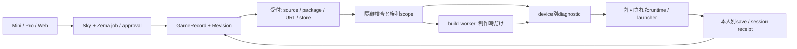

# ゲーム制作と持込みを両立するための実現調査

調査時間: 2026-10-18 23:04:16 UTC〜2026-10-19 00:04:22 UTC（60分06秒）。主担当: Game / Market / Fund（AI06、RQ14）。状態: 一次資料と現行コードを照合した設計調査完了。92件の異なる外部資料URLを引用。実装・実機・公開の受入ではない。

## 1. 答えの範囲

利用者の確定要望は、RockstarOS／Sky／Zemaからゲームを**制作・試遊・修正・書出し**できることと、**他者のゲームを権限のある方法で持ち込み、診断・起動・入力・保存・更新・復旧**できることの両立である。特定タイトル・engineだけの製品にしない。MiniはPCから離れた制作指示と、能力が合格したゲームの単体プレイを目標とする。ProはAI専用PCとして制作・実行の強い候補で、[現行device設計](device-support-architecture.md#pro-internals)ではx86_64 Linuxを第一試作候補とするが、採用hardware／OSとgame GPU性能の実測は未確定である。仕事・費用・本人承認は共通契約、実際の起動・描画・入力・保存は端末／runtime別に判定する。

**結論（設計上の推論）:** 「どんなゲームでも同じbinaryで起動」は約束できない。実現可能なのは、同じ作品IDと検収記録の下に、Web、対象OS向けnative、既存store/launcher、許可されたremote sessionの**別経路**を置き、作品と機種とruntimeと版の組合せごとに対応を示す方法である。独自性の候補はengineの再実装ではなく、制作と持込みが同じ作品台帳へ入り、失敗理由から修正・再ビルド・再試遊へ戻る一周にある。新規性や市場優位性は未検証。

**既存例との比較:** [GDevelopの公式公開手順](https://wiki.gdevelop.io/gdevelop5/publishing/web/)はeditorからWeb gameをbuildしてgd.gamesへ載せる経路を既に持ち、[Heroicの公式サイト](https://heroicgameslauncher.com/)はEpic/GOG/Amazonの購入ゲームをLinux/Windows/macOSで管理・起動する。従って「browserでゲームを作る」「複数storeを見せる」だけを新規の発明・差別化と呼ばない。Rockが検証すべき仮説は、作者の制作仕事、外部作品の合法な参照、機種別診断、本人別saveとrollback、費用/停止の同意を一つの履歴へつなぐと導入時間・復旧時間が実際に短縮するか、である。これは機能の組合せに関する製品仮説であり、特許性の調査結果ではない。GDevelop書出し済みWeb bundleはA経路の候補になるが、GDevelopのcloud build/API利用をRockが許諾されたとは扱わない。

**最短の実現順:** ①既存`WEB13`で小さな作品を作る／権限のある別作者のWeb書出しを受ける、②同じ`GameRecord`へpackage hash・作者・版を登録し隔離診断する、③ProとMiniの各確定機種で起動・入力・保存・再起動を別々に測る、④合格した作品だけ非公開previewから公開審査へ進める。Godot/GDevelop/Unity/Unrealや購入済みstore gameは、この共通契約の下へadapterを一つずつ追加する。ゲーム世界との双方向連携はSDK・MOD等の正式接続口がある作品へ限定する。各段階の具体的な合格証拠は§8に記す。

## 2. 一次資料から確定できた実行上の条件

| 条件 | 一次資料と意味 | Avocadoへの帰結 |
| --- | --- | --- |
| Web版も元engineとexport条件がある | [Godot Web export](https://docs.godotengine.org/en/stable/tutorials/export/exporting_for_web.html)はWebAssembly/WebGL 2、Compatibility renderer、Godot 4のC# Web export不可、single-thread exportを説明する。[Godot Web editor](https://docs.godotengine.org/en/stable/tutorials/editor/using_the_web_editor.html)はWeb editorからのproject exportが未対応と記す。 | 「Miniのブラウザで編集＝書出し完了」にはできない。Miniからの依頼をProまたは隔離build workerへ渡す。Web対応はプロジェクトごとに測る。 |
| 複数engineはautomation入口が異なる | [Godotのexport](https://docs.godotengine.org/en/stable/tutorials/export/exporting_projects.html)、[Unityのcommand-line build](https://docs.unity3d.com/Manual/build-command-line.html)、[UnrealのBuildCookRun](https://dev.epicgames.com/documentation/en-us/unreal-engine/build-operations-cooking-packaging-deploying-and-running-projects-in-unreal-engine)は別々のpreset、target、toolchainを要する。 | 共通UIは作れるが、engine adapterは別実装・版固定・license確認・target別試験が必要。 |
| 持込みmanifestは起動を記述できるが、実行成功は別 | [itch.ioのapp manifest](https://itch.io/docs/itch/integrating/manifest.html)は起動action、OS別entry、prerequisiteを宣言する。[Steam Deck互換性](https://partner.steamgames.com/doc/steamhardware/compat)はタイトルごとにVerified等を評価する。 | 作者申告manifest、静的診断、実際の起動・入力・saveの証拠を別状態にする。 |
| Web配布には明確なpackageと公開状態がある | [itch.ioのHTML5受付](https://itch.io/docs/creators/html5)はZIP内`index.html`と相対pathを要求し、展開後ファイル数・サイズに上限を設ける。[access control](https://itch.io/docs/creators/access-control)はDraft/Restricted/Publicを分け、[butlerのchannel更新](https://itch.io/docs/butler/pushing.html)は配布版の上書きとversionを扱う。 | 初期pilotでは入口・上限・公開scopeを明文化し、採用済みrevisionを指す参照を検収後に切り替える。itch.ioの値をAvocadoの限度として無検討に流用しない。 |
| 第三者の保存は提供元境界にある | [Steam Cloud](https://partner.steamgames.com/doc/features/cloud?language=english)はgameごとのsave path/APIとplatform mappingを設定する。Auto-CloudのOS別rootをそのまま分けるとcross-platform saveにならず、作者のroot override等が必要。[IndexedDB](https://developer.mozilla.org/en-US/docs/Web/API/IndexedDB_API/Basic_Terminology)は同一origin境界、[browser storage](https://developer.mozilla.org/en-US/docs/Web/API/Storage_API/Storage_quotas_and_eviction_criteria)は既定でevictionを受けうる。 | 所有gameのsave adapterがある場合のみ同期・復元を約束する。外部URLやstoreの内部saveを勝手に取得したり「保存済み」と表示しない。 |
| 隔離はビルド時とプレイ時の両方が必要 | [OWASP upload指針](https://cheatsheetseries.owasp.org/cheatsheets/File_Upload_Cheat_Sheet.html)は不正archive等の検査を求める。[Godotの`@tool`](https://docs.godotengine.org/en/stable/tutorials/plugins/running_code_in_the_editor.html)はeditor内でコードを動かし、[UnityのAssetPostprocessor](https://docs.unity3d.com/ScriptReference/AssetPostprocessor.OnPostprocessAllAssets.html)もimport時callbackを持つ。[Flatpak権限](https://docs.flatpak.org/en/latest/sandbox-permissions.html)はhost file/network/device/processを制限する。 | 作者projectを開くだけでコードが動く場合がある。本体のAgent資格情報と同じprocessで開かず、受付・展開・ビルド・ゲーム本体にそれぞれ境界を置く。 |
| Webゲームは同一origin配信が危険 | [MDN iframe](https://developer.mozilla.org/en-US/docs/Web/HTML/Reference/Elements/iframe)は同一originで`scripts`と`same-origin`を同時に許すsandboxを警告する。[Service Worker](https://developer.mozilla.org/en-US/docs/Web/API/ServiceWorkerRegistration)は同一origin/scopeのページを制御しうる。 | 任意ゲームをSky/Zemaと同じoriginへ配信しない。ゲームごとに隔離originまたは同等の分離を検証し、認証cookieを渡さない。 |
| Windows互換は作品ごと | [Valve Proton](https://github.com/ValveSoftware/Proton)はSteam Play用Windows→Linux互換層。[Steam Deck互換性](https://partner.steamgames.com/doc/steamhardware/compat)はanti-cheat/middleware等を条件とする。 | ProのLinux候補にProtonを試せても全Windowsゲーム対応とは表示できない。所有権確認は公式launcher側に残す。 |
| 3D素材はゲーム実行形式ではない | [Khronos glTF 2.0仕様](https://github.com/KhronosGroup/glTF/blob/main/specification/2.0/Specification.adoc)は3D scene/assetの伝送形式。 | 素材のengine間移動に使えても、ゲームロジック・保存・ネットワークを自動変換する根拠にはならない。 |

## 3. 提案する共通契約

入口を`GameRecord`（安定作品ID、作者／権利主体、登録元、private/public範囲）と`GameRevision`（管理するpackageでは不可変source/package digest、外部参照ではprovider ID/URL/観測版と時刻、engine/target、公開状態）に分ける。本人の`Installation`、端末能力の`DeviceProfile`、起動ごとの`PlaySession`、本人別`SaveBinding`、Zemaの`WorkJob`は別主体で結ぶ。digestは同一ファイル確認、作者署名は作者同一性、起動試験は互換性、権利確認は利用範囲の証拠であり、互いに代用しない。[SLSA provenance](https://slsa.dev/spec/v1.2/provenance)はsource・builder・outputの追跡、[検証指針](https://slsa.dev/spec/v1.2/verifying-artifacts)は実際のdigest照合を求める。

**manifest候補 `rock.game-package/1`（未実装）**

```json
{
  "schema": "rock.game-package/1",
  "gameId": "game-sample-a",
  "revision": "r1",
  "sourceKind": "owned-web-bundle",
  "packageSha256": "<64 hex>",
  "targets": [{"os": "web", "runtime": "wasm-webgl2", "entry": "index.html"}],
  "input": ["keyboard", "pointer"],
  "save": {"kind": "author-export-api", "formatVersion": "1"},
  "permissions": {"network": false, "microphone": false, "filePicker": false}
}
```

作者の申告は診断入力に過ぎない。manifestへsecret、本人資格情報、原稿、権利証明の現物を入れない。`rock.game-package/1`の`sourceKind`は管理下の`owned-web-bundle`と`owned-native-package`に限定する。外部URL、store/launcher、remote sessionは別の`rock.game-reference/1`でprovider、正式入口、観測時刻、本人の利用権scopeを参照し、取得していないbyteの`packageSha256`を捏造しない。URLを任意shell commandに変換しない。packageのhashとsourceのhashは別。target entryは相対pathのみ、展開root外を指さず、実行権限を持つentryを無条件に許可しない。作品revisionが変われば旧検収・旧公開承認を引き継がない。外部URLは内容が変わりうるため、前回成功を同一URLの次回成功へ自動昇格しない。

**ローカル持込みはクラウド取込みと別経路:** 利用者が手元に持つ許諾済みDRM-free等の作品fileは、Pro clientのfile pickerで本人が選び、端末内でdigest/形式/arch/権限を診断して`Installation`へ結べる設計にする。たとえば[GOG公式は購入作品のoffline installerを本人がdownload/実行する経路](https://support.gog.com/hc/en-us/articles/213148105-How-do-I-download-my-purchased-items)を説明しているが、それだけでRockへの再配布権やLinux互換があるわけではない。RockのR2へ作品byteを自動送信しない。本人が選んだ診断metadataだけをSky/Zemaへ同期できるが、local pathは他端末で起動可能なpackageではないため、別機種への`compatible`を推測しない。local fileの更新・消失・失効・malwareは端末内で再診断し、実行時もOS sandboxで隔離する。最初のWeb pilotは管理下の非公開package、local-only native持込みはProのexact OS/security gate後の受入とする。

`permissions.network: false`も作者の申告値であり強制機構ではない。Webでは[Content Security Policyの`connect-src`](https://developer.mozilla.org/en-US/docs/Web/HTTP/Reference/Headers/Content-Security-Policy/connect-src)、画像・media・form等の他の送信経路、frame/navigation制限を合わせて対象browserで試験する。nativeではsandboxのnetwork権限とegressを別に強制する。「ネットワーク無し」の表示は実際に遮断試験へ合格した範囲に限る。認証cookieは[Domain指定が下位domainにも届く](https://developer.mozilla.org/en-US/docs/Web/HTTP/Reference/Headers/Set-Cookie)ため、単なる別subdomainでは安全の根拠にならない。

**publicationは別の更新操作:** `GameRevision`自体を上書きせず、`GameRelease`の`channel=private-preview | restricted | public`と`revisionId`を条件付きで切り替える。受付済み・build成功・所有権/権利/安全/起動の必要gate・本人の公開承認をそれぞれ確認し、切替の前後で旧revision、save snapshot、取り消し/再公開手順を保持する。最初のpilotは`private-preview`までとし、restricted/publicは実配備・運用審査が終わるまで無効。これは[itch.ioの公開範囲](https://itch.io/docs/creators/access-control)と[ビルドchannel](https://itch.io/docs/butler/pushing.html)を参考にしたRock独自の設計案で、同サービスと互換だという意味ではない。

作者が公開を撤回した場合は新規閲覧/取得を止めて掲載・検索から外し、本人の保有saveと既取得packageの扱い、法令/契約に基づく保持、調査・appealを別に示す。既に他者が保存したbyteを遠隔で消せると約束しない。release変更は作品台帳に監査eventを残し、ゲーム内からの「公開した」申告を承認の代わりにしない。

Avocado内の`public`と外部storeへの掲載も別成果である。[Steamのreview process](https://partner.steamgames.com/doc/store/review_process)はstore pageと配布buildの双方の審査、表示した対応OS/機能と実buildの一致を求める。[Epic Games Storeの公開手順](https://dev.epicgames.com/docs/epic-games-store/get-started/get-started-steps/introduction)もonboarding、設定試験、最終review、releaseを分ける。Rockは作者の外部store権限・申請状態・各storeの結果を参照するだけにし、Avocadoでのbuild完了を外部store承認と表示しない。

**互換性の結果契約 `rock.game-diagnostic/1`（候補）:** `gameId/revision`に加え、管理packageなら`packageSha256`、外部参照なら`providerRef/observedAt`を持つ。さらに`device model/SKU`、OS/browser/driver/runtime版、実測したCPU/architecture、graphics feature/limits、input/音、storage、network、権利・launcherの条件、検査method、時刻、理由code、次の利用者操作を持つ。静的な不足は`missing_capability`／`unsupported`／`rights_blocked`、通過しても`launch_candidate`までとする。動的結果は起動・入力・保存を**別々のcheck**にし、各checkの`unverified`／`pass`／`fail`／`blocked`と根拠を保存する。表示用`summaryStatus`の`failed_launch`／`launched`／`input_verified`／`save_verified`はcheckから導出し、起動済みだが保存未検証の作品を単に「未検証」へ戻して隠さない。`launch_candidate`は起動を試せる候補で、互換性合格ではない。別端末や新版へ成功を自動昇格しない。試験証拠が古くなれば再診断を促す。

[Valveの機種別compatibility review](https://partner.steamgames.com/doc/steamhardware/compat)もVerified/Playable/Unsupported/Unknownを分け、controller、launcher、middleware、Protonの不足を理由付きで示し、新buildでは再試験する。この先例から、Avocadoの`save_verified`も作品全体の安全保証ではなく、指定した操作・保存path/版での実測結果とする。

| 診断段階 | 取る証拠 | 自動化できない境界 |
| --- | --- | --- |
| 静的`launch_candidate` | 対象OS/arch、entry、必要API、package hash、権利/launcher、必要容量を照合 | 静的情報では描画・操作の成功を保証できない |
| `launched` | 作品hashと機種/OS/driver/実行版を固定し、process/画面到達・crash・所要時間を記録 | 任意の開始画面が見えただけではゲーム進行可能とは言えない |
| `input_verified` | 定めた操作を送り、期待する状態変化とfocus解放を確認。SDK協力作品は状態receipt、他作品は対象sceneの目視/画面・入力logを使う | 第三者ゲームの全操作や全levelを自動検証したとは言えない |
| `save_verified` | 内容が変わる操作→export/保存byteのdigest→終了/再起動→import/読戻し→同じ状態を確認 | 外部storeや任意URLでsaveへアクセスできなければ保存段階は`unverified`に止める |

diagnosticの有効範囲は`revision/package digest + device model/SKU + OS/driver/browser/runtime版 + 実施した操作scene + 時刻`に固定する。曖昧な「全対応」判定を避け、機種更新や新build時は再試験へ戻す。外部URL／storeの変化は観測時刻付き参照なので、providerが同じURLを返しても前回のbyte同一性を証明できない。
具体的にはpackage digest、OS/driver/browser/launcher、入力device、permission、save schema、接続profileのどれかが変われば影響するcheckを`unverified`へ戻す。外部providerは内容の同一性を検証できないため、起動時の最終観測時刻と前回検査の差を表示する。期限だけで古い証拠を「失敗」に変換せず、未再検証として残す。

**作者向け非金融Game SDKの最小面（提案）:** 作者が明示的に組み込む`capabilities`、`requestSaveExport`、`requestSaveImport`、`pause`、`stop`、`playReceipt`だけを検討する。saveは`owner/gameId/revision/formatVersion/digest`を結び、受領済みbyteと作者側の復元ackを別証拠にする。別版へのrestoreには作者提供migrationと退避済み旧saveが必要。game内のスコアや成果申告はZema/Walletの本人承認・実行成功へ昇格させない。このSDKは既存`DX01`の合成資産交換APIとは別package/権限であり、導入しない外部store gameや外部URLにはsave同期を約束しない。[Godot `user://`の保存境界](https://docs.godotengine.org/en/stable/tutorials/io/data_paths.html)と[Unity `persistentDataPath`](https://docs.unity3d.com/ScriptReference/Application-persistentDataPath.html)は既定の保存場所がengine/platform依存である根拠。

Godot Web adapterで作者が協力する場合、[安定版`JavaScriptBridge` API](https://docs.godotengine.org/en/stable/classes/class_javascriptbridge.html)にはWeb exportからbrowser JSへ渡すcallbackとsave byteの`download_buffer`がある。これをSDKの明示exportの候補とする。ただしbrowserはuser gestureなしのdownloadを拒否しうるため、無操作の自動バックアップ完了とは記録しない。Rock側の保存receiptには、本人が選んだexport byteを再受領してdigest検査し、再import後に作者gameが読めた証拠まで必要である。

native診断では拡張子だけで互換性を判断しない。ELF/PE/Mach-O、CPU architecture、共有library/runtime/ABI、GPU APIとdriver、audio/input、launcher/DRM、外部server要件を別に測る。[Steam Linux Runtime](https://partner.steamgames.com/doc/store/application/platforms/linux?l=english)はSDKとruntime版の一致を要求し、[Unreal Linux要件](https://dev.epicgames.com/documentation/unreal-engine/linux-development-requirements-for-unreal-engine?lang=en-US)もglibc/toolchain/GPUを明示する。Linuxでの[Flatpak権限](https://docs.flatpak.org/en/latest/sandbox-permissions.html)はgraphics用`dri`、game controller用`input`（Flatpak 1.15.6以降）、広い`all`を区別する。必要deviceだけを検証し、`all`や全home/全D-Busを既定付与しない。同資料はnetwork許可時のhost abstract socket露出も注意するため、Proの実OS設定で閉じる。Flatpak形式で配布されていない購入作品をRockが勝手に再包装する経路にはしない。未知の要求は`unverified`、不足は`missing_capability`で止め、compatibility layerで動く可能性を実測なしに`compatible`と呼ばない。



**最初のコード境界案（未実装）:** 純粋な`game-package` parserとdiagnostic policy、owner/revisionのD1 registry、quarantineと採用済みpackageを分けたR2 object store、機種別capability probe、型付きplay receipt、`WorkJob`への参照bindingを小さく分ける。`POST`受付は既存`app/api/work-jobs/route.ts`と同じ本人認証・Origin・bounded bodyの慣行を使い、大きなbyteは別upload契約へ送る。管理packageは`owner + gameId + revision + packageSha256`、外部参照は`owner + gameId + registrationRevision + providerRef`へ固定したoperation keyを使う。同じkey・同じpayloadの再送は既存結果を返し、同じkey・異なるpayloadは競合拒否する。外部URLの新しい観測/内容変更は明示的な新`registrationRevision`とし、観測時刻は各revisionの初回記録に固定する。blobの保存成功、D1行の確定、build workerの完了、ゲーム起動の確認は別receiptとし、途中応答消失では同じkeyを照合する。作品データはZemaの12KB JSON bodyへ埋めない。

## 4. 制作の具体経路

制作の入力も二種類に分ける。**source projectがある**場合は本人/作者が許可した範囲で修正し、engine adapterで再buildできる。**配布済みbinaryやstore購入物しかない**場合は起動・診断の対象であり、元作品の改造・再export権を推測しない。ゲーム内MOD/UGCはhost game固有のF経路へ送る。

| 制作adapter | 初期候補としての位置 | 必要な検証 |
| --- | --- | --- |
| 管理されたHTML/JS 2D template | 最初の小さなend-to-end試験。browserで直接動く作品を作り、A経路へ同じpackageを渡せる。[Phaser公式入門](https://docs.phaser.io/phaser/getting-started/making-your-first-phaser-game)。 | dependency固定、CSP、origin隔離、pointer/keyboard、save API、更新/rollback。複雑なゲームや他engineを代表しない。 |
| Godot project | 二番目のengineでsource→Web/native exportを試す。[headless/CLI](https://docs.godotengine.org/en/stable/tutorials/editor/command_line_tutorial.html)、[export preset/templates](https://docs.godotengine.org/en/stable/tutorials/export/exporting_projects.html)。[GodotのMIT license](https://godotengine.org/license/)はengineの商用利用も認め、必要なnoticeを示すため初期adapterの権利条件を整理しやすい。 | `project.godot`、engine/template/preset版、Web制約、`@tool`のbuild隔離、`user://`保存を固定して試験する。作者素材やpluginはMIT一括扱いにしない。 |
| GDevelop source / export | browser editorと[gd.gamesへの公開](https://wiki.gdevelop.io/gdevelop5/publishing/web/)が既存の作者経路。まず作者自身が書き出したHTML5 packageをA経路で受ける。公式の[gameplay test CLI](https://wiki.gdevelop.io/gdevelop5/interface/gameplay-tests/command-line/)は作者が用意した操作期待値を追加の検査に使える。 | Rock側でのproject編集・自動build・cloud API利用は別gate。sourceとexport済みpackageを混同せず、公式CLIの成功を対象Mini/Proでの実プレイ成功へ転用しない。 |
| Unity project | 初期二方式後、まず作者が許可を持つ環境で書き出したpackageの診断から追加。[command-line build](https://docs.unity3d.com/Manual/build-command-line.html)、[Web技術制約](https://docs.unity3d.com/Manual/webgl-technical-overview.html)。作者自身の[Unity Build Automation](https://docs.unity.com/en-us/build-automation/check-build-results/overview)から本人が許可して渡す成果ZIPも取込み候補で、Unity公式はbuild artifactのdownload/shareを説明する。 | editor/license、build profile、target、asset import script、Webの機能差、`persistentDataPath`の継続性。Web版はmanaged C# threadsやraw IP socket等に制約があり、native buildの一律移植ではない。Unity公式はbatch buildでtargetを明示し、複数targetはprocessを分けるよう求める。[2026年のUnity Editor条項](https://unity.com/legal/editor-terms-of-service/software)はEditorの機能/処理をend user向けcloud/hosted/SaaSとして提供する場合、別の権利付与を求め、Build Serverは別契約とする。Rockが第三者作者のためにCloud buildする機能はその条件が確定するまで無効にする。作者のUnity accountや共有linkをRockが無断取得・恒久保存しない。 |
| Unreal project | 高負荷native作品の後段候補。[BuildCookRun](https://dev.epicgames.com/documentation/en-us/unreal-engine/build-operations-cooking-packaging-deploying-and-running-projects-in-unreal-engine)と[platform別release](https://dev.epicgames.com/documentation/en-us/unreal-engine/sharing-and-releasing-projects-for-unreal-engine)。 | ProのCPU/GPU/RAM、SDK/契約、cook/stage/package、pluginのeditor起動、対象deviceでの性能。[Epicの推奨開発機仕様](https://dev.epicgames.com/documentation/en-us/unreal-engine/hardware-and-software-specifications-for-unreal-engine)はWindows例でRAM 32GB/GPU RAM 8GB、[Unreal EULA](https://www.unrealengine.com/eula/unreal)は用途ごとの費用条件を持つ。Web gameと自動互換とは扱わない。 |

1. Mini／Pro／Webでbriefを作り、素材の出所・利用許可、目標platform、入力、保存、予算上限、外部送信を本人が確定する。Agentはplan・コード案を出せるがBrokerの許可やBuild成功にならない。
2. 最初は**管理された小さなWebゲームのテンプレート**と**Godotの許可されたproject**の二経路を比較する。[Phaserの公式tutorial](https://docs.phaser.io/phaser/getting-started/making-your-first-phaser-game)はWebの2D作品がHTML/JSとして動くことを示す。WebテンプレートはMiniの短い指示→Pro/workerビルド→browser試遊を小さく検証できる。Godotは別engineのexport adapter検証に使う。いずれも「全engine対応」ではない。
3. source/asset/lockfile/engine版を固定し、隔離workerへ複製する。`WEB13`のsource URLは参照だけであり、所有権と取得scopeが定まるまで自動cloneしない。workerには本人のproduction credential、Wallet、Sky platform鍵、公開tokenを渡さず、CPU/メモリ/時間/出力量/networkを制限する。[Cloudflare Sandbox security](https://developers.cloudflare.com/sandbox/concepts/security/)が示す通り、clone URLに埋めたtokenは`.git/config`から作者codeに見えるので、必要なprivate sourceの取得は外側の認証済みgatewayで行い、workerへ短命なcontent copyだけ渡す。Web依存物の[install scriptはnpmの設定で抑止/許可範囲を制御できる](https://docs.npmjs.com/cli/commands/npm-ci/)ため、無審査で全scriptを走らせず、必要なものだけ隔離workerで受入する。toolchain依存物と出力digestを記録する。build logはsecretを除去し、必要部分だけZemaへ返す。README、asset metadata、manifestの説明、build log、ゲーム内textはAgentへの非信頼資料であり、その中の指示文をTool権限・承認・費用上限の変更として実行しない。
4. `build succeeded`の後に、起動、最初の操作、終了、save、別process再起動、更新、rollbackを同一package hashで試す。失敗なら診断→Agent修正提案→本人確認→新revision buildへ戻す。確認なしで元作品を書き換えない。
5. 私有previewと書出しを先に完了し、一般配布・catalog掲載・販売は作者権利、review、公開承認、費用、引揚げ/appealを別gateにする。[Godotライセンス説明](https://docs.godotengine.org/en/stable/about/complying_with_licenses.html)はengine・第三者素材のnoticeを求める。Unity/Unrealは当該licenseとbuilder運用条件を対象契約で確認する。

Godot adapterの最小実行形は、許可済みprojectを隔離workerの`/work/source`へ複製し、出力先`/work/out`を作り、版を固定したeditor/export templateで次を行うもの。`export_presets.cfg`のpreset名と出力先を実projectに合わせる。これは[公式CLI](https://docs.godotengine.org/en/stable/tutorials/editor/command_line_tutorial.html)からの実装案で、現Macでの実行結果ではない。

```sh
godot --headless --path /work/source --import
godot --headless --path /work/source --export-release Web /work/out/index.html
```

`--import`段階でもproject/editor拡張コードは非信頼として扱う。Web exportのHTMLと関連assetを一体のpackageとしてhash化し、隔離originで起動試験する。`exit 0`や`index.html`の存在だけで操作可能・保存可能としない。

最初の制作受入は二人の作者が別作品を作り、同じテンプレートの複写だけに見えないよう元source・生成source・試遊結果の差を示す。測るのは初回preview時間、build成功率、失敗から再試遊までの時間、作者が権限/費用/保存を理解できたかである。

初期adapterの自動試験には管理された自作fixtureを使い、参考にする外部sampleはcodeと素材の権利を分ける。[Phaser公式examples](https://github.com/phaserjs/examples)はsource codeをMITとする一方、付属assetは同じ許諾ではないと明記する。[Godot公式Dodge the Creeps](https://github.com/godotengine/godot-demo-projects/blob/master/2d/dodge_the_creeps/README.md)も音・画像・fontが別ライセンス。これらをそのままAvocado配布sampleへ丸ごと混ぜず、採用するassetのnotice/再配布条件を個別確認する。公開demoの起動成功を「二人の独立作者が導入成功」と数えない。

## 5. 持込みの具体経路

| 経路 | 受付と処理 | できること／未保証 |
| --- | --- | --- |
| A. 作者が許可したWeb bundle | ZIP等を大きさ・件数・展開後容量・path・MIME・hashで検査、隔離originへ配置、browser能力probe、入力/save adapter試験 | 最短の実動候補。WebGL/WASMやcross-origin isolation、browser storageの条件が合えば遊べる。第三者のゲームを権利なしに複製しない。 |
| B. 作者が許可した対象OS native package／本人のlocal file | Proのexact OS/arch/driverを検査し、依存runtimeと許可scopeを提示。署名/出所確認、隔離して起動、保存範囲を検証。local fileは端末内でdigestを取り、作品byteを自動uploadしない | Proの機種決定後。LinuxならFlatpak等のsandbox候補を比較する。任意binaryの安全性・互換性は保証しない。local-only fileの成功を他端末へ移さない。 |
| C. 他社store/launcher | 本人が正式な購入/利用権を得たlauncherへ引き渡し、対応実測のみ記録 | Steam等のDRM・更新・saveを迂回しない。内部saveと実行結果を勝手に取得しない。[Steam DRM説明](https://partner.steamgames.com/doc/features/drm?language=english)。Steamの[認証・ownership API](https://partner.steamgames.com/doc/features/auth)で任意ユーザーの全購入作品をRockが検証できるとは推定しない。publisher keyが扱えるAppIDと明示同意を別に確認する。 |
| D. 外部Web URL | URLのorigin、通信/入力/表示を診断し、利用者のbrowserで開く | 提供元originのゲームをSkyへコピーしない。閉じたsaveへのアクセス、後日同じゲームが存続する保証はない。 |
| E. 許可されたremote session | 二つに分ける。E1は本人の対応console/PCを使う[PS Remote Play](https://www.playstation.com/en-us/remote-play/)、[Xbox Remote Play](https://www.xbox.com/en-US/consoles/remote-play)、[Steam Remote Play/Link](https://store.steampowered.com/remoteplay)の正式client/Web入口へ引き渡す。E2はRockが権利を持つ作品をPro等で稼働させ、画面と限定入力をMiniへ送る。[WebRTC](https://developer.mozilla.org/en-US/docs/Web/API/WebRTC_API)は映像・音声・data channelの候補。自作Unreal作品には[Epic公式Pixel Streaming](https://dev.epicgames.com/documentation/en-us/unreal-engine/pixel-streaming-in-unreal-engine)がpackaged gameのbrowser/mobile向けWebRTC経路として参考になる | いずれもMini単体でゲームを動かす実績とは別。E1は本人のhost機器、提供元account、公式client対応OS/browser/controller、title側のRemote Play制限と通信条件を診断し、Rockが映像を再配信・資格情報を代理収集しない。E2はGPU/encoder、遅延・通信量・費用・権利・pairing・入力停止を個別検証。[Epicの初期設定](https://dev.epicgames.com/documentation/en-us/unreal-engine/getting-started-with-pixel-streaming-in-unreal-engine)は複数視聴者が同じinstanceと入力を共有するため、本人別プレイはsession/instance/入力制御を分離する。第三者store作品やGTAのRock独自remote配信許可へ転用しない。 |
| F. ゲーム内MOD／UGC | 対象gameが用意する正式な作者Tool/APIと公開手順へ渡す。[Steam Workshop](https://partner.steamgames.com/doc/features/workshop/implementation)はhost game側のUGC統合、itemのversion/visibility/legal acceptanceを扱う。[Roblox Place Publishing API](https://create.roblox.com/docs/cloud/guides/usage-place-publishing)は許可されたUniverse/Place IDと書込みscopeを要し、[Minecraft Bedrock Add-On](https://learn.microsoft.com/minecraft/creator/documents/resourcepack)はresource/behavior pack固有形式を使う。[Rockstar Mission Creator](https://www.rockstargames.com/newswire/article/39a3412379o79o/play-thrilling-new-gta-online-experiences-built-by-the-community-with)はGTA Online内のUGC制作経路の先例 | standalone gameの実行とは別。各hostのID・権限・version・審査を別adapterにし、GTA/FiveM等も対象build/server/resourceごとに受入する。Mission Creatorの記事はRockが外部APIで自動投稿できる根拠ではない。対象ゲームの内部へ任意の作品を注入できるとは表示しない。 |
| G. Android app/game | Pixel等の対応OSで、正式なstoreまたは許可された署名済みpackageの導入へ引き渡す。[AOSP app sandbox](https://source.android.com/docs/security/app-sandbox)はappごとにUID/processを分ける | OS platform鍵で第三者gameを署名しない。Play等のlicense・端末API/性能は個別に判定し、Android APK動作をMini/ProやPixel全OS buildの受入へ移さない。[Play licensing](https://developer.android.com/google/play/licensing/overview)。 |
| H. 許諾された旧作/homebrewの互換runtime | 特定のlegacy形式について、本人が利用権を持つcontentと選定したruntime/coreの組合せを登録して試験。[Libretroのcore API](https://docs.libretro.com/development/cores/developing-cores/)は映像/音/入力の共通frontendとcoreの分担を示す | 将来の候補。core/APIがあることはゲームcontent/firmwareの配布権や全作品互換を意味しない。ROM・BIOS・暗号解除をRockが収集する入口にせず、タイトル/地域/端末/権利ごとに判断する。 |
| I. 提供元のcloud game | [Xbox Cloud Gaming](https://www.xbox.com/en-US/cloud-gaming)や[GeForce NOW](https://www.nvidia.com/en-us/geforce-now/faq/)などの正式Web/app入口へ、本人の選択で遷移する | 作品のbyteはRockへ持ち込まず、提供元のcatalog・地域・subscription/購入権・browser/device/controller/回線条件に従う。外部のgame/save/accountをRockが所有・診断済みと表示しない。Xbox公式も利用できるtitleが時期・地域・plan・platformで変わると明記する。 |

受付は`received → inspected → launch_candidate → launched → input_verified → save_verified`と進め、各段階の測定artifactを残す。未知形式・権利不足・必要GPU不足は**理由つき未対応**。同じpackageの重複取込みはhashで検出。ゲーム起動時はOSへの入力focus、停止、GPU device lost、network断、storage不足、process crashを試す。更新時は旧packageとsave snapshotを保持し、save形式を変更する場合は作者提供のmigrationを隔離実行し、読めない時に元のsaveを消さない。外部store/providerのsaveはその提供元の復旧方法に従う。

入力は「ゲームが受け取れるaction」と「Mini/Proに付くdevice」を分けて測る。Web gamepadはbrowser/iframeの[Gamepad Permissions Policy](https://developer.mozilla.org/en-US/docs/Web/HTTP/Reference/Headers/Permissions-Policy/gamepad)で塞がれる場合があり、nativeは[SDL mapping](https://wiki.libsdl.org/SDL3/SDL_AddGamepadMapping)や[Steam Input](https://partner.steamgames.com/doc/features/steam_controller)など提供元経路に依存する。diagnosticはkeyboard/pointer/touch/gamepadを別項目で示し、focusをOSへ戻す時に保持中の入力を解放する。controllerが見えた事実だけでその作品の全操作を検収済みとしない。

WebゲームをSky/Zemaと同じoriginのpathへ置くと、scriptとService Workerとstorageが干渉しうる。Game専用の隔離origin/profileでcookie/credentialなしに動かし、親との通信はorigin・session・schema・nonceを検査した限定messageだけにする。上位domainに広く付いた認証cookieがゲーム側へ送られないことも実設定で確認する。iframeだけで隔離済みと見なさず、第三者cookie・IndexedDB・offline cacheの成立を対象browserで実測する。[MDN iframe](https://developer.mozilla.org/en-US/docs/Web/HTML/Reference/Elements/iframe)、[postMessageのorigin検証](https://developer.mozilla.org/en-US/docs/Web/API/Window/postMessage)、[storage partitioning](https://developer.mozilla.org/en-US/docs/Web/API/Storage_Access_API)。

Web保存の第一候補はゲーム専用originのtop-level起動と、作者が実装したsave exportの組合せにする。[Godot Webの制限](https://docs.godotengine.org/en/stable/tutorials/export/exporting_for_web.html)はiframe下のIndexedDB永続性、private browsing、background tab停止、音声/全画面のuser gestureを挙げる。埋込み試遊はbrowserごとに追加で受入し、同じゲームでもtop-levelでは保存できてiframeでは失敗する場合を別結果にする。ゲームが`user://`へ書いた申告だけでRock側バックアップ済みとしない。

console専用作品は既存PC binaryを持たない場合がある。コンソール向け制作・配布は各社の登録・build・審査へ送る別経路で、Pro/Miniへbinaryを移しただけで動く対象に含めない。[Nintendoの開発・公開手順](https://developer.nintendo.com/the-process)、[XboxのGDK/Partner Center手順](https://developer.microsoft.com/en-us/games/resources/develop-xbox-games-for-pc/)、[PlayStation Partners](https://partners.playstation.net/)を参照。これは各社の具体的なAvocado提携や許諾を示すものではない。

**GTA VIの位置（2026-10-18確認）:** [Rockstar公式サポートのplatform案内](https://support.rockstargames.com/articles/4QfG4FmZCf5W1gS8jy4UVT/grand-theft-auto-vi-platform-editions-and-versions)は現時点でPS5とXbox Series X|Sの予約販売を示す。[Cfx.reのresource manifest](https://docs.fivem.net/docs/scripting-reference/resource-manifest/resource-manifest/)はFiveMの`gta5`等のresourceを記述する。ゆえに既存FiveM橋渡しの合格をGTA VIのPC/native/UGC対応へ移せない。GTA VIでは現時点で公式に確認できる購入・起動先へのhandoffと、提供元が将来公開する正式な接続口の再調査を別に扱う。本人のPS5/Xboxでのゲームに公式Remote Playが利用できるかは発売後のtitle/端末別検証課題で、[PlayStationは一部ゲームを非対応と明記](https://www.playstation.com/en-us/support/games/ps4-remote-play-connection-troubleshooting/)する。[Rockstar利用規約](https://www.rockstargames.com/jp/legal)第2.3条・第6.1条は別途明示条件のないremote server／virtual PCでのサービス利用・内容複写や、サービス内容・アカウント等の生成AI開発/学習/素材化を制限する。したがってGTA系素材をAgentの入力・training・評価素材に自動投入せず、E2のPro→Mini独自streamingもGTA VIで許可済みとしない。Rockstarからの提携/改変許諾を得たという記録はない。

[Rockstar公式Launch Trailerのページ](https://www.rockstargames.com/VI/launch-trailer)は2026-10-15公開の動画案内であり、外部作品の投入APIやMOD SDKの仕様を示す資料ではない。動画で見える演出を、取得可能なgame state・NPC操作・物理連携のAPIと読み替えない。利用者が当初示したYouTubeページは今回のWeb取得では本文を直接読めなかったため、GTA VIの可否判断はRockstarの製品ページ、公式Trailerページ、Cfxの仕様に基づく。

### 5.1 現実とゲームを往復する能力は別に受け入れる

[既存の現実↔GTA橋渡し仕様](gta-reality-bridge.md)は、作品をゲーム内へ送り、同一artifactの表示を確認し、ゲーム側からZemaへ下書きを戻す一周を定義する。この能力は「起動できる」の上位にあるが、すべてのゲームが持つわけではない。`GameConnectionProfile`（対象タイトル/版、serverまたはproject ID、公式adapter/API版、operatorとplayerの認証binding、許可capability、停止/取消方法、権利条件）を`GameRecord/Revision`へ参照で結び、起動診断と**橋渡し受入**の結果を分ける。

| 対象 | 可能な橋渡し候補 | 境界 |
| --- | --- | --- |
| Rock製／協力作者のWeb・Godot・Unity作品 | 作者が組み込む非金融Game SDKで自作asset、限定event、save exportを往復 | 作者実装と同じ版のreadbackが必要。game eventは現実の承認を代行しない |
| FiveMなど管理権限のあるMOD/UGC環境 | 提供元の正式resource/APIへ許可済みassetを送る。既存FiveM案はGTA Vの限定例 | server運営者とplayerの同意、同一artifact表示、停止・失効が必要。GTA VIへ転用しない |
| 購入済みstore/console/外部URL/cloud game | 正式入口へのhandoffと、利用者が自分で記録するメモ／リンク | APIや作者許可がなければゲーム内状態、NPC、save、購入権をRockへ自動取得・変更しない |

橋渡しのreceiptは`jobId + gameId/revision + connectionProfile digest + owner/player binding + operationId + artifact digest + target readback`を結ぶ。再送時は同じoperationを照会し、応答不明から新しい配送を自動発行しない。ゲームから戻るeventは出所付きの**非信頼な下書き**で、現実の支払い・発注・送信は既存workflowと本人承認を再度通す。これにより「遊べる作品を増やす」と「現実へつなぐ作品を増やす」を同じ作品カード上で別々に進められる。

## 6. Mini／Pro／Pixelへの割り当て

**Pro**は制作worker候補とnative/Web play候補。[既存内部構成候補](device-support-architecture.md#pro-internals)はx86_64 Linux上のRockstarOS runtime、Value試作のRyzen 7 9700X／RTX 5060 Ti 16GB／RAM 64GBを第一候補としているが、採用hardware／OS・GPU性能は未受入。最初にOS基盤、CPU architecture、GPU/API/driver、入力、RAM/storage、更新・復旧を確定し、同じgame hashでprofileを測る。Linuxを選ぶならFlatpak/bubblewrap、Steam/Protonとの組合せを小さく検証する。別OSなら同等の隔離手段を設計し直す。ProのLLM実行能力とgame GPU能力を同一視しない。

ProのOSを先に「全ゲーム向け」として固定しない。最初の自作Web/Godot sampleならbrowser・export targetで選べる。購入済みPC作品を重視するなら、各gameの正式OS/architecture depot、launcher、DRM、GPU/anti-cheat条件でWindows native、Linux native、Linux+Protonの候補を比較する。[Steamのdepot仕様](https://partner.steamgames.com/doc/store/application/depots)はOS/architecture別contentを扱い、[Valve Proton](https://github.com/ValveSoftware/Proton)はWindows game互換を狙うが作品ごとに制約がある。高負荷Unreal作品なら[対応hostとGPU encoder](https://dev.epicgames.com/documentation/en-us/unreal-engine/getting-started-with-pixel-streaming-in-unreal-engine)を同じsampleで確認する。採用判断は対象game群の`起動→入力→save→再起動→更新`測定、隔離、OS更新期間、端末価格/熱/電力を比較して行う。

**Webバックエンド**は受付・認証・job/権利・object参照・診断結果の制御面とし、Godot/Unity/Unrealの実buildを同じCloudflare Worker request内で行わない。[Workersの現在の制限](https://developers.cloudflare.com/workers/platform/limits/)はisolated requestのメモリ128MB/CPU時間等を示し、[Node.js互換表](https://developers.cloudflare.com/workers/runtime-apis/nodejs/)で`child_process`は非機能stubに分類される。[Cloudflare Sandboxes](https://developers.cloudflare.com/sandbox/concepts/security/)は作者ごとの隔離Linux環境候補で、既定は外部networkを閉じ、Workerと別sandboxから隔離する。ただし同一sandbox内のprocessはfile/localhostを共有し、そこへ置いた資格情報は作者コードに読まれうる。現在の[Container既定の最大instance](https://developers.cloudflare.com/containers/platform/limits/)はcustomでも4 vCPU/12GiB RAM/20GB diskで、公式は申請により上限引上げ可能と記す。したがって既定枠だけで重いUnreal buildやGPU実プレイが成立する証拠ではない。[GitHub Actionsのsecurity指針](https://docs.github.com/en/actions/reference/security/secure-use)もself-hosted runnerへの非信頼code実行の危険を示す。最初はProまたは専用隔離Linux workerに限定し、複数作者向けCloud buildを使う前にjobごとの隔離、egress allowlist、秘密値除去、料金、停止、削除を受け入れる。build workerとGPU付き実プレイ試験機は別に選定してよい。

**Mini**は声/短いカード/物理操作でbrief、進捗、費用承認、試遊指示、修正、結果検収を同じZema jobへ送る。Mini単体で受入可能なのは選定した軽量Web/2D gameの起動・入力・保存・熱/電源まで同一試作機で満たした範囲に限る。Mini R5の`MG01〜07`を用い、特に同じsceneの720p/30fps・30分連続（MG03の暫定目標）、game/OS focus 20往復と押下残留0（MG04）、GPU lossと再起動、閉箱熱を確認する。数値は既存設計の試験目標で、製品性能や実測値ではない。公式Remote Playへの引渡し（E1）とPro独自streaming（E2）は別機能・別受入として表示する。[既存Miniゲーム実行設計](avocado-mini-r5/game-runtime-design.md)。E1はMiniの確定OSが公式clientをサポートするかから確認し、E2の方式は端末・OSで決める。[WebRTC](https://developer.mozilla.org/en-US/docs/Web/API/WebRTC_API)ならbrowser client候補だが、[Moonlight公式FAQ](https://github.com/moonlight-stream/moonlight-docs/wiki/Frequently-Asked-Questions)はGameStreamがraw TCP/UDPを要し純browser clientを提供しないと明記するため、MoonlightをWebRTC経路へそのまま置換しない。動画decode、往復入力遅延、jitter、切断時の入力解放、本人pairing、通信量を測る。

E1の候補も同一端末で一律に動くわけではない。[PS Remote Play](https://www.playstation.com/en-us/remote-play/)の公式対応一覧はWindows/Mac/iOS/Android等、[Xbox Remote Play](https://www.xbox.com/en-US/consoles/remote-play)の現行ページはAndroid/iOS/Windows等を列挙する。両ページからProのLinux候補が正式対応だとは推定できない。一方[Steam Link](https://store.steampowered.com/remoteplay)はLinuxとAndroidのclientを列挙する。MiniのOS/SoC、controller、decode能力も未確定なので、これらは製品約束ではなく個別試験対象である。Xbox Cloud Gamingの対応browserもconsoleからのRemote Playとは別service/権利として扱う。

**Pixel等**は既存OS/client/browser capabilityと正式device support gateに従う。Android APK、QEMU、host browserの成功をnative RockstarOSの実機受入へ転用しない。

## 7. 現行repositoryとの接続点

- `lib/workflow.ts`はjob ID、revision競合、停止、reviewを持つ。現行templateは`article`／`coconala`／`cloud-agent`だけで、cloud料金gateも`planGateForStep`へ固定されている。Game制作/持込みを追加するときは小さな`game-create`／`game-intake`のtemplate、typed step/receipt参照、必要な承認gateを既存遷移に追加し、作品byteは別registryへ置く。`WorkCommand`の`passed`自己申告だけでbuild/playの実測成功としない。既存Webの仕事を新状態機械で迂回しない。現行`app/api/work-jobs/route.ts`のCloud Agent手順は、PATCH時に保存済みの委任・成果・usage receiptを本人jobへ照合してから進める。同型のGame gateでは、`owner/jobId/gameId/revision/package digest/device profile`が一致したbuild/play/save receiptをGame registryから再読取りしてから`record`を受け付ける。Game画面の成功表示やAgentの説明文だけをgateの入力にしない。
- `lib/sky-app-contract.ts`は現状`zoom | planner`の文章成果限定。ゲームbinaryやsaveをこの型へ押し込まず、作品・診断・play receiptを別契約にする。
- Sky catalogは発見/本人の入口を共通化できるが、ゲームの掲載をSky Toolの実行capability付与と同一視しない。作者の作品同一性、配布権、package hash、端末別の動作証拠をGameのregistryで扱い、署名されたゲームだからBrokerの一般Tool権限を持つとは判定しない。
- `lib/work-composition.ts`は現在`text | csv`のみで、`lib/a2a-artifacts.ts`は非テキストのfile/URIを取得・保存しない。制作物の大きなbinary・素材を仕事JSONに入れる設計にしない。新しい本人別object保存、digest、上限、取得/失効の契約が必要。`lib/work-store.ts`のD1 job payloadには参照と小さなreceiptのみを保存する。
- D1の表定義は`db/schema.ts`と`drizzle/*.sql`にある。新しい`GameRecord/Revision/Installation/SaveBinding`は既存`workJobs`や`csvJobs`の列を使い回すのではなく、owner列・revision・不可変digest/参照・消去期限を持つ追加migrationとし、仕事とのbindingには`work_jobs.user_id`との一致を検証する。実schema・migrationは本調査では作成していない。
- `lib/csv-job-store.ts`にはD1行とR2 objectを分け、入力hashを照合する先例がある。Gameには作品/版/owner別のobject keyと別schemaを設計し、既存CSVの課金・容量・保存期限を流用しない。[Cloudflare R2のupload方式](https://developers.cloudflare.com/r2/objects/upload-objects/)は大容量のmultipartと再開を用意し、[presigned URL](https://developers.cloudflare.com/r2/api/s3/presigned-urls/)は期限内に再利用可能なBearer相当である。受付は短命・一意なquarantine keyで発行し、事前の申告容量と費用枠を確認する。ただしURL発行だけでbyte上限や一度限りの書込みを強制できたとは扱わない。完了後にserver側で実byte hash、容量、件数/展開量、owner、権利とvirus/構造検査を確定する。[R2の`CopyObject`とsource条件](https://developers.cloudflare.com/r2/api/s3/api/)は採用済みkeyへのcopy候補で、copy後のdigest readbackとD1参照のrevision条件付き確定を行って初めて`inspected`へ進める。D1とR2は一つのtransactionではないため、copy後にD1条件付き更新が失敗したobjectは非公開の孤児として掃除し、D1が参照しないbyteを配布しない。期限内のquarantine key再上書きや未完了multipartの掃除を設計し、R2 ETagを任意uploadのSHA-256そのものと扱わない。
- `lib/game-sandbox.ts`のGM01は決定的な2D fixture。入力/復旧試験の一部に再利用できるが、一般持込みやengine対応を示さない。
- `lib/game-launch.ts`と`app/game/page.tsx`はFivePlay等の限定入口。外部URL laneの参考にはできるが、汎用実行やsave取得と記載しない。
- `sites/avocado-mini/src/pages/create/index.astro`と`sites/avocado-mini/public/create.js`には`WEB13`の実在する小さなbrowserゲーム編集・試遊・設定JSONのexportがある。starter ZIPと公開HTTPS demoの**非公開審査リンク受付**もある。ここは第一pilotの作者入口として再利用できる。ただし現在の`avokado-mini-browser-game/1`は当該tap demoの設定で、任意作品のbinary/package schemaではない。URL提出はbyteの取込みでも起動検収でもなく、submitterと本人jobの紐付けも別途設計する。初期実装で`WEB13`を作り直さず、`rock.game-package/1`への明示変換と、所有権を持つ作品受付を追加する。
- [IP Studioの交換可能な制作契約](sky-tools-complete-design.md#85-ip-studio--交換可能な制作配信ゲーム展開)にはAsset ID、入力/出力digest、Provider/model版、権利、費用、review状態のlineage設計がある。Game制作は許可済みAsset IDをsource manifestから参照し、素材台帳を別に作り直さない。Asset生成完了とpackage build、起動、ゲームへの導入、販売はそれぞれ別receiptにする。IP Studio設計自体を現行の本番Asset Registry実装済みとは扱わない。
- `docs/game-api-contract-draft.md`と`DX01`はゲーム資産/Wallet接続。非金融Game制作をその完成待ちにせず、発行ポイント権限と実資金記帳権限を分ける。
- 既存の`docs/workstreams/08-game-market-fund.md`を責任とtask IDの入口にし、本書はその調査根拠と実装順を詳述する。全体設計は`docs/rockstaros-complete-design.md`、Miniは`docs/avocado-mini-r5/game-runtime-design.md`が正本。

## 8. 実装順と受入証拠

費用は同じjob内でも別明細にする。`Agent推論/token`、`build CPU/GPU分とtool license`、`試験device時間`、`object保存/転送`、`remote streaming通信/compute`、`store購入/外部権利`、`通信回線`を混ぜない。Cloud/有料Toolは既存[Sky料金・予約契約](sky-billing.md)の事前単価、見積、上限承認、予約・確定・解放、itemized usageを使う。原価や単価が未確定なら見積可能な無料/ローカル操作へ限定し、有料jobの無制限起動を許さない。ゲーム内通貨はRQ13の独立gateのまま本番無効。

Cloud buildの見積単位もproviderの請求単位へ分ける。[Cloudflare Containersの料金表](https://developers.cloudflare.com/containers/platform/pricing/)は稼働時間中のactive vCPU秒、選択instanceに確保したmemory/diskの秒、地域別egress、Worker/Durable Object、logを別計上する。[R2の料金表](https://developers.cloudflare.com/r2/pricing/)はGB-month、書込系Class A、読取系Class B、Infrequent Accessの取出し量を区別する。初期見積は`最大worker稼働秒 × 選択instanceのmemory/disk + CPU上限 + 想定object量/操作回数 + network/log + engine license`で上限を計算し、見積の適用日・地域・無料枠の扱いを明示する。停止/timeoutと未完了multipartの掃除も実使用量に含める。GPU付き試遊hostとstream encoderはこのContainer料金から推定しない。料金は変動するため、ここに固定の販売単価を記さず、実行直前の単価と上限を本人へ提示する。

SIM/eSIMによるSky/RockstarOSのサービス利用権、ゲームの購入/作者license、実行可能なlocal file、本人が持つsource/save、外部store accountはそれぞれ独立した権利・状態とする。サービス終了で新しい有料Agent/buildを止めても、本人の作品・保存データの回収と外部storeの契約を勝手に失効させない。削除/保持期限・提供元の制限は本人に事前表示する。[Skyの本人主導・退出設計](sky-tools-complete-design.md#sky-user-freedom)。

| 順 | 作業 | 必要な合格証拠 | 未解決条件 |
| --- | --- | --- | --- |
| 0 | 最新mainとbranchの入口/優先順位を同期し、dirty差分を保全 | 同じSHAの対象sourceと作業branchを照合。文書保存・branch反映・main統合を別記録 | remote進行の競合がある |
| 1 | `GameRecord/Revision/Package/Diagnostic/Installation/SaveBinding`の小さなschemaを定義 | 不正hash/path/owner/revision/URL/scope拒否、古い承認の失効、重複取込みの結果が決定的 | 初期package形式と保存契約 |
| 2 | `WEB13`の作者入口を再利用し、非金融のA経路: 二人の作者による小規模Web bundle持込みと、Mini/Pro候補browserで診断 | 既存設定JSONと新しいpackageを区別した変換、package hash、起動、入力、終了、再起動、save export/復元、更新/rollback、別owner隔離、失敗理由 | 対象browser/実機、作者権利 |
| 3 | 既存starterを第一fixtureとして小規模Web template→隔離build→試遊→修正→export | sourceとoutput別hash、使用engine/toolchain版、job/revision、予算/外部送信承認、同じpackageの実試遊。build失敗も表示 | worker環境とTool license |
| 4 | Godot source adapterとB native package候補 | headless export、preset/template版、target一致、sandbox、GPU/音/入力、save移行、失敗/rollback | Pro exact hardware/OS、ゲーム素材・license |
| 5 | Unity/Unreal、store/launcher、remote sessionを個別拡張。Unityは作者環境の書出しpackage診断から始め、Rockの代行Cloud buildは別gate | 各adapterの同じ受入項目とentitlement/rights、Miniの単体/stream別表示 | Unityのend user向けhosted build権利、他engine/対象作品の実契約、公開gate |

**次の実装担当が開く場所:** まず`lib/workflow.ts`と`app/api/work-jobs/route.ts`で既存の本人job/revision/receipt gateを読み、`db/schema.ts`・`drizzle/*.sql`・`lib/work-store.ts`・`lib/csv-job-store.ts`でowner別D1/R2と競合更新の先例を確認する。新設するparser/registry/diagnostic/receiptはGame専用の小さなmoduleにし、`sites/avocado-mini/src/pages/create/index.astro`と`public/create.js`の`WEB13`入口へ任意作品受付を**別操作**として接続する。`lib/game-launch.ts`と`lib/game-sandbox.ts`は限定fixtureのまま保持する。実装時は対象branchの最新main同期とdirty差分保全が先で、ここに記したpathを新規独立DBや新しい仕事状態機械の許可と読まない。

**最初の実証セット（未実行）:** 開発fixtureとして`WEB13`の既存starterと、権利/noticeを確認した小さなGodot GDScript projectを使う。これはparser、builder、browser操作、save/rollbackを壊さないための技術試験で、二作者の導入成功率には入れない。その後、同意した独立作者Aが管理HTML/JS templateで新作を作り、独立作者BがRock外で作ったGodot projectを本人環境でWebへexportしたpackageを持ち込む。Aは制作→export→再取込み、BはRockの制作UIを経由しない取込み→診断→play→save/復旧を行い、両者を同じ`GameRecord/Diagnostic`契約で比較する。Bのsource取込みとRock側Godot再exportは、その後の別受入にする。Pro/Miniの実機が用意できなければhost/browser試験までと記録し、二方式が通っても全engine・全ゲーム対応とはしない。

二作者の導入試験、二つのownerが混ざらない保存試験、複数playerが同時に同じgameへ入れる試験はそれぞれ別である。初期pilotは前二者までを対象にし、同一ownerの複数端末での再開を複数player基盤の完成として数えない。複数playerを後で扱う時はplayer identity、session間干渉、同時入力、server権限、個別save/費用を専用の受入へ追加する。

横断失敗fixture: 別ownerのpackage/save、zip-slip/展開爆弾、改ざんhash、切れた権利、unsupported arch/GPU、ネットワーク断、入力focus漏れ、保存容量不足、crash後再起動、更新でsaveが読めない、承認後revision更新、同じjobの重複依頼。合格は環境ごとに`host fixture`、`browser`、`Pro試作機`、`Mini試作機`、`本番`を分ける。導入時間・成功率・復旧時間はRQ14の計測値として実測し、目標値を根拠なく宣言しない。

検収記録は作品hash、作者/ownerを匿名化したID、対象端末SKU・OS/driver/browser版、試験sceneと入力、start/end、save前後digest、失敗理由、操作した人、同意と費用receiptを小さなJSONにまとめる。動画全フレーム、ゲーム原本、ビルドcache、秘密情報はGitへ入れず、必要な証拠は本人別・期限付きのartifact領域に置く。Playwright等で取得したbrowser screenshotは[公式の操作・撮影手順](https://playwright.dev/docs/screenshots)に従い、静的画像だけを「操作成功」とせず入力→画面変化→再起動後状態を結び付ける。

本人への入口は「ゲームを作る」「自分のファイルを持ち込む」「購入先で開く」「Webリンクで遊ぶ」「公式Remote Play／クラウドで遊ぶ」「自作ゲームをProから送る」を明示的に選ぶ形がよい。どの入口も最初に同じ作品カードへ戻り、端末別に「試せる候補」「起動確認」「操作確認」「保存確認」「今は不可／理由」を表示する。見積/承認/仕事の続きはSky/Zemaへ、ゲーム操作は隔離runtimeまたは提供元の正式画面へ送る。未実装のimportや未確認のstore権利を単一の「対応」バッジで隠さない。これは本調査からのUI提案で、既存画面へまだ実装していない。

## 9. 判断が必要な点と次の一手

最初の二方式は、実装負担が小さく制作と持込みを結べる**小規模Web bundle + Godot project export**を第一候補にする。これは調査上の推奨で、Pro OS/GPU、Mini SKU、外部gameの具体的権利、公開先、build費用上限が未確定なので一般対応を宣言できない。最初の開発は既存仕事契約に接続する非金融fixtureと、不正packageを拒否する診断schemaから着手する。利用者が選ぶべき最終範囲は、最初に許可する実作品・端末・配布範囲であり、ROCKは比較sampleと実測を先に提示する。

本調査時点のMacでは`ffmpeg`のみ確認され、Godot/Unity/Unreal/Flatpak/bubblewrap/Steamは未導入。上記engineのbuild、実ゲーム起動、Pro/Mini実機試験、公開、DRM連携、実資金操作は**未実施**である。
