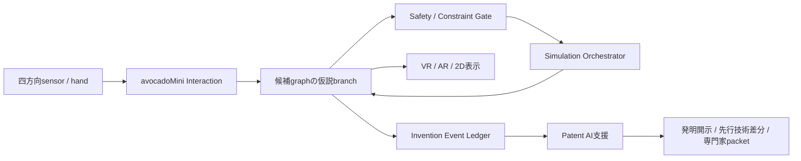

# RockstarOS Material Invention Core — 物質の組合せから発明候補を作る共通設計

状態: RQ49の設計と装置非接続sandbox Coreを実装済み。標準製品体験をRockstarOS端末`avocadoMini`の四方向sensor、hand interaction、差分再計算、Patent AI支援として設計済み。SkyからZemaの2D候補比較・本人用保存・再開へ接続済み。XR runtime、四方向rig、化学simulation、外部データベース、限定記憶、外部ラボ、実験設備との接続は未実装。本文と実装は候補生成と検証の契約であり、安全性、性能、特許性、量産性の実証ではない。

## 目的

Material Invention Coreは、物質と物質だけでなく、配合比、混合順序、温度、圧力、雰囲気、加工、保持時間、冷却、表面処理を一つの候補として扱い、求める特性に近い材料・用途・工程を探索する。RockstarOSは発明の履歴と判断根拠を管理し、物理計算、化学計算、材料データベース、測定器、ロボット、ラボは交換可能なTool／Providerとして接続する。

このCoreの標準製品体験は`avocadoMini Spatial Invention Studio`である。四方向のsensor／cameraが中央のInvention Volumeにある手の動きを捉え、利用者は物質digital twinを掴み、接続し、離し、配合や工程条件を変える。commitされた操作ごとに元候補を破壊しない仮説branchを作り、安全制約を先に検査してから対応simulationを差分再計算する。結果と失敗はInvention Event Ledgerへ残し、人の操作、AI提案、simulation、文献、実験receiptを区別したままPatent AIへ渡して、発明開示と先行技術差分の整理を支援する。

cameraが物理物質を直接動かすわけではなく、gestureは物理実験、外部共有、Wallet、出願の最終承認ではない。Patent AIは新規性、特許性、発明者、権利帰属、登録を自動確定せず、自動出願もしない。

## 共通データ契約

| entity | 必須内容 | 役割 |
| --- | --- | --- |
| `MaterialRecord` | 物質ID、組成、状態、純度、由来、lot、単位、不確かさ、SDS／規制参照 | 入力物質を再現可能にする |
| `CompositionCandidate` | 構成物質、比率、許容差、代替候補、生成根拠、版 | 配合仮説を比較する |
| `ProcessRecipe` | 順序、温度、圧力、雰囲気、時間、加工、設備条件 | 組成と工程を分離せず記録する |
| `SafetyAssessment` | 危険性、反応性、PPE、設備、廃棄、輸送、法規、reviewer | 物理実行のgateにする |
| `SimulationResult` | 使用モデル、入力hash、版、予測値、誤差、適用範囲 | 予測を再計算可能にする |
| `ExperimentReceipt` | 承認、実施者、設備、校正、測定値、raw data hash、異常、時刻 | 実験結果を追記型証拠にする |
| `InventionCandidate` | 目的特性、候補版、根拠集合、比較対象、未確認事項、IP区分 | 次の検証判断を一か所にまとめる |
| `SpatialSceneManifest` | graph digest、候補digest、座標、object binding、安全overlay、表示仮定 | CoreをVR／ARへ正本性を保って投影する |
| `SpatialInteractionEvent` | 四方向rig、校正、tracking model、gesture、confidence、対象、仮説操作 | 手操作を再現可能なCore入力にする |
| `InventionEventLedger` | 人／AI区分、graph diff、model版、結果、失敗、共有範囲 | 発明過程を削除せず追跡する |
| `PatentAiPacket` | event範囲、課題、構成、効果、source区分、引用、公開状況 | 専門家確認前の発明整理へつなぐ |

各値は単位を必須にし、変換元、測定誤差、欠損、推定値を区別する。生成AIの提案、simulation、文献値、supplier申告、実測値は同じ信頼度として混ぜない。

## 発明ループ

1. 利用者が目的特性、用途、禁止物質、費用、設備、環境条件を定義する。
2. Skyから材料データ、simulation、文献検索、Patent AI、ラボ候補を接続する。
3. avocadoMiniへMaterialRecordをdigital twinとして読み込み、四方向sensor rigを校正する。
4. 利用者が手で物質を接続・分離・調整し、ZemaとLocal AIがrelation typeや未確定条件を確認する。
5. Coreが操作を新しい`HYPOTHESIS` branchとして仮適用し、Safety AssessmentがSDS、反応性、毒性、可燃性、圧力、温度、廃棄、輸送、法規を検査する。
6. 変更部分だけをsimulationまたは既知データと再比較する。予測は実験済みと表示しない。
7. 人、AI、simulation、文献、実測のsourceを分けてInvention Event Ledgerへ追記し、Patent AIが発明開示と先行技術差分のprivate draftを作る。
8. 物理実験の対象、量、設備、実施者、停止条件、費用上限を、XR gestureとは別の信頼済み画面で本人が承認する。
9. 資格・設備を持つ外部ラボまたは明示的に許可された装置が実験し、署名付きreceiptとraw data hashを返す。
10. Coreが予測と測定を照合し、失敗も削除せず次の空間操作と候補生成へ使う。

## 安全境界

- 危険性情報、法規、設備適合、廃棄方法のいずれかが不明なら、物理実行を`blocked`にする。
- 爆発性、高毒性、病原性、放射性、違法・規制対象、高圧・極端温度などの候補は、資格を持つreviewerと適切な施設の証明なしに実行へ進めない。
- RockstarOSは危険な合成を無人で開始せず、任意shellや装置の包括制御権限をMaterial Toolへ渡さない。
- Toolは許可された物質、量、工程、装置、時間、費用上限だけを一回承認で実行する。変更時は再承認する。
- simulation、生成AI、文献一致だけで「安全」「発明成功」「特許可能」「量産可能」と断定しない。
- 実験ノート、未公開配合、raw data、知的財産はowner／project単位で分離し、外部共有には対象と目的を明示した承認を要求する。

## RockstarOSへの接続

- Core: entity、provenance、権限、version、approval、receipt、監査、backup／restoreを提供する。
- Sky: 材料データベース、simulation、測定器、ラボ、知財調査Toolの発見と接続を担当する。
- Zema: 目的、候補、追加確認、実行計画、停止、結果、次の反復を一つの仕事として管理する。
- Wallet: simulation、試料、外部ラボ、測定、廃棄の費用を事前上限とreceiptで照合する。研究成果や将来収益を未確認で計上しない。
- Local AI: 秘密の条件を端末内で扱える候補生成・要約を優先する。モデル版と入力hashを候補へ固定する。
- avocadoMini: 四方向sensor、hand interaction、VR／AR／2D表示をMaterial Invention Coreの標準操作面として提供する。候補・安全・証拠の正本はCoreに残す。
- Patent AI: event ledgerから発明開示、先行技術候補、差分表、専門家向けpacketを作る。特許性、発明者、権利帰属、自動出願を確定しない。

## 最初の実装単位

1. `MaterialRecord`、`CompositionCandidate`、`ProcessRecipe`、`SafetyAssessment`のJSON Schemaとfixtureを実装する。**完了**
2. 物理装置へ接続しないsandboxで、二物質・複数比率・工程条件から候補graphを作る。**完了**
3. 危険性情報不足、単位不整合、禁止物質、設備外条件をfail closedで拒否する。**完了**
4. simulation結果と署名検証済み測定receiptを別sourceとして取り込み、候補順位と不確かさを再計算する。**証拠区分のみ実装、取り込みと順位計算は未実装**
5. 第三者ラボ接続は契約、資格、設備、データ保持、事故責任、知財境界を確認した後に独立受入する。**未実装**

初期合格はsandbox上の候補生成、危険gate、provenance、再現、失敗記録までとする。実物の新材料、安全性、性能、特許性、量産性は外部試験を通るまで未確認と表示する。

## 実装済みのsandbox Core

- 入力契約: [`contracts/material-invention.json`](../contracts/material-invention.json)
- 危険物を含まない合成fixture: [`contracts/material-invention-fixture.json`](../contracts/material-invention-fixture.json)
- 純粋runtime: [`lib/material-invention.ts`](../lib/material-invention.ts)
- 自動試験: [`tests/material-invention.test.mjs`](../tests/material-invention.test.mjs)

runtimeは2〜16物質から二物質pairを作り、指定された複数比率と版付き工程を候補graphへ変換する。候補IDとrequest digestはcanonical JSONのSHA-256で、物質lot、配合比、工程版の変更を別候補として固定する。未知field、重複ID、矛盾する危険分類、工程順の欠落は入力拒否、SDS不足、危険性不明、禁止物質／危険分類、配合単位不一致、許可外設備、温度・圧力上限超過は候補を`BLOCKED`にする。既知の危険分類は`REVIEW_REQUIRED`にするが、どの状態でも`physicalExecutionAllowed`はfalseのままである。

simulationは`SIMULATED`、文献・supplier情報は`SCREENED`として実測と分離する。実験扱いへ進めるのは、外部境界で署名検証済みとされたreceiptと有効なraw data SHA-256が揃った場合だけである。現在のCore自身は署名検証、装置操作、物理実験を行わない。

## Sky / Zemaの机上比較と本人用保存

2026-10-11実装。`rockstar-material-invention`をSkyから選び、`/zema/tools/rockstar-material-invention`で入力・比較・保存・再開する。MAT03のうちWeb仕事への接続を進めるもので、MAT03全体、Mini実機、化学simulation、限定記憶、外部ラボの完了ではない。

- **目的・利用体験**: 入力JSONまたは危険物を含まない合成サンプルから、二物質の比率候補を2Dカードで比較する。SDS不足・禁止条件・資格者審査を文字で示し、lot・工程版・入力digestへ戻れる。生成はブラウザ内、保存は別の明示操作である。
- **責任・費用**: ROCK/O5がCoreとWeb保存を担当。外部AI、simulation、ラボ、有料API、Wallet、装置には接続しない。利用者は入力の由来・共有範囲を判断する。保存操作は本人用サーバーへの入力送信であり、外部共有や物理実行の承認ではない。
- **入出力**: `contracts/material-invention.json`の既存入力を維持。2〜16物質、1〜19比率、工程版を受ける。API入力は48 KB、UIの入力本文は47 KBに制限。Coreから最大2,280候補を生成し、`HYPOTHESIS`と`physicalExecutionAllowed: false`を全候補で維持する。物質IDと工程IDの衝突を拒否する。
- **状態・承認**: `lib/workflow.ts`の`material-invention`仕事を使用。通常入力は候補生成後に`review`となり、本人が不足条件を確認して`completed`へ進める。完了は机上比較の確認だけである。合成サンプルは`sample: true`のまま`active`へ保存し、実データ仕事の完了へ昇格できない。取消は`cancelled`とし、保存した入力を削除しない。
- **保存・本人分離**: `/api/material-invention`は既存`requestUser`とZema利用権検査を通し、`work_jobs`へ正規化入力・Core版・request digest・sample区分・WorkJob履歴を保存する。新DBや独立の本人性を作らない。一覧は入力本文を含まない。詳細読出しは本人とjob IDを照合し、入力から候補を再生成してdigestを検証する。機密配合は本人用サーバーへ保存されることを画面に明記し、raw cameraや生体入力は持たない。
- **失敗・再送・競合**: 同じjob IDと入力digest・名前・sample区分の再送は既存仕事を返す。違う入力の再送、別owner、形式版の不一致、保存内容のdigest不一致を拒否する。状態更新は既存revision CAS。応答不明時は入力と同じcommand/job IDを保持し、再試行後も二重の仕事を作らない。入力変更は新しい候補生成と別仕事になる。
- **認証復帰の保存意図**: 一覧GETの`ownerScope`は既存`requestUser`から導出した安定したSHA-256識別値で、認証credentialや権限tokenではない。画面は最初に確認できたscopeを未確認操作に固定し、再送前GETで同じ本人か確認する。不明・別ownerなら本文とIDを保持して送信を止める。元ownerで接続確認するか、「保留を解除（入力は保持）」の後に別IDで新規保存する。解除は保存済み仕事を削除せず、元owner側の保存結果を先に確認するよう案内する。`POST /api/material-invention`と`PATCH /api/work-jobs`へ`X-Rock-Owner-Scope`を送り、APIは現在の`requestUser`と不一致・不正値なら409 `OWNER_CHANGED`で書込前に拒否する。互換APIではheaderは任意だが、この復旧UIは必須とする。header省略は旧client契約であり、owner固定の復旧保証はない。保存のownerは常にサーバーの`requestUser`で決める。
- **復旧・export**: 再読込後は本人の保存一覧から同じ入力を開ける。JSON exportは入力と重複を除いた候補要約を含む。importは入力とsample区分だけを読む。持ち込まれたgraph、安全表示、WorkJob owner・承認・完了状態を信頼せず再生成する。ブラウザのlocalStorageへ配合を既定保存しない。
- **合格条件**: 正常系、SDS不足、サンプル昇格拒否、別owner拒否、同一ID再送、入力変更の競合、revision競合、破損digest拒否、export/importで承認を引き継がないことを確認する。`tests/material-study.test.mjs`は実際のroute、認証/Origin判定、全SQLite migration、work storeを使うhost試験で、外部IdP・本番配備の証明ではない。
- **未決事項**: 限定記憶、simulation receipt取込、候補ランキング、外部ラボ、共同研究共有、保存期間・削除policyの製品化は別受入。現状の仕事履歴は既存保存期間に従い、個別配合の削除APIは追加していない。

実装: `lib/material-study.ts`、`app/api/material-invention/route.ts`、`components/material-invention-workspace.tsx`。検証: `node --experimental-strip-types --test tests/material-invention.test.mjs tests/material-study.test.mjs tests/workflow.test.mjs`、`npm run typecheck`、`npm run lint:product`。ローカル実ブラウザで合成候補3件、SDS不足の`BLOCKED`、未認証保存拒否、保存再試行、再読込復旧、確認済み後のBLOCKED保持、320/390/1280px横はみ出し0を確認した。本番配備・実材料・実機試験は未実施。

## 標準操作面: avocadoMini Spatial Invention Studio

avocadoMiniは任意の飾りや後付け拡張ではなく、このCoreを人が使うための標準製品体験である。候補graphをVR／ARへ投影する共通仕様は[Spatial Invention Studio設計](material-invention-xr.md)、四方向sensorでhand interactionを取得し、候補の接続・分離・再計算とPatent AIを結ぶ端末仕様は[avocadoMini設計](avocado-mini-spatial-invention.md)を正本とする。XR sceneとgesture eventはCoreへの派生入力であり、物質、安全判定、証拠の正本にはしない。headsetがない場合も2D fallbackで同じ発明loopを利用できるようにする。
