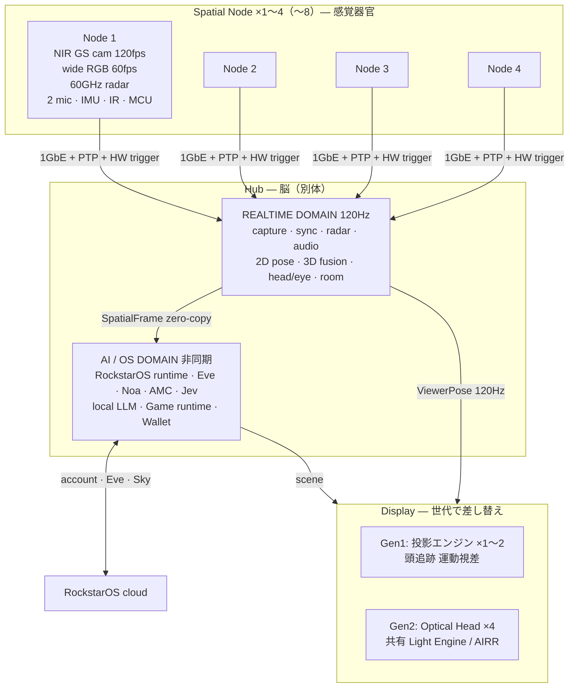

# mii 設計書 V1（Tower 4本＋Hub フル構成、本数可変）

版: V1.0 / 2026-11-02 / 著者: Fable（Noelle 指示）
状態: **設計入力（Design Input）**。寸法・性能目標・受入条件を固定し、試作とRFQに渡す。製造図・部品確定・法規適合・実機合格を意味しない。
上位: [docs/structure/01-mii.md](../../structure/01-mii.md)（構造の決定）。本書はその下の設計書。
出典: 議事録 2026-08〜10、「3Dプロジェクション技術説明」チャット（特に回答 34, 50–55, 64–65）、AVOKADO Issue01 PDF、R5 統合設計（docs/avocado-mini-r5/package/integrated_design.md）。

## 0. 本人の指示（2026-11-02）で固定したこと

| 項目 | 決定 |
| --- | --- |
| 構成 | **Tower（Spatial Node）4本 ＋ Hub（別体）** を基準。1本でも動くが基本4本。最低2本。 |
| 本数可変 | **1→2→3→4（→8）と増やすと空間の品質が上がる**ことを設計の前提にする。本数ごとの「できること」「置き方」「設計の差」を 09 章で固定。 |
| 部屋 | 6畳より大きい部屋に置けること。基準部屋は設計側で決める（02 章: 基準 4.5m×4.5m、対応範囲 3×3m〜6×6m、それ以上は本数追加）。部屋の大きさより**設計そのもの**を優先。 |
| Tower の寸法 | 現実的な数字なら可。→ 高さ 1,000mm、センサーヘッド径 150mm・高さ 200mm（R5 の 200mm 包絡を「ヘッド」として継承）、ベース径 260mm（03 章）。 |
| 表示 | 一人で使った時に「空中に浮かんでいる・没入している」感覚になればよい。→ Gen1 は **頭追跡の運動視差投影**（本物の空中像ではないが、一人に対しては没入が成立する）。本物の空中像（AIRR）は Gen2 の表示ヘッド。05 章。 |
| 試作機材 | 手持ちプロジェクターあり（センサー付き）。Gen1 試作の表示に流用可。Node は新規。13 章。 |

## 1. 一枚絵

4 つに完全分離する（チャット回答 65 §41 の結論を採用）:
① **Spatial Node**（高性能センシング） ② **Hub**（GPU・RockstarOS） ③ **Optical Head**（安い表示出口、Gen2） ④ **Display Engine**（将来の AIRR / Light-field）。
Gen1 では ③④ の代わりに市販の投影エンジンを Hub に直結する。

## 2. 章立て

| 章 | ファイル | 内容 |
| --- | --- | --- |
| 01 | [01-system.md](01-system.md) | システム構成、座標系、データ流れ、レイテンシ予算 |
| 02 | [02-room-coverage.md](02-room-coverage.md) | どの大きさの部屋まで照らせる・追えるか（計算）、基準部屋、Node 配置 |
| 03 | [03-node-hardware.md](03-node-hardware.md) | Node の機構・センサー・電気・熱、Column / Puck / Slot の差分 |
| 04 | [04-hub.md](04-hub.md) | Hub の演算・二層構造・I/O・熱・設置 |
| 05 | [05-display-gen1.md](05-display-gen1.md) | Gen1 運動視差投影の設計（没入の成立条件、明るさ、配置）、Gen2 への道 |
| 06 | [06-sync-network-power.md](06-sync-network-power.md) | PTP＋HWトリガー、配線、電源、PoE |
| 07 | [07-software.md](07-software.md) | spatiald のサービス構成、SpatialFrame、Spatial API、RockstarOS との接点 |
| 08 | [08-calibration.md](08-calibration.md) | 部屋・Node・表示・本人の校正手順 |
| 09 | [09-scaling-1-to-4.md](09-scaling-1-to-4.md) | 本数ごとのできること・置き方・劣化モード・自動検出 |
| 10 | [10-safety-privacy.md](10-safety-privacy.md) | IR 眼安全、転倒、プライバシー、録画表示 |
| 11 | [11-acceptance.md](11-acceptance.md) | 受入試験（数値）と Demo 1〜6 |
| 12 | [12-bom-structure.md](12-bom-structure.md) | BOM の構造（部品の役割と候補。**価格は書かない**） |
| 13 | [13-prototype-plan.md](13-prototype-plan.md) | 試作の順番、手持ち機材の使い方、最初の 4 週間 |

## 3. 用語

- **Node** = Tower = Spatial Node。設計書では Node。製品の形としては Column（置く）/ Puck（天井）/ Slot（壁）。
- **Head** = Node のセンサーヘッド（200mm 包絡）。R5 の筐体はこれ。
- **Hub** = 演算本体。Node には OS を入れない。
- **Display** = Gen1 投影エンジン / Gen2 Optical Head。
- **ViewerPose** = 両眼位置＋頭の 6DoF＋速度＋表示予定時刻。表示 API の中心。
- **SpatialFrame** = 1 フレーム分の世界（viewer, bodies, objects, radar tracks, room）。

## 4. 決めていないこと（本人）

1. Node の最大本数を 4 で止めるか 8 まで設計するか（本書は 8 まで配線・同期を想定、筐体・製品は 4）。
2. Gen1 の投影エンジンを「別売りの箱」にするか「Hub に内蔵」するか（05 章は別箱を推奨）。
3. mii の名前（商標。docs/structure/08 §3）。
4. 本物の空中像（Gen2）に進む判断時期（Gen1 の没入評価＝11 章の受入 D-4 の結果で決める）。
