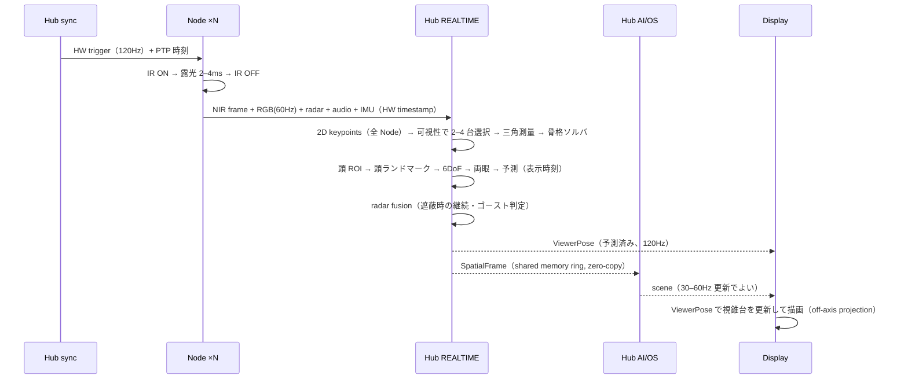

# 01 システム構成

## 1. 構成要素と責務

| 要素 | 数 | 責務 | 持たないもの |
| --- | --- | --- | --- |
| Spatial Node | 1〜4（最大 8） | 同期露光した画像・レーダー・音を Hub へ送る。IR 照明・転倒検知・自己診断 | OS、推論、Wi-Fi、電池、スピーカー |
| Hub | 1 | REALTIME（120Hz 追跡）と AI/OS（RockstarOS）の二層。表示へ ViewerPose と scene を出す | — |
| Display | Gen1: 投影エンジン 1〜2 / Gen2: Optical Head 4 | ViewerPose に合わせて描画を実空間へ出す | 追跡、推論 |
| RockstarOS cloud | — | account、Eve、Sky、Wallet の正本 | 追跡データの生 |

**Node に OS を 4 コピー入れない**（原価・電力・同期のため）。R5 の「1 本の中に CM5」は **Head 内の MCU** に縮退させ、演算は Hub へ集める。1 本構成（09 章）でも Hub は要る（小型 Hub）。

## 2. 座標系

- 世界座標: **部屋中央を原点**、床面 Z=0、+Z 上、+X を「基準壁」に向かって右、+Y を基準壁方向。Node 1 基準にしない（Node を増減しても座標が動かないため）。
- 各 Node: 内部パラメータ K_i, 歪み D_i, 外部パラメータ R_i, t_i を校正で持つ（08 章）。
- 表示面（壁・床）: 世界座標上の平面／メッシュとして登録（Room Model）。投影エンジンも K_p, R_p, t_p を持つ「逆向きのカメラ」として扱う。
- 本人: ViewerPose（両眼位置・頭 6DoF・速度・表示予定時刻）。

## 3. データの流れ（1 フレーム）

フレーム分配: Camera 120fps → Head tracker 120Hz / Body AI 60Hz（2 フレームに 1）/ Semantic AI 30Hz（4 フレームに 1）。間は Optical Flow・Kalman・運動学予測で補間。**表示は 120Hz、重い推論は 30–60Hz**。

## 4. レイテンシ予算（motion-to-photon）

| 段 | 予算 | 備考 |
| --- | --- | --- |
| 露光 | 2–4 ms | IR パルスと同期 |
| Node→Hub | 1–3 ms | 1GbE、非圧縮 NIR 1920×1280×8bit×120fps ≈ 2.36 Gbps → **Node 側で 2×2 ビニング or ROI or 軽圧縮が必須**（06 章） |
| 2D 追跡 | 3–6 ms | 頭 ROI は別パイプライン |
| 多視点融合 | <2 ms | |
| フィルタ・予測 | <1 ms | |
| ゲームロジック | <2 ms | |
| 描画 | 4–8 ms | |
| 表示走査 | 4–8 ms | 投影エンジンの入力遅延に注意（ゲームモード必須） |
| **合計目標** | **予測込み 20–30 ms** | 頭追跡はさらに厳しく: 予測で表示時刻の頭位置を当てる |

受入条件は 11 章（実測）。

## 5. REALTIME と AI/OS を分ける理由

LLM が 2 秒考えていても、剣道の竹刀は 120Hz で動き続ける。REALTIME ドメインは独立プロセス群（07 章 spatiald）で、AI/OS ドメイン（RockstarOS runtime, Eve, Game runtime）が落ちても追跡・表示は止まらない。逆に REALTIME が落ちたときは表示を**最後の安全な状態**（静止画・停止表示）にし、AI/OS が本人へ通知する。

## 6. 本数可変の原則（09 章の前提）

- Node は**対等**。親 Node はない。Hub が全部の同期・スケジュール・融合を持つ。
- Node を足した瞬間に、融合は「使える視点が増えた」として扱う（校正済みなら即、未校正なら 08 章の増設校正を促す）。
- Node を抜いた／故障したときは、残りで劣化モードに落ちる（09 章の表）。表示は止めない。
- 表示（Gen1 投影エンジン）は Node 本数と独立。1 本＋投影でも運動視差は成立する（頭追跡が 1 視点でできる範囲で）。
