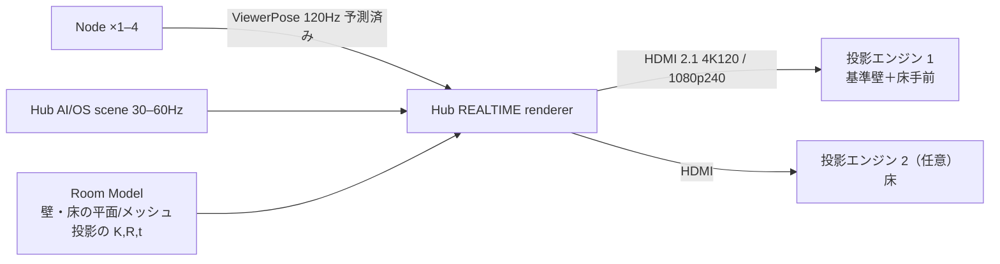

# 05 表示 — Gen1 運動視差投影と、本物の空中像への道

## 0. 本人の要求との対応

要求:「一人で使った時に、その人にとって空中に浮かんでいる・没入している感じになればいい」。

| 方式 | 一人のときの見え方 | 複数人 | 原価目標（RFQ 前） | 位置づけ |
| --- | --- | --- | --- | --- |
| **運動視差投影**（Gen1） | 壁・床の中に奥行きのある世界が見える。壁の手前 30–50 cm までなら物が「飛び出して」見える（頭を動かすと正しく視差が出る）。両眼視差は無い | 一人分の視点にしか合わない（他の人には歪む） | 3〜8 万円 | **今。確実に動く** |
| AIRR（空中像）＋投影（Gen2） | 部屋の中央 30–50 cm の空中に本物の像（チェス駒・分子・相手の顔）。周囲は投影 | 空中像は複数人が同時に見られる | 7〜25 万円 | 光学試作の結果で |
| 4 Optical Head ＋ 共有 Light Engine（Gen2/Pro） | 等身大の相手 | 視線位置から必要なヘッドだけ使う | 4 ヘッド 3 万円が R&D 目標 | 等身大の遠隔相手 |

「本物の空中像」と「運動視差」の違い: 運動視差は**壁に描いた絵を頭の位置に合わせて描き直す**ので、壁の向こう側の奥行きは完璧に出るが、壁から離れた空中の物は頭を動かしたときの遅れで破綻しやすい。AIRR は光学的に空中に像を結ぶので、頭を動かしても像はそこにある。一人用なら Gen1 で「没入」は成立する（チャット回答 34 の結論）。

## 1. Gen1 構成

| 項目 | 設計値 |
| --- | --- |
| 投影エンジン | 3,000 lm 級、DLP または 3LCD、**入力遅延 ≤ 10 ms（ゲームモード）**、120 Hz 入力対応、レーザー光源（寿命・即時点灯）。超短焦点（throw 0.25）を第一候補 |
| 台数 | 基準 1（基準壁 4.5×2.5 m＋床手前 2×3 m）。2 台目で床全面、3–4 台で側壁 |
| 解像度 | 4K（壁 4.5 m で 1.2 mm/px）。1080p でも可（2.3 mm/px） |
| 設置 | 基準壁の直上（UST）または対面天井際 2.3 m。本人の背後から投影し、影を描画側で避ける |
| 幾何校正 | 投影エンジンを「逆カメラ」として Node で校正（08 章）。壁・床の継ぎ目で誤差 ≤ 5 mm |
| 色・輝度校正 | Node の RGB カメラで投影面の反射率・色を測り補正（白い壁前提にしない） |
| 環境光 | Hub が照明を制御（Matter / IR リモコン / スマートプラグ）。投影面 ≥ 150 lux、コントラスト ≥ 100:1 |

## 2. 描画（off-axis projection）

1. ViewerPose から両眼の中点 E（世界座標）と表示時刻 t_d を取る。
2. 投影面ごとに、E を視点とし投影面の四隅を通る**非対称視錐台**を作る（Generalized Perspective Projection, Kooima 2008）。
3. 仮想世界を描画 → 投影エンジンの K_p,R_p,t_p で投影面上の画素へ再投影（ホモグラフィ／メッシュワープ）。
4. 遅延補償: t_d は「描画開始＋描画時間＋走査時間」で予測。頭の速度・角速度で E を外挿。
5. 影回避: Node の骨格から本人のシルエットを投影エンジン視点に投影し、その領域には**描画を置かない or 重要物を置かない**（影が「黒い穴」になるのを避ける）。
6. 2 面以上（壁＋床）は同じ E で連続する世界として描く。継ぎ目は Room Model の角で一致。

両眼: Gen1 は左右の眼に別画像を出せないので E を中点にする。壁の手前に飛び出す物は**壁から 50 cm 以内**に抑える（それ以上は両眼の矛盾で破綻する）。

## 3. 没入の受入条件（11 章 D-1〜D-5）

| # | 条件 | 測り方 |
| --- | --- | --- |
| D-1 | motion-to-photon ≤ 30 ms（予測込み） | 高速カメラ 240fps で頭マーカーと壁の像の遅れを計測 |
| D-2 | 両眼中点の誤差 ≤ 10 mm（Node から 3 m） | 既知位置のターゲットで比較 |
| D-3 | 投影面の幾何誤差 ≤ 5 mm | 壁の角・既知の格子で計測 |
| D-4 | 本人評価: 「壁の向こうに部屋が続いている」「床に正四面体が置いてある」と 10 人中 8 人が答える | Demo 1–4（11 章） |
| D-5 | 速い首振り（90°/s）で像が破綻しない | 動画で確認 |

## 4. Gen2 へ

- Gen1 の D-4 が通ったら、**AIRR 30 cm モジュール 1 個**を部品レベルで設計し（display source → beam splitter → retroreflector → Fresnel）、中国工場 5〜10 社に同じ RFQ（codex/tasks/20）。
- Optical Head（Gen2）に入れてよいもの: 光学素子、光変調、ドライバ、小さな MCU、温度センサー。入れない: カメラ、LLM、Linux、Wi-Fi、電池、スピーカー。眼位置は Node からもらう。
- 共有 Light Engine（1 つの高速光源を 4 方向へ時分割、240 Hz で各 60 Hz）は**研究価値が最も高いが決定仕様にしない**。光学試作で輝度・FOV・解像度を確認してから。
- Display Bus（Hub → Head A–D）は 06 章で配線だけ先に用意しておく（Gen1 の筐体に予備ポート）。

## 5. 手持ちプロジェクター（試作）

本人の手持ち（センサー付きの一般プロジェクター）は Gen1 試作の**表示出口として使える**。条件: HDMI 入力、ゲームモードで遅延 ≤ 20 ms、1,000 lm 以上、台形補正を**切る**（Hub 側で幾何校正するため）。内蔵センサー（オートフォーカス・自動台形）は全部オフ。13 章。
