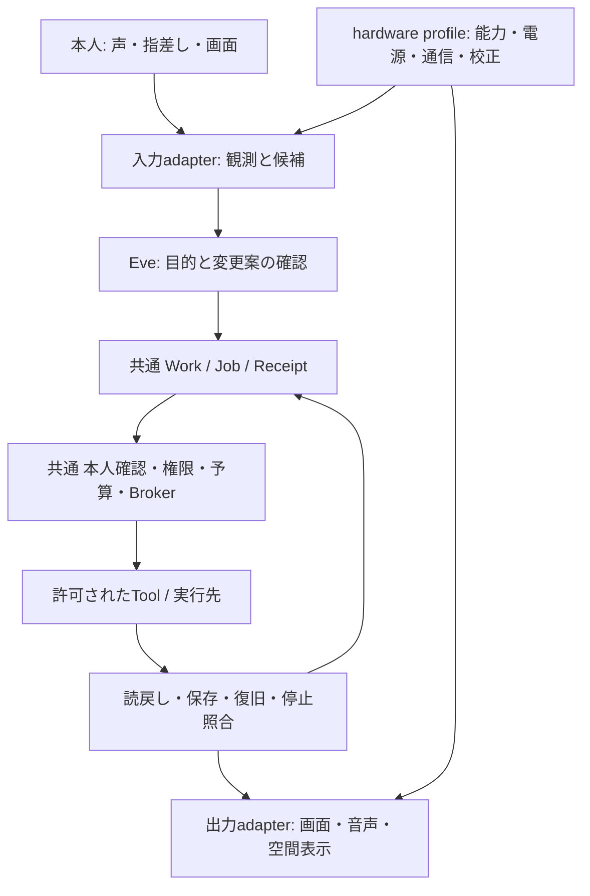

# 14 共通OSとmiiの実機接続

版: V1.1設計追補 / 2026-11-02 / 状態: 設計、実機未受入。
本人の明示回答: **「osの中身は一緒」**。上位は [共通OS構造](../../structure/02-rockstaros.md)、実機化の入口は [設計目次](00-README.md)。MAT15／OS10／MINI01・MINI02、主担当ROCK。

## 1. 作る体験

本人がEveへ話す→指差しで対象を選ぶ→変更案を確認→既存の仕事へ保存→同じ仕事から再開する。別の端末を使う時も仕事を作り直さず、認証後に続きへ戻る。画面・空間表示・音声は同じ仕事への入口であり、それぞれに仕事DB、Wallet、承認ロジックを作らない。

共通とは**業務契約・状態・本人性・保存形式と互換性が同じ**という意味。LinuxとAndroidのkernel、driver、BSP、image、入出力性能が同一という意味ではない。対応しない機能は未対応と表示し、対応端末へ明示的に引き継ぐ。全機種にlocal LLMを必須にしない。

## 2. 変わらない部分とハードの違い

| 共通OSが所有 | profile／adapterが所有 | 境界 |
| --- | --- | --- |
| account、端末束縛、利用権 | device ID、入力機器ID、driver版 | カメラが人を見たことを本人認証成功にしない |
| WorkJob、revision、command ID、Receipt | 観測時刻、座標系、quality、校正ID | 認識結果は候補。保存・実行前に共通検証 |
| 本人承認、Tool scope、上限・予約・使用額 | 実行可能な能力と実行先の報告 | deviceの申告だけで権限・費用を増やさない |
| 保存・競合・同期・停止の意味 | camera停止、物理遮断、接続・電源状態 | OSのcancelと物理出力停止の証拠を分ける |
| model router・履歴・再開 | CPU/GPU/RAM、熱、local modelの実在 | 能力不足でcloud課金やmodel downloadを自動開始しない |

Nodeはセンサー／出力機器。設計済みの室内構成ではHubがOSを動かす。PCで先行する試作も同じ契約を使う。携帯構成の演算搭載位置は未確定でも、共通OSの意味は変えない。

## 3. 既存sourceと実装範囲

基点: GitHub main `7bbb4b27ab6ca3b1d42bef4643c9dda8cb8ba0c6`（PR311統合）。以下はsourceを読んだ範囲。今回の文書作業によるruntime変更はない。

| 既存source | 再利用するもの | 残ること |
| --- | --- | --- |
| `lib/workflow.ts`、`app/api/work-jobs/route.ts` | 共通状態遷移、本人scope、revision競合 | 実機/端末間の同一job受入 |
| `lib/mii-plan-edit.ts` | `edit_plan`、本人確認、CAS、event読戻し | offline変更の永続化と再同期は未実装 |
| `lib/mii-spatial-input.ts` | 2D指先選択、曖昧/古い観測の拒否 | 校正済み3D ray・本人の手の識別は未受入 |
| `lib/mii-local-speech.ts` | 対応環境のlocal音声入力 | 実マイク、日本語ASR、騒音下の評価 |
| `lib/mii-work-adapter.ts`、`lib/mii-indexeddb-journal.ts` | 同じjobの照合、保留cancelのjournal | journalを全成果のoffline保存と呼ばない |
| `systems/rock-star-os/targets/avocado-mini/` | gesture／spatial／電源・通信の既存実験 | mii製品profileと実driverを同一試作機で受入 |

現編集対象はWorkJobの**依頼内容**。任意のサイト、画像、CADを直接編集できるという仕様実装報告に広げない。既存path・API・保存schemaを名称整理だけで移動しない。

## 4. 入出力契約（追加設計、API実装済みではない）

| 境界 | 必須情報 | 拒否／劣化条件 |
| --- | --- | --- |
| 観測→候補 | device／sensor、frame sequence、capture時刻とclock domain、受信時刻、quality、座標単位、校正版、place epoch | 時刻対応不明、古い/逆順、範囲外、校正違いは操作候補にしない |
| 候補→変更確認 | server側で確認した本人、job ID、revision、対象ID、変更前後、必要scope | 複数対象、owner不一致、対象消失で確認を無効化 |
| 確認→保存 | 既存のcommand ID、expected revision、本人の明示確認 | 競合なら再読込。不明なら同じcommandのeventを照合し自動再送しない |
| 出力→実表示 | job/revision、scene版、place/calibration、利用可能領域、出力lease | stale scene／追跡消失／期限切れは空間出力を安全停止 |
| 停止→確認 | job cancel状態、worker状態、出力adapter ACK、独立遮断の実測 | ACKなしは`unknown`。UI停止だけで電源/光の停止にしない |

座標変換は [01章](01-system.md) を使う。2D正規化座標と部屋のm単位座標を同じ数値として混ぜない。現在の2D選択の500ms鮮度判定は120Hz表示の遅延予算ではない。実空間の期限・誤差は [16章](16-prototype-acceptance.md) で別に測る。

## 5. 保存・復旧・通信断

1. accountに紐づく仕事は既存storeが正本。端末cacheにはowner、job ID、revision、schema、同期時刻を束縛する。秘密鍵・原音声・生映像を設計証拠やGitへ入れない。
2. 現状は保存API到達が必要。通信断中は「未保存」を表示し、保存済み表示や自動の副作用再実行をしない。永続offline編集は次段階。
3. 再接続時は同じcommand ID／eventで結果を照合。競合は双方の内容を保全して本人が選ぶ。重複Tool実行・二重課金を防ぐ。
4. 再起動時は本人を確認し、同じjobを読戻す。校正はroom／device配置／版に束縛し、SEは鍵・機器同一性に使う。SEに校正一式が格納できると仮定しない。
5. Node移動／交換、dock取り外しではplace epochと旧機器のscopeを無効化。別の部屋へ校正や物理制御権限を持ち越さない。
6. 熱・電源・watchdog faultでは新規実行を止め、可能なjournal書込後に停止。書込不能なら最後の確認済みrevisionから復旧し、最新保存成功と表示しない。

## 6. 故障時と承認の責任

ROCK: 共通契約、候補/実行の分離、状態表示、hashと試験記録。EXTERNAL: BSP・sensor仕様・光学/電源評価情報。JOINT: 実機遅延、電力、入力精度、遮断、復旧。OWNER: 対象機材・場所・予算・提供条件と本人の操作承認。

Spatial Coreが追跡を失ったら、危険な古い視点の投影を続けない。校正済みの静的安全表示へ落とす条件を実測できない場合はblackout。AI処理が継続しても共通権限/leaseが有効でなければ物理作用は止める。

## 7. 未決定を閉じる順序

| ID | 未決定 | 決め方・完了証拠 |
| --- | --- | --- |
| C-01 | 携帯本体と室内Tower＋Hubの製品構成 | 00章に両出典を保持。本人が筐体構成を選び、寸法/電池/表示の対象を明記する |
| C-02 | 表示Gen1と4条件の関係 | 投影は試験治具として先行可能。板膜なし・少数・上下全範囲・低眩しさの製品合格は別測定 |
| C-03 | local／cloudの実行分担 | 同じjob fixtureと対象hardwareの時間・電力・費用を比較。local LLM有無で業務契約は変えない |
| C-04 | offline編集・端末間再開 | owner/revision/event契約を使って実装し、通信断/競合/別owner拒否を同一候補で受入 |

今回の回答は共通OSを確定する。筐体選択や従来4表示条件の撤回は含まない。機械・基板の不可逆な固定はC-01/C-02と実測後に行う。

## 9. 火災警報機能との接続

[24章](24-fire-alarm.md)の住宅・施設用miiも、この共通OSを使用する。追加能力は消防機器側の状態読取りと補助通知であり、独立する検知・現場警報をJob／LLM／本人ログイン／予算承認待ちにしない。通知先・外部送信・費用は既存契約を使い、通知停止と現場警報停止を分ける。火災・故障・通信鮮度は独立に保持し、既読・配送・再起動を警報解除へ置換しない。消防機器側への書込みAPIは初版に設けない。実adapter・検定・物理受入は未完了。

F2の実入力境界は[25章](25-retrofit-fire-hardware.md)と[mii-fire-f2 profile](../../../systems/rock-star-os/targets/mii-fire-f2/README.md)。FSOJ001B-Sの1a接点は群単位のcontact_closedのみを提供し、発報室・fault・lowBatteryはunknownのまま。接点開放を警報解除へ換算しない。Phidget22診断と共通OS adapterの実装受入は別で、後者は未実装。
