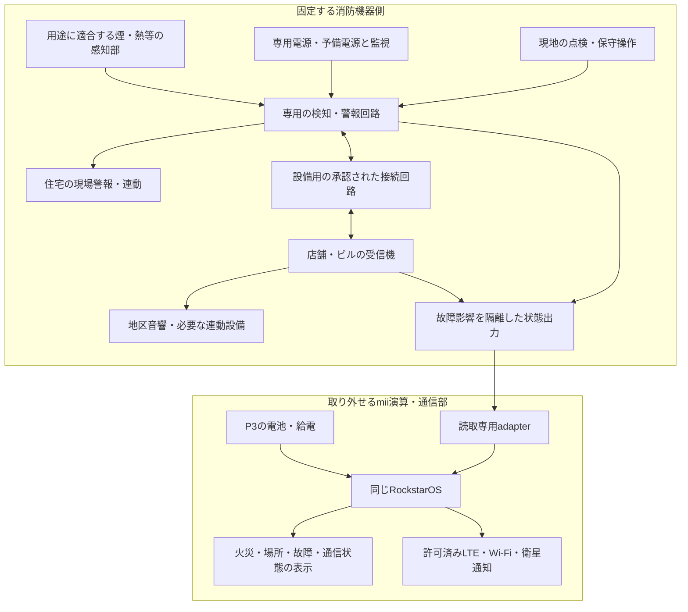

# 24 火災警報機能を備えるmii

版 F1 / 2026-11-02 / 設計入力。製品の検定、施工受入、実機試験は未実施。

本人の指示「火災報知器と同じ部類にしてその機能もつけて、火災報知器の代替えもしてくれる一品に」、対象の回答「全部」を採用する。**miiを住宅・店舗・ビルで使う火災警報機能付き空間端末として開発し、適用する検定・設備基準を満たした構成で既存警報器／感知器を置き換えることを目標にする。** RockstarOSの仕事・本人性・保存・通信・予算は[14章](14-common-os.md)と共通。火災検知と法定の警報経路は、OSとは独立した消防機器側が担う。

製品カテゴリの目標を変更する指示であり、現在のP3試作機に法的な区分・合格表示を付与するものではない。購入・施工に使う消防用の型番／端子は未確定。既存の[可搬P3配線](22-integrated-radio.md)は通信部分の図面として保持する。

## 1. 一つの商品と、用途ごとの適合仕様

普段はEveへの依頼、空間操作、通信、仕事の継続に使い、火災時は現場で直ちに警報する。利用者には一つのmii製品体験として提供する。内部は共通OS部と、用途に適合した火災検知・警報部に分ける。**住宅用の検定を、店舗・ビル用の適合へ流用しない。**

| 適合仕様 | 代替を目指す範囲 | 一式として必要なもの・判定 |
| --- | --- | --- |
| JP-H 住宅 | 設置場所に適した住宅用火災警報器 | 煙式を基本に場所に応じた熱式等を選定。検知・現場警報・電源を本体に備え、連動仕様も受入。必要な部屋／階段ごとに配置 |
| JP-S 特定小規模施設 | 適用要件を満たす施設の自動火災報知設備の構成機器 | 対象用途・面積等による適用可否、連動型感知器等の指定機器と全体構成を確認。家庭用の流用とはしない |
| JP-B 店舗・ビル等 | 自動火災報知設備の感知器としてのmiiと、適合する設備一式 | 煙／熱等の感知器、受信機、発信機、地区音響、配線・予備電源等。P型／R型などの受信機ごとに許可された組合せを固定 |

「全部」は住宅だけに商品を限定しないという対象指定として保持する。必要な設置点数・警戒区域・受信機等を建物ごとに設計する。受信機自体もmiiの商品一式へ統合・提供する目標に含めるが、現段階は適合する既製／OEM受信機を採用する方式とし、Piを受信機として扱わない。どの建物でも1台で全設備の代わりになるという仕様にはしない。

日本消防検定協会は、住宅用防災警報器と感知器・発信機・中継器・受信機を検定品目として扱い、型式承認と製造品の型式適合検定を区別している。[S1] 住宅の寝室・階段等では煙式が必要で、追加設置場所は自治体条例による。[S2] 建物の自動火災報知設備には機器単体とは別の設備試験がある。[S3]

## 2. 着脱できるmiiと、その場所に残る火災監視

採用する設計方針は、**固定する火災検知・警報部に、取り外せるmii演算・通信部を組み合わせる構造**。取り外した通信部は従来どおり電池で単体通信する。固定部には感知部、警報経路、必要な予備電源・連動経路が残る。

- 固定部は認められた天井／壁位置で常時監視する。机上に置いた可搬Coreや床のTowerを、所定位置の感知器として数えない。
- 着脱で煙の入口や警報の音口を塞がず、演算部を外しても感知部の向き・通気・電源・連動を変えない。
- 火災部全体を外す作業は保守として扱い、必要な監視を維持する代替措置と施工・管理者の手順を必要とする。遠隔通知だけを代替措置にしない。
- 「監視中」「火災警報」「故障／電池低下」「交換・保守」を固定部自身で区別して知らせる。画面、ログイン、スマートフォンを必須にしない。
- 重量、取付強度、落下、点検可能性、発熱、煙流入を確認し、既存200mm目標やP3筐体を消防機能の制約より優先しない。既存の表示4条件は別の製品目標として維持する。

## 3. 独立した警報経路

以下は機能と責任を示す論理接続図。端子番号・電圧が確定した組立配線図ではない。

図の住宅系と設備系は用途別の実装であり、未認定の端子同士を共用接続する指示ではない。

独立性を製品の必須要件とする。

1. OS停止・再起動・OTA・ストレージ故障・LLM無応答・回線断でも、消防機器側の所定の検知・現場警報・連動を維持する。
2. P3の電池、UPS、電源スイッチを消防機器側の唯一の電源にしない。主電源故障、短絡、逆流、過熱が消防機器側へ波及しない構成とする。設計電力・予備時間は消防機器側とP3側で別に計算する。
3. 法定の警報音源・駆動・音量とmiiの会話／音楽用スピーカーを分離する。夜間モード、音量0、課金停止、account失効で火災警報を止めない。
4. AIによる映像判定や二次確認を、火災警報開始の前提にしない。補助的な映像解析を後で追加する場合も、一次警報を抑制しない。
5. 共通OSから感度変更、警報停止、復旧、試験開始、消防機器側FW更新を行う制御線／APIは初版に設けない。現地の停止・復旧は適合品の正規操作と管理手順で行う。
6. 消防機器側の電池低下・回路故障は自己監視で報知する。OS接続の有無と、消防機器が正常かどうかを分ける。

消防機器と演算部を同じ外装に納める場合、通気、冷却風、IR迷光、粉塵、熱、RF、電源故障を含めた完成形で評価する。市販の検定済み警報器へ穴開け・電源分岐・ケース変更をして、その合格を完成miiへ引き継がせない。住宅用の規格省令にも附属装置の影響に関する規定があるため、最終形状の適用・試験条件を検定機関と確認する。[S4]

## 4. 部品と配線を確定するための境界

| 接続 | 方針 | 未確定のまま通電・接続しない項目 |
| --- | --- | --- |
| 感知部→消防機器側回路 | 消防機器OEMの適合する感知室・感知回路・FWを一組で採用 | 型番、検定型式、感度区分、感知部の姿勢と通気。汎用煙／温度sensorだけで代替可としない |
| 消防機器側→現場警報／連動 | その用途の指定音響・光表示・連動回路 | 音響部品、定格、駆動、電池、連動相手。住宅警報とビルの地区音響を別に照合 |
| 消防機器側↔受信機 | JP-S／JP-Bの適合した系統。メーカーが指定するbase・中継器・終端・監視方式 | 受信機・感知器・baseの正確な組合せ、端子番号、極性、線種、回線長・負荷・終端抵抗。P型／R型を汎用互換とみなさない |
| 消防機器側→mii | OEMの許可する状態出力を絶縁・電流制限した読取adapterで受ける | 出力方式、接点定格／絶縁、入力電圧、故障時挙動、正常性の監視。消防回線をPi GPIOへ直結しない |
| 電源 | 消防機器側の専用電源・予備電源とP3電源を分離 | 電池型番、保持時間、警報時負荷、充電・保護、耐火／耐熱配線等の適用。P3の3S電池を無条件共用しない |

接続名は機能名であり、実在端子番号ではない。火災側の型番はOEM完成品／正式供給部品と検定範囲を先に確定し、メーカーの現行図面からpin-to-pin表を作る。既存P3部品の選定を取り消すのではなく、消防機器側へ流用可能という扱いを止める。衛星の屋外視界と天井の感知位置は両立を検証し、屋内の衛星通知成功を前提にしない。

試作は、検定済み機器を正規状態で維持し、メーカーが許可する出力だけをmiiで読む方式から始める。これは連携試作であり、mii完成品の消防機器認定とは分ける。量産品は最終筐体・電源・FW・連動構成を含むOEM／検定経路へ進める。

## 5. 共通OSで扱う状態・保存・通知

追加する能力は `fire_status` の読取りと補助通知。別のOS、別の仕事台帳、Sky Toolの自動実行権を作らない。実adapterは未実装。

- 入力にはdevice ID、適合profile、設置zone、source sequence、観測時刻、接続の鮮度、fire／fault／low-battery／maintenance／testの独立した状態を持たせる。火災と故障は同時に成立できる。単一のenumで火災を故障表示に上書きしない。
- 匿名の未登録入力は実警報として認証しないが、欠測を正常とも表示しない。状態出力が火災接点だけなら「火災接点入力」を表示し、感知器全体の健全性は未確認とする。
- 最後の警報と未確認状態は再起動後も参照できるようlocal保存する。復旧・取り外し・新しいsequenceは元の機器状態と照合する。画面の既読や通知配送成功は警報解除を意味しない。
- 正常表示は、新しい有効な状態観測でのみ回復させる。通信断・期限切れは「状態未確認」とし、最後の警報履歴を残す。
- 外部通知先、建物／部屋情報、費用上限、再送間隔と保持期間を導入時に本人／管理者が設定する。消防機器側の現場警報は契約・account・AI利用料に依存しない。外部通知は既存の送信同意・有限予算を守り、予算超過時は「外部通知停止」と表示する。
- LTE／Wi-Fi／衛星は補助通知経路。P3のR01〜04、Skylo接続維持、屋内遮蔽・遅延・不達を引き継ぐ。無線通知の成功を受信機や消防への通報成功へ読み替えない。
- 119自動発信、消火起動、防火戸・排煙・エレベーター制御は、各対象の適合する設備・連動計画の受入が必要。今回のAgent／音声／一般通知APIから直接作動させない。避難案内は確認済み建物計画に従い、LLMが未確認の避難経路を断定しない。

## 6. 認定・設置までに閉じる条件

主担当はMAT15／JOINT、ROCKが設計入力・共通OS接続を担当。OS10・MINI-08・NET01との境界を維持する。

| 条件 | 担当 | 完了に必要な証拠 |
| --- | --- | --- |
| F-G01 対象区分 | JOINT：消防機器設計・施工の専門担当 | 住宅／特定小規模施設／一般の自火報について、適用用途・設置位置・台数・受信機等を文書化。対象物件はOWNERが指定 |
| F-G02 適合する機器構成 | EXTERNAL：OEM・検定機関 | 完成形の型式・検定範囲、指定部品／FW／筐体／電池／取付、製造品の検定と表示・変更管理。技適/PSEと消防検定を分離 |
| F-G03 独立性と配線 | JOINT：回路・電源・消防機器担当 | 正式回路／端子表、故障影響解析、絶縁・逆流・短絡・予備電源・監視、着脱後の警報継続、受信機互換性 |
| F-G04 感知・音響・環境 | JOINT／EXTERNAL：試験機関 | 適用基準を根拠にした感度・応答・音圧・環境・EMC・機械・寿命の試験計画と実結果。目標値を実測済みにしない |
| F-G05 建物設備受入 | JOINT：消防設備士等・建物管理者・管轄消防 | 設備設計、必要な届出・施工・試験、連動・故障・予備電源、点検保守・交換手順の受入 |
| F-G06 共通OS連携 | ROCK | 読取の真正性／鮮度、火災と故障の同時表示、再起動・重複・既読・復旧、通知同意／費用／不達を検証 |

認証条件、試験値、消防機器側の部品型番はOEMと検定・施工の専門担当のレビューで確定する。家庭向けと建物向けの許可を個別に管理し、一方の合格から他方の代替可を出さない。今回の「同じ部類に」という指示だけで技適・消防検定・設置適合を取得済みとしない。

## 7. 実機受入と保守

以下は試験仕様であり、すべて **NOT_RUN**。認定試験と実際の建物試験は、設備を管理する専門担当と実施する。実火や無断の設備作動で試さない。

1. **F-A01 独立警報**：OSハング、再起動、空の保存領域、ログイン不可、回線なし、予算0で、適用profileの検知・現場警報が成立する。
2. **F-A02 電源・着脱**：演算部を取り外す／その電池を使い切る／主電源を失う場合の固定部動作を確認。消防機器側の電池低下・断線・短絡は指定手順で検査する。
3. **F-A03 完成形の感知**：演算最大負荷、fan／IR／RF動作、筐体の全許可姿勢・着脱状態で試験。煙流入・排気・光・熱・埃による影響を測る。
4. **F-A04 建物連動**：適合する受信機と全必要回路で警報・場所表示・回路故障・復旧を試験。家庭の連動試験をビル試験へ転用しない。
5. **F-A05 状態・履歴**：火災＋故障、古い情報、断線、不正device、OSの再起動、既読後の継続警報を確認する。
6. **F-A06 通知**：屋内衛星不可、LTE断、Wi-Fi断、重複・遅延・送信上限を試験。受信者への配送結果と現場警報・消防通報を別記録する。
7. **F-A07 保守**：製造／設置／点検／交換記録、現地ボタン、清掃、電池・故障表示、取付状態を確認。交換時も必要な監視を維持する。

住宅用警報器には定期的な作動確認・清掃・交換が必要で、交換目安は10年と案内されている。[S5] この目安をP3電池の持続時間や、mii全体の無保守10年保証にしない。採用品の期限と保守条件を製造番号ごとに追跡する。

次の作業は、住宅用／施設用それぞれのOEM方式と対象建物の条件を確定し、F-G02/03の原本から消防機器側BOMと実端子配線を起こすこと。外部問い合わせ・申請・契約・購入・施工は今回行っていない。先に送信済みの通信2社への照会は[23章](23-japan-procurement.md)の範囲を保つ。

## 8. 確認した一次資料

- [S1 日本消防検定協会：検定業務](https://www.jfeii.or.jp/activity/) — 型式承認、型式適合検定、品目と合格表示。
- [S2 消防庁：住宅用火災警報器Q&A](https://www.fdma.go.jp/relocation/html/life/yobou_contents/qa/) — 感知・警報、寝室等の煙式、設置・連動。
- [S3 消防庁：消防用設備等の試験基準等の改正通知、2024-03-29](https://www.fdma.go.jp/laws/tutatsu/items/20240329_yobou3.pdf) — 第11の自動火災報知設備等。実施設計時に現行改正と管轄の条件を再照合。
- [S4 e-Gov：住宅用防災警報器等の規格省令](https://laws.e-gov.go.jp/law/417M60000008011)／[感知器・発信機の規格省令](https://laws.e-gov.go.jp/law/356M50000008017) — 適用する法令の入口。今回e-Gov本文取得は制限があり、現行条文全項目の適合審査は未完了。
- [S5 日本消防検定協会：住宅火災対策](https://www.jfeii.or.jp/learn/alarm/) — 自動試験、維持管理、交換目安。

確認日：2026-11-02。法的区分・設置適合の最終判断は、選んだ完成機器と対象建物について行う。
