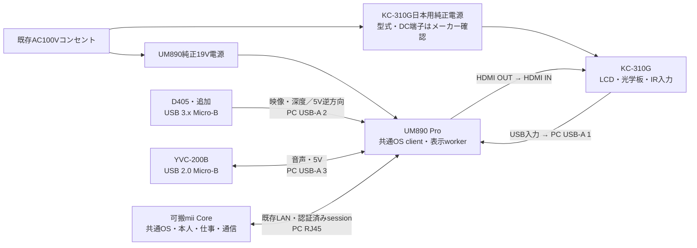

# 27 裸眼・工事なしの空間SI — 実現性、部品、接続、費用

**後続指示:** 本人は卓上案を製品目標にせず、部屋全体の新規開発を指定した。[28章](28-room-scale-si-rd.md)を現行の研究方針とし、本章は市販品比較・価格資料として保持する。

調査日: 2026-11-08。MAT15／ROCK、MINI01/02・OS10。本人の参考動画にある「周囲に浮く資料、中央の立体対象、手操作、会話」を対象にする。名称は **SI**。共通OSの仕事・権限・保存・再開は[14章](14-common-os.md)を維持する。これは一次資料による設計判断であり、組立・実機測定・メーカー見積取得は未実施。

## 1. 結論と要求の扱い

**机の近くに浮く画面を裸眼で見て操作する構成は、市販品を組み合わせて評価できる。動画のように部屋全体の任意位置へ、立体・資料を出し、歩き回りながら触れる体験を、小さな天井miiだけで工事なしに実現する購入可能な構成は確認できなかった。** 実現不可能という物理学上の断定ではなく、確認できた製品・研究の到達範囲に基づく判断。

今回の「工事なし」は既存の机・棚への設置とコンセント／完成品ケーブルの接続まで。壁・天井内の配線、穴あけ、AC直結は不要とする。**コードも外部表示装置も一切なし**という要求を満たすものではない。製品の単体携帯、板膜なし・少数表示部・上下全域・低眩しさ、消防代替は撤回しない。

| 体験 | 一次資料で確認できる範囲 | miiでの未達条件 |
| --- | --- | --- |
| 浮く資料・ボタン | ASKA3Dは光学プレートの外に実像を結び、IRセンサーと組み合わせて操作可能 [S1–S3] | 装置に結び付いた結像面と視域。部屋の任意位置・全周ではない |
| 周囲から見られる立体 | VX2は直径25cm×高さ25cmの走査体積、複数人で周囲から見る方式 [S8] | 可動表示面を持つ装置内。部屋全体の空気中表示ではない |
| 立体の中へ手を入れる | FlexiVol研究は弾性拡散材を使った体積表示と直接操作を実証 [S10] | 拡散材と駆動機構が必要。購入して家庭へ置く完成品の見積・適合は未確認 |
| 壁・床に部屋を広げる | 既存05章の頭追跡投影は空間演出の評価経路 | 光は壁・床に届く。両眼で同じ奥行きの実像になる保証はない |
| 裸眼・空中・全室・少数・低眩しさの同時達成 | 今回の市販品調査で適合一式なし | C-02を継続。固定焦点／視域／表示面積／遮蔽／輝度の実測が必要 |

透明OLEDは物理画面、XRは装着機器が必要なので、この要求を満たす採用案から外す。空中にレーザーで点を発生させる研究もあるが、家庭向けの調達可能な一式と部屋規模の文字表示を裏付ける資料は得ていない [S11]。

## 2. 最初に評価する構成 S1

**KC-310Gを机に置き、手前の浮遊パネルでNoahへ話しかけ、資料を選択し、モデルを回転させ、同じ仕事を保存する。** まず標準のIR入力で選択・ドラッグを評価する。手全体でつかむ三次元操作は追加カメラと別ソフトが必要。

ASKA3Dは二面直交リフレクターによる空中結像方式。05章のビームスプリッター＋再帰反射材によるAIRR案と同一の部品構成ではない。LCDの画を空中に結ぶ本構成では、表示された3Dモデルも画としての立体表現であり、奥行き全域に発光点がある体積表示にはならない [S1–S3]。

| ID | 部品・variant | 数量 | 役割・端子・電源 | 価格の扱い |
| --- | --- | ---: | --- | --- |
| D1 | アスカネット **KC-310G** | 1 | 12.1型／16:10。ASKA3D-310、LCD、IR入力、筐体。HDMI映像＋USB入力。360×410×182mm、5.5kg、最大60W [S1,S3] | **Q310: 要見積**。日本用純正電源、HDMI／USB適合ケーブル、設定ソフト、税・国内送料を含む金額で取得 |
| C1 | MINISFORUM **UM890 Pro／32GB RAM＋1TB SSD／Windows 11** | 1 | Ryzen 9 8945HS／内蔵GPU。HDMI×1、USB-A 3.2 Gen2×4、USB4×2、2.5GbE×2。純正19V電源使用 [S4] | 公式掲載174,399円税込。79,999円はOSなしベアボーンなので使用しない |
| A1 | Yamaha **YVC-200B** | 1 | マイク＋スピーカー＋エコー低減。USB 2.0 Micro-B、付属USBケーブルでPCへ。USB給電、最大2.5W [S5] | 2026年10月改定後の希望小売価格38,500円税込。実売・納期は販売店見積 |
| G1・追加 | RealSense **D405** | 0→1 | 手元7–50cmの深度／RGB取得。USB 3.x Micro-B、5V。streaming公称1.55W。USB-A→USB 3.x Micro-Bの正規対応ケーブル [S6,S7] | 公式掲載US$325。税・送料・輸入費別。最初のIR選択試験には不要 |
| M1 | 既存の安定した机・棚 | 1 | 有効面600×600mm以上、機材総重量に対し余裕のある耐荷重。D1の設置角度・眼位置はメーカー指定に合わせる | 既存品流用なら0円。家具新調は別見積 |
| W1 | 純正電源・指定映像／USBケーブル、必要な固定具・ケーブル整理 | 一式 | D1/C1は個別ACアダプター。内部DCを共通化しない。D405は短い直結ケーブル。汎用USB2 Micro-BをD405用と取り違えない | 不足品・カメラ台・配線整理などの**予算枠20,000–40,000円**。販売価格ではない |

KC-W1は7型・1.73kg・最大36W、KC-420Gは15.6型・9.7kg・最大60Wの比較候補 [S1]。S1は資料を読む用途を考え12.1型を選ぶが、可読性は受入前。手持ちM4 Macを利用できればC1購入分を削減できる可能性がある。ただしASKAの説明はWindows接続であり、macOSのIRドライバー互換を確認せず「Macで動く」としない。

D405は距離画像センサーで、完成した手指追跡器ではない。指の認識・つかみ判定・表示座標への校正はROCKの実装と測定が必要。既存のLeap Motion Controller 2は国内代理店の取扱終了告知（2026年6月）があるため、新規調達の基準部品に固定しない [S12]。

### 部屋へ広げる場合の限界

正面・左右の家具にKC-310Gを各1台置けば、3か所に固定された浮遊パネルを設ける候補にはなる。ただし同一人物が同時に見られる配置、USB入力と画面の対応、遮蔽・照明は未受入。1台から部屋中へ好きな位置に出せる構成にはならない。3台で表示装置だけ16.5kg、電力枠は3×60W＋PC120W＝300W（各AC変換損失・Core別）。表示部費用は3×Q310、さらに映像出力変換・延長・家具・入力校正が追加になる。UM890の複数映像出力だけで3台の光学・入力互換を合格としない。S1の1台評価前にこの拡張を注文仕様にしない。

## 3. 外部端子の接続図と未確定端子

| 接続 | 組立指定 | 確認状況 |
| --- | --- | --- |
| S1-N01 映像 | C1 HDMI出力 → D1 HDMI入力。メーカー適合ケーブル、D1のEDID／推奨解像度で出力 | HDMI接続はメーカー公表。D1側コネクター寸法・native画素数・refreshは資料未取得。4K/120Hzを仮定しない |
| S1-N02 空中入力 | D1指定USBケーブル → C1 USB-A。Windowsの入力座標とD1画面を関連付ける | USB接続は公表。D1側Type／VID-PID／HIDか専用driverか、同梱物を確認する |
| S1-N03 音声 | C1 USB-A → 付属USBケーブル → YVC-200B Micro-B | メーカー資料で確認。USB入力・出力を明示選択し、物理ミュートを使用 |
| S1-N04 深度・追加 | C1 USB-A 3.2 → USB 3.x Micro-B → D405 | D405の10接点Micro-Bはメーカーdatasheet §3.7.6。VBUSは5V。既製ケーブルを使い、接点への手配線はしない |
| S1-N05 PC電源 | C1付属ACケーブル → 純正19Vアダプター → C1 DC IN | 公式仕様120W（19V／6.32A）。DCプラグの推測互換品を購入しない |
| S1-N06 表示電源 | 日本向けD1純正ACアダプター → D1 DC IN | **型式・DC電圧・極性・コネクターは未公表／資料待ち**。最大60Wだけで12V等を推定しない |
| S1-N07 Core接続 | C1 RJ45 → 既存LAN → 可搬Core。電源は各系統の既存設計 | 認証・表示session・校正・仕事の再接続adapterは未実装／未受入 |

**接続方式まで確認済みだが、S1-N01/02/06の購入仕様が未確定なので、完全な注文書・製造配線確定とはしない。** 製品詳細PDFは問い合わせフォーム送信後の提供で、今回は新しい個人情報送信・外部照会をしていない [S13]。未確認DC端子を創作して図を埋めない。

給電の一次予算はC1のDC出力定格120W＋D1最大60W＝180W。USB機器はC1側の電力に含めるので、2.5W／1.55Wをこの合計へ再加算しない。ただしPC電源の120Wは消費電力実測ではなく、AC損失・D1の定格定義・USB全ポート同時給電余裕も未測定。AC側は**250Wを初期測定用予算枠**に取り、起動・全USB稼働・音声・描画時に実測して訂正する。可搬Coreの充電・LTE/NTN/Wi-Fiはこの180Wに含まない。別電源で既存22/26章の条件を保持する。

この光学系を既存火災警報器の電池・感知器配線・取付台へ給電接続／懸架しない。5.5kgの卓上装置の受入を、mii天井本体の重量・感知・検定適合へ転用しない。

## 4. Noah／共通OSとの使い方

1. 所有者の既存sessionと仕事を開き、Noahへの音声入力を明示的に開始する。初号は押して話す方式と物理ミュートを持ち、常時聴取を前提にしない。
2. 仕事の資料・進捗・モデルを空中パネルへ表示。文字は大型化し、一度に読む情報を絞る。
3. IR入力で対象選択・ボタン・ドラッグを行う。D405追加時だけ、つかむ／離す候補をローカルで推定する。モデル回転の描画をSIの応答待ちにしない。
4. 変更・保存・外部実行は既存WorkJob／Broker／owner／revision／予算の契約を通す。手の動きやSI応答を承認に格上げしない。
5. Coreには仕事ID・成果・revisionと対応するレイアウト参照を保存。表示側はキャッシュ・校正・描画を担当し、独立の課金／仕事台帳を作らない。表示側を外してもCoreの既存通信・仕事は別受入条件に従って継続する。

新OSを作らず既存OS上のclient／表示workerとして接続する構成案。共通runtimeがWindowsで完成している、Noah音声やジェスチャーが実機で動いた、という意味ではない。切断・追跡喪失・owner変更時は操作を停止し、古い位置で再実行しない。復帰時に同じjob/revision、機器、校正を再照合する。

## 5. 費用 — 公開価格、未取得見積、設計予算を分離

換算は比較用に **US$1＝150円と仮定**。現在の為替レートや決済レートではない。輸入税・送料・為替手数料は別。公開価格確認日2026-11-08、在庫・納期・取引条件は注文時確認。過去のA Lantern／消防製品の開発費を、この空間表示の実現費へ流用しない。

| 対象 | 算式／金額 | 含むもの・含まないもの |
| --- | --- | --- |
| S1 浮遊UI＋音声 | **Q310＋232,899～252,899円** | PC174,399＋音声38,500＋不足品予算20,000～40,000。D1見積Q310は未取得 |
| S1＋手元深度 | **Q310＋281,649～301,649円＋輸入費** | 上記＋D405 $325×150＝48,750円。手指ソフトは別 |
| 既存Windows PCが適合する場合 | 上記から174,399円を差引可能 | 実際にHDMI/USB/ソフト性能を受入できた場合のみ。M4 Macは未確認 |
| 別案: VX2本体 | **$6,800＝仮換算1,020,000円** | 25cm立体表示。送料・税・輸入費・Windows11専用GPU PC・入力装置・開発費別 [S8] |
| 部屋全域・任意位置・天井単体mii | **算定不能** | 購入可能な適合方式・性能根拠・製造見積が未成立。高額予算を積めば成立するとはいえない |

Q310について、メーカー2023年資料は「コンテンツと筐体一式購入200万円～／レンタル30万円～」の参考値を示す [S9]。**これはKC-310G単体の現行価格ではない。** 小型unitの価格にも、期間不明のレンタル総額にも読み替えない。たとえばQ310が仮に50万円ならS1＋深度は約78～80万円＋輸入費、仮に200万円なら約228～230万円＋輸入費。どちらも感度計算で、メーカー提示価格ではない。

S1のソフトを外注する場合の内部検討用工数を、既存認証・仕事APIが利用可能という前提で次のように置く。既存機能が不足する場合は別途積み上げ直す。

| 作業 | 仮の人日 |
| --- | ---: |
| 表示・IR入力・音声機器の接続、解像度設定 | 3～5 |
| Noahの既存仕事UIを大きな浮遊カードへ対応、音声導線 | 5～10 |
| 保存・再開・停止・revision／session接続 | 3～5 |
| 可読性・誤操作・切断・負荷の測定と修正 | 4～5 |
| D405による限定した手操作を追加する場合 | ＋5～10 |

基本15～25人日、深度操作込み20～35人日。**仮単価5万円／人日なら75～125万円、深度込み100～175万円**。外注見積・納期の約束ではなく、範囲を定めるための計算。自分たちで実装する場合はこの人件費を購入代へ加算しないが、作業時間は必要。Core／無線の部品、消防OEM・検定、最終筐体、部屋全域の新光学、量産、サービス通信費／SI使用料はこの試作費に含めない。mii完成品の総額は確定していない。

## 6. 次の判断を可能にする受入

ROCKは表示・入力・共通契約と記録、EXTERNALはD1の正確な端子／電源／価格／視域資料、JOINTは実光学・遅延・電源・熱、OWNERは予算・使用場所の決定を担う。今回は問い合わせ原稿に相当する下記仕様を準備した段階で、送信・購入はしない。

| 条件 | 次に確認する内容 | 合格証拠 |
| --- | --- | --- |
| S1-G01 調達 | KC-310G一式の型式・native解像度・USB種別とdriver・電源型式／DC端子・日本AC適合・同梱物・納期・税込送料込見積 | メーカー資料と見積。D1の端子が埋まるまで注文確定しない |
| S1-G02 空中像 | 想定机上で結像距離／眼位置／視域、昼夜の実使用照明で資料を読めるか | 寸法と照度を記録した本人評価。12.1型の写真だけで合格にしない |
| S1-G03 操作 | 30回の選択／ドラッグ／取消、手の遮蔽と追跡喪失 | 選択成功率・誤発火数・入力から表示の遅延を記録。初期目標:成功≥95%、停止中の実行0、p95≤100ms（実績ではない） |
| S1-G04 共通OS | 同じjobの開く→変更→保存→切断→再接続 | owner/revision一致、二重変更なし、古い入力の拒否。会話・手操作adapterの実動作 |
| S1-G05 給電・配置 | 全機器最大描画／音声／入力時、起動・抜差し | AC電力、各USB電圧・切断、温度を1時間記録。別系統Coreの通信条件も混同せず記録 |
| C-02 製品要件 | 全室の任意位置、歩行視域、少数表示部、低眩しさ、可搬性 | S1-G01～05が合格しても未達のまま。新しい光学方式の実測でのみ更新 |

## 7. 一次資料

以下は製品説明の要約・数値参照。宣伝上の「ホログラム」「3D」をそのまま全室体積表示と解釈しない。

- **S1** [ASKA3D空中ディスプレイユニット](https://aska3d.com/ja/aska3d-unit.html) — KC-W1/310G/420Gのサイズ、電力、構成、Windows接続。
- **S2** [ASKA3D原理と仕組み](https://aska3d.com/ja/technology.php) — プレートを挟んだ等距離結像と開口／視域。
- **S3** [AsukanetによるKC-310G/420G紹介](https://xchange.avixa.org/posts/kc-310g-kc-420g-easy-connection-to-windows-pc-to-jump-start-holographic-display-experience) — HDMI、USB、別電源。
- **S4** [MINISFORUM UM890 Pro日本公式](https://www.minisforum.jp/products/minisforum-um890-pro)、[仕様一覧](https://www.minisforum.jp/pages/spec) — 完成variant価格と端子・電源。
- **S5** [Yamaha YVC-200 datasheet](https://sound-solution.yamaha.com/download/other/ds-yvc-200-20220408-ja_web.pdf)、[2026年10月価格改定](https://sound-solution.yamaha.com/news/uc/news_nw_20260901) — USB、最大2.5W、38,500円。
- **S6** [RealSense D405](https://www.realsenseai.com/products/d405-series/) — $325、距離、消費電力、取得可能データ。
- **S7** [D400系列datasheet 2026年3月](https://www.realsenseai.com/wp-content/uploads/2026/03/RealSense-D400-Series-Datasheet-Mar-2026.pdf) — §3.7.6 D405 USB3 Micro-B／5V。
- **S8** [Voxel Photonics VX2](https://voxel3d.co/) — $6,800、25cm×25cm、30 volumes/s、専用GPU PC条件、10–12週の掲載リードタイム。
- **S9** [Asukanet展示会資料、2023年、FAQ](https://pub-mediabox-storage.rxweb-prd.com/exhibitor/products/exh-37fb7a89-8fd8-4b42-9cb6-9b0be0ff746d/product-documents/pro-d8c109a7-f2a5-4102-8ba9-5ed84716cc28/4faa7d98-733b-4a79-8573-b364b02efe35.pdf) — 旧カスタム一式費用の参考。現行unit見積ではない。
- **S10** [UPNALAB FlexiVol, CHI 2025](https://upnalab.com/project/flexivol-reach-through-volumetric-display/) — 弾性拡散材を使った直接操作の研究。
- **S11** [筑波大学 Fairy Lights in Femtoseconds](https://digitalnature.slis.tsukuba.ac.jp/2015/06/fairy-lights-in-femtoseconds) — 小規模のレーザープラズマ表示研究。この論文の規模を全最新研究の上限とも、家庭製品の完成根拠とも扱わない。
- **S12** [ASK Leap Motion Controller 2取扱終了追記](https://www.ask-corp.jp/news/2023/06/ultraleap-leap-motion-controller-2.html) — 2026年6月終了。
- **S13** [ASKA3Dユニット資料取得窓口](https://aska3d.com/ja/products_unit.html) — PDFはフォーム送信後。今回未送信。

## 8. 保存と検証の範囲

設計書は既存mii作業branchへlocal保存。実装・製造・購入・認証・実光学・GitHub保存・main統合は未実施。動画・抽出画像・個人情報はリポジトリに保存しない。検証結果と次の作業は[project.md](../../../project.md)と[data/project-status.json](../../../data/project-status.json)の`miiSpatialSiFeasibility`で追跡する。
