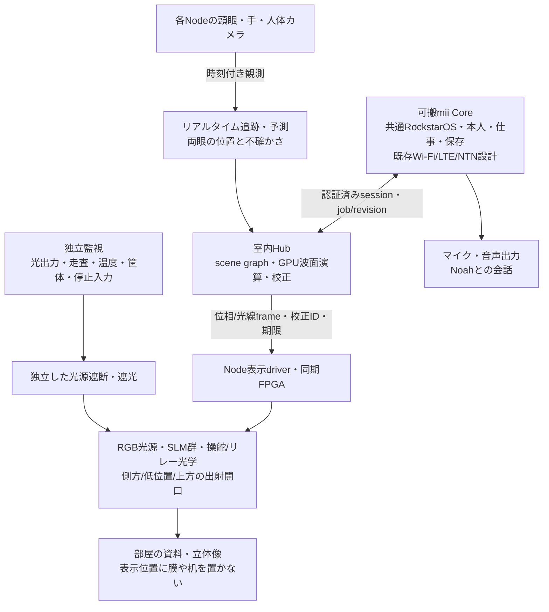

# 28 mii 全室空間SI — 新規光学の研究開発設計

2026-11-08、27章への本人の後続指示。**卓上を製品目標にしない。部屋全体・裸眼・工事なし・共通OS・SI名称を維持する。** MAT15／ROCK、MINI01/02・OS10。以下の寸法、性能、構成、予算はこの要求を検証する設計仮定で、本人が個々の数値を確定した意味ではない。購入・開発委託・問い合わせ送信・支出は未実施。

## 1. 今回決めることと、まだ証明できていないこと

研究の主経路は**目の位置へ必要な波面を送る、追跡型の多開口ホログラフィック表示**とする。空中の表示位置にスクリーンを置かず、左右の眼に立体として必要な光を届ける。SIは仕事・会話・内容を作り、光学とリアルタイム制御が「その位置に見える」を担当する。

この方式は直接見るホログラフィック表示の研究を出発点にできる [R1,R2]。SeeRealのViewing Window／Sub-hologramも比較対象とし、既存技術の利用・ライセンス可能性と独自開発部分を分ける [R11]。ただし、研究例の表示サイズ・眼の移動範囲・奥行きを、そのまま部屋全域へ拡張できる証拠はない。**全条件を満たす完成構成と、成功を買える金額は現時点で未確定。** 本書は、必要な発明・実験と、失敗を早く判定する研究計画を具体化する。

前回のKC-310G卓上S1は[27章](27-spatial-si-feasibility.md)に比較資料として残す。これを大きく並べることを全室版の完成案にはしない。

### 設計上の初期目標

| 項目 | 開発目標／評価条件 | 未達のとき |
| --- | --- | --- |
| 部屋 | 4.5×4.5m、天井高2.5mを初期試験室。機材占有部を除く室内、床上0.2〜2.2mに資料・立体を配置 | 一方向・狭い領域だけなら部分実験合格。全室合格にしない |
| 観察者 | 最初は裸眼の1人・両眼。座る／立つ／歩く。複数人の同時視認は追加開発 | 定位置のカメラ1台で撮れた映像だけで合格にしない |
| 表示 | フルカラー60Hz／眼を目標。50cm級資料と1m級の透過的モデルを複数位置で表示 | 角度だけ広い投影や、平面映像を真の3Dへ換算しない |
| 応答 | 手／頭の動きから表示までp95≦30ms、校正付きの80mm級可視眼領域（眼の移動1m/sの初期枠）を目標 | 追跡誤差・速度が範囲を超えたら停止。値の根拠は§3 |
| 照明 | まず室内50～300luxで文字可読性と眩しさを測定。昼光直射は別試験 | 明るさを落とさないと成立しない条件を明記 |
| 工事なし | 床置き・展開式機材、既存コンセント、着脱ケーブル、自動校正。穴あけ・天井内配線・壁面フィルム貼付なし | 配電増設や建築固定が必要なら、この製品条件は不合格 |
| 共通OS | 同じ本人／仕事／権限／予算／保存・再開。表示機だけ交換 | 新しい仕事台帳・別OS商品を作らない |
| 少数・小型 | 4基を出発点に最小の台数と出射面積を求める | 小型4基で成立したとはしない。展開面の大きさを隠さない |

光を加えて見せる方式では、現実の背景を黒く消す不透明な物体表現は別課題。初期のジャービス体験は、発光する資料・輪郭・点群などを対象とする。手操作は選択・回転・配置で、物理的な抵抗や重さの触覚は含めない。

## 2. 研究経路の比較

| 経路 | 実証された出発点 | 全室化に必要な新規開発 | 判断 |
| --- | --- | --- | --- |
| **追跡型の波面再生** | 10.1型LCD・操舵バックライトの直接観察研究、別研究の大開口直接観察 [R1,R2] | 出射開口、視域、RGB・両眼、歩行追跡、校正、演算、眼安全を同時に成立させる | **主研究経路。装置外の像位置に板・霧は不要だが、光を出す物理面は必要** |
| 大面積の多視点ライトフィールド | 観察方向ごとに異なる光線を出す技術 | 面積×方向数×解像度の大きな情報量、発熱・歩留まり、床／上方を含む配置 | 主経路と比較する部品／実装候補。周囲に巨大な通常画面を置くだけでは要求合格にしない |
| メタサーフェスで回折角拡張 | 160°級・60Hzの研究 [R3] | 大開口、複数色、独立に制御できる波面数、眼の移動領域、製造・実時間計算 | 要素研究として追う。160°という数字だけで全室表示可能とはしない |
| 空中粒子を光／音で動かして発光点にする | 光捕捉粒子による自由空間表示研究 [R4] | 大体積、多数点、風・人の手・粒子保持、カラー、明るさ、室内衛生 | 原理的な代替研究。全室の文字量・更新速度・家庭での実用を示す根拠なし |
| 空気のプラズマ発光 | フェムト秒レーザーによる小規模表示研究 [R5] | 室内規模の点数・電力・音・光曝露・故障時停止・低コスト | 家庭の第一候補にしない。物理研究費を投入すれば完成するとはいえない |
| 動く拡散面の体積表示 | FlexiVolの弾性拡散材と直接操作 [R6] | 人が歩く全室を駆動面なしにする別原理 | 元方式の拡大では今回の空間条件を満たさない |

**研究結果の読み違いを防ぐ:** R3の全文では、実験像は約91×88mm、メタサーフェスから約8.39mm離れたスクリーンで評価している。波長は561nm、動画像は事前計算。広角化の有力な研究だが、空気中の部屋全域・RGB・歩行する裸眼観察者への実時間表示の実証ではない。近眼型の導波路研究も、眼鏡を外せる根拠に置換しない。

## 3. 小型投影器を増やすだけでは足りない理由と再現計算

計算入力は[assumptions.json](room-rd/assumptions.json)、再現は `python3 docs/mii/design/room-rd/calculate.py`。計算は幾何光学の必要条件と予算算術だけで、波動光学シミュレーション・既存MINI-02の有限cone探索・実光学の代替ではない。

### 3.1 光の出口の面積

部屋中に霧・粒子・反射器を置かないとき、像から眼へ来るように見える光には、その方向を供給する出射開口が必要。レンズでビームを振っても、最後の出射開口の位置まで任意に移動したことにはならない。

4.5m四方の中央に眼があり、4壁の中央に幅0.6mの開口がある単純例では、水平角は

`4 × 2 atan(0.6 / 4.5) = 60.76°`、全周360°の **16.88%**。

これは「miiの完成度17%」ではない。**この特定配置に対する水平・単一視点の必要幾何条件**で、出射角、両眼、画質、回折・明るさはまだ考慮していない。

さらに18眼位置と36目標位置の組合せから距離0.3m未満を除いた646本の視線を四壁／床／天井へ延長すると、開口高さ0.4～2.2m・幅0.6m×4は28本、幅1.5m×4は52本、幅4.5m×4でも176本しか開口へ届かない。398本は床または天井へ達する。**この格子でのヒット数は全室の面積率・成功率ではなく、配置の反例を見つける計算。** 連続領域の保証、両眼同時、人体遮蔽を含まない。

したがって4本の細いTowerを完成形として固定しない。必要な方向へ光を出す**側方・低位置・上方の展開式開口**を検討し、許される設置面積とともに求解する。広い出射面を隠して「本体は小さい」と表示しない。出射面を大きくすること自体も画質・出射角の保証にはならない。

### 3.2 大きさと角度の両立

初期SLM候補GAEA-2.1-VIS-158は画素間隔3.74µm [R7]。532nmで単純なサンプリング限界の全回折角を `2 asin(λ/(2p))` とすると約8.157°。幅15.56mmの有効面を普通のリレー光学で600mmへ拡大すると、同じ空間帯域の近軸モデルでは全角約0.211°、2.5m先で約9.22mmの広がりになる。

これは最適な表示系の上限を証明する計算ではない。**単純な拡大レンズだけでは、広い開口と広い可視眼領域を同時に得られない**という設計警告。より多くの独立制御画素、複数チャネル、時間分割、眼追跡、バックライト操舵、光学設計を共同で検討する [R1,R2]。固定メタサーフェスが動的自由度を無限に増やすと仮定しない。

### 3.3 歩行追跡・更新・帯域

- 眼の移動1m/s、総遅延30msなら30mm動く。位置誤差3mmと瞳半径2mmを加えた単純余裕は、直径 `2×(30+3+2)=70mm`。初期目標80mmはこれへ10mmの設計余裕を加えたもの。速度方向・誤差を仮定した予算であり、眼安全の計算ではない。実機で達成できるかを検証する。
- RGB×左右眼×60Hzを単純な1枚のSLMの時間分割で実現するには360状態/sが必要。GAEAの180Hz CFSという入力表記をそのまま60Hz両眼RGBへ転用できない。液晶応答速度も入力周波数とは別 [R7]。
- 3840×2160×8bit×60Hzの位相データは1チャネル約3.981Gbps。独立RGB・左右眼の6チャネルなら約23.888Gbps／光学ヘッド。伝送符号化・blanking・同期等を除いたpayloadで、HDMIの線速度ではない。
- 1920×1200×8bit×120fpsのカメラ8台はraw合計約17.695Gbps。1GbE集約や一本のUSBハブに全量を通す案にはしない。画像の局所処理、独立USB root、10/25GbE等を含めて設計する。

## 4. miiの構成案

**可搬Core＋固定時だけ使う演算Hub＋展開式光学Node群。** 4基を配置探索の開始点とするが、台数・展開面・上下の支持構造はR0で決める。4基で全域が成立するという採用決定ではない。光学Nodeは家具状の床置き・自立支持とし、壁や天井に荷重を預けない。上方開口の自立支持と転倒・避難動線が両立しなければ、その案は工事不要条件で失敗。

室内Hubは光学演算用worker。共通OSを別製品に分岐させない。Coreを外したときも仕事／通信の契約は既存22/26章に従うが、持ち歩くCore単体に部屋規模の出射面が付いてくるわけではない。以前の消防代替は別の適合gateを維持し、既設感知器の台座や電源を全室光学の支持・給電へ転用しない。

### 買える研究部品と、新しく作る部品

| 系統 | 研究用候補／数量の出発点 | 端子・役割 | 未確定／開発する部分 |
| --- | --- | --- | --- |
| 位相変調 | **HOLOEYE GAEA-2.1-VIS-158／HES 7010-3-VIS-158**、R0は2式までの予算枠 | HDMI 2系の映像入力、メーカーdriver／純正電源。まず単色で波面・焦点・可視領域を測定 [R7] | 完成品の変調器型番は未選定。RGB同時なら3チャネル、眼を分けるならさらに増える。価格は要見積 |
| 精密観測 | **Basler a2A1920-160umPRO／107961**、R0は2台 | 1920×1200級global shutter、USB3 Micro-B、M8 6pin I/O、hardware trigger [R8] | レンズ・照明・距離で眼位置精度を実測。標準可視カメラを自動的にNIR眼追跡器と呼ばない |
| 広域姿勢 | 既存HW1の **OAK-D Pro W PoE A00574** 等を再評価 | RJ45 PoE、体・手・部屋の粗い位置 | pupil位置精度や全室遮蔽を満たす証拠はない。新規精密カメラと役割を分ける |
| 波面計算 | **NVIDIA GeForce RTX 5090 32GB** 搭載研究PCを比較基準 | PCIe、DisplayPort／HDMI、GPU計算 [R9] | 1枚で全室60Hzを処理できる保証なし。台数・リアルタイム性能・消費電力を測ってから固定 |
| 時間同期 | 専用FPGA／表示controller、校正用timebase | local clock、frame-ready／exposure trigger。PC通信はEthernet／USB | SLM実更新とcamera露光の同一時刻保証、再接続epoch。M8の電圧・pin割当はメーカー回路ごとに照合、直結を仮定しない |
| 光学部 | 波長別光源、拡大・合波、空間フィルター、操舵器、自由曲面／導波路、出射面 | 光路設計から決める。光源の供給と運転条件は専門設計 | 開口／視域／効率／色ずれ／speckle／迷光を同時に測る。未選定部を型番で埋めない |
| 筐体・自動校正 | 位置固定できる自立Node、展開機構、光学マーカー、姿勢・温度監視 | 置き直し時の自己診断と空間校正 | 大面積開口の支持、重量、熱、ケーブル取り回し。設置30分以内を目標とし未実証と表示 |
| 保護 | OSから独立した光源制限／遮断、遮光、停止入力、出力監視 | 故障・停止・追跡喪失で出力許可信号が消える設計 | 最終光学系を対象に評価。LLM／ネットワークだけの停止に依存しない |

この表は研究の調達仕様で、量産BOMや家庭で組み立てるレーザー配線図ではない。部品資料は実験の入口、完成品への採用は性能・電源・供給条件の受入後とする。

### 接続と給電の制約

1. Core↔Hubは認証済みLAN。Nodeへはsceneだけで済むか、位相frameが必要かを選び、帯域・演算・停止遅延を実測する。Wi-Fi/LTE/衛星を表示同期の必須経路にしない。
2. SLMへは局所GPU/controllerから短い適合映像配線。位相値が色補正・圧縮・OSのgammaで変わらない経路を評価する。HDMI分配器で独立した多チャネルを作ったことにしない。
3. カメラはNode内USB3へ、controllerから電気条件を合わせたtrigger。USB3規格対応と同期精度を別に検査する。
4. 研究台はメーカー電源を分離して使う。製品は既存コンセントの回路定格・共用負荷内に収める。口数が多くても別回路とは限らず、給電工事を要求するなら製品条件不合格。
5. 最初の製品電力割当はCore30W＋Hub350W＋光学Node150W×4＋補機100W＝**1080W、予算上限1200W**。すべて測定前の上限配分。RTX5090単体の公表TGPは575Wであり [R9]、そのままHub350Wに収まるとはいえない。低電力化／演算局所化／専用化も開発項目。8基へ倍増した場合の1680W案はこの枠に不合格。
6. 光学出力とAC電力を混同しない。完成光学系のレーザー分類はIEC 60825-1等の適用を確認する [R10]。家庭向けはClass 1の達成を設計目標とし、通常時／想定故障時を専門試験で確認する。R0は閉鎖光学台でカメラ測定し、人の眼を試験器にしない。

研究用のI/O・電力・演算境界は[hardware profile](../../../systems/rock-star-os/targets/mii-room-rd/README.md)へ記録する。

## 5. 共通OSの変更範囲

仕事の意味・本人・承認・課金・保存は[14章](14-common-os.md)を再利用。追加するのはprofile、出力capability、校正状態、pose／sceneの入出力adapter。Noah／SIの応答は非同期で、眼追跡と光源停止のループへ入れない。

| 状態 | 入出力・保存・失敗時の処理 |
| --- | --- |
| `unplaced`／`calibrating` | 部屋ID・各Nodeの配置epoch・光学校正・電源制約を計測。保存済みの他室校正で発光しない |
| `ready` | owner/session、job/revision、表示可能volume、眼位置の不確かさ、光学profileを照合。報告だけで実機合格にしない |
| `displaying` | scene／pose／校正版／frame期限を束縛。frame ACKと実際の光出力監視を区別する |
| `tracking_lost`／`fault` | 期限切れ入力と物理出力を止める。断線・SLM停止・走査停止・出力過大・Node移動を独立監視。Jobの中止と表示停止は別に記録 |
| `resume` | owner、同じjobのrevision、部屋・機器・校正を再照合し再開。副作用を自動再送しない |

保存するのは既存仕事とscene版・配置参照・校正の版。実測cameraの原映像を既定で保存しない。現在の既存2D指先adapterやfixture合格を、3D手操作・瞳追跡・波面表示の実機合格に流用しない。

## 6. 開発段階・合格条件・止める条件

| 段階 | 期間・体制の仮定 | 得るべき証拠 | 次段階へ進めない条件 |
| --- | --- | --- | --- |
| **R0 原理と単位光学** | 3か月／9人月。光学、波面計算、測定・制御を中心に分担 | 許容する装置外形での3D両眼光線到達の必要条件、実物SLMで焦点・視域・効率・更新・光出力を測定。独立な光学設計者が計算と測定を照合 | 4細柱案は現計算で不合格。展開面・低位置／上方開口で解がない、表示方式自体を変えないと条件を満たせない、光安全や輝度の同時達成見込みがない |
| **R1 室内距離の一方向** | 追加6か月／36人月。光学2、CGH/GPU1、追跡1、電子・同期1、機構・測定1の平均 | 1～3mの室内距離、1m級対象、両眼RGB・60Hz、歩行区間と手操作、停止。カメラによる複数焦点と実光学評価 | 据置カメラだけで見える、片眼だけ、壁面投影へ置換、誤追跡時に停止しない、電力・明るさに余裕なし |
| **R2 全室統合** | 追加12か月／108人月。平均9名、光学3・演算2・追跡1・電子1・機構1・試験1を想定 | 4.5m室内の上下・全方向・歩行、複数資料、1mモデル、遮蔽・受渡し、再配置校正。図面上の許可volume全域を密な格子と境界反例で確認 | 見えない角度を除外して「全室」と表示、常時の壁／床／天井スクリーン施工が必要、家庭の給電枠や眩しさを外れる |
| **R3 工事不要の少数製品評価** | 追加18か月／216人月。平均12名 | 自立・展開・撤去、製造再現性、熱・騒音・EMC・光安全・故障・更新復旧、複数の実部屋 | 固定工事必須、量産ばらつきで視域消失、既存通信／消防適合を侵害、安定供給不可 |

R0～R3の単純逐次計画は39か月。成功時の工学日程案であり、納期ではない。物理上の未達を追加予算だけで解消できる保証はない。室内の一方向を試すR1も製品目標の縮小ではなく、全室へ進む前の実験。

光線計算は各眼位置と目標点の**必要条件**を調べ、波面計算はそこから光学モード・画質・クロストークを評価し、実測で閉じる。格子合格を連続領域の数学的保証へ置換しない。評価volumeの穴や近接・高速移動時の不成立を記録する。

## 7. 開発費 — 見積ではなく、条件付き研究予算

**費用で技術の成立を保証しない。** 以下は既存SLM／外部供給できる光学部品を出発点とした研究チームと試作費の積上げ。メーカー・大学・委託先からの見積は未取得。雇用か委託か、設備を所有するか共同利用するかで変わる。

仮の総負担単価は**1人月150～220万円**。専門人材の報酬、雇用負担または委託間接費を含める予算仮定で、相場を調査確認した値ではない。20稼働日なら7.5～11万円／人日相当。機材・試作と外部評価は別に置く。単価を変更すれば[計算入力](room-rd/assumptions.json)から再計算できる。

金額単位は万円。各段階は**追加額**、累計は二重計上しない。

| 段階 | 人月 | 人件費 | 追加機材・試作／型・治具 | 外部評価等 | 予備費 | 段階費用 | ここまでの累計 |
| --- | ---: | ---: | ---: | ---: | ---: | ---: | ---: |
| R0 | 9 | 1,350～1,980 | 900～1,800 | 150～300 | 25% | **3,000～5,100** | **0.30～0.51億円** |
| R1 | 36 | 5,400～7,920 | 1,500～3,500 | 300～700 | 30% | **9,360～15,756** | **1.24～2.09億円** |
| R2 | 108 | 16,200～23,760 | 5,000～10,000 | 1,500～3,000 | 35% | **30,645～49,626** | **4.30～7.05億円** |
| R3 | 216 | 32,400～47,520 | 8,000～18,000 | 2,000～5,000 | 35% | **57,240～95,202** | **10.02～16.57億円** |

算式は `(人月×単価＋追加機材等＋外部費)×(1＋予備費率)`。R0の機材枠はSLM／driver2式300～800、光学・閉鎖筐体300～600、計測器借用等200～300、研究PC等100、計900～1,800万円を仮配分したもの。部品の販売価格として引用しない。R1以降は前段の設備を再利用し、表は追加分だけ。

**読み方:** 全室試作への挑戦まで累計約4～7億円、工事不要の少数製品評価まで約10～17億円という一つの人員計画。成功確率は不明で、これを最低開発費・完成保証・製品販売価格にしない。R0が成立しなければR1以降の費用を自動投入せず、理由と変更案を本人へ戻す。

この枠に新しい半導体製造プロセス／SLM工場、独自の大面積ナノ加工量産、量産在庫、消防OEM・検定／ビル互換、回線契約／日本衛星・RF認証、継続SI利用料、税・為替変動は含めない。R0で独自SLM量産や新しい空中発光原理が必須と判定されたら、**上記の予算・日程を失効させ、別途再見積**する。「量産すれば数万円」といった単価目標は置けず、現在は一室一式の販売価格を算定できない。

## 8. 分担と次の一件

- **ROCK:** 共通OSを維持した入力・表示契約、校正・波面計算・追跡の比較、再現可能な設計計算、状態／予算の正確な表示。
- **EXTERNAL:** 光学／SLM・半導体の供給仕様、光学試作、必要なら研究機関の要素技術。技術権利と供給・共同研究条件の確認。
- **JOINT:** 出射面と部屋の光線到達、波面・視域・手操作・光安全・電力・機構の実測、独立光学検収。
- **OWNER:** 展開時の大きさ・設置方法の受入、研究予算、外部相談／委託／機器購入の個別許可。

次はR0内で、**「人が歩ける室内を保ち、穴あけせず展開できる光の出口」で全域へ必要な光線を供給できる配置を求める**。今回の4細柱反例を入力に、側方／低位置／上方の開口面積、支持寸法、実際の瞳を含む到達図を作る。これに波動光学と電力・光曝露の評価を重ね、独立した光学専門家が反証できる仕様にする。既存の権限・API・仕事台帳を作り直す作業から始めない。

## 9. 一次資料と証拠の限界

- **R1** An et al., [Slim-panel holographic video display, Nature Communications 2020](https://www.nature.com/articles/s41467-020-19298-4)／[公開論文](https://pmc.ncbi.nlm.nih.gov/articles/PMC7655945/)。10.1型、操舵バックライトと直接観察。本文の公開検索取得を参照。直接openは認証／reCAPTCHAへ遷移し、全補足動画の実験再現はしていない。
- **R2** [A Large-Étendue Direct-View Holographic Display System, SIGGRAPH Posters 2025](https://doi.org/10.1145/3721250.3742975)。公開本文抜粋では250mm口径レンズ、使用領域約6型、16.8°。大開口・高画素LCD・操舵の設計例。直接PDF取得は403で、全実験条件を確認済みとしない。
- **R3** Li et al., [A 160°×160° Dynamic Holographic Meta-Projector, arXiv 2025](https://arxiv.org/abs/2511.22639)／[全文PDF](https://arxiv.org/pdf/2511.22639)。Fig.4、Methods、Supplementary §7の実験距離・スクリーン・単色・事前計算を確認。査読済み製品仕様とは扱わない。
- **R4** Smalley et al., [A photophoretic-trap volumetric display, Nature 2018](https://www.nature.com/articles/nature25176)。粒子を動かす自由空間表示。全文直接取得は認証遷移、取得できたabstractの範囲で参照。
- **R5** [筑波大学 Fairy Lights in Femtoseconds](https://digitalnature.slis.tsukuba.ac.jp/2015/06/fairy-lights-in-femtoseconds)。プラズマ表示研究。現在の全研究の到達上限と断定しない。
- **R6** [UPNALAB FlexiVol, CHI 2025](https://upnalab.com/project/flexivol-reach-through-volumetric-display/)。弾性拡散面を利用した直接操作。
- **R7** [HOLOEYE GAEA-2.1-VIS-158](https://holoeye.com/product/gaea-2-1-vis-158/)／[系列仕様](https://holoeye.com/products/spatial-light-modulators/gaea-2-phase-only/)。型番、画素間隔、面積、HDMI、入力周波数。入力周波数と液晶実応答の区別。
- **R8** [Basler a2A1920-160umPRO仕様・コネクター](https://docs.baslerweb.com/a2a1920-160umpro)／[注文番号107961](https://www.baslerweb.com/en/shop/a2a1920-160umpro/)。USB3、M8、global shutter。瞳追跡器としての性能保証ではない。
- **R9** [NVIDIA RTX5090](https://www.nvidia.com/en-us/geforce/graphics-cards/50-series/rtx-5090/)。32GB、表示端子、575W。ゲーム性能を全室CGH性能へ換算しない。
- **R11** [SeeRealの表示原理](https://seereal.com/how-does-it-work-seereals-holographic-display-principle-in-a-nutshell)／[技術概要](https://seereal.com/technology)。瞳位置へ可視領域を追従させる方式。メーカー説明であり、miiの部屋全域・工事不要の受入証拠ではない。
- **R10** [IEC 60825-1:2014](https://webstore.iec.ch/en/publication/3587)。最終レーザー製品の分類と要求。公表概要を参照した段階で、規格全文の条項判定・認証取得ではない。

資料確認日2026-11-08。外部ページの記述と本設計の推定・予算仮定を分離した。研究・source・算術の確認を物理的な全室成立に置換しない。
