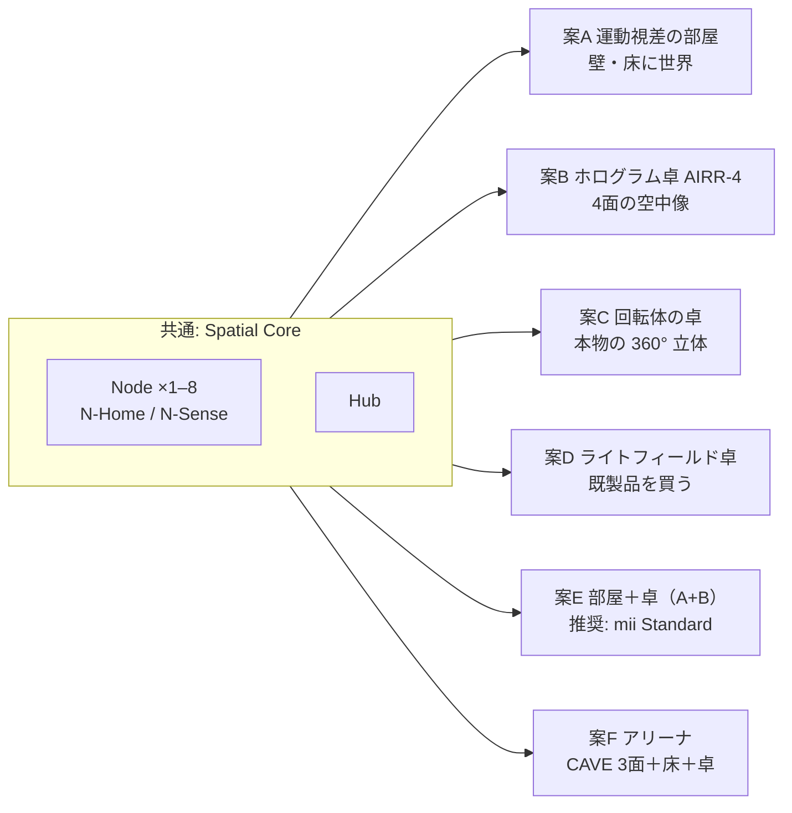

# 10 設計案の全体像 — 6 案 × Node 2 段階

更新: 2026-11-05。要件は [00](00-what-noelle-wants.md)、技術判定は [01](01-feasibility.md)、価格は [02](02-pricing.md)。比較と推奨は [20](20-comparison-and-recommendation.md)。

## 1. 設計案は「表示の方式」で分かれ、「Node」は共通

本人の要件のうち「空中に浮く・歩いて回れる・触って操作」（R4, R5）は**卓（Object Zone）**で、「360° の異世界に入る」（R2, R3）は**部屋（Room Zone）**で実現する。両方やるのが案 E。

## 2. 6 案の一覧

| 案 | 一言 | 空中の 3D | 歩いて回れる | 触って操作 | 360° 没入（一人） | 複数人 | 今日作れる | 原価の目安（4 Node＋Hub＋表示、1,000 台） |
| --- | --- | --- | --- | --- | --- | --- | --- | --- |
| **A** 運動視差の部屋 | 4 Node＋Hub＋UST 投影 1〜2 台。壁の向こうに世界 | 壁の手前 50 cm まで | △（壁の中の物だけ） | ○（手で指す・つかむ。像は壁の中） | ◎ | △（一人分の視点） | **○** | [02](02-pricing.md) |
| **B** ホログラム卓 AIRR-4 | 卓の中央に 4 面の空中像（各面 30〜40 cm）。手が像の中に入る | ◎（本物の空中像） | ○（4 方向、面の切替で跳ぶ） | ◎（手追跡＋超音波触覚オプション） | ×（卓だけ） | ◎（面ごとに一人） | **○** | 同上 |
| **C** 回転体の卓 | 透明筒の中で高速回転する面に断面を投影。本物の体積表示 | ◎ | ◎（連続 360°） | ○（筒の外から。像に手は入らない） | × | ◎ | ○（自作可、画質は低い） | 同上 |
| **D** ライトフィールド卓 | Looking Glass / Sony SRD を卓に置く | ○（画面の手前後 ±数 cm） | △（視野円錐 50° の中） | ○ | × | ○ | **◎**（買うだけ） | 同上 |
| **E** 部屋＋卓（A+B） | 本人のイメージの全部。部屋は運動視差、中央は空中像 | ◎ | ○ | ◎ | ◎ | ○ | **○** | 同上 |
| **F** アリーナ | 3 壁＋床の投影（UST ×4）＋卓。等身大の遠隔相手。施設・建築埋込 | ◎ | ○ | ◎ | ◎◎ | ○（視点は一人） | ○（施工が要る） | 同上 |

Node は 2 段階（[11](11-node-tiers.md)）: **N-Home**（追跡・顔・声・存在・レーダー心拍/呼吸）と **N-Sense**（＋熱画像で体温、虹彩カメラ、空気、拡張スロット）。どの案にも組み合わせられる。

## 3. 判定の物差し（各案の末尾に同じ表）

| 判定 | 意味 |
| --- | --- |
| 今日作れる？ | 2026-11 に買える部品だけで、試作が 1 台組めるか（◎ 買うだけ / ○ 組み立て要 / △ 光学試作が要る / × 部品が無い） |
| イメージ通り？ | 00 の R1〜R14 を何個満たすか（必須 10 個中）|
| GitHub 設計書通り？ | V1 設計書（docs/mii/design/00〜13）と structure/01 からの変更点が何か |
| 原価 | 1 台／100 台／1,000 台（02 の価格表、出典付き）|

## 4. 先に結論（詳細は 20）

- **今日、部品を買って組んで「没入」と「空中の 3D に触る」の両方が成立する最小は案 E**（A の部屋 ＋ B の卓）。
- 「360° どこを向いても異世界、空中に等身大が浮いて、歩いて回り込める、裸眼」を**一つの装置で全部**満たす技術は 2026 年に存在しない（01 §9）。案 E は、部屋側を運動視差（一人に完璧）、卓側を本物の空中像（複数人）で分担することで、本人の体験の 9 割を今の部品で作る。
- 残り 1 割（等身大の空中像、磁場での思考読取）は R&D 枠として Node と Hub に**接続口を予約**しておく（11 §5、01 §8）。
