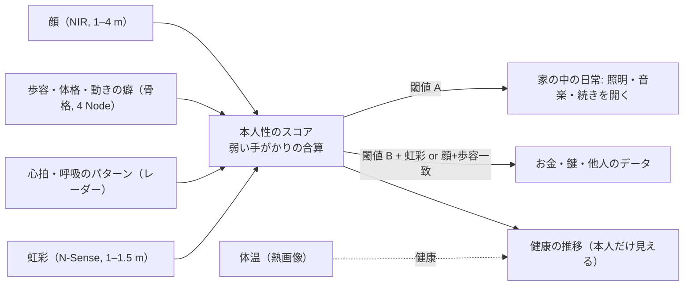

# 11 Node（30 cm のセンサー塔）— N-Home と N-Sense

更新: 2026-11-05。V1 設計書 03 章（Node のハード）を、本人の 2026-11-05 指示（30 cm、温度・磁場・虹彩・心拍・体温・歩容、6 本で安定、拡張性）で更新する。価格は [02](02-pricing.md)。

## 1. 形: 30 cm の Head を 3 通りに置く

```text
  Column（床置き）        Orb（棚・机置き）        Puck / Slot（建築埋込）
  ┌──┐ Head 300          ┌──┐ Head 300            ━━━━━━━ 天井 / 壁
  │  │                   │  │                        ┌──┐
  │  │                   └──┘ ベース φ200            │  │ Head 300（横向き）
  │  │ 柱 700                                        └──┘
  │  │
 ─┴──┴─ ベース φ260
```

| | Column | Orb | Puck / Slot |
| --- | --- | --- | --- |
| Head | **φ150 × 高 300 mm**（本人の「30 cm ぐらい」） | 同じ | 同じ |
| 設置高さ | 1.0 m（柱 700 mm） | 0.8〜1.2 m（棚・机の上） | 2.4 m / 1.4 m |
| 使いどころ | 標準。4 本で部屋の四隅 | 賃貸・机上・1 本運用。「ただ置くだけ」 | 新築・改装 |
| 違い | 柱とベースだけ | ベースだけ | 金具だけ |

V1 の「Head 200 mm」は 300 mm に伸ばす。理由: 熱画像・虹彩カメラ・拡張スロット・超音波（オプション）が入らない。

## 2. Head の中身

```text
         ┌──────── Head φ150 × 300 ────────┐
 上段    │ ① 文脈 RGB 魚眼 180°  60fps       │  部屋・家具・物・色、rPPG（心拍の補助）
         │ ② 追跡 NIR GS 1920×1280 120fps   │  体・手・頭・両眼（主追跡）
 黒い帯  │ IR  ③ 虹彩 NIR 望遠 f=30–45mm  IR │  N-Sense: 1〜1.5 m で虹彩（HFOV 8–10°）
         │ ④ 熱画像 LWIR 160×120 or 320×240 │  N-Sense: 体温・発熱・人数（暗闇でも）
 中段    │ ⑤ 60GHz レーダー 3T4R（AoP）      │  距離・速度・存在・**心拍・呼吸**（非接触）
         │ ⑥ マイク ×2〜4（ビームフォーミング）│  「ヘイ、エヴァ」、話者の方向
         │ ⑦ IMU・温湿度・照度・CO₂（任意）   │  転倒・環境
 下段    │ ⑧ 拡張スロット ×1（M.2 / USB-C / 12V）│  将来: UWB、ToF、超音波触覚、**磁場センサー**
         │ ⑨ MCU（同期・IR・watchdog）SE      │
         │ ⑩ 1GbE PoE+ / 12V、機械式シャッター │
         └──────────────────────────────────┘
```

| # | 部品 | N-Home | N-Sense | 根拠・備考 |
| --- | --- | --- | --- | --- |
| ① 文脈 RGB 魚眼 | ○ | ○ | 室内理解。rPPG（カメラで脈）は補助（01 §3） |
| ② 追跡 NIR GS | ○ | ○ | V1 のまま。120 fps、HFOV 100° |
| ③ 虹彩 NIR 望遠 | — | ○ | 虹彩径 11.5 mm を 120 px 以上で撮るには、3 µm 画素で **1.0 m: f=31 mm、1.5 m: f=47 mm**（HFOV 7〜10°、視野幅 18 cm）。広角カメラでは物理的に無理なので**専用の望遠カメラ**。本人が Node の正面 1〜1.5 m の「ログイン位置」に立ったとき、追跡カメラが顔位置を渡し、望遠が撮る。Slot（玄関）では自然にその距離になる |
| ④ 熱画像 LWIR | — | ○ | 体温は額・目頭の皮膚温。1〜3 m で ±0.5 ℃級（放射率・距離補正・環境温の参照が要る。医療機器ではない）。人数・暗所の存在にも効く |
| ⑤ 60GHz レーダー | ○ | ○ | V1 と同じ素子で、**心拍・呼吸のモード**を追加（静止している人、1〜2 m、複数人は分離が課題: 01 §3）|
| ⑥ マイク | 2 | 4 | |
| ⑦ 環境 | IMU | ＋温湿度・CO₂・照度 | 健康の文脈（部屋の空気）|
| ⑧ 拡張スロット | 1 | 1 | **「あらゆる可能性」の受け皿**。電源 12 V 10 W、USB 3 / PCIe x1（M.2 2242）、窓（光学・電波）を 1 面予約。磁場センサー（OPM）は 01 §8 の条件が満たされたらここに挿す |
| ⑨⑩ | ○ | ○ | V1 のまま |

## 3. 本人認証（「魔法みたいに、何も出てないのにどうやって認証した」）



- 議事録 10-30「生体認証は弱い→家族紐付けなどルールで」をそのまま設計に: **用途ごとに要求する強さを変える**。ドアの解錠や Wallet は虹彩か「顔＋歩容＋心拍」の一致、照明や会話の続きは顔だけ。
- 虹彩は N-Sense だけ。N-Home では顔＋歩容＋レーダー心拍の 3 つで「家族の誰か」を当てる（他人の侵入検知には十分、金融には使わない）。
- 生データ（顔画像・虹彩画像）は Hub の外に出さず、埋め込み（テンプレート）だけを account に E2E で同期（V1 10 章）。

## 4. 健康（医療機器ではない。「気づく」装置）

| 測るもの | どのセンサー | 距離 | 精度の目安（01 §3 の出典） | 使い方 |
| --- | --- | --- | --- | --- |
| 心拍 | レーダー（主）＋rPPG（補助） | 0.5〜2 m、静止時 | ±3〜5 bpm | ヨガの前後、睡眠、驚き |
| 呼吸 | レーダー | 同上 | ±2 回/分 | 瞑想、睡眠 |
| 体温（皮膚） | 熱画像 | 1〜3 m | ±0.5 ℃（参照体あり） | 発熱の気づき、帰宅時 |
| 姿勢・歩容・震え | 4 Node 骨格 | 部屋全体 | 関節 ±10 mm | 転倒、長期の変化、ヨガ |
| 人数・位置 | レーダー＋カメラ | 部屋全体 | — | 在室、見守り |
| 空気 | CO₂・温湿度 | — | — | 「換気して」 |

「心拍数でログインできたらかっこいい」（議事録 10-30）は、**レーダー心拍の波形の個人差**を手がかりの一つにする（単独では認証に使えない。01 §3）。

## 5. 「磁場で思考を読む」の扱い

結論（詳細と出典は [01 §8](01-feasibility.md)）: **家の中で、何も被らず、10 cm 離れた所から脳の磁場を読む装置は 2026 年に存在しない**。脳の磁場は地磁気の 1 億分の 1 以下で、今の OPM-MEG は磁気シールド室かヘルメット型のセンサー配列が要る。
設計での答え:
1. Head の拡張スロット（⑧）に**磁場センサー用の電源・バス・筐体の窓**を予約する（将来、室温で無シールドの磁気センサーが出たら挿せる）。
2. いま「考えていること」に近いものは、**視線（どこを見ているか）＋手（何を指しているか）＋声＋心拍の変化**から推定する「意図の推定」で作る（07 章 Spatial API に `intent` を追加）。本人の「言葉に変換しなくていい」はこれで半分叶う。
3. 本人が本当に脳信号を使いたくなったとき: 装着型（EEG ヘッドバンド）が最短で、Node ではなく「周辺機器」として Hub に繋ぐ（01 §8 に候補）。

## 6. 6 本で安定させる（本人要件 R10）

| 項目 | 4 本 | 6 本 | 8 本 |
| --- | --- | --- | --- |
| Hub の PoE+ ポート | 4 | **6（Home Hub を 6 ポートに変更）** | 8（Pro） |
| 映像帯域（Node 750 Mbps） | 3 Gbps | 4.5 Gbps → Hub 側 10GbE | 6 Gbps |
| レーダー TDM | 4 スロット/ms | 6 スロット（各 0.167 ms） | 8 |
| 融合 | 関節ごとに最良 2〜4 視点 | 同じ（遠い Node は自動で捨てる） | 同じ |
| 配置 | 四隅 | 四隅＋長辺中央 ×2 | ＋短辺中央 ×2 |
| 校正 | 1 周 | 1 周 | 1 周 |

**Home Hub は 6 ポート**にする（V1 の 4 ポートから変更）。4 本で買って 2 本足せるのが「標準 4、6 で安定」の意味。

## 7. V1 からの変更点

| V1 | V2 | 理由 |
| --- | --- | --- |
| Head φ150 × 200 | **φ150 × 300** | 熱画像・虹彩・拡張スロット |
| 形態 Column / Puck / Slot | ＋ **Orb（置くだけ）** | 「30 cm ぐらいでカメラとセンサー」のイメージ、1 本運用 |
| センサー: RGB・NIR・レーダー・マイク・IMU | ＋ 熱画像・虹彩望遠・環境・拡張スロット（N-Sense） | 本人指示 |
| レーダー = 距離・速度・存在 | ＋ 心拍・呼吸モード | 非接触の健康 |
| Hub PoE 4 ポート | **6 ポート** | 6 本で安定 |
| 認証 = 顔 | 顔＋歩容＋心拍＋虹彩の合算、用途別の強さ | 議事録 10-30 |
