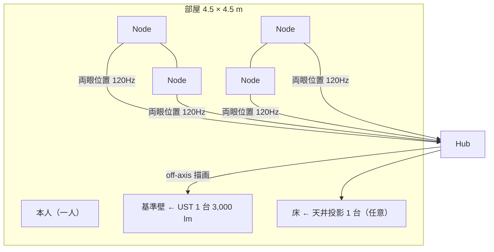

# 案 A — 運動視差の部屋（Spatial Core ＋ 壁・床投影）

一言: **V1 設計書の Gen1 そのもの。** 4 Node が頭の位置を 120 Hz で追い、UST プロジェクターが壁と床を「窓」にする。本人が気に入った「視覚トラッキングと運動視差」（3D 会話 34）を最短で形にする案。

## 1. 絵

## 2. 構成と数

| 部品 | 数 | 仕様 |
| --- | --- | --- |
| Node（N-Home） | 4（1〜6） | 11 章 |
| Hub | 1 | Jetson Orin NX 級、PoE 6 ポート、HDMI ×2 |
| UST レーザープロジェクター | 1（＋床用 1） | 3,000〜4,000 lm、120 Hz 入力、遅延 ≤ 10 ms、throw 0.25 |
| 照明制御 | 1 | スマートプラグ or Matter（暗くする） |
| 校正ターゲット | 1 | 反射球 3 個の棒 |

## 3. 体験（できる／できない）

| できる | できない |
| --- | --- |
| 壁の向こうに部屋が続く。床に正四面体が置いてある。本人が歩くと正しく視差が出る | 壁から 50 cm 以上手前に浮く物（両眼の矛盾で破綻） |
| 壁・床・本人の体にガイド（ヨガの正解姿勢、ツイスターの的、工場のボルト） | 部屋の中央に等身大の相手が立つ（ゴーストアバターとして壁・床に落とすのは可） |
| 視野の大半を世界で埋める（壁 1 面＋床で水平 90〜120°、UST 2〜3 台で 180°） | 複数人が同時に正しく見る（一人分の視点） |
| 指す・つかむ・ズーム（手追跡。像は壁の中） | 像に手を入れる |

## 4. 要件の採点（00 §3）

| R1 眼鏡なし | R2 画面を意識しない | R3 一人で没入 | R4 空中の 3D | R5 触って操作 | R6 等身大 | R7 認証 | R8 健康 | R10 可変 | R11 30cm | R12 OS | R13 今日作れる |
| --- | --- | --- | --- | --- | --- | --- | --- | --- | --- | --- | --- |
| ◎ | ○（壁が窓になる） | ◎ | △（壁の中） | ○ | △ | ○ | ○ | ◎ | ◎ | ◎ | ◎ |

必須 10 個中 **8 個**。足りないのは R4（空中に浮く）と R5 の「手を入れる」。

## 5. 今日作れるか

**◎ 作れる。** 全部品が市販品。試作は手持ちプロジェクター＋Pi 5＋GS カメラで 4 週間（V1 設計書 13 章）。製品版の UST は街で買える。

## 6. GitHub 設計書との差

V1 設計書（docs/mii/design）と同じ。変更は 11 章の Node（30 cm Head、N-Sense、Hub 6 ポート）だけ。

## 7. 原価（02 章の価格表から。確定後に記入）

| 構成 | 1 台 | 100 台 | 1,000 台 |
| --- | ---: | ---: | ---: |
| Node ×4（N-Home） | $3,244 | $1,388 | $884 |
| Hub Home | $1,140 | $744 | $628 |
| UST ×1 | $2,623 | $2,310 | $1,995 |
| **合計** | **$7,005（¥1,051,000）** | **$4,441（¥666,000）** | **$3,507（¥526,000）** |

UST が半分以上。「Core ¥410,000 ＋ 投影キット別売り」なら Core は 1,000 台で原価 ¥227,000（02 §5）。

## 8. リスク

- 本人の「スクリーン欲しくない」との距離: 壁は「窓」になるが、壁の手前には何も浮かない。**卓（案 B/C/D）を足さないと「空中に浮く」は満たせない**。
- 環境光に弱い。昼の部屋では照明制御と遮光が要る。
- 複数人は一人分の視点にしか合わない（遠隔プレイは部屋ごとに一人、で解決）。

## 9. 判定

| 今日作れる？ | イメージ通り？ | 設計書通り？ |
| --- | --- | --- |
| ◎ | 8/10（空中に浮かない） | ◎（V1 そのもの） |

**位置づけ: 全案の土台。単独では本人の「スター・ウォーズの卓」に届かないので、案 E の半分として採用。**
