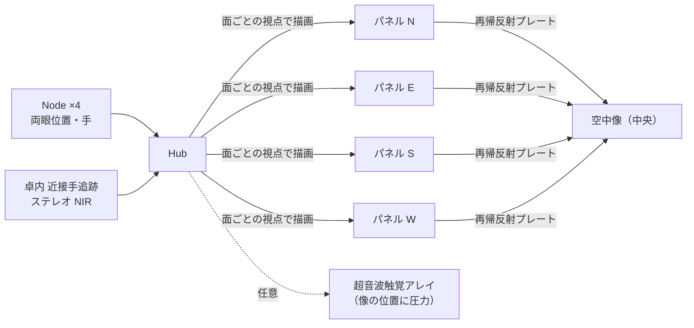

# 案 B — ホログラム卓 AIRR-4（4 面の空中像、手を入れられる）

一言: **スター・ウォーズの卓を、今ある光学部品で作る案。** 卓の中央の空気中に 30〜40 cm の像が結び、4 方向から見え、手を像の中に入れてつまむ・回す・ズームできる。4 Node が目と手を追うので、各面の像は見る人の位置に合わせて描き直される。

## 1. 絵

```text
            上から見た卓（天板 900 × 900）
           ┌─────────────────────────┐
           │   面N  ╱‾‾‾‾‾‾‾‾‾╲  面N │   ← 各面: 再帰反射プレート（45°）
           │  ╱                 ╲    │      ＋ 高輝度パネル（面の下、内向き）
           │ │   ●●● 空中像 ●●●  │   │   ← 中央 φ400 × 高 400 の空気中
           │  ╲   手が入る領域    ╱    │
           │   ╲_______________╱     │
           │   手追跡カメラ（下向き）   │
           └─────────────────────────┘
   観察者は 4 辺のどこからでも。各辺の視域 ±25〜30°。
```



## 2. 原理（なぜ空中に見えるか）

- **AIRR（Aerial Imaging by Retro-Reflection）**: パネルの光をビームスプリッタで折り、再帰反射材で来た方向に返し、再びスプリッタを通すと、パネルと鏡対称の位置の**空気中に実像**が結ぶ。像の大きさ ≈ パネルの大きさ、像までの距離 ≈ パネル〜プレートの距離。市販のプレート（ASKA3D 等）はこれを 1 枚の板にしたもの（02 で価格）。
- 像は「そこに光が集まっている」ので、**手を入れても像は消えず、手の表面にも光が当たる**。本人の「ホログラムに触れて」はこれで成立する（触った感触は別: §6）。
- 弱点: 1 枚の板の視域は板の法線から ±25〜30° 程度。だから **4 枚を四方に置いて 4 面にする**。面の境目（角）で像が切り替わる。
- 4 Node が観察者の両眼位置を知っているので、**各面の像をその人の視点で描き直す**（運動視差）。面の中では歩いても自然、角で跳ぶ。

## 3. 構成と数

| 部品 | 数 | 仕様 |
| --- | --- | --- |
| 空中結像プレート | 4 | **ASKA3D 樹脂 250 mm**（量産推定 4,000〜5,000 円/枚、公式非公開）か、ガラス 310/420 mm（要見積、大判は約 100 万円の言及）か、再帰反射シート（US$4/m²）＋ハーフミラーの自作（像がぼける） |
| 高輝度パネル | 4 | 10〜15"、**1,000〜2,000 nit**（AIRR は光の 10〜20% しか像に使えないため）、120 Hz |
| 卓の筐体 | 1 | 900 × 900 × 900 mm、内部は黒（迷光を吸う）、天板中央は開口 |
| 近接手追跡 | 1〜2 | **自前のステレオ NIR（OG02B1B ×2＋850 nm）**を像の下から上向きに。Leap Motion 2 は Discontinued（在庫限り US$217）、Ultraleap は 2026-10 管財入りのため依存しない |
| 超音波触覚アレイ（任意・R&D） | 1 | 40 kHz トランスデューサ 256 個の位相配列を自作。市販モジュールは 2026 年に無い（Ultraleap 管財入り） |
| Node（N-Home） | 4 | 11 章。卓の四隅の外側 1.5 m |
| Hub | 1 | HDMI/DP ×4（4 パネル）＋ Node 6 ポート |

## 4. 体験

| できる | できない |
| --- | --- |
| 分子・建築模型・人体・チェス駒・相手の上半身が**空中に**出る。4 辺から見える。手を入れてつまむ・回す・ズーム・注釈 | 等身大（像は 40 cm 級。等身大は案 F の R&D） |
| 複数人が同時に（面ごとに一人ずつ正しい視点） | 面の角を回り込むときの連続性（跳ぶ） |
| 明るい部屋でも見える（1,000 nit 級パネルなら） | 像の後ろに本物の背景が透ける（迷光対策で筐体内を黒に） |
| 卓の上の像と、部屋の壁（案 A）を同じ座標で（案 E） | 卓の外の空中には出ない |

## 5. 要件の採点

| R1 | R2 | R3 一人で没入 | R4 空中の 3D | R5 触って操作 | R6 等身大 | R7 | R8 | R10 | R11 | R12 | R13 |
| --- | --- | --- | --- | --- | --- | --- | --- | --- | --- | --- | --- |
| ◎ | ◎（画面が見えない） | △（卓だけ。部屋は案 A） | ◎ | ◎ | △ | ○ | ○ | ◎ | ◎ | ◎ | ○ |

必須 10 個中 **9 個**（R3 は卓だけでは△）。

## 6. 「触った感じ」

- 像に手が入る時点で、視覚的には「触れている」。
- 感触が欲しい場合は超音波触覚（空中に 40 kHz の焦点を作り皮膚に圧を感じさせる）。**市販品は 2026 年に無い**（Ultraleap 管財入り）。自作は研究例が多い（40 kHz 素子 256 個＋FPGA）。弱い（そよ風程度）が「ここに面がある」は分かる。
- 代替: 手が像の面に触れた瞬間に像を少し光らせる・音を出す（視覚・聴覚で補う）。V1 でも十分。

## 7. 今日作れるか

**○ 作れる（光学の調整が要る）。** プレートは ASKA3D 樹脂 250 mm（サンプル購入）か自作、パネルは市販、手追跡は自前ステレオ NIR（在庫があれば Leap Motion 2 でも可）、筐体は木＋黒布で試作可。**最初の試作は 1 面**（プレート 1 枚＋パネル 1 枚＋Leap）で「空中に分子が出て手でつかめる」まで 2 週間。4 面はその後。

## 8. GitHub 設計書との差

| V1 | 案 B |
| --- | --- |
| 表示層 Gen2 = AIRR module（将来） | **Gen1 の時点で卓として入れる**（部屋の投影と並列） |
| Display Bus（予約） | 4 パネル分の HDMI/DP が今要る → Hub は DP ×4 |
| 05 章「Gen1 は運動視差」 | 変更なし。卓は追加 |
| 手追跡は Node だけ | ＋ 卓内の近接手追跡 |

## 9. 原価（02 確定後に記入）

| 構成 | 1 台 | 100 台 | 1,000 台 |
| --- | --- | --- | --- |
| 卓（プレート 4・パネル 4・筐体・手追跡） | | | |
| Node ×4 ＋ Hub | | | |
| 合計 | | | |

## 10. リスク

- プレートの価格と視域（±25°）。自作（再帰反射シート＋スプリッタ）は画質が落ちる。
- 輝度: パネルが暗いと像がぼんやりする。1,000 nit 以上を必ず使う。
- 角での像の跳び: 回り込む体験は案 C（回転体）が上。
- 超音波触覚の入手性（01 §5）。無くても成立。

## 11. 判定

| 今日作れる？ | イメージ通り？ | 設計書通り？ |
| --- | --- | --- |
| ○ | 9/10（部屋の没入は案 A と組む） | ○（Gen2 の AIRR を前倒し） |

**位置づけ: 「空中に浮く・触れる」の本命。案 E の半分。**
