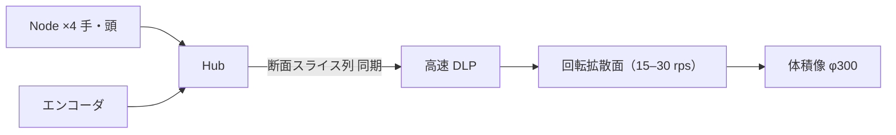

# 案 C — 回転体の卓（本物の 360° 体積表示）

一言: **透明な筒の中で面を高速回転させ、角度ごとの断面を投影して、本当に体積を持つ像を作る。** どこから見ても正しく、歩いて回り込める唯一の方式。像は小さく（φ30 cm 級）、色と解像度は限られる。

## 1. 絵

```text
          上面図                      側面図
       ┌───────────┐              ┌──────────┐ 透明筒 φ350 × 350
       │  透明筒     │              │  ╱‾‾‾╲   │
       │ ╱ 回転面 ╲  │   ←観察者    │ │ 像  │  │  ← 回転する拡散面（ヘリックス or 平面）
       │╲         ╱ │   どこからでも │  ╲___╱   │
       │  ‾‾‾‾‾‾‾   │              ├──────────┤
       └───────────┘              │ モーター  │ BLDC + エンコーダ
                                  │ 投影エンジン│ 高速 DLP（1,440〜4,000 fps 2値）
                                  └──────────┘
```



## 2. 原理と数

- 面が 1 回転する間に、角度ごとに「その角度の断面」を投影。残像で体積に見える。
- DLP の 2 値フレーム 1,440 fps・15 rps → **96 断面/回転（3.8° 刻み）**。4,000 fps なら 267 断面（1.3°）。色は 2 値×3 色の時分割で粗い（市販の Voxon は単色〜限定色）。
- 像の大きさ ≈ 筒の大きさ。φ300〜400 が現実的。等身大は機械的に無理（巨大な回転体）。
- 手は筒の外。像に手を入れられない（代わりに筒の外で指す・回す）。

## 3. 構成

| 部品 | 数 | 仕様 |
| --- | --- | --- |
| 高速 DLP 光学エンジン | 1 | TI DLP（LightCrafter 級）、2 値 ≥ 1,440 fps |
| BLDC モーター＋エンコーダ | 1 | 15〜30 rps、低振動 |
| 回転拡散面 | 1 | ヘリックス（Voxon 型）or 平面。軽量・透明基材 |
| 透明筒・保護 | 1 | PMMA/PC、安全センサー（開けたら停止） |
| MCU（同期） | 1 | エンコーダ→フレーム同期 |
| Node ×4 ＋ Hub | — | 共通 |

## 4. 体験

| できる | できない |
| --- | --- |
| 分子・立体図形・小さな建築模型を**本当に 360° 歩いて回って**見る。複数人同時 | 大きい像、フルカラーの滑らかな質感、明るい部屋 |
| 手で指して回す（筒の外） | 手を像に入れる |

## 5. 要件の採点

| R1 | R2 | R3 | R4 空中の 3D | R5 触って操作 | R6 | R7 | R8 | R10 | R11 | R12 | R13 |
| --- | --- | --- | --- | --- | --- | --- | --- | --- | --- | --- | --- |
| ◎ | ○（筒は見える） | △ | ◎（本物の体積） | △（筒の外から） | × | ○ | ○ | ◎ | ◎ | ◎ | ○ |

必須 10 個中 **7 個**。

## 6. 今日作れるか

**○ 自作できる（画質は研究レベル）。** 高速 DLP 評価キット＋モーター＋拡散板で、学生プロジェクトの実績が多い。市販完成品（Voxon VX2）は 02 で価格。安全（回転体）と騒音が製品化の壁。

## 7. 設計書との差

V1 表示層の Tier 一覧（05 章）に「swept-volume」は候補として載っている（3D 会話 50 の案 5）。追加は卓の筐体と高速 DLP の同期だけ。

## 8. 原価（02 確定後）

| 構成 | 1 台 | 100 台 | 1,000 台 |
| --- | ---: | ---: | ---: |
| Voxon VX2（完成品） | $7,140 | $6,825 | $6,300 |
| 自作（高速 DLP EVM $1,199 ＋ モーター・筒・MCU 推定 $400） | $1,700 | 不明 | 不明 |
| Node ×4 ＋ Hub | $4,383 | $2,131 | $1,512 |
| **合計（VX2）** | **$11,523（¥1,728,000）** | **$8,956** | **$7,812** |

## 9. リスク

- 像が小さい・暗い・粗い。「分子」「立体問題」には向くが「建築」「人」には弱い。
- 回転体の安全・騒音・寿命。
- 本人の「触れて、ズームイン」のうち「触れて」が筒に阻まれる。

## 10. 判定

| 今日作れる？ | イメージ通り？ | 設計書通り？ |
| --- | --- | --- |
| ○ | 7/10 | ○ |

**位置づけ: 「本当に 360° 回れる」を最初に体験する教材・デモとして価値がある。製品の主役にはしない（案 B の AIRR が「手を入れる」で勝つ）。**
