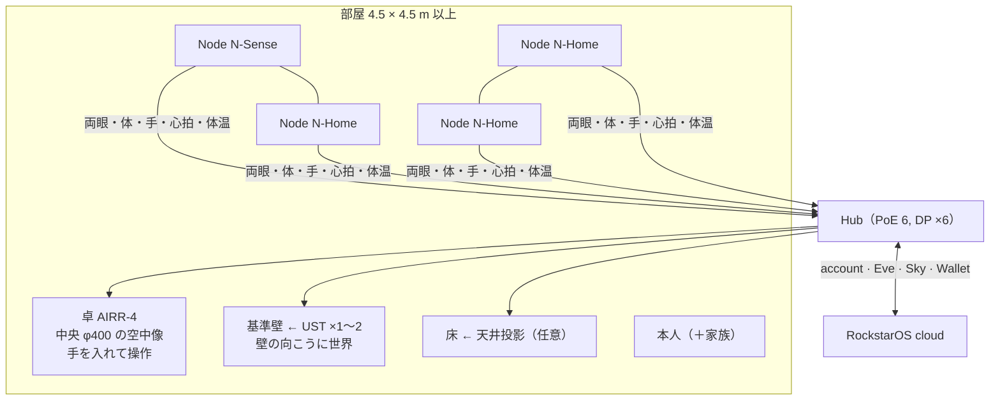

# 案 E — 部屋＋卓（案 A ＋ 案 B）: mii Standard（推奨）

一言: **本人のイメージの全部を、今の部品で一つの製品にする案。** 4 本の Node が部屋を見て、壁と床は運動視差で「窓」になり、部屋の中央の卓には本物の空中像が浮いて手で操作できる。ゲーム（部屋）と想像の道具（卓）と健康・認証（Node）が同じ座標系・同じ OS で動く。

## 1. 絵

## 2. 一日の使い方（体験を具体的に）

1. 帰宅。玄関の Slot Node（N-Sense）が顔＋歩容で本人を認識、1 m に立つと虹彩で確認し解錠（「何にも出てないのに認証した」）。
2. リビングに入る。壁の向こうに今日の天気の空が広がり、床に足元のガイド。「ヘイ、エヴァ、昨日の続き」で卓の上に建築模型が浮く。
3. 模型を手でつまんで回し、指で壁を一枚足す。4 Node が指先を追い、卓の近接カメラが手の形を取る。家族が反対側から見ると、その人の視点で見える。
4. 分子の勉強。卓の上に 2 つの分子、手で近づけると反応のアニメーション。壁には反応式の波（物理の波の干渉も壁で）。
5. ヨガ。卓は消え、壁と床と体にガイド。レーダーが心拍を取り、前回との比較を壁の端に。
6. 遠隔ツイスター。相手のゴーストアバターが床と壁に、相手の上半身は卓の空中像に。
7. 夜。Node は照明を落とし、心拍・呼吸・体温の推移を本人だけの健康ページへ（医療機器ではない「気づき」）。

## 3. 構成

| 部品 | 数 | 備考 |
| --- | --- | --- |
| Node N-Home | 3 | 11 章 |
| Node N-Sense | 1（玄関 or 基準壁脇） | 虹彩・熱画像・環境 |
| Hub | 1 | PoE 6 ポート、DP/HDMI ×6（壁 2＋卓 4）、Orin NX 級。Pro Hub なら x86＋dGPU |
| UST プロジェクター | 1〜2 | 3,000〜4,000 lm、120 Hz、低遅延 |
| 卓 AIRR-4 | 1 | 13 章。1 面版から始めて 4 面へ |
| 照明制御 | 1 | |
| 校正ターゲット | 1 | |

## 4. 採点

| R1 | R2 | R3 | R4 | R5 | R6 等身大 | R7 | R8 | R9 磁場 | R10 | R11 | R12 | R13 |
| --- | --- | --- | --- | --- | --- | --- | --- | --- | --- | --- | --- | --- |
| ◎ | ◎ | ◎ | ◎ | ◎ | △（ゴースト＋卓の上半身） | ◎ | ◎ | 枠のみ | ◎ | ◎ | ◎ | ○ |

必須 10 個 **全部**。希望 2 個（R6、R9）は R&D 枠。

## 5. 今日作れるか

**○ 作れる。** 全部市販部品。順番: ①部屋（案 A の 4 週間試作）→ ②卓 1 面（2 週間）→ ③卓 4 面＋同一座標の統合（4 週間）→ ④N-Sense（虹彩望遠・熱画像を Node に追加、4 週間）。約 3.5 ヶ月で「本人のイメージの試作 1 台」。

## 6. 設計書との差（V1 → V2）

| 項目 | V1 | V2（案 E） |
| --- | --- | --- |
| 表示 | Gen1 投影のみ、AIRR は Gen2 | **投影 ＋ AIRR 卓を Gen1 で並列** |
| Node | Head 200、4 種センサー | Head 300、N-Home/N-Sense、熱画像・虹彩・心拍・拡張スロット |
| Hub | PoE 4、HDMI 2 | **PoE 6、DP 6** |
| 認証 | 顔 | 顔＋歩容＋心拍＋虹彩の合算 |
| 本数 | 1〜4（8） | 1〜6 を標準域、8 は Pro |
| 座標 | 壁・床 | 壁・床・**卓の空中像**を同じ世界座標に |

## 7. 原価（02 確定後に記入）

| 構成 | 1 台 | 100 台 | 1,000 台 |
| --- | --- | --- | --- |
| Node ×3 N-Home ＋ ×1 N-Sense | | | |
| Hub（6 ポート） | | | |
| UST ×1 | | | |
| 卓 AIRR-4 | | | |
| 合計 | | | |

## 8. リスク

- 部品点数が多く、最初の製品としては大きい。→ **売り方は「Core（Node 4＋Hub）」「Projection Kit」「Table」の 3 箱**（3D 会話 38 の分離案）。Core だけでも Eve 端末・健康・ゲームの一部が動く。
- 卓と壁の像を同じ座標に置く校正（卓の空中像の位置を Node で実測して合わせる）。
- 価格。16 万〜41 万の議論（議事録）と 02 の原価を 20 章で突き合わせる。

## 9. 判定

| 今日作れる？ | イメージ通り？ | 設計書通り？ |
| --- | --- | --- |
| ○ | **10/10**（等身大・磁場は R&D 枠） | ○（V1 に卓と N-Sense を足す） |
