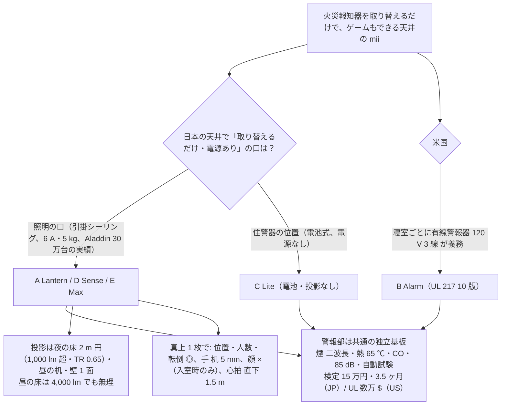

# 30 第 1 形態（Gen1）— 入口: 天井に工事なしで付く mii、火災警報器を兼ねる

本人の指示（2026-11-05 04:57 / 05:07）: 「第 1 形態は火災報知器に工事なしで取り替えるだけ、火災報知器の役割もして、ゲームなど大まかな部分ができる。第 2 形態にめっちゃ近いものを。同じ密度で調べ、技術的にできるかが一番大事。設計書は 5 種類。値段と構造をプロフェッショナルに。」

## 章の地図

| 章 | 内容 |
| --- | --- |
| [31](31-gen1-physics.md) | 共通の物理: 床・机・壁の照度とスロー比、真上カメラの分解能と「顔が見えない」、レーダーの距離、熱、質量（引掛 5 kg / US ボックス 2.7 kg） |
| [32 A Lantern](32-A-lantern.md) | 日本・引掛シーリング・照明＋投影 1,200 lm（床／机／壁 切替）＋全センサー＋警報。4.5 kg・150 W。原価 ¥130,000 |
| [33 B Alarm](33-B-alarm.md) | 米国・4″ 警報器ボックス 120 V・UL 217 10 版＋2034・投影 800 lm・照明なし。2.4 kg・80 W。$663 |
| [34 C Lite](34-C-lite.md) | 電池だけの位置・警報＋レーダー（電源版）＋PIR＋マイク・426 MHz 連動・Thread。0.4 kg。¥12,000 |
| [35 D Sense](35-D-sense.md) | 引掛・照明＋全センサー＋警報・投影なし（TV へ）。1.8 kg・50 W。¥46,000。Node ソフトがそのまま動く |
| [36 E Max](36-E-max.md) | 投影 2 台（床 2,000＋壁 1,200 lm 同時）・Orin・ステレオ NIR・Lepton。7.5 kg・250 W → ハンガ固定か 30 分工事。¥317,000 |
| [37 比較](37-gen1-comparison.md) | 一枚の表、推奨（A 主・C 神経・D 入口・E 上位・B 米国）、最初に買う物、16 週の試作、V1 への反映、本人の決定事項 |
| [research/](research/) | 調査 5 本（天井の口と法規、天井投影、真上センシング、BOM 価格 1・2） |

## 結論を 1 枚で

| 問い | 答え |
| --- | --- |
| 工事なしで火災報知器と取り替えられる？ | **日本では「照明の口」に付けるのが正解**（引掛シーリング: 工具不要・6 A・5 kg、非照明機器の給電は Aladdin 30 万台と Panasonic のアダプタで実績、禁止条文なし）。既設の電池式住警器の位置には電源が無いので、そこには C Lite。**米国では既設の有線警報器のボックスに回し込みで付く（B）** |
| 火災報知器の役割をする？ | する。ただし**法定の警報は煙室（光電式二波長）＋熱 65 ℃で取る**。カメラ・熱画像は「予兆」であって法定要件を満たせない（省令は煙・熱方式のみ、画像式の住宅規格なし）。日本は検定 148,100 円・多機能型 3.5 ヶ月・1 個 30〜41 円。米国は UL 217 10 版（移行期限 2027-11-17）＋UL 2034、数万 $〜 |
| ゲームなど大まかな部分は？ | 床（夜、2 m 円、1,000〜2,000 lm）、机（昼も、指先タッチ 5 mm）、壁 1 面（運動視差で一人なら窓）。**昼の床は物理的に無理**（4,000 lm でも 2〜3:1） |
| 第 2 形態に近い？ | センサーは Node と同構成（真上視点）。Hub が来たら Node に降格して残る。E Max は PoE で柱 2 本を足せる。無いのは壁 3 面の UST と卓の空中像 |
| 原価 | C ¥12,000 / D ¥46,000 / A ¥130,000 / B $663 / E ¥317,000（1,000 台）。議事録の **¥160,000 = Lantern 800（原価 ¥105,000）**、¥410,000 は Core のまま |
| 今日、買って組める？ | 全案の試作部品は市販。A は Aladdin X2 Light（¥60,280）を分解して足せば 4 週間で「床・机・壁に出る天井 mii」。TR 0.65・1,000 lm 超のエンジンだけ Anhua に RFQ |
| 一番の技術リスク | (1) 150〜250 W の器具に煙室を同居させる熱設計を検定で証明すること、(2) TR 0.5〜0.8・1,000 lm 超のエンジンが Anhua ほぼ一社、(3) 天井カメラの受容性 |

## 旧 30 章（mii One、04:57〜05:07 版）について

最初の版は調査 6 本で書き、原価 ¥83,000・売価 ¥160,000 とした。本人が「密度が違う」と判定したため、調査 5 本（約 120 品目・出典 URL 付き）をやり直し、31〜37 に分割した。旧版の数字（¥83,000）は投影エンジンの価格を見ていなかったので無効。
