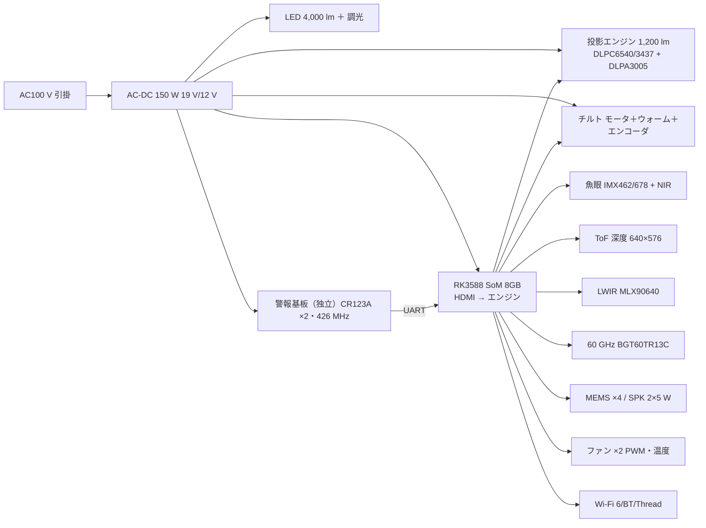

# 32 設計書 A「mii Lantern」— 日本の引掛シーリングに付く、照明＋投影＋全センサー＋火災警報

一言: **Aladdin X2 の形（引掛シーリング・照明兼用・4.5 kg 以内）に、D Sense の全センサーと火災警報器を入れ、投影を「壁専用」から「床・机・壁の切替」にした 1 枚。** 日本の家の 8 畳までを 1 枚で担い、夜〜間接照明のとき床に 1.5〜2 m の円、昼は机、いつでも壁 1 面。第 1 形態の本命。

根拠: [31 物理](31-gen1-physics.md)、[research-ceiling-projection](research/research-ceiling-projection.md)、[research-ceiling-alarm](research/research-ceiling-alarm.md)、[research-overhead-sensing](research/research-overhead-sensing.md)、[research-gen1-bom](research/research-gen1-bom.md)。

## 1. 絵

```text
   断面（Ø460 × H 150 mm、4.5 kg。Aladdin X2 Plus は Ø476 × H145・4.9 kg・160 W）

   ┌────────────────────────── 天井 ──────────────────────────┐
   │  引掛シーリングキャップ（5 種）＋ 落下防止ワイヤ（耳付きローゼット時）│
   ├─────────────────────────────────────────────────────────────┤
   │  AC-DC 150 W  │  警報基板（独立・CR123A ×2）│ 426 MHz │ Wi-Fi/Thread │
   ├─────────────────────────────────────────────────────────────┤
   │  メイン基板: RK3588 SoM（6 TOPS）＋ eMMC   │ 吸気 → ファン ×2 → 側面排気 │
   ├─────────────────────────────────────────────────────────────┤
   │ LED リング 4,000 lm ─┐  投影エンジン 1,000〜1,500 lm 1080p TR 0.65 │
   │  （外周、Al 放熱板）  │  1 軸電動チルト 0°（床）〜 63°（壁）、AF 3 点│
   │                      └─ センサー島: 魚眼 RGB/NIR・ToF 深度・LWIR・レーダー・マイク ×4 │
   └── 乳白カバー ──── 投光窓（下面＋側面の 2 窓）──── IR 黒窓 ──┘

   平面（下から見る）         チルト 0°: 真下の床に 3.56 × 2.0 m（円 2 m）
      ┌───────────┐          チルト 40°: 机（1.6 m 先）
      │  LED リング │          チルト 63°: 壁（水平 1.8 m、画面中心 1.5 m 高）
      │ ◎ 投光窓   │
      │ ● センサー  │
      └───────────┘
```

## 2. 取付・電源・質量

| 項目 | 設計値 | 根拠 |
| --- | --- | --- |
| 取付 | 引掛シーリング 5 種。**出しろ 10〜21 mm の薄い口にも対応**するバネ接点。4.5 kg なので「引掛のみ 5 kg 未満」の枠内だが、安全率のため耳付きローゼットではハンガ固定（10 kg）を推奨。工事資格不要 | 内線規程 3205-3、JIS C 8310 50 N（研究 alarm §1） |
| 電源 | AC100 V、**最大 150 W**（投影 95 W＋照明 35 W＋電子 20 W）。6 A・600 W 枠 | Aladdin X2 160 W の実績 |
| 質量 | **4.5 kg**（Aladdin X2 Light 4.7 kg、X2 Plus 4.9 kg） | 31 §5 |
| 停電 | 警報部のみ電池で継続 | 省令 |
| PSE | 照明器具＋引掛キャップ（差込み接続器＝特定電気用品の可能性）＋ AC-DC。登録検査機関へ事前相談 | 経産省判断例（研究 alarm §1） |

## 3. 構造（上から）

1. **引掛キャップ＋電源層**: AC-DC 150 W（Mean Well EPP-150/RPS-160 級）、警報基板（独立）、無線。
2. **演算層**: RK3588 SoM、ヒートシンク、ファン ×2（40 mm、Aladdin X2 Light は 32 dB）。吸気は天井面に沿って外周から、排気は側面。**煙室は吸気側（冷側）に置き、排気の暖気流が当たらない位置**（0〜40 ℃ 試験）。
3. **光学層**: 投影エンジン（0.47″ DLP471TP または 0.33″ DLP3310、LED、TR 0.5〜0.8 帯）を 1 軸チルト台に載せる。ウォームギア自己保持（停電で落ちない・振れない）。チルト 0° は下面の投光窓、63° は側面の投光窓を使う（**2 窓**）。AF は床 2.3 m／机 1.6 m／壁 2.0〜2.6 m の 3 プリセット＋ToF 実測で微調整。
4. **センサー島**: 投影軸の隣に魚眼 RGB/NIR 160°、ToF 深度（640×576 級、机のタッチ用）、LWIR 32×24 110°、60 GHz レーダー。マイク ×4 は外周 4 点。
5. **照明層**: LED リング 4,000 lm（8 畳）、2,700〜6,500 K、Al 放熱板兼用。
6. **カバー**: 乳白（照明）、IR 透過黒窓（センサー）、投光窓 ×2（ガラス）。

## 4. 警報部

34 章と共通の警報基板（煙 ADPD188BI 二波長・熱 65 ℃・CO・85 dB・426 MHz 連動・自動試験・10 年 EOL）。A/E は発熱 150 W と同居するので、**検定の環境試験（0〜40 ℃）で煙室温度と気流を証明する熱設計が最大の認証リスク**。対策: 煙室を吸気側の最外周に置き、ファン停止時も自然対流で煙室が天井面と同温になる構造。熱式センサは外気側。

## 5. センサー

D Sense（35 §5）と同じ＋**ToF 深度カメラ**（机の指先タッチ 5 mm 級、床のゾーン 10 mm 級。DIRECT: Kinect v2 1.6 m で誤差 4.8 mm・検出 99.3%・遅延 15 ms）。取れるもの・限界は 31 章と研究 sensing の通り: 位置・人数 ◎、上半身 ○、転倒 ◎（半径 2 m）、識別 ○（身長＋体格＋服色＋声、85〜95%、顔は入室時のみ）、呼吸 ○、心拍 △（直下 1.5 m・静止）、火災予兆 ○（コンロ・ストーブ）、法定警報 = 煙室で。

## 6. 投影（この案の核心）

| モード | チルト | 距離 | 画面 | 照度（1,200 lm 機） | 使い方 |
| --- | ---: | ---: | --- | ---: | --- |
| 床 | 0° | 2.3 m | 3.56 × 2.0 m（円 2 m） | 170 lux → 夜 10 lux で 17:1、間接照明 50 lux で 4.4:1 | 床ゲーム、子供、Eve の「足元に出る」 |
| 机 | 35〜45° | 1.6 m | 2.46 × 1.38 m → 机 1.2 × 0.7 m に電子クロップ | 約 480 lux（局所） | 昼も使える。指先タッチ、Star Wars の卓の「平面版」 |
| 壁 | 63° | 2.0〜2.6 m | 壁に 100″ 級（斜入 27°、画素 20〜30% 損失、AF） | 100″ 2.2 × 1.24 m に 1,200 lm → 440 lux | 映画・Eve の顔・運動視差の窓（第 2 形態の予告編） |

- **エンジン**: 現行 DMD（DLP471TP 1,800 lm 上限 / DLP3310 800 lm 上限）。TR 0.5〜0.8 帯は Anhua FF81HA/FF86HA（DLP471TP、600〜2,000 lm）、F11/F56/FY81/FY86（DLP4710、LAST TIME BUY なので採用しない）。Ongine/Young Optics は TR 0.9 以上で床 2 m 円が出ない。
- **明るさの判定**: 1,000〜1,500 lm なら「夜〜間接照明の床」「昼の机」「壁」が成立。**昼の床は 4,000 lm でも 2〜3:1 で不成立 → 製品コンセプトで諦める**（research-projection §4-2）。
- **遅延**: DLPC 1 フレーム（60 Hz 16.7 ms）。台形補正・AF 後処理はエンジン側 OFF、GPU（RK3588 Mali）で自前ワープ → 表示 ≤25 ms。タッチ 15 ms＋30 fps → 合計 60〜80 ms。
- **安全**: LED-DLP は IEC 62471 RG1 級。真下から見上げる前提なので、人体検知（ToF）で顔がレンズ正面 1 m 以内に来たら減光。レーザー光源は RG2 判定と FDA 警告が要るので Gen1 では LED。

## 7. 計算

| 予算 | 値 |
| --- | --- |
| 電力 | 投影 95 W（1,200 lm LED、TI 600 lm EVM が 90 W 級から外挿）＋ LED 35 W ＋ RK3588 12 W ＋ センサー 5 W ＋ ファン 3 W ＝ **150 W** |
| 熱 | 150 W を Ø460 筐体から。自然対流では ΔT 80 K 超（31 §4）→ ファン必須。Aladdin X2 Light（160 W、H121）が 32 dB で成立しているのが前例。目標 ≤30 dB、排気温 ≤45 ℃ |
| 質量 | 筐体 PC 1.2 kg、放熱板 Al 0.9 kg、エンジン＋チルト 0.9 kg、電源 0.4 kg、基板 0.4 kg、LED 0.3 kg、カバー・ガラス 0.4 kg ＝ **4.5 kg** |
| 投影照度 | 31 §1 の表 |
| 演算 | RK3588 NPU 6 TOPS: 人物検出・上半身姿勢 15 fps、ToF タッチ 30 fps、ワープ、Eve の音声。足りなければ Hailo-8（26 TOPS、A$314）を M.2 で（納期 21 週に注意） |

## 8. 電気ブロック



## 9. ソフト

- 単体: Eve（声・照明・見守り・火災）、床ゲーム（踏む・手を置く）、机アプリ（タッチ、3D モデルの回転・拡大 = 卓の 2D 版）、壁（映画、Eve の顔、**一人のときは頭追跡の運動視差で壁を窓にする**＝第 2 形態の体験の予告）。
- Hub が来たら Node に降格し、投影は Hub の Display Bus の 1 出力に（V1 設計書 05/07 章）。
- 補正パイプライン: ToF で床・机・壁の平面を実測 → 射影変換を GPU で → エンジンは生のまま。

## 10. 認証

| 市場 | 必要 | 費用・期間 |
| --- | --- | --- |
| 日本 | 住警器 型式承認＋適合検定（多機能型、148,100 円、3.5 ヶ月、30〜41 円/個）、PSE（内蔵 AC-DC＝直流電源装置は特定電気用品）、技適（Wi-Fi/BT/Thread・60 GHz）、IEC 62471 RG 試験（LED） | PSE 適合性検査 ¥950,000、技適 ¥240,000×2＋60 GHz ¥450,000（認証済モジュールで回避可）、62471 は見積制（不明）。**認証合計の目安 ¥1,100,000〜2,000,000**（検定＋PSE＋技適の一部） |
| 米国 | 引掛が無いので B Alarm の筐体へ（33 章）。A は日本専用 | — |

## 11. BOM（1,000 台。出典 research-gen1-bom / research-ceiling-projection。「推定」は根拠を併記）

| 部品 | 品 | 1 台 | 100 台 | 1,000 台 | 出典・推定根拠 |
| --- | --- | ---: | ---: | ---: | --- |
| 投影エンジン 1,200 lm 1080p TR 0.65 | Anhua FF81HA 級（DLP471TP）/ DLP3310 系 | $1,200（EVM 471TP $1,199、600 lm 4710 EVM 級） | $800（推定） | **$450（推定: Alibaba 参考帯 Mid 1080p $650〜1,300 の下限 × 0.7。RFQ 必須）** | research-projection §1 |
| チルト機構 | iPower GM2804＋AS5048A $38.99 or ギヤドステッパ $3.96@100＋ウォーム＋スリップリング 6ch $14.95 | $60 | $30 | $18（推定） | research-gen1-bom 7A |
| ToF 深度カメラ | Orbbec Femto 級 / 自前 ToF モジュール | $300 | $150（推定） | $70（推定） | Azure Kinect 後継は価格不明 |
| SoM | RK3588 8GB（Firefly Core-3588J $309 / Radxa CM5 8GB $89） | $309 / $89 | $80（推定） | $65（推定、Radxa 系） | research-gen1-bom §1 |
| 魚眼・NIR・LWIR・レーダー・CO₂・環境・マイク・Wi-Fi | 35 §11 と同じ | $176 | $120 | **$98** | 35 §11 合計 |
| 警報基板（共通） | 34 §11 | $75 | $45 | **$38** | 34 §11 |
| LED 4,000 lm＋ドライバ | Citizen CLU048-1212 $14.93 ＋ LCM-40 £23.39 | $45 | $30 | $18（推定） | research-gen1-bom 6A |
| AC-DC 150 W | Mean Well RPS-160 級（RPS-120-12 $23.31・在庫 0・16 週、EPP-100-12 $40.55 を参考） | $45 | $35 | $28（推定） | research-gen1-bom 5A |
| ファン ×2・ヒートシンク | Sunon 40 mm €5.99→€4.30@50 ×2＋Al | $20 | $14 | $10（推定） | research-gen1-bom 8A |
| スピーカー 2×5 W | Dayton CE48-4 €7.95 ×2 | $17 | — | $9（推定） | research-gen1-bom 8A |
| 引掛キャップ・落下防止 | WG1000P ¥333（¥242@10）＋ワイヤ | $4 | — | $3 | research-gen1-bom 5A |
| 基板 2 枚 | 4 層実装 | $70 | $35 | $16（推定） | research-pricing |
| 筐体・放熱板・カバー・投光窓ガラス | 成形 4 部品＋Al＋ガラス。金型 P20 $8,000〜25,000 ×4（計 $40k〜100k） | $150（切削） | $45 | $30（ABS 大物 約 $8/個 ×3＋Al・ガラス） | research-gen1-bom 8A |
| 組立・試験・検定・PSE ラベル | — | — | — | $20＋¥41 | — |
| **合計** | | **$2,500 級** | **$1,480 級** | **$872（¥131,000）** | |

売価の目安: **¥198,000〜248,000**（Aladdin X2 Plus ¥129,800、X3 Laser ¥249,800、Nobi 約 $2,500）。議事録の **¥160,000 は原価 ¥130,000 では成立しない** → 投影を 800 lm（DLP3310、エンジン推定 $280）に落とした「Lantern 800」なら原価 ¥105,000、売価 ¥160,000（税込）で粗利 28%（45 章）。直販なら成立、量販に卸すなら ¥178,000 以上。

## 12. 判定

| 問い | 判定 | 理由 |
| --- | --- | --- |
| 今日、材料を買って組める？ | **○（試作）** | Aladdin X2 Light（¥60,280 実売）を買って分解＋Pi/RK3588＋ToF＋MLX90640＋BGT60 EVM を足せば「床・机・壁に出る天井 mii」の体験は 4 週間で見られる。TR 0.65 のエンジンだけは Anhua に RFQ（単品可） |
| 火災警報器として | **認証が要る＋熱設計が難所** | 150 W と同居する煙室の 0〜40 ℃ 試験 |
| mii として | **◎ 第 1 形態で一番近い**: 床・机・壁の 3 面、全センサー、Eve、火災 | §6 |
| 第 2 形態への近さ | 高: Node のセンサー構成＋壁の運動視差（一人）が入る。無いのは壁全面 UST と卓の空中像 | §9 |
| 無理なこと | 昼の床、顔（真上）、指 mm 精度（床）、¥160,000 で 1,200 lm、5 kg 超 | 31 章、§11 |

## 13. リスク

1. **エンジンの量産価格と供給**: TR 0.5〜0.8・1,000 lm 超は Anhua ほぼ一社。DLP4710 系は LAST TIME BUY → DLP471TP 系（FF81HA）で RFQ。
2. **検定の熱試験**: 150 W の器具に煙室を同居させた前例が見つからない。先に検定協会へ事前相談し、ダメなら「警報部を別筐体（C Lite）にして無線連動」に逃げる設計を残す。
3. **4.5 kg と引掛の口**: 出しろの薄い口、古い角形。Aladdin と同じ非対応リストが出る。
4. **ToF 深度の供給**: Azure Kinect 終息。Orbbec Femto Bolt か自前 ToF（VL53L8 ×N は 8×8 で机のタッチには粗い）。
5. **昼の床が出ない**ことを売り方で先に言う（夜のゲーム機・昼の机・いつでも壁）。
6. **プライバシー**: 天井カメラ。カメラ OFF 物理スイッチ。

## 14. 試作計画

| 週 | 内容 |
| --- | --- |
| 0〜1 | Aladdin X2 Light 購入・分解（取付・放熱・チルトの実物）、Anhua へ FF81HA の RFQ と単品注文 |
| 1〜3 | RK3588 ボード＋手持ちプロジェクター（TR 1.2 でも可、床 1.3 m 円）＋ToF＋魚眼で「床ゲーム 1 本・机タッチ・壁の運動視差」。遅延実測 |
| 3〜6 | エンジン到着 → チルト台（3D プリント＋ウォームギア）、3 プリセット AF、GPU ワープ |
| 6〜10 | 筐体 SLA、150 W の放熱・騒音測定、警報基板同居の煙室温度測定 |
| 10〜14 | 検定協会・PSE 登録検査機関・技適の事前相談、RFQ 7 件（エンジン・SoM・ToF・LED・電源・金型・AC-DC）、EVT 判断 |
