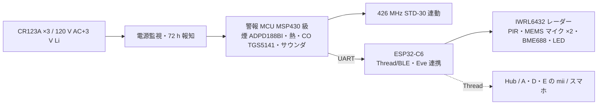

# 34 設計書 C「mii Lite」— 電池だけの位置に付く、火災警報器＋耳＋気配

一言: **引掛シーリングの無い位置（階段・廊下・2 台目の寝室）に、電池式住警器と同じ手順で付く小さな mii。** 投影もカメラも無い。煙・熱・CO・音・人感を取り、426 MHz で他の mii と連動、Thread で Hub/Eve に繋がる。「mii のある家」を全部屋に広げるための最安の 1 枚。

根拠: [research-ceiling-alarm](research/research-ceiling-alarm.md)、[research-overhead-sensing](research/research-overhead-sensing.md)、[research-gen1-bom](research/research-gen1-bom.md)、[31 物理](31-gen1-physics.md)。

## 1. 絵

```text
   断面（Ø120 × H 38 mm、電池式住警器と同寸級。Nest Protect は 135 × 135 × 39.5 mm / 379 g）

   ┌──────────────── 天井 ────────────────┐
   │  ベースプレート（ネジ 2 本 or 既存住警器のベース流用）│
   ├───────────────────────────────────────┤
   │  電池室 CR123A ×3（Nest 有線版と同じ 3 本）/ 単 3 Li ×6 │
   ├───────────────────────────────────────┤
   │  基板 1 枚: MCU・ESP32-C6(Thread)・426 MHz 連動・    │
   │  IWRL6432 レーダー(※電源版のみ常時)・MEMS マイク ×2 │
   ├───────────────────────────────────────┤
   │  煙室（ADPD188BI 二波長、防虫網 1 mm）・サーミスタ 65 ℃ │
   │  CO セル（TGS5141）・PIR・圧電サウンダ 85 dB・LED リング │
   └───────────── 格子カバー（白）──────────┘
```

## 2. 取付・電源・質量

| 項目 | 設計値 | 根拠 |
| --- | --- | --- |
| 取付 | 天井にネジ 2 本（ベースプレート回し込み）。既存の電池式住警器を外した位置にそのまま | 市販住警器と同じ手順。工事資格不要（研究 alarm §1 工事資格） |
| 電源 | **電池版**: CR123A ×3（3 V × 1,500 mAh ×3 ≈ 13.5 Wh）。**電源版 Lite-AC**: 既存の AC 式住警器の配線（日本では稀）／米国の 120 V 3 線 | Nest Protect 有線版が 3×AA、電池版が 6×AA（研究 alarm §4） |
| 質量 | ≤400 g | Nest Protect 379 g |
| 寿命 | 警報部 10 年（CO セル 7〜10 年）。電池は下記 §7 | 省令: 10 年交換目安、72 h 電池切れ報知 |

## 3. 構造

1 枚基板＋煙室アセンブリ＋電池室。**警報部（煙・熱・CO・サウンダ・426 MHz）は専用 MCU（MSP430 級）で独立**し、ESP32-C6（Thread/BLE、Eve 連携）とは UART 1 本で繋ぐ。Eve 側が落ちても警報は鳴る。

## 4. 警報部（法規に従う部分）

| 要素 | 設計 | 法規・根拠 |
| --- | --- | --- |
| 煙 | 光電式 2 種、ADI ADPD188BI（青 470 nm＋IR 850 nm 二波長）。感度は地域設定: JP 15 %/m 作動・5 %/m 不作動、US 0.5〜4 %/ft 窓 | 省令 / UL 217 10 版（研究 alarm §3-1, §4）。ADI の算法ライセンス $27,500（1 回） |
| 熱 | 定温式 65 ℃ サーミスタ（外気側） | 省令 |
| CO | Figaro TGS5141（UL 2075 認定部品、10 年） | UL 2034。日本は住警器検定の範囲外（別途確認） |
| 音 | 圧電サウンダ 85 dB@3 m 相当（JP 70 dB@1 m、US 85 dB@10 ft） | 省令 / UL 217 |
| 連動 | 426 MHz 小電力セキュリティ（ARIB STD-30）。**自社 mii 同士のみ**。Wi-Fi/Thread は連動の代替にならない | 研究 alarm §3-1 無線連動 |
| 自動試験・停止 | 1 時間ごと自己診断、故障 72 h 報知、停止後 15 分で復帰、10 年 EOL タイマー | 省令 / UL 217 8 版 |
| 表示 | 検定合格表示（住警第○号）、US は UL/ETL マーク | 2014-04 以降必須 |

## 5. センサー（mii として取れるもの）

| センサー | 取れるもの | 天井 1 枚での限界 |
| --- | --- | --- |
| IWRL6432 60 GHz（電源版は常時、電池版は PIR 起床後 60 s だけ） | 在室・人数（1〜2 人）・転倒（半径 2 m）・就寝中の呼吸 | 心拍は 1.5 m 以内・静止（研究 sensing §2, §4） |
| PIR | 在室の起床トリガ（Nest Pathlight と同じ） | 方向・人数は不可 |
| MEMS マイク ×2 | 声でのウェイク、話者 ID（世帯 EER 1.3〜3.8%）、ガラス割れ・警報音の検知 | 残響。テキスト化は Hub/Eve 側 |
| 温湿度・照度（BME688） | 環境、蒸気誤報の抑制（Nest Steam Check） | — |
| LED リング | 夜間の足元灯、警報色 | — |

カメラ・LWIR は無し（電池と価格のため）。**火災の「予兆」は無く、法定の煙・熱・CO のみ**。

## 6. 投影

無し。TV・スマホ・隣室の mii へ Eve が声と光で返す。

## 7. 計算 — 電池で何が動くか

| 構成 | 平均消費 | 13.5 Wh での寿命 |
| --- | ---: | ---: |
| 警報部のみ（市販住警器相当） | 50 µW 級 | 10 年超 |
| ＋Thread スリーピーエンドデバイス（1 回/10 s）＋PIR | 0.3 mW | 約 5 年 |
| ＋レーダー常時（IWRL6432 低電力 presence、2 mW 平均） | 2.5 mW | **約 7 ヶ月** |
| ＋マイク常時待受（100 µA 級 VAD）＋レーダー常時 | 3 mW | 約 6 ヶ月 |

→ **電池版は「警報＋Thread＋PIR＋声起床」。レーダー常時と転倒検知は電源版（Lite-AC）か、A/D/E の下に。** 電池版でもレーダーは PIR 起床後 60 s だけ回して「人数・立ち座り」を取る（1 日 2 時間稼働なら 0.3 mW 相当、寿命 3〜4 年）。

## 8. 電気ブロック



## 9. ソフト

- 警報 MCU: 検定対象の固定ファーム（更新は型式変更試験を伴うので頻度を上げない）。
- ESP32-C6: Matter over Thread の Smoke/CO Alarm デバイスタイプ＋独自クラスタ（在室・転倒・声）。Hub（第 2 形態）か A/D/E があればそこへ、無ければスマホ直結。
- Eve はこの 1 枚では動かない（耳と口だけ）。「Eve、電気消して」は Hub/他室 mii が処理。

## 10. 認証の道筋

| 市場 | 必要 | 費用・期間（研究 alarm §3-2, §4） |
| --- | --- | --- |
| 日本 | 住警器 型式承認＋型式適合検定（多機能型）、技適（Thread・426 MHz） | 型式試験 148,100 円、標準 3.5 ヶ月、適合検定 30〜41 円/個。技適は 2.4 GHz ¥240,000（認証済モジュール ESP32-C6 を使えば不要）、426 MHz は特定小電力の工事設計認証 別途 |
| 米国 | UL 217 10 版＋UL 2034、FCC Part 15 | UL 217 Listing 約 $31,000〜45,000・試験 12〜16 週＋Listing 4 週（実務 18〜20 週）、UL 2034 は公開値なし（2027-01-01 に Ed.4 改訂適合期限）、FCC 意図的放射器 $9,000〜12,000（モジュール流用で大幅減）、年 $1k〜3k＋工場監査 |
| 両市場共通ハード | 感度窓が違う（JP 15 %/m vs US 高感度側）→ 地域別ファーム設定、別々の認証 | 研究 alarm §4 |

## 11. BOM（1,000 台。出典: research-gen1-bom。1,000 個価格が無い品は「1 個価格 × 0.6（推定）」と明記）

| 部品 | 品 | 1 台 | 100 台 | 1,000 台 | 出典 |
| --- | --- | ---: | ---: | ---: | --- |
| 煙センサ IC | ADI ADPD188BI | $5.73 | $4.21 | $3.4（推定） | LCSC |
| CO セル | Figaro TGS5141 | $47.5（Arrow, MOQ10） | 不明 | $18（推定: TGS5042 £25→量産 ¥2,500 級の業界相場、要 RFQ） | Arrow/RS |
| レーダー IC | TI IWRL6432 | $10.92 | $7.70 | $6.0（推定） | LCSC |
| Thread/BLE | ESP32-C6-WROOM-1 | $2.98 | 不明 | $2.2（推定） | LCSC |
| 426 MHz 連動モジュール | STD-30 準拠（要選定） | 不明 | 不明 | $8（推定、要 RFQ） | — |
| 警報 MCU | MSP430FR2355 級 | $3 | — | $1.8（推定） | TI 参考設計 SLAA930 |
| サーミスタ・PIR・BME688 | — | $8.14（BME688） | — | $9（推定、3 点） | LCSC |
| MEMS マイク ×2・サウンダ・LED | Murata PKM22EPPH4007 85 dB は在庫 19・再入荷なし → 後継選定 | $8 | — | $5（推定） | research-gen1-bom 8A |
| 電池 10 年 Li ×3 | Tadiran TL-5903/S 級 | $7 | — | $15（$5.00@1,080 ×3。「製造終了」表示あり要確認） | research-gen1-bom 5A |
| 基板（4 層、実装） | JLCPCB 50 枚 $37/枚 | $37 | $20 | $8（推定） | research-pricing |
| 筐体・煙室・防虫網（成形 3 部品） | 金型 P20 $8,000〜25,000/キャビティ（中国） | $30（切削） | $10 | $6（ABS 1,000 個で約 $8/個の相場・小物） | research-gen1-bom 8A |
| 組立・試験・適合検定 | — | — | — | $6＋¥41 | 検定協会 |
| **合計** | | **$150 級** | **$85 級** | **$91（¥13,600）** | |

売価の目安: **¥19,800〜24,800**（Nest Protect $119〜129、First Alert SC5 $129.95、単機能住警器 ¥3,000〜6,000）。

## 12. 判定

| 問い | 判定 | 理由 |
| --- | --- | --- |
| 今日、材料を買って組める？ | **○ 試作は今日** | 全部品が市販。ADPD188BI の評価基板 CN0537 は UL 217 8 版の Intertek 試験に合格済み |
| 火災警報器として売れる？ | **認証が要る**（JP 約 15 万円・3.5 ヶ月、US 数万 $・3〜6 ヶ月） | 検定済みモジュールの外販は無いので自社煙室＋検定 |
| mii として | △ 耳と気配だけ。Eve の口は LED と音 | 投影・カメラ無し |
| 第 2 形態への近さ | 低（Node でも Column でもない）。ただし **mii の「家中の神経」になる** | |
| 無理なこと | 電池で レーダー常時／顔／投影 | §7 |

## 13. リスク

- 426 MHz 連動は自社機同士のみ → 既設の他社住警器とは鳴動連動できない（説明書に明記）。
- CO セルの 10 年寿命と Thread チップの陳腐化 → 警報カートリッジ交換式にするか、10 年で本体交換。
- 検定ファームの固定と Eve 側の更新を分けないと、更新ごとに型式変更試験。

## 14. 試作計画

| 週 | 内容 |
| --- | --- |
| 1〜2 | ADI EVAL-CN0537 ＋ TGS5141 ＋ ESP32-C6 で机上動作、Matter Smoke/CO デバイスとして Home アプリに出す |
| 3〜4 | IWRL6432 EVM を天井 2.4 m に付け、在室・転倒・呼吸の取れ方を 31 章の数字と照合 |
| 5〜8 | 1 枚基板・煙室試作（SLA）、音圧 85 dB 測定、電池寿命の実測 |
| 9〜 | 検定協会へ事前相談（多機能型の扱い、発熱部品無しなので A/E より通りやすい） |
