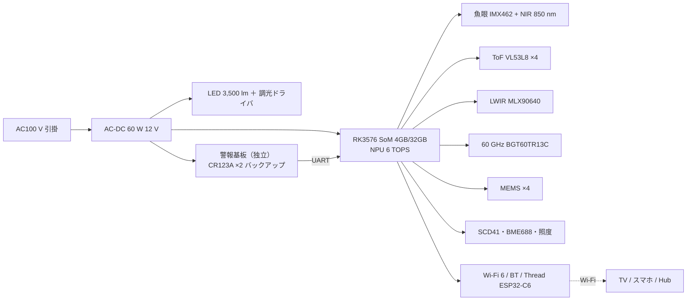

# 35 設計書 D「mii Sense」— 投影なし。照明＋全センサー＋小さな脳。表示は TV とスマホへ

一言: **引掛シーリングに付く「シーリングライト型の mii」。** 照明を兼ね、真上から部屋を見て（魚眼・深度・熱・レーダー・マイク）、火災警報器も兼ねる。映像は部屋の TV・スマホ・タブレットに Eve が出す。投影が無いので 2 kg 以下・60 W 以下・ファンなしで、**第 2 形態の Node ソフトがそのまま動く最初の 1 枚**。

根拠: [31 物理](31-gen1-physics.md)、[research-overhead-sensing](research/research-overhead-sensing.md)、[research-ceiling-alarm](research/research-ceiling-alarm.md)、[research-gen1-bom](research/research-gen1-bom.md)。

## 1. 絵

```text
   断面（Ø390 × H 70 mm。SwitchBot シーリングライト 6 畳が Ø390 × H96・1.1 kg）

   ┌─────────────────── 天井 ───────────────────┐
   │ 引掛シーリングキャップ（5 種対応、出しろ 10〜21 mm 吸収）│
   ├──────────────────────────────────────────────┤
   │ AC-DC 60 W ＋ 警報部バックアップ電池（CR123A ×2）   │
   ├──────────────────────────────────────────────┤
   │ メイン基板: RK3576 SoM（6 TOPS NPU）・ESP32-C6・eMMC │
   │ ［独立］警報基板: 煙 ADPD188BI・熱・CO・サウンダ・426 MHz │
   ├──────────────────────────────────────────────┤
   │ LED リング 3,500 lm（外周）  ＋  センサー島（中央、Ø60 mm 窓）│
   │   魚眼 RGB/NIR 160°  ToF 8×8  LWIR 32×24 110°  60 GHz レーダー │
   │   MEMS マイク ×4（外周 4 点）  SCD41 CO₂  BME688  照度  │
   └────────────── 乳白カバー（中央は IR 透過の黒窓）────────┘
```

## 2. 取付・電源・質量

| 項目 | 設計値 | 根拠 |
| --- | --- | --- |
| 取付 | 引掛シーリング（角形・丸形・フル・埋込ローゼット・フル引掛の 5 種）。工具不要。出しろ 10〜21 mm の薄い口にも当たるバネ接点 | 研究 alarm §1。Aladdin が非対応にした「出しろ 21 mm 以下」を吸収する |
| 電源 | AC100 V、最大 55 W（照明 35 W＋電子 15 W＋余裕） | 6 A・600 W 枠に余裕 |
| 質量 | **1.8 kg**（引掛 5 kg の 1/2.8） | SwitchBot 1.1〜1.7 kg、Panasonic AIR PANEL 4.9 kg |
| 停電 | 警報部のみ CR123A ×2 で継続（Nest 有線版と同じ考え） | 省令: 電池切れ 72 h 報知 |
| 米国 | 引掛が無いので 4" 八角ボックス用ブラケット＋120 V 直結（照明置換）。質量 2.7 kg 以下の条件を満たす | NEC 314.27(A)、研究 alarm §4 |

## 3. 構造

外周 = 照明（LED リング＋拡散カバー）、中央 Ø60 mm = センサー島（黒い IR 透過窓）、裏 = 基板 2 枚（メインと警報）。**警報基板は独立電源・独立 MCU・独立サウンダ**で、メイン基板と UART 1 本。煙室は LED 熱の上昇流を受けない側面（天井面に沿う吸気）に置く（研究 alarm §3-1 環境試験 0〜40 ℃）。

ファン無し: 55 W のうち LED 35 W は外周アルミ放熱板（表面 0.15 m²、ΔT ≈ 35 K、一般のシーリングライトと同等）、SoC 10 W は中央のヒートシンクへ。

## 4. 警報部

34 章 C Lite と同一の警報基板（煙 ADPD188BI 二波長・熱 65 ℃・CO TGS5141・85 dB サウンダ・426 MHz STD-30 連動・自動試験・10 年 EOL）。**法規・認証は 34 §4, §10 と同じ。** 1 つの基板を C/D/A/E で共用し、検定を 1 回で済ませる（型式は「多機能型」。発熱体と同居する D/A/E は 0〜40 ℃ 試験で煙室温度の証明が要る）。

## 5. センサー — 天井 1 枚で取れるもの（研究 sensing の数字で）

| センサー | 品 | 取れるもの | 精度・限界 |
| --- | --- | --- | --- |
| 魚眼 RGB/NIR 160° 2.5〜4 MP | IMX462（低照度 2 MP）または IMX678 8 MP | 人の位置・人数（AP50 94+ 照明良好）、上半身姿勢（頭 98 / 肩 96 / 手 85%）、服色、床の物 | 顔は不可（真上）。下半身 50〜60%。消灯時は NIR 照明 850 nm で 87% に回復 |
| ToF 8×8 → 将来 VL53L8 ×4 または小型 ToF カメラ | ST VL53L8CX（8×8、$7.44） | 身長（深度で直接）、頭の高さの急減（転倒） | 8×8 では粗い。E Max は 640×576 級 ToF |
| LWIR 32×24・110° | MLX90640 BAA | 床 6.9 × 3.7 m の温度地図（1 画素 ≈ 22 × 15 cm）。コンロ・ストーブの過熱（300 ℃ 飽和で確実）、人の在室（消灯でも）、体温の**相対**変化 | ロウソク級は不確実。蒸気で誤報。**法定警報の代替にはならない**（画像式サーマルの住宅規格なし） |
| 60 GHz レーダー | Infineon BGT60TR13C（$14.75/$11.70@100） | 在室（静止含む）、呼吸（全員）、転倒（半径 2 m）、就寝中の心拍（ベッドが直下〜2 m なら MAE 1 bpm の研究値） | 心拍は 1.5 m 以内・静止・1 人。半径 2 m を超えると転倒は 2 枚目が要る |
| MEMS マイク ×4 | — | 声のウェイク、方向、話者 ID（EER 1.3〜3.8%）、警報音・ガラス割れ | 残響。テキスト化は SoM の NPU かクラウド |
| CO₂・VOC・温湿度・照度 | SCD41、BME688 | 換気、在室の裏付け、Steam Check | — |
| 照明 | LED 3,500 lm 2,700〜6,500 K | 照明そのもの、Eve の合図（色・点滅）、夜の足元灯 | — |

**人物識別**: 顔が使えないので、身長（ToF）＋頭肩形状＋服色＋歩き方（上半身の揺れ）＋声の合算。研究値は外見 Re-ID 80〜83%、身長＋歩容 85%（誤認 0）、位置ベース多視点 94〜95%。4〜5 人世帯で 85〜95% 級。**入室時にドア方向の俯角 25〜35° で顔が 1 回取れる配置なら顔も足せる**（31 §2）。

## 6. 投影

無し。Eve の映像は Wi-Fi で TV（RockstarOS TV アプリ／Chromecast 系／AirPlay 系）、スマホ、タブレットへ。ゲームは TV 画面＋天井の体の追跡（Kinect 方式）。**「床に出る」体験が無い**のが A/E との差。

## 7. 計算

| 予算 | 値 |
| --- | --- |
| 電力 | LED 35 W＋RK3576 8 W＋カメラ/レーダー/LWIR 3 W＋Wi-Fi 2 W＋警報 0.5 W ＝ **49 W**（AC-DC 60 W） |
| 熱 | 外周放熱板 ΔT 35 K（無風）。センサー島はカバー内で +10 K → LWIR の NUC 補正に周囲温度センサ必須 |
| 質量 | 筐体 PC 0.7 kg、放熱板 Al 0.5 kg、基板・電源 0.35 kg、電池・警報 0.15 kg、カバー 0.1 kg ＝ **1.8 kg** |
| 演算 | RK3576 NPU 6 TOPS: 魚眼人物検出（RAPiD 1024 px）＋上半身姿勢を 15 fps、話者 ID、レーダー信号処理。全身の高精度や複数部屋の統合は Hub へ |

## 8. 電気ブロック



## 9. ソフト

- 単体: Eve（音声・照明・見守り・火災・TV へのゲーム）が SoM で動く。音声認識は端末内（小型）＋クラウド。
- Hub（第 2 形態）が来たら: **この 1 枚は Node に降格**。Spatial API（V1 設計書 07 章）で位置・姿勢・識別・環境を Hub へ流す。V1 Node との差は「真上視点」だけなので、Hub 側は視点パラメータを持つ Node として扱う。
- 2 枚（LDK）: 位置ベースの多視点 Re-ID が効き識別 94〜95%、レーダー転倒の半径 2 m ×2 で LDK 全域。

## 10. 認証

| 市場 | 必要 | 費用・期間 |
| --- | --- | --- |
| 日本 | 住警器 型式承認＋適合検定（多機能型）148,100 円・3.5 ヶ月、PSE（照明器具＋引掛キャップは「差込み接続器＝特定電気用品」になり得る → 登録検査機関）、技適（Wi-Fi/BT/Thread、60 GHz レーダー） | PSE・技適の費用は BOM-2 調査（research-gen1-bom 追補）参照 |
| 米国 | UL 217 10 版＋UL 2034、UL 62368-1（機器）、FCC Part 15（無線・60 GHz）、IEC 62471 は LED 照明の RG 判定（一般に RG1） | $5k〜50k＋継続 |
| プライバシー | 天井カメラは受容性が低い → **LWIR＋レーダーだけで動く「カメラ OFF モード」**をハードスイッチで用意（Nest の Pathlight 的な妥協）。個人識別符号（顔・声）の同意 UI | 個人情報保護法、BIPA |

## 11. BOM（1,000 台。出典は research-gen1-bom。「推定」は 1 個価格 × 0.6）

| 部品 | 品 | 1 台 | 100 台 | 1,000 台 | 出典 |
| --- | --- | ---: | ---: | ---: | --- |
| SoM | Firefly Core-3576JD4 4GB/32GB（RK3576） | $119 | $100（推定） | $85（推定） | cnx-software 2024-10 |
| 魚眼カメラ | IMX462 モジュール＋160° M12 | $83 | $50（推定） | $38（推定） | Waveshare |
| NIR 照明 850 nm | LED ×8＋ドライバ | $6 | — | $3 | — |
| ToF | VL53L8CX ×4 | $30 | — | $18（推定） | LCSC $7.44 |
| LWIR | MLX90640 BAA 110° | $26.70 | $20（推定） | $16（推定） | LCSC（在庫切、前倒し発注） |
| レーダー | BGT60TR13C＋アンテナ基板 | $14.75＋$5 | $11.70＋$3 | $10＋$2（推定） | LCSC |
| CO₂・環境 | SCD41、BME688 | $19.76＋$8.14 | $16.33＋$6 | $14.51＋$5（推定） | Symmetry、LCSC |
| マイク ×4・スピーカー 2×3 W | — | $12 | — | $8（推定） | BOM-2 待ち |
| Wi-Fi/Thread | ESP32-C6 | $2.98 | — | $2.2（推定） | LCSC |
| 警報基板（34 章と共用） | 煙・熱・CO・サウンダ・426 MHz・MCU・電池 | $75 | $45 | **$38** | 34 §11 の該当行合計 |
| LED 3,500 lm＋ドライバ | COB/SMD リング | $25 | — | $12（推定、SwitchBot 完成品 ¥4,980 から逆算） | BOM-2 待ち |
| AC-DC 60 W | Mean Well IRM-60-12 級 | $30 | $22 | $15（推定） | RS（BOM-2 で確定） |
| 引掛キャップ・接点 | 5 種対応 | $8 | — | $3 | BOM-2 待ち |
| 基板 2 枚（4 層実装） | JLCPCB | $60 | $30 | $14（推定） | research-pricing |
| 筐体・放熱板・カバー | 成形 3 部品＋Al | $80（切削） | $25 | $12（推定、金型別 BOM-2 待ち） | — |
| 組立・試験・検定 | — | — | — | $12＋¥41 | — |
| **合計** | | **$600 級** | **$400 級** | **$308（¥46,000）** | |

売価の目安: **¥79,800〜99,800**（Aladdin X2 Light ¥99,800、Nobi Smart Lamp 約 $2,500＋月額、SwitchBot ¥4,980）。議事録の ¥160,000 は D と Lite ×2 のセットで成立する。

## 12. 判定

| 問い | 判定 | 理由 |
| --- | --- | --- |
| 今日、材料を買って組める？ | **◎** | 全部品が市販、発熱が小さく、Pi/RK3576 の開発キット＋カメラ＋MLX90640＋BGT60 EVM で 2 週間 |
| 火災警報器として | 認証が要る（34 と同じ）＋ LED 発熱と煙室の分離を検定で証明 | 研究 alarm §3-1 |
| mii として | ○ 耳・目（真上）・口（TV・光・音）。「床に映る」が無い | §6 |
| 第 2 形態への近さ | **高（ソフト）**: Node のセンサー構成とほぼ同じ、Hub が来たらそのまま Node。**低（体験）**: 投影が無い | §9 |
| 無理なこと | 顔（真上）、指 mm 精度、心拍 1.5 m 超、LDK 1 枚、昼夜問わず画像で火災判定 | 31 章 |

## 13. リスク

- 天井カメラの受容性 → カメラ OFF モードを物理スイッチで。
- MLX90640 の在庫切（LCSC・Arrow）→ 1,000 台は前倒し発注か Lepton 3.1R（$149）/InfiRay Tiny1-C（$99〜）へ。
- RK3576 SoM の価格は DDR4 高騰で変動（CM5 が $45→$135 の例）。
- 照明一体の PSE 区分（照明器具か差込み接続器か）が設計次第 → 早期に登録検査機関へ相談。

## 14. 試作計画

| 週 | 内容 |
| --- | --- |
| 1〜2 | Radxa CM5/Firefly 3576 ＋ IMX462 魚眼 ＋ MLX90640 ＋ BGT60TR13C EVM を天井 2.4 m の板に付け、RAPiD で人物検出、ITOP 系で上半身姿勢、レーダーで呼吸を取る。31 章の数字と照合 |
| 3〜4 | 身長＋服色＋声で世帯 4 人の識別率を測る（目標 85%）。転倒の模擬 30 回 |
| 5〜6 | TV へのゲーム 1 本（体で操作）、Eve 音声、照明制御。遅延測定 |
| 7〜10 | 筐体 SLA、放熱測定（ΔT）、警報基板（34 と共通）同居での煙室温度 |
| 11〜 | 検定協会・登録検査機関（PSE）事前相談、RFQ（SoM・LED・AC-DC・金型） |
