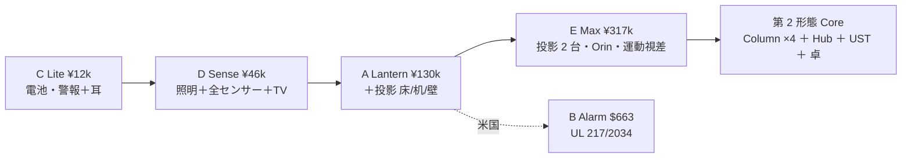
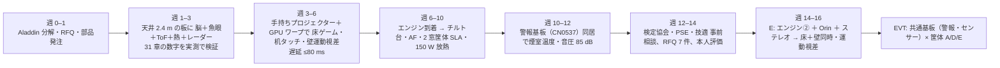

# 37 第 1 形態 5 案の比較と推奨 — どれを作るか、何から買うか

根拠: [31](31-gen1-physics.md) [32 A](32-A-lantern.md) [33 B](33-B-alarm.md) [34 C](34-C-lite.md) [35 D](35-D-sense.md) [36 E](36-E-max.md)、research/ 5 本。

## 1. 一枚の表

| | A Lantern | B Alarm | C Lite | D Sense | E Max |
| --- | --- | --- | --- | --- | --- |
| 市場 | 日本 | 米国 | 日米 | 日米 | 日本（上位） |
| 口 | 引掛シーリング | 4″ 警報器ボックス 120 V 3 線 | ネジ 2 本・電池 | 引掛 / US ボックス | 耳付きローゼット（ハンガ）or 金具工事 |
| 工事なし | ◎ | ◎（既設警報器の交換） | ◎ | ◎ | **△**（7.5 kg） |
| 質量 / 電力 | 4.5 kg / 150 W | 2.4 kg / 80 W | 0.4 kg / 電池 | 1.8 kg / 50 W | 7.5 kg / 250 W |
| 照明 | 4,000 lm | 無 | 無 | 3,500 lm | 5,500 lm |
| 投影 | 1,200 lm、床／机／壁 切替（チルト） | 800 lm、床／机／壁 切替 | 無 | 無（TV へキャスト） | **2,000＋1,200 lm、床＋壁 同時** |
| 床 2 m 円の照度 | 170 lux | 113 lux | — | — | 280 lux |
| 昼の床 | × | × | — | — | ×（夕方は ○） |
| センサー | 魚眼・ToF・LWIR 32×24・レーダー・マイク 4・CO₂ | 同 | レーダー（電源版）・PIR・マイク 2 | A と同 | ステレオ NIR・ToF・魚眼・Lepton 160×120・レーダー ×2・マイク 6 |
| 顔 | 入室時のみ | 同 | 無 | 入室時のみ | 入室時のみ |
| 手 | 机 5 mm・床 10 mm（ToF） | 同 | 無 | 位置のみ（8×8 ToF） | 机 5 mm・3D（ステレオ） |
| 転倒 | 半径 2 m | 半径 2 m | 電源版のみ | 半径 2 m | 半径 2 m ×2 方向 |
| 心拍 | 直下 1.5 m・静止 | 同 | 同（電源版） | 同 | 同 |
| 運動視差（壁を窓に） | ○ 一人 | ○ 一人 | — | — | ◎ 一人、床と同時 |
| 火災警報器 | 検定（多機能型） | UL 217 10 版＋2034 | 検定 / UL | 検定 / UL | 検定 |
| 認証の難所 | 150 W と煙室の熱 | UL 複合の費用 | ほぼ無し | LED 熱 | 250 W の熱 |
| 演算 | RK3588 | RK3588 | MCU＋ESP32 | RK3576 | Orin Nano |
| 原価 1,000 台 | **¥130,000** | ¥99,000（$663） | **¥12,000** | **¥46,000** | ¥317,000 |
| 原価 1 台（試作） | ¥390,000 | ¥285,000 | ¥22,000 | ¥90,000 | ¥740,000 |
| 売価の目安 | ¥198,000〜248,000 | $1,299〜1,499 | ¥19,800〜24,800 | ¥79,800〜99,800 | ¥498,000〜598,000 |
| 第 2 形態への近さ（体験） | 高 | 高 | 低 | 中（投影なし） | **最高** |
| 第 2 形態への近さ（ソフト・Node 互換） | 高 | 高 | 低 | **高** | 最高 |
| 今日、材料を買って組める？ | ○ 4 週 | ○ 4 週 | ◎ 2 週 | ◎ 2 週 | ○ 8 週（エンジン ×2 RFQ） |

## 2. 本人の 3 つの条件に対して

| 条件（04:57 の指示） | 判定 |
| --- | --- |
| 火災報知器に**工事なし**で取り替えるだけ | A・B・C・D は ◎。E は △（5 kg 超）。※日本の電池式住警器の位置（階段・廊下・2 台目の寝室）には電源が無いので、そこは C Lite しか付かない。**「取り替えるだけで火災報知器を兼ねる」のは日本では「照明の口（引掛）」の話であり、既設住警器の位置とは別**。この区別が設計の出発点 |
| 火災報知器の役割もする | 全案 ◎（共通の警報基板、検定／UL）。ただし**画像・熱画像だけでは法定要件を満たせない**（省令は煙・熱方式のみ、画像式の住宅規格なし）→ 煙室は必ず積む |
| ゲームなど大まかな部分ができ、第 2 形態に近い | A ○（床・机・壁の切替）、E ◎（床＋壁同時＋運動視差＋手 3D）、D △（TV に出す）、B ○、C × |

## 3. 推奨

**製品は A Lantern（日本）を主、C Lite を全部屋の神経、D Sense を安い入口。E Max は A の上位（第 2 形態を買う客向け）。B は米国展開時に A から派生。**

理由:
1. 物理（31 章）: 天井 1 枚は「位置・人数・転倒・床と机への投影」が最強、「顔・下半身・昼の床」が弱い。A はこの長所を全部使い、短所を「入室時の顔」「夜の床・昼の机」で避けている。
2. 法規: 引掛シーリングから非照明機器へ給電する製品は Aladdin 30 万台で市場実績があり、禁止条文は見つからない。警報器は検定 15 万円・3.5 ヶ月で桁違いに安い（UL は数万 $）。**日本から始める理由がここにある。**
3. 価格: A 原価 ¥130,000 は議事録の ¥160,000 を超える。Lantern 800（DLP3310、原価 ¥105,000）なら ¥160,000 が成立。**¥160,000 = Lantern 800、¥410,000 = Core（第 2 形態）、間に E Max ¥500,000 級**。
4. 第 2 形態への道: D と A は Node のセンサー構成そのもの。Hub が来たら降格して繋がる。E は PoE で柱を 2 本足せる。**第 1 形態を買った家は、第 2 形態で天井の 1 枚を捨てない。**

## 4. 最初に買う物（A の試作 1 台、¥600,000 前後）

| 用途 | 品 | 概算 | 入手 |
| --- | --- | ---: | --- |
| 取付・放熱・前例の実物 | Aladdin X2 Light | ¥60,280 | 量販・中古 |
| エンジン（TR 0.65） | Anhua FF81HA 単品（RFQ）／暫定: TI DLPDLCR471TPEVM（500 lm、$1,199） | ¥180,000 | Anhua / ichome |
| 脳 | Radxa CM5 8GB＋IO（$89＋）／ Orin Nano Super Dev Kit（$399、E 用） | ¥20,000 / ¥60,000 | Radxa / Seeed |
| 目 | IMX462 魚眼（$83）、IMX296 GS ×2（$81 ×2、E 用）、850 nm LED | ¥40,000 | Waveshare / RobotShop |
| 深度 | Orbbec Femto Bolt または手持ち Azure Kinect | ¥80,000 | — |
| 熱 | MLX90640 BAA（$26.70）、Lepton 3.1R（$149） | ¥27,000 | LCSC / GroupGets |
| レーダー | Seeed MR60FDA2/BHA2（$24.90 ×2）、Infineon DEMO BGT60TR13C（$215） | ¥40,000 | Seeed / Mouser |
| 警報 | ADI EVAL-CN0537（$101＋$63）、TGS5141、ESP32-C6 | ¥30,000 | Mouser / Figaro |
| 環境・音 | SCD41、BME688、ReSpeaker 4 mic（A$92）、スピーカー | ¥20,000 | — |
| チルト | ウォームギア・ステッパ・AS5048A、Waveshare 2 軸（$110）で代用 | ¥20,000 | — |
| 電源・筐体 | Mean Well 150 W、3D プリント、Al 板 | ¥30,000 | — |

## 5. 試作の順番（A → E、16 週）

## 6. 第 2 形態（V1 設計書）への反映

| 章 | 追加 |
| --- | --- |
| 00 README | 「第 1 形態 = 天井 1 枚（A/D/E）、第 2 形態 = Column ×4＋Hub」。第 1 形態の 1 枚は第 2 形態で Node として残る |
| 03 Node | **Ceiling 形態**を追加（真上視点、投影 1〜2 出力、警報基板、引掛給電）。Puck 形態の実体 |
| 04 Hub | 天井 Node からの表示出力を Display Bus に受ける。E の PoE 出力 ×2 は Hub 無しの最小構成 |
| 05 表示 | 床投影（TR 0.65）と壁 1 面（63° 斜入）の補正パイプラインを追加 |
| 07 ソフト | 真上視点の Node パラメータ、入室時の顔取得、身長＋服色＋声の識別合算 |
| 10 安全 | 火災警報の独立性（警報基板は Spatial Core に依存しない）、検定ファームの固定 |
| 12 BOM | 31〜36 の数字 |

→ codex task 23 に併記（本人が A/E を承認したら）。

## 7. 本人に決めてほしいこと

1. **主製品を A（¥130,000 原価・¥198,000 級）にするか、Lantern 800（¥105,000・¥160,000）にするか。**
2. **E Max の「ハンガ固定か 30 分工事」を許すか**（許さないなら E は Max-Lite = A に収束）。
3. **検定を自社で取るか、住警器メーカーと OEM 提携するか**（モジュール外販は無い）。
4. **米国 B を Gen1 で追うか**（UL 複合は数万 $・継続費）。
5. **天井カメラのプライバシー**: カメラ OFF 物理スイッチで足りるか、D の「LWIR＋レーダーのみ」モデルを別に出すか。
6. **最初の試作に Aladdin X2 Light を買って分解してよいか**（¥60,280）。
