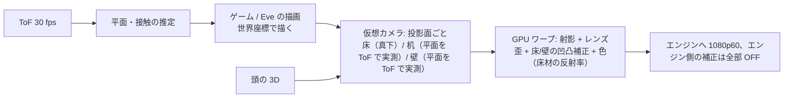

# 38 第 1 形態のソフトとデータ — 単体で動き、Hub が来たら Node になる 1 枚の中身

対象: A/B/D/E（C Lite は MCU＋ESP32 のみ、§8）。前提: V1 設計書 07（Spatial API・Hub 二層）、docs/structure/01（Spatial Core＋表示層）、04（Eve → Noa → AMC → Jev、Jev は権限を持たない）。**Tower に OS を 4 コピー入れない**（AGENTS §7）という原則を天井 1 枚にも守る: 1 枚のときは「Hub 役を兼ねる」のであって、Node が OS を持つのではない。

## 1. 2 つの脳と 1 つの壁

```text
  ┌──────────────────────── 1 枚の中 ────────────────────────┐
  │  警報 MCU（MSP430 級、検定対象、固定ファーム）               │
  │   煙・熱・CO・サウンダ・426 MHz。電源・時計・自己診断を自前で持つ │
  │   ─── UART 1 本（片方向 + ACK）、光結合で絶縁 ───────────  │
  │  SoM（RK3576/3588/Orin）: RockstarOS mii profile            │
  │   ├ Spatial 層（Node 役）: センサー → 位置・姿勢・識別・環境   │
  │   ├ Hub 役（1 枚のとき）: 世界座標・人の台帳・表示合成         │
  │   ├ 表示層: GPU ワープ → エンジン、床/机/壁の 3 面             │
  │   └ Eve（会話・見守り・ゲーム）→ Noa → AMC → Jev（クラウドへ） │
  └──────────────────────────────────────────────────────────┘
```

| 原則 | 中身 |
| --- | --- |
| 警報は SoM に依存しない | SoM が死んでも・更新中でも・Wi-Fi が無くても鳴る。SoM は警報 MCU から「状態」を受けるだけで、消音は MCU 側のボタン／15 分制限付きの UART コマンドのみ |
| 更新は 2 系統 | 警報ファームは**更新しない**（更新 = 型式変更試験）。SoM 側は A/B スロットで OTA、失敗時は前スロットへ自動復帰 |
| 1 枚のときの Hub 役 | 世界座標の原点はこの 1 枚（天井中心、床の法線 = Z）。2 枚目・Column Node・本物の Hub が来たら、台帳と座標を**引き継いで降格**（§5） |
| 計算の置き場 | 端末内: 検出・姿勢・識別・声のウェイク・ワープ・ゲーム。クラウド（Eve の大きい頭）: 会話の生成、長期の記憶、家族間の共有。**映像・深度・熱・音声の生データは端末から出さない** |

## 2. Spatial 層（Node 役）— 出すもの・出さないもの

Spatial API（V1 07 章）に「真上視点」を足す。出力は人ごとの構造体、30 fps（位置）／10 fps（姿勢・識別）／1 Hz（環境）。

| フィールド | 中身 | 真上での信頼度（31 章） |
| --- | --- | --- |
| `pose.head_xyz` | 頭頂の 3D（ToF＋魚眼） | ◎ 誤差 2〜5 cm |
| `pose.upper` | 肩・肘・手首の 3D | ○ 85〜96% |
| `pose.lower` | 腰・膝・足 | △ 50〜60% → `confidence` を必ず付け、Hub は複数視点で上書き |
| `hands[]` | 手の位置、机上なら指先とタッチ（ToF） | 机 ◎ 5 mm、床 ○ 10 mm |
| `height_m` | 身長（深度直読） | ◎ 識別の主軸 |
| `identity` | `{score_by_person, method: height/shape/color/gait/voice/face}` | ○ 85〜95%、顔は `face` 法が入室時だけ立つ |
| `vitals` | 呼吸 rpm（レーダー、全員）、心拍 bpm（直下 1.5 m・静止・1 人のときだけ値、他は null） | ○／△ |
| `fall` | `{suspected, confirmed, t}`: 頭高の急減＋床面積増（カメラ）AND レーダーの落下 → 2 系統一致で confirmed | ◎ |
| `thermal` | 床の温度地図 32×24、ホットスポット一覧（座標・℃・持続秒） | ○ 予兆のみ |
| `env` | CO₂・VOC・温湿度・照度・騒音 | ◎ |
| `alarm` | 警報 MCU の状態（監視中／警報／故障／電池）— **読むだけ** | ◎ |

**出さないもの**: 生画像・生深度・生音声・熱の生フレーム。デバッグ用の「ローカル表示」は本人がその場でボタンを押した 60 秒間だけ、端末内の画面（スマホ直結）に出す。

## 3. 表示層 — 3 面を 1 本のパイプで



- **運動視差（壁）**: 一人のとき、頭の 3D で仮想カメラを動かす（V1 Gen1 と同じ）。複数人は固定視点。
- **床**: 俯瞰の正射影。ゲームは「踏む・手を置く・物を置く」。指は使わない。
- **机**: 机の平面を ToF で検出（天板の高さ・輪郭）、電子クロップ。指タッチ 5 mm。3D モデル（分子・建築）は机に「置く」表現 ＝ 卓（13 章）の平面版で、将来の AIRR 卓と同じ座標系・同じ操作語彙にしておく。
- **遅延予算**: センサー 33 ms（30 fps）＋推定 15 ms＋描画 8 ms＋ワープ 4 ms＋エンジン 16.7 ms ＝ **77 ms**（研究 projection §4-4 の現実解 60〜80 ms に一致）。120 Hz エンジンなら 69 ms。
- **チルト切替（A/B）**: 床→壁は 63° の機械移動（約 2 s）。その間は照明を少し落として「移動中」を見せる。E は固定 2 台なので瞬時。

## 4. Eve と「半分ゲーム機」

| 場面 | 1 枚でできること | 足りないもの |
| --- | --- | --- |
| 声 | ウェイク・話者 ID・方向。回答は音と光（照明の色）と、必要なら床/壁の文字 | 口の近くのマイクが無い（残響）→ Hub/Column で改善 |
| 見守り | 転倒 → 家族のスマホへ（119 自動通報はしない）、就寝中の呼吸、夜の足元灯、留守の在室 | 心拍は条件付き |
| 火災 | 法定警報（MCU）＋予兆（熱地図）→ 「コンロの右奥が 180 ℃ のまま 10 分」を声で | — |
| ゲーム | 夜の床（2 m 円）: 踏む・避ける・陣取り。机: 指でつまむ・回す・積む。壁: 一人の窓 | 昼の床、全身の正確な骨格 |
| 第 2 形態の予告 | 壁 1 面の運動視差 ＝ Core の体験の 1/4 | 壁 3 面、卓の空中像 |

ゲームの作り方（Game サービス、docs/structure/06 の内部名）: **投影面を知らない**で書ける SDK にする。世界座標（m）で物を置き、`surface: floor|desk|wall` と `input: step|hand|touch|head` だけを宣言する。1 枚でも Core でも同じゲームが動く。ローンチは 3 本（床 1・机 1・壁 1）で十分。

## 5. 1 枚 → 2 枚 → Hub への成長

| 段階 | 誰が Hub 役 | 何が起きる |
| --- | --- | --- |
| 1 枚 | その 1 枚 | 原点 = 天井中心。人の台帳（身長・体格・声・服色の当日分）を持つ |
| 2 枚（同室） | 先に付いた方 | 2 枚目は 39 章の手順で相対位置を登録。位置ベース Re-ID で識別 94〜95%、転倒半径 2 m ×2 |
| 他室に 1 枚ずつ | 各室が Hub 役、台帳は Thread で同期 | ドア通過で人の「引き継ぎ」（前の部屋の識別を事前確率に） |
| Column Node を足す（E の PoE） | その 1 枚 | 顔・全身が取れるようになる。表示は変わらず |
| 本物の Hub（第 2 形態） | Hub | 全 1 枚が Node に降格、台帳・座標・ゲームの保存を Hub に移す。**降格しても警報 MCU と照明は 1 枚で動き続ける** |

## 6. プライバシーとセキュリティ（CISO の欄）

| 項目 | 設計 |
| --- | --- |
| データの場所 | 生データは端末内のみ・保存しない（リングバッファ 10 秒、転倒確認時だけ骨格の 10 秒を保存、画像は保存しない）。識別テンプレート（身長・体格・声）は端末内、暗号化、家族の同意で作成 |
| カメラ OFF | 物理スイッチ（カメラ電源を切る、LED 表示）。OFF でも LWIR＋レーダー＋マイクで見守りは動く |
| 顔・声 | 個人識別符号（個人情報保護法）→ 登録時の同意画面、目的掲示、削除ボタン。健康（呼吸・心拍）は要配慮情報に近い扱い: 本人のスマホにだけ出す、家族共有は明示の同意 |
| 通信 | 端末 ↔ クラウドは mTLS、端末ごとの鍵は Secure Element（SoM の TrustZone/TPM）。Thread/Matter は標準のまま。426 MHz はメーカー独自（内容は警報の種別だけ） |
| 更新 | 署名付き A/B OTA、ロールバック。警報ファームは更新対象外 |
| ゲーム・外部アプリ | SDK は Spatial API の**要約**（人の位置・手・タッチ）だけを渡す。画像・音声は渡さない。権限は Broker 経由（docs/structure/04） |
| 子供 | 顔・声の登録は保護者のみ。ゲームの時間制限は Eve ではなく保護者設定 |
| 侵入時 | SoM が乗っ取られても警報 MCU は独立（§1）。カメラ LED はハード配線（ソフトで消せない） |

## 7. 電源断・故障時の振る舞い

| 状態 | 照明 | 警報 | Spatial/Eve | 投影 |
| --- | --- | --- | --- | --- |
| 正常 | ○ | ○ | ○ | ○ |
| Wi-Fi 断 | ○ | ○ | 端末内の分だけ（声の簡単な命令、見守り） | ○（ローカルのゲーム） |
| SoM 故障・更新中 | ○（LED ドライバは SoM と独立、壁スイッチで点灯） | ○ | × | × |
| ファン故障 | ○ | ○ | ○ | **投影 OFF（熱保護）**、声で通知 |
| 停電 | × | ○（電池、72 h 報知） | × | × |
| 10 年 | 警報 EOL 信号 → 警報カートリッジ交換（40 章） | | | |

## 8. C Lite の中身

MCU（警報）＋ESP32-C6（Thread）。Matter Smoke CO Alarm デバイスタイプ＋独自クラスタ（在室・転倒・声の有無）。レーダーは電源版のみ常時、電池版は PIR 起床後 60 s。Eve は無い（耳と口）。ファーム更新は ESP32 側のみ。

## 9. 開発の順（ソフト）

1. Spatial 層（Node 役）を RK3588 開発機で: 魚眼人物検出 → 身長 → 上半身 → 転倒 → 識別。31 章の数字で合否（44 章）。
2. 表示パイプ（ワープ・3 面・遅延計測）。
3. Eve 単体（声・照明・見守り）。
4. ゲーム SDK ＋ 3 本。
5. 降格手順（2 枚・Hub）。
6. OTA・A/B・Secure Element。
7. 警報 MCU は別チーム（検定の固定ファーム）。SoM との UART プロトコルを最初に凍結。
