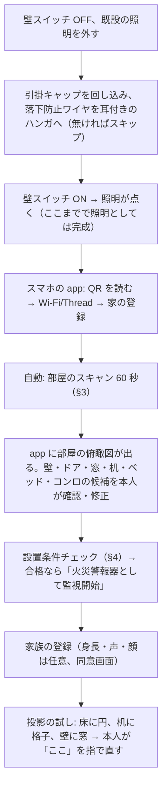

# 39 設置と校正 — 箱から出して 10 分で、天井の 1 枚が部屋を知るまで

問題: 引掛シーリングに付けると**向きが決まらない**（回し込みの角度は任意）、天井高も部屋の形も壁の位置もコンロの位置も分からない。投影とカメラは工場で合わせられるが、部屋との関係は現場でしか決まらない。しかも作業者はユーザー本人、脚立の上、工具なし。

## 1. 工場でやること（現場でやらないために）

| 校正 | 方法 | 残す値 |
| --- | --- | --- |
| 魚眼の内部パラメータ | チャート 1 枚（等距離射影モデル＋歪 4 次） | 焦点・中心・歪係数 |
| ToF の内部・深度オフセット | 平板 3 距離（1.0 / 1.6 / 2.3 m） | 深度補正表 |
| 魚眼 ↔ ToF ↔ LWIR ↔ レーダーの外部パラメータ | 共通ターゲット（反射球＋ヒーター球＋コーナーリフレクタ、V1 08 章の棒を流用） | 剛体変換 4 組 |
| 投影エンジン ↔ ToF | 格子を床面（2.3 m）に投影して ToF 側カメラで撮る、チルト 0°/40°/63° の 3 点 | 射影＋チルト角ごとの補正表 |
| チルトのエンコーダ原点 | 機械端で零点 | 原点オフセット |
| LWIR の NUC・放射率 | 黒体 2 点（30 / 60 ℃） | ゲイン・オフセット |
| 煙室 | 検定の抜取試験（協会）。工場では感度の自己診断値を記録 | 初期感度 |
| 音 | 無響箱でサウンダ 85 dB、スピーカーの周波数特性 | 等化係数 |

治具は「天井 2.4 m の疑似室」1 台（2.5 × 2.5 × 2.5 m のフレーム、床に格子・壁に平面、ターゲット棒）。1 台 10 分、1 ライン 1 日 48 台 → 1,000 台で 21 日。100 台なら 2 日。

## 2. 現場の手順（ユーザー、脚立、10 分）

## 3. 自動スキャン（60 秒）

| 分かること | どうやって | 精度 |
| --- | --- | --- |
| 天井高 | ToF で床までの距離（人がいない部分の最頻値） | ±2 cm |
| 床の法線・自分の傾き | ToF 平面当てはめ → 世界座標の Z | 0.5° |
| 壁の位置・部屋の輪郭 | 魚眼の周縁で床と壁の境目（線分検出）＋ ToF の端 | ±10 cm（4.5 m 室） |
| 自分の向き | 最も長い壁を X 軸に。**ユーザーの回し込み角は不問**。北は要らない | — |
| ドア | 人が最初に通る場所（数日で学習）＋ 輪郭の開口 | 学習 |
| 窓 | 昼の照度ムラ（魚眼の明るさ地図）＋ LWIR の温度差 | 候補 |
| 机・ベッド・ソファ | ToF の高さ地図: 0.7 m の平面 = 机、0.4〜0.6 m の大きな平面 = ベッド/ソファ | 候補、本人が名前を付ける |
| コンロ・暖房器具 | LWIR のホットスポットの履歴（数日） | 学習 |
| エアコン吹出し | LWIR の冷/温スポット（運転時） | 候補 |
| 2 枚目 | 相手の NIR LED を点滅させ、自分の魚眼で見る（＋ Thread の RSSI）。重なり領域の床格子を両方で見て剛体変換 | ±5 cm |

## 4. 設置条件チェック（火災警報器として）

省令と自治体の基準（研究 alarm §3-3）を app が判定し、合格しないと「火災警報器」の表示を出さない（照明と見守りは動く）。

| 条件 | 判定材料 | 不合格時 |
| --- | --- | --- |
| 中心が壁・梁から 60 cm 以上（熱式 40 cm） | §3 の部屋輪郭 | 「この位置では住警器になれません。C Lite を別に付けてください」 |
| エアコン吹出しから 1.5 m 以上 | LWIR の候補＋本人確認 | 同上 |
| 台所: 煙・蒸気が直撃しない | コンロ候補の位置・距離 | 熱式モードに切替（台所は熱式可） |
| 天井高 2.1 m 以上（建基法） | ToF | 想定外 |
| 寝室・階段・居室の義務（自治体） | 本人が部屋種別を選ぶ → 自治体 DB | 必要な部屋に C Lite を案内 |

米国（B）: NFPA 72 — 調理器具から 10 ft、浴室ドアから 3 ft、HVAC・天井ファンから 36 in、傾斜天井。

## 5. 投影の現場校正

- 床: 工場値のまま。ToF で天井高を測って射影を更新。ユーザーには「円が丸いか」だけ確認してもらう。
- 机: 検出した天板の輪郭に合わせて電子クロップ。四隅を指で直せる。
- 壁: チルト 63° で壁の平面を ToF で実測（距離 2.0〜2.6 m）→ AF と射影。壁に絵や窓があれば本人が範囲を指で囲む。**壁は 1 面だけ**: 引掛の位置が部屋の中央なら 4 壁のどれでも選べる（筐体を回し込み直すのではなく、A/B はチルト台をパン方向にも手で回せる機構にする — 工具なし、カチッと 8 方向）。
- 色: 床材の色を魚眼で読んでホワイトバランスとガンマを補正（暗い床は照度が足りないことを app が正直に表示: 「この床では夜のみ」）。

## 6. 日常の自己校正

| いつ | 何を |
| --- | --- |
| 毎晩（無人） | ToF の床平面再測、投影格子の微調整（人がいないとき 2 秒だけ赤外の格子ではなく可視の暗い格子） |
| 毎時 | 警報 MCU の自己診断（省令）、LWIR の NUC |
| 家具が動いたとき | 高さ地図の差分 → 机・ベッドの位置更新、本人に通知 |
| 季節 | 窓の照度ムラ・日射のホットスポットを学習（誤報抑制） |

## 7. 取り外し・引越し・交換

- 回し込みを戻せば外れる。落下防止ワイヤを外す。10 年で警報カートリッジ交換（40 章）。
- 引越し: 部屋の学習は消え、家族の台帳は残る（本人の選択）。
- 返品・譲渡: 物理リセットボタン 10 秒で台帳・鍵を消去（Secure Element の鍵破棄）。
