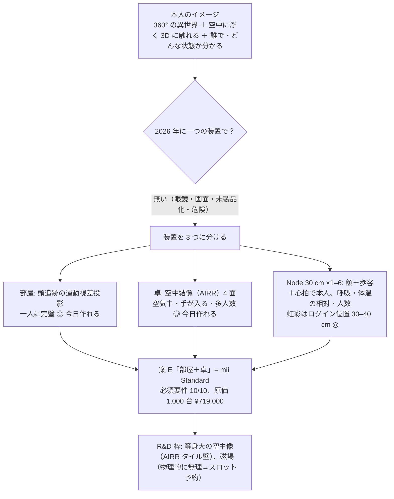

# mii V2 設計研究（2026-11-05）— 入口と全体のまとめ

この README は全体のまとめ。考えた順・調べた順は [99-journal.md](99-journal.md)。

## 0. 何を頼まれたか

工場に発注できる設計書。100 / 1,000 台のロット価格。議事録と 3D 会話を読み直し、設計案を 5〜10 通り。「今日、材料を買って組んだら本当にイメージ通りの没入になるか」「GitHub の設計書通りになるか」を判定する。半分ゲーム機・半分ホログラム卓（スター・ウォーズ／アバター）。30 cm のセンサー塔に温度・磁場・虹彩・心拍・体温・歩容。1〜6 本で可変。

## 1. 章の地図

| 章 | 内容 | 状態 |
| --- | --- | --- |
| [00](00-what-noelle-wants.md) | 欲しいものを原典から引用付きで固定（要件 R1〜R14） | 済 |
| [01](01-feasibility.md) | 技術ごとの「今日買える / R&D / 物理的に無理」判定 | 済（出典: research/） |
| [02](02-pricing.md) | 部品の 1 / 100 / 1,000 台価格と、モジュールの積み上げ | 済（RFQ で置き換える行を明記） |
| [10](10-candidates-overview.md) | 設計案 6 通りの全体像 | 済 |
| [11](11-node-tiers.md) | Node（30 cm）: N-Home / N-Sense、認証・健康・拡張スロット・6 本安定 | 済 |
| [12](12-A-parallax-room.md) A / [13](13-B-airr-table.md) B / [14](14-C-swept-volume-table.md) C / [15](15-D-lightfield-table.md) D / [16](16-E-room-plus-table.md) E / [17](17-F-arena.md) F | 各案の詳細と原価 | 済 |
| [20](20-comparison-and-recommendation.md) | 比較・推奨・最初に買う物・試作の順番・V1 の直し方・本人の決定事項 | 済 |
| [research/](research/) | 調査の生データ 4 本（表示・センサー・価格・先行例、出典 URL 付き） | 済 |

## 2. 結論を 1 枚で

| 問い | 答え |
| --- | --- |
| 今日、材料を買って組んだらイメージ通りになる？ | **部屋の没入（壁の向こうに世界）**: なる。**卓の空中に分子が浮いて手でつかむ**: なる（像は空気中、奥行きは視点追跡）。**本当に 360° 回り込む**: なる（Voxon VX2 を買う、φ25 cm）。**空中の等身大・裸眼・多人数**: ならない（部品がない）。**磁場で思考**: ならない（物理） |
| GitHub の設計書通りになる？ | V1 設計書の構造（Spatial Core ＋ 差し替え表示層）はそのまま。変更は Node 30 cm・N-Sense・Hub 6 ポート・卓を Gen1 に前倒し（20 §5） |
| 原価は？ | Node N-Home 1 本 ¥33,000（1,000 台）、Core（4 本＋Hub）¥227,000、案 E ¥719,000、案 F ¥2,280,000＋施工。1 台試作は ¥900,000〜1,500,000 |
| 議事録の ¥160,000 / ¥410,000 は？ | ¥410,000 = Core の売価として成立（投影キット・卓は別売り）。¥160,000 は Node 2 本の Solo/Duo か、簡略版 N-Lite が要る |
| 磁場で思考を読む | 脳の磁場は地磁気の 1 億分の 1。市販 OPM は磁気シールド室（$150,000）が要り、10 cm 離すと信号は雑音以下。装着＋シールドでも「打鍵文字の誤り率 32%」。**要件から外し、Node の拡張スロットを予約**。代わりに視線＋手＋声＋心拍から「意図」を推定 |
| 虹彩 | 市販は 30〜40 cm で覗き込む方式のみ。玄関 Slot と机上 Orb に「ログイン位置」を作る。部屋の中は顔＋歩容＋心拍の合算 |
| 心拍・体温 | 心拍はレーダーで 1〜1.5 m・1 人・静止。呼吸は全員分。体温は絶対値が出ない（±5 ℃級、口腔温との相関が弱い）ので「平常比の変化」だけ |
| 触った感じ | Ultraleap が 2026-10 に管財入り、市販の空中触覚は無い。手が像に入る＋光と音の合図で成立。超音波は自作 R&D |

## 3. 推奨の試作順（20 §3）

D（既製品の裸眼 3D を 1 台、判断用）→ B 1 面（空中の分子、2 週間）→ A（Node 相当 ×4＋手持ちプロジェクター、4 週間）→ B 4 面＋卓 → E 統合 → N-Sense → EVT（Node V2 基板、RFQ 7 件）。約 4.5 ヶ月。

## 4. 本人に決めてほしいこと

20 §6 の 6 項目（3 箱で売るか、最初の売価、卓のプレート、虹彩の距離、磁場を外すか、D を買うか借りるか）。
