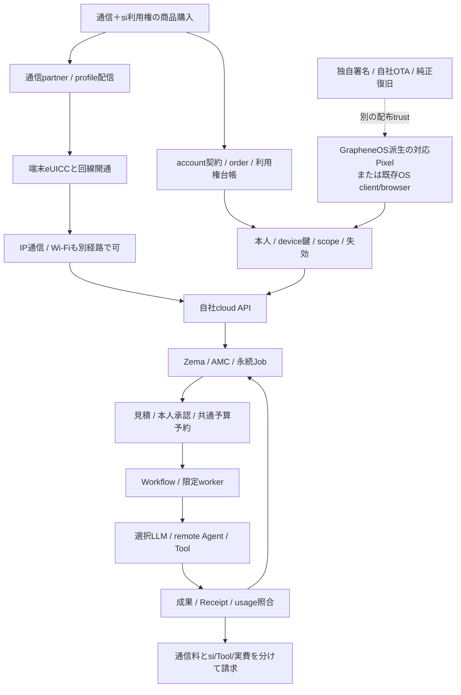

# RockstarOS — GrapheneOS・eSIM・LLMクラウドの基盤設計

更新: 2026-10-15 / OS11（O6、ROCK）・DOC04（H1、設計同期）。基準main `8b374cfc7838d3a751faf5e28b367c860ddbcd0d`。利用者の「通信とsi利用権をまとめる商品入口」「GrapheneOSをもとに、書換え可能性とできることを全部調べる」に対する調査設計。機械可読根拠は[調査台帳](evidence/graphene-cloud-foundation.json)。

**結論: GrapheneOSを改変して独自のPixel向けRockstarOSをbuildする道はある。eSIM商品、OS導入、LLMクラウドは独立した基盤を結合して成立させる。** 現在はsource・host/fixture・試験APKの系列があり、正式全OS・実回線・本番LLM/課金が完成した状態ではない。

## 1. 本人が更新した商品の入口

2026-10-15、本人はeSIMの役割として「通信とsi利用権をまとめて提供する商品の入口」を選択した。2026-10-10のaccount先行/一般eSIM販売保留という**商品設計方針**を更新する。accountは本人・契約・Job・Artifact・費用の正本で、eSIM profile番号をownerにしない。無料account/対応Toolの試用、既存OS client/browser経路、Miniのoffline利用は維持する。商品入口の更新は実発行・契約・課金・flash開始の許可/成功ではなく、既存runtime gateは閉じたまま。

販売する体験は `通信＋RockstarOS/Sky/Zema/si利用権`。通信料、LLM/Agent従量、Tool/外部実費は明細を分ける。「利用権を含む」は無制限token/GPUや全機種native OSを意味しない。既存30%/10%/1,000円等の料金判断は新しい価格決定まで維持し、回線原価/含むquota/対象国/carrier/解約・再発行・利用停止の関係は契約前に決める。

## si専用端末の利用体験と実装境界

2026-10-15の本人指示「ai専用端末に変えたいんだよね」を、製品表記siで具体化する。**Pixel参照機の目標は、unlock後の中心がJenniferとの対話・制作・仕事になるsi専用端末。** GrapheneOSを土台にしたRockstarOSのdevice profileとして設計し、通信＋si利用権の商品入口を維持する。全体の携帯不要という目的は維持し、この端末の常時携行をMini利用の条件にしない。Mini/対応hostは同じ仕事へ別の場所から入る。

### 通常の一周

1. 初期設定で本人・端末鍵・service利用権・通信を個別に確認する。再起動後はOSの本人unlockを経てsi Homeへ戻り、未送信の下書き、進行中の仕事、承認待ち、停止を表示する。boot直後の鍵が利用できない状態を自動unlockで迂回しない。
2. Jenniferへ音声または文字で目的を伝える。音声が使えない場面でも文字/画面操作を残す。常時待受/呼びかけの方式は消費電力・mic表示・privacy・機種対応を実測して選び、常時録音を前提にしない。
3. Skyが使える能力と不足条件を示し、Zemaが既存Jobと成果の版を保存する。通常の一件で利用者がアプリ一覧やmodelを毎回選ばずに済む導線にする。理解/制作は契約・受入済みcloudを標準候補とし、端末内modelは対応機種の任意能力。model未接続時は未接続と示す。
4. 費用・送信先・作用・対象版を示し、必要な本人承認を得てBrokerが実行条件を確認する。Jenniferの発話やmodelの回答で権限を作らない。進捗/成果/使用額/停止をHomeから扱い、外部作用の応答喪失時は同じ実行IDを照合する。
5. Miniへ移っても同じowner/Job/Artifact revision/grant/予算を再取得し、私有出力先を確認する。端末を変えたことを二度目の注文・製作・課金の理由にしない。

### 画面・保存・失敗・復旧

Homeの中心は会話、進行中、確認待ち、成果、費用、停止。設定には通信・本人連携・権限・入力/出力・保存/復旧への明示導線を置く。ロック中/他人利用時の私有成果読み上げと承認を拒否し、muteと手動停止を会話以外から操作できるようにする。通信/LLM停止時は受入済みの有限local機能と暗号化保存/再取得を使い、cloud代替への無断送信や無断追加費用を発生させない。localにないcloud成果をofflineで取得できたとは表示しない。

保存は既存owner別Job、版付きArtifact、端末の暗号化連携/保存を再利用する。認証失効・鍵喪失・home crash・OS更新失敗を区別し、読み取れない記録を空の正常状態で上書きしない。設定/復旧、OSが提供する緊急機能への導線は確保する。一般Android appを許可する範囲、kiosk/管理端末化、Homeの置換範囲は未決定であり、「専用」という発言だけで全app削除や利用者の脱出不能を決めない。外部appも必要な能力として接続する場合は既存のscope/承認を通す。

### 現在の差分と順番

現sourceの`android/shell/src/aosp/AndroidManifest.xml`はMAIN/LAUNCHERで、HOME categoryやVoiceInteractionServiceを宣言していない。現在のShell APKをsi Home/OS常駐音声として完成扱いしない。①既存OS上で非破壊に一仕事の対話/成果導線を検証 → ②ownerが選択/解除できるHome候補とcrash復帰を検証 → ③必要なら音声role/機種の入力経路を検証 → ④独自署名OSへ統合し同imageのboot/更新/復旧を受け入れる。app試作とprivileged OS統合は別成果にする。音声roleの可能性は調査G14〜16、独自build/OTAはG01/G05に従う。

**合格条件**はbaselineのDT01〜DT06。DT01はboot/unlock/Home/再起動と同owner/Job復元、DT02はapp選択なしの依頼→改訂→確認→保存→再開、DT03はcloud/通信断、DT04はロック/他人/mute/私有出力、DT05は見積/上限/停止/応答喪失の重複防止、DT06はMini引継ぎと端末復旧。所要時間、誤認識、再開時間、電池/熱、費用を同じ候補artifactで測り、値の合否基準は試作briefで定める。全6件は未実行。既存AC01〜06、OS受入report、DEVICE-INSTALL等のgateを省略しない。

主担当はOS11/O6/ROCK、体験同期DOC04/H1、Home/仕事WEB04、local planner AI04、cloud/Sky SKY07・SKY21、署名/復旧RLS02。次の試作briefでROCKが代表一仕事とHome復帰動作を具体化し、OWNERが一般appの扱いと音声待受の選択を行う。専用端末方針は署名鍵生成、flash、回線契約、有料実行gateの解除を含まない。

## 2. 下から積む6層

1. **通信**: 対象端末/eUICC/LTE modem、通信partnerのprofile発行・開通。購入、profile配信、端末install、網登録、IP通信を別状態にする。最初のprofile downloadに使うWi-Fi等のbootstrap通信も準備する。
2. **端末OS**: exact Pixelへ受入済み署名OS、または既存OS app/browser。GrapheneOSのforkはPixel向け選択肢で、eSIMからOS binaryを起動/書込みする仕組みにはしない。
3. **本人と利用権**: account、購入order、profile binding、device鍵、service scope、期限/失効を関連付ける。eSIMの開通とsi利用許可、OS attestationと支出承認を混ぜない。
4. **自社cloud制御**: 認証API、Zema/AMCの永続Job、予算予約、期限/取消、Workflow、成果/usage台帳。端末が切れても受付済みの有限仕事を続け、追加承認では待機する。
5. **計算とTool**: cloud LLM/API、remote Agent、必要時の自社GPU、端末内planner、本人PC/Proを限定adapterで選ぶ。端末に共通Provider秘密鍵を埋め込まない。LLMは提案し、Brokerが実行を許可する。
6. **費用/成果/運用**: 項目別usage/請求、通信会社明細、暗号化保存/削除、backup、監査、supportとOS更新を照合する。cloud inferenceとOTA配信を同じcredential/更新権にしない。

回線が切れた時、cloudの停止要求は未達になり得る。受付済みJobの期限/予算による停止、再接続での同ID照合を[継続実行契約](sky-cloud-continuity.md)へつなぐ。回線解約、service停止、未精算usage、成果export/削除は独立に扱う。

## 3. 改変できる範囲を32項目で確認する

分類は技術的な到達経路で、実装/配布/商用受入の完了率ではない。外部APIやsourceの存在だけでできると断定せず、現repoの証拠と不足を併記する。

### C01 独自Home / Launcher — 通常app/role

可能性/責任: 独自Home appで入口をまとめる。現source: RockShellはLAUNCHER activityで、HOME role宣言は見つからない。

不足: Home roleと既定選択を設計する。合格証拠: 起動/戻る/再起動/更新後も本人の選択を保持。

根拠: [android/shell/src/aosp/AndroidManifest.xml](../android/shell/src/aosp/AndroidManifest.xml) / [G04](https://grapheneos.org/source)。

### C02 標準app同梱 / 削除 / branding — OS source改変

可能性/責任: product構成で同梱appと表示を変更。現source: RockShell/Automation/Articleのproduct記述あり。

不足: 独自UI/不要app/依存関係とlicenseをexact tagで照合。合格証拠: user buildのapp一覧と機能/更新/noticeを確認。

根拠: [android/Android.bp](../android/Android.bp), [os/physical/rockstaros.mk](../os/physical/rockstaros.mk) / [G01](https://grapheneos.org/build), [G04](https://grapheneos.org/source), [G18](https://source.android.com/docs/setup/contribute/licenses)。

### C03 初回設定とeSIM商品導線 — OS source改変

可能性/責任: SetupWizardと自社app導線を編集する候補。現source: 購入claim/端末session sourceあり。統合初回設定は未受入。

不足: 無料account先行から通信＋si商品入口へ方針同期。合格証拠: 購入/開通/本人/利用権/OS状態を別表示し一周。

根拠: [lib/rockstar-entitlement-claim.ts](../lib/rockstar-entitlement-claim.ts), [docs/service-entitlements.md](../docs/service-entitlements.md) / [G04](https://grapheneos.org/source), [G07](https://source.android.com/docs/core/connect/esim-overview)。

### C04 Settings / SystemUI / quick settings — OS source改変

可能性/責任: 設定・status表示・quick tile等を変更可能。現source: 独自ShellはあるがSystemUI統合は未証明。

不足: 上流patch維持と部品別の変更範囲を固定。合格証拠: 通知/権限/lock/privacy indicatorが退行しない。

根拠: [android/shell/src/main/java/dev/rock/shell/MainActivity.java](../android/shell/src/main/java/dev/rock/shell/MainActivity.java) / [G04](https://grapheneos.org/source)。

### C05 Broker / Binder共通実行 — appまたはsource統合

可能性/責任: 明示APIと署名/UIDで限定作用を仲介。現source: Binder/SDK/Job/Receipt sourceとAPK系列がある。

不足: 全OS Soongとproduction署名/UID/SELinuxは未受入。合格証拠: 越境・改ざん・失効・再起動を同imageで拒否。

根拠: [android/tool-sdk/src/main/aidl/dev/rock/sdk/IPlatformApi.aidl](../android/tool-sdk/src/main/aidl/dev/rock/sdk/IPlatformApi.aidl), [android/automation/src/aosp/AndroidManifest.xml](../android/automation/src/aosp/AndroidManifest.xml) / [G10](https://source.android.com/docs/core/permissions/perms-allowlist), [G13](https://source.android.com/docs/security/features/selinux)。

### C06 privileged app / system service — OS source改変

可能性/責任: 必要な権限だけproduct/allowlist/frameworkで追加。現source: 現Soong appsはsdk current/testkey。包括platform権限はない。

不足: 必要性ごとに通常appとの差をADR化。合格証拠: partition/allowlist/署名/SELinuxとCTS影響を確認。

根拠: [android/Android.bp](../android/Android.bp), [android/sepolicy/private/rockstar_platform.te](../android/sepolicy/private/rockstar_platform.te) / [G10](https://source.android.com/docs/core/permissions/perms-allowlist), [G13](https://source.android.com/docs/security/features/selinux)。

### C07 任意appデータの無条件取得 — 一般化不可

可能性/責任: owner許可APIや共有fileだけを扱う。現source: Brokerの隔離契約とneverallowあり。

不足: root/Accessibilityを万能迂回路にしない。合格証拠: 別owner/app/profileの私有dataを拒否。

根拠: [android/sepolicy/private/rockstar_platform.te](../android/sepolicy/private/rockstar_platform.te) / [G13](https://source.android.com/docs/security/features/selinux)。

### C08 音声入力 / ASR / TTS — appまたはsource統合

可能性/責任: 専用runtime/許可したcloudで組み込む候補。現source: 前turnのAC01〜06は設計のみ。

不足: 言語/認識/遅延/電力/声の出力先と保持を実測。合格証拠: 電話/PC前操作0で一作品の修正/保存/再開。

根拠: [docs/service-design/01-service-experience.md](../docs/service-design/01-service-experience.md) / [G14](https://developer.android.com/reference/android/service/voice/VoiceInteractionService), [G15](https://developer.android.com/develop/background-work/services/fgs/restrictions-bg-start), [G16](https://developer.android.com/media/platform/sharing-audio-input)。

### C09 background assistant / hotword — 条件付きsource/API

可能性/責任: 選択されたvoice serviceや必要な専用実装を使う。現source: 現RockShell manifestにvoice serviceなし。

不足: DSP/lock/電池/他appのmicとの共存は未確認。合格証拠: 誤起動/騒音/通話/lock/mute/別人を実機確認。

根拠: [android/shell/src/aosp/AndroidManifest.xml](../android/shell/src/aosp/AndroidManifest.xml) / [G14](https://developer.android.com/reference/android/service/voice/VoiceInteractionService), [G15](https://developer.android.com/develop/background-work/services/fgs/restrictions-bg-start), [G16](https://developer.android.com/media/platform/sharing-audio-input)。

### C10 端末内LLM — appまたはsource統合

可能性/責任: model/runtimeを許可範囲で同梱/交換する。現source: Qwen plannerの限定試験APK系列あり。model結果は非信頼。

不足: model license/熱/RAM/電池/更新/大model能力を受入。合格証拠: offline plan→Broker→有限Tool→保存/停止を確認。

根拠: [docs/llm-evaluation-architecture.md](../docs/llm-evaluation-architecture.md), [data/llm-capabilities.json](../data/llm-capabilities.json) / [G13](https://source.android.com/docs/security/features/selinux)。

### C11 cloud LLM / remote Agent — OS外の自社cloud

可能性/責任: 自社gatewayから選択Providerへ接続。現source: 6種provider定義、quote/workflow source。paid gateはfalse。

不足: 実Provider/鍵/予算/usage/請求とproductionは未受入。合格証拠: 一仕事の見積/承認/受付/成果/usage/請求を照合。

根拠: [lib/llm-providers.ts](../lib/llm-providers.ts), [lib/remote-ai-pricing-gate.ts](../lib/remote-ai-pricing-gate.ts), [services/sky-agent-runtime/src/worker.ts](../services/sky-agent-runtime/src/worker.ts) / [G11](https://source.android.com/docs/security/features/verifiedboot)。

### C12 自社GPUでLLM提供 — OS外の自社cloud

可能性/責任: 別のinference基盤として接続可能な設計候補。現source: 互換endpoint定義はある。GPU fleet稼働証拠なし。

不足: model license/配備/隔離/queue/採算/品質を別に実証。合格証拠: 固定負荷で品質/待ち時間/原価/中断復旧を比較。

根拠: [lib/llm-providers.ts](../lib/llm-providers.ts), [docs/cloud-agent-provider-comparison-20261001.md](../docs/cloud-agent-provider-comparison-20261001.md) / [G18](https://source.android.com/docs/setup/contribute/licenses)。

### C13 既存eSIM profileの利用 — 機種/回線条件付き

可能性/責任: GrapheneOS上での既存profile利用を公式案内。現source: GL066の本日ADB接続0件。現回線未確認。

不足: exact SKU/回線/電波/OS版の実試験。合格証拠: 既存profileのdata/再起動/圏外復帰を確認。

根拠: [docs/avocado-mini-cellular.md](../docs/avocado-mini-cellular.md) / [G02](https://grapheneos.org/faq#supported-devices), [G03](https://grapheneos.org/usage#esim-support)。

### C14 eSIM追加 / 削除 / 切替 — 条件付きsource/API

可能性/責任: 公式のeSIM管理機能とEuicc APIを使う。現source: eSIM order/proof sourceあり。発行gate無効。

不足: 管理にはproprietary機能。Google Playとは別。本人/権限を確認。合格証拠: 追加/失敗/本人解決/切替/再発行を同端末で確認。

根拠: [app/api/esim/orders/[orderId]/issue/route.ts](../app/api/esim/orders/[orderId]/issue/route.ts), [lib/esim-install-proof.ts](../lib/esim-install-proof.ts) / [G03](https://grapheneos.org/usage#esim-support), [G07](https://source.android.com/docs/core/connect/esim-overview), [G09](https://developer.android.com/reference/android/telephony/euicc/EuiccManager)。

### C15 carrier appの限定管理 — 通信partner条件付き

可能性/責任: 通信partnerがprofileへ署名証明書規則を付ける場合に設計。現source: Rockの利用権署名とcarrier privilegeは別。

不足: 通信partner契約/ARF/署名更新を要照合。合格証拠: 他carrier profile操作拒否と本人解決を確認。

根拠: [lib/esim-device-entitlement.ts](../lib/esim-device-entitlement.ts) / [G07](https://source.android.com/docs/core/connect/esim-overview), [G09](https://developer.android.com/reference/android/telephony/euicc/EuiccManager)。

### C16 独自LPA / eUICC / SM-DP+ — 自由な任意改変ではない

可能性/責任: Android LPAの統合は可能だがprofile供給/secure elementは独立。現source: 自社LPA/SM-DP+の実装・資格受入なし。

不足: LPA自作とeUICC firmware改変を混同しない。partner機能を先に使う。合格証拠: end-to-end発行/鍵/失効/規格/契約を別受入。

根拠: [lib/esimgo-provider.ts](../lib/esimgo-provider.ts), [docs/avocado-mini-cellular.md](../docs/avocado-mini-cellular.md) / [G07](https://source.android.com/docs/core/connect/esim-overview), [G08](https://source.android.com/docs/core/connect/esim-euicc-api)。

### C17 電話 / SMS / VoLTE / 5G / APN — 機種/回線条件付き

可能性/責任: OSとcarrierの対応範囲を維持して設計する。現source: Miniは別LTE-only data契約。Pixelの電話serviceとは別。

不足: 国内SKU/通信会社/IMS/契約を未確定のまま保証しない。合格証拠: 対象planでdata/必要な通話/SMS/緊急導線を受入。

根拠: [docs/device-support-architecture.md](../docs/device-support-architecture.md) / [G03](https://grapheneos.org/usage#esim-support), [G07](https://source.android.com/docs/core/connect/esim-overview)。

### C18 SIMだけでOSを書換え / 任意locked機導入 — 一般化不可

可能性/責任: SIMでサービス開始へ誘導できるがOS導入は別。現source: APK/PWAは既存OS経路。全OS flash未実施。

不足: eSIM=OS image/bootloader解除と説明しない。合格証拠: 対応/非対応機を判定しclient/browserへ分岐。

根拠: [os/physical/frankel-source-lock.json](../os/physical/frankel-source-lock.json) / [G05](https://grapheneos.org/install/web), [G12](https://source.android.com/docs/core/architecture/bootloader/locking_unlocking)。

### C19 kernelとdriverの変更 — sourceとhardware条件付き

可能性/責任: 公開kernel等は対象機のbuild手順で変更可能。現source: frankel laguna/muzel 6.6を固定。

不足: 各driver/firmware/セキュリティ機能の継続更新が必要。合格証拠: boot/hardware/熱/休止/復旧の同image試験。

根拠: [os/physical/frankel-source-lock.json](../os/physical/frankel-source-lock.json) / [G01](https://grapheneos.org/build), [G04](https://grapheneos.org/source)。

### C20 baseband / TEE / eUICC firmwareの任意改造 — 一般化不可

可能性/責任: OEM署名firmwareやhardware権限をOSのsource変更で解除しない。現source: vendor取得/純正復旧artifactは別gate。

不足: 公開sourceと任意署名/無線許可を同一にしない。合格証拠: 取得元/版/署名/復旧・再配布条件を照合。

根拠: [docs/android-google-stock-recovery.md](../docs/android-google-stock-recovery.md) / [G01](https://grapheneos.org/build), [G11](https://source.android.com/docs/security/features/verifiedboot)。

### C21 独自OS署名 / AVB / bootloader relock — 機種/回線条件付き

可能性/責任: 対応する機種で独自鍵のsigned user imageを受入する。現source: testkey source/署名custody設計あり。正式署名/flash未完。

不足: 鍵生成/保管/復旧は未実施。unlock可能な個体を確認。合格証拠: 同一imageの鍵/boot/保存/再起動/復旧を独立受入。

根拠: [docs/android-production-signing-custody.md](../docs/android-production-signing-custody.md), [os/physical/rockstaros.mk](../os/physical/rockstaros.mk) / [G05](https://grapheneos.org/install/web), [G11](https://source.android.com/docs/security/features/verifiedboot), [G12](https://source.android.com/docs/core/architecture/bootloader/locking_unlocking)。

### C22 自社OTAとsecurity更新 — source＋運用

可能性/責任: 独自署名に対応する自社配信元と更新clientを維持。現source: 現productはOFFICIAL_BUILD=trueを拒否。

不足: 上流Updater採用には自社URL/鍵検証付きhook等の別設計が必要。現guardは解除しない。合格証拠: testing→beta→stable、rollback/中断/鍵喪失/上流patchを受入。

根拠: [os/physical/rockstaros.mk](../os/physical/rockstaros.mk), [docs/android-rollback-index-policy.md](../docs/android-rollback-index-policy.md) / [G01](https://grapheneos.org/build), [G19](https://raw.githubusercontent.com/GrapheneOS/platform_packages_apps_Updater/17/LICENSE)。

### C23 OSとTool/appの署名・配信を分ける — appまたはsource統合

可能性/責任: OS releaseと作者app鍵、model packageを分離。現source: Sky package署名/版、testkey APKあり。

不足: release鍵とauthor鍵を混ぜず更新と失効を実装受入。合格証拠: 他作者/旧版/改ざん/期限切れを拒否。

根拠: [docs/service-entitlements.md](../docs/service-entitlements.md), [android/Android.bp](../android/Android.bp) / [G10](https://source.android.com/docs/core/permissions/perms-allowlist), [G11](https://source.android.com/docs/security/features/verifiedboot)。

### C24 backup / 複数profile / 端末移管 — appまたはsource統合

可能性/責任: ownerごとの暗号化保存/選択export/復旧を接続。現source: 23/23試験APKの非破壊再起動証拠。全損未受入。

不足: 鍵喪失/再登録/SIM再発行/別realm復旧を別試験。合格証拠: 同じJob/版/未解決費用を保持し別人へ漏れない。

根拠: [docs/android-backup-recovery.md](../docs/android-backup-recovery.md) / [G11](https://source.android.com/docs/security/features/verifiedboot), [G13](https://source.android.com/docs/security/features/selinux)。

### C25 Google Play / 他社app / 決済互換 — 第三者互換条件付き

可能性/責任: 許可された互換経路で個別appを試す。現source: 自社APKの合格は銀行/Wallet/DRMの合格ではない。

不足: 他社のGoogle認証/規約/機種要求を回避できると約束しない。合格証拠: 対象app/版/OSで一機能ずつ確認。

根拠: [docs/device-support-architecture.md](../docs/device-support-architecture.md) / [G17](https://developer.android.com/google/play/integrity/verdicts)。

### C26 独自attestation trust — source＋cloud

可能性/責任: 自社OSのAVB鍵/patch/boot状態を自社serverへ登録。現source: Broker device登録APIはsource/合成検証あり。

不足: GrapheneOS公式鍵やGoogle認証を借用しない。合格証拠: challenge/鍵/失効/boot状態/owner/bindingを実機照合。

根拠: [app/api/rockstar/broker-devices/route.ts](../app/api/rockstar/broker-devices/route.ts) / [G06](https://grapheneos.org/articles/attestation-compatibility-guide), [G11](https://source.android.com/docs/security/features/verifiedboot), [G17](https://developer.android.com/google/play/integrity/verdicts)。

### C27 商用再配布と独自brand — license個別審査

可能性/責任: componentごとの許諾とnoticeに従い設計する。現source: Updater/brandingのMIT形式source licenseを確認。

不足: OS全体/license/vendor/model/商標は別審査。公式と誤表示しない。合格証拠: exact tagのSBOM/NOTICE/source提供/再配布表を受入。

根拠: [scripts/check-release-readiness.mjs](../scripts/check-release-readiness.mjs) / [G18](https://source.android.com/docs/setup/contribute/licenses), [G19](https://raw.githubusercontent.com/GrapheneOS/platform_packages_apps_Updater/17/LICENSE), [G20](https://raw.githubusercontent.com/GrapheneOS/branding/17/LICENSE)。

### C28 Mini/Pro/任意hardwareへのport — Pixel対応から転用不可

可能性/責任: 共通業務契約は使えるがOS imageは機種別。現source: Pixel OS、Linux/QEMU、Mini R5、NVIDIA PCは別系列。

不足: GrapheneOS frankelの合格を他SoC/GPU/光学/RFへ転用しない。合格証拠: 各BSP/driver/boot/復旧/安全/熱を別受入。

根拠: [docs/device-support-architecture.md](../docs/device-support-architecture.md), [docs/avocado-mini-r5/README.md](../docs/avocado-mini-r5/README.md), [docs/avokado-pro-pc-design.md](../docs/avokado-pro-pc-design.md) / [G01](https://grapheneos.org/build), [G02](https://grapheneos.org/faq#supported-devices)。

### C29 購入/回線/利用権の一商品化 — OS外の自社cloud

可能性/責任: 購入eventをaccount契約とscopeへ結ぶ。現source: claim/order/cloud credential sourceあり。live issueはdisabled。

不足: carrier側確定と自社grantの片成功/再発行/返金/解約を要設計。合格証拠: 同じorder/eventで一回grantしSIM交換でowner/仕事を失わない。

根拠: [lib/esim-cloud-access.ts](../lib/esim-cloud-access.ts), [lib/rockstar-entitlement-claim.ts](../lib/rockstar-entitlement-claim.ts) / [G07](https://source.android.com/docs/core/connect/esim-overview), [G09](https://developer.android.com/reference/android/telephony/euicc/EuiccManager)。

### C30 端末切断後のAgent継続 — OS外の自社cloud

可能性/責任: Cloudが受付済みの有限仕事を期限/予算内で続ける。現source: D1/Workflow/one-shot照合sourceとlocal fixtureあり。

不足: production DB/鍵/provider/配備は未受入。合格証拠: 切断後に継続/承認待ち/取消未確認/再接続照合を確認。

根拠: [docs/sky-cloud-continuity.md](../docs/sky-cloud-continuity.md), [services/sky-agent-runtime/wrangler.jsonc](../services/sky-agent-runtime/wrangler.jsonc) / [G11](https://source.android.com/docs/security/features/verifiedboot)。

### C31 月上限 / 後払い / 明細 — OS外の自社cloud

可能性/責任: 通信料/si使用料/実費/Tool料金を分けて上限を強制。現source: 署名ratecard/quote/parentJob poolあり。共通paid gate false。

不足: account月→Goal→leaf/worker/reviewerと後払いの照合は未受入。合格証拠: 二端末同時上限・遅延usage・返金・不払いで二重計上なし。

根拠: [lib/a2a-delegation-store.ts](../lib/a2a-delegation-store.ts), [lib/remote-ai-pricing-gate.ts](../lib/remote-ai-pricing-gate.ts), [docs/sky-billing.md](../docs/sky-billing.md) / [G11](https://source.android.com/docs/security/features/verifiedboot)。

### C32 公開運用の認証 / 保存 / secrets — OS外の自社cloud

可能性/責任: API制御、D1台帳、artifact保存、Workflow、secretsを分離。現source: scope enforcementはflag条件、runtime DB IDはplaceholder。

不足: 公開環境のfail-closed設定/鍵保管/backup/retention/監査/DRを受入。合格証拠: owner A/B・失効・復旧・data削除・費用を同じ配備で確認。

根拠: [lib/rockstar-service-access.ts](../lib/rockstar-service-access.ts), [services/sky-agent-runtime/wrangler.jsonc](../services/sky-agent-runtime/wrangler.jsonc) / [G11](https://source.android.com/docs/security/features/verifiedboot), [G13](https://source.android.com/docs/security/features/selinux)。

## 4. GrapheneOS改変の三つの進め方

- **公式GrapheneOS＋通常APK**: 公式OSの更新を維持したまま、Sky/Zema/接続/保存/有限Tool/通知/明示音声等のapp体験を先に試す。これを独自OS完成とは呼ばない。
- **独自signed user build**: 上流のexact stableを固定して小さなproduct hookと必要なsource差分を載せる。Home/SetupWizard/標準app/Broker/設定/OTAを自社責任で統合する。権限が必要な部品だけ個別に審査し、最初からframeworkやkernelを全面改造しない。
- **Mini/Proへの共通契約移植**: account/Job/Artifact/Receiptは共有しても、MiniのBSP/音声/光学/RFやNVIDIA PCのOS/driverをfrankel imageで代用しない。Pixel、QEMU、Mini、Proは別の受入系列。

狙う到達形は第二経路だが、第一経路で通信/本人/一仕事/保存/費用を先に確かめ、第二経路の必要なOS差分を絞る。これは段階の提案で、build資源購入や所有Pixelの初期化/flashを開始しない。

## 5. 現repoで見つかった基盤の不足

1. **paid gate**: `lib/remote-ai-pricing-gate.ts`は`false`。Provider定義/画面/見積sourceがあっても、cloud LLMの有料本番利用は未受入。法務/特許経路も同gateを確認する。
2. **scope enforcement**: `lib/rockstar-service-access.ts`はpreview互換のflag条件を持つ。公開運用で必須のscope/owner/device/失効をfail-closedにする設定と受入が必要。単にflagをtrueにする作業ではなく全経路の照合を行う。
3. **cloud配備**: `services/sky-agent-runtime/wrangler.jsonc`はD1 IDがplaceholder、A2A実行false。実DB/secret/trust/allowlist/migration/backupの同一配備証拠がない。
4. **月上限と後払い**: parentJob poolをaccount全体の月上限とは呼べない。直接LLM/worker/reviewer/複数端末を同予算へ予約し、遅延usage・不払い・返金と照合する。
5. **eSIM受入**: order/install proof/cloud grantのsourceはあるが、実発行gateは明示trueが必要。通信partnerの再販・profile/activation・carrier privilege・利用権付与・再発行・解約を一契約で確認していない。
6. **OS buildと署名**: 固定source tagは`2026100200`、署名manifest確認は2026-10-06の証拠。全repo sync/Soong/user image/正式署名/flash/全損復旧の合格ではない。`android/Android.bp`のtestkeyはproduction資格ではない。
7. **OTA経路**: 現`rockstaros.mk`は`OFFICIAL_BUILD=true`を拒否する。一方、上流Updaterは自社URLを設定して採用する。既存guardを外すだけでは解決せず、自社URL/鍵/配信検査を持つ専用product/hook/clientの設計と受入が必要。
8. **Home/常時音声**: RockShellのLAUNCHERはHOME roleやVoiceInteractionService実装ではない。電話なしのAC01〜06は声・本人性・privacy・表示・停止を実機で確認する。
9. **新旧資料**: 本書のBlackBerry-first/旧料金を現行入口から退役。phone-preview中の旧2026091000記述は現在のsource lockへ同期し、旧物理観測や過去の受入はそのまま保持する。
10. **今日の物理確認**: ADBの接続/認証済み端末は0件。Pixelの実OS/boot状態、現eSIM、回線、実LLMを本調査で確認したとはしない。

## 6. 作る順番と合格を示すもの

1. **商品契約（SIM01 / SKY21 / BIL02）**: 通信とsiの含有範囲、partner/地域、accountへの購入binding、再発行/解約/返金、価格/上限/実費を確定する。購入直後に無制限の実行権は付けない。
2. **一仕事のcloud基盤（SKY07 / SKY21）**: 同じ環境で本人A/B、scope、quote、原子的予約、永続受付、Provider実処理、schema成果、usage/請求、停止/timeout/再接続を受入。環境/Provider/価格版を固定し本番gateと別に試験する。
3. **GrapheneOS上のapp（OS11 / AI04）**: 対象GL066のread-only情報を確認し、電話なしの制作入口と既存Job契約を検証。full imageの代わりにはしない。
4. **独自OSの最小差分（OS11 / RLS02）**: signed stable/manifest/vendor/kernelを固定、必要なapp/role/hookだけを追加。専用x86_64 Linuxでcompileし、署名/boot/保存/更新/復旧を同じartifactで受入。
5. **独自配信と運用（RLS02）**: 自社署名・OTA・鍵保管/rotation・restore・脆弱性追従・license/NOTICE・support体制を確認。公式GrapheneOSの鍵/OTA/認証を自社forkの成功へ転用しない。
6. **Mini/Pro接続**: 前turnのAC01〜06、MAT15/MAT16とhostの個別gateへ進む。電話を持たず制作する価値を、cloud本番や物理表示の完成待ちの宣伝だけにしない。

GrapheneOSの公式build資料に従い、full buildはx86_64 Linux、RAM32GiB以上、sourceとbuildの領域を別々に確保する。現在のMacや未確認VMを合格環境へ換算しない。build環境・exact sourceの再確認を行い、固定tagを最新版と呼ばず、source lockや署名鍵を本調査で変更しない。

## 7. 根拠・範囲・履歴

外部事実は次の一次資料、現実装は台帳に保存した基準SHA/hash、設計判断は本書の責任/合格条件として区別する。商用配布の条件は各componentのlicense/NOTICE、kernel、vendor/model、商標、通信/提供契約を個別に確認する。Updaterやbrandingのlicenseだけで全OSの権利を推定しない。現在のFAQ本文ではtrademark節を特定できなかったため、商標の包括許諾確認済みとは記録しない。

- **G01** [GrapheneOS build](https://grapheneos.org/build) — 改変/独自build、frankel、build資源、vendor、release署名と独自OTA。
- **G02** [GrapheneOS supported devices](https://grapheneos.org/faq#supported-devices) — Pixel 10 frankelは公式対象。任意機器の同等対応ではない。
- **G03** [GrapheneOS eSIM usage](https://grapheneos.org/usage#esim-support) — 既存profile利用と追加/管理を区別。追加管理にproprietary機能、Google Play依存は不要。
- **G04** [GrapheneOS source repositories](https://grapheneos.org/source) — Launcher/Settings/SystemUI/Telephony/Updater等のsource分割。
- **G05** [GrapheneOS install](https://grapheneos.org/install/web) — 公式導入/検証/復旧の入口。端末の適合・unlock条件を別確認。
- **G06** [GrapheneOS attestation](https://grapheneos.org/articles/attestation-compatibility-guide) — 独自OSの鍵/verified bootを自社サービスのtrustへ照合する。
- **G07** [AOSP eSIM architecture](https://source.android.com/docs/core/connect/esim-overview) — eUICC/LPA/SM-DP+/carrier appを分離。profileの証明書規則でcarrier権限を制御。
- **G08** [AOSP eUICC APIs](https://source.android.com/docs/core/connect/esim-euicc-api) — eUICC管理の専用APIとLPA役割。
- **G09** [EuiccManager](https://developer.android.com/reference/android/telephony/euicc/EuiccManager) — eSIMの追加/切替等はpermission/carrier privilege/本人解決の条件付き。
- **G10** [Privileged permission allowlist](https://source.android.com/docs/core/permissions/perms-allowlist) — preinstallだけではprivileged権限を満たさずallowlistとpartitionを確認。
- **G11** [Android Verified Boot](https://source.android.com/docs/security/features/verifiedboot) — 署名されたchain/rollbackの保証範囲。
- **G12** [Bootloader locking](https://source.android.com/docs/core/architecture/bootloader/locking_unlocking) — unlock/lockは適合とdata消去を伴う。任意のlocked機を上書きしない。
- **G13** [SELinux](https://source.android.com/docs/security/features/selinux) — domainとenforcing policyで隔離を強制。
- **G14** [VoiceInteractionService](https://developer.android.com/reference/android/service/voice/VoiceInteractionService) — 本人が選んだvoice interactorの仕組み。hotword/音声UIの実装候補。
- **G15** [Background microphone restrictions](https://developer.android.com/develop/background-work/services/fgs/restrictions-bg-start) — 通常appのbackground microphoneには制限があり例外も条件付き。
- **G16** [Audio input sharing](https://developer.android.com/media/platform/sharing-audio-input) — assistantと他app/通話の同時音声取得は規則と権限に依存。
- **G17** [Play Integrity verdicts](https://developer.android.com/google/play/integrity/verdicts) — 自社attestationとGoogle認証/他社app利用可否は別。
- **G18** [AOSP licenses](https://source.android.com/docs/setup/contribute/licenses) — Apache系を中心に複数license、kernel GPL等を個別確認。
- **G19** [GrapheneOS Updater license](https://raw.githubusercontent.com/GrapheneOS/platform_packages_apps_Updater/17/LICENSE) — MIT形式の改変/配布許諾とnotice条件。OS全体の包括許諾ではない。
- **G20** [GrapheneOS branding license](https://raw.githubusercontent.com/GrapheneOS/branding/17/LICENSE) — 取得したbranding sourceのlicense。商標/全vendor blobの判断へ拡張しない。
- **G21** [GrapheneOS release channel](https://grapheneos.org/releases#frankel) — 採用前にexact機種のsigned stableを確認。現repo固定tagとは別。

旧native統合文書は、[基準mainのGit履歴](https://github.com/k999ln/rock/blob/8b374cfc7838d3a751faf5e28b367c860ddbcd0d/docs/native-os-integration.md)から復元できる。Linux/Buildroot/QEMUの実装と受入は削除せず、`systems/rock-star-os/`と[native検証](native-os-validation.md)を独立して維持する。固定IMPORT-MANIFEST/vendor/原本/署名/source lockは変更していない。

検証結果は[進捗JSON](../data/project-status.json)の`grapheneCloudFoundation`へ記録する。本書は調査設計で、実OS書込み・開通・クラウド契約・Provider実行・課金・配備を実施した報告ではない。
