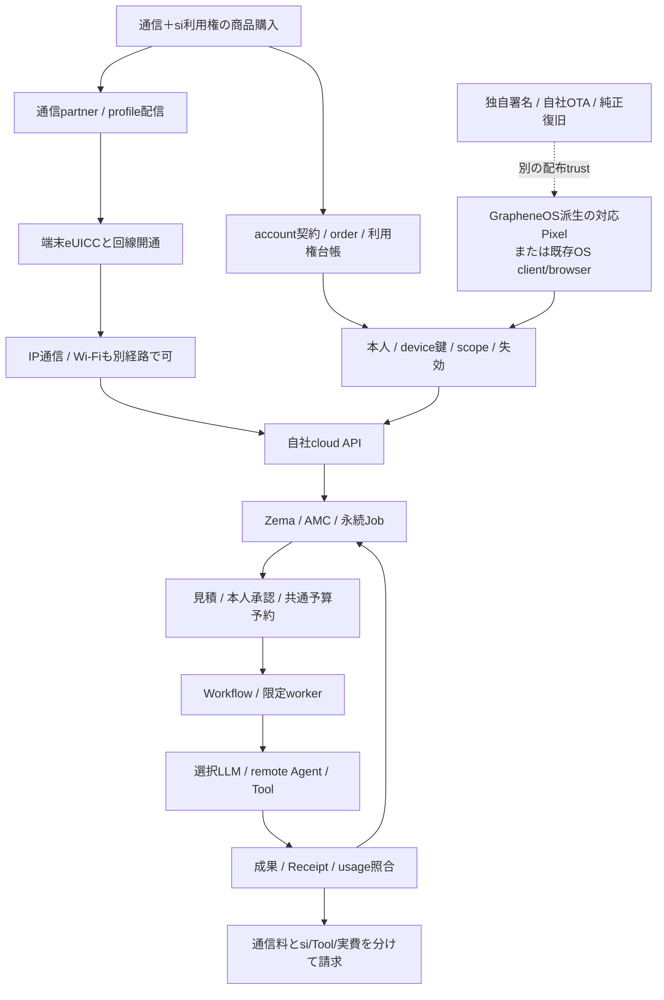
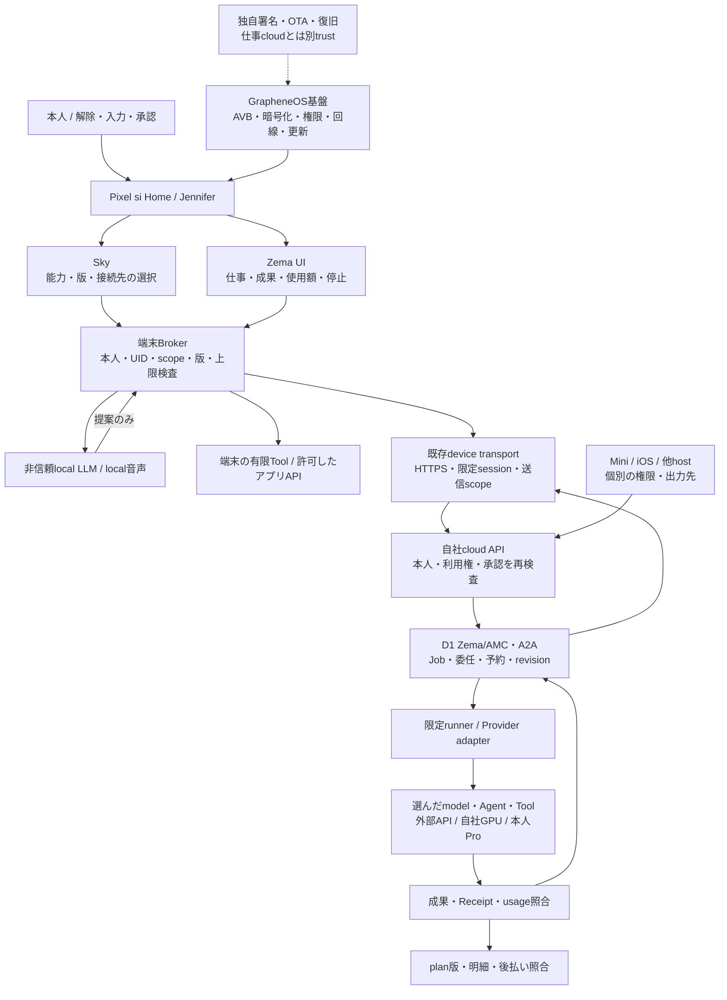

# RockstarOS — Pixel si専用端末とSky・クラウドの設計

**Pixelの具体的な実装方針は[Pixel si専用端末の実装設計](#pixel-si専用端末の実装設計)を参照。** 2026-10-15の追加依頼に基づき、GrapheneOSの固定構成・公開差分・同梱app・kernel/vendorの確認範囲を[コード調査台帳](evidence/grapheneos-source-audit.json)へ記録する。前の73項目は説明用の分類で、全機能数や全ソース精読の証拠ではない。以下の32項目は改変可能性、追加節は採用・改変・追加の実装判断として読む。

更新: 2026-10-15 / OS11（O6、ROCK）・DOC04（H1、設計同期）。基準main `8b374cfc7838d3a751faf5e28b367c860ddbcd0d`。利用者の「通信とsi利用権をまとめる商品入口」「GrapheneOSをもとに、書換え可能性とできることを全部調べる」に対する調査設計。機械可読根拠は[調査台帳](evidence/graphene-cloud-foundation.json)。

**結論: GrapheneOSを改変して独自のPixel向けRockstarOSをbuildする道はある。eSIM商品、OS導入、LLMクラウドは独立した基盤を結合して成立させる。** 現在はsource・host/fixture・試験APKの系列があり、正式全OS・実回線・本番LLM/課金が完成した状態ではない。

## 1. 本人が更新した商品の入口

2026-10-15、本人はeSIMの役割として「通信とsi利用権をまとめて提供する商品の入口」を選択した。2026-10-10のaccount先行/一般eSIM販売保留という**商品設計方針**を更新する。accountは本人・契約・Job・Artifact・費用の正本で、eSIM profile番号をownerにしない。無料account/対応Toolの試用、既存OS client/browser経路、Miniのoffline利用は維持する。商品入口の更新は実発行・契約・課金・flash開始の許可/成功ではなく、既存runtime gateは閉じたまま。

販売する体験は `通信＋RockstarOS/Sky/Zema/si利用権`。通信料、LLM/Agent従量、Tool/外部実費は明細を分ける。「利用権を含む」は無制限token/GPUや全機種native OSを意味しない。既存30%/10%/1,000円等の料金判断は新しい価格決定まで維持し、回線原価/含むquota/対象国/carrier/解約・再発行・利用停止の関係は契約前に決める。

## Pixelを先行し、iOSはeSIMから機能を追加する

2026-10-15の本人指示を[多機種の提供契約](device-support-architecture.md#pixel先行とiosへの機能追加)へ固定する。最初はPixel 10 GL066 / frankelへGrapheneOSベースのRockstarOSを統合する専用端末。iOSは通信＋si利用権商品から、accountに結び付いたclient/Web/対応App Intents等へ進む機能追加型の後続経路。eSIM開通、利用権、client導入、native権限は独立して照合し、eSIMによるcode導入・OS権限獲得を前提にしない。同じJob/Artifact/費用を使いながら機種の能力は別受入とする。Pixel全OS/iOS連携とも未受入で、実行gateは変更しない。

## si専用端末の利用体験と実装境界

2026-10-15の本人指示「ai専用端末に変えたいんだよね」を、製品表記siで具体化する。**Pixel参照機の目標は、unlock後の中心がJenniferとの対話・制作・仕事になるsi専用端末。** GrapheneOSを土台にしたRockstarOSのdevice profileとして設計し、通信＋si利用権の商品入口を維持する。全体の携帯不要という目的は維持し、この端末の常時携行をMini利用の条件にしない。Mini/対応hostは同じ仕事へ別の場所から入る。

### 通常の一周

1. 初期設定で本人・端末鍵・service利用権・通信を個別に確認する。再起動後はOSの本人unlockを経てsi Homeへ戻り、未送信の下書き、進行中の仕事、承認待ち、停止を表示する。boot直後の鍵が利用できない状態を自動unlockで迂回しない。
2. Jenniferへ音声または文字で目的を伝える。音声が使えない場面でも文字/画面操作を残す。常時待受/呼びかけの方式は消費電力・mic表示・privacy・機種対応を実測して選び、常時録音を前提にしない。
3. Skyが使える能力と不足条件を示し、Zemaが既存Jobと成果の版を保存する。通常の一件で利用者がアプリ一覧やmodelを毎回選ばずに済む導線にする。理解/制作のmodelとAgent実行先はSkyで選ぶ。対応端末内LLM、受入済みcloud、明示した工程ごとの組合せを、準備状態・送信先・資源・費用とともに提示する。選択を必要なJob条件へ保存した後は毎回選び直しを要求せず、未接続や経路変更時は確認へ戻す。[選択契約](llm-evaluation-architecture.md#skyでmodelとagent実行先を選ぶ)に従い、未接続時の無断fallbackをしない。
4. 費用・送信先・作用・対象版を示し、必要な本人承認を得てBrokerが実行条件を確認する。Jenniferの発話やmodelの回答で権限を作らない。進捗/成果/使用額/停止をHomeから扱い、外部作用の応答喪失時は同じ実行IDを照合する。
5. Miniへ移っても同じowner/Job/Artifact revision/grant/予算を再取得し、私有出力先を確認する。端末を変えたことを二度目の注文・製作・課金の理由にしない。

### 画面・保存・失敗・復旧

Homeの中心は会話、進行中、確認待ち、成果、費用、停止。設定には通信・本人連携・権限・入力/出力・保存/復旧への明示導線を置く。ロック中/他人利用時の私有成果読み上げと承認を拒否し、muteと手動停止を会話以外から操作できるようにする。通信/LLM停止時は受入済みの有限local機能と暗号化保存/再取得を使い、cloud代替への無断送信や無断追加費用を発生させない。localにないcloud成果をofflineで取得できたとは表示しない。

保存は既存owner別Job、版付きArtifact、端末の暗号化連携/保存を再利用する。認証失効・鍵喪失・home crash・OS更新失敗を区別し、読み取れない記録を空の正常状態で上書きしない。設定/復旧、OSが提供する緊急機能への導線は確保する。一般Android appを許可する範囲、kiosk/管理端末化、Homeの置換範囲は未決定であり、「専用」という発言だけで全app削除や利用者の脱出不能を決めない。外部appも必要な能力として接続する場合は既存のscope/承認を通す。

### 現在の差分と順番

2026-10-15の調査基点では`android/shell/src/aosp/AndroidManifest.xml`はMAIN/LAUNCHERのみだった。10-16の[アプリ実装](#pixel-terminal-implementation)でHOME/DEFAULT候補と明示音声adapterを追加した。VoiceInteractionService・常時待受・全OSの受入は別に残す。①既存OS上で非破壊に一仕事の対話/成果導線を検証 → ②ownerが選択/解除できるHome候補とcrash復帰を検証 → ③必要なら音声role/機種の入力経路を検証 → ④独自署名OSへ統合し同imageのboot/更新/復旧を受け入れる。app試作とprivileged OS統合は別成果にする。音声roleの可能性は調査G14〜16、独自build/OTAはG01/G05に従う。

**合格条件**はbaselineのDT01〜DT06。DT01はboot/unlock/Home/再起動と同owner/Job復元、DT02はapp選択なしの依頼→改訂→確認→保存→再開、DT03はcloud/通信断、DT04はロック/他人/mute/私有出力、DT05は見積/上限/停止/応答喪失の重複防止、DT06はMini引継ぎと端末復旧。所要時間、誤認識、再開時間、電池/熱、費用を同じ候補artifactで測り、値の合否基準は試作briefで定める。全6件は未実行。既存AC01〜06、OS受入report、DEVICE-INSTALL等のgateを省略しない。

主担当はOS11/O6/ROCK、体験同期DOC04/H1、Home/仕事WEB04、local planner AI04、cloud/Sky SKY07・SKY21、署名/復旧RLS02。次の試作briefでROCKが代表一仕事とHome復帰動作を具体化し、OWNERが一般appの扱いと音声待受の選択を行う。専用端末方針は署名鍵生成、flash、回線契約、有料実行gateの解除を含まない。

## 2. 下から積む6層

1. **通信**: 対象端末/eUICC/LTE modem、通信partnerのprofile発行・開通。購入、profile配信、端末install、網登録、IP通信を別状態にする。最初のprofile downloadに使うWi-Fi等のbootstrap通信も準備する。
2. **端末OS**: exact Pixelへ受入済み署名OS、または既存OS app/browser。GrapheneOSのforkはPixel向け選択肢で、eSIMからOS binaryを起動/書込みする仕組みにはしない。
3. **本人と利用権**: account、購入order、profile binding、device鍵、service scope、期限/失効を関連付ける。eSIMの開通とsi利用許可、OS attestationと支出承認を混ぜない。
4. **自社cloud制御**: 認証API、Zema/AMCの永続Job、予算予約、期限/取消、Workflow、成果/usage台帳。端末が切れても受付済みの有限仕事を続け、追加承認では待機する。
5. **計算とTool**: cloud LLM/API、remote Agent、必要時の自社GPU、端末内planner、本人PC/Proを限定adapterで選ぶ。端末に共通Provider秘密鍵を埋め込まない。LLMは提案し、Brokerが実行を許可する。
6. **費用/成果/運用**: 項目別usage/請求、通信会社明細、暗号化保存/削除、backup、監査、supportとOS更新を照合する。cloud inferenceとOTA配信を同じcredential/更新権にしない。

回線が切れた時、cloudの停止要求は未達になり得る。受付済みJobの期限/予算による停止、再接続での同ID照合を[継続実行契約](sky-cloud-continuity.md)へつなぐ。回線解約、service停止、未精算usage、成果export/削除は独立に扱う。

## 3. 改変できる範囲を32項目で確認する

分類は技術的な到達経路で、実装/配布/商用受入の完了率ではない。外部APIやsourceの存在だけでできると断定せず、現repoの証拠と不足を併記する。

### C01 独自Home / Launcher — 通常app/role

可能性/責任: 独自Home appで入口をまとめる。現source: 10-16の実装でLAUNCHERとHOME/DEFAULTを宣言し、RoleManagerの本人選択と既定Home設定への導線を追加した。

不足: 独自OS同imageでのboot/更新受入は残る。アプリの起動/戻る/本人選択/再開は[同じ候補の証拠](evidence/pixel-si-terminal-implementation.json)で追跡する。

根拠: [android/shell/src/aosp/AndroidManifest.xml](../android/shell/src/aosp/AndroidManifest.xml) / [G04](https://grapheneos.org/source)。

### C02 標準app同梱 / 削除 / branding — OS source改変

可能性/責任: product構成で同梱appと表示を変更。現source: RockShell/Automation/Articleのproduct記述あり。

不足: 独自UI/不要app/依存関係とlicenseをexact tagで照合。合格証拠: user buildのapp一覧と機能/更新/noticeを確認。

根拠: [android/Android.bp](../android/Android.bp), [os/physical/rockstaros.mk](../os/physical/rockstaros.mk) / [G01](https://grapheneos.org/build), [G04](https://grapheneos.org/source), [G18](https://source.android.com/docs/setup/contribute/licenses)。

### C03 初回設定とeSIM商品導線 — OS source改変

可能性/責任: SetupWizardと自社app導線を編集する候補。現source: 購入claim/端末session sourceあり。統合初回設定は未受入。

不足: 無料account先行から通信＋si商品入口へ方針同期。合格証拠: 購入/開通/本人/利用権/OS状態を別表示し一周。

根拠: [lib/rockstar-entitlement-claim.ts](../lib/rockstar-entitlement-claim.ts), [docs/service-entitlements.md](../docs/service-entitlements.md) / [G04](https://grapheneos.org/source), [G07](https://source.android.com/docs/core/connect/esim-overview)。

### C04 Settings / SystemUI / quick settings — OS source改変

可能性/責任: 設定・status表示・quick tile等を変更可能。現source: 独自ShellはあるがSystemUI統合は未証明。

不足: 上流patch維持と部品別の変更範囲を固定。合格証拠: 通知/権限/lock/privacy indicatorが退行しない。

根拠: [android/shell/src/main/java/dev/rock/shell/MainActivity.java](../android/shell/src/main/java/dev/rock/shell/MainActivity.java) / [G04](https://grapheneos.org/source)。

### C05 Broker / Binder共通実行 — appまたはsource統合

可能性/責任: 明示APIと署名/UIDで限定作用を仲介。現source: Binder/SDK/Job/Receipt sourceとAPK系列がある。

不足: 全OS Soongとproduction署名/UID/SELinuxは未受入。合格証拠: 越境・改ざん・失効・再起動を同imageで拒否。

根拠: [android/tool-sdk/src/main/aidl/dev/rock/sdk/IPlatformApi.aidl](../android/tool-sdk/src/main/aidl/dev/rock/sdk/IPlatformApi.aidl), [android/automation/src/aosp/AndroidManifest.xml](../android/automation/src/aosp/AndroidManifest.xml) / [G10](https://source.android.com/docs/core/permissions/perms-allowlist), [G13](https://source.android.com/docs/security/features/selinux)。

### C06 privileged app / system service — OS source改変

可能性/責任: 必要な権限だけproduct/allowlist/frameworkで追加。現source: 現Soong appsはsdk current/testkey。包括platform権限はない。

不足: 必要性ごとに通常appとの差をADR化。合格証拠: partition/allowlist/署名/SELinuxとCTS影響を確認。

根拠: [android/Android.bp](../android/Android.bp), [android/sepolicy/private/rockstar_platform.te](../android/sepolicy/private/rockstar_platform.te) / [G10](https://source.android.com/docs/core/permissions/perms-allowlist), [G13](https://source.android.com/docs/security/features/selinux)。

### C07 任意appデータの無条件取得 — 一般化不可

可能性/責任: owner許可APIや共有fileだけを扱う。現source: Brokerの隔離契約とneverallowあり。

不足: root/Accessibilityを万能迂回路にしない。合格証拠: 別owner/app/profileの私有dataを拒否。

根拠: [android/sepolicy/private/rockstar_platform.te](../android/sepolicy/private/rockstar_platform.te) / [G13](https://source.android.com/docs/security/features/selinux)。

### C08 音声入力 / ASR / TTS — appまたはsource統合

可能性/責任: 専用runtime/許可したcloudで組み込む候補。現source: 前turnのAC01〜06は設計のみ。

不足: 言語/認識/遅延/電力/声の出力先と保持を実測。合格証拠: 電話/PC前操作0で一作品の修正/保存/再開。

根拠: [docs/service-design/01-service-experience.md](../docs/service-design/01-service-experience.md) / [G14](https://developer.android.com/reference/android/service/voice/VoiceInteractionService), [G15](https://developer.android.com/develop/background-work/services/fgs/restrictions-bg-start), [G16](https://developer.android.com/media/platform/sharing-audio-input)。

### C09 background assistant / hotword — 条件付きsource/API

可能性/責任: 選択されたvoice serviceや必要な専用実装を使う。現source: 現RockShell manifestにvoice serviceなし。

不足: DSP/lock/電池/他appのmicとの共存は未確認。合格証拠: 誤起動/騒音/通話/lock/mute/別人を実機確認。

根拠: [android/shell/src/aosp/AndroidManifest.xml](../android/shell/src/aosp/AndroidManifest.xml) / [G14](https://developer.android.com/reference/android/service/voice/VoiceInteractionService), [G15](https://developer.android.com/develop/background-work/services/fgs/restrictions-bg-start), [G16](https://developer.android.com/media/platform/sharing-audio-input)。

### C10 端末内LLM — appまたはsource統合

可能性/責任: model/runtimeを許可範囲で同梱/交換する。現source: Qwen plannerの限定試験APK系列あり。model結果は非信頼。

不足: model license/熱/RAM/電池/更新/大model能力を受入。合格証拠: offline plan→Broker→有限Tool→保存/停止を確認。

根拠: [docs/llm-evaluation-architecture.md](../docs/llm-evaluation-architecture.md), [data/llm-capabilities.json](../data/llm-capabilities.json) / [G13](https://source.android.com/docs/security/features/selinux)。

### C11 cloud LLM / remote Agent — OS外の自社cloud

可能性/責任: 自社gatewayから選択Providerへ接続。現source: 6種provider定義、quote/workflow source。paid gateはfalse。

不足: 実Provider/鍵/予算/usage/請求とproductionは未受入。合格証拠: 一仕事の見積/承認/受付/成果/usage/請求を照合。

根拠: [lib/llm-providers.ts](../lib/llm-providers.ts), [lib/remote-ai-pricing-gate.ts](../lib/remote-ai-pricing-gate.ts), [services/sky-agent-runtime/src/worker.ts](../services/sky-agent-runtime/src/worker.ts) / [G11](https://source.android.com/docs/security/features/verifiedboot)。

### C12 自社GPUでLLM提供 — OS外の自社cloud

可能性/責任: 別のinference基盤として接続可能な設計候補。現source: 互換endpoint定義はある。GPU fleet稼働証拠なし。

不足: model license/配備/隔離/queue/採算/品質を別に実証。合格証拠: 固定負荷で品質/待ち時間/原価/中断復旧を比較。

根拠: [lib/llm-providers.ts](../lib/llm-providers.ts), [docs/cloud-agent-provider-comparison-20261001.md](../docs/cloud-agent-provider-comparison-20261001.md) / [G18](https://source.android.com/docs/setup/contribute/licenses)。

### C13 既存eSIM profileの利用 — 機種/回線条件付き

可能性/責任: GrapheneOS上での既存profile利用を公式案内。現source: GL066の本日ADB接続0件。現回線未確認。

不足: exact SKU/回線/電波/OS版の実試験。合格証拠: 既存profileのdata/再起動/圏外復帰を確認。

根拠: [docs/avocado-mini-cellular.md](../docs/avocado-mini-cellular.md) / [G02](https://grapheneos.org/faq#supported-devices), [G03](https://grapheneos.org/usage#esim-support)。

### C14 eSIM追加 / 削除 / 切替 — 条件付きsource/API

可能性/責任: 公式のeSIM管理機能とEuicc APIを使う。現source: eSIM order/proof sourceあり。発行gate無効。

不足: 管理にはproprietary機能。Google Playとは別。本人/権限を確認。合格証拠: 追加/失敗/本人解決/切替/再発行を同端末で確認。

根拠: [app/api/esim/orders/[orderId]/issue/route.ts](../app/api/esim/orders/[orderId]/issue/route.ts), [lib/esim-install-proof.ts](../lib/esim-install-proof.ts) / [G03](https://grapheneos.org/usage#esim-support), [G07](https://source.android.com/docs/core/connect/esim-overview), [G09](https://developer.android.com/reference/android/telephony/euicc/EuiccManager)。

### C15 carrier appの限定管理 — 通信partner条件付き

可能性/責任: 通信partnerがprofileへ署名証明書規則を付ける場合に設計。現source: Rockの利用権署名とcarrier privilegeは別。

不足: 通信partner契約/ARF/署名更新を要照合。合格証拠: 他carrier profile操作拒否と本人解決を確認。

根拠: [lib/esim-device-entitlement.ts](../lib/esim-device-entitlement.ts) / [G07](https://source.android.com/docs/core/connect/esim-overview), [G09](https://developer.android.com/reference/android/telephony/euicc/EuiccManager)。

### C16 独自LPA / eUICC / SM-DP+ — 自由な任意改変ではない

可能性/責任: Android LPAの統合は可能だがprofile供給/secure elementは独立。現source: 自社LPA/SM-DP+の実装・資格受入なし。

不足: LPA自作とeUICC firmware改変を混同しない。partner機能を先に使う。合格証拠: end-to-end発行/鍵/失効/規格/契約を別受入。

根拠: [lib/esimgo-provider.ts](../lib/esimgo-provider.ts), [docs/avocado-mini-cellular.md](../docs/avocado-mini-cellular.md) / [G07](https://source.android.com/docs/core/connect/esim-overview), [G08](https://source.android.com/docs/core/connect/esim-euicc-api)。

### C17 電話 / SMS / VoLTE / 5G / APN — 機種/回線条件付き

可能性/責任: OSとcarrierの対応範囲を維持して設計する。現source: Miniは別LTE-only data契約。Pixelの電話serviceとは別。

不足: 国内SKU/通信会社/IMS/契約を未確定のまま保証しない。合格証拠: 対象planでdata/必要な通話/SMS/緊急導線を受入。

根拠: [docs/device-support-architecture.md](../docs/device-support-architecture.md) / [G03](https://grapheneos.org/usage#esim-support), [G07](https://source.android.com/docs/core/connect/esim-overview)。

### C18 SIMだけでOSを書換え / 任意locked機導入 — 一般化不可

可能性/責任: SIMでサービス開始へ誘導できるがOS導入は別。現source: APK/PWAは既存OS経路。全OS flash未実施。

不足: eSIM=OS image/bootloader解除と説明しない。合格証拠: 対応/非対応機を判定しclient/browserへ分岐。

根拠: [os/physical/frankel-source-lock.json](../os/physical/frankel-source-lock.json) / [G05](https://grapheneos.org/install/web), [G12](https://source.android.com/docs/core/architecture/bootloader/locking_unlocking)。

### C19 kernelとdriverの変更 — sourceとhardware条件付き

可能性/責任: 公開kernel等は対象機のbuild手順で変更可能。現source: frankel laguna/muzel 6.6を固定。

不足: 各driver/firmware/セキュリティ機能の継続更新が必要。合格証拠: boot/hardware/熱/休止/復旧の同image試験。

根拠: [os/physical/frankel-source-lock.json](../os/physical/frankel-source-lock.json) / [G01](https://grapheneos.org/build), [G04](https://grapheneos.org/source)。

### C20 baseband / TEE / eUICC firmwareの任意改造 — 一般化不可

可能性/責任: OEM署名firmwareやhardware権限をOSのsource変更で解除しない。現source: vendor取得/純正復旧artifactは別gate。

不足: 公開sourceと任意署名/無線許可を同一にしない。合格証拠: 取得元/版/署名/復旧・再配布条件を照合。

根拠: [docs/android-google-stock-recovery.md](../docs/android-google-stock-recovery.md) / [G01](https://grapheneos.org/build), [G11](https://source.android.com/docs/security/features/verifiedboot)。

### C21 独自OS署名 / AVB / bootloader relock — 機種/回線条件付き

可能性/責任: 対応する機種で独自鍵のsigned user imageを受入する。現source: testkey source/署名custody設計あり。正式署名/flash未完。

不足: 鍵生成/保管/復旧は未実施。unlock可能な個体を確認。合格証拠: 同一imageの鍵/boot/保存/再起動/復旧を独立受入。

根拠: [docs/android-production-signing-custody.md](../docs/android-production-signing-custody.md), [os/physical/rockstaros.mk](../os/physical/rockstaros.mk) / [G05](https://grapheneos.org/install/web), [G11](https://source.android.com/docs/security/features/verifiedboot), [G12](https://source.android.com/docs/core/architecture/bootloader/locking_unlocking)。

### C22 自社OTAとsecurity更新 — source＋運用

可能性/責任: 独自署名に対応する自社配信元と更新clientを維持。現source: 現productはOFFICIAL_BUILD=trueを拒否。

不足: 上流Updater採用には自社URL/鍵検証付きhook等の別設計が必要。現guardは解除しない。合格証拠: testing→beta→stable、rollback/中断/鍵喪失/上流patchを受入。

根拠: [os/physical/rockstaros.mk](../os/physical/rockstaros.mk), [docs/android-rollback-index-policy.md](../docs/android-rollback-index-policy.md) / [G01](https://grapheneos.org/build), [G19](https://raw.githubusercontent.com/GrapheneOS/platform_packages_apps_Updater/17/LICENSE)。

### C23 OSとTool/appの署名・配信を分ける — appまたはsource統合

可能性/責任: OS releaseと作者app鍵、model packageを分離。現source: Sky package署名/版、testkey APKあり。

不足: release鍵とauthor鍵を混ぜず更新と失効を実装受入。合格証拠: 他作者/旧版/改ざん/期限切れを拒否。

根拠: [docs/service-entitlements.md](../docs/service-entitlements.md), [android/Android.bp](../android/Android.bp) / [G10](https://source.android.com/docs/core/permissions/perms-allowlist), [G11](https://source.android.com/docs/security/features/verifiedboot)。

### C24 backup / 複数profile / 端末移管 — appまたはsource統合

可能性/責任: ownerごとの暗号化保存/選択export/復旧を接続。現source: 23/23試験APKの非破壊再起動証拠。全損未受入。

不足: 鍵喪失/再登録/SIM再発行/別realm復旧を別試験。合格証拠: 同じJob/版/未解決費用を保持し別人へ漏れない。

根拠: [docs/android-backup-recovery.md](../docs/android-backup-recovery.md) / [G11](https://source.android.com/docs/security/features/verifiedboot), [G13](https://source.android.com/docs/security/features/selinux)。

### C25 Google Play / 他社app / 決済互換 — 第三者互換条件付き

可能性/責任: 許可された互換経路で個別appを試す。現source: 自社APKの合格は銀行/Wallet/DRMの合格ではない。

不足: 他社のGoogle認証/規約/機種要求を回避できると約束しない。合格証拠: 対象app/版/OSで一機能ずつ確認。

根拠: [docs/device-support-architecture.md](../docs/device-support-architecture.md) / [G17](https://developer.android.com/google/play/integrity/verdicts)。

### C26 独自attestation trust — source＋cloud

可能性/責任: 自社OSのAVB鍵/patch/boot状態を自社serverへ登録。現source: Broker device登録APIはsource/合成検証あり。

不足: GrapheneOS公式鍵やGoogle認証を借用しない。合格証拠: challenge/鍵/失効/boot状態/owner/bindingを実機照合。

根拠: [app/api/rockstar/broker-devices/route.ts](../app/api/rockstar/broker-devices/route.ts) / [G06](https://grapheneos.org/articles/attestation-compatibility-guide), [G11](https://source.android.com/docs/security/features/verifiedboot), [G17](https://developer.android.com/google/play/integrity/verdicts)。

### C27 商用再配布と独自brand — license個別審査

可能性/責任: componentごとの許諾とnoticeに従い設計する。現source: Updater/brandingのMIT形式source licenseを確認。

不足: OS全体/license/vendor/model/商標は別審査。公式と誤表示しない。合格証拠: exact tagのSBOM/NOTICE/source提供/再配布表を受入。

根拠: [scripts/check-release-readiness.mjs](../scripts/check-release-readiness.mjs) / [G18](https://source.android.com/docs/setup/contribute/licenses), [G19](https://raw.githubusercontent.com/GrapheneOS/platform_packages_apps_Updater/17/LICENSE), [G20](https://raw.githubusercontent.com/GrapheneOS/branding/17/LICENSE)。

### C28 Mini/Pro/任意hardwareへのport — Pixel対応から転用不可

可能性/責任: 共通業務契約は使えるがOS imageは機種別。現source: Pixel OS、Linux/QEMU、Mini R5、NVIDIA PCは別系列。

不足: GrapheneOS frankelの合格を他SoC/GPU/光学/RFへ転用しない。合格証拠: 各BSP/driver/boot/復旧/安全/熱を別受入。

根拠: [docs/device-support-architecture.md](../docs/device-support-architecture.md), [docs/avocado-mini-r5/README.md](../docs/avocado-mini-r5/README.md), [docs/avokado-pro-pc-design.md](../docs/avokado-pro-pc-design.md) / [G01](https://grapheneos.org/build), [G02](https://grapheneos.org/faq#supported-devices)。

### C29 購入/回線/利用権の一商品化 — OS外の自社cloud

可能性/責任: 購入eventをaccount契約とscopeへ結ぶ。現source: claim/order/cloud credential sourceあり。live issueはdisabled。

不足: carrier側確定と自社grantの片成功/再発行/返金/解約を要設計。合格証拠: 同じorder/eventで一回grantしSIM交換でowner/仕事を失わない。

根拠: [lib/esim-cloud-access.ts](../lib/esim-cloud-access.ts), [lib/rockstar-entitlement-claim.ts](../lib/rockstar-entitlement-claim.ts) / [G07](https://source.android.com/docs/core/connect/esim-overview), [G09](https://developer.android.com/reference/android/telephony/euicc/EuiccManager)。

### C30 端末切断後のAgent継続 — OS外の自社cloud

可能性/責任: Cloudが受付済みの有限仕事を期限/予算内で続ける。現source: D1/Workflow/one-shot照合sourceとlocal fixtureあり。

不足: production DB/鍵/provider/配備は未受入。合格証拠: 切断後に継続/承認待ち/取消未確認/再接続照合を確認。

根拠: [docs/sky-cloud-continuity.md](../docs/sky-cloud-continuity.md), [services/sky-agent-runtime/wrangler.jsonc](../services/sky-agent-runtime/wrangler.jsonc) / [G11](https://source.android.com/docs/security/features/verifiedboot)。

### C31 月上限 / 後払い / 明細 — OS外の自社cloud

可能性/責任: 通信料/si使用料/実費/Tool料金を分けて上限を強制。現source: 署名ratecard/quote/parentJob poolあり。共通paid gate false。

不足: account月→Goal→leaf/worker/reviewerと後払いの照合は未受入。合格証拠: 二端末同時上限・遅延usage・返金・不払いで二重計上なし。

根拠: [lib/a2a-delegation-store.ts](../lib/a2a-delegation-store.ts), [lib/remote-ai-pricing-gate.ts](../lib/remote-ai-pricing-gate.ts), [docs/sky-billing.md](../docs/sky-billing.md) / [G11](https://source.android.com/docs/security/features/verifiedboot)。

### C32 公開運用の認証 / 保存 / secrets — OS外の自社cloud

可能性/責任: API制御、D1台帳、artifact保存、Workflow、secretsを分離。現source: scope enforcementはflag条件、runtime DB IDはplaceholder。

不足: 公開環境のfail-closed設定/鍵保管/backup/retention/監査/DRを受入。合格証拠: owner A/B・失効・復旧・data削除・費用を同じ配備で確認。

根拠: [lib/rockstar-service-access.ts](../lib/rockstar-service-access.ts), [services/sky-agent-runtime/wrangler.jsonc](../services/sky-agent-runtime/wrangler.jsonc) / [G11](https://source.android.com/docs/security/features/verifiedboot), [G13](https://source.android.com/docs/security/features/selinux)。

## 4. GrapheneOS改変の三つの進め方

- **公式GrapheneOS＋通常APK**: 公式OSの更新を維持したまま、Sky/Zema/接続/保存/有限Tool/通知/明示音声等のapp体験を先に試す。これを独自OS完成とは呼ばない。
- **独自signed user build**: 上流のexact stableを固定して小さなproduct hookと必要なsource差分を載せる。Home/SetupWizard/標準app/Broker/設定/OTAを自社責任で統合する。権限が必要な部品だけ個別に審査し、最初からframeworkやkernelを全面改造しない。
- **Mini/Proへの共通契約移植**: account/Job/Artifact/Receiptは共有しても、MiniのBSP/音声/光学/RFやNVIDIA PCのOS/driverをfrankel imageで代用しない。Pixel、QEMU、Mini、Proは別の受入系列。

狙う到達形は第二経路だが、第一経路で通信/本人/一仕事/保存/費用を先に確かめ、第二経路の必要なOS差分を絞る。これは段階の提案で、build資源購入や所有Pixelの初期化/flashを開始しない。

## 5. 現repoで見つかった基盤の不足

1. **paid gate**: `lib/remote-ai-pricing-gate.ts`は`false`。Provider定義/画面/見積sourceがあっても、cloud LLMの有料本番利用は未受入。法務/特許経路も同gateを確認する。
2. **scope enforcement**: `lib/rockstar-service-access.ts`はpreview互換のflag条件を持つ。公開運用で必須のscope/owner/device/失効をfail-closedにする設定と受入が必要。単にflagをtrueにする作業ではなく全経路の照合を行う。
3. **cloud配備**: `services/sky-agent-runtime/wrangler.jsonc`はD1 IDがplaceholder、A2A実行false。実DB/secret/trust/allowlist/migration/backupの同一配備証拠がない。
4. **月上限と後払い**: parentJob poolをaccount全体の月上限とは呼べない。直接LLM/worker/reviewer/複数端末を同予算へ予約し、遅延usage・不払い・返金と照合する。
5. **eSIM受入**: order/install proof/cloud grantのsourceはあるが、実発行gateは明示trueが必要。通信partnerの再販・profile/activation・carrier privilege・利用権付与・再発行・解約を一契約で確認していない。
6. **OS buildと署名**: 固定source tagは`2026100200`、署名manifest確認は2026-10-06の証拠。全repo sync/Soong/user image/正式署名/flash/全損復旧の合格ではない。`android/Android.bp`のtestkeyはproduction資格ではない。
7. **OTA経路**: 現`rockstaros.mk`は`OFFICIAL_BUILD=true`を拒否する。一方、上流Updaterは自社URLを設定して採用する。既存guardを外すだけでは解決せず、自社URL/鍵/配信検査を持つ専用product/hook/clientの設計と受入が必要。
8. **Home/常時音声**: RockShellのLAUNCHERはHOME roleやVoiceInteractionService実装ではない。電話なしのAC01〜06は声・本人性・privacy・表示・停止を実機で確認する。
9. **新旧資料**: 本書のBlackBerry-first/旧料金を現行入口から退役。phone-preview中の旧2026091000記述は現在のsource lockへ同期し、旧物理観測や過去の受入はそのまま保持する。
10. **今日の物理確認**: ADBの接続/認証済み端末は0件。Pixelの実OS/boot状態、現eSIM、回線、実LLMを本調査で確認したとはしない。

## Pixelの現在地と実用化の順番

2026-10-15の[監査記録](evidence/pixel-readiness.json)はmain `1cb16d06`、同SHAの7 CI成功、現source、手元の別候補、同artifactの過去実機証拠を照合した。今日のADB一覧は0件で、現在のOS/APK/model/回線を観測したとはしない。主担当OS11/O6/ROCK、同期DOC04/H1。source/CI・過去APK実証・手元未反映・実機未受入を分け、完成率を算出しない。

現在動いた証拠があるのは、mainの有限Tool/仕事・権限・保存のhost/CI、9月16日の固定local LLMと試験APKの非破壊再起動等。現API v4はunsigned build/stage済みで実機未受入。手元`codex/esim-cloud-access`には10月9日の17項目test modeと11実機試験の未コミット記録があり、12 source hashは今回全一致した。8実処理/9模擬で、当時は`no_model`、Brokerの実仕事は作成しない。mainにActivity/実行器がないことを「手元にも未実装」と読み替えず、この候補をmain反映済みとも呼ばない。

未完了は、現行v4と同候補のPixel一仕事、model/Agent実行先のnative選択、専用Home/音声、正式全OS、実cloud/課金、eSIM商用、iOS/Mini/家具・建築の各実機受入。`remoteAiPricingGateAccepted()`はfalse固定、cloud runtimeのrepo設定にはplaceholderがあり、現在の本番環境/credentialsを確認した証拠ではない。全OS compileと初回flashを別gateに保つ。

1. **P0: 候補を同期・固定（RLS02/O7）** — mainの最新契約と、手元test modeの必要な12 source/依存差分を選別し、単一commit・APK hash・署名identity・復旧先を固定する。dirty全体を一括mergeしない。旧compile branchはmainの祖先で追加commit 0件、PR #130の未統合設計はPixel実用化の前提にしない。
2. **P1: 現行v4を非破壊再受入（OS11/O6）** — GL066を読取り確認し、Broker/Tool/runtimeと一つの署名済みmodel profileを同候補へ揃え、実Binder・機内モード推論・保存・停止・実再起動を試す。9月のAPI v2系の合格をv4へ流用しない。
3. **P2: 一件の実用仕事（AI04/O2）** — 既存の記事/出典Toolで依頼→local plan→権限確認→Tool→本人review→同Artifact版保存/再開を通す。17項目の模擬Zema/LLMを実Agentの成功へ加算しない。
4. **P3: Skyの実行先選択（SKY07/O4）** — model推論先とAgent runnerを別に選び、実host/版/grant/見積を同Jobへ固定する。cloud未接続は未接続表示、C2合格後に同じ仕事のcloud経路を比較する。無断fallbackなし。
5. **P4: 専用Homeと対話入口（OS11/O6、WEB04連携）** — ownerが選択/解除できるHome、Jennifer/仕事導線、文字/押して話す入力、設定/mute/停止/復旧を実装し、lock/crash/再起動の復帰を測る。常時待受は後続の機種/電池/privacy受入とする。
6. **P5: compile-only（OS11/O6）** — ANDROID-PREFULLと同候補freeze後、予算/対象の確定した専用x86_64 Linuxへ固定source `2026100200`、vendor inventory、現行APKを揃えてbringup build。現repoのRAM64GiB/空き400GiB要件と同build numberのtarget-files/otatools/hash検査を通す。compile合格はflash許可ではない。
7. **P6: release前条件（RLS02/O7）** — 鍵管理/rotation、rollback運用、純正factory/full OTA実byte、Keystore喪失復元を初回flashの4 gateへ揃える。現在0/4。実行前/後のrollback試験境界、初期化/復元の対象と復旧手順を具体化し、gateを勝手に開けない。
8. **P7: 同imageの実機OS受入（RLS02/O7）** — 適合/backup/書込み条件を満たした対象へ導入し、boot・権限・通信・保存・再起動・一仕事・OTA/rollback/純正復旧を同image hashの受入reportへ記録する。公開・本番金融・実回線商用は別gate。

**並行するcloud系列**: C1（BIL02/O5）でsiクラウドのplan/利用枠/超過/実meter/account月上限/後払い/失効をfixtureへ結び、C2（SKY21/O5）でsandbox→予算承認済み一Providerの見積/予約/実行/停止/usage/請求一周を受け入れる。P0の候補と同Job契約を使い、localのP1〜P4をC2完成待ちにしない。local/cloud両方を実際に選べる日常利用には双方の受入が必要。モデル/署名/依頼/計画/料金を変えたら該当証拠を取り直す。

各段階の原因・再利用path・担当・合格証拠・未解決条件は監査JSONに保存する。検証は既存`npm run device-support:check`、`npm run llm:architecture:check`、`npm run android:first-flash:check`、`npm run design:check`、`npm run verify`、実装時は`docs/os-prototype.md`とAndroid CIの同候補APK/実Binder/SQLite/端末試験を使う。`--require-pass`は現状0/4のため拒否されるのが期待値で、実機合格として表示しない。

## 6. 作る順番と合格を示すもの

1. **商品契約（SIM01 / SKY21 / BIL02）**: 通信とsiの含有範囲、partner/地域、accountへの購入binding、再発行/解約/返金、価格/上限/実費を確定する。購入直後に無制限の実行権は付けない。
2. **一仕事のcloud基盤（SKY07 / SKY21）**: 同じ環境で本人A/B、scope、quote、原子的予約、永続受付、Provider実処理、schema成果、usage/請求、停止/timeout/再接続を受入。環境/Provider/価格版を固定し本番gateと別に試験する。
3. **GrapheneOS上のapp（OS11 / AI04）**: 対象GL066のread-only情報を確認し、電話なしの制作入口と既存Job契約を検証。full imageの代わりにはしない。
4. **独自OSの最小差分（OS11 / RLS02）**: signed stable/manifest/vendor/kernelを固定、必要なapp/role/hookだけを追加。専用x86_64 Linuxでcompileし、署名/boot/保存/更新/復旧を同じartifactで受入。
5. **独自配信と運用（RLS02）**: 自社署名・OTA・鍵保管/rotation・restore・脆弱性追従・license/NOTICE・support体制を確認。公式GrapheneOSの鍵/OTA/認証を自社forkの成功へ転用しない。
6. **Mini/Pro接続**: 前turnのAC01〜06、MAT15/MAT16とhostの個別gateへ進む。電話を持たず制作する価値を、cloud本番や物理表示の完成待ちの宣伝だけにしない。

GrapheneOSの公式build資料に従い、full buildはx86_64 Linux、RAM32GiB以上、sourceとbuildの領域を別々に確保する。現在のMacや未確認VMを合格環境へ換算しない。build環境・exact sourceの再確認を行い、固定tagを最新版と呼ばず、source lockや署名鍵を本調査で変更しない。

## 7. 根拠・範囲・履歴

外部事実は次の一次資料、現実装は台帳に保存した基準SHA/hash、設計判断は本書の責任/合格条件として区別する。商用配布の条件は各componentのlicense/NOTICE、kernel、vendor/model、商標、通信/提供契約を個別に確認する。Updaterやbrandingのlicenseだけで全OSの権利を推定しない。現在のFAQ本文ではtrademark節を特定できなかったため、商標の包括許諾確認済みとは記録しない。

- **G01** [GrapheneOS build](https://grapheneos.org/build) — 改変/独自build、frankel、build資源、vendor、release署名と独自OTA。
- **G02** [GrapheneOS supported devices](https://grapheneos.org/faq#supported-devices) — Pixel 10 frankelは公式対象。任意機器の同等対応ではない。
- **G03** [GrapheneOS eSIM usage](https://grapheneos.org/usage#esim-support) — 既存profile利用と追加/管理を区別。追加管理にproprietary機能、Google Play依存は不要。
- **G04** [GrapheneOS source repositories](https://grapheneos.org/source) — Launcher/Settings/SystemUI/Telephony/Updater等のsource分割。
- **G05** [GrapheneOS install](https://grapheneos.org/install/web) — 公式導入/検証/復旧の入口。端末の適合・unlock条件を別確認。
- **G06** [GrapheneOS attestation](https://grapheneos.org/articles/attestation-compatibility-guide) — 独自OSの鍵/verified bootを自社サービスのtrustへ照合する。
- **G07** [AOSP eSIM architecture](https://source.android.com/docs/core/connect/esim-overview) — eUICC/LPA/SM-DP+/carrier appを分離。profileの証明書規則でcarrier権限を制御。
- **G08** [AOSP eUICC APIs](https://source.android.com/docs/core/connect/esim-euicc-api) — eUICC管理の専用APIとLPA役割。
- **G09** [EuiccManager](https://developer.android.com/reference/android/telephony/euicc/EuiccManager) — eSIMの追加/切替等はpermission/carrier privilege/本人解決の条件付き。
- **G10** [Privileged permission allowlist](https://source.android.com/docs/core/permissions/perms-allowlist) — preinstallだけではprivileged権限を満たさずallowlistとpartitionを確認。
- **G11** [Android Verified Boot](https://source.android.com/docs/security/features/verifiedboot) — 署名されたchain/rollbackの保証範囲。
- **G12** [Bootloader locking](https://source.android.com/docs/core/architecture/bootloader/locking_unlocking) — unlock/lockは適合とdata消去を伴う。任意のlocked機を上書きしない。
- **G13** [SELinux](https://source.android.com/docs/security/features/selinux) — domainとenforcing policyで隔離を強制。
- **G14** [VoiceInteractionService](https://developer.android.com/reference/android/service/voice/VoiceInteractionService) — 本人が選んだvoice interactorの仕組み。hotword/音声UIの実装候補。
- **G15** [Background microphone restrictions](https://developer.android.com/develop/background-work/services/fgs/restrictions-bg-start) — 通常appのbackground microphoneには制限があり例外も条件付き。
- **G16** [Audio input sharing](https://developer.android.com/media/platform/sharing-audio-input) — assistantと他app/通話の同時音声取得は規則と権限に依存。
- **G17** [Play Integrity verdicts](https://developer.android.com/google/play/integrity/verdicts) — 自社attestationとGoogle認証/他社app利用可否は別。
- **G18** [AOSP licenses](https://source.android.com/docs/setup/contribute/licenses) — Apache系を中心に複数license、kernel GPL等を個別確認。
- **G19** [GrapheneOS Updater license](https://raw.githubusercontent.com/GrapheneOS/platform_packages_apps_Updater/17/LICENSE) — MIT形式の改変/配布許諾とnotice条件。OS全体の包括許諾ではない。
- **G20** [GrapheneOS branding license](https://raw.githubusercontent.com/GrapheneOS/branding/17/LICENSE) — 取得したbranding sourceのlicense。商標/全vendor blobの判断へ拡張しない。
- **G21** [GrapheneOS release channel](https://grapheneos.org/releases#frankel) — 採用前にexact機種のsigned stableを確認。現repo固定tagとは別。

旧native統合文書は、[基準mainのGit履歴](https://github.com/k999ln/rock/blob/8b374cfc7838d3a751faf5e28b367c860ddbcd0d/docs/native-os-integration.md)から復元できる。Linux/Buildroot/QEMUの実装と受入は削除せず、`systems/rock-star-os/`と[native検証](native-os-validation.md)を独立して維持する。固定IMPORT-MANIFEST/vendor/原本/署名/source lockは変更していない。

検証結果は[進捗JSON](../data/project-status.json)の`grapheneCloudFoundation`へ記録する。本書は調査設計で、実OS書込み・開通・クラウド契約・Provider実行・課金・配備を実施した報告ではない。

## Pixel si専用端末の実装設計

2026-10-15 / OS11・O6・ROCK、設計同期DOC04・H1。本人の追加指示「残りもコードから全部調べて、Pixelをsi専用端末にするために何をそのまま使って何を追加するのか、Skyやクラウドとの繋がりも辻褄を合わせて設計書にして」を具体化する。基準mainは`a3e7a8ca8c166dc670a811a735b104dde9fd958f`、同SHAの7 CI成功を確認した。RQ01〜RQ50、DT01〜06、SC01〜05、既存の料金・初回flash gateを維持する。

### 1. 固定版と調査の意味

調査版はGrapheneOS `2026100600`、manifest commit `26f7e8a760d4343a501faf09773ec4cc61a6b56b`。構成は1,057 project、うちGrapheneOS側remoteは129。公開GitHub/GitLabの構成と、取得できたAndroid基盤との差分、独立app、Pixel 10用設定を横断する。公式機能ページのAndroid 16という説明と、調査manifestの`android-17.0.0_r1`を混同しない。原稿・大量ログ・diff・APK・kernel・imageはGitへ入れず、revision/hash/対象/取得失敗/未検証条件を[台帳](evidence/grapheneos-source-audit.json)へ保存する。

GitHub 127件とGitLab 2件の構成を取得し、86 repositoryのAOSP比較diff（binary/シンボル表を含む2,611 entry）と、選択取得したsource/config 4,705 fileを検索した。diff APIの300 file上限で切らず、downloadしたdiffの行頭headerを数える。DeskClockは比較diff取得に失敗したためsource snapshotへ切り替え、14件のkernel prebuiltはsource精読の代わりにしていない。独立app sourceは別commitを固定し、OS同梱APKとのbyte再現は未証明と記録する。

Rockの**採用compile入力は引き続き2026100200**。調査版とはGrapheneOS側27 projectのrevisionが異なる。Settings/NetworkLocation/Updaterは同一だが、framework/Virtualization/adevtool等は異なる。調査版の存在を理由にlockや受入済みAPKを更新しない。採用更新はsource署名・差分・vendor/復旧互換を確認する別作業とする。

「全構成を分類して公開差分を検索した」「主要処理の制御を追った」「同一imageで実機合格」は別の証拠である。vendor firmware/HAL、kernel prebuilt、Google由来部品のbinary内部、全Android API、全flag組合せの動作は今回のsource検索だけで保証できない。未公開部分は必要なinterface/版/hashと実機試験へ落とし、機能を推測して埋めない。

Pixel 10 kernelの参考checkoutは`kernel_pixel_6.6` commit `66529eed85e8f3ccbda7f74911b125e7d6df7efc`、内側ACKは`de3eb0b989169834cea291dd421a4cb4619bbf88`へ固定して設定を確認した。muzelのbuild scriptには`--disable_slab_canary`があり、総論の防御一覧を全機種で常に同じ有効設定と扱わない。この参考sourceが固定OS prebuiltを再現することや、現在の実機で当該flagが有効なことまでは確認していない。

### 2. 端末が提供する体験と境界

Pixelを解除するとsi Homeを開き、Jenniferへ依頼し、作成・修正・確認・保存・再開する。SkyはAgent/LLM/Toolを選び接続する入口、Zemaは同じ仕事の進捗・承認・成果・費用・停止を扱う。推論結果は計画候補であり、端末Brokerまたはサーバー側policyが再検査した範囲だけを実行する。利用者がPCの前へ移動しなくても、許可したcloud/Pro等を計算先にできる。

初期試作の音声入力は明示した開始/停止から受け入れる。常時hotword、ロック中の私有読み上げ、声だけの購入/送信承認を最初の完成条件へ紛れ込ませない。文字入力・設定・緊急機能・mute・手動停止・復旧を常に残す。Mini/建築hostへ移った場合もPixelの携行や中継を必須にせず、受入済みhostが同じaccount/仕事の許可を再取得する。

矢印は接続設計で、全経路の実装完了を示さない。local LLMの結果、cloud response、push通知、接続済み表示を本人承認や成功証拠にしない。

本図はPixel統合profileである。mainに統合されたPR #142の[Sky単体・月次請求契約](sky-billing.md#sky単体のagent利用月次請求2026-10-15確定設計)を維持し、Sky単体の選択/利用/計測/明細/請求にJennifer、Zemaの利用、RockstarOS導入、Mini、SIMを必須としない。Skyは既存の共通権限・実行/usage台帳を使って完結し、Zema画面は同じ記録への任意の仕事管理入口。Pixelではそれらを一つの体験として統合する。D1正本という実装上の責任と、特定の画面・サービス利用を強制することを区別する。

### 3. そのまま引き継ぐもの

| 領域 | 採用判断 | 接続・確認条件 |
| --- | --- | --- |
| boot/kernel/vendor・AVB・SELinux | GrapheneOS/機種適合BSPと防御を維持 | 独自root APIや汎用daemonを追加しない。kernel sourceとprebuiltの対応、vendor inventory、署名、rollbackを同imageで検査 |
| 暗号化・Keystore・画面ロック・ユーザー隔離 | 維持 | OS解除とcloud account、私有成果、支出承認は別。Direct Bootで私有鍵や原稿を先読みしない |
| 通話/SMS・緊急機能・Wi-Fi/BT/NFC・eSIM管理 | 既存UI/APIを再利用 | 国/SKU/carrier別受入。回線profileをownerやTool許可にしない。回線の停止を仕事取消成功にしない |
| Network/Sensors/Storage/Contact Scopes・Secure Paste | 強制を維持 | Agentの便宜で一括許可しない。IME/アクセシビリティ/共有UID等の例外もdata flowへ含める |
| 設定・通知・privacy indicator・USB制御 | 維持 | si Homeから到達可能にする。収音表示や権限promptを隠さない |
| Vanadium/WebView・Camera・PDF・Files・キーボード・TalkBack | 基本部品として再利用 | Web表示、明示撮影、共有picker、文書確認を使う。入力/保存権限を常時の全端末走査へ拡張しない |
| 連絡先・時計・計算機・Calendar等 | 基本機能として保持 | 専用端末という理由だけで削除しない。一般アプリ制限の強さは本人判断待ち |
| アプリ互換・sandboxed Play・Android Auto | 必要な人の追加能力 | 標準での必須化はしない。外部appの受入条件、権限差分、private profileを別検査 |
| 端末診断・Auditor・LogViewer・Seedvault | 既存機能を入口に使う | 独自OS鍵の認証受入、ログの本文秘匿、アプリ別backup対象、Keystore全損は追加受入 |
| Linux Terminal/AVF | 任意の制作実行先候補 | 組込flag/VM能力/容量/guest像/port/保存/停止を受入後にSkyへ登録。存在だけで任意shell公開や本番Tool実行を許可しない |

住所↔座標、80%充電上限、代替touch、CT/Widevine配信先、Play Integrity通知/拒否、Security Preview、プロファイル間clipboardは調査台帳へ独立記録する。設定定義だけの項目は、利用可能機能と同列にしない。充電制御の下位経路とNFC_AUTO_OFFの実利用経路は特に未確認条件を保持する。

### 4. 改変するところ・追加するところ

以下は論理moduleの分割で、新しい独立microserviceや完成済みpackageを増やした宣言ではない。

| ID / 担当 | 再利用するsource | 具体的な差分・責任 |
| --- | --- | --- |
| PX-HOME / OS11・O6、表示WEB04・O5 | `android/shell`、`ShellConnection`、既存device-home API | HOME候補/本人による既定選択、Jennifer入力、仕事/確認/成果/費用/停止。戻る/解除/再起動/crash/更新後の復帰を追加。10-16にHOME候補と4画面のAPK実装を追加。OS受入は別 |
| PX-VOICE / OS11・O6、AI04・O2 | Android音声API、TalkBack/TTS、既存LLM境界 | 明示収音、日本語ASR、読み上げ、通話競合、音声出力先、mute。LLMへの入力とTool承認を分離し、ロック中の秘密出力を拒否 |
| PX-SKY / SKY07・O4 | catalog、接続、Device Capability、model registry | model/Agent/Toolの作者・版・license・能力・実host・資源・送信先・見積をnativeへ投影。modelのdownload/検証/導入とAPI接続を区別 |
| PX-LOCAL / AI04・O2、OS11・O6 | Local si API v4、GGUF/llama.rn、Engine、有限Tool SDK | 同一signer/API/型を照合した一仕事。model更新・容量不足・hash不一致・熱/低電池・読込み失敗・停止・再起動後の再読込みを受入 |
| PX-LINK / SKY21・O5、端末OS11・O6 | `AndroidRockstarDeviceAuthorizationTransport`、`AndroidRockstarDeviceSessionStore`、`AndroidRockstarDeviceHomeTransport`、`AndroidA2ABrokerDeviceTransport`、`lib/rockstar-device-link.ts` | 既存の本人連携・暗号化session・HTTPSを再利用し、認可済みJob/入力/成果/取消の操作へ限定。汎用URL fetchやProvider鍵配布にしない |
| PX-JOB / AI04・O2、SKY21・O5 | `lib/workflow.ts`、A2A/AMC、Android SQLite/Job/Receipt | authority/realmと同Job参照、revision・operation ID、片側受付・通信断・取消未確認を整合。schema/native fixtureの移行は未実装 |
| PX-COST / BIL02・O5 | quote、予算予約、usage-store、commerce/後払い | account全体の月上限・同時予約・plan版・明細照合を追加受入。現parentJob予算やfunded Walletをそのまま月次後払いの完成形にしない |
| PX-RELEASE / RLS02・O7、OS11・O6 | Soong/product、source lock、既存署名/復旧gate、Updater | exact採用版へ組込。first-party作者鍵とOS/OTA鍵を分離し、独自更新配信・正式署名・rollback・純正復旧を受入 |

重要な現状: **ShellにINTERNET権限はないが、`android/automation`のBrokerには既にINTERNETとdevice transportがある。** 「Brokerは通信できない」と再設計せず、既存の到達先・要求型・失効/応答制限を再利用する。`operator-agent`は署名済み管理操作の別系統で、Jenniferの対話・一般Agentの万能実行口へ転用しない。第三者Toolを第一者のsignature権限へ入れるためのplatform署名は行わない。

OS側の改変はHomeと導入/設定への必要最小限の接続から始める。frameworkの強制部を変える場合だけ理由・権限差分・上流追従・隔離/CTS影響をADRへ固定する。最初からkernel/driver、一般appの全操作、全画面監視を追加する構成は採らない。

SkyのmarketplaceはAppStore/PackageInstallerを置き換える実行権限ではない。APKは作者署名・PackageInstallerの結果、modelはdataの版/hash/licenseと対応runtime、Agent/Recipeは能力宣言・grant・有限工程をそれぞれ検査する。Sky購入・掲載・download完了をinstall成功やTool実行許可にしない。OS/OTA鍵、第一者app鍵、第三者作者鍵、catalog署名を分離し、同じpackageを複数経路で更新する場合の管理元/署名互換を確認する。

### 5. 音声のコード確認と日本語の不足

固定manifestが参照する`platform_external_SpeechServices`は**GitLab remote**である。前の調査でGitHub側を探して得た404/422を、正式取得先のsource不存在として扱った点を訂正する。正しいremoteの`Android.bp`はarm64/x86_64の事前build APKを組込む。固定arm64 APKを取得しhash・manifestを読取り検査した結果は台帳へ残す。端末へ導入/実行はしていない。

固定arm64 APKは75,506,283 bytes、SHA-256 `cacbe72f4ac05e30cb874947513cbd6702faa7aea49615100cfdaee0b0ad056c`、package `app.grapheneos.speechservices`、versionCode/Name `3`。manifestに`TTS_SERVICE`と`directBootAware=true`があり、INTERNET/RECORD_AUDIO権限とASR service宣言はない。これはAPKの静的検査で、署名真正性・再現build・実機動作の合格ではない。[対応するsource tag 3](https://github.com/GrapheneOS/SpeechServices/tree/c7576fb41bbb8928de945f30685473aa48683423)のREADMEは端末内TTS、`Voices.kt`の登録voiceは`en_US`だけ。sourceの版対応とAPKのbyte再現は区別する。

したがって「標準TTSなし」という前の説明を撤回し、**TTSの同梱は確認、日本語ASR/TTSは不足、hotword/会話Agentは別実装**とする。Direct Boot対応宣言だけでlock中の私有内容を読み上げない。日本語ASR/TTSの採用品は未決定で、他サービス契約やmodel導入を今回開始しない。

最初のvoice adapterは `収音開始 → 上限付きbuffer → 選んだASR → 編集可能な文字 → planner → 本人確認 → Tool → 選んだTTS`。音声bufferは既定でvolatile、録音を成果へ保存/送信する場合は別grant。文字起こしと原音を同じ保持条件にしない。local-only時に対応ASR/TTSがなければ不足を表示し文字操作へ戻る。cloud音声は音声送信先・保持・見積を先に承認し、認識失敗を理由に無断切替しない。会話の声紋や発話内容だけで支出/送信を承認しない。

### 6. 実行先と仕事正本の対応

| 選択 | 推論 / runner | 正本・端末停止時 | 課金・不足時 |
| --- | --- | --- | --- |
| 端末内のみ | local model / 端末の有限runner | Android Broker/SQLiteが正本。端末停止中は進まない。cloudへJob本文を同期しない | cloud推論usageは0。未導入modelや非対応Toolを実行可能としない |
| cloud中心 | 選んだremote model / cloud runner | 受付確認後は既存D1 Job/A2Aが正本。端末はprojectionと未送信command outbox | cloud/Tool/実費を見積・予約。圏外でも承認済み期限/上限内のみ継続 |
| 明示した混合工程 | 工程ごとにmodel先とrunnerを別固定 | 開始時に一つのroot authorityを指定。端末/remote工程は子の実行記録と同成果版へ結ぶ | 送信境界ごとにgrant/quote。realm間adapter受入までは未対応表示 |
| 本人PC/Pro・任意VM | 選んだmodel / 対応hostの限定runner | host側の実行記録をroot Jobへ照合。停止/切断は結果不明を保持 | GPU/資源条件・host認証が必要。Pixelが無断で任意shellやLAN全体へ接続しない |

rootの`authorityRealm + job ID`、delegation/operation、artifact ID/revision/hash、入力digest、接続/Tool/model版、grant、quote/予約を**既存schemaへ対応する実装計画**として固定する。概念一覧をそのまま新しいHTTP payloadとして送らない。local/remote双方へ同じ仕事の正本を作り、最終更新時刻だけで競合解決する方式は採らない。

初期実装は開始時のrealmを固定する。local正本をremoteへ委任するなら、D1側へ必要なparent参照を作るadapterとnative復旧fixtureが必要。cloud正本のlocal工程は端末へ期限付き依頼を出し、返した成果をサーバーが照合する。この橋がない現sourceを「すべて同じDBへ同期済み」と呼ばず、SC03/PX06受入前は混合経路を選べる表示にしない。既存Web親Jobの四状態は維持し、音声/通信待ち等は工程または画面の状態で表す。

端末が通信前に保存するdraftは未受付。POSTの応答喪失では同operationを照合し、新しいJobや予約を作らない。旧入力版に承認済みの要求はrevision不一致で拒否。pushは再取得のきっかけであり、payloadから承認/課金/成果成功へ状態を進めない。

### 7. eSIM・利用権・cloud・料金

初期導入は `適合するOSの導入済み状態 → 本人解除 → bootstrap通信 → account連携 → bundle注文/claim照合 → eSIM profile配信/開通 → service利用権照合 → Skyで能力準備 → 一仕事`。既存回線/Wi-Fiだけでも対応local機能を使える。eSIMをOSやmodelの格納場所、SIM番号を本人ID、網登録を有料実行許可にはしない。OS導入の成否と注文/開通を独立に追跡する。

cloud APIはdevice sessionからownerを決め、scope/期限/失効、plan、対象model/Agent、data grant、quoteと支出承認を再検査する。端末の承認記録だけを信頼してpaid gateを迂回しない。Provider秘密鍵はserverの秘密管理、本人BYOKは既存暗号化保管と失効を使い、ROM/model/catalogへ埋め込まない。

料金は[既存plan契約](service-design/02-system-contracts.md#siクラウドのサービス事業者としての料金プラン)に従い、plan ID/版/期間/対象能力/含む量/超過単価/上限/終了条件を見積へ固定する。含む量も並列予約で引当て、model token、Agent計算、Tool、通信、端末、外部実費を区別。自己host modelとrunnerを二重計上せず、Provider実meter/取消実費と一致させる。米国向けSky 140の月額140 USD/利用枠100 USDは既存mainの確定設計に従う。超過扱い・商用受入と他商品の料金は請求正本を参照し、このPixel実装で既存率や課金gateを変更しない。未実測のGPU原価を利益へ換算しない。

Agent利用の請求周期と未払い/異議/入金復旧は[Sky月次後払いの正本](sky-billing.md#agent利用料の月次後払いと未払い対応2026-10-15)へ従う。旧しきい値や既存fixtureの記載は互換・保全であり、このPixel追補から月途中徴収や本番与信を開始しない。Skyが単独で同じ契約accountのusage/明細を照会でき、Pixel/Zemaの利用有無で請求が失われないことをPX07の条件に含める。

**account月上限と同時予約、funded Walletに依存しない後払い契約、commercial scopeのfail-closed受入は未完。** 現sourceのordinary previewはscope強制が設定依存、A2A予約はowner/parentJob単位、remote pricing gateはfalse、workerにはD1 placeholder/実行無効設定がある。これらを文書だけで修正済みにせず、C1/C2とPX07へ対応する。本番の実行/発行/課金gateは閉じたまま。

現在地追補: PR #144（main `869addc1`）の`lib/sky-monthly-sandbox.ts`、HTTP境界/API、schema/migration、[既存の受入記録](evidence/sky-monthly-sandbox.json)も再利用する。これはloopback HTTP＋`local-fixture`限定で、引用整形の有限Agent、見積/金額・単価版の承認、原子的な成果/usage保存、上限制御、模擬月締め・fixture収納照合を持つ。公開/production経路は404とし、10円/1,000文字と月上限1,000円はfixture値で商品価格ではない。外部LLM、実Provider、真正な本人受入、訂正/返金/未払い、商用月次請求の合格へ転用しない。PX07はこのlocal fixtureを再利用して、実meter/全account/商用契約までを段階受入する。この追補で「月次の試験実装が一切ない」とは扱わない。

### 8. 保存・個人情報・復旧・更新

| データ | 正本・保持 | 失敗・削除・復旧 |
| --- | --- | --- |
| 原音・収音中buffer | 端末volatileを既定。保存/送信は別grant | 中止/mute/期限で破棄。lockやcrash後に自動で収音を再開しない |
| local draft/Job/成果 | Android owner領域の既存SQLite/保護file、版/hash | quota/書込失敗を成功表示せず、壊れたDBを空で上書きしない。cloud同期は本人が選ぶ |
| cloud Job/委任/成果 | owner別D1/R2等の既存権限下。端末cacheはprojection | schema/hash/版を再取得。取消/削除tombstoneを反映し、backup復元で削除済み成果を復活させない |
| device session・鍵 | 既存Keystore/暗号化session storeとserver hash/失効 | Keystore全損時は失効/再連携。backupから支出承認やdevice権限を復活させない |
| model/runtime/package | 作者・版・hash・license、OSとは別更新 | 中断/hash不一致/失効/容量不足で旧合格版を保持。第三者をOS platform鍵で署名しない |
| usage/quote/予約/請求 | サーバーの既存台帳 | 取消未確認・応答喪失では精算/解放を推測しない。端末cache消去で債務を消さない |
| 診断・log・metric | 既存の本人選択export。測定値と秘匿済みID/hash | 原稿・原音・token・住所・連絡先を既定で記録しない。自動全ログuploadを追加しない |

復旧は①Home crash/通常再起動、②model読込/更新失敗、③account/session失効、④OS更新失敗、⑤userdata/Keystore全損、⑥純正OS復帰に分ける。Seedvault/OTA rollbackだけで⑤⑥の合格にしない。独自OSは独自署名/自社Updater配信/鍵rotation・失効・サポート終了を設計し、OTA管理権限をLLM/Toolの権限へ渡さない。AVB rollback indexで拒否される旧imageへの任意downgradeを、A/Bの起動失敗rollbackと混同しない。

### 9. 同じ候補で受け入れる12ケース

全ケース未実行。機能実装後、候補commit・OS/APK/model/設定のhash・signer・端末SKU・回線・Provider環境を固定して記録する。PXはこの設計のケースIDであり、新しい完了taskではない。

| ケース | 既存担当/対応 | 合格条件と必要環境 |
| --- | --- | --- |
| PX01 localの一仕事 | AI04/O2、P1/P2 | 現API v4と対応modelでoffline依頼→plan検査→有限Tool→review→成果保存/停止/再起動。模擬結果0、同じ入力/成果hashを実Pixelで照合 |
| PX02 Home | OS11/O6、DT01/02・P4 | 本人のHOME選択/解除、boot/unlock/back/crash/更新から同Jobへ復帰。設定/緊急/停止へ会話なしで到達 |
| PX03 日本語音声 | OS11/O6、DT04 | 固定した発話fixtureでASR/TTSの対応・誤認識修正・mute・通話競合・別人/lock拒否を実測。声だけの変更系承認は0 |
| PX04 Sky選択 | SKY07/O4、SC01/02/04 | modelとrunnerを別に固定し、未導入/未接続/失効/資源不足を区別。hash不一致・非対応を実行不可。無断fallback/送信0 |
| PX05 cloud継続/停止 | SKY21/O5、DT03/05・C2 | Provider sandbox後、承認予算内の有限仕事。受付前/後の通信断、同ID照合、停止要求/外部停止/精算を分離。重複実行0 |
| PX06 realmと混合 | AI04/O2、SC03/05 | local/remoteのroot authorityを固定し、子工程・入力/成果版・ownerを照合。切断/二端末/遅延結果/重複で二重正本や完了捏造0 |
| PX07 plan/月上限 | BIL02/O5、C1/C2 | account全体の並列予約で月上限を超えない。含む量/超過/後払い/取消実費/期間境界/再送を同plan版とProvider明細で照合 |
| PX08 本人/情報分離 | OS11/O6、SKY21/O5 | owner A/B、別profile、expired grant、clipboard例外、lock、IME/音声出力先、紛失端末失効を検査。原稿やtokenの診断漏えい0 |
| PX09 回線/利用権 | SKY21/O5、SIM01 | bootstrap、profile追加/切替失敗、期限/解約/再発行、Wi-Fi代替、bundle claimとaccount scopeを別々に照合。eSIM所有だけの承認0 |
| PX10 保存/全損 | RLS02/O7、DT06 | 通常再起動とfull userdata/Keystore全損を別試験。欠落/未知schema/hash不一致/容量不足を拒否し、再連携・削除journal・既存成果の扱いを照合 |
| PX11 OS image | RLS02/O7、OS11/O6・P5〜P7 | compile-onlyを先行。first-flash 4/4と必要な本人操作後、同imageでAVB/SELinux/hardware/OTA/rollback/純正復旧を受入 |
| PX12 他host継続 | SKY07/O4、DT06・SF | Mini/iOS等の受入済みhostが同owner/root Job/成果版を取得。Pixel中継必須なし、私有出力先確認、重複作用0。家具sensor/施工は別の実受入 |

性能は発話/文字依頼の応答時間、ASR誤認識、Tool成功率、Job再開時間、RAM/熱/電池、cloud待ち時間/実費を測る。ハードな不変条件は権限越境0・予算超過0・重複作用0・未検証成功表示0。速度/品質/電池の数値閾値は代表一仕事と採用modelのbench後にOWNERが確定し、測っていない値を合格扱いしない。

### 10. 実装の順番と未決事項

既存[P0〜P7/C1/C2](#pixelの現在地と実用化の順番)を維持する。**P0**で手元候補を選別同期/固定 → **P1/P2**でPX01のlocal一仕事 → **P3/P4**でSky選択・Homeと明示音声（PX02〜04）。**C1/C2**は独立してplan/Providerを受け入れ、PX05/07/09を開く。**P5**の専用Linux compile-only → **P6**で4つのflash条件 → **P7**でPX10/11。混合PX06と他host PX12は必要adapter/host受入に従い、local試作を商用課金待ちにしない。

未決事項の決め方: 一般app/kioskの強さ・音声待受はOWNERが通常操作と復旧の比較で決める。日本語ASR/TTS/modelはAI04/OS11がlicense・品質・資源・offline benchを提示して決める。cloud事業者/契約・料金額・枠はBIL02/SKY21が承認対象となる原価/見積/保持/停止/請求の資料を準備しOWNERが決める。調査版へのsource更新はOS11/RLS02が差分/署名/vendor/復旧互換を示して選ぶ。これらは不足を隠すためのfixture、任意のAPI key要求、無断の契約/flashでは補わない。

設計の検証は`npm run baseline:check`、`npm run design:check`、`npm run device-support:check`、`npm run llm:architecture:check`、`npm run android:first-flash:check`、`npm run verify`。実装後は[Android試作手順](os-prototype.md)と[OS受入report](templates/os-acceptance-report.md)を使い、host/fixture/provider sandbox/実機/本番の欄を分ける。文書保存・branch/CI・main統合と、OS導入・契約・本番利用は別々に記録する。

## Pixelのアプリ実装と受入

2026-10-16、本人の「この設計でPixelで実際にsi専用端末として使えるように実装を進めて」に基づくOS11/O6/ROCKの第一段階。最新main `019c2231`を土台に、原dirty候補から表示部品と画面遷移だけを選別し、初回APKのBinder API 18（次段のモデル導入は19）、Local si API v4、LocalSubmissionの同ID照合、仕事/予算/復旧契約を保持する。実装と同一APKの証拠は[実装台帳](evidence/pixel-si-terminal-implementation.json)を正本にする。

### 使う体験と責任

`MainActivity`はHome／Sky／仕事／設定の4画面を持つ。HomeのJennifer欄は依頼を準備する入口で、自然文を理解するLLMやJenniferのGoal統括が未接続でも、それらを実行済みと表示しない。`端末内Tool（LLMなし）`、`端末内LLMで計画→Tool`、`クラウドLLMの見積`を明示的に選ぶ。準備ボタンは編集可能な入力先へ移すだけで、以前の保存/送信承認を解除し、Job作成・外部送信・課金を行わない。入力先に別の下書きがある時は置換確認をする。実行先の好みだけを保存し、未送信原稿はActivity内のmemory、承認は再取得とする。

LLMなしの経路も`ShellConnection.submit`→既存Broker/Engine→`citations@1`→`free-article@1`→review→本人の確認メモ→completedを通る。原稿・条件・端末保存への同意が必要で、模擬Agent回答へ置き換えない。自然文計画の経路は従来どおり署名済runtime・登録model profile・入力schema・Sky tokenを検査し、不足なら開始しない。cloudは既存本人連携・利用権・見積・予算承認・pricing/Provider gateを通す。mode選択をgrantや有料実行許可にしない。

### 状態・保存・失敗・復旧

仕事は既存Broker SQLiteと保護fileが正本。ShellはDBやProvider秘密鍵を持たない。foregroundの実行中仕事を5秒間隔で再取得し、pause/背景化ではpollを止め、復帰時は同じ記録を読む。クラウドHomeの取得失敗より先にlocalの状態を描画する。中止履歴を隠さず、個別中止と端末全停止、cloud取消を区別する。reviewメモは入力必須で、他の工程の状態更新でも入力途中のメモをmemoryに保持する。

本人が選んだ成果の書出しは`ACTION_CREATE_DOCUMENT`へ渡し、結果をBrokerから再取得し、UTF-8で保存・同期する。取消や保存先/書込み失敗で元の成果を消さず、確認できない書込みを成功表示しない。process喪失で未送信下書きや保存先選択中の未確定要求を自動再送しない。通常のアプリ再開と端末再起動、userdata/Keystore全損は別受入。

BrokerのSchedulerは既存充電必須・熱・pause・lease・有限Tool制限を維持し、15分の保守jobに加えて依頼時のone-shot jobを登録する。全停止は両jobを停止し、JobServiceはjob ID別のsessionを保持して取消対象を混同しない。Job完了、成果review、本人の完了承認を分ける。

### 端末内モデル導入とJenniferの有限計画

本人の2026-10-16の追加指示「端末内LLMを入れて、Pixelで依頼したらJenniferが考えて実Toolを動かして成果物ができるところまで」に対応するOS11/O6/ROCKの実装。コードとビルド、Android境界試験、Pixelの実推論を[別の受入台帳](evidence/pixel-local-jennifer.json)へ記録する。2026-10-17に本人が接続し、GL066/frankelと同signerを照合、既存4 APKを退避して6候補APKの非破壊更新と固定GGUF転送に成功した。一時ADB接続が切れたが本人許可後に再接続。現v4の実2 Tool/保存一周は合格したが、0.6Bの内容は雛形コピーや主題の取違えがあり品質未合格。署名済1.5Bを追加し、同一固定APKのHome一周まで機能確認した。PR #149のLLMなし実機合格を転用しない。

**利用体験と範囲。** Skyの「端末内モデル」で対応GGUFと取得元・license・容量・配布定義の署名を確認し、本人が同意してsystem file pickerから選ぶ。導入後、Homeの「端末内LLM」から依頼を準備し、仕事画面でSkyの選択と処理/保存を承認する。Jenniferの端末内計画は既存`ZemaOrchestrator`の有限経路であり、この版は記事準備一件だけ。`LLM入力案 → Brokerの厳格schema検査 → citations@1 → free-article@1 → review → 本人の確認メモ → completed`を使う。投稿・送信・課金は含まず、Goal Contract/COLOMBIA/AMC全体のnative統括を実装済みとはしない。

**責任と入力。** ShellはUI、選んだread-only descriptor、profile ID、明示同意だけを渡す。Brokerの`LocalModelCatalog`/`LocalModelInstaller`が配布定義・モデル・license同意・資源・登録を管理し、既存`ModelProfileActivationCoordinator`が実runtimeへの読込みとactive pointerを確定する。UI/Brokerのprivate APIは20（model choice/discoveryをappend、既存transaction保持）、共通Platform APIは1、Local si Binder APIは4。各番号を別の契約として検査する。`com.localactionassistant`の実package/version/same signer/UID/APIを検証し、モデル名やファイル名から信頼を作らない。

**配布定義。** 初期Developer Previewの一候補は[Qwen公式のQwen3 0.6B Q8_0 GGUF](https://huggingface.co/Qwen/Qwen3-0.6B-GGUF/tree/23749fefcc72300e3a2ad315e1317431b06b590a)、639,446,688 bytes、SHA-256 `9465e63a22add5354d9bb4b99e90117043c7124007664907259bd16d043bb031`、[Apache-2.0](https://huggingface.co/Qwen/Qwen3-0.6B-GGUF/blob/23749fefcc72300e3a2ad315e1317431b06b590a/LICENSE)。contextはruntimeの2,048 token。tokenizerはGGUFの`tokenizer.*`（chat_template以外）のsorted-key/UTF-8/compact JSON、templateはGGUFの`tokenizer.chat_template` UTF-8のSHA-256をprofileへ固定する。両方は同じ検証済みGGUF内にあり、外部assetを追加取得しない。2 GiBの最小総RAMは導入条件で、実機の速度/品質/安全な空きRAMの受入証拠ではない。

Ed25519の署名はRockの**開発preview配布定義**を認証する。Qwen本人の署名、安全性・文章品質の保証、OS/platform署名ではない。公開鍵・署名済profileはBrokerの署名APK内debug assetに固定し、読み込むGGUFから鍵やmanifestを受け取らない。release/Soong用の既定catalogは空、productionの配布設定は別gate。private model keyとweightはGit外、OS署名鍵は生成しない。

Android 15の初回CIではJCAの`Ed25519`がAndroidKeyStoreを選び、software公開鍵のSPKI取込に失敗した。署名検証を省略せず、[Bouncy Castle公式配布](https://www.bouncycastle.org/download/bouncy-castle-java/)のlightweight Ed25519 verifier（`bcprov-jdk15to18:1.86`）へ統一する。providerのglobal登録や鍵生成はしない。GradleとSoongは`os/physical/model-crypto-artifact-lock.json`の同じJAR hash/sizeを検査する。full OSの専用Linuxでは`ROCK_MODEL_CRYPTO_JAR`を渡し、既存build入口が`stage-model-crypto.py`でvendorの`rock-model-crypto` moduleとlicense NOTICEを固定配置・再検証する。JARやcacheはGitに入れない。これはhost/Android候補であり、Soong全OS compileは未実行。

**検証・状態・保存。** 未導入/確認待ち/検証中/読込み中/ready/失敗を分け、ファイル選択や登録だけでreadyにしない。readonlyかつregularなPFD、exact length、選択ファイルのSHA-256を先に確認する。既存stagerでBroker-private no-backup領域へコピー・再hash・atomic昇格し、runtimeがreadonly PFDから再コピー・再hashして返すprofile/hash/byte receiptとstatusを照合する。全て成功した時だけPlatformStoreのactive pointerを確定する。2コピーとreserveの容量、RAM/low-memory、解除状態を検査する。license同意はowner/profile digest/license/timeをBroker-private preferencesへ保存し、実行承認とは別にする。原稿と成果の正本は既存Broker DB/保護fileのまま。

2026-10-17の実機初回試験ではimport/loadは通ったが、計画時に旧単体appの`repository.model()`を参照して失敗した。追加overlay `local-ai-loaded-profile-v4.patch`では計画を現在ロード済みの検証hashだけへ結び、単体appのmodel登録・暗黙load・profile再ラベルへ進めない。冷起動時は旧profile IDもhash/sizeとともに消してno_model状態を整合させる。未load/別hashを拒否し、runtime内部の排他hash再照合とBrokerの前後照合を保持する。hostのbridge回帰3ケースを含む26 Jest・型・lint・offline source検査が成功。CI 39043256663の同source/5 overlay APKを実検査しOS用unsigned lockへ更新、同payloadの開発署名copyで現v4の構造的一周を確認した。内容品質と全OSの合格は別である。

**失敗と復旧。** 不明profile・未知key/失効key・改変署名・別weight・writable/pipe descriptor・容量不足・lock・version/signer/API不一致では停止し、仕事や旧active pointerを消さない。検証済cache/partialが残る場合は同じcatalog候補だけ明示再試行する。起動時autoloadや別model/cloudへのfallbackはなく、Skyから「保存済みモデルを再読込み」を選ぶ。runtime読込み後にactivationが失敗した時は既存coordinatorの旧profile復帰を試み、失敗を成功扱いにしない。失効・非互換profileへ戻さない。

**モデル比較と内容品質。** 完成文の入力例をモデルがコピーしたため、`ZemaToolPlan.planningPrompt`は完成原稿を含めず短い主題別の入力条件を渡す。構造・Tool成功と内容の妥当性を分け、実機の合成依頼で主題との一致・雛形の不使用を検査する。0.6Bは一般利用の品質を未受入とし、追加のQwen公式Qwen2.5 1.5B Instruct Q4_K_M（revision `91cad51170dc346986eccefdc2dd33a9da36ead9`、1,117,320,736 bytes、SHA-256 `6a1a2eb6d15622bf3c96857206351ba97e1af16c30d7a74ee38970e434e9407e`、Apache-2.0、総RAM 4 GiB条件）を同じ開発publisher keyで認証する。license/size/hashを本人が確認して明示選択し、別profileへの無断fallbackはしない。debug catalogは2候補、release catalogは空。既存の未確定planに対する15分の固定予約とactive jobの切替禁止を保持する。 予約期限後に1.5Bの構造的一周（80.811秒）と保存済artifactのprocess再起動readbackを確認。その後のHome試験失敗と自動lock観測を経て、本人解除後に試験windowだけ点灯を維持し、固定候補`6c9a3083`のHome試験が64.625秒で合格した。準備だけでは仕事0、明示同意後に二重tapでも仕事1、実2工程成功、1.5B pinの395-byte成果物を確認待ちで保存。Broker process再起動後も同SHA-256を読み戻し、画面で成果表示、system保存先pickerから書出した395 bytesも一致した。内容は主題一致・完成文見本の不使用を確認したにとどまり、導入/3手順/出典未調査の依頼構成を満たさない。SDKは`afterChars=1`を指定し、既存`free-article@1`は有料部分を残して本文を切る契約のため、表示成果だけでrawモデル本文の不足原因を断定できない。次はraw本文の品質と抜粋Toolの出力目的を分け、依頼した草案全体に合う既存成果契約を選ぶ。一般的な文章品質や全Agent統括を合格にしない。

実機の全停止→再開ではack 6 ms/遅延仕事0を確認したが、runtimeがreadyへ戻るまで28.785秒を要した。これは協調停止の現状であり、計算の即時終了を受入済みとしない。

**仕事・停止・合格条件。** 依頼は既存LocalSubmissionの同owner/同ID、Sky token、署名profile/weights/runtime pinへ固定し、モデル結果を成功や権限にしない。モデル計画中も停止ボタンは別control executorからBrokerへ届き、`LocalPlanningFence`がstopと最終submitを直列化する。停止→再開後に旧計画が届いても新しい仕事を作らない。保存済み仕事、成果、本人review、工程claim時の電源/熱/停止制約を維持する。hostではv4とPlatform v1の分離・実2セグメントpackage、catalog改変/失効/未知項目、停止→再開の遅延結果拒否を検査する。Androidでは実署名検証、同意なし・writable・長さ不一致でactive/job不変を検査する。Pixelでは同一APK/同一GGUFでimport→実推論→2 Tool→review artifact→同ID再試行→再開/再読込みを確認し、未実行を合格へ換算しない。詳細手順は[Android prototype](os-prototype.md#pixel-local-model-acceptance)。

### Pixelの直感的な仕事操作と通知

2026-10-17の本人の改善指示をOS11/O6/ROCKで実装する。目的は依頼・進行・確認・成果物・停止を探さず扱うこと。Shellの表示を刷新し、仕事/工程/保存/承認の正本は既存Brokerのままにする。全OS、cloud push、文章品質の受入を追加したとはしない。

**利用体験と入出力。** Homeで依頼と実行先を選び「依頼の内容を確認」へ進む。準備だけでは仕事を作らず同意を外す。明示同意後だけ既存の同ID送信を行い、受付後は一つの仕事の詳細へ進む。Homeの確認待ちボタン、仕事タブの件数、一覧のカード、通知は同じ仕事へ戻る入口。確認待ちを優先し、進行中/履歴で絞れる。詳細は最新snapshotの工程数から進捗を示し、完了率・残り時間を推測しない。成果は全工程成功のreview/completedだけ自動読込みし、全文表示・system picker保存・確認メモ付き完了を用意する。失敗/needs_reviewを成果完成と表示せず、activeで失敗した工程だけ再試行を案内する。中止は対象仕事の確認dialog、全停止は端末全体の独立操作とする。計画中のフォームには端末の一時停止を置く。

**通知の不具合修正。** receiver制限ContextでBinder接続していたため、Pixelで `ReceiverCallNotAllowedException` を再現。application Contextへ修正し、通常snapshot更新をbaseline扱いしないよう変更した。初回通知ON時だけbaselineを作る。診断はexception classと受信/読取り時刻だけをprivate保存し、本文/原稿は記録しない。

**通知と責任。** Shell設定の「仕事の通知を受け取る」からAndroid通知許可を求め、既存仕事をbaseline化してから通知を開始する。拒否/失効/アプリ側OFFでも仕事は変えない。進行は静かなchannel、確認/対応は独立channelで種類と音を本人が変更できる。Brokerはsubmit/状態変更/JobScheduler工程の後、explicit componentとsignature permissionでIDだけの更新hintを送る。Shell receiverは既存のexact-package/signer Binderでsnapshotを読み直して通知を作る。hintのstate、原稿、成果を採用しない。通知はgenericな状態/工程数のみ、lockscreenはprivate/public版で原稿やtitleを見せない。同じ仕事/状態は再通知せず、中止は通知を除く。通知を押してもsubmit/retry/complete/承認/課金は実行せず、immutable PendingIntentのIDを最新25件と照合して詳細を開く。外部の未知IDでも表示照合に限る。通知の状態は最後の観測であり、タップ後のBroker正本を優先する。

**保存・失敗・復旧。** 原稿/成果/同ID/本人メモは既存Broker、表示中の下書きは既存メモリ、フィルタ/詳細IDはActivity状態、通知のON/OFFと状態stampはShell-private preferences。通知stampはReceipt/完了証拠ではない。読取り失敗は通知を作らず、画面再開で正本を再取得する。通知許可の処理中にOFFにした場合は遅延のON要求を破棄する。通知停止/読取り失敗をTool failureへ変換しない。タイトルは検証できた既存成果の先頭行だけ、技術ID/モデル名/工程内訳は詳細の折りたたみに置く。先頭25件外の通知IDは不明と示し、仕事を作り直さない。

**モデルと検索。** [選択/公開検索の詳細契約](llm-evaluation-architecture.md#selectable-models-and-automatic-default)に従う。Homeは自動が初期値、署名済LLMを手動指定可能。準備したexact digestを実行時pinと照合する。Skyの公開検索は別の明示操作であり、未検証candidateを自動選択対象にしない。

**合格条件。** 同じAPKのPixel GL066で (PXUX01) 自動を含む4経路の準備に実行/同意継承0、(PXUX02) 優先一覧→一件の詳細→戻る、(PXUX03) 不完全reviewの成果/完了を禁止しempty確認を拒否、(PXUX04) 実Tool二重送信1仕事と成果保存/読戻し、(PXUX05) 許可/拒否/OFFで仕事を変更しない、(PXUX06) background実Tool→通知→実System UI tap→同じ仕事と成果、追加実行0、(PXUX07) 中止/停止/再開と失敗時の再試行表示、(PXUX08) 大きな文字・画面幅・戻る・process再起動の操作を検証する。fixture、host、emulator、実機は別に[台帳](evidence/pixel-intuitive-experience.json)へ記録する。

未決定: 通知音の好みはAndroid channel設定で本人が選ぶ。cloud通知/多端末引継ぎ/25件を超える検索は対応adapterとowner-scoped paginationの別受入を必要とする。機種やSKU間でPixelの証拠を転用しない。

### Home・音声・一般アプリ

main/aosp双方でHOME/DEFAULT候補を宣言する。既定HomeはRoleManagerのsystem画面で選択・変更でき、自動設定しない。Homeへ戻る操作で新しい仕事を実行しない。Android設定と、LAUNCHERとして公開された一般appへの入口を残し、QUERY_ALL_PACKAGES・任意shell/root・他appの私有data取得を追加しない。

`TerminalVoice`は明示操作から`createOnDeviceSpeechRecognizer`を使い、マイク許可、解除状態、20秒上限、停止、背景化、遅延callbackと編集中原稿の保護を扱う。認識結果は編集可能な下書きだけで、Tool承認にしない。端末内の日本語認識がなければ文字へ戻し、cloudへfallbackしない。TTSはinstalledの日本語・network不要voiceだけを選び、依頼文の先頭2,000文字までを明示操作で読む。日本語voiceがなければ不足表示し、lock/背景化/停止で中止する。SpeechServices英語TTSの同梱を日本語会話の合格にしない。ShellのINTERNET/MANAGE_PLATFORM権限は引き続きなし。RECORD_AUDIOは本人操作時だけruntime許可を求める。

### 合格条件と残る実装

Home候補・権限境界、3経路の下書きと承認解除、v4 statusと旧v2の拒否、中止履歴/空review拒否、実Toolの二重送信防止/保存/Activity再開をinstrumentationで受け入れる。実機、emulator、署名済APK hash、保存先picker、Home選択、実再起動、日本語音声の利用可否を台帳で別記録する。PX01の現v4実機一周は下記の限定recipe/APKで確認済み。production配布設定、Jennifer Goal統括のnative統合、実cloud/商用請求、混合realm、全OS/正式署名/flash/OTA/全損復旧、Mini/iOS継続は未完了で、今回の有限Tool受入へ加算しない。

main PR #148 (`60765fc3`) のStripe sandbox実往復も保全する。合成usage 1 USDの請求/テスト決済/署名通知/再照合は当該証拠で受入済み。実Cloud Agentのusage、140 USDの継続契約/有限後払い/権限制限、本番課金は別であり、Pixelの有料実行を自動で有効にしない。

主担当OS11/O6、ROCKはAPK/Core/同ID・状態・停止・保存を実装する。AI04は署名済modelと日本語ASR/TTSのlicense/品質/資源、SKY21/BIL02はProvider/請求、RLS02は同imageの配布・復旧を受け持つ。OWNERのHome選択・model/外部送信/予算同意を保持する。検証は`os:check`、AndroidのCore/SDK/JVM/build/lint、`TerminalHomeIntegrationTest`、`LocalAiServiceIntegrationTest`、`design:check`、`npm run verify`。失敗は同じ候補の原因・修正・再検証と未実行欄へ残す。
