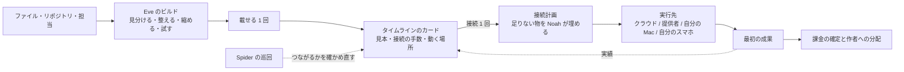

# Noah の市場 — 載せるのも、つなぐのも、1 回で終わる

2026-11-20。出典は 11-20 の本人指示、議事録の決定（10-07・10-10・11-15・11-18。[07](structure/07-decisions-from-minutes.md)）、main `37ef2bf` のコードと設計書。役割は [04](structure/04-eve-noa-amc-sky.md)。「提案」と書いた所は本人確認待ち。数値は候補で、決めるのは本人。

## 1. 誰のために作るか

利用者像は 11-15 と同じくかいや。「めんどくさい！好きなこと以外やりたくない」。受入条件は 2 つ:

- **使う人**: タイムラインのカードで「接続」を 1 回押す。それ以外に何もしなくても、最初の成果が出る。
- **作る人**: ファイルを 1 つ落として「載せる」を 1 回押す。それ以外に何も書かなくても、他の人が上の 1 回でつなげる状態で並ぶ。

10-07 に決めた「X のタイムラインのようにエージェントが流れてきて、タップして『接続』を押すと接続される」「より接続しやすく、より解約しやすく」「その後、開発者が入りやすいビルドを作る」を、売り買いまで含めて形にする。

| 原則 | 意味 |
| --- | --- |
| 準備は裏でやる | 実行環境・モデル・依存・接続先への登録は Noah と Eve が用意する。本人に導入や設定をさせない |
| 聞くのは許可だけ | 本人に求めてよいのは「はい」の 1 タップまで。入力・貼り付け・導入が残る Agent には「1 クリック」の印を出さない |
| 約束は試してから出す | 印は、何も入っていない環境で 1 クリック接続を実際に再現して通った版にだけ付ける |
| 払うのはつながってから | 有料でも、接続の確認が通るまで課金を確定しない |
| 場所は黙って変えない | どこで動くかは接続の時に見せて固定する。使えなくなったら理由を見せ、本人が選び直す |

## 2. 現状（2026-11-19 の main）

### 2.1 手数を数える

| 誰が | 今やること | 数 |
| --- | --- | --- |
| 初めて使う人 | アカウント登録 → Noah-Mac.zip を展開 → Node.js 24 以上・Colima・Docker CLI・Ollama・Git を入れる → `noah doctor`・`noah pair`・`noah start` → Mac を承認 → Mac を選ぶ → Agent を選ぶ → 接続 → 初回のモデル取得（qwen3:4b は 2.5GB） | 導入 5、コマンド 3、画面操作 5 以上。Apple Silicon の Mac が無い人は 1 件も動かせない |
| 載せて売る人 | /noah/agents/new（入力欄 25）→ /noah/publisher（公開仕様 24、公開操作 5、確認のチェック 5）→ 別の人の審査（7 項目、証拠 URL、根拠）→ /noah/sell（受取先の登録、入力欄 5） | 4 画面、入力欄 59（任意を含む） |

部品は多い。登録、下書き、リポジトリ取込、整理、公開仕様、審査、Stripe の購入と分配、利用権の判定、Mac runner、13 件の固定 adapter。それでも、**作者と別の人が、公開の Noah で「載せる → つなぐ → 動かす → 払う」を通した記録は無い**（ローカルの API と実コンテナでは接続 → 実行 → 停止を確認済み。README と CHANGELOG の受入範囲による）。足りないのは部品ではなく、準備無しで通れる一本道。

「接続」のボタンだけを 1 クリックにしても、その手前に 13 手以上あれば何も変わらない。**1 クリックは、初めての人がカードを見た所から数える。**

### 2.2 指示ごとの現在地

| 11-20 の指示 | あるもの | 無いもの |
| --- | --- | --- |
| 売り買い | Package と審査、円建て買い切りの Stripe Checkout / Connect、手数料の計算、購入済みの版だけ配布・実行する判定（`authorizedNoahRelease`） | Agent のカードから買う導線（/noah/marketplace は旧 Tool 画面の再利用。/noah/launch の一覧は無料の公開版だけ）。従量。直した版を購入者が使う権利 |
| 利用者の Agent を載せる | 下書き、ファイル・貼付・ZIP・GitHub / Hugging Face 取込、公開仕様、別権限の審査 | 自動入力。作者の入力欄 59 がそのまま残っている |
| 1 クリック接続 | 本人の Mac への接続と停止（runner）、利用許可の保存（`sky_connections`）、1 タップ接続の設計（[sky-identity-connection.md](sky-identity-connection.md)）、Connection Passport（PC Connector） | 準備の要らない実行先。つなぐ前に「何が足りないか」を出す仕組み |
| 登録の手間 | パスキー、端末の承認、サービス設定の再利用（`sky_provider_connections`）、必要条件の文章表示（`AGENT_REQUIREMENTS`） | 必要条件の機械可読な宣言。事前登録無しの OAuth。提供者側の会員登録を不要にする利用権の受け渡し（設計のみ: [sky-commerce-design.md](sky-commerce-design.md) §11） |
| アップ時のリファクタ | JS/TS の構文整理。固定テスト付きの si 整理（ローカルの Mac host だけ） | 公開側からの実行。「つながる形」への変換 |
| モバイル用の圧縮 | Pixel の動的追加（単一 GGUF と宣言型 Agent）、固定モデル 3 版 | 載せた Agent からスマホ内版を作る工程すべて |
| Eve でビルド | 会話から担当を作って保存（`eve-agent-composer`）、由来の記録（`eve-agent-origin`） | 担当を載せる経路。ファイルからのビルド |

## 3. 一周

## 4. 設計

### 4.1 接続の手数

登録や準備を「誰が埋められるか」で 3 段に分ける。これが登録を減らす作業の物差しになる。

| 段 | 誰が埋めるか | 例 | 扱い |
| --- | --- | --- | --- |
| 自動 | Noah | 無料の利用権、クラウドの実行環境、依存の導入、モデル、前につないだ外部サービス | 本人には見せるだけ |
| 1 タップ | 本人の「はい」 | パスキー、外部サービスの許可（OAuth）、保存済みの支払い方法での購入、外部への書き込みを伴う権限 | 接続のシートに順に出す |
| 入力 | 本人の作業 | API キーの貼り付け、アプリの導入、提供者サイトでの会員登録 | 「1 クリック」の印を出さない。ビルドで上の段へ落とす対象 |

- **接続の手数** ＝（1 タップの数、入力の数）。カードに「1 クリック」「あと 1 タップ（GitHub の許可）」「準備が必要」のどれかを出す。
- 計算するのは**接続計画**（純関数）。入力は、その版の接続要件・本人の今の状態・使える実行先。出力は、段の並び・手数・選んだ実行先。計画は判断材料で、権限も利用権も与えない。接続の時にサーバーが全部を検査し直す。
- **接続要件**は公開仕様の sidecar `noah-connect/1` に書く。`sky-tool-package/1` は鍵の完全一致と hash を持つので変えない（[sky-commerce-design.md](sky-commerce-design.md) §11 の `sky-paid-access/1` と同じやり方）。中身は、動かせる場所、モデルの使い方、通信先、外部サービス、権限、依存する他の Agent・Tool、見本の入力。
- 権限が「入力を読む・成果を保存する」だけの無料 Agent は、接続のクリック自体を同意として扱う。ボタンの下に 1 行で、読むもの・動く場所・料金を出す。外部への書き込みと金融の権限は、今の決まりどおり実行の直前に個別確認する。
- 契約は [services/noah-one-click-connect.md](services/noah-one-click-connect.md)。

### 4.2 「接続」を押した後

| 順 | 起きること | 使う既存の実装 |
| --- | --- | --- |
| 1 | 未サインインなら、その場でパスキー。終わったら押した操作へ自動で戻る | `returnTo`、`rockstar-account` |
| 2 | 接続計画を計算し直し、利用権を確かめる（無料はそのまま通る。有料は 4.6） | `noah_instances`、`sky_connections`、`authorizedNoahRelease` |
| 3 | 実行先を決めて準備し、疎通を実測する | runner の connect（`noah_runner_commands`）と同じ契約 |
| 4 | Connection Passport を保存し、ボタンを「頼む」に変える | Passport の形は PC Connector の物にならう。「頼む」の表示は [sky-identity-connection.md](sky-identity-connection.md) のとおり |
| 5 | 見本の入力があれば、そのまま最初の成果を出す | Work |

つながりやすくするための工夫:

- **見本**。公開前の接続試験で実際に出た入力と成果を、カードに載せる。つなぐ前に何が返るか分かる。
- **まとめて接続**。Agent が他の Tool・Agent を使うなら、依存を 1 回の接続でまとめてつなぐ。同意も 1 画面。
- **0 クリック（提案）**。Eve が仕事の途中で「この能力が無い」と分かった時（`sky-recipe-planner` の gap）、条件を満たす Agent を自分でつなぐ。条件の候補は、無料、権限は入力の読取と成果の保存だけ、接続証明あり。つないだ物は一覧に残り、1 タップで切れる。11-15 の「組合せを人間が考えるのは嫌」をここへつなぐ。
- **切るのも 1 タップ**。切った後は新しい実行を止め、成果と費用の記録は残す（既存の決まり）。
- **登録の後回し**。復旧コードの保存は最初の成果の後に出す。受取先の登録は初めて有料で売る時に出す。

### 4.3 準備の要らない実行先

今は本人の Mac でしか動かない。これが 2.1 の手数の原因。実行先を 4 つにし、準備の要らない順に選ぶ。

| 場所 | 本人の準備 | 向く物 | 状態 |
| --- | --- | --- | --- |
| クラウド（Noah が用意） | 無し | コードの Agent、担当 | **新規。既定にする（提案）** |
| 提供者のサーバー | 無し | MCP・A2A・Web で提供される Agent | A2A 1.0 の client あり。事前登録無しの OAuth は新規 |
| 自分の Mac | runner の導入と承認 | 手元のデータ、ローカルモデル、費用 0 | 実装済み。導入を 1 つにまとめる |
| 自分のスマホ（Pixel） | client へのサインイン | スマホ内版（4.5） | 宣言型 Agent と GGUF の実行は実装済み |

クラウドの作り:

- 実行の契約は今の `noah-terminal/1`（1 行ずつの JSON。モデルは host が渡す）と `noah-isolation/1`（本人の画面・ファイル・ブラウザに触れない）をそのまま使う。置き場所が Mac の VM からクラウドの VM に変わるだけ。Mac の runner と同じ「取りに来る・lease・停止確認」の手順で動かす。
- 候補は Cloudflare Sandbox（Containers の上。1 sandbox が 1 VM）。[cloud-agent-provider-comparison-20261001.md](cloud-agent-provider-comparison-20261001.md) が実行の候補に挙げた物と同じ。置き方は [services/noah-cloud-operation.md](services/noah-cloud-operation.md) の専用 Worker と同じ。
- 外向きの通信は全閉から始め、接続要件に宣言した host だけ開ける。鍵は sandbox に入れず、外向きの中継で付ける（Sandbox の outbound handler）。「認証情報は実行 container へ渡さない」（[services/noah-standalone-launch.md](services/noah-standalone-launch.md)）を保つ。
- モデルは今と同じく中継で渡す。Agent は API キーを持たない。OpenAI 互換の呼び出しを直接書いたコードは、sandbox の外向き中継で受けて同じ中継へ流す。受けられる時はコードを変えない。受けられない実行環境では、ビルドで呼び出し先を付け替える。
- 費用は 6 章。**1 回およそ 0.1 セント、上限いっぱいの重い仕事で約 1 セント。**
- 契約は [services/noah-cloud-place.md](services/noah-cloud-place.md)。

Mac の導入を 1 つにまとめる（後の task）: Node を同梱する。コンテナは macOS 26 の Apple container（2026-06 に 1.0）を使い、Colima と Docker CLI を外す。モデルは接続の後に裏で取得する。承認は `noah pair` の URL を開く形から、ブラウザの「この Mac をつなぐ」で app が開く形にする。

### 4.4 載せる — Eve のビルド

作者が書く欄を 0 にする。Eve がファイルを読み、下の 7 段を進め、作者は結果を見て「載せる」を押す。

| 段 | やること | 動く所 | 通る条件 |
| --- | --- | --- | --- |
| 1 受け取る | ファイル・貼付・ZIP・リポジトリの URL・Eve の担当・接続先の URL | Web | 既存の上限内。権利の確認 1 回 |
| 2 見分ける | 種類、言語、入口、依存、モデルの呼び方、通信先、要る鍵、ライセンス、説明文を読み取る | Web | 実行しない。読み取った内容は全部、直せる下書き |
| 3 整える | つながる形へ直す（下の表） | 隔離環境 | 変更の前後で同じ固定テストが通る |
| 4 縮める | スマホ内版を作る（4.5） | 隔離環境 | 予算内で、固定テストが通る |
| 5 試す | 何も入っていない環境で、初めての人の接続を再現する | 隔離環境 | 接続の手数・秒数・通信先を測り、宣言と一致する |
| 6 確かめる | 鍵の混入、権限と通信先の宣言との差、ライセンス、既知の危険 | Web（Spider） | 不一致 0 |
| 7 載せる | 公開仕様・カード・価格 | Web | 無料かつコード公開は即時。それ以外は人の審査 |

**整える**は、書き方をきれいにする事ではなく、利用者の登録と準備を消す事。

| 対象 | そのまま載せた時に利用者に起きること | 直した後 |
| --- | --- | --- |
| モデルの呼び出し | 作者か利用者の API キーが要る。利用者はモデル提供元へ登録する | 中継へ付け替える。キーも登録も要らない |
| 鍵・パスワード | コードに直書きされた物が配られる | 載せる前に止める。必要な鍵は接続要件の「外部サービス」へ出す |
| 依存 | 利用者の環境で毎回入れる | 版を固定し、ビルドの時に 1 回入れた層を使い回す |
| 入口 | 作者ごとに起動方法が違う | `noah-terminal/1` の入口を足す。元の入口は残す |
| テスト | 無い。動くか分からない | README の例から固定テストの案を作り、作者が期待値を確かめる |
| 書き方 | — | 既存の構文整理（実装済み） |

- 原本は変えない。直した物は別の版として保存し、いつでも原本へ戻せる（既存の決まり）。
- 各変更は、変更の前後で同じ固定テストが通った時だけ採る。差分は作者に見せ、作者が採否を決める。si の出力だけで合格にしない。
- Eve が読み取った内容で、`noah-agent/1`・`sky-tool-package/1`・`noah-connect/1` を下書きする。作者は直したい所だけ直す。
- 段 5 の結果が**接続証明**。版の hash に結び、実行先ごとの手数・最初の成果までの秒数・使ったメモリ・実際の通信先・見本を持つ。「1 クリック」の印はこれが通った版だけ。
- 公開後は Spider が同じ試験を巡回でやり直す。通らなくなった版は印を外し、作者へ知らせる。
- 審査は 10-10 の決定どおり 2 段。**無料かつコード公開**は機械審査が通れば載る。**有料またはコード非公開**は、作者の名前（会社名）と所在地の確認と、人の審査。人が見るのは機械審査の報告と差分。自己承認は不可（現行）。
- **コードを見せない売り方**（10-10「コードの公開は求めない」）。作者が動かす場所を選ぶ。「クラウドだけ」ならコードは利用者へ渡らない。「端末でも動かす」なら利用者の端末にコードが入る。今の公開操作にある「購入者へコードを配布する」の確認は後者だけに出す。
- **作者の引き取り**。公開ソースから載った Agent（調査一覧 85 件、発見した候補）は、元の作者が GitHub の認可で持ち主だと示せば 1 タップで引き取れる。10-10「オープンの人が報酬をもらえる仕組み」の入口。引き取るまでは無料のままにし、お金を発生させない。
- 契約は [services/eve-agent-build.md](services/eve-agent-build.md)。

### 4.5 スマホ内版（圧縮）

「スマホで使える」には 2 つある。

| | 意味 | いつ |
| --- | --- | --- |
| スマホから使う | 画面はスマホ、実行はクラウドか Mac | クラウドの実行先ができた時点で全部の Agent |
| スマホの中で動く | Pixel の中で、通信が無くても動く | 圧縮して作る。ここで決める |

Pixel の中で動かせる物は決まっている（[llm-evaluation-architecture.md](llm-evaluation-architecture.md) の動的追加）。圧縮の的はこの予算。

| 予算 | 値 |
| --- | --- |
| 形式 | 宣言型だけ。`rock-sky-agent/1`（文章）、`rock-sky-agent/2`（Tool 付き）。任意のコードは動かさない |
| モデル | 単一 GGUF、4GiB 以下、Apache-2.0 / MIT / BSD-3-Clause。Q4_K_M なら約 7B パラメータまで（8B は 4.57GiB で入らない） |
| 指示 | 指示と依頼の合計で 2KB 以内 |
| Tool | 端末内 adapter を 1〜2 個、順序固定、追加権限なし（今は `citations@1`、`free-article@1`） |
| 出力 | 最大 512 トークン、計画 180 秒 |

| 縮める物 | やり方 | 判定 |
| --- | --- | --- |
| 指示 | 元の指示とコード内のプロンプトを、予算内の短い指示へ書き直す | 同じ固定テストを小さいモデルで実行し、元と同じ合否 |
| モデル | 固定版の中で、テストが通る最小の物を選ぶ（1.5B → 4B の順）。作者が持ち込んだモデルは Q4_K_M の GGUF へ変換する（次の段階） | 同上。端末の空き容量とメモリに収まる |
| Tool | 端末内 adapter に対応する物だけ残す。無い物は、通信がある時だけ account 経由で呼ぶ | 通信無しで動く範囲を表示する |
| コード | プロンプトと順序だけで表せる処理を、宣言型へ移す。表せない処理は移さない | 移せない時はスマホ内版を作らない |

- スマホ内版は、元から派生した別の成果物として保存する（別 hash、`derivedFrom`。モデル catalog の派生と同じ）。元の版は変えない。
- 出力は既存の `rock-sky-agent/1`・`/2` の定義なので、Pixel 側の追加・同意・失効の経路をそのまま使える。
- 表示は 2 段。「スマホ内版あり（実機未確認）」→ 検証用の Pixel で実行が通った後に「スマホの中で動く」。検証用の Pixel を 1 台つないでおけば、段 5 の接続試験と同じ流れで自動にできる。
- 作れなかった Agent は「スマホから使う」のまま出す。作れた事にしない。
- 契約は [services/noah-mobile-variant.md](services/noah-mobile-variant.md)。

### 4.6 売り買い

| 型 | 今 | 今回 |
| --- | --- | --- |
| 無料 | あり | 既定 |
| 買い切り | Stripe Checkout / Connect、50 円〜 | 試用 → 仮売上 → 接続の確認 → 確定。2 回目からは保存済みの支払い方法で 1 タップ |
| 従量 | 料金方式の選択肢だけ（市場の決済は準備中） | 1 回あたりの作者価格＋si 使用料。月の上限は本人が決め、しきい値後払い（既存の方針）。クラウドの実行先の後 |

- **試用**。作者が無料で動かせる回数を決める（候補: 既定 3 回）。クラウドと提供者のサーバーではコードが利用者へ渡らないので、払う前に試せる。
- **つながってから払う**。買い切りは仮売上で止め、接続の確認が通ってから確定する。通らなければ仮売上を取り消す。
- **直した版を使う権利**。今は注文が版の hash に固定され、作者が直した版を出すと購入者は使えない。販売条件に「同じ系列の更新を含む／この版のみ」を足す。既定は「含む」（提案）。
- **手数料と上乗せは変えない**。売上手数料 10%、従量の粗利が固定費を 3 か月続けて上回ったら 0（10-10 確定、`lib/sky-marketplace-policy.ts`）。si 使用料は実費＋30%、しきい値 1,000 円の後払い（[product-baseline.md](product-baseline.md)）。数字を変えるのは本人。
- **並び順につながりやすさを入れる（提案）**。接続の成功率、最初の成果までの秒数、検収の合格率を実測で使う。人気と売上は入れない（今のおすすめの決まりのまま）。つながらない Agent は自然に下がる。
- **評価**は、実際に 1 回以上動かした人だけが書ける。
- 契約は [services/noah-agent-purchase.md](services/noah-agent-purchase.md)。

### 4.7 登録の棚卸し

| 登録 | 今 | 直した後 | 段 |
| --- | --- | --- | --- |
| アカウント | 別画面でパスキーか ID＋15 文字以上のパスワード。復旧コードの保存 | 「接続」を押した場でパスキー 1 回。復旧コードは最初の成果の後 | 1 タップ（初回だけ） |
| 実行先 | Mac に 5 つ導入、コマンド 3 つ、承認 | クラウドが既定。Mac は 1 つのインストーラー | 自動 |
| モデル | 初回に 1〜2.5GB を取得 | クラウドは不要。端末は接続の後に裏で取得 | 自動 |
| API キー | 利用者が用意して貼る | モデルは中継。それ以外の鍵は作者側の中継か外部サービスの許可へ | 自動 / 1 タップ |
| 外部サービス | Agent ごとに設定 | 最初の 1 回だけ許可。次の Agent からは再利用し、使わせるかの同意は接続の画面に含める | 1 タップ → 自動 |
| 提供者サイトの会員登録 | 提供者ごとに登録 | Noah が出す利用権を提供者が確かめる。会員登録は不要。SDK に数行で入る受け口を足す | 自動 |
| 支払い方法 | 買うたびに Stripe の画面 | 最初の 1 回だけ入力。試用の後、初めて払う時まで出さない | 入力（初回だけ）→ 1 タップ |
| 権限の同意 | Agent ごと | 接続のクリックに含める。差分がある更新の時だけ聞き直す | 自動 / 1 タップ |
| Agent の登録・公開仕様 | 入力欄 49、確認 5 | Eve が下書き。確認 1 回 | 1 タップ |
| 審査 | 別の人が手で 7 項目 | 機械審査。人は有料・非公開だけ | 自動 |
| 受取先（Stripe） | 売る前に必ず | 初めて有料で売る時だけ。無料なら不要 | 入力（1 回） |
| 開発者キー（SDK） | 発行して環境変数へ貼る | 端末承認で自動保存する `noah login`（新規） | 1 タップ |
| 自分の OSS の登録 | 一から登録 | 既に載っている物を引き取る | 1 タップ |

### 4.8 Eve と中の役割

Eve は公開の窓口で、中の構造（Eve → Noa → AMC → Jev）は変えない。

| 役割 | この市場でやること |
| --- | --- |
| Eve | 話して担当を作る。ファイルからのビルドの窓口。「Noah に載せる」「Eve で改良する」 |
| Noa | 接続計画。依存と実行先を選ぶ。0 クリックの時は Noah を探してつなぐ |
| AMC | ビルドの 7 段を進める。ビルドは 1 件の Work |
| Jev | 固定テスト、接続試験、スマホ内版の合否 |
| Spider | 機械審査と、公開後の巡回 |
| Broker | 権限・予算・鍵の中継 |
| Wallet | 仮売上、確定、従量の明細、分配 |

Eve で作った担当は、指示・モデル・使う Tool だけでできている（コードが無い）。審査が軽く、クラウドでもスマホの中でも動く。**最初の出品はここから増やす。**

## 5. 外の標準との関係

| 標準 | 今の版（2026-11） | リポの対応 | 使い方 |
| --- | --- | --- | --- |
| MCP | 2026-07-28。session と `initialize` の往復を廃止（stateless）、`server/discover` を追加。client の登録は Client ID Metadata Document を推奨し、動的登録（DCR）は非推奨 | 2025-11-25 まで（`initialize` → `tools/list` の検査）。OAuth の client は未実装 | Noah の client 文書を 1 つ公開する。対応する接続先には、事前登録無しで認可画面へ進める。新版だけの接続先は今の検査では読めないので、両方の版に対応する |
| A2A | 1.0。`/.well-known/agent-card.json`、署名付き Agent Card（JWS） | 1.0 の JSON-RPC client あり。署名の検証は未実装 | 提供者サーバー型の取込。クラウドで動かす Agent に接続口を自動で付ける（後の段階） |
| Agent Skills | `SKILL.md` の folder（agentskills.io の公開仕様） | 未対応 | 担当の取込形式に足す |
| MCPB | 1 ファイルの bundle。設定項目を宣言すると host が画面を出す | 未対応 | 接続要件の書き方の参考。取込形式に足す |
| Android の端末内モデル（AICore） | 前面のアプリ限定、アプリごとの回数制限 | 自前の GGUF 実行 | 今の方針のまま |

## 6. 数字で見た前提

公開価格は 2026-11-20 に取得した定価（税・地域差・ログ・通信量を除く）。契約の前に取り直す。

| 項目 | 値 |
| --- | --- |
| Cloudflare Containers（Workers Paid、月 $5） | CPU $0.000020 / vCPU 秒（動いた分）、メモリ $0.0000025 / GiB 秒、ディスク $0.00000007 / GB 秒 |
| Workers AI の例（qwen3-30b-a3b-fp8） | 入力 $0.051、出力 $0.335（100 万トークンあたり） |

| 仕事の大きさ | 箱 | モデル | 合計 |
| --- | --- | --- | --- |
| ふつう（basic: 1/4 vCPU・1GiB、60 秒、入力 3,000・出力 1,000 トークン） | $0.00047 | $0.00049 | **約 $0.001** |
| 上限いっぱい（standard-2: 1 vCPU・6GiB、240 秒、入力 32,000・出力 2,048 トークン） | $0.0086 | $0.0023 | **約 $0.011** |

- 月 $5 の中に、basic の 60 秒が約 1,500 回入る（箱の分。モデルは別）。
- 100 人が 1 日 10 回、30 日使うと 30,000 回。ふつうの仕事で約 $29、全部が上限いっぱいでも約 $328。
- 上の「上限いっぱい」は今の制限（240 秒、モデル呼び出し 8 回、出力 2,048 トークン、`noah-execution-contract.mjs`）から置いた。箱の種類は実測で決める。
- 11-16 に「クラウドと予算は未決定」とした点は、この桁なら小さい上限額を置いて始められる。

## 7. 作る順番

一周が閉じる順に作る。各 task は 1 PR。

| 段階 | 閉じる一周 | task |
| --- | --- | --- |
| 1 つなぐ | 初めての人が、無料の Agent を 1 クリックでつなぎ、クラウドで最初の成果を受け取る | [73](../codex/tasks/73-noah-connect-plan.md) 接続要件と接続計画、[74](../codex/tasks/74-noah-one-click-connect.md) 1 クリック接続、[75](../codex/tasks/75-noah-cloud-place.md) クラウドの実行先 |
| 2 載せる | 作者がファイルを落として 1 回で載せ、別の人が段階 1 の形でつなぐ | [76](../codex/tasks/76-eve-build-autofill.md) 自動入力と 1 画面、[77](../codex/tasks/77-eve-build-normalize.md) 整える・接続試験・機械審査、[80](../codex/tasks/80-eve-to-noah.md) 担当を載せる・0 クリック |
| 3 払う | 有料の Agent を試し、つながってから払い、作者へ分配される | [78](../codex/tasks/78-noah-agent-purchase.md) 売り買い |
| 4 広げる | スマホの中、提供者のサーバー、自分の Mac | [79](../codex/tasks/79-noah-mobile-variant.md) スマホ内版、[81](../codex/tasks/81-noah-connect-patrol.md) 巡回・並び順・引き取り、[82](../codex/tasks/82-noah-provider-place.md) 提供者サーバー型、[83](../codex/tasks/83-noah-mac-installer.md) Mac の導入 |

73 はクラウドが無くても始められる。今ある Agent 全部の「接続の手数」がカードに出て、どこが長いかが見える。75 は契約と上限額に本人の許可が要る。

変えないもの: Eve → Noa → AMC → Jev の構造。Broker と Wallet の gate。API path・D1 table・enum の既存名。価格と料率。原本を変えない決まり。本番の migration・本番の決済鍵・外部との契約は本人の明示許可の後。

## 8. 測る値

- 初めての人の接続の手数（中央値）。目標: 1 タップ以下、入力 0。
- カードを見てから最初の成果までの秒数。目標: 30 秒以内（候補）。
- 接続の段ごとの到達数と完了数（どこでやめたか。依頼の本文は記録しない）。
- 作者が載せるまでに書いた欄の数。目標: 0。
- 「1 クリック」の印が付いた版の割合と、巡回での合格率。
- 作者と別の人が一周を通した回数。今は記録の上で 0。

機能の数、Agent の掲載数だけでは測らない。

## 9. 本人が決めること

1. クラウドの実行先を始めるか。始めるなら月の上限額（提案: 始める。候補 $30）。
2. 無料で動かせる回数（候補: 1 人 1 日 10 回）。
3. クラウドのモデルの出どころ。Workers AI の従量、今の無料 Cloud（Pollinations。best effort）、自前の GPU のどれから始めるか。
4. 0 クリック（Eve が自分でつなぐ）を、4.2 の条件に限って最初からオンにするか（提案: オン）。
5. 無料かつコード公開の Agent を、機械審査だけで載せるか（10-10 の決定の確認）。人の審査の担当は誰か。
6. 直した版を使う権利の既定を「含む」にするか。
7. 並び順に接続の実測を入れるか。
8. 検証用の Pixel を 1 台、常時つないでおくか。
9. iPhone は「スマホから使う」だけにするか。
10. 10-10 の「作る人：使う人＝9：1」は、分配の比（作者 9・運営 1。今の手数料 10% と同じ）か、人数の比か。
11. Stripe の sandbox での受入をいつやるか（本人の Stripe アカウントが要る）。

## 10. 専門家に確認すること（確認していない）

特定商取引法の表示（有料で売る作者）、取引デジタルプラットフォーム消費者保護法、従量をまとめて請求して作者へ分ける形と資金決済の関係、消費税とインボイス、作者・利用者それぞれの利用規約、他人の公開コードを載せる時のライセンスと作者表示、NY の LLC が日本で売る時の表示。

## 11. 根拠

- コード: `components/noah-mac-handoff.tsx`、`scripts/noah-mac-runner.mjs`、`components/noah-agent-upload-form.tsx`、`components/noah-publication-form.tsx`、`components/noah-publisher.tsx`、`components/noah-review.tsx`、`components/sky-commerce.tsx`、`lib/noah-launch.ts`、`lib/noah-release.ts`、`lib/noah-instances.ts`、`lib/noah-terminal-contract.mjs`、`lib/noah-execution-contract.mjs`、`lib/noah-model-catalog.mjs`、`lib/sky-tool-package.ts`、`lib/sky-agent-library.ts`、`lib/sky-marketplace-policy.ts`、`lib/a2a-client.ts`、`lib/mcp-inspection.ts`。
- 設計書: [sky-identity-connection.md](sky-identity-connection.md)、[sky-mcp-architecture.md](sky-mcp-architecture.md)、[sky-network-economy.md](sky-network-economy.md)、[sky-tool-sdk.md](sky-tool-sdk.md)、[sky-launch-design.md](sky-launch-design.md)、[sky-work-loop.md](sky-work-loop.md)、[services/](services/) の既存の Noah 17 枚。
- 外の資料（2026-11-20 取得）: [MCP 2026-07-28 の変更点](https://modelcontextprotocol.io/specification/2026-07-28/changelog)、[同 Client Registration](https://modelcontextprotocol.io/specification/2026-07-28/basic/authorization/client-registration)、[A2A v1.0 の解説（AAIF）](https://aaif.io/blog/a2a-v1-0-a-builder-s-guide-part-2-migration-security-and-production)、[MCPB](https://claude.com/docs/connectors/building/mcpb)、[Cloudflare Containers の料金](https://developers.cloudflare.com/containers/platform/pricing/)、[Sandbox の外向き通信](https://developers.cloudflare.com/sandbox/sdk/guides/outbound-traffic/)、[Sandbox の隔離](https://developers.cloudflare.com/sandbox/sdk/concepts/security/)、[Workers AI の料金](https://developers.cloudflare.com/workers-ai/platform/pricing/)、[llama.cpp の量子化](https://mintlify.com/ggml-org/llama.cpp/concepts/quantization)、[ML Kit GenAI](https://developers.google.com/ml-kit/genai)、[Apple container 1.0](https://cloudnativenow.com/features/apple-ships-stable-1-0-of-its-native-container-tool-for-macos/)。
