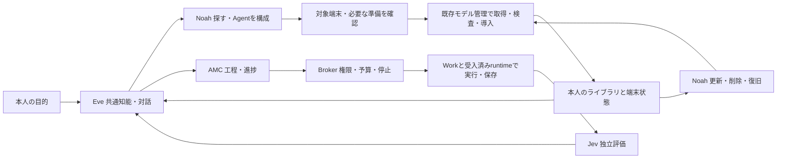

# Noah — Agent・LLMストアと端末管理

版: 0.4 / 更新: 2026-11-02 / 状態: 実装に渡す設計。新規実装・端末導入・配備は未実施。

**NoahでAgentやLLMを見つけ、自分の端末へ追加し、Eveで使い、更新・削除まで管理する。** Noahはさらに、Eveの共通知能に役割・専門知識・記憶・Toolを組み合わせて、自分用のAgentを構成する。

本人の今回のストア設計指示と、指定された[Eve・仕事と編集のチャット](codex://threads/01a19abe-6bc5-7081-bc12-446a83a225ed)の「Eveは共通知能」「NoahがAgentを組み立てる」「Skyはない」を適用する。**独立したSky製品・system・ストアを設けない。ストアはNoahの中の機能。** `sky`系path、schema、API、task IDは既存データとの互換識別子として再利用する。Eve側の設計で未追加だった公開catalogの機能は、今回の明示指示でNoah内の到達仕様へ追加する。公開・販売・モデルdownloadの実行許可をこの設計依頼から推測しない。

本書は[Noah全体設計](noah-connection-sharing-design.md)の端末導入章であり、[既存モデル管理](ai-native-os-architecture.md#ai-model-management)と[LLM・評価設計](llm-evaluation-architecture.md)を入口から結ぶ。[機械可読契約](../data/noah-agent-model-store-design.json)。v0.3の[限定投稿・下書き・招待のDB/API](noah-connection-sharing-contracts.md)は保持する。

## 1. 目的と対象

利用者は、用途に合うAgent/LLMを探す人、自分のAgentを構成する人、版付きのAgent/モデルを提供する作者。App Storeのように一覧・詳細・追加・管理を一つの入口へまとめる。利用者は内部の役割名やmanifestを理解しなくても、何が入り、どこで動き、何にアクセスし、いくらかかるかを確認できる。

| 種類 | 「追加」で取得するもの | 実行する場所と条件 |
| --- | --- | --- |
| Agent構成 | 役割、指示、Eveのmodel profile参照、必要なTool・知識・記憶scope・完了条件の版付き定義 | 本人の設定へ複製し、必要なモデル/Toolを準備。共有元の鍵・個人の記憶・予算はコピーしない |
| 端末内LLM | 互換runtimeで読める固定版のweights/tokenizer/template等 | 選んだ端末。実取得・hash・load/資源確認を経て使う |
| クラウドLLM | 選んだprovider/modelと利用条件への接続設定 | 表示した外部実行先。モデル本体を端末へ入れたとは表示しない |
| Tool/Agent実行パッケージ | 既存Package/Registryで検証できる能力・依存・署名・権限の宣言 | 受入済みadapterのみ。未対応コードをAgent設定へ混ぜて実行しない |

EveはAgent共通の知能という製品上の役割で、モデル選択はその実装profileを選ぶ操作。全Agentごとにweightsを複製・学習する前提にしない。Eve Adapt/Baseの学習候補は、品質と配布条件の受入前に「使えるモデル」として公開しない。

初期の実装対象は本人Pixel 10 GL066/frankel内Linuxの対応文章用GGUFとデータ形式のAgent構成。Mac/別Linux、Android固定profile、native OS、browser/PWA、外部Cloudは実行adapterごとに適合を判定する。browserを開けることを端末内推論対応と同一にしない。iPhoneや他機種での本体導入、画像/音声モデル、任意コンテナ/作者実行コードは個別の受入条件を持つ。

## 2. 画面と利用体験

Noahの主導線を **「探す」「Agentを作る」「ライブラリ」「端末・更新」** とする。投稿/コミュニティーは「探す」から継続して使え、投稿に付いたAgent・モデルを同じ詳細画面へ開く。新しい独立サービスへ遷移させない。Eveから「この仕事に必要な担当を追加」も同じNoah画面を開き、元の依頼/下書きを保持する。

| 画面 | 利用者の操作 | 必ず示すこと |
| --- | --- | --- |
| 探す | 用途、Agent/LLM、端末内/Cloud、言語、対応端末、費用で絞込 | 検証範囲、作者、更新、容量。未確認の性能や人気を捏造しない |
| 商品詳細 | 機能・条件を確認し、ライブラリへ追加/端末を選ぶ | 版、配布元、license、依存、必要RAM/空き容量、追加download量、権限、外部送信、商品代/利用料/実費の内訳 |
| Agentを作る | 目的・役割・知識参照・記憶scope・モデル・Tool・実行先を選ぶ | Eveの提案をNoahが実在する能力と照合。本人の確認後に構成版を保存 |
| 導入確認 | 「Pixelに入れる」等、実際の対象名を確認する | 本体取得/再利用/未対応、依存も含む総容量、必要な準備と変更される権限 |
| 準備状況 | 取得、確認、動作確認、取消、再開を選ぶ | 実byte進捗と現在の工程。登録だけで「利用可能」にしない |
| ライブラリ | 追加済みAgent/LLMを選ぶ、Eveで使う | この端末に入っている/別端末にある/Cloudで使う/未準備を別表示 |
| 端末・更新 | 対象端末、更新差分、前版へ戻す、削除 | 実行中の仕事、依存Agent、削除範囲、保持する成果/旧版容量 |

代表体験は「資料整理Agentを探す→Pixelを選ぶ→必要な文章LLMを一緒に準備→Eveへ資料と依頼を戻す→同じ仕事で成果を編集→Agent/LLMを更新→端末から削除しても成果を読む」。資料は端末導入用manifestやcatalogへ入れない。Agent作成/モデル取得だけでは推論や有料仕事を始めない。

標準導線は `探す → 詳細 → この端末に追加 → 準備 → Eveで使う`。Cloudは「Cloudで使う」と表示し、端末への追加ボタンを偽装しない。未対応端末では理由と対応候補を示すが、自動でCloudへ送信しない。

## 3. Eve・Noah・OSと担当

| 担当 | 責任 | 渡す情報 |
| --- | --- | --- |
| Eve / ROCK | 共通推論、目的/制約理解、構成候補、実結果の説明 | 目的、期待成果、必要能力。モデル出力は候補 |
| Noah / ROCK | ストア、Agent構成、互換照合、本人ライブラリ、対象端末への導入/更新/削除の管理 | 固定Agent版、model/Tool/runtime pin、導入計画と不足 |
| 既存モデル管理・runtime / ROCK | private staging、取得検査、load/資源確認、activation、停止、回収 | 端末本人性に束縛した操作記録と実状態 |
| AMC / ROCK | 同じ仕事の工程・担当・順序・合格条件 | 既存Job/step、次の有限操作 |
| Broker・Work / ROCK | owner・権限・予算の強制、実行、保存/編集/停止 | 実receipt、Artifactの版、費用/未確認事項 |
| Jev / ROCK・JOINT | 成果の独立評価 | 合格/修正点。本人許可や課金を代行しない |
| 作者・provider / EXTERNAL | 版付き配布物、license、互換/資源宣言、外部処理条件 | 実検証が必要な宣言。署名は安全保証ではない |
| 利用者 / OWNER | 対象端末、導入、情報利用、権限、費用、更新差分、削除範囲 | 具体的な操作への確認。利用中の同じ承認を無用に聞き直さない |

主担当はNoah / MCPのROCK（既存workstream pathは`02-sky-mcp.md`）。既存task SKY21/14/15/20、AI02/05、OS10、HOME01/WEB04へ結び、新しい重複task系列は作らない。従来のtask題名にあるSkyは互換・履歴名であり、独立製品の存続や全task完了を表さない。

## 4. 入出力・版・既存実装への接続

### 4.1 正本を再利用する

| 対象 | 既存の正本・source | v0.4でつなぐ内容／不足 |
| --- | --- | --- |
| 本人Agent定義 | `sky_agent_settings`、`lib/sky-agent-library{,-store}.ts`、`/api/sky/agents` | 既存name/instructions/provider/model/enabled/revisionを保持。knowledge/memory/Tool等は別の版付き構成参照として追加し、旧strict parserへ未知fieldを詰めない |
| Agent構成候補 | PR候補の`lib/eve-agent-proposal.ts` / `eve-agent-creation.ts`、既存share/provenance | Eveは候補生成、Noahは能力照合と確認保存。ファイル名を機能担当と混同しない。Rootにない実装を導入済みとしない |
| Model profileと取得 | `android/core/src/main/java/dev/rock/core/platform/ModelProfileManifest.java` / `ResumableModelArtifactStager.java`、`android/automation/src/main/java/dev/rock/automation/ModelProfileActivationCoordinator.java` | manifest、hash、再開、activationを同じprofile identityへ接続。APK/host合格とOS全体受入を区別 |
| Pixel内Linux | `lib/sky-linux-models.ts`、`scripts/sky-linux-local-runtime.mjs`、`toolkits/sky-linux-local/worker.py`と既存UID別`state.json` | `sky.local-model/1` / `sky.local-agent/1`を受入済みadapterとして包む。削除GUI・汎用更新・全損復旧は既存実機合格の範囲外 |
| Package/能力registry | `lib/sky-tool-package{,-store}.ts`、`/api/sky/tool-packages` / `tool-registry`、`systems/rock-star-os/src/blackberryrock/packages.py` | 公開/審査/失効の既存判定、作者署名と互換検査を再利用。所有者一覧APIをそのまま全員向けcatalogへ開放しない |
| 実行先binding | `lib/sky-package-runtime-binding{,-store,-dispatch}.ts`、既存device/runtime command・本人認証 | 別端末/remote Agentには実在するbindingと署名・期限・scopeが必要。公開Webから私用localhostへ任意fetchしない |
| 導入済み一覧 | `/api/llm/local-models`と`lib/ollama-model-inventory.ts` | localhostの導入済みmodelを読む現API。新規download/全端末inventory APIとして扱わない |
| 仕事・成果編集 | `lib/workflow.ts`、既存work store、LLM quote/実行、Eve履歴/編集 | Agent/model版を既存Jobへpin。別の仕事DB・課金台帳を作らない |

Pixel Linuxの現行上限は8モデル/合計6GiB/単体1.5GiB、32Agent、指示1200字、依頼4000字、100仕事。現在の形式は文章GGUF、chatml/llama3、宣言RAM 2〜4GiB。これは既存adapterの上限であり、Noah全体・全端末の一律上限ではない。変更にはそのadapterの負荷/容量/失敗試験を伴う。nativeのPackage/モデル機能を未調査で作り直さない。

### 4.2 論理recordと最小追加層

既存のAgent/model/Package/本人/Jobが正本。以下の名前は実装へ渡す**補助record案**で、正式migrationをこの設計更新で作成・適用しない。旧フィールドの改名より参照と互換readerを優先する。

| record | key・必須field・条件 |
| --- | --- |
| `NoahCatalogItem`（読取りprojection） | `kind, itemId, publisherId, releaseId, manifestSha256, title, purpose, sourceRefs, licenseRef, artifactPins, dependencyPins, supportedAdapters, resourceRequirements, pricingTermsRef, reviewStatus, revokedAt`。審査済み公開元と本人専用importを区別。URLや名前だけで同一itemにしない |
| `NoahAgentComposition`（既存Agentへ結ぶ版付き補助） | `(ownerId,agentId,agentRevision)`、`role,eveProfilePin,knowledgeRefs,memoryScopeRefs,toolPins,executionPolicy,permissionRequirements,budgetPolicyRef,acceptanceCriteria,originRef`。知識/記憶は本人scope付き参照。旧Agent設定との保存/版更新を一transactionで固定 |
| `noah_library_entries`（既存D1の追加候補） | PK `(owner_id,kind,item_id)`、`revision,pinned_release,source_kind,source_ref,desired_presence,created_at,updated_at,removed_at`。Agent実体は既存Agent ID、model実体は既存profile/Package。購入/契約は既存commerceへの参照だけ。index `(owner_id,updated_at,item_id)` |
| `noah_install_plans`（既存D1の追加候補） | UUID PK、`owner_id,device_id,device_epoch,capability_digest,item_pin,dependency_lock,expected_library_revision,expected_install_generation,action,permission_diff,storage_estimate,transfer_ceiling_bytes,terms_digest,plan_digest,created_at,start_by,consumed_operation_id`。所有者/全対象/費用/期限を束縛し、開始まで最大10分、一回消費 |
| `noah_install_operations`（既存device commandの補助） | PK `(owner_id,operation_id)`、`plan_id UNIQUE,device_id,device_epoch,command_id UNIQUE,request_digest,state,stage,desired_generation,deadline,receipt_ref,error_code,created_at,updated_at`。既存command store/署名付きportへ結び、一つの命令の状態を投影。別executorを作らない |
| `noah_device_installations`（端末観測のprojection） | PK `(owner_id,device_id,kind,item_id)`、`generation,desired_presence,observed_release,observed_manifest_digest,active_slot,previous_slot,phase,last_receipt_ref,last_observed_at,device_epoch`。serverの希望状態と端末で確認した状態を分離。generation/epochの古い報告は破棄 |
| 端末journal/既存profile store | `(localOwner,deviceId,operationId)`、`requestDigest,stage,downloadIdentity,receivedBytes,verifiedHashes,activePointerBefore/After,commitMarker,resourceReservation,stopGeneration`。既存state/SQLiteに拡張。model本体はprivate artifact領域、D1には保存しない |

ownerは認証から決める。itemIdはkindと配布元を含む衝突しないcanonical IDとし、releaseIdは不変版。既存Agent/model IDをnamespace付き参照へ対応付け、異なるkindの同名商品を誤接続しない。端末key/資格・provider key・原稿・本文を上記metadataへ入れない。NoahAgentCompositionのscope参照は本人別認可に従い、一般catalog/shareへ漏らさない。単純な既存Agentには既存設定から既定の構成projectionを作るが、存在しない記憶・Tool権限を補って付与しない。

補助表はrevision/generation正数、action/stateの閉じたenum、同ownerの参照、terminal receiptの不変性をDB制約と最終transaction条件で強制する。新しい保存APIを作る時は[v0.3共通契約](noah-connection-sharing-contracts.md#noah-api-common)のstrict parser、Origin/owner認証、CAS、同operationの照合を再利用する。`noah_operation_receipts`もv0.3では設計段階なので、既に存在すると仮定しない。

### 4.3 操作APIの接続契約

新規routeはNoahの薄い制御層として提案する。単なるAdd requestがOSインストーラ・課金・実行を直接呼ばない。

| 操作 | 提案route／入出力 | 実体への接続 |
| --- | --- | --- |
| 検索/詳細 | `GET /api/noah/catalog?kind=&query=&deviceId=&cursor=`、`GET /api/noah/catalog/{itemId}?releaseId=` → 公開可能な詳細/適合理由 | 既存registry・model catalog・本人importの認可済みprojection。query上限200字、page20/最大50、owner/filterに束縛したcursor |
| 本人追加/除外 | `GET /api/noah/library`、`PUT /api/noah/library/{itemId}` `{kind,expectedRevision,releaseId,presence:added|removed}` → revision/参照 | Agentなら既存Agent追加/無効化へ結ぶ。library変更と補助recordを一transaction。元catalog item削除や端末file削除は別 |
| 構成保存 | 既存`/api/sky/agents`を互換維持、構成版の追加endpointを採番時に定義 | 旧settings parserを破壊せず、Agent revision/構成record/由来を一体保存。Eveからも同じNoah serviceを呼ぶ |
| 計画 | `POST /api/noah/devices/{deviceId}/install-plans` `{itemId,releaseId,action,expectedLibraryRevision,expectedInstallGeneration}` → plan/digest/容量/差分/不足 | action=`install|update|rollback|remove`。依存lockと端末能力を照合。処理・downloadは未開始 |
| 開始 | `POST /api/noah/devices/{deviceId}/install-operations` `{planId,planDigest,consent:true}`、`Idempotency-Key` → 202 operation | owner/端末epoch/現revision/generation/期限/失効/予約を同一transactionで再検査、plan消費＋既存command enqueue＋receipt。同じplanを二端末へ流用不可 |
| 状態/取消 | `GET /api/noah/devices/{deviceId}/install-operations/{operationId}`、`POST .../{operationId}/cancel` `{expectedGeneration,confirm:true}` | 端末の実receiptを照合。取消要求と停止済みを別表示。timeoutで別operationを自動作成しない |
| 端末一覧 | `GET /api/noah/devices/{deviceId}/installations` → 希望/観測/鮮度 | 所有が確認された端末だけ。未接続/古い観測はunknownとして表示 |
| 実行/編集 | 既存Eve・Job・LLM/Tool API、v0.3のdraft/source/egress拡張 | 端末管理routeに汎用`execute shell`や別のJob作成口を設けない |

mutationは認証owner内で一意のoperation IDと正規化request digestを持つ。同keyで別対象/bodyは409、別ownerは404、未対応は422、revision/generation不一致は409、端末未接続は202 queued/理由付き、鍵/時刻/署名不明は503で停止する。JSON受信上限32KiB、plan依存32件/深さ8・循環拒否、対象端末の同時変更operationは1件を初期設計上限とする。二重要求で容量予約/commandを増やさない。個別Agent構成の最終schema/APIはEve側の構成保存候補と統合して同じ版として確定し、今回の3機能用OpenAPIに未完成routeを混入しない。

## 5. 状態と実行条件

library、取得操作、端末実状態、仕事を別に持つ。Noahの表示をWorkJob enumへ追加しない。仕事は既存`active/review/completed/cancelled`。

| 軸 | 状態／表示 | 次へ進む根拠 |
| --- | --- | --- |
| 本人ライブラリ | 未追加 → 追加済み → 除外済み | 本人recordのreadback。端末の準備状態とは別 |
| 操作 | `queued → running → succeeded/failed/cancelled/unknown` | 署名/owner/epoch/generation/operation/digestが一致する実receipt。unknownから自動再dispatchしない |
| 導入工程 | `registered → downloading → verifying → checking → staged → ready`、`blocked/quarantined/missing/revoked/removing/removed` | 実byte取得、全artifact hash、license、adapter適合、load・資源検査、atomic activation |
| 既存AI02評価 | `discovered/staged/verified/compatible/benchmarked/active/retired` | 既存model管理の証拠をそのまま保持。Noah工程名へ置換しない |
| 更新 | 更新あり → 新版準備 → 切替可能/旧仕事終了待ち → 新版active | 旧版を破壊せず、依存lock・検査・再確認済みの世代へ切替 |
| 削除 | 削除予定 → 停止/参照解消待ち → 削除中 → この端末から削除済み | command受付だけでは完了にしない。実file/active pointer/参照数のreadback |

「この端末で使える」は、モデルと依存が同じ受入済みprofileで存在し、load/有限probeと資源/権限の条件が有効な場合だけ。AI02で要求される評価もその用途に対応する記録を必要とする。declared compatibleや一般的なbenchmarkだけで個別の仕事品質を保証しない。別モデルとの同条件比較が未実施ならそのまま表示する。

端末能力snapshotはowner/device/epoch/OS/ABI/runtime/有効adapter/空き容量/利用可能RAM/観測時刻を束縛。plan作成時は5分以内、開始直前とactivation前には現物を再検査する。追加量の予約は対象端末で行い、外部catalogの自己申告だけで空きを確保したとしない。planの開始期限は10分、開始後の操作期限は最大24時間の有限値（adapterの短い上限を優先）。期限は再接続で延長しない。

開始後も、停止世代・署名/失効・本人/端末所有・license/terms・正確な依存をactivation前に再検査する。plan期限と転送全体の期限を分けるが、新しい権限/費用/送信先への変更を既存planで続行しない。長時間offlineで確認できないactivationは保留し、既存導入済みモデルは有効なlocal権限内だけで使う。

## 6. 保存・共有容量・削除範囲

本人ライブラリ/Agent構成/仕事・成果の正本は既存account/store、導入済みbytesとactive profileは当該端末storeを正本にする。同期された「追加済み」は、その端末に本体がある証拠ではない。weightsは`models/<id>`等の既存private領域へ置き、共有DownloadやGitに保存しない。初版でaccount間の重複排除はしない。

必要な空き容量は、新たに必要なblob＋転送中の一時領域＋展開/変換後の追加量＋新runtime依存＋journal/安全reserveを計算する。既存旧版・実行中pin・rollback用bytesを勝手に空きへ算入しない。同hashの完全検証済みblobは同ownerで再利用し、download量と保存後総量を別表示する。上限・不足時は整理案を出して止め、本人の成果や唯一のモデルを自動消去しない。

削除操作は次の三つを区別する。

1. **この端末から削除**: Agentの当該端末への配置/実行許可、またはモデル本体を除去。本人ライブラリと仕事・成果は保持する。
2. **ライブラリから外す**: 本人の追加記録/構成を無効化し、server経由の新規実行を止める。登録済み各端末へ除外の希望を伝えるが、offline端末への反映/実消去は未確認と表示する。offline端末では現地で有効な許可の範囲の処理が続く可能性を示し、即時の全端末停止を保証しない。再接続時は新規実行前に除外/失効を同期する。
3. **仕事・成果/記憶を削除**: 既存の本人データ削除操作として別に確認。Agent/モデル削除の付随処理にしない。

model削除前に依存Agent・実行中Job・再開中claim・旧版rollbackを列挙する。共有blobはreference countと実pinを確認し、最後の参照がなくなるまで消さない。Agent削除だけで共用モデルを削除しない。依存Agentの新規実行を無効化する範囲を本人が選び、稼働中の仕事は終了待ちまたは明示停止へ進む。停止結果不明ならphysical deletionを保留する。

端末操作receipt/除外tombstoneは終端から90日以上を設計既定とし、backup・offline再接続の許容期間より短くしない。D1のprojectionと端末journalのGCは照合済みのみ。古い端末やbackupが最新の除外/失効/epochを検証できない場合は、起動・同期を隔離し、状態を再確認してから利用を再開する。実Hostingの保持期間を確認するまで全損復旧合格とはしない。

## 7. 中断・失敗・二重操作

downloadは既存stagerへ委譲する。Range/ETag等で同じremote objectを固定でき、最終全byte hashが一致するadapterだけが再開可能。Pixel Linuxの既存「部分file削除して取り直す」経路に、表示だけでresume機能を付けない。どちらも旧activeを保持し、転送費・byte上限を超える再試行を自動で行わない。

容量/RAM不足、非対応ABI/形式、依存循環、hash不一致、license不明、署名/作者失効、load失敗、権限拒否、接続断を別理由で返す。失敗した導入物はprivate stagingへ隔離し、readyへ進めない。Noahは不足をEveに返し、Eveが本人へ説明する。

UI timeoutは同operationのreadbackを行う。serverのenqueueと端末activationは単一transactionではないため、端末journalに①準備済み②切替前③pointer切替commit④receipt送信待ちを永続化する。再起動後はpointer/hash/generationを照合してreceiptだけ再送し、既に行った導入を別operationで繰り返さない。fencing tokenで古いworkerのactivationを拒否する。serverは結果不明を成功/失敗確定へ変換しない。unknownからの確定は当該operationの現物照合と正規receiptに限り、同じ作用の再実行を意味しない。

対象端末の明示選択を維持し、ブラウザを開いた端末へ自動で置換しない。端末所有変更、owner切替、re-pair、遅延通知ではepoch/owner/generationが一致しなければ表示・書込・実行を拒否する。全端末への一括自動導入は初期版に含めない。

## 8. 更新・前版へ戻す・復旧

自動更新は初期OFF。新版の説明に加え、model/runtime、権限、Tool、知識/記憶scope、実行先、外部送信条件、価格、容量の差を出す。必要な確認は既存承認との差に応じて行い、未同意の差分を旧grantで実行しない。

新版は別slotに取得・全hash照合・依存解決・互換/load/有限probeを済ませ、対象generationのCASでactive pointerを切り替える。失敗時は旧activeを保持。実行中Jobは承認時の旧Agent/model/Tool/runtime pinを最後まで使い、更新で書換えない。二版共存に資源が足りない端末は旧仕事終了待ちとし、新版準備を理由に強制停止しない。

旧版は原則一世代をrollback候補として保持し、その容量を導入前に示す。旧Jobの実行pinが必要な版は一世代制限を理由に消さない。手動整理時も依存/pinを確認する。前版へ戻す時は旧license/署名/失効/互換・権限を再検査し、安全上失効した版へ戻さない。前版fileがなければ再取得条件を示し、復旧済みと表示しない。

Agentの作者新版と本人編集が競合したら、作者版/本人版/共通元の差を表示し、本人版を保持する。自動で私用指示・知識scopeを上書きしない。新Agent revisionは旧Jobと独立し、編集の取消も外部Tool操作の取消にはならない。モデル変更時のtoken/embedding cacheは版に結び、canonicalな本人記憶から再構成する。会話や仕事を勝手に再生成しない。

## 9. 許可・料金・資料の扱い

追加確認、モデル取得、端末配置、実行、外部送信、購入/利用料の承認をそれぞれ対象と作用に結ぶ。UXは一枚の確認画面へまとめられるが、各承認を裏で混同しない。有料商品のAddだけで購入/課金を開始せず、既存commerce/quote/Walletを利用する。商品料金、通信料、AI使用料、外部実費、OSS/BYOKを別表示し、新しい料率や作者報酬をこの設計で作らない。

初版のAgent recipeはデータだけ。作者のshell/root/installer、モデル由来の実行命令、未検証依存の自動導入を認めない。既存の第三者Packageを扱う場合も作者署名・審査・sandbox・resource limit・取消をOS側で強制し、platform鍵で代理署名しない。

Noahが構成するAgentはEveのprofileを参照するが、modelの自称や署名を実行許可にしない。Brokerは毎回owner、Agent/model/Tool版、data scope、execution host、grant期限、費用上限、停止世代を確認する。local失敗時のCloud自動fallbackはOFF。Provider変更は正確な送信先・内容・価格の再確認を要する。

限定投稿から構成したAgent/知識/成果にはv0.3の出典制限を継承する。Noahへ追加、別モデルへ変更、export、記憶検索、updateで制限を落とさない。下書き保存は推論・学習を始めない。個人の会話・原稿・記憶をAgentの共有定義や学習データへ自動で入れない。

## 10. Eveの仕事・編集へ渡す契約

NoahからEveへ渡すのは、本人の同じ依頼参照と`agentId/agentRevision/compositionDigest`、`modelProfilePin/toolPins/executionDeviceId/epoch`、準備receipt、必要な承認/不足である。URLにはIDだけを渡し、本文・鍵・grant/tokenを入れない。Eveを開いた時にserver/runtimeで現在の本人・版・状態を再照合する。

Eveは目的と素材を受け、Noahが能力・構成を照合し、AMCが工程を作り、Broker/Workが実行してJevの評価と成果を同Jobへ戻す。最初の内容受入はEve側の「2〜4資料から根拠付き文章」へ合わせる。用途はこれに限定しないが、文章の合格を写真・音楽・動画の編集品質へ流用しない。

Noahからの追加・更新で既存Jobを作り直さない。元の依頼がまだ未送信ならv0.3のdraftで保管し、端末準備完了後に本人が送信する。既存Jobが準備待ちならそのJob/revisionへ準備receiptを結び、上限・試行回数をリセットしない。Eve側の現在の有限recipe/最大3stepを、Noahの再構成やモデル変更で無制限化しない。

成果編集は既存のArtifact/文章の新revisionとして保存する。旧版・引用/根拠・使用Agent/model・費用を保持し、本人間/別端末の競合はCASで解決。更新や削除後も既存成果は読めるが、元モデルがなければ再生成は利用不可と表示する。新しい推論で直す場合は新attemptとして同Jobへ結び、必要な費用/外部送信だけを再確認する。Noahの導入成功、Toolの実成功、内容検収、保存完了、本人の完了確認は別の証拠で扱う。

## 11. 受入と実装順

既存の限定受入は[Pixel複数モデル記録](evidence/sky-multi-model-pixel.json)の対応文章GGUF/Agent recipe一周。一般catalog、任意コード、全機種、削除GUI、全損復旧、運用品質を受入済みとしない。Eve別チャットの設計/Adapt教材実装は、その候補の記録であり、今回のNoahストアやモデル品質の合格ではない。

| ケース | 合格条件（これから実装して検証） |
| --- | --- |
| S01 探索 | Agent/LLM・local/Cloud・対象端末・費用を区別。非公開/失効itemを権限外へ配信しない |
| S02 役割 | Eveが候補、Noahが構成/保存、Brokerが許可。独立Sky nodeなし。存在しない能力を追加しない |
| S03 本人と端末 | 別owner/device/epoch・古い能力snapshot・再pair後の旧命令を拒否 |
| S04 追加 | library追加だけではdownload/推論/課金0。端末導入後に実receiptでのみready |
| S05 依存 | DAG循環・未解決版・非対応adapter・license/hash不明を拒否。共用modelは重複取得しない |
| S06 容量 | 旧新版/partial/展開/pinを含む予約、同時操作、容量/RAM不足で旧環境・成果を保持 |
| S07 取得 | 中断/改ざん/remote object差替え/Range非対応で誤resumeしない。hash一致後にだけactivate |
| S08 二重操作 | 同operation/planの二重押下は一件、別digestは409。端末commit後応答消失で再導入0 |
| S09 再起動 | 各journal境界でcrashし、active pointer/世代/receiptを照合。旧workerの遅延activation拒否 |
| S10 実行 | 同じEve JobへAgent/model/Tool/端末版を固定。追加成功を仕事完了へ換算しない |
| S11 編集 | 新しいArtifact版として保存、別端末競合を検出。モデル更新/削除後も旧成果/出典を読める |
| S12 更新 | 本人編集を保持、差分承認、二slot切替、旧Job pin継続、容量不足時は待機 |
| S13 rollback | 検査失敗で旧版保持、署名/権利失効版へ戻さない。grant/旧Job/会計を巻き戻さない |
| S14 削除 | model/Agent/共用blob/仕事/記憶の削除を区別。依存/稼働/未知停止があれば実file削除を待つ |
| S15 offline/復元 | offline端末の消去を完了扱いせず、古いbackup/端末が除外済み構成を復活させない |
| S16 費用/外部 | Cloud本体をlocal扱いしない。local-only・期限・上限・三許可を守り、無断fallback/実課金0 |
| S17 既存互換 | 旧Agent/model/Package/履歴、`sky`系ID、v0.3三契約、投稿出典制限を維持 |
| S18 一周 | 同一candidate・同一端末で検索→導入→Eveの文章仕事/編集→更新→削除→成果読戻しを記録 |

実装順は①main・Eve役割候補・Noah文書の入口/命名同期、②既存catalog/Agent/modelから読取りprojectionと適合表示、③一端末のplan/取得/activation/receipt、④Eveの同Jobと編集への結合、⑤更新/rollback/削除・復旧、⑥別adapter・作者登録/審査/公開条件の個別受入。最初から汎用installerや別platformを作らない。

未決定は、統合先候補の正式migration/構成API、最初の一般公開catalogと作者審査体制、機種別の実資源/品質閾値、Hosting backup/offline許容期間、Providerの実条件。ROCKが既存source差分とhost負例で契約を固め、JOINTが同artifactの端末/運用を検証、OWNERが対象・権利・費用を確認して決める。未測定の性能/価格を仮の合格値で埋めない。

確認コマンドは `npm run project:update`、`npm run project:check`、`npm run baseline:check`、`npm run design:check`、`npm run llm:architecture:check`、`python3 contracts/noah/validate.py`、最後に`npm run verify`。今回の文書/構造検査と、S01〜S18のruntime受入は[版別証拠](evidence/noah-connection-sharing-design.json)で分ける。
