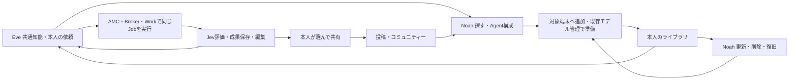

# Noah — Agent・LLMストア、構成と接続・共有の設計

版: 0.4 / 更新: 2026-11-02（America/New_York） / 状態: 既存契約を束ねた設計案。新ストア統合と追加3契約は未実装

**Noahは、AgentやLLMを探し、自分の端末へ追加・実行・更新・削除し、Eveの共通知能に役割・知識・記憶・道具を組み合わせてAgentを作る仕組み。** 投稿・コミュニティーからの発見と共有も、Noahの中から同じストアと本人ライブラリへつなぐ。

今回の本人指示「設計書を組んでいく」を、[Noah・接続と共有のチャット](codex://threads/01a16c28-04a3-7022-8475-da5901359f3f)の継続として整理した。新しい料金・権限・機器の対応を確定する文書ではない。画面構成や実現順の提案は、以下で「設計案」と記す。

v0.2は「限定投稿の外部送信、下書き保存、招待の期限・撤回も詰めて設計書に反映して」という追加指示を具体化した。以下の既定値は実装に渡す設計案で、稼働中の設定や既存利用者の同意を変更するものではない。

v0.3はDBスキーマとAPI仕様の追加指示により、[実装契約](noah-connection-sharing-contracts.md)、[参照DDL](../contracts/noah/connection-sharing.schema.sql)、[OpenAPI](../contracts/noah/connection-sharing.openapi.json)を追加した。12表・20 path/26 operation・既存LLM API拡張、原子的な処理、移行手順を定義。仕様の具体値はこの追補を優先し、以下のUX/権限境界を保持する。製品schema/APIの変更は未実施。

v0.4では今回の本人指示により、[Agent・LLMストアと端末管理](noah-agent-model-store-design.md)を中心の利用体験として追加した。[指定Eveチャット](codex://threads/01a19abe-6bc5-7081-bc12-446a83a225ed)に従い、Eveは共通知能、NoahはAgent構成とストア/端末管理を担当する。**独立したSky製品・system・ストアは置かない。** 旧sky系API/schema/taskは互換識別子として保つ。今回の設計は既存モデル管理と接続するもので、新しいストア/端末一周の実装・配備を完了した意味ではない。

| 追加した契約 | 初期設計案 | 詳細 |
| --- | --- | --- |
| 限定投稿の外部送信 | 既定禁止。community方針・投稿者の許諾・送信者の一回確認をすべて照合 | [送信範囲と撤回](#noah-restricted-egress) |
| 未送信下書き | 本人が保存を選び、暗号化して30日保持。会話履歴/モデル記憶へ入れない | [保存と復旧](#noah-draft-contract) |
| 招待 | 既定24時間、選択範囲5分〜7日、利用1回。招待撤回と参加解除を別操作にする | [期限と撤回](#noah-invite-contract) |

主担当は **Noah / MCP・ROCK**（既存workstream名/IDはSky / MCP）。既存taskはSKY21 / SKY14、連携先はHOME01 / WEB04、物との接続はDSP01 / OS10、作者SDKはSKY15。既存unit `SMITH-01〜06` / `MCP-01`を引き継ぎ、改名に伴う新しい並行task系列は作らない。

正本の入口は[設計ポータル](rockstaros-design-portal.md)、[OS全体](rockstaros-complete-design.md)、[全Tool](sky-tools-complete-design.md)、[責任分界](workstreams/00-responsibility-boundaries.md)。この文書は接続・共有を横断して読める詳細章として接続し、既存API・schema・受入証拠を置き換えない。

## 読み方と確認した現在地

本書のNoahは、[既存の配備・画面検証記録](evidence/eve-noah-publication.json)で確認された表示名。旧Sky / smis / Smithの文書、`/sky`・`/api/sky`・保存key・schema・unit IDは互換識別子として保持する。EveはAgent共通LLMの製品名であり、Eve画面は会話・仕事への入口を担う。Agentの構成・登録・版管理はNoahの責任とし、Eveの画面からも同じNoah機能を呼ぶ。Zema等の既存仕事管理とOS Brokerの責任は名称から変更しない。

| 照合対象 | 今回確認したこと | 設計での扱い |
| --- | --- | --- |
| [GitHub main `7bbb4b27`](https://github.com/k999ln/rock/tree/7bbb4b27ab6ca3b1d42bef4643c9dda8cb8ba0c6) | v0.4でもbranchと同SHA checks 13/13成功を再取得（v0.1観測は12/12）。`lib/eve-source-context.ts`は保存リソースのpinを扱う | 投稿pinの実装とは分ける |
| [PR305 `ee87a643`](https://github.com/k999ln/rock/pull/305) | open / 未統合、同SHA checks 7/7成功。投稿・返信のpin、ACL再検査、原子的な保存条件をsourceで確認 | 採用候補。取得時の`mergeable=false`は統合前の差分・競合調査対象 |
| 配備候補 `f18bc82e` / Site v138 | 既存記録にEve・Noah・コミュニティーのWeb/Pixel往復合格 | 今回は記録の読取り。実行先の準備、追加推論、PR305の配備合格へ流用しない |
| 共有Root `951d82d5` | 多数の先行差分あり。共有担当・成果のローカルsourceが存在 | Root全体をmainや配備候補と同一としない。既存差分を保全する |

mainの`SkySocialAttachment`には、今回読んだRootの`agent-template` / `agent-outcome`がない。単に同じファイル名があることを機能同一の証拠にしない。mainのbaseline v2.08/RQ50とRoot v1.128/RQ01〜49、旧料金記述の差も既知の統合課題であり、この章で黙って統一しない。料金・要求の採用は各正本の明示判断を照合する。

Git観測、参照source、検証結果は[設計整理の記録](evidence/noah-connection-sharing-design.json)。上記CIは観測した既存commitの結果であり、この未commit設計文書のCIではない。

<a id="noah-purpose"></a>
## 1. 目的と利用者

利用者は「用途に合うAgent/LLMを探す人」「Noahで自分用のAgentを構成する人」「担当やToolを提供する作者」。中心の一周は、Agent/LLMを探す→対象端末に追加/準備→Eveで仕事と成果編集→更新/削除→過去成果を読む体験とする。投稿1件から自分用の文章担当を作る流れも同じNoahの構成機能へ結ぶ。これは最初の受入例であり、用途を文章だけへ制限する仕様ではない。

Noahで発見した能力は、既存OSのbrowser/clientからも使える導線を持つ。SIM/eSIMはサービス利用開始の入口の一つ、Mini・Pro・Pixelは入出力と実行能力の違いとして扱う。SIMの所持、商品購入、端末の表示名を、本人性・Tool権限・実行可能性の代わりにしない。

利用者への約束は、選んだ内容が分かること、使える範囲と不足が分かること、送信先と費用が分かること、途中で止めても同じ仕事へ戻れること。推薦や人気を権限・品質保証・収益実績として表示しない。

<a id="noah-experience"></a>
## 2. 一周の利用体験と画面

1. **探す。** NoahでAgent/LLM/Toolを検索し、投稿やコミュニティーからも商品詳細へ進む。作者・版・用途・費用・端末対応を確認する。
2. **構成する。** 既存Agentを自分用に追加するか、Eveの候補を使ってNoahが役割・知識参照・記憶scope・モデル・Toolを組み立てる。構成案は本人確認後に保存する。
3. **端末へ入れる。** 実際の対象端末を選び、モデル本体と依存、容量、権限、利用条件を確認する。既存モデル管理が取得・検査・動作確認を行い、readback後に利用可能と示す。
4. **Eveで使う。** 元の依頼/下書きを引き継ぎ、AMC/Broker/Workを通して同じJobを実行する。外部送信・料金は必要な条件を確認する。
5. **成果を編集する。** 結果・独立評価・費用・停止を確認し、既存Artifactの新revisionとして修正する。モデル更新や削除後も過去成果を読める。
6. **更新・削除する。** Noahで版や権限の差を確認し、旧仕事を保って更新する。端末の本体、ライブラリ、仕事/記憶の削除範囲を分ける。
7. **共有する。** 担当設定と成果を別々にpreviewし、範囲・内容・条件を確認する。受取人は自分の端末・権限・予算で追加する。



図は到達体験。全経路が同一候補で受入済みという意味ではない。

**画面構成案。** 新しい大きな管理画面を増やさず、既存の入口へ以下を配置する。

| 場所 | 主操作 | 常に分かる情報 |
| --- | --- | --- |
| Noahの投稿一覧 | 読む、検索、選ぶ、新着を取り込む、一時停止 | 出典、閲覧範囲、更新/停止/取得失敗 |
| 投稿・担当の詳細 | Eveで相談、追加、共有条件の確認 | 選んだ1件、作者、版、添付、必要な準備 |
| ストア/ライブラリ/端末・更新 | Agent/LLMを探す、端末へ追加、更新、削除 | 本人への追加、端末に本体がある、Cloud接続、実行可能を別表示 |
| Eve | 依頼、Noahの構成画面へ接続、成果編集、仕事の確認、停止 | 担当、基盤モデル、実行先、承認上限、成果 |
| コミュニティー | 参加、投稿、共有範囲の確認、戻る | 現在の本人、参加状態、鍵/失効状態 |

公開版の往復入口は `/#timeline`、`/#communities`、`/os/eve`。旧 `/sky` 系とqueryによる引継ぎを保つ。正式Web入口は `avoado.si`、Miniは `avocadomini.si`、Proは `avocadopro.si`。端末別サイトでも本人用localhostや秘密を公開URLへ移さない。

<a id="noah-responsibility"></a>
## 3. 責任と権限の境界

| 主体 | 引き受けること | 他へ渡す条件 |
| --- | --- | --- |
| Noah / ROCK | Agent/LLMストア、Agent構成、端末への追加/更新/削除、能力照合・接続・共有 | 固定構成/導入receiptを既存Eve/仕事契約へ渡す |
| Eve / ROCK | 共通知能として依頼の理解、構成候補、修正候補、実結果の説明 | Noahが構成保存、Brokerが許可。モデル出力は提案 |
| OS・Broker / ROCK | 本人、owner分離、scope、期限、予算、停止、保存/復旧 | 有効な契約と実行先が揃った要求だけを実行 |
| Tool・model・feed・機器 / EXTERNAL | 宣言した能力と実処理、usage、取消/結果情報 | 宣言と実観測を照合し、未対応を明示 |
| 接続受入 / JOINT | 同じbuild、実account、実Provider/端末で一周を検証 | source/fixtureの成功と別の証拠を提出 |
| 利用者・作者 / OWNER | 素材、対象、共有先、必要権限、費用、内容の確認 | 操作対象・版・作用を具体的に確認 |

出典hashは同じ内容を照合するための値で、真実性・著作権・実行許可を証明しない。作者署名は作者の同一性であり安全保証ではない。投稿に「実行せよ」と書かれていても、Tool grantや本人の承認にはしない。

<a id="noah-contracts"></a>
## 4. 入出力・ID・版・上限

| 契約 | 入力と固定するもの | 出力と境界 |
| --- | --- | --- |
| 保存リソースの選択 | 認証owner、`rockstaros.eve-source/1`、key、revision、metadataSha256 | 本人が追加した有効リソース。上流の真正性は別検査 |
| 投稿1件の選択（PR305） | `rockstaros.eve-post-source/1`、`post:<id>`、authorId、communityId、replyTo、createdAt、本文・添付digest | 本文/添付snapshotとpin。閲覧者ownerScopeはserverから取得 |
| 担当保存 | 本人、担当ID/revision、編集した設定、確認した出典 | 私用Agent設定と不変の由来。権限・鍵・元作者の予算を付与しない |
| 接続 | host/executor/outputの版付き能力、対象、model/Tool版、現grant | 準備と不足の診断。readyは実行承認ではない |
| 仕事 | 同ownerのJob、入力digest、担当/Tool/model版、実行先、quote/cap、期限 | 既存workflow、receipt、Artifact、項目別usage |
| 担当共有 | `rockstar-agent-share/1`、share ID/version/digest、作者、共有先、条件、parent | 受取人の別設定へ無効状態でAdd。鍵・会話・原稿・Tool grant・実行中Jobを複製しない |
| 成果共有 | 本人が選んだ説明・公開可能な成果参照、元share由来 | 共有previewと同意の記録。私用成果の自動投稿をしない |

投稿sourceの読取りは既存 `GET /api/eve/source-context?key=…`、担当保存は既存 `/api/sky/agents`、投稿は `/api/sky/social`、共有は `/api/sky/agent-shares` / `/api/sky/agent-outcomes` の該当候補を再利用する。後二つのRoot候補の存在をmain導入済みとは扱わない。新たな汎用実行APIや名前だけのDBを設けない。

PR305で確認した上限はkey 300文字、投稿本文1000文字、固定形式のUUID/64桁digest。選択communityの鍵1件だけを同一サイトの出典確認・担当保存へ渡す。鍵はURL・モデル入力・由来へ入れない。共有の版/件数など既存parser/storeの上限は維持し、拡大はmigration・資源上限・負例を伴う別変更とする。

原子的な条件: 投稿読取りのSELECTと担当保存のINSERT条件の中で、現在のowner/profile/member/key/revocation/archive、投稿行、返信先とのcommunity整合を再照合する。画面で一度確認した閲覧可能一覧だけを保存authorityに使わない。本文・添付・作者・時刻等が変われば選び直す。

<a id="noah-state"></a>
## 5. 状態と失敗時の表示

Noahの表示状態、Agent設定、接続、共有、仕事はそれぞれ既存の状態を使う。「準備中」などの案内文を新しいWorkJob enumとして保存しない。Webの親仕事は [lib/workflow.ts](../lib/workflow.ts) の `active / review / completed / cancelled` を維持する。

| 場面 | 遷移・判定 | 利用者へ示すこと |
| --- | --- | --- |
| 選択 | 未選択→出典確認→下書き。変更/失効/古い応答は確認無効 | 「投稿が変わりました。最新の内容を選び直してください」 |
| 担当保存 | 編集→保存中→同ID読戻しで保存済み | 「保存結果を確認しています」。応答消失を保存失敗確定にしない |
| 接続 | 未設定/準備中/利用可能/不足/失効を観測別に表示 | 足りない能力、必要な本人操作、使える実行先 |
| 実行 | 承認条件を照合→既存Job→review→本人完了 | 結果ができたことと内容確認が済んだことを区別 |
| 停止 | 要求→元executorの照合→停止確認。不明なら照合継続 | 「停止を要求しました」「停止を確認しました」を分ける |
| 共有 | preview→本人確認→版付き公開/限定共有→撤回 | 範囲と版。撤回は新しい取得/Addを止め、既存コピーの消去とは言わない |
| feed | 読込/新着保留/停止/終端/障害 | 閲覧位置・入力を保ち、新着の有無と取得失敗を区別 |

<a id="noah-storage"></a>
## 6. 保存・保持・削除・backup

既存のowner別D1/SQLite、`sky_social_profiles` / `sky_social_posts` / communityのmember/key、Agent Library、仕事/成果storeを利用する。共有候補は既存`sky_agent_shares`等のschemaに従う。追加tableとAPIはv0.3の実装契約で定義する。正式migration番号は統合候補の最新schemaを照合して採番する。

投稿選択の一時引継ぎは既存のHome intentとowner/source pinへ結ぶ。目的入力の一部は現在同ページmemoryだけで、再読込で失われる。この文書で永続保存済みとしない。未送信下書きは次項の設計で既存本人認証・暗号化・revision/CASを再利用する。

保存済み担当・旧仕事・成果は、接続の失効後も本人に許された履歴として維持する。読み直しだけで再登録・新規実行しない。限定投稿の出典を現在再取得できることと、既に本人が保存した自分の設定の由来記録を分ける。失効した資料本文を新たに配信してはならない。

秘密の専用鍵・tokenは既存の用途別保管を使い、一般exportや公開manifestへ混ぜない。backupにはschema、版、原本hash、削除/失効の履歴を対応づけ、古いsnapshotからの復元で撤回済み権限を復活させない。復元後のtombstone照合の全経路受入は残件として扱う。新しい下書きの保持・削除は次項で定義し、既存会話や仕事の保持期間を一括変更しない。

<a id="noah-draft-contract"></a>
### 6.1 未送信下書きの保存・競合・復旧

**目的と責任。** 書きかけの依頼を同じ本人が後で再開でき、保存だけではmodel送信・Agent作成・Job開始が起きないこと。Web/ROCKが保存/UI、Security/ROCKが暗号化・削除・ACL、OWNERが保存/削除/送信を選ぶ。JOINTの別端末・backup受入は実装後に行う。

**既存との差。** Rootの[Home intent](../lib/home-intent.ts)は2000文字・10分・一回読取りのtab内引継ぎで、永続下書きではない。[会話store](../lib/eve-history.ts)のparserは未送信draftを受け付けず、保存messageは履歴・recallの対象になる。mainにも同じ分離の必要がある。未送信文を偽の`me` messageや`activeRequest`へ詰めて保存しない。

**操作と表示。** 最初は「未保存」。本人の「下書きを保存」でowner別保存を開始し、serverのID/revision/digestの応答を確認して「保存済み・日時」を表示する。「この下書きを自動保存」は初期OFFで、当該draftにだけ有効。ONなら編集停止2秒後、最大5秒に1回、同時保存は1件に制限し、途中編集は次のrevisionへ送る。保存中に離脱する場合は未保存分を案内する。復元画面は本文、対象会話/担当、出典の現在状態を表示し、「編集へ戻る」だけを行う。

| 保存項目（論理契約案） | 条件 |
| --- | --- |
| `ownerId / draftId / schemaVersion / revision` | ownerは認証から取得、draftIdはUUID。新規expectedRevision=0、更新はCAS |
| `threadId? / entryKind / agentRef?` | 新規依頼はthread未作成でも保存可能。既存会話/担当は同ownerのID・版を参照し、別ownerへの付替えを拒否 |
| 暗号化envelope | 本人が書いた文章、編集値、参照pin、既知の出典由来区分、autoSave選択。raw鍵/token、送信許可、予算承認、実行handleを入れない |
| `sourceRefs` | 初版は投稿1件。投稿本文・添付本体を永続複製せず、ID・固定pin・出典制限を暗号化して保持 |
| `operationId / requestDigest / lastOperationReceipt` | save/deleteの同じ操作を照合。同IDで異なる本文/対象/expectedRevisionは409 |
| `createdAt / updatedAt / expiresAt / deletedAt / submittedRef?` | server時刻。状態はdraft固有の`editable / submitted / deleted / expired`で、WorkJob状態を変更しない |

容量案は依頼本文2000文字、復号後の構造全体16 KiB、ownerあたり保存中のdraft最大100件。上限では既存分を勝手に消さず、削除/整理を案内する。暗号化後の容量上限も対応parserで別検査する。添付本体は既存Artifact参照として扱い、このdraft endpointで任意uploadやURL取得をしない。

**保存先。** 同じD1の既存会話・本人保存系に、未送信用の補助recordを追加する設計案とする（`eve_composer_drafts`。v0.3でtable名を固定、migration番号は未割当）。別のaccount/Job DBは作らない。既存AES-GCM・key rotationを共通化し、AADはowner/draft ID/schema/revisionへ固定、更新ごとに新nonceを使う。旧会話ciphertext/AADを変えない。API案は同一サイトのowner認証付き`/api/eve/drafts`の作成/一覧と`/{draftId}`の読取/更新/削除。現時点では存在・稼働を主張しない。`no-store`、Origin/owner intent、strict parser、一覧にも本人分離を適用する。

**限定資料と記憶。** 復元時は先に現在のACLを照合し、許可された出典だけを取得する。失効/削除/内容変更時は元pinを維持して「出典を再確認できません」と表示し、投稿本文を復活させず外部送信を止める。本人だけの独立した文章は編集可能だが、アプリ内で限定投稿から作った引用・要約・担当案には由来制限を保持する。制限付き内容を含む編集bufferを一体の文章としてしか扱えない旧clientでは、そのbufferをこの保存APIへ受け入れない。構造化した本人文と出典参照へ変換して本人に確認してもらう。

draftは会話一覧の通常message、recall索引、embedding、学習、推薦、ログ、標準会話exportに含めない。新しいdraft読取り口も既知の制限付き派生文を返す前にACLを検査し、判定不能ならその部分を非表示にする。raw本文をURL/localStorageへ退避しない。現在のHome intentとの互換を保ちつつ、限定本文の一時受渡しはmemory又はowner-bound参照へ移す対象とし、既存全経路がこの条件を満たしたとは扱わない。

**競合と結果不明。** 保存中の編集は送信snapshotと分け、応答が現在のowner/draft/revisionに一致する時だけ採用する。409ならserver版と自分の未保存版を比較し、「最新に合わせて編集」「別下書きとして保存」を本人が選ぶ。無言のlast-write-winsや自動mergeをしない。timeoutは「保存結果を確認中」とし、同operationのreceiptと現revisionを読戻す。別端末がさらに更新していても、自分の旧保存が成立したかをreceiptで判定できるようにする。receiptの保存期限はdraftの有効期間＋後述のtombstone期間に合わせる。

offline時の新編集はmemory内の未保存状態で、同じ端末でもreload/終了で失われ得ると表示する。再接続後は先にserver版と削除/失効を読んでから本人が保存する。owner切替/logoutでは他人に見せないようmemoryと旧応答を破棄し、旧ownerの未保存文を新ownerへ自動保存しない。

新規作成にはserverが発行するowner/用途付きの短命な作成nonce（案: 10分、一回利用）も要求し、draft IDと作成operationへ結ぶ。保存receiptを保持しなくなった古い作成要求を新規作成として再受理しない。期限切れの作成要求は自動再送せず、現記録を照合した後、本人が新しいID/nonceで作り直す。このnonceは本文のmodel送信権限にはならない。

**保持と削除。** 新規/内容変更の保存成功から30日。閲覧、同じ保存の再送、単なるautoSave設定変更で期限を延長しない。「30日延長」は本人の別操作。期限到達で読取/送信を拒否し、削除と同様に本文を空にする。削除はowner/revision照合と同transactionでtombstone化し、応答不明時も元IDへ照合する。未保存autoSaveが後着しても復活させない。本文の稼働store消去は即時処理、cache消去は制御可能なclientが通知/再接続した時に行い、閉じた端末や本人が別保存したコピーの遠隔消去を保証しない。

backup/復元案は最大30日の保存世代、本文を含まない削除/期限切れのtombstoneと操作receiptは90日保持。これは現Hostingの保証値ではなく、新draftを有効化する前に確認する上限/下限である。Providerのbackup期間が長ければtombstoneをその期間＋復元余裕へ延長する。鍵付き監査digest以外の本文をreceiptへ残さない。復元は最新の削除台帳を先に適用し、台帳が欠ける/古い世代なら隔離して読出しを止める。expired/deleted IDへのwriteは410とし、復活には別IDの明示新規作成が必要で、削除された本文を回収できることは意味しない。

**送信との接続。** draftを送る時も、復元した同意を使わず、現在の出典・本文digest・送信先・見積を確認する。既存の送信/Jobの受領と同じsubmission IDに結び、受領不明ならdraftを削除せず「送信結果を確認中」。受領済みだけ`submitted`へ投影する。二端末の同draft/revision送信は原子的な一回claimで一つの論理submissionにし、providerへの再送は既存の結果不明規則に従う。以前送った依頼をもう一度使う時は、本人が別下書き/別依頼を作る。

<a id="noah-retry"></a>
## 7. offline・再送・重複・結果不明

- offline中は許可された保存済み内容と、その取得時刻を表示する。現在のACL/価格/権限を確認できない新規共有・外部作用は保留する。
- 投稿選択、本人、profile、鍵、対象が変わったら旧非同期処理を無効化する。A→B→Aへ戻った場合も、古いAの応答を最新として採用しない。
- 保存・publish・Add・実行の応答が消えたら、同じID/版/digestで正本を照合する。別IDで自動再送しない。
- feedの更新は既存のcursor、停止/再開、backoffを利用する。閲覧権限の判定を推薦順位より先に行い、重複・削除・失効を反映する。
- 上流feedの取り込み・継続同期は別契約として、供給元、cursor、更新/削除、利用条件、rate limit、失効を固定する。単なる定期GETや合成投稿を実Provider受入へ換算しない。
- 有料処理の結果不明や取消未確認中は、既存予算予約を保持して同じ実行を照合する。Provider切替や予算増額を復旧として自動実行しない。

<a id="noah-recovery"></a>
## 8. 更新・互換・rollback・復旧

表示名変更は旧route、API、header、schema、保存keyとtask IDを保つ。旧Agent、旧editor、固定済み出典、過去Job/成果のreadとstopを維持し、作者の新版を実行中の仕事へ差し替えない。

PR305採用前に、最新mainとbranchの共通祖先・両側差分・共有schemaを確認する。検収された13 production sourceとmain側の改善をともに保ち、Rootの共有候補も必要な範囲だけ比較する。PR本文の古いmain SHAや旧成功receiptを、統合後の候補の合格として使わない。

復旧の順は、旧処理の照合→現owner/接続/版の確認→保存済み仕事の読戻し→必要な再承認→有限の再開。unknown schemaを初期化しない。schema変更が必要な時はread-old/write-compatible、backup、元版へ戻れる範囲を同じ候補で試す。元版が新しい共有範囲や失効を正しく判定できない場合は、書込みを止めた読取り復旧とする。

物への接続は内蔵・外付け・周辺観測の3方式を同じ能力契約へつなぐ。対象識別、入力の観測、目的達成は別判定。付け替えは旧仕事の停止照合→旧scope/epoch失効→新対象・校正・本人確認の順とし、停止不明のまま新対象を動かさない。加速度を水分や重量の測定と表示せず、意味・単位・鮮度・観測範囲を保つ。

<a id="noah-security"></a>
## 9. 安全・privacy・security・承認

閲覧、モデルへの送信、担当保存、Tool実行、外部公開は別の操作・権限である。限定投稿を閲覧できても外部modelへの送信や再公開が自動許可されるわけではない。送信先、送る内容、対象communityの条件、費用を確認する。条件不明なら外部送信を保留する。この区別の全経路強制はPR305のACL成功だけで受入済みにしない。

共有する設定の既存候補は公開`CC-BY-4.0`、限定`community-copy/1`を識別する。対象の権利、公開範囲、改変/再共有条件を確認し、既存の無償共有を有料licenseへ自動変更しない。私用会話、原稿、生体情報、元作者のsession/device/key、Tool grant、Wallet予約は共有manifestから除外する。

第三者の文章とモデルの提案は非信頼入力として扱う。実行直前にBrokerが本人・有限scope・版・実行先・見積・上限・期限を再検査する。投稿者/作者/モデルがOS platform署名や任意shell/root権限を得る経路を作らない。

招待の有効期限・撤回は§9.2の保存契約案で具体化する。画面で招待欄を操作できることを、失効・再利用防止の実装証拠にしない。

作者報酬は既存Billingの契約・usage・Invoice・入金/返金照合へつなぐ。閲覧数、Add数、実行数を売上や送金の証拠にしない。金融、機器制御、全OS、一般ローンチのgateは各正本に従う。

<a id="noah-restricted-egress"></a>
### 9.1 限定投稿を外部model・Toolへ送る条件

**目的と責任。** 閲覧できる資料を、利用者が知らない相手へ送らない。Noah/ROCKは出典と送信範囲、Security/ROCKはpolicy/ACL/撤回、Eve/実行adapterは最終payloadと一回送信、OWNERは今回の送信を確認する。EXTERNALの実際の保持/再利用条件と削除応答はJOINTで確認する。以下は許諾の技術的な取り扱いであり、権利保有や法的適合そのものの保証ではない。

**外部の定義。** 選択したcommunityの許された処理境界を越えるmodel、Tool、MCP、remote evaluator、embedding、ログ/解析sink等への本文・派生文・機微なmetadataの移送を含む。avokado提供cloudや本人のBYOKでも第三者へ届けば外部送信として扱う。端末内計算は、その入力が許可された端末へ渡り、後続のTool/telemetryを含む外向き送信がない範囲だけを区別する。「local」という表示だけで免除しない。

**成立条件は積集合。** 次のすべてを満たした一回の要求だけを認める。

1. 現在の認証owner/profileがmemberで、専用鍵が有効、community未終了、投稿と返信先整合がPR305の条件に合う。
2. community管理者が版付きの外部処理方針を設定している。旧community/不明fieldは`deny`、許す場合は`allow_list`でprovider・endpoint境界・処理目的・素材種別・保持/再利用条件を列挙する。
3. 投稿者が当該投稿の内容pinに対して許諾している。管理者の設定だけで投稿者の許諾を代行しない。引用/添付にはその素材の利用条件も必要で、未確認の添付は送らない。投稿者の許諾はcommunity方針を広げられない。
4. 送信する本人が、最終的な対象・本文・送信先・目的・費用を確認して一回承認する。本人が投稿者でも、投稿の許諾設定と今回の送信操作は分ける。
5. 選んだmodel/Tool/adapterの版、Providerのデータ条件、既存利用権・Broker権限・価格/予算gateが現在も有効である。

一つでも不足なら、外部呼出し0で「この投稿は外部処理に使えません」と理由を示す。端末内経路が実際に利用可能なら選択肢を出すが、自動切替はしない。拒否を解除するために引用タグや出典pinを取り除く操作を用意しない。投稿から作った既知の要約・担当案・出力にも制限を継承し、共有/再送/recallで同じ条件を照合する。権利を確認した別の解除手続が成立するまで、単なる編集で制限を外さない。

**画面の確認内容。** 「送信内容を確認」に、投稿1件と引用範囲、添付の選択、本人の追加文、参照する過去会話、送る個人情報、実Provider/model/処理目的、保存/再利用条件の版、費用見積と上限をまとめる。不要な添付・過去会話は初期OFF。raw鍵、招待token、内部owner/thread IDはpayloadへ入れない。伏字/除外は送信前に確定した実payloadへ適用し、画面だけのマスクにしない。編集・送信先・model・資料・policy・費用条件が変われば確認をやり直す。利用者向けボタンは「この内容を○○へ一回送る」とし、技術的digestは通常表示しない。

**保存する許可の論理契約案。** community方針と投稿許諾は同じD1の版付き補助recordに置く（仮称`sky_community_egress_policies` / `sky_post_egress_permissions`）。本文を複製せず、community/post ID、policy revision、投稿pin、許可した相手/目的/素材、許諾者、失効時刻/版を保持する。クライアントが送った`allowed=true`やlicense文字列だけでは許可を作らない。設定変更は認証された管理者/投稿者だけに許し、旧revisionへのCASを使う。

一回承認は既存のquote/approvalと実行記録へ結ぶ拡張案で、owner、source pin、community/post許諾版、最終payload digest、provider/endpoint/model/adapterの固定参照、目的、データ条件版、既存quote/cap、親Job/request ID、承認nonce、created/expires/revoked/consumedを保持する。payload原文は既存の暗号化実行入力へ置き、許可の監査recordへ複製しない。外部送信確認の有効時間案は最大5分で、quote・source許諾・sessionの期限より長くしない。認証secretや専用鍵を許可recordへ保存しない。

**実行直前と競合。** serverでpayloadを再構成してdigestを照合し、現ACL、投稿/方針/許諾の版、失効、期限、実行先、予算、一回nonceを同じ送信claimの条件で検査する。既存[remote実行](../lib/remote-ai-text-execution.ts)の`claimDispatch` / `claimProviderSend`と[store](../lib/remote-ai-text-store.ts)の`quoted / reserved / sending / completed / unreconciled / cancelled / expired`へ対応させ、別の並行executorを作らない。このpolicy照合は現在の関数には未追加である。

撤回と最終claimは同じauthority storeで順序づける。撤回が先ならclaimと送信を拒否、claimが先なら送信済みの可能性がある処理として停止/照合する。DB更新と外部ネットワーク送信は一つのtransactionにできないため、後からの撤回で「一byteも出なかった」と保証しない。claim直後のcrashも保守的に結果不明とし、自動再送しない。送信前に未送信が確実と確認できた場合だけ既存取消規則に従って予約を解放する。使用量/予約は取消UIだけでは0にしない。

**隠れた送信を防ぐ。** 同じguardをmodel本呼出しだけでなく、外部のtoken数見積、要約、recall取得後のprompt合成、Tool引数、A2A/remote evaluator、添付URLの取得、後続Agentの送信へ適用する。初期の料金見積は本文を外部へ出さない方式を使い、Providerへの本文送付が必要な見積はその目的を別承認する。本文取得やredirectで許可先が変わる経路は拒否する。複数段階に一括承認を使わず、次の相手/目的へは新しい内容確認が必要になる。

**撤回後と復旧。** 未claimの承認を失効し、queued処理も配送直前に止める。claim済みは元execution/provider referenceを照合し、対応Providerの取消/削除要求の受付と完了を別記録する。既に送信された内容の回収や学習からの消去は保証しない。新しい再送・共有は止める。承認をdraft/backupから復元して再利用せず、新端末/復旧後も現policyを読む。

**適用範囲。** アプリが扱う既知の出典参照とその派生経路を強制する設計であり、人が別アプリへ手動転記した文章の出典を完全検出するDLPではない。アプリ内の出典付きdraftを制限なしのlegacy endpointへ落とさないことは必須。限定出力を既存履歴/Artifactへ保存した後の読取・recall・exportでも制限を伝播できるまで、その経路の限定投稿処理を有効にしない。本文ログ、telemetry、古いclientからの回避を含めたE01〜E08が合格条件になる。

<a id="noah-invite-contract"></a>
### 9.2 招待の期限・一回利用・撤回

**目的と既存との差。** 招待を渡せる期間と使える回数を明確にし、意図しない将来の参加を止められるようにする。既存[community store](../lib/sky-social-store.ts)はcommunityに一つの`invite_hash`を保存し、再発行で旧tokenを無効にする。mainも同方式で、期限・消費・個別招待receiptはない。memberとaccess keyの作成、管理者による参加解除/再参加許可、archiveは再利用する。

**初期仕様案。** 発行権は現community作成者だけ。認証された本人への招待で、既定24時間、最短5分/最長7日、利用1回、無期限/複数回利用は初版で提供しない。通常は「この招待を受け取った、最初の認証済み1人」が対象で、転送すれば別人が使えると表示する。特定の既存profileに限定する選択肢では受取profile IDも固定し、メール文字列を本人確認に使わない。宛先指定のための全利用者検索や未公開profileの列挙を作らない。

作成者は対象/期限/回数をpreviewして「招待を作成」。受取人はログイン→招待の確認→現在のルールを読む→「このアカウントで参加」の順。previewは期限を消費せず、投稿本文、参加者一覧、専用鍵、model送信権限を返さない。画面に参加先、期限の絶対日時と残り時間、1回限り、今回のアカウントを表示し、期限計算はserverの結果を使う。クライアント時計は表示補助だけとする。

| 保存項目（論理契約案） | 条件 |
| --- | --- |
| `inviteId / communityId / issuerOwnerId / revision / inviteEpoch` | 仮称`sky_community_invites`を同じD1へ追加。旧member/key表を置き換えない |
| `tokenHash / recipientProfileId? / createdAt / expiresAt` | 既存同様32byteの乱数tokenをserverで生成し、DBにはdomain分離したhashだけ保存。受取人指定は任意 |
| `revokedAt / expiredAt / redeemedAt / redeemedBy / redemptionOperationId` | 未消費→消費済み、失効、観測した期限切れを追記・終端化し、元招待を再有効化しない |
| `issueOperationId / issueDigest / redemptionDigest / receipt` | 同じ操作の再送を照合。receiptにraw token/access keyを含めない |
| communityの`inviteEpoch` | 全未使用招待の一括撤回や旧方式の終了に使う。membershipやaccess keyのepochとは分ける |

stateは保存された消費/撤回とserver期限から`active / redeemed / revoked / expired`を投影する。`serverNow >= expiresAt`で無効。期限切れを観測したrecordはterminalにし、時計が戻っても復活させない。server時刻の信頼性が損なわれた場合は新規発行/参加を保留し、UI時計から期限を延長しない。新規作成/再発行を含むmutationは認証・Origin/owner intent・strict parser・有限rate limitを通す。tokenを持つだけで発行権や管理者権限は得られない。

発行/再発行のpreviewはserverが作る10分・一回のowner/community/条件digest付きnonceへ結ぶ。古いissueOperationのreceiptが保存期限を過ぎても、その旧nonceで招待を作り直せない。管理者が改めてpreviewを確認した場合だけ、新しいnonceとoperation IDで発行する。

**原子的な参加。** 同じtransactionで、token hash、招待ID/revision/epoch、未使用/未撤回/期限、未archive、現発行者の権限、受取profile、現rulesVersion、参加禁止状態を検査し、招待消費→member登録→その本人のaccess key hash登録→同操作receiptを確定する。一部だけの成功を許さず、二人が同時にredeemした場合は一人だけ成立する。batchを使う実装では、claim結果への従属条件・UNIQUE制約とrollbackをSQLite/D1双方で検証する。事前SELECTの成功だけでINSERTしない。

既存memberが別招待を開いた時は「参加済み」と返し、招待を消費せずaccess keyを変更しない。鍵が使えなければ既存の復旧へ案内する。管理者が解除したprofileは新招待でも拒否し、既存`allowMember`による明示許可後に、新しい招待から参加する。参加は現在のルールへの同意であり、外部model送信・課金・端末登録の許可ではない。

**二つの撤回。** 「この招待を無効にする」は未使用のそのinviteIdをrevision付きで撤回し、既に参加したmemberを退会させない。「参加を解除する」は対象profileのmembership削除とaccess key失効を既存契約で原子的に行い、今後の限定投稿閲覧/送信を止める。画面で対象と効果を分け、招待撤回を参加解除と表示しない。全招待撤回はcommunityのinviteEpochを更新するが、既存memberの権限をまとめて消さない。

撤回とredeemは同じDBで順序づける。撤回が先なら参加0、redeemが先なら招待は消費済みとして返し、必要なら作成者が別途参加解除を選ぶ。再発行は選んだ旧inviteの撤回と新invite作成を同transactionにし、旧期限を延長しない。archiveは全招待無効化と既存のmember/key失効へ接続する。

**応答消失。** 発行は同issueOperationId/digestで重複招待を作らず、結果をowner専用metadata一覧から照合する。raw tokenは初回応答でだけ渡す。応答喪失/閉画面でtokenを失った場合は再表示できない旨を示し、作成者が旧招待を撤回して再発行する。自動で次のtokenを発行しない。

参加応答が消えたら同owner/同redemptionOperationId/digestを読戻す。保存済みreceiptがあれば、現在は期限切れ/撤回でも元の参加結果と現在のmembershipを返すだけで、memberや鍵を作り直さない。参加後に退会/参加解除された場合も古い再送で再参加させない。receiptなしで期限切れ/撤回なら拒否。別owner/別payloadでの同操作ID再利用を拒否する。受取clientは同じ参加要求で生成した自分のaccess keyを保ち、応答不明を理由に勝手に新しい鍵へ回転しない。端末が鍵を失ったら既存の本人復旧を使う。

**秘密・保存・移行。** 招待tokenはURL queryやアクセスログに出さず、既存の招待JSON、又はfragmentからmemoryへ取り込み直ちにURLから除去する方式を使う。招待表示画面のanalytics/clipboard操作にもraw tokenを記録せず、自動で他人へ送信しない。token付きpreview/redeemは同一サイト認証POST、応答`no-store`。tokenの誤り・別宛先・失効は受取人に同じ「この招待は利用できません」を返し、発行者だけに詳細状態を示す。tokenはmemberのaccess keyと別の秘密である。

初版の記録保持案は終端から90日、token原文のserver保持は0日。backup最大30日を前提に、最新epoch/撤回/消費/参加解除台帳を復元へ先に適用する。台帳欠落なら招待受付を再開しない。古い招待をbackupからactiveへ復元しない。実Providerの保存期間を確認できるまで本番消去の保証値にしない。

移行時はv2機能を既定無効で追加し、UI/API/storeの一致を受入してから切替える。既存v1招待には発行時刻・受取人・回数を捏造せず、「更新が必要」とし、新規joinで受け付けない。communityの旧`invite_hash`を無効にする切替を管理者に案内し、既存member/access key/投稿は保持する。旧clientがv1を再発行する経路も拒否し、rollbackしても消費/撤回履歴やv1停止を戻さない。新形式を読めない旧版へ戻す場合は招待の発行/参加を停止し、既存memberの読取りを維持する。

Security/ROCKとWeb/ROCKが保存/競合/移行を担当し、OWNERは招待対象と期限、個別撤回/参加解除を選ぶ。JOINTで二つの認証account、実D1再起動、期限と撤回を確認する。I01〜I08が合格条件で、今回の設計変更から招待発行や既存招待失効を実行しない。

<a id="noah-acceptance"></a>
## 10. 合格条件・環境・証拠

下表は次の実装/統合候補を受け入れるためのケース。**今回の文書整理では未実行**。PR305や既存配備の成功を再利用する場合も、対象source hashと環境を照合する。

| ケース | 合格条件 | 層 / 主な既存unit |
| --- | --- | --- |
| N01 旧入口 | 旧URL/保存参照から同じ本人・担当・仕事・成果を読める。新規dispatch/課金/鍵変更0 | host＋browser / SMITH-01 |
| N02 選択1件 | 本文/添付/pinが選択した投稿・返信だけと一致。親本文・他投稿・他鍵の混入0 | store/API/browser / SMITH-03 |
| N03 権限と競合 | 別owner、退会、鍵失効、archive、削除、本文変更、親整合不一致をread/save両方で拒否 | SQL・負例 / SMITH-03 |
| N04 遅延と切替 | 遅い旧応答、選択連打、owner/profile/key変更とABA、離脱で旧入力が復活しない | client/browser / SMITH-01・03 |
| N05 保存応答不明 | 同owner/同ID/同設定digestを照合し、重複Agent/共有版を作らない | store＋再起動 / SMITH-03・05 |
| N06 実行一周 | 同担当ID/版・実model又は実Tool・同Jobの成果保存/独立開封・停止receipt・再開後不変 | JOINT / SMITH-03 |
| N07 別本人のAdd | Aの設定をBの無効設定へ追加。Aの鍵/権限/会話/費用を継承せず、Bの条件で実行 | 二owner fixture→実二人 / SMITH-05 |
| N08 共有の変更/撤回 | 旧仕事の版を保持。新規取得を適切に拒否し、既存コピーの消去を装わない | store/API/browser / SMITH-05 |
| N09 継続feed | 新着・重複・更新/削除・終端・429/切断・停止/再開・ACL変更を区別し入力と閲覧位置を保持 | fixture→実供給元 / MCP-01 |
| N10 能力不足と付替え | 不足した観測/処理を省かない。古いepoch入力と停止不明中の新対象実行を拒否 | host→実部品 / SMITH-02・04 |
| N11 切断/復元 | 同Job読戻し、失効/tombstone保持、未知schema保全。結果不明中の重複作用0 | 永続store→実端末 / SMITH-03・06 |
| N12 画面の理解 | 390px/keyboardで選択、戻る、保存/停止状態が読める。実行先未準備を「使える」としない | browser→Pixel / WEB04・SMITH-01 |

### v0.2の追加受入ケース

以下24ケースは**設計済み・未実装/未実行**。既存12ケースと合わせて36ケースとする。runtimeのテストを追加した意味ではなく、実装時にstore/API/worker/browserと必要な実環境へ落とす受入仕様である。

| 外部送信 | 正例・負例と合格証拠 |
| --- | --- |
| E01 三つの許可 | community deny/未設定、投稿者未許諾、今回未承認の各欠落で外部呼出0。全条件一致だけ許可 |
| E02 実payload | 引用範囲・伏字・本人文・添付OFFが実送信byteと一致。親投稿・他鍵・隠れた過去会話の混入0 |
| E03 pin/宛先変更 | 投稿/ACL/許諾/方針/データ条件/価格/model/endpoint変更、期限境界で旧承認を拒否 |
| E04 撤回との競合 | 撤回先行はclaim0。claim先行は同ID照合/停止要求に留め、未送信・取消無料を装わない。DB順序と通信traceを照合 |
| E05 二重送信/不明 | 二worker、claim直後crash、timeout、結果保存失敗で外部作用の自動再送0、必要な予約を保持 |
| E06 派生と裏経路 | draft復元、要約、recall、embedding、外部見積、MCP/A2A、添付redirect、出力の再共有で同じ制限。旧client/legacy routeからのsource付き迂回も拒否 |
| E07 ログ/復旧 | raw本文・鍵・tokenが監査/telemetryへ出ない。backup/別端末から旧nonceを復活できず、現policyで再確認 |
| E08 Provider受入 | 実Providerの対象endpoint/保持条件を固定した限定テストで一回送信、取消/削除受付と完了を別確認。非対応は未受入として停止 |

| 下書き保存 | 正例・負例と合格証拠 |
| --- | --- |
| D01 保存と非実行 | 明示保存→reload/別端末で同owner・ID/版/digest一致。model/Agent/Job作成0、recall/標準export混入0 |
| D02 分離/暗号化 | 別ownerの一覧/read/update/delete拒否、AAD差替え/壊れたciphertext/未知schema拒否、平文のURL/localStorage/log保存0 |
| D03 保存競合 | 二端末の同revision更新は一方だけ成立。409で両方の文章を混同せず、選択した保存だけ反映 |
| D04 応答消失 | 保存commit後timeout→別端末の更新後でも元operation receiptを照合。同ID別payload拒否、重複draft0 |
| D05 削除と期限 | 削除対autoSave、expiresAtと同時read、古いbackup/古いcreate nonce、90日後の旧再送で本文復活0。最新tombstone不在は復元停止 |
| D06 出典失効 | 限定本文を永続draftに複製しない。退会/鍵失効/削除/内容変更時は参照/既知の派生文を再表示・送信しない。独立した本人文だけ保持 |
| D07 offlineと切替 | offline未保存を明示、接続復帰で現revisionを先に照合。owner切替/離脱/遅延応答で他ownerの画面や保存へ混入0 |
| D08 送信/上限 | 二端末の同draft送信は同submission一件。不明時draftを失わず、受領済みだけsubmitted。2000文字/16 KiB/100件境界、autoSaveの2秒/5秒、期限延長条件を確認 |

| 招待 | 正例・負例と合格証拠 |
| --- | --- |
| I01 期限とpreview | 24時間既定、5分/7日境界、期限直前/同時/直後、client時計変更、観測済みexpired後の時計逆行を検査。preview消費0・投稿/鍵返却0 |
| I02 一回利用 | 二profile/二requestの同時redeemで成功1、失敗側のmember/key作成0。部分失敗注入で消費/member/key/receiptが一体でrollback |
| I03 撤回との競合 | revoke先行はjoin0、redeem先行は参加済みのまま。招待撤回だけでmemberを消さず、個別参加解除で現在ACLを拒否 |
| I04 参加応答不明 | commit後timeout、期限到達、撤回、退会/参加解除の後も同operationを照合するだけ。鍵再生成・再参加0、別owner/別digestの再送拒否 |
| I05 権限と宛先 | 非作成者の発行/撤回拒否、指定外recipient拒否、参加禁止profile拒否、rules変更で再確認。既存memberの招待消費/鍵回転0 |
| I06 発行応答不明 | 同issueOperationで一件だけ。token再表示なしを説明し、明示した撤回＋再発行だけ新tokenを作る。旧作成nonceの再送拒否 |
| I07 旧版と復元 | v1停止後の旧join/発行拒否、既存member/key/投稿不変、epoch/撤回/消費を古いbackup/rollbackで巻戻さない |
| I08 秘密と実受入 | raw tokenがquery/log/analyticsにない、fragment除去、no-store/Origin/認証を確認。二accountの実D1再起動と一回参加/撤回を確認 |

E01〜E07、D01〜D08、I01〜I07は決定論的な時刻・並行処理・永続SQLite/D1とAPIの負例から始める。E08はProvider、D01/D07とI08は実browser/別端末・二accountで受け入れる。APIには提案した状態/境界が現実装へ結合していることを確認し、文書内の表だけでpassにしない。

証拠にはsource SHA/hash、環境、入力の由来、owner数、model/Toolの実呼出数、状態/保存の読戻し、費用/予約、停止receipt、失敗と未実行を残す。秘密・全会話・原稿・全フレームは証拠repositoryへ入れない。

既存試験入口（対応ファイルの存在する候補で実行）:

```sh
# PR305の投稿出典候補
node --experimental-strip-types --test tests/eve-post-source-store.test.mjs tests/eve-post-source-api.test.mjs tests/eve-post-source-client.test.mjs tests/eve-agent-creation-ui.test.mjs
node --experimental-strip-types --test tests/eve-smith-mii-browser.test.mjs
# Rootの接続・共有候補。mainへ採用済みとは限らない
node --experimental-strip-types --test tests/sky-agent-shares.test.mjs tests/sky-agent-outcomes.test.mjs tests/community-key-client.test.mjs tests/smis-object-purpose.test.mjs tests/smis-module.test.mjs
# 設計と進捗、完了前の共通検証
npm run project:update
npm run project:check
npm run baseline:check
npm run design:check
npm run verify
```

端末ストアの追加受入は[詳細設計S01〜S18](noah-agent-model-store-design.md#noah-store-acceptance)。v0.3の44件と合わせ62件の受入設計であり、今回その製品試験を実行した意味ではない。

<a id="noah-decisions"></a>
## 11. 未決定事項・担当・決め方

| 決めること | 担当 | 決定に必要な確認 |
| --- | --- | --- |
| 最初に受け入れる統合候補 | Git/ROCK＋Eve/Noah | main・PR305・Root・配備sourceの差、schema互換、同候補の再検証 |
| 上流feedの最初の供給元と更新契約 | MCP/ROCK＋EXTERNAL＋OWNER | 現存接続/契約、実投稿、cursor/削除/失効、使用量と上限の証拠 |
| 外部処理先の実条件と派生経路への適用 | Security/ROCK＋EXTERNAL | §9.1のdeny/三許可/claim契約は設計済み。実Providerの保持条件、既存出力/recall/Toolへの由来伝播をE01〜E08で検証 |
| 下書きの物理保存/backup適合 | Web/ROCK＋Security/JOINT | §6.1の保存/CAS/30日/削除案は設計済み。共通暗号化抽出、補助record、Hostingの保存世代と90日tombstoneをD01〜D08で検証 |
| 招待v2のmigrationと運用上限 | Security/ROCK＋Web | §9.2の24時間/一回/撤回案は設計済み。v1停止、既存member保持、v0.3のschema/API/rate limitをI01〜I08・C01〜C08で実装検証 |
| 実二人共有の対象と条件 | JOINT＋OWNER | 両者の認証/同意、素材と条件、自分の権限で同じbuildを一周 |
| 物理入力・音声の最初の実受入範囲 | OS/DSP/JOINT＋OWNER | 実能力、鮮度、同意、停止、付替え、保存/復旧。未所持部品の購入は別判断 |

**実現順。** ①main/PR/配備/Rootの契約差と引継ぎ入口を同期する。②PR305の投稿選択→Eve→担当保存を固定候補で統合検証する。③準備済み実行先で同Jobの成果・停止・復旧を受け入れる。④別ownerへのAdd/成果共有を同じ契約で受け入れる。⑤上流feed、物理入力、音声を独立した受入単位で広げる。共有fixtureやfeed契約の準備は、実機・金融の完成待ちにせず進められる。

v0.4では、[端末ストア/Agent構成設計](noah-agent-model-store-design.md)と[機械可読契約](../data/noah-agent-model-store-design.json)を追加した。既存モデル管理・本人ライブラリ・Package・device port・Eveの同Job/編集へ接続し、追加/更新/削除の状態と復旧を具体化した。S01〜S18を加えて計62件の受入設計。v0.3の12表・26 operationは3機能用の参照契約として維持し、ストア補助record/API案を実装済みと数えない。

次は最新mainと指定Eve候補の役割・構成APIを統合し、一端末のcatalog→導入→Eve仕事/編集→更新/削除を受け入れる。文書検証と実装/端末/Providerの合格は[版別証拠](evidence/noah-connection-sharing-design.json)で分ける。GitHub保存・main統合・配備は別工程とする。
