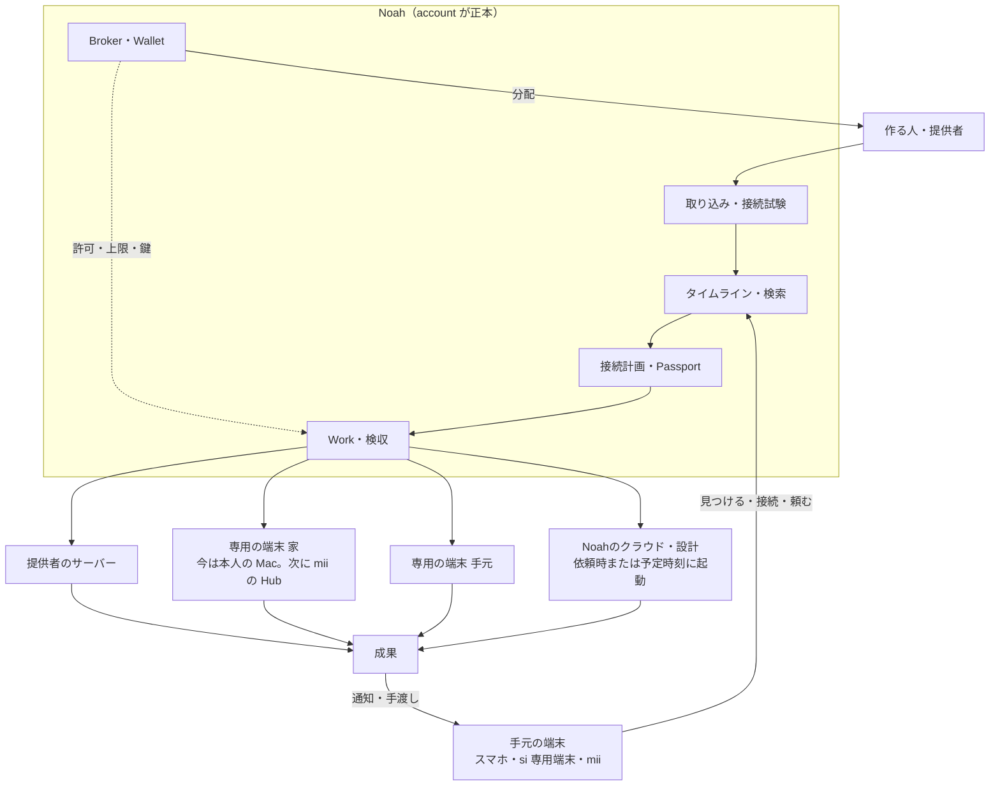
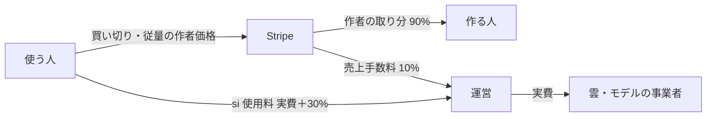
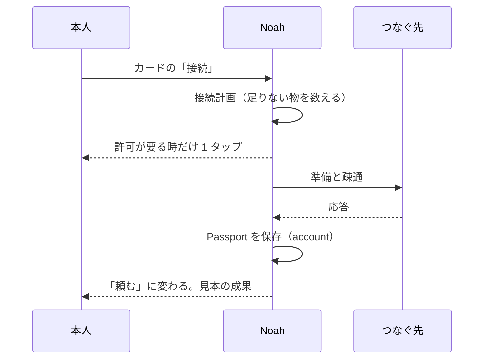
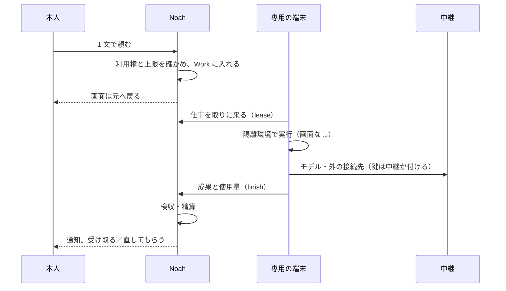
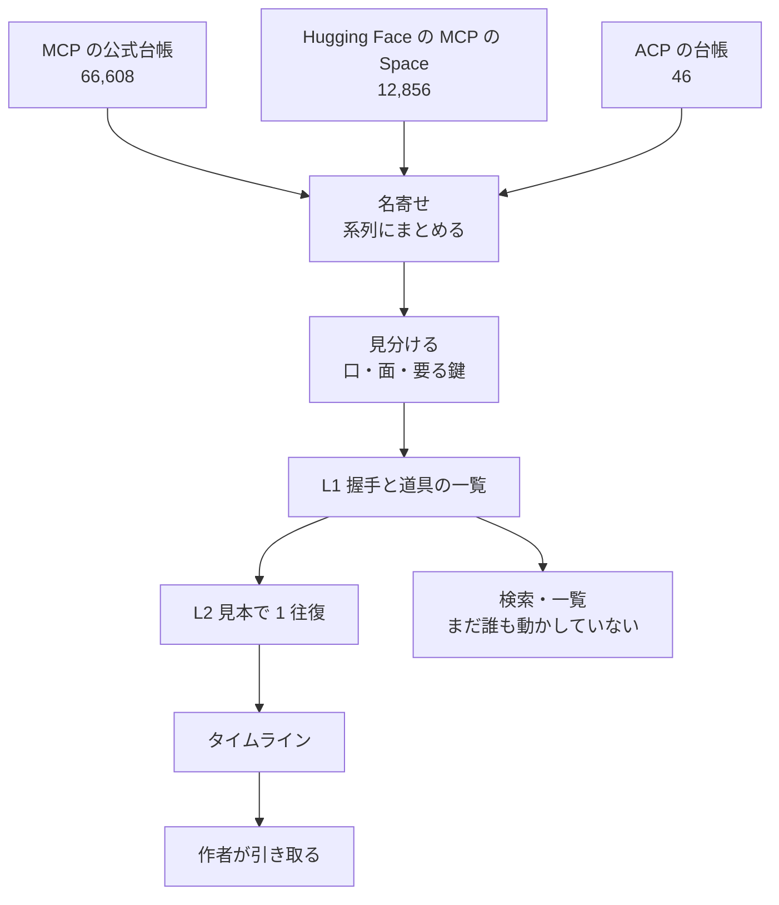
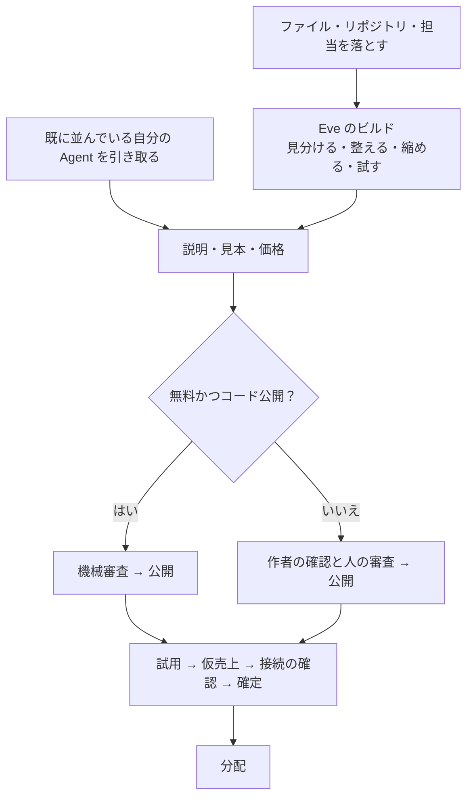

# Noah の設計書（全体）

2026-11-20。Noah 全体を 1 冊にまとめた文書。出典は 11-20 の本人指示と同日に共有された資料（構想、開発進捗）、議事録の決定と 11-20 の本人確定方針「mii が主でミニマムから始めるのが noah」（[07](structure/07-decisions-from-minutes.md)、[product-baseline.md](product-baseline.md)）、main `c4d7c27` のコードと既存のサービスシート、同日の実測（[noah-agent-census-20261120.md](noah-agent-census-20261120.md)）。接続・実行・取り込み・市場の細部は [noah-agent-market-design.md](noah-agent-market-design.md)。「提案」と書いた所は本人確認待ち。数値は候補で、決めるのは本人。

読み方: 1〜2 章が行き先と全体像。3 章が具体的なスキーム。4 章が機能ごとの設計。5 章が「この技術が要るから、こう作る」。6 章が順番。11 章が、7 つの問い（技術・タイミング・独占・人材・販売・持続性・隠れた真実）への答え。12 章が、目的と、一番重く見る 3 つ（本人の言葉 11-20 夜）に、この設計がどう答えているか・足りない所・今の品揃えと並びの現状。そのまま実装できる細かさは [詳細設計書](noah-detailed-design.md)（バックエンド・フロント・UX）。

## 1. 行き先

> 主商品は mii。Noah は、mii へ進む最小構成。みんなが、Noah で Agent を見つけ、1 回で自分の専用の端末につなぎ、当たり前に使う。PC の前に座らない。Agent が働いている間、本人は別のことをしている。

- **mii** は、声で Eve に頼み、空間の表示を見たり触ったりして仕事を進める端末。**Noah** は、その mii に Agent を集める・つなげる・載せる所。
- **専用の端末**は、本人だけの si 専用端末（mii、Pro、Pixel 参照機）。Agent はそこにつながり、そこで動く。
- **進み方は 3 歩。**
  1. 本人の Mac で、選ぶ・接続・実行・成果の受け取り・停止を完成させる（最初の完成条件）。Mac は、人が座る PC としてではなく、Agent の端末の代わりとして裏で動く。本人の画面を取らない。
  2. 手元（スマホ）から頼み、通知で受け取る。外の Agent を、1 件ずつ作らずに大量につなぐ。
  3. 同じ契約を mii の Hub へ移す。声と空間の表示で使う。みんなの専用の端末へ広げる。
- 自分の端末を用意しない人、Macを閉じたまま依頼や定期作業を続けたい人は、Noahのクラウドを選べるようにする構想。操作・実行・請求の流れは[クラウド実行の設計](services/noah-own-device.md#クラウドで依頼して受け取るまで)。
- **PC の前がだめな理由**: 考えは動いている時に来る。画面を読む作業が考えを切る。Agent が画面を使うと人は端末を使えない。PC は閉じれば止まる。持たない人・設定できない人が多い。人が機械に合わせている。10-15「pc のやリアルの物の前にたたなくてもものが作れる状態をつくる、携帯を持たなくてもやり取りができる状態を作る」と同じ線で、mii を作る理由そのもの。
- **受入条件（全体）**:

| 条件 | 判定 |
| --- | --- |
| 座らずに一周 | 接続・依頼・許可・受取・切断が、手元の端末（スマホ、次に mii）だけで終わる。PC は動く所としてだけ使い、前に座るのは最初の導入 1 回だけ |
| 閉じても進む | 依頼の後に、画面を閉じる・端末をロックする・圏外になる。仕事は進み、成果が残る |
| 画面を取らない | 実行中、本人が使っている端末の前面の表示・入力・ブラウザ・音・クリップボードの変化 0。mii では、Agent が空間の表示・カメラ・マイクを直接握らない |
| 見張らせない | 途中で人に求めるのは許可（1 タップ）だけ。許可待ちは通知で届き、前面を奪わない |

「それぞれを agent と呼ぶんだけど、その agent の管理してる箱が noah」（[noah-agent-operations.md](services/noah-agent-operations.md)）。箱が動く所を、人が座る PC から、本人の専用の端末へ移すのがこの設計。

## 2. Noah は何をする所か

| すること | 本人がやること | Noah がやること |
| --- | --- | --- |
| 見つける | タイムラインを見る。探す。Eve に任せる | 外の Agent を取り込み、つながると確かめた物だけ流す |
| つなぐ | 「接続」を 1 回 | 足りない物を数え、埋め、置き場所を決め、疎通を確かめる |
| 頼む | 1 文か 1 タップ | 利用権と上限を確かめ、仕事にして、専用の端末か提供者へ渡す |
| 受け取る | 受け取る／直してもらう | 成果に、誰の Agent が・何を使い・いくらかかったかを添えて手渡す |
| 続ける | 上限を 1 回決める | 予定どおりに仕事を作り、まとめて知らせ、上限で止める |
| 入れ替える | 更新・戻す・切るを 1 タップ | 版を固定し、差分がある時だけ聞き直す |
| 載せる・売る | 引き取る。ファイルを落とす。「載せる」を 1 回 | 下書き、接続試験、審査、分配 |
| 管理する | 自分の利用と費用を見る | 利用者・提供者・運営の 3 つの立場に、同じ記録を出し分ける |

## 3. 具体的なスキーム

### 3.1 登場する人と物

| 誰・何 | 役目 | 持つ物 |
| --- | --- | --- |
| 使う人（本人） | 頼む。受け取る。払う | account、手元の端末、専用の端末 |
| 作る人 | Agent を載せる。売る | 作者の account、受取先（有料の時だけ） |
| 提供者 | 自分のサーバーで Agent・道具を動かしている人 | 接続先、相手側のアカウントの仕組み |
| 運営（avokado） | つなぐ。確かめる。預かる。分ける | Noah、Broker（鍵と許可）、Wallet、審査 |
| 専用の端末 | Agent が動く所。画面が無い | 家（今は本人の Mac。次に mii の Hub、Pro）、手元（Pixel）、雲（端末を持たない人。提案） |
| 雲とモデルの事業者 | 計算を貸す | 従量の請求 |
| 決済の事業者（Stripe） | 支払いと分配 | カードの情報（Noah には置かない） |

### 3.2 お金のスキーム

| 場面 | 使う人が払う | 作る人が受け取る | 運営に残る | 運営が払う |
| --- | --- | --- | --- | --- |
| 無料の道具を 1 回使う（無料枠の中） | 0 円 | 0 円 | 0 円 | 約 0.1 セント（モデル） |
| 買い切り 500 円の Agent を買う | 500 円 | 450 円 | 50 円 | 決済の実費（別表示） |
| 専用の端末（雲）で、無料枠を超えて 1 回動かす（実費 1 円の時） | 1.3 円（しきい値 1,000 円の後払い） | 0 円 | 0.3 円 | 1 円 |
| 従量の Agent を 1 回使う（作者価格 10 円、実費 1 円の時。次の段階） | 11.3 円 | 9 円 | 1.3 円 | 1 円 |
| 家の端末（本人の Mac、mii の Hub）で動かす | 0 円（電気代は本人） | — | 0 円 | 0 円 |
| 常駐する Agent を雲に置く | 受けない（1 体あたり月 約 8 ドルかかる。家の端末へ） | — | — | — |

- 手数料は `floor(価格 × 10%)`。処理費用を引く前の額（[sky-commerce-design.md](sky-commerce-design.md)）。従量の粗利が固定費を 3 か月続けて上回ったら 0（`lib/sky-marketplace-policy.ts`）。登録・接続・公開・基本利用は 0 円。
- 有料は、**試す → 仮売上 → 接続の確認 → 確定**。つながらなければ払わない。
- 取り込んだ Agent は、作者が引き取るまで無料のまま。お金を発生させない。
- 取り分は、作る人にも使う人にも見せる。
- 月額と無料枠の関係は未決（8 章）。回線・月額・ハードの価格は既存の個別の確認のまま（[05](structure/05-business.md)、[product-baseline.md](product-baseline.md)）。この設計は料率を変えない。

### 3.3 つなぐスキーム

| 足りない物 | 誰が埋めるか | 手数 |
| --- | --- | --- |
| 無料の利用権、つないである専用の端末、依存、モデル、前に許可した外部サービス | Noah | 0 |
| パスキー、相手の許可（OAuth）、保存済みの支払い方法での購入 | 本人の「はい」 | 1 タップ |
| API キーの貼り付け、アプリの導入、相手のサイトの会員登録 | 本人の作業 | 入力（「1 クリック」の印を出さない） |

状態: `planned → entitling → preparing → probing → connected`。不足は `needs_action`、不可は `blocked`、不明は `unknown`（同じ操作 ID で照合し、自動で再接続しない）。

### 3.4 動かすスキーム

- 端末が外向きの HTTPS で取りに来る。Noah から端末へは入らない（今の Mac の runner と同じ。lease 30 秒、heartbeat 5 秒以内）。
- 止める時は、停止の確認が返ってから「停止済み」と出す。lease を越えた仕事は結果不明にし、再配送しない。
- 専用の端末は、今は本人の Mac。同じ受け渡しを mii の Hub が行う。提供者のサーバーで動く物は、端末を使わない。Noah の「道具を持つ担当」が本人の 1 文を受け取り、その接続先の道具を呼ぶ。
- 上限は今の `LIMITS`（240 秒、モデル呼び出し 8 回、出力 2,048 トークン）から始める。

### 3.5 集めるスキーム

| 口 | 1 つ作ると届く数（2026-11-20 の実測） | 動く所 |
| --- | --- | --- |
| リモートの道具（MCP） | 45,668 件。鍵なしで応答する host は約 1 万 7 千（標本の 54.6%） | 提供者 |
| Space（Gradio の MCP） | 動いている 4,275 件の約 82% | 提供者 |
| ターミナル（ACP） | 46 件。Goose・Cline・OpenHands・Codex・Gemini CLI・Claude・Devin を含む | 専用の端末 |
| ターミナル（MCP の package） | 25,063 件。鍵が要らない 12,649 | 専用の端末 |
| A2A、コード | 後。コードは Eve のビルド | 提供者／専用の端末 |

1 件ずつ実行器を書かない。調査した残り 72 件は、口で届く 33、家の端末か中の画面を待つ 13、書いても 1 クリックにならない 26。

### 3.6 載せる・売るスキーム

作者が書く欄は 0 を目標にする（今は入力欄 59）。最初に載せる人は、ファイルを上げる人より先に、引き取る人になる。

### 3.7 端末のスキーム

| 歩 | 手元（頼む・受け取る） | 動く所 | 人は PC の前に座るか |
| --- | --- | --- | --- |
| 1 最小構成（今、完成させる） | Web の画面 | 本人の Mac の隔離環境（裏で動く） | 導入と承認の時だけ（今は導入 5・コマンド 3） |
| 2 座らない | どのスマホでも。通知で受け取る | 本人の Mac（導入 1 つ）、提供者のサーバー | 座らない |
| 3 mii | 声で Eve に頼む。空間の表示を見て触る | mii の Hub（同じ契約）、Pro | PC が要らない |
| 広げる | si 専用端末（Pixel）、どのスマホでも | ＋ 雲（端末を持たない人。提案）、手元（スマホ内版） | 要らない |

- つないだ Agent（Passport）は account が正本。端末は cache。Mac でつないだ物は、mii を入れた日に承認 1 回でそのまま使える。
- 契約は 1 つ（`noah-terminal/1`、`noah-isolation/1`、取りに来る受け渡し）。置き場所の値は `provider`・`home`・`cloud`・`pocket`。機種の名前は契約に書かない。ハードの差は hardware profile に置く（[02](structure/02-rockstaros.md)）。
- 家（Mac → Hub）が本線である理由: 主商品が mii で、Hub は RockstarOS が動く唯一の場所（[01](structure/01-mii.md)）。常駐する Agent、本人の月額契約で動く Agent（Codex 等）、手元のデータ、画面を操作する Agent 用の「誰も使っていない画面」が、家でしか成り立たない。雲の使用料も 0。
- Noahのクラウドを選んだ単発・定期の仕事は、利用者のMacがスリープ中でも進む。利用者は仕事の前に上限を決め、成果と利用明細を後から確認できる。事業者・月の上限は未決。[受付から精算まで](services/noah-own-device.md#クラウドで依頼して受け取るまで)

### 3.8 データのスキーム

| 何を | どこに（既存） | 足す物 |
| --- | --- | --- |
| 本人・端末の承認 | account、`noah_runner_devices`（今は Mac） | Hub・Pro の行。雲を始める時は platform=`cloud` の行 |
| 仕事の受け渡し | `noah_runner_commands`（端末 1 台につき実行中 1 件） | 並列が要る端末の持ち方（別の表か、制約の分割） |
| 仕事と成果 | 既存の Work / Job / Receipt | 変えない |
| 外の候補 | `noah_discovery_sources`・`_candidates`・`_versions`（GitHub・Hugging Face。変えない） | 取り込み用の別の表: `noah_intake_sources`・`noah_intake_candidates`・`noah_intake_checks`（口・面・接続要件・深さ）・`noah_intake_families`（系列・引き取り・取り下げ）。今の表は出どころを 2 つに固定する制約を持ち、鍵がリポジトリで、上限が 10,000 件なので、足さない |
| 載せた Agent | `noah_agent_drafts`、`sky_tool_packages`、`sky_tool_package_reviews` | sidecar `noah-connect/1`、`noah_agent_variants`（スマホ内版） |
| つないだ物 | `noah_instances`（系列・版・固定）、`sky_connections`、`sky_provider_connections` | Passport（置き場所・道具の定義の hash・同意の版）を account に |
| 売り買い | `sky_commerce_offers`・`_orders`・`_sellers` | 販売条件に `trialRuns`・`updates` |
| 利用の記録 | `lib/noah-usage.ts` の集計 | 受け渡しの完了と道具を持つ担当で、1 回だけ記録する |

既存の表の意味と名前は変えない。本番の migration は本人の許可の後。

## 4. 機能ごとの設計

進捗報告（2026-11-20）の 11 項目に、構想とのずれと直し方を付ける。

| # | 項目 | 今 | ずれ | 設計 | 文書・task |
| --- | --- | --- | --- | --- | --- |
| 01 | 1 クリックで接続・実行 | 13 / 85。Mac の隔離環境 | 人が Mac の前で操作する前提。1 件ずつ実行器 | Mac の一周を完成させる。口ごとに取り込む。接続計画。手元から頼む | [market](noah-agent-market-design.md) 4.3・4.4、71・96・74・85〜90 |
| 02 | Anicca などを自分の Codex につなぐ | 固定版の連携と、Codex の画面なし実行器 | 本人のログインが Mac に要る | 4.1 | 89、83 |
| 03 | Agent・LLM の追加・更新・削除 | カタログ、取得、固定版、モデルの共有 | 更新・復元が一貫していない。端末の移行が無い | 4.2 | 93 |
| 04 | 載せて、買って使う | 登録 → 審査 → 公開の基盤。無料か既存の利用権 | 入力欄 59。別の利用者での通しが無い | 引き取り、Eve のビルド、つながってから払う | [market](noah-agent-market-design.md) 4.6・4.8、76〜78・81 |
| 05 | タイムライン・新着・推薦 | 公開の入口、候補の取得、推薦の基盤 | 取り込んだ候補は実行できない。数が増えると選ぶのが手間 | 4.3 | 88、81、80 |
| 06 | 継続して任せる | 定期実行、開始・停止・再開。Mac と Noah が動く間 | Mac を閉じると止まる。金額の上限とつながっていない | 4.4 | 92 |
| 07 | Mac を閉じても動く雲 | 固定のテスト Agent だけ | 一般の Agent は雲で動かない | 端末を持たない人の置き場所として足す（提案。個別の契約と受入） | [own-device](services/noah-own-device.md)、75 |
| 08 | 実行場所を選び、スマホから使う | Mac の runner への経路 | 場所を自動で選ばない。スマホの通しが無い | 接続計画が選ぶ。手元から頼み、Mac は裏で動く。次に mii | 96、90、83、95 |
| 09 | 3 つの立場で利用を管理 | 集計 API、所有権の検査、SDK | 全 Agent の計測になっていない。上限で止まらない | 4.5 | 94 |
| 10 | 下書き・限定共有・招待・外部送信 | 版の管理、限定招待、送信の下書き → 承認 → 送信 | 別の利用者での受入が無い | 4.6 | 74、既存の受入 |
| 11 | アップ時の自動リファクタ | 構文整理、固定テスト付きの整理（ローカルだけ） | 公開側で動かない。きれいにするだけ | 「整える」＝利用者の登録と準備を消す | [eve-agent-build](services/eve-agent-build.md)、77 |

### 4.1 本人の契約で動く Agent（Codex、Claude、Gemini CLI など）

- 本人の月額契約で動く Agent は、**専用の端末（家）でだけ**動かす。本人のログインを運営の雲へ運ばない（規約の確認は 9 章）。
- つなぐ条件は「その端末で、提供元の公式の手順で 1 回ログインしてある」こと。Noah は鍵もメールアドレスも受け取らない（今の Codex の実行器と同じ。`scripts/noah-codex-runtime.mjs`）。
- Agent から Agent への受け渡し（Anicca の計画 → Codex の実行）は、依存として 1 回の接続でまとめてつなぐ。
- 同じ種類の Agent は ACP の口で一般化する。Agent ごとの実行器を増やさない。

### 4.2 入れ替える（追加・更新・戻す・切る・移す）

- **一覧は 1 つ。** つないだ Agent と、端末に入れたモデルを同じ一覧に出す。正本は account。
- **更新。** 新しい版が出た時、権限・道具の定義・料金・通信先に差が無ければ自動。差がある時だけ 1 タップで聞き直す。
- **戻す。** 前の版へ 1 タップで戻せる。固定（pin）した版は自動で上げない。
- **切る。** 新しい実行を止め、端末の cache を消す。成果と費用の記録は残す。
- **モデル。** 雲は中継なので、本人が管理する物は無い。家と手元は、裏で取得し、複数の Agent で共有し、使用中は消さない（既存）。容量が足りない時は、使っていない物を挙げて本人に選ばせる。
- **移す。** 端末を足した時・替えた時、置き場所の変更をまとめて 1 回の確認で行う。

### 4.3 見つける（タイムライン・検索・推薦）

- **流す物。** L2 の接続試験が 7 日以内に通った系列だけ。検索と一覧には L1 の物も出し、「まだ誰も動かしていない」と書く。
- **カードに出す物。** 日本語の 1 行説明、見本（実際の入力と成果）、接続の手数、動く所、費用、作者。
- **選ぶ手間を増やさない。** 同じ物のコピーは 1 枚にまとめる。並び順は、接続の成功率・最初の成果までの秒数・検収の合格率（提案）。人気と売上は入れない。
- **Eve が選ぶ（0 クリック、提案）。** 仕事の途中で足りない能力を Eve が見つけ、条件（無料、権限は入力の読取と成果の保存だけ、L2 済み、動く所が専用の端末）を満たす物を自分でつなぐ。11-15「組合せを人間が考えるのは嫌」。
- **フォロー。** 作者と提供者をフォローすると、新しい版と新しい Agent が流れる（既存の関心・フォローの基盤）。

### 4.4 続ける（継続運用）

「接続ボタンを押すとターミナル下で始まり、他の画面をストレスなく触れるようにしたい」（[noah-background-operation.md](services/noah-background-operation.md)）。

- **予定は account に置く。** 時刻や、他の Agent の成果を起点に、Noah が Work を作る。専用の端末が取りに来る。雲に置けば、Mac を閉じても続く。
- **始める前に 1 回、上限を決める。** 回数・期間・金額。今の「依頼と上限の確認後に開始する」を保つ。初期値は今の計画（最大 24 時間・100 回・同時 1 件）。
- **知らせ方。** 毎回は鳴らさない。まとめて知らせる。失敗が続いたら止めて知らせる。
- **常駐する Agent**（チャットに住む型）は、専用の端末（家）へ。雲では受けない。
- 止める・再開は 1 タップ。更新しても自動では走らない（既存の合格条件）。

### 4.5 管理する（利用者・提供者・運営）

「誰がどのくらい agent を使ってるのか管理」「1,2,3 全部」（[noah-agent-usage.md](services/noah-agent-usage.md)）。

- **記録は 1 か所で 1 回。** 全部の実行は、受け渡しの完了（finish）か、道具を持つ担当を通る。そこで、誰が・どの系列のどの版を・どこで・結果・秒数・トークン・費用・価格を記録する。依頼と成果の本文は入れない。
- **利用者。** 自分の利用、費用、無料枠の残り、月の上限。上限で止まる（Wallet の予約）。
- **提供者・作者。** 自分の Agent の接続数、成功率、最初の成果までの秒数、売上。個人は見えない。人数が少ない区分は出さない（候補: 5 人未満）。
- **運営。** つながると確かめた数、失敗、費用、無料枠の消費、濫用の兆候。
- 未計測を無料と表示しない（既存の合格条件）。

### 4.6 限定で配る（下書き・招待・外部送信）

- **招待から来た人も、同じ 1 クリック。** 招待のリンクは接続計画へつながり、相手はパスキー 1 回と「接続」1 回で使える。
- **撤回。** 新しい実行を止め、動いている仕事は次の heartbeat で止める。
- **外部送信。** 下書き → 本人の確認 → 送信 → 結果の照合（既存）。確認は通知で届き、前面を奪わない。

### 4.7 mii で使う

「声で Eve に依頼し、空間の表示を見たり触ったりして仕事を進める」（11-20 の本人確定方針）。Noah がそこへ渡す物を決めておく。

- **流れ。** 声で Eve に頼む → Eve が依頼を仕事にする → Noa がつないだ Agent を選ぶ（足りなければ Noah で探してつなぐ）→ Hub の隔離環境で動く → 成果を空間の表示へ出す → 見て、触って、直す（声と指先による依頼の修正・保存・再開は、既存の WorkJob へつながっている。[01](structure/01-mii.md)）。
- **Agent に、表示層・カメラ・マイク・センサーを直接渡さない。** Agent が返すのは成果（文章・ファイル・表示の依頼）。描くのと聞くのは RockstarOS。部屋の表示を Agent が乗っ取らない。画面を取らない決まりの mii 版。
- **Hub が動く所。** Hub は RockstarOS が動く唯一の場所。専用の端末（家）の受け渡しを、Hub で同じ形で動かす。今の Mac は、その代わりを務める最初の実装。
- **持ち越せる物。** つないだ Agent、接続の条件、仕事と成果、費用の記録は account にある。Mac で作った物は mii でそのまま使える。
- **許可。** 声や在室だけで本人の承認にしない（既存）。外部への書き込み・支払い・設備への作用は、別の本人確認を通す。
- **今やること。** mii の表示・入力・演算の方式は設計と試作の途中なので、ここでは契約だけを固める。Mac 固有の処理を 1 か所に寄せ、Linux の host で同じ受入が通ることを確かめる（task 95）。

## 5. 要る技術と、作り方

「この技術が要るから、こう作らなければならない」の一覧。今ある物を土台にし、無い物だけ作る。

| 技術 | 何のために | 今ある物 | 作り方 | 難しい所 | task |
| --- | --- | --- | --- | --- | --- |
| 画面の無い隔離環境（Linux の VM） | 画面を取らない。座らない | Mac の VM と container（network 無し・読み取り専用・`DISPLAY` 空）。これが最初の実装 | 同じ起動条件を、Linux の host（Hub・Pro）と、端末を持たない人向けの雲（Cloudflare Sandbox。1 つが 1 つの VM）へ。共通の image 1 つ | 起動の秒数。雲の image は account で 50GB まで。今の 13 件は Agent ごとの image | 84・95・75 |
| 依存の層 | 「接続」から数秒で動く | Mac で初回に image を作る（上限 15 分） | 導入を 1 回だけ行い、読み取り専用の層として保存して重ねる（Sandbox の backup） | 層の hash の固定。導入の時だけ registry を開ける | 75・89 |
| 受け渡し（取りに来る・lease・停止確認） | 閉じても進む。二重実行 0 | `/api/noah/runner`、`noah_runner_commands`。公開版で接続・実行開始・停止を確認済み。正常完了と成果の受け取りが未合格 | まず正常完了を通す（71）。同じ API を Hub と雲の端末が呼ぶ | 端末 1 台 1 件の制約。並列の持ち方 | 71・95・75 |
| 外向きの中継と鍵の預かり | Agent に鍵を渡さない | 「認証情報は container へ渡さない」の決まり | 全閉から始め、宣言した host だけ開ける。鍵は中継で付ける | HTTPS のままコードを変えずに受けられるか。だめなら呼び出し先を付け替える | 75・86 |
| モデルの中継 | API キーの登録を消す | Mac のローカルモデル。URL・header・モデル名を Agent から受け取らない検査 | OpenAI 互換の入口を 1 つ。裏の事業者を差し替えられる形に。トークンを計測 | 小さいモデルの道具の呼び出しの質。固定の評価で選ぶ | 87・75 |
| MCP の client（今の版と新しい版） | リモートの道具 45,668 件 | `lib/mcp-client.ts`、`lib/mcp-inspection.ts`（2025-11-25 まで） | 握手で版を決める。JSON と SSE。道具の定義の hash を固定 | 実装のばらつき（新しい版に応答したのは 273 中 8） | 86 |
| 事前の申し込み無しの認可 | 相手の許可を 1 タップに | 無い | 保護された資源の公開情報 → 認可サーバー → client 文書（無ければ動的登録）→ PKCE。token は Broker | 認可サーバーごとの差、更新、取り消し。古い方式が 91%、新しい方式が 36% | 86 |
| 道具を持つ担当 | 道具を 1 文で頼める形に | Eve の担当、planner、`LIMITS` | 1 回の仕事に接続先 1 つ。道具の説明は指示として読ませない。書き込みは確認 | 注入は完全には防げない。権限で被害を限る（その接続の道具しか呼べない。鍵を持たない） | 87 |
| 取り込みと名寄せ | 大量に扱う | 発見（GitHub・Hugging Face。lease・ETag・hash。上限 10,000 件）。巡回の作りを手本にする | 取り込み用の表を別に作る。台帳の 1 件を、型の付いた項目だけから接続要件の下書きにする（全 66,608 件を通して、下書き 94.3%、例外 0）。系列の鍵（量産、同じ道具の定義、別の載り方、写し） | 量産となりすまし。台帳の書き方の揺れ。台帳に公開された鍵（6 件）を運ばない | 85 |
| 接続試験と見回り | 約束は試してから出す | 無い（試験済み 0 件） | L1 は握手 1 回。L2 は読み取りだけの道具に限る。本人の実行も L2 に数える | 礼儀と回数制限。握手だけ通る偽の成功 | 86・88 |
| 接続計画と接続要件 | 手数を正直に出す。場所を選ぶ | 文章の必要条件 | sidecar `noah-connect/1` と純関数。契約の表をそのままテストに | 本人が相手のアカウントを持っているかは分からない | 96 |
| 1 クリックの操作 | 1 回で終わる | 取得の準備と接続が別の操作。`returnTo` | 1 操作にまとめる。操作 ID で冪等。見た計画の hash を照合 | 途中で閉じた時の続き。結果不明の扱い | 74 |
| Passport の同期と移す | 専用の端末へそのまま移る | 接続は端末ごと | account を正本にし、端末は cache。置き場所の一括変更 | 端末が無い間の扱い（黙って変えない） | 74・75 |
| ターミナルの口（ACP・package） | 実行器を 1 件ずつ書かない | Codex の実行器、13 件の手書き | 台帳の型の付いた項目を固定の型紙へ。PTY で起動 | Agent ごとのログイン。項目の検査 | 89 |
| 画面を取らない検査 | 絶対に取らないことの証明 | 起動条件と合格条件の文 | 面の見分け（静的）、起動引数の検査、検査用の端末での観測 | 観測そのものに権限が要る。検査用の端末に限る | 84 |
| 通知と「あなたの番」 | 見張らせない | Work に保存。画面で確認 | 対応する端末は通知。許可待ちは一覧へ | iPhone の Web の通知は、ホーム画面に追加した時だけ | 90 |
| 中のブラウザと仮想の画面 | 画面が要る Agent の行き先 | 無い | 隔離環境の中の画面なしブラウザ。仮想の画面。見るだけの窓 | ログイン、bot の判定、費用（4 分で約 1 セント） | 91 |
| スマホ内版の圧縮 | 通信が無くても動く | Pixel の動的追加（宣言型・GGUF） | 指示を縮める → 最小のモデルを選ぶ → 同じ固定テスト → 実機 | 小さいモデルで同じ合否 | 79 |
| 決済（仮売上 → 確定） | つながってから払う | Stripe Checkout / Connect、10% | 後から確定する形が今の分配で通るかを sandbox で先に確かめる。だめなら自動返金へ | 決済の形と制度 | 78 |
| 利用権の受け渡し | 提供者サイトの会員登録を消す | 設計だけ（`sky-paid-access/1`） | Noah が出す短命の証明を、提供者の受け口が確かめる | 提供者側の導入が要る | 82 |
| 家の端末（Mac を座らない端末に） | 本線の 2 歩目 | Mac の runner と常駐の仕組み。導入 5・コマンド 3 | Node の同梱、macOS 26 の Apple container、QR で承認、実行用 image を裏で用意、重さの上限 | スリープ。署名と配布 | 83 |
| Linux 版の runner（Hub・Pro） | mii で動かす | Mac 専用の起動（Colima）。RockstarOS の native（Buildroot・QEMU） | Mac 固有の処理を 1 か所に寄せ、Linux の host で同じ受入を通す。次に Hub の基板で | Hub の演算は未決（[01](structure/01-mii.md)）。同時 2 件の隔離環境とローカルモデルが載ること | 95 |
| 声と空間の表示への受け渡し | mii の体験 | 声・指先による依頼の修正は WorkJob へ（限定の試用） | 依頼は Eve → Work。成果は「表示の依頼」として profile の表示層へ。Agent は表示層を直接握らない | 表示・入力・センサーの方式は設計と試作の途中 | 95 |
| 予定の実行 | 継続して任せる | Mac のローカルの計画 | 予定を account に置き、時刻で Work を作る | 上限と費用の事前確認。失敗の連続 | 92 |
| 利用の記録 | 3 つの立場の管理。上限で止める | 集計 API と SDK | 完了の 1 か所で 1 回だけ記録 | 二重計上、未計測の表示 | 94 |

## 6. 作る順番

一周が閉じる順に作る。各 task は 1 PR。順番の正本は [codex/tasks/00-index.md](../codex/tasks/00-index.md)。

| 段階 | 閉じる一周 | task | 先に要る決定 |
| --- | --- | --- | --- |
| 0 最小構成 | 本人の Mac で、選ぶ・接続・実行・成果の受け取り・停止（進行中）。画面を取らない検査が通る | 71 の残り、84 | 無し |
| 1 大量につなぐ | 外の Agent を、1 件ずつ書かずに、1 クリックでつなぎ、1 文で頼む。動く所は提供者と本人の Mac | 85、96、86、87、74、88、89 | モデルの出どころと月の上限 |
| 2 座らない | 手元（スマホ）から頼み、通知で受け取る。Mac は導入 1 つで裏に回る。継続して任せる。利用を 3 つの立場で見る | 90、83、92、94 | 署名と配布 |
| 3 作る人 | 別の人が載せる・引き取る・審査・公開。試して、つながってから払う。更新・戻す・移す | 81、76、77、78、93 | Stripe の sandbox、審査の担当 |
| 4 mii | 同じ契約を Linux の host（Hub の代わり）で動かし、声と空間の表示の模擬で一周。次に実機 | 95 | Hub の演算、検証用の端末 |
| 並行（個別の残件） | 端末を持たない人の置き場所（雲）、中のブラウザと画面、スマホ内版、提供者の利用権、0 クリック | 75、91、79、82、80 | Cloudflare の契約と月の上限 |

- 段階 0 は main の方針（最初の完成条件は本人の Mac 上の Noah。[rockstaros-1.0-strategy.md](rockstaros-1.0-strategy.md) の 6 手順）そのまま。進捗報告の A1〜A5 がこれに当たる。
- 段階 1 は、Mac の受入と並べて進められる。リモートの道具は隔離環境が要らない。ターミナルの口は、今ある Mac の隔離環境で動く。
- 残り 72 件を 1 件ずつ対応する作業（1〜10 人日/件）は行わない。
- 13 / 85 などの限定試験を、全体の合格と数えない。

### ローンチの最小限（本人指示 11-20: 「ローンチするのに最小限って意味の mvp」）

段階 0〜1 の全部を作ってから出すのではない。**出すまでに作る範囲と順は [noah/mvp-launch.md](noah/mvp-launch.md) が決める。**

- 出す物: スマホだけで、PC の前に座らずに、選ぶ・接続（1 回）・入力欄から頼む・受け取る・切る。動く所は相手のサーバー。本人の端末では何も動かない。
- 品揃え: 公式台帳の、鍵も許可も無しで握手が通る物。見込みは約 18,000 系列（握手の標本から）。入力欄で、実在の道具の 95.5% が使える（握手が通った 276 接続先の 3,699 個に通した実測）。
- 入れない物（出した後の順）: 相手の許可（OAuth）→ 1 文で頼む（モデル）→ 家の端末を同じボタンで → Space・ACP → 見本の自動実行。端末で動かす配布（89）、雲、売り買い、作者の引き取り、mii。
- 作る順は L1〜L9（84 → 96 → 85 → 86 → 74 → 87 → 88 → 97 → 90 の、各仕様書の「ローンチの範囲」の章だけ）。今の Mac の道（task 71）の画面と API は変えない。
- 出す前に確かめる事（一周・品揃え・守り・巡回・窓口・止め方・本人の許可）と、本人が決める事 13 個（既定つき）も、同じ文書にある。

変えないもの: Eve → Noa → AMC → Jev の構造。Broker と Wallet の gate。API path・D1 table・enum の既存名。価格と料率。原本を変えない決まり。台帳の文章を実行コードにしない決まり。本番の migration・本番の決済鍵・外部との契約・端末の署名と flash は本人の明示許可の後。

## 7. 測る値

- **つながると確かめた数**（L2 が 7 日以内に通った系列）。今は 13（Mac がある人だけ）。
- PC の前に座らずに一周できた人の数。今は 0。
- 本人の Mac の最小構成で、どの Agent・どの仕事が続けて使われたか（main の方針の「検証する仮説」）。
- 初めての人の接続の手数（目標: 1 タップ以下、入力 0）と、最初の成果までの秒数（候補: 30 秒以内）。
- 画面を取らない検査の違反件数（目標: 0）。
- 作者と別の人が一周を通した回数。今は記録の上で 0。
- 作者が載せるまでに書いた欄の数（目標: 0）。

台帳の行数、機能の数では測らない。

## 8. 本人が決めること

1. 1 章の言い直しが構想と合っているか。「専用の端末」に雲の置き場所を含めてよいか。
2. 取り込んだ道具を、Agent と同じカードで並べてよいか。
3. 端末を持たない人の置き場所として、雲を始めるか。月の上限額（候補 $30）。
4. 無料枠（実行回数）と、試行後の接続枠・クラウドの条件。定期便と有料の差し引きは11-24の決定を参照。
5. モデルの出どころ（Workers AI の従量、今の無料 Cloud、自前の GPU）。
6. 他人の公開 Agent を、引き取りと取り下げの窓口を置いた上で、許可を待たずに無料で並べてよいか。
7. 侵入試験の Agent を共有の雲で受けない、本人の端末そのものを操作する Agent を受けない、でよいか。
8. 0 クリック（Eve が自分でつなぐ）を最初からオンにするか（提案: オン）。
9. 無料かつコード公開の Agent を機械審査だけで載せるか。人の審査の担当は誰か。
10. 直した版を使う権利の既定を「含む」にするか。
11. 継続運用の上限の初期値（今は最大 24 時間・100 回・同時 1 件）。
12. 作者に見せる集計の最小人数（候補: 5 人）。
13. 検証用の端末（Linux の host、Pixel）を常時つないでおくか。iPhone は「スマホから使う」だけにするか。
14. 10-10 の「作る人：使う人＝9：1」は、分配の比か、人数の比か。
15. Stripe の sandbox での受入をいつやるか。
16. 最初の小さな市場をどれにするか（11 章の候補 A 作る側・B 使う側・C mii。提案は A → B）。

2026-11-21 に決まった所: 4 のうち、無料でつなげる数は 6 枚・有料は 50 枚（数えるのはカード。[棚の仕様](noah/spec-110-shelf.md) 8 章）。12 の最小の人数 5 は、棚の並びと数字の表示にも使う。16 は、使う側（B）の入口を、3 つの棚と 300 人の試行として先に作る（[300人試行](noah/trial-300.md)）。作る側（A）の順は変えていない。

2026-11-24 に決まった所。300人の試行中は無料で、定期便の本人分の配分も行わない。300人到達の翌月以降に月締めを行い、有料を希望した人は、確定した本人の分が600円以上の月だけ600円を差し引く。実際に始めるには入金の照合、初回月締め、税務・法務の確認、本番設定が必要。[定期便仕様と開始条件](noah/spec-124-teikibin-ledger.md)

## 9. 専門家に確認すること（確認していない）

- 他人の公開の接続先と Space を、作者の許可無しに並べて呼ぶこと（利用規約、商標、作者表示）。
- 本人の月額契約で動く Agent を、運営の雲で動かすことが各社の規約に合うか。合わない前提で「家の端末だけ」にしている。
- 特定商取引法の表示、取引デジタルプラットフォーム消費者保護法、従量をまとめて請求して作者へ分ける形と資金決済の関係、消費税とインボイス、利用規約、他人の公開コードのライセンス、NY の LLC が日本で売る時の表示。
- 「稼ぐ・仕事を省く」の棚の見せ方と月額の組み合わせが、特定商取引法の業務提供誘引販売取引（「仕事を提供するので収入が得られる」と誘い、仕事に必要だとして負担を求める取引）に当たらない形か。当たらないようにする決まり（金額を約束しない・試行の間は無料・カードの文に誘う語を書けない）は [noah/trial-300.md](noah/trial-300.md) の 6 章（2026-11-21）。
- 健康のカードで、どこまでが一般的な情報で、どこからが診断や医療の助言に当たるか。確かめた記録が無い間は、助言を含むカードを棚に載せない（[noah/spec-110-shelf.md](noah/spec-110-shelf.md) の 9 章。2026-11-21）。

## 10. 文書の地図

| 知りたいこと | 文書 |
| --- | --- |
| そのまま実装できる細かさ（UX・フロント・API・データ・状態遷移・試験・開発の進め方） | [noah-detailed-design.md](noah-detailed-design.md) |
| **ローンチの最小限（MVP）**: 線・作る順・出す前に確かめる事・本人が決める事 | [noah/mvp-launch.md](noah/mvp-launch.md) |
| **棚とパッケージ**（選ばせない・組み合わせを考えさせない。カードの形、載せる条件、学習なしの並び、札、つなげる数）と、**300 人への出し方** | [noah/spec-110-shelf.md](noah/spec-110-shelf.md)、[services/noah-shelf.md](services/noah-shelf.md)、[noah/trial-300.md](noah/trial-300.md) |
| 作業単位ごとの実装仕様書（今あるコードのどこをどう変えるか、規則の全表、画面と文言、処理の順、試験）。各仕様書の最後が「ローンチの範囲」 | [noah/README.md](noah/README.md) |
| 動く型契約と参照実装、表の定義、実データでの試験と実測 | [contracts/](contracts/)（`noah-*`）、[design-validation/noah/README.md](design-validation/noah/README.md) |
| 接続・実行・取り込み・市場の細部、費用の計算、外の規格との関係 | [noah-agent-market-design.md](noah-agent-market-design.md) |
| 実測の方法と数字、85 件の分類 | [noah-agent-census-20261120.md](noah-agent-census-20261120.md) |
| 1 クリック接続、接続要件、接続計画 | [services/noah-one-click-connect.md](services/noah-one-click-connect.md) |
| 専用の端末（雲・家・手元） | [services/noah-own-device.md](services/noah-own-device.md) |
| 画面を取らない | [services/noah-screenless.md](services/noah-screenless.md) |
| 取り込み、口、道具を持つ担当、接続試験 | [services/noah-agent-intake.md](services/noah-agent-intake.md) |
| Eve のビルド、スマホ内版、売り買い | [services/eve-agent-build.md](services/eve-agent-build.md)、[services/noah-mobile-variant.md](services/noah-mobile-variant.md)、[services/noah-agent-purchase.md](services/noah-agent-purchase.md) |
| 既存: 箱としての Noah、継続運用、利用状況、限定で配る、発見、端末内ストア | [services/noah-agent-operations.md](services/noah-agent-operations.md)、[services/noah-background-operation.md](services/noah-background-operation.md)、[services/noah-agent-usage.md](services/noah-agent-usage.md)、[services/noah-agent-delivery.md](services/noah-agent-delivery.md)、[services/noah-agent-discovery.md](services/noah-agent-discovery.md)、[services/noah-device-store.md](services/noah-device-store.md) |
| 既存: Mac の runner と公開の受入 | [services/noah-standalone-launch.md](services/noah-standalone-launch.md)、[codex/tasks/71-noah-standalone-launch.md](../codex/tasks/71-noah-standalone-launch.md) |
| 料金と収益の正本 | [structure/05-business.md](structure/05-business.md)、[sky-commerce-design.md](sky-commerce-design.md) |
| task の順番 | [codex/tasks/00-index.md](../codex/tasks/00-index.md) |

## 11. 7 つの問い — この設計は答えられているか

11-20 の本人指示。答えられている所と、まだの所を分けて書く。「まだ」を埋める作業は、設計と 8 章の決定に入れた。

| 問い | 判定 | 今の答え | 足りない所 |
| --- | --- | --- | --- |
| 技術: 既存の手段を大きく上回るか | 途中 | 手数 13 → 1、つながると確かめた数 13 → 千の桁、人が見張る時間 → 0。設計の上では 10 倍の差を置いた | 未実装で、実測が無い |
| タイミング: なぜ今か | 答えられている | 供給が今、急に増えている。信頼の層が無い（下の実測） | 窓は長くない |
| 独占: 小さな市場で大きなシェアを取れるか | まだ | 最終は「みんな」。最初の小さな市場を選んでいない | 本人が選ぶ（8 章の 16） |
| 人材: 実行できるチームか | 途中 | 小さい体制で回る作りにした（1 件ずつ作らない、サーバーを持たない、実装する Agent が止まらない設計書） | 端末・決済と法務・安全の監査・作者対応の担い手 |
| 販売: 届けて買ってもらう経路があるか | まだ弱い | 経路を 5 つ設計に入れた（下） | どれも未検証。何に払ってもらえるかが未確定 |
| 持続性: 10 年後、20 年後も守れるか | 途中 | 残る資産を 6 つ仕込んだ（下） | 効くかどうかは年単位 |
| 隠れた真実: 他社が見落としている機会か | 仮説として持てている | 「足りないのは Agent ではなく、つながると確かめた事実と、Agent の置き場所」 | 仮説。確かめ方を置いた |

### 技術

- **比べる相手。** 自分で Agent を入れる（今の Mac の手順は 13 手以上、初回に十数分）。一覧だけの台帳（66,608 件。つながるかは誰も測っていない）。大手の chat の接続先一覧（選ばれた少数。相手の雲で動く）。画面を操作する Agent（動いている間、端末を使えない）。
- **上回る所。** 1 回でつながる。つながると確かめてある。見張らなくていい。本人の専用の端末で動く。
- **真似しにくい中身。** 接続試験と見回りの蓄積。足りない物を数えて埋める接続計画。画面の無い隔離環境と中継を、本人の端末で動かす作り。mii の声と空間の表示。
- **正直な所。** 大手も、選んだ接続先の 1 クリックは出している。差が残るのは、長い尾（数万件）、本人の端末、mii の 3 つ。
- **確かめる値。** 最初の成果までの秒数（30 秒）、接続の手数（1 以下）、つながると確かめた数、画面を取らない検査の違反 0。

### タイミング

- 公式台帳に公開された数は、7 月 3,460 → 9 月 9,511 → 11 月（20 日間）22,401。全体の 58% がこの 50 日で増えた。
- 規格がそろった。許可が要る接続先の 95% が、事前の申し込み無しで登録できる。ターミナルの Agent の共通規格の台帳は 46 件全部が Linux で動く。隔離環境は 1 回およそ 0.1 セント。
- それでも、つながるかを確かめた人がいない。「agent」と名の付く Space の 0.7% しか動いていない。**供給はある。信頼の層が無い。**
- 遅れると、大手が上位だけを囲う。規格が固まり切る前に、口と、確かめた記録を持つ。

### 独占

最初の小さな市場の候補（本人が選ぶ）:

| 候補 | 誰 | なぜ最初から大きく取れるか |
| --- | --- | --- |
| A 作る側 | 台帳に載せたが使われていない個人の作者（提供者 41,508 のうち、1 件だけの人が 37,778） | 引き取り・確かめた印・利用の数字を渡せる所が他に無い。全員がもう台帳に並んでいる |
| B 使う側 | 日本語で、つながると確かめた Agent を探してつなぎたい人 | 台帳は英語で、確かめた印が無い。日本語の説明と印を付けた一覧を、他に見つけていない |
| C mii | 建築・内装の専門家（既存の候補） | 建築に埋め込む端末は、設計の段階で入る。入れば長く残る |

提案は A → B の順。作者が来ると、その利用者が付いてくる。C は mii の試作に合わせる。確かめる値は、引き取られた系列の割合と、週あたりの新しい接続の数。

### 人材

- リポジトリから分かる体制は小さい（設計を書く人、実装を進める Agent、主担当 1 名、運営 1 名の前提）。
- 設計の側の答え: Agent ごとの実行器を手で書かない。サーバーを自分で持たない。検査を自動にする。実装する Agent がそのまま進められる [詳細設計書](noah-detailed-design.md) と合格条件を置く。
- 足りない専門: 端末（量産・光学・組込み）、決済と法務、安全の外部監査、作者対応（審査・取り下げ）。誰が持つかを決める必要がある。

### 販売

| 経路 | 仕組み | 確かめる値 |
| --- | --- | --- |
| 作者が連れてくる | 引き取った作者が、自分のカードと「つながると確かめた」印を、README や SNS に貼る | 引き取った作者 1 人あたりの新しい利用者 |
| 検索から来る | 公開のカードのページ（日本語の説明・見本・最後に確かめた日）が検索に載る | 検索から来て接続した割合 |
| 使う人が連れてくる | 招待のリンクが、そのまま 1 クリック接続になる | 招待から接続した割合 |
| 探させない | Eve が、要る時に自分でつなぐ（0 クリック） | Eve がつないだ物の継続利用 |
| mii | 建築家・ビルダーと組む（[05](structure/05-business.md) の計画） | 設置先の数 |

買ってもらう物は 4 つ（無料枠を超えた実行、有料の Agent の手数料 10%、月額、mii）。どれが先に払われるかは、まだ分からない。本人の Mac の最小構成で、どの Agent・どの仕事が続けて使われるかを見てから決める。

### 持続性

| 残る資産 | なぜ残るか |
| --- | --- |
| つないだ Agent と履歴が account にある | つなぐほど、離れると失う物が増える。端末を替えても続く |
| 接続試験と見回りの記録 | 「つながるか・続くか」の年単位の記録は、後から来た人が持てない |
| 作る人と使う人の両側 | 片側が増えると、もう片側が来る |
| 家に入った端末 | mii は建築に埋め込む。10 年、20 年そこにある。Agent はそこに住む |
| 口を差し替えられる作り | 規格が変わっても、接続の記録は残る |
| 画面を取らないという信頼 | 1 回でも破ると失う。検査で守る |

危ない所: OS や大手の chat が Agent の店を標準で持つ。台帳は誰でも読めるので、一覧だけなら真似できる。モデルの提供元が、他社の端末での利用を締める。端末の事業の実行。守り方は、一覧ではなく「確かめた記録」と「本人の端末」で差を持つこと。

### 隠れた真実

どれも仮説。実測が支えているのは 1 と 3。

1. **Agent は足りている。足りないのは、つながると確かめた事実。** 66,608 件が並んでいて、確かめた人がいない。みんなが Agent と一覧を作っている。
2. **人は Agent を見張りたくない。Agent に要るのは、賢さより居場所。** 他社は、本人の画面を渡すか、自社の雲に置く。居場所は、本人の専用の端末（家・部屋）。
3. **大量にあるのは道具で、Agent ではない。** 道具を「頼める形」にする層が空いている。
4. **本人の契約で動く Agent は、本人の端末でしか動かせない。** 雲の事業者には運べない。

確かめ方: 1 は、確かめた印のあるカードと無いカードで、接続する割合を比べる。2 は、家の端末（Mac）で動かす人が、座らずに使い続けるかを見る。3 は、道具を持つ担当で頼まれた回数。4 は、各社の規約の確認（9 章）。

### この問いから設計に足した事

- 公開のカードのページと、作者が貼れる印（販売。詳細設計書 4 章・12 章）。
- 最初の小さな市場を選ぶ決定（独占。8 章の 16）。
- 10 倍の差を測る値を、受入と 7 章に置いた（技術）。
- 接続試験の記録を消さずに積む（持続性。詳細設計書 15 章）。

## 12. 目的と、一番重く見る 3 つ — この設計はどう答えているか（本人の言葉 2026-11-20 夜）

目的と重点の正本は [00 全体像](structure/00-overview.md) の 0 章。ここは、Noah での意味と、設計の対応、足りない所。数は 2026-11-20 の実測。

### 12.1 目的

- 大きな目的: みんなが Agent を使って、生活がより豊かになる。
- 最初の目的: 教育と、身の回りの生活が、少しでも便利に、効率よくなる。
- 残る物の基準: わかりやすく便利になる物が残る。行き着く所は「Noah が無いと生きていけない」。

Noah での意味: 「何件並んでいるか」ではなく、「この 2 つの領域で、押して成果が出て、また使われる物が幾つあるか」で測る。今の現状は 12.4、変える所は 12.5。

### 12.2 一番重く見る 3 つと、設計の対応

**① どんな Agent にも、1 クリックでスムーズにつながる**

| 設計の答え | 場所 |
| --- | --- |
| カードを出す前に、足りない物を数える（タップの数・入力の数）。印は「1 クリック」「あと n タップ」「準備が必要」「まだ誰も動かしていない」「つなげない」。入力が要る物に「1 クリック」の印を出さない | 接続計画（[仕様書 96](noah/spec-96-connect-plan.md)） |
| 「接続」を押した要求 1 回の中で、利用権 → 準備 → 握手まで進める。二重に押しても、再読込しても、行は 1 件 | 1 回でつなぐ（[仕様書 74](noah/spec-74-one-click-connect.md)） |
| 動かす所は Noah が決める（相手のサーバー → 家の端末 → 雲 → 手元の順）。本人に選ばせない | 接続計画の置き場所の決め方 |

足りない所: 「どんな Agent にも」は、Agent の型ごとに届く範囲が違う。型と順は 12.3。

**② 登録が要る場合でも、どこかで解決して、利用者を離れさせない**

| 登録の種類 | 今の設計 | 残る離れ所 | 案 |
| --- | --- | --- | --- |
| Noah への登録 | 「接続」を押した後に、その場でパスキー。戻ったら、押し直さずに続く（74 の 6.3・11.4） | 最初の成果の前に、登録が 1 回入る | サインイン無しのお試し: 読み取りだけで入力の要らない道具に限り、成果を 1 回見せてから登録を求める。上限と悪用の手当てが要る。本人確認待ち |
| 相手の許可（相手のアカウントは、もう持っている） | Noah が、相手への client の登録を代わりに行う。本人は、相手の画面で 1 回「許可」するだけ（[仕様書 86](noah/spec-86-remote-mouth.md) の 5 章。許可が要る 174 接続先のうち、159 がこの形に対応） | 相手の画面へ 1 回移る | 同じ提供者の別の Agent では、もう聞かない（許可の再利用。task 82） |
| 相手のアカウントを作る所から | **設計に無い。**「本人の作業」としている（3.3 の表） | **ここが一番離れる** | 登録の要らない物を先に並べる。要る物は、押す前に「<相手> のアカウントが要ります」と出す。途中で離れても、戻ったら続きから（74 の `resume`）。提供者が引き取った Agent は、Noah の account をそのまま受け入れてもらう形を、提供者と作る（task 81・82。規格の今の状況は未確認） |
| 相手の鍵（API キー） | 「準備が必要」の印。鍵を 1 回貼る（74 のシート。暗号化した値だけを保存） | 鍵の発行は、相手のサイトでの作業 | 下の実測のとおり、Noah が共通の鍵を持って代わる形は、ほとんど効かない。効くのは、相手の許可への移行と、提供者の引き取り |
| 支払い | 保存済みの支払い方法なら 1 タップ。仮売上 → 接続の確認 → 確定（task 78） | 最初のカードの登録 | 端末に登録済みの支払い（Apple Pay・Google Pay）を使う。本人確認待ち |
| 端末の用意 | 端末を持たない人は雲（task 75）。家の Mac は、導入 1 回（task 83） | 最初の導入 | ローンチは、端末の要らない物だけにしてある |

実測（鍵が要る候補 8,163 件。相手のサーバー 4,137、端末で動かす配布 4,026）: 求められる鍵の名前は 4,636 種類。多いのは `Authorization`（3,342）と `X-API-Key`（516）で、どちらも、その提供者自身の鍵。Noah が 1 つ持てば多くの Agent に効く共通の鍵（モデルの鍵 約 100、Apify 174、RapidAPI 約 40、GitHub 約 20）は、合わせても 4% ほど。**登録が要る物の中身は、ほぼ全部「その提供者のアカウント」。**

**③ Agent が動く時に、画面をジャックしない**

見つけた方法: 他人が作った Agent を、本人が今使っている端末の画面と入力装置の上で動かさない。動かす所を、次の 4 つに限る。

| 動かす所 | 画面 | 今の状態 | task |
| --- | --- | --- | --- |
| 相手のサーバー | 本人の端末では、何も動かない | ローンチの本線 | 86・87 |
| 専用の端末の隔離環境（ターミナル）。今は本人の Mac の中の container と VM、次に mii の Hub | 画面も入力装置も無い環境で、ターミナルの process として動かす。表示・キーボード・マウス・クリップボード・ホストのファイルへ届く起動引数を、検査で落とす | 今の 13 件は、もうこの形で動いている。検査は L1（[仕様書 84](noah/spec-84-screenless.md)）。今の main の起動引数が検査を通る事、緩めた変更 15 通りが落ちる事は、検証キットで確かめてある | 84・89・83 |
| 雲（端末を持たない人） | 同じ隔離環境を、雲で | 契約と月の上限は、本人の許可の後 | 75 |
| 画面が要る Agent（ブラウザの操作など） | 専用の端末の中の、仮想の画面で動かす。本人の画面は使わない。本人は「のぞく」だけ | 未着手 | 91 |

受入の条件は 1 章の表（座らずに一周・閉じても進む・画面を取らない・見張らせない）。ローンチでの判定は [仕様書 90](noah/spec-90-phone-only-loop.md)。

### 12.3 全部の Agent につながるまで（型ごとの数と、順）

本人指示「agent 全部に繋がるようにシステムを開発して」。1 件ずつ実行器を書かず、つなぎ方の型（口）を 1 つ作るごとに、その型の Agent が全部つながるようにする。

| 順 | 型 | 数（2026-11-20） | つなぎ方 | 本人の手数 | 画面 | task |
| --- | --- | --- | --- | --- | --- | --- |
| 1（ローンチ） | 相手のサーバー。鍵も許可も要らない | 候補 40,503。握手が通る見込み 約 18,000 系列 | 握手して、道具を入力欄から頼む | Noah のサインイン 1 回。接続は 1 クリック | 何も動かない | 84・96・85・86・74・87・88・97・90 |
| 2 | 相手のサーバー。相手の許可（OAuth）が要る | 型 1 の候補の接続先の 34.8%（標本 500 のうち 174） | Noah が client の登録を代行。本人は相手の画面で 1 回許可 | 1 クリック＋相手の許可 1 回。相手のアカウントは要る | 同上 | 86 の 5 章・82 |
| 3 | 1 文で頼む（型 1・2 の道具を、モデルが選んで呼ぶ） | 型 1・2 の全部 | 道具を持つ担当。上限・確認・停止つき | 1 文 | 同上 | 87 の 1〜10 章 |
| 4 | 端末で動かす配布（npm・PyPI・OCI） | 18,158 件。入力が要らない物 14,132 | 専用の端末の隔離環境で起動。中身は hash で固定 | 端末をつないであれば 1 クリック | 画面の無い環境 | 89・83・75 |
| 5 | ターミナルの Agent（ACP の台帳。今の 13 件もこの仲間） | ACP の台帳 46 件（Goose・Cline・OpenHands・Codex など。今の 13 件と重なる物がある） | 同じ隔離環境で、ターミナルとして動かす | 本人の契約で動く物（Codex など）は、本人のログイン 1 回 | 同上 | 71・89 |
| 6 | Hugging Face の Space | 12,856 件。動いているのは 4,275 | Space の口で握手。寝ている物は起こさない | 1 クリック | 何も動かない | 85・86 |
| 7 | 相手のサーバー。相手の鍵が要る | 4,137 件 | 鍵を 1 回貼る。提供者が引き取れば、鍵なしへ | 入力あり（「準備が必要」） | 同上 | 74・81・82 |
| 8 | 画面が要る Agent | 未計測 | 専用の端末の中の仮想の画面 | 1 クリック | 本人の画面は使わない | 91 |
| 9 | コードだけが公開されている物（今の調査カタログの「分類確認待ち」60,982 件が、ほぼこれ） | 約 61,000 | そのままではつなげない。Eve がビルドして口を付ける。作者が載せる | 作者の作業 | — | 76・77・80 |
| — | つなげない物（旧い形式だけ、接続先が無い、など） | 3,810 件 | 対応しない | — | — | — |

型 1・2・4・7 を作ると、公式台帳の有効な 66,608 件のうち、62,798 件（94.3%）に、つなぎ方ができる（40,503＋4,137＋14,132＋4,026）。ただし、「つなぎ方がある」と「つながる」と「登録なしで 1 クリック」は別。相手が応答しない物は、つなぎ方があってもつながらない（握手の標本で約 1 割）。登録なしで 1 クリックで届くのは、型 1 と型 6 と、型 4・5 のうち鍵の要らない物（こちらは、専用の端末か雲が要る）。

### 12.4 今の Noah の現状（main `ab1a730` のコードとデータで確かめた）

| 見た事 | 結果 |
| --- | --- |
| 今、実際に動かせる Agent | 13 件（本人の Mac）。CowAgent・QwenPaw・DeepSeek Harness・Anicca・Codex・Cline SDK・Data Analysis Agent・OpenFang・Goose・nanobot・Aider・gptme・OpenHands SDK。暮らし向けは Anicca の 1 件。残りは、開発者向けか、汎用の土台 |
| 調査カタログ（`/noah/agents`） | 79,643 件（2026-11-15 の固定の写し）。Agent 本体候補 85、分類確認待ち 60,982、モデル 11,606、データセット 6,718、ほか。**接続を確かめた物は 0 件**（データの `integrationTested` が 0）。見られるが、使えない |
| そのうち、最初の目的に当たる物 | Agent 本体候補 85 のうち、教育は DeepTutor の 1 件、暮らしは Anicca の 1 件。分類確認待ちは、語が当たる物が教育 731・暮らし 1,024（中身は未確認） |
| 並び（`lib/noah-recommendation-policy.ts`） | 点数の足し算: フォロー中の提供元 40、選んだ興味のタグに一致 20、自分が使った Agent のタグに一致 10、実行方法が合う 5。「おすすめ」を ON にした人にだけ効く。**動いたか・成果が返ったか・また使われたか・同じ目的の人が何を使ったかは、見ていない。予測はしていない** |
| タグ | 184 種類。大半は出どころ（Hugging Face 70,779、spaces 52,432、models 11,606）。「Education」は 103 件。目的（教育・暮らし）で引ける作りになっていない |
| ローンチで載せられる候補（公式台帳。量産を除く 31,433 系列）を、名前と説明の語で分けた割合 | 開発者向け 61.8%、暮らし 15.4%、教育 2.8%（重なりあり。語で数えただけの粗い見積もり）。握手の標本（522 系列・通った 301）では、教育 12 → 8、暮らし 75 → 44。語が当たっただけの物（「math」で設計の計算の道具、など）が混じり、本当に暮らし向けの物も、海外の特定の町の店探しや予約のような狭い物が多い。説明はほぼ英語 |

結論: **今の品揃えと並びは、最初の目的（教育と暮らし）に合っていない。** 数はあるが、普通の人が開いて、押して、教育や暮らしの役に立つ物は、今はほとんど無い。

### 12.5 最初の目的に合わせて変える所（提案。本人確認待ち）

1. **入口を「教育」と「暮らし」の棚にする。** 約 18,000 の一覧は奥に置く。棚に置くのは、運営が自分で動かして確かめた物（ローンチの前に動かす 100 件を、この 2 つの領域から選ぶ。[ローンチの最小限](noah/mvp-launch.md) の 13 章）。棚の名前と「何が便利になるか」の一言は、日本語で、運営が書く（提供者の説明は、作り替えずにそのまま出す決まりは変えない。運営の言葉と分けて出す）。
2. **目的のタグを付ける。** 最初は、運営が棚に入れた物だけ。機械で付けるのは、棚で当たりが見えてから。
3. **並びに「便利だった証拠」を入れる。** 成果が返った割合、翌日以降にもう一度使われた割合、同じ棚の中での利用。単純な回数と売上は入れない（4.3 の決まりのまま）。数は、依頼の記録と利用の記録（task 94）から取る。その人に合う物を当てる（予測）は、この記録が貯まってから。
4. **毎日使う理由を作る。** 1 回頼んで終わりではなく、続けて任せる（task 92）。この 2 つの領域の具体例から始める（例: 毎朝の単語、週の献立、月末の家計）。
5. **足りない物は、自分たちで用意する。** 領域ごとのパッケージ（11-19 の本人の構想）と、Eve のビルド（task 76・77）。

決まっていない事（本人に聞いている）: 「教育」は誰の何を便利にするか（子どもの勉強、学生、社会人の学び直し、先生の準備）。「暮らし」で最初に狙う場面を 3 つ。最初の相手は日本の人か（説明の言葉と、選ぶ物が変わる）。

**2026-11-21 に決めた事**（本人の決定と、任された既定。[07](structure/07-decisions-from-minutes.md)）: 1 の棚は「稼ぐ・仕事を省く」「教育」「暮らし」の 3 段にする。2 の目的のタグは、棚と領域（7 つ）として、運営が付ける。3 の「便利だった証拠」は、つながる率・成果が返る率・検収に通る率・また使う率の掛け算にし、5 人未満の実績は使わない。5 のパッケージは、カード 1 枚 ＝ 1 つの仕事を最後までやる組合せ、として形を決めた。教育の最初の相手は 18 歳以上の学生と社会人、最初の相手は日本・日本語。作りは [noah/spec-110-shelf.md](noah/spec-110-shelf.md)、最初のカード案 12 枚は [services/noah-shelf.md](services/noah-shelf.md)、出し方は [noah/trial-300.md](noah/trial-300.md)。4 の「毎日使う理由」（続けて任せる）は、今のまま task 92。
