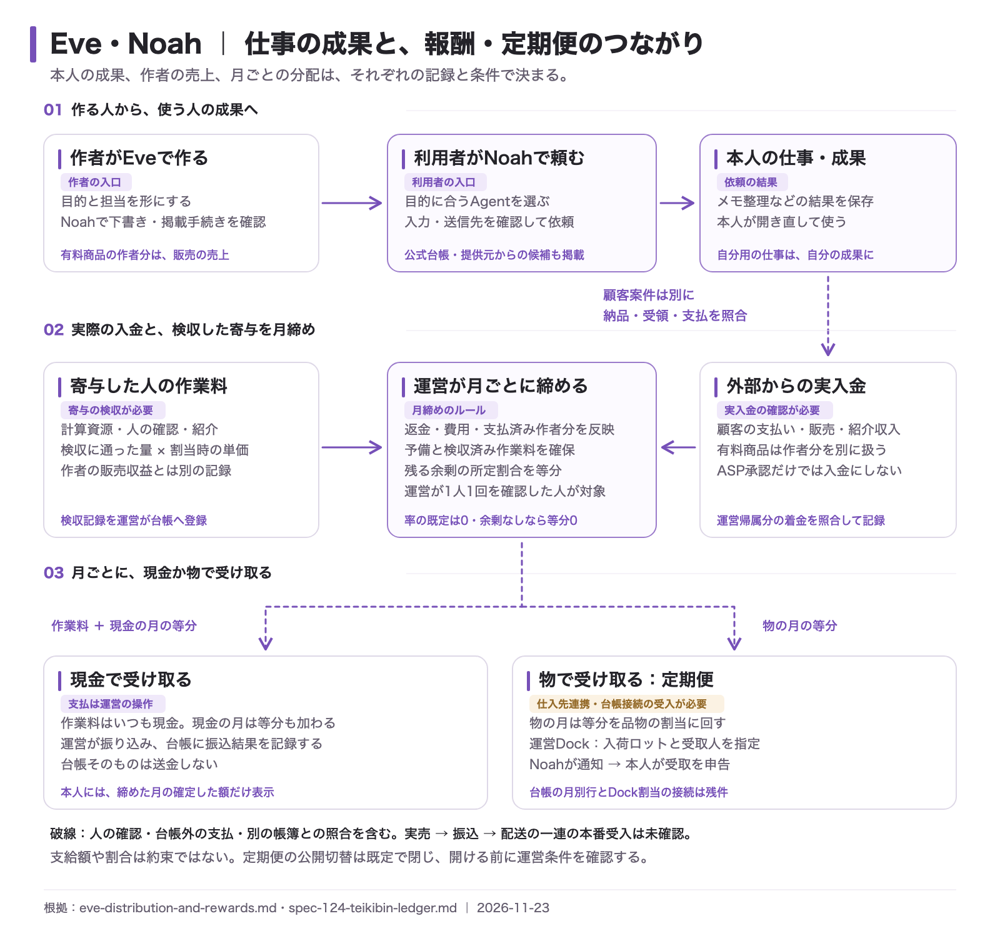
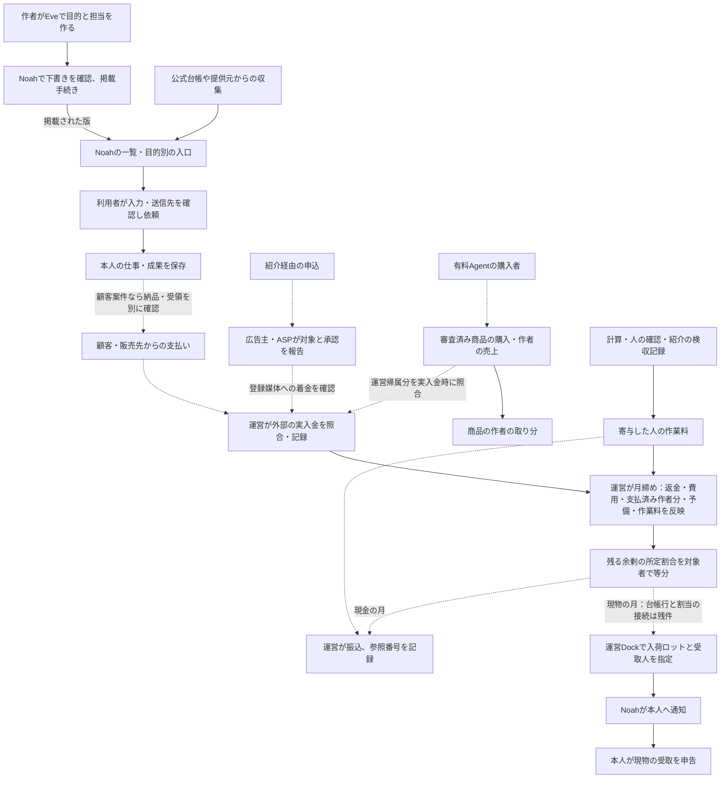

# Eveで作るAgent、Noahの仕事、報酬と定期便

2026-11-23。Eveは作者が目的や担当を形にする入口。Noahは利用者が目的に合うAgentを選び、依頼し、成果を受け取る入口。収入につながる仕事では、さらに顧客・販売先・広告主など外部の相手と支払の根拠が必要になる。自分用のメモを整理した人に返るのは、その人のメモの成果。定期便を受け取る資格と金額は、月ごとに別の記録から決まる。[画面から成果まで](first-use-architecture.md)・[定期便台帳の正本](spec-124-teikibin-ledger.md)

## 作者から利用者へ、お金から定期便へ

図の実線は各システム内の処理や表示、破線は人の確認や別の帳簿との照合が必要な箇所。図全体を通した実売・振込・配送の本番受入は未確認。

## EveでAgentを組み、Noahで使う

Eveは、本人の言葉から目的・入力・期待する成果・予算を決め、担当を組んで仕事と成果を確認する窓口。内部の **Noa** がTool・Agent・実行先を組み合わせ、AMCが工程と合格条件を定め、Jevが成果を独立に検収する。公開サービスの **Noah** では、利用者が集めたAgentから目的に合うものを選び、接続・依頼・停止・成果の再表示まで進める。公開Noahは、Eveを経由せずに使い始められる。Eveで作った担当を誰でも自動掲載・接続できる段階かは、担当ごとの権限・接続試験・掲載審査で確認する。[Eveを開く](https://avoado.si/os/eve)・[Noahを開く](https://avoado.si/noah)・[公開名と内部名](../structure/06-naming.md)・[全体の役割](../structure/04-eve-noa-amc-sky.md)・[Eveから掲載する設計](../../codex/tasks/80-eve-to-noah.md)

## 食料・日用品の配給

このリポジトリの名称は「Noahの配給」、利用者画面の呼び名は「定期便」。**運営Dockが仕入れと割当を決め、Noahの配給Agentがお知らせを届け、受取人が受領を記録する。** Eveはこうした仕事を担うAgentを組む側に位置する。仕入先との連絡・合意・発注は運営が担当する。GitHubなどから公開Agentを継続収集する処理には、物資や受取人を自動で集める役割はない。[配給の設計正本](../structure/04-eve-noa-amc-sky.md#noahの配給)・[仕入れと割当についての決定](../structure/07-decisions-from-minutes.md)・[公開Agentの収集](../services/noah-agent-collection.md)

| 工程 | 誰が何を記録し、次に渡すか |
| --- | --- |
| 仕入れと入荷 | 運営がDockに仕入先管理名・品目・数量・単位・仕入額・送料を入力し、入荷ロットと残数を確定する。費用が未確定なら空欄を保持する。試行の受取人負担は0円。[入荷と在庫](../../services/operator-dock/src/distribution-stock.ts) |
| 受取資格と割当 | 受取人は有効な専用回線で本人の配送先を登録する。運営が受取人、入荷ロット、数量、受渡しの案内を指定する。必要な住所・回線資格・在庫が揃ったときだけ割り当て、その時点の配送先を固定する。定期計画は受取枠ごとに再照合し、不足・資格待ち・期限切れを記録する。[割当](../../services/operator-dock/src/distribution.ts)・[定期計画](../../services/operator-dock/src/distribution-plans.ts) |
| 通知と配布 | 指定番号ごとにNoahが本人宛の通知を準備する。本人が画面を閉じていても通知処理は進む。通常回線では「更新があります」まで、本人の専用回線では品目・数量・受渡し案内を表示する。配給通知の完了と現物の引き渡しには別々の記録を使う。[配給Agent](../../services/noah-test-runtime/src/esim-trial/distribution-work.mjs)・[受取人の入口](../../lib/noah-distribution-routes.mjs) |
| 本人による受け取り | 現物を受け取った本人が「受け取りました」を押す。再送でも最初の受取時刻を保持し、運営は指定番号から通知成果と元の入荷まで照合できる。入荷数は残数・受取待ち・受取済みの合計に一致する。[受取と再送の試験](../../tests/esim-distribution-fulfillment.test.mjs) |

**お金の台帳と物資の在庫。** 月次の定期便台帳は実入金・返金・手数料・実費・作者分・検収済みの寄与と月ごとの配分を記録する。等分の対象は締め時点で確認済み・有効な受取人で、台帳上の本人確認方法と物資を開く回線の判定はそれぞれにある。物で渡す月は運営が月次の行にDockの割当IDを対応付ける。現金の振込は運営が台帳の外で行い、照合番号を記録する。分配率の既定は0で、有効化前の条件は仕様書12章に残る。[利用者の定期便](https://avoado.si/noah/teikibin)・[台帳の規則と開始条件](spec-124-teikibin-ledger.md)・[台帳のAPI](../../lib/noah-teikibin-api.ts)

**確認できた範囲。** ローカルの模擬回線、架空の住所・入荷、分離した運営／受取人セッションで、在庫不足・失効時の拒否、別人の情報分離、画面を閉じた通知、受領の再送を検証している。実回線での受取、実際の仕入れ・発送・引渡し、実資金の分配には別の運用記録が必要となる。[二つの画面での再現手順](../../toolkits/esim-bootstrap/README.md#noah-free-trial)・[専用入口・Dock・通知の結合試験](../../tests/esim-distribution-bindings.test.mjs)・[在庫不足・再開・期限切れの試験](../../tests/esim-distribution-plans.test.mjs)

## 報酬を受け取る人と、金額が決まる時点

| 種類 | 誰から誰へ | 金額を確かめる記録 |
| --- | --- | --- |
| 受注した仕事の作業料 | 仕事を請けた会社 → 計算・判断・紹介で寄与した参加者 | 割当時の単価 × 検収を通った量。顧客との契約主体は会社で、作業料は検収により会社の支払義務として計算する。入金前や赤字でも作業料は残る。Eve が仕事を組み、Jev が成果を検収し、分配計算は金額を返す。受注・納品・入金・参加者への振込を通した本番実績は未確認。[仕事の設計](../sky-work-loop.md)・[分配計算](../../lib/sky-company-order.ts) |
| Noah の定期便の等分 | 運営 → 月の締め時点で本人確認済み・受取停止していない登録者 | 日本時間の暦月終了後、外部実入金から費用・作業料等を引いた余剰の一部を等分する。等分に回す率は未決、既定は0。作業料は現金、等分の渡し方は月ごとに現金か物を選ぶ。物を渡すには仕入先・割当との接続が残る。[配給の方針](../structure/04-eve-noa-amc-sky.md#配給のお金の決まり2026-11-22-本人回答)・[定期便仕様](spec-124-teikibin-ledger.md) |
| 広告案件の紹介料 | 広告主側の ASP → 提携済みの登録媒体の運営者 | 実注文を ASP が承認すると承認額が確定し、支払履歴と銀行の着金明細が一致すると入金を記録できる。個別案件の単価・正式タグは運営の非公開情報。サイトを診断した利用者には診断結果と準備票が届く。[紹介設計](../services/noah-revenue-combinations.md)・[承認から入金まで](../services/noah-business-si-agent.md) |
| Agent・Tool の販売 | 審査済み商品を購入した利用者 → 登録された作者の受取先・運営 | 円建て買い切りでは注文時の価格・受取先を固定。手数料は注文額の10%を円未満切捨て、残りが処理費用等を引く前の作者分。署名済み通知と決済元の状態を照合し、返金・紛争後に遅れた成功通知が来ても購入権を戻さない。決済・作者払出しの本番受入は未確認。[売買設計](../sky-network-economy.md)・[手数料](../../lib/sky-marketplace-policy.ts)・[注文の状態](../../lib/sky-commerce-store.ts) |

### 定期便の月締めと払出し

1. **運営が外部の受領番号を記録する。** 顧客や取引先から実際に入った円額、返金、売り場手数料、外部への実費、作者へ支払済みの額を受領番号付きで分けて記録する。寄与は本人確認済みの受取人に、種類・検収量・単価・参照番号を付ける。同じ入出金の種類と参照番号、または同じ寄与参照番号の再送では重複加算しない。締め前の取消は理由と担当者を残す。[運営 API と保存](../../lib/noah-teikibin-store.ts)
2. **月が終わったら確定する。** 余剰は「入金 − 返金 − 売り場手数料 − 外部実費 − 作者支払済み額 − 返金に備える予備 − 作業料」。予備は返金後の入金に予備率を掛けて円単位で切り上げる。対象者がいて余剰が正の時だけ、その余剰に当月の分配率を掛けて切り捨て、等分の原資にする。端数は受取人 ID 順に1円ずつ配る。赤字は会社負担。締めの下書きと確定時の入力ハッシュが異なる場合は再確認し、中断した締めは保存済みの計算から再開する。確定後の調整は翌月以降に記録する。[計算](../../lib/noah-teikibin.ts)・[締めの規則](spec-124-teikibin-ledger.md#5-規則)
3. **本人別の明細から渡す。** 有料プランを選んだ本人だけ、値段が設定され当月の等分で全額まかなえる時にその等分から差し引く（既定価格は未設定）。本人の画面は自分の確定明細を表示し、運営の審査者だけが全体台帳・払出し一覧を扱う。振込待ちのCSVは月・受取番号・円額の3列。運営が外部で振り込み、一意の振込番号で `pending → paid` を記録する。保留の間は振込済みにできない。物は Dock の割当番号を記録する。[払出しと権限](../../lib/noah-teikibin-api.ts)・[CSV](../../lib/noah-teikibin.ts)
4. **公開状況と残件。** D1 の5表・計算・利用者画面・運営画面は実装済み。本人確認は振込先口座または eSIM 回線の HMAC を使い、生の番号は台帳に残さない。`NOAH_TEIKIBIN` は既定で閉じ、一般利用者には金額を表示しない。本番 migration・鍵・最初の受領番号付き入金と費用、分配率・有料価格、税務・法務確認が有効化前の残件。定期便の原資になる初回入金、利用者への振込、現物配送には本番の照合記録が必要。[task124](../../codex/tasks/124-noah-teikibin-ledger.md)・[仕様12章](spec-124-teikibin-ledger.md#12-開ける前に要る事本人と運営)

### 紹介の成果と Wallet

運営台帳は ASP の案件・媒体・成果番号を照合し、保留・承認・否認を区別する。同じ取得の再取込は一度として扱い、確定後の金額・状態・帰属変更は確認に回す。登録記事の成果は媒体集計まで。銀行との照合は、確認済み口座・振込元・円額・支払日からの日数（既定5日）が一意に対応するときに限る。複数候補は保留する。PR #17 に記録された WordPress/EC 2案件の実観測は **2026-11-22 22:50（日本時間） 時点で各案件の注文・承認とも0件**。その後は ASP ログイン切れで再取得できず、現在の件数・入金額は未確認。[照合実装](../../toolkits/noah-affiliate-agents/combination-core.mjs)・[銀行明細との照合](../../toolkits/noah-affiliate-agents/business-sources.mjs)・[本番の観測記録](https://github.com/iceiceice999/rock/pull/17)

Wallet は利用する機能の予算・予約・利用額・精算を管理する。保存済み Work、ASP 承認額、定期便の確定明細、試験用の計算資源クレジットは、それぞれが裏付ける処理の記録として扱う。Wallet 残高を動かすには別の認可と照合済みの資金記録が要る。Eve で Agent を作る無料枠は0円で、超過時の扱いは未決。作者は有料商品の販売や、合意した仕事の対価を受ける経路を使う。[Eve のビルド](../services/eve-agent-build.md)・[Wallet の責任](../structure/04-eve-noa-amc-sky.md)・[計算資源の試験クレジット](../sky-compute-grid.md)

### ひと月の分配を数字で読む

以下は既存の自動テストの入力を使った計算例。金額・人数・率はいずれも仮定で、本番の支給実績や約束額ではない。[同じ金額を検証するテスト](../../tests/noah-teikibin.test.mjs)

| 項目 | テストの値 | 誰の何を表すか |
| --- | ---: | --- |
| 外から入った額 | 100,000円 | 運営が照合した入金を想定 |
| 手数料・実費・支払済みの作者分 | 10,000円＋20,000円＋10,000円 | 売り場、実行費用、作者への支払い |
| 予備・検収済みの作業料 | 10,000円＋5,000円 | 予備を残し、計算10単位を1単位500円で提供した人の分を確保 |
| 残った余剰 | 45,000円 | この例の設定では半分の22,500円を等分し、残り22,500円は運営分 |
| 3人に支給する内訳 | 12,500円・7,500円・7,500円 | 全員の等分は各7,500円。最初の人には作業料5,000円が加わる |

現物の月には等分を物の割当に回し、作業料は現金のまま扱う。運営が分配率を決める前の既定は0で、配れる余剰がなければ等分も0。検収済み作業料に不足が出た場合は運営側の不足として記録する。[月締めと支払方法](spec-124-teikibin-ledger.md)・[分配計算](../../lib/noah-teikibin.ts)
