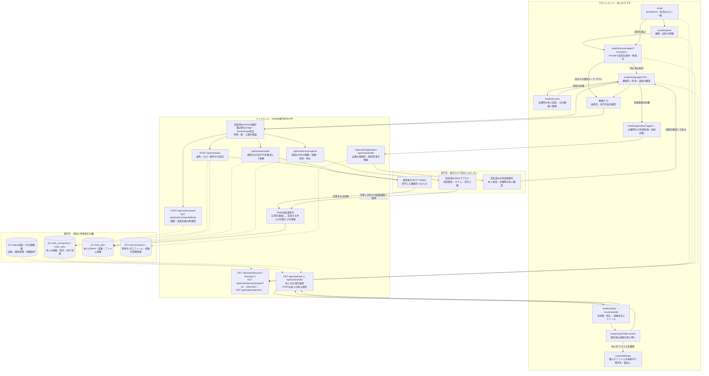
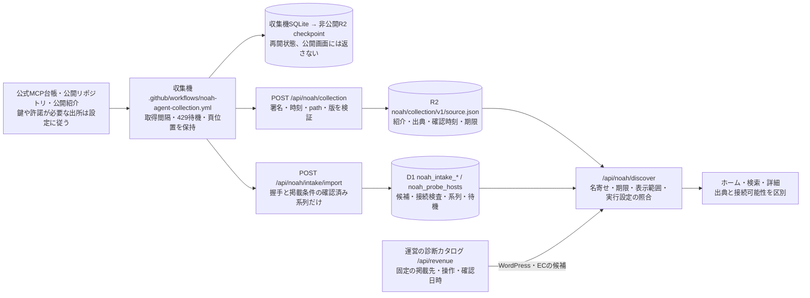

# Noah — 初回の仕事と成果受取の構造

2026-11-23。対象はスマホから使う公開Noahの初回導線。既存実装は main `21518016a` を基準に読み、今回の変更は同じPRのコードと照合する。これは画面・API・保存の関係を説明する資料であり、本番配備や全Agentの受入記録ではない。公開状態と実機の証拠は [task100](../../codex/tasks/100-noah-standalone-ui.md)・[task125](../../codex/tasks/125-noah-cloud-agents.md) の日付付き記録を参照する。

## 1. 初めて開いた人に何を届けるか

最初の目的は「Agentの仕組みを理解すること」ではなく、本人が選んだ小さな仕事について、使える成果を一つ受け取り、後から開けること。閲覧から一律に会員登録やMac導入を要求せず、送信・接続・保存に本人性が必要な場面で確認する。外部サービスへの登録が必要なAgentでは、Noahの本人認証とは別に、その登録先・送る項目・規約への同意を扱う。

ホームの案内は、得たい成果から選べる入口を既存の一覧に足す。目的を押した時点では実行せず、実行先と入力を確認してから依頼する。既存の探索・タイムライン・保存は引き続き使える。「収集済み」「接続できる」「依頼が返った」「本人に役立った」は別々の状態として扱う。

正本の境界は [04 構造](../structure/04-eve-noa-amc-sky.md)、[単体ローンチ](../services/noah-standalone-launch.md)、[登録支援](../services/noah-registration-agent.md)、[成果データ](../services/noah-result-data.md)。この資料で価格・権限・内部のEve→Noa→AMC→Jevの分担を変更しない。下図は実際のWeb経路であり、全依頼が内部の全担当を自動で通過する図ではない。

### 今回追加する3つの目的

`NoahHome`の公開モードから`NoahPinHome`が `GET /api/noah/discover?firstJobs=1` の初頁を読む。サーバーは [noah-first-jobs.ts](../../lib/noah-first-jobs.ts) の3目的に対して、その時点の公開ディレクトリと一致した行だけに遷移先を付ける。検索や出所フィルタで別の一覧を見ていても、目的の候補は公開ディレクトリ全体から選ぶ。本人が非表示にした系列は候補生成前に除く。

| 入口の表示 | 本人が渡すもの | 受け取るもの | 実行経路 |
| --- | --- | --- | --- |
| WordPressの保守を相談する準備 | 管理・診断の許可があるWordPressサイトの公開URL | 公開ページの診断結果と、保守相談で確認したいこと | `firstJob=wordpress-maintenance` → 本人が入力欄を開く → providerの`diagnose_wordpress_site`だけを選択 → 明示送信 |
| ネットショップの改修点を調べる | 管理・診断の許可があるショップの公開URL | 公開ページの診断結果と、制作・改修の依頼時の確認事項 | `firstJob=ec-production` → 本人が入力欄を開く → providerの`diagnose_ec_site`だけを選択 → 明示送信 |
| メモの中の関係を整理する | 人物・担当・作業など、整理したいメモ | 項目と関係を整理した記録 | `firstJob=memory` → 本人のクラウド接続 → 入力と送信先を確認して依頼 |

遷移は既存の `/noah/discover/agent?id=project-…&firstJob=…`。詳細APIも同じ`firstJob`を受け、対象との対応を読み直す。対応する候補が見つからない時は実行画面を出さず、目的の選び直しを案内する。ホームには遷移先のある目的だけを表示し、全件利用できない時は短い案内を出す。「ほかの仕事を探す」と「保存した成果を見る」は常に残す。リンクを開くGETは依頼の実行や入力の外部送信をしない。

WordPress/ECの候補は [noah-revenue-directory.ts](../../lib/noah-revenue-directory.ts) の固定URL・固定endpoint・`first_party`・20分以内の確認日時と公開ask設定を照合する。その後も `/api/noah/provider` で実際の道具定義を確認する。Memoryは公開収集の固定出典と対応profile、有効なruntime設定から選ぶ。依頼の中で整理した記憶は成果として残すが、次の依頼の記憶に自動で引き継がない。

診断の入力画面では管理・診断の許可と第三者への公開URL送信を本人が確認する。WordPressのBot Appétitは公開履歴を持ち、Google PageSpeed/Safe Browsingも使う。診断Workerは公開診断結果を最大24時間キャッシュする。この境界は [診断仕様](../services/noah-site-diagnostics.md) と [道具定義](../../toolkits/noah-affiliate-agents/site-diagnostics.mjs) に従う。本人のWorkが私有であることは、診断先の公開履歴まで非公開になる意味ではない。広告主への申込や有料契約はこの入口では送信しない。

今回の変更は既存の候補・実行・Workを利用する。新しい保存表、広告集計、分析イベント、既定の自動実行は追加しない。本番への配備と初回利用者の受入は、コードの実装とは別に記録する。

## 2. 画面から成果まで

図の実線は本人の操作またはAPIの処理、破線は保存済み情報の参照・更新。公開候補を読む処理と、本人の入力を送信する処理を分ける。

`G`は共通の責任を示し、単一の万能APIではない。各APIが認証・送信内容・同意を検査する。登録APIにはブラウザの受付権限とaccountが必要な登録先の区別もある。未設定・非対応の実行経路を、この図の矢印だけで利用可能とは扱わない。Hugging Faceの埋込画面は別経路で、表示できてもWorkへの成果受領は証明しない。

## 3. 各段階の行動・必要・データ

心理の列は設計仮説であり、利用者調査や計測で確認した事実ではない。

| 段階 | 実際の行動と画面 | 満たしたい必要・心理の仮説 | 読む／書くデータと境界 |
| --- | --- | --- | --- |
| 入口 | `/noah`で成果の目的を選ぶ、または一覧を見る | 「自分の何に使えるか」を短時間で判断したい。技術名より成果の例の方が選びやすい可能性 | 公開一覧を読む。目的を選ぶだけでは外部実行・プロフィール送信をしない |
| 探索 | `/noah/explore`で検索、出所を切替 | 候補が多くても、今使える範囲を知りたい | `/api/noah/discover`が公開系列・出典付き候補・設定済みクラウド情報を統合。出所と表示条件を保持 |
| 詳細 | `/noah/discover/agent`または`/noah/ready/agent`で説明・料金・送信先を読む | 選択の理由と、何が外へ出るかを知りたい | 提供者の説明や外部評価は出典情報。接続確認や品質保証へ読み替えない |
| 本人性・登録 | 必要なら`/noah/account`、外部登録が必要なら`/noah/registration` | 入力のやり直しを減らしつつ、何に同意したか分かりたい | Noahのaccountと外部アカウントを分離。保存・再利用は説明版付き同意。登録完了と通常接続の可否は別に確認 |
| 接続 | 本人が接続を指定し、道具を読み込む | 準備できたことと次の操作を知りたい | `/api/noah/connect`と`/tools`。本人の接続・定義hashを保持。接続は個々の仕事の実行成功ではない |
| 依頼 | 内容を入力、必要な確認後に依頼 | どこまで任せるかを自分で決めたい | 入力、道具の版、操作ID、委任設定を送信直前に検査。候補の説明やREADMEを起動コマンドにしない |
| 待機・停止 | 実行中と仕事詳細で実状態を見る、必要なら停止 | 画面を見張らず、後で戻りたい。失敗時も操作を決めたい | `queued/running/returned/failed/cancelled/unknown`等を経路ごとに表示。読取失敗を0件や成功にしない。結果不明の自動再実行はしない |
| 受取・再利用 | 成果本文・ファイルを確認、保存画面から再び開く | 一度使って終わらず、成果が手元に残ると分かりたい | 本人のWorkを正本として取得。受信済みでも内容は未検証。ダウンロード開始と端末への保存完了を分ける |
| 任意の提供 | 対応する成果だけを選択して運営へ提供・撤回 | 共有範囲を自分で決めたい | `/api/noah/data`の対象成果に限る。通常保存とは別の目的版・内容選択・同意・提供台帳。既定で提供しない |

## 4. 収集データはどこから来て、どう更新されるか

公開収集は、本人が依頼のために入力した情報の収集とは別の処理。設定されている収集元、直近の実行状態、掲載の有効期限を確認する。「常時」とは各出所の期限に合わせた巡回であり、全インターネットや全投稿の網羅ではない。

実装の根拠は [収集API](../../lib/noah-collection-api.ts)、[名寄せと一覧](../../lib/noah-agent-directory.ts)、[一覧への依存注入](../../lib/noah-agent-directory-server.ts)、[詳細の実行先解決](../../lib/noah-project-api.ts)、[収集の運用仕様](../services/noah-agent-collection.md)。公式台帳は初回と差分、GitHub/Hugging Face等は検索窓・取得上限の範囲。X等は運営キーの有無や別の承認済み収集経路に左右される。出所定義があることを、その出所が本番で稼働している証拠にはしない。

取得失敗・429・期限切れは出所単位で扱う。掲載APIは古いスナップショットによる上書きと同時更新を拒否する。表示側も期限・除外条件を確認する。外部のスター・いいね等は出典付きの値で、Noahの利用人数や本人の満足度へ加算しない。巡回の握手は本人の仕事や外部への書込を実行する許可にならない。

## 5. 同じ「データ」でも保存と権限は異なる

| 種類 | 正本・入口 | 読む人／書く主体 | 同意・分離 |
| --- | --- | --- | --- |
| 公開の候補・出典 | R2 `noah/collection/v1/…`、D1 `noah_intake_*` | 公開APIから閲覧。掲載は認証された収集機・審査経路 | 出典URLや説明は信頼済み命令ではない。候補を本人のAgentや実行実績にしない |
| 本人の接続・依頼 | D1 `noah_connections`、`noah_asks`、`work_jobs` | APIが認証したowner単位で取得・更新 | クライアントのownerScopeだけで権限を付与しない。書込時にOrigin・ownerScope・revision/操作IDを検査 |
| 登録情報・書類・委任 | `/api/noah/profile`、R2 `noah-private/v1/<owner hash>/…` | 本人の保存操作と許可された登録処理 | AES-GCMでownerと用途を結び付けて保存。保存同意と再利用の可否、全停止、操作ごとのallow/confirm/denyを別に保持 |
| 外部登録先の資格情報 | 登録runtimeの本人別暗号化保存 | 設定済みの登録処理・許可された送信先への注入 | ブラウザの入力欄やWorkへ鍵を返す契約ではない。本人照会・登録結果不明・待機を区別 |
| 成果本文・ファイル | 本人の`work_jobs`。`/api/noah/ask`系と各実行経路から取得 | 本人が開く・保存する。runtimeは当該仕事の結果を返す | 接続解除後も本人の過去成果を取得する。別ownerの成果へ広げない。返却内容の正しさは別評価 |
| 外部サイト診断の公開URL・診断結果 | 本人のWorkとは別に診断Workerの最大24時間キャッシュ。WordPressは提供元の公開履歴もある | 本人の明示送信後に固定の診断先が処理 | 管理・診断許可と外部送信の確認が必要。Googleでの確認を含め、送信前の説明を維持 |
| 運営へ提供した写し | `/api/noah/data`、D1 `noah_result_contributions` | 本人が選択・同意して提供。設定済み専用運営権限だけが有効な写しを取得 | 品質確認・不具合調査の目的版。学習・販売・一般公開への同意ではない。撤回で写しをNULL化し新規取得を止める。既に持ち出された写しは回収しない |
| 本人が選んだ手元のファイル・メモ | `/noah/add/data`、端末内メモリと`.rockdata`書出し | 本人がファイルを選択し、復旧パスフレーズを管理 | この処理はAPIへアップロードしない。画面の再読込で未保存の選択は消える。Noahの成果台帳や公開収集へ自動転記しない |

成果提供の対象は [noah-result-data.ts](../../lib/noah-result-data.ts) が選ぶ `noahExecution.state=returned` のWork。リモート／クラウドの`noahRemote`成果がすべて提供対象とは限らない。保存画面は複数の成果経路をまとめて見せているため、「画面にある成果＝運営に提供できる成果」と扱わない。

## 6. 実装済みの根拠と、受入で残ること

| 確認対象 | コードから確認できること | 別途確認すべきこと |
| --- | --- | --- |
| 入口と遷移 | [NoahHome](../../components/noah-home.tsx)、[NoahShell](../../components/noah-shell.tsx)、[探索](../../components/noah-explore.tsx)。検索・詳細・実行中・保存を既存経路へつなぐ | 初見の本人が説明なしに最初の成果まで進めるか。390px、読み上げ、戻る、認証復帰、入力保持 |
| 実行可能な範囲 | [directory](../../lib/noah-agent-directory.ts)と[project API](../../lib/noah-project-api.ts)で、掲載済み系列と固定出典・環境設定・対応profileを照合 | 現在の本番環境で表示したものが接続・入力・成果受取まで通るか。CIの成功だけでは未確認 |
| 送信と制御 | [接続](../../lib/noah-connect.ts)、[依頼](../../lib/noah-ask.ts)、[provider](../../lib/noah-provider-runtime.ts)、[cloud](../../lib/noah-cloud-api.ts)で本人・操作・版を検査 | 提供元停止、権限変更、上限超過、通信切断、外部登録の確認待ちで次の操作を本人が判断できるか |
| 保存と再表示 | [仕事一覧](../../components/noah-work-list.tsx)、[詳細](../../components/noah-task-detail.tsx)、[成果表示](../../components/noah-result-content.tsx)、[保存](../../components/noah-saved.tsx) | 同じaccountでの実機再読込、切断後の取得、画像・複数ファイル・端末保存の個別受入 |
| 同意と所有者 | [プロフィール保存](../../lib/noah-profile-store.ts)、[登録runtime](../../lib/noah-registration-runtime-server.ts)、[提供API](../../lib/noah-result-data-api.ts) | 実際の文言を見た本人が送信先・保存・再利用・任せる範囲を説明できるか。別ownerでの拒否と停止後の送信抑止 |

Pixelで確認済みの特定経路の受領票は、他のAgent・別利用者・eSIM導入・実機OSの受入には拡張しない。コードの対応、ローカル試験、CI、本番配備、スマホでの一周、成果が本人に役立つことは、それぞれ別の証拠で判断する。

「70点＝改善余地があっても低ストレスで使える」の判定には、初見の人が目的を選び、送信内容を理解し、補助なしに成果を開き直せるかを見る。次の項目は検証案であり、取得済みの分析値でも、新しい追跡機能の実装でもない。

- 初回訪問から目的選択、依頼受付、最初の成果表示までの時間と、説明を求めた箇所を、本人に説明した受入試験で記録する。待ち時間と操作時間を分ける。
- 戻る・認証復帰・通信失敗時に、入力を失った回数、同じ仕事を誤って再送した回数、次の操作が分からなくなった箇所を見る。
- 本人に「何がどこへ送られたか」「成果をどこから再び開くか」「止めるにはどうするか」を説明してもらう。ボタンを押せたことだけで理解を合格にしない。
- 成果を目的に使えたかを確認し、Agentの応答受領と分けて記録する。機種・経路・実行先・公開版・未確認項目を残す。収益や全サービス対応の点数へ換算しない。

## 7. 「低ストレスで使える70点」の小さな受入手順（提案・未実施）

この手順の70は「改善してほしい所はあるが、この仕事には低ストレスで使える」という本人指定の基準。評点は参加者本人が付ける。開発者・siがCIの成功数や画面の印象から利用者の評点を作らない。[300人試行](trial-300.md)の「登録数ではなく最初の成果まで行った人を数える」「本人の報告は任意」という考え方を使うが、その試行人数・進行条件は変更しない。

### 準備

試す公開版・端末・対象の仕事を固定する。実際の初見利用者を、まず一つの目的につき5人集める案とする。異なる目的を混ぜて5人とする場合は目的別に内訳を出し、全3目的が合格したとは言わない。人数は検証提案で、参加者はまだ集めていない。

実行できると事前に確認した目的について、Agent名・ボタン名・進む画面を教えず、以下のような依頼だけを渡す。診断対象は試験用に管理・診断許可のあるサイトを用意する。

| 目的 | 参加者へ渡す仕事（そのまま読める文） | 先に決める成果の確認基準 |
| --- | --- | --- |
| メモ整理 | 「この会議メモを、決まったことと担当者・期限が分かる形に整理してください。終わったら一度別の画面に移り、その成果をもう一度開いてください。」 | メモの決定・担当者・期限が対応し、存在しない担当者や期限を足していない。未決は未決と分かる |
| WordPress診断 | 「あなたに管理と診断の許可があるこの試験サイトについて、直す必要がある点を確認し、診断結果を後でもう一度開いてください。」 | 許可されたURLが対象で、観測した問題と提案を区別する。試験サイトの既知の状態と矛盾がない |
| EC診断 | 「あなたに管理と診断の許可があるこの試験ショップについて、改善すべき点を確認し、診断結果を後でもう一度開いてください。」 | 許可された店舗が対象で、観測事実と改善提案を区別する。売上改善の実績や保証を作らない |

メモの共通試料は「展示会は12月5日。田中さんは会場予約を11月30日まで、森さんは招待状を12月1日までに準備する。予算は未決。」とする。期待する関係は、展示会と開催日、田中さんと会場予約・期限、森さんと招待状・期限、予算と未決状態。人名や期限を入れ替えず、未決の予算を確定事項にしないことを確認する。サイト診断は主催者が試験前に対象URL・管理許可・既知の状態を書いた確認票を用意する。どの目的も、Agent名や操作手順は課題文に足さない。

### 1人ずつの進め方

1. 何を記録するかを説明して参加の同意を得る。秘密、プロフィール原文、成果原文の収集は前提にしない。途中でやめられることを伝える。
2. `/noah`を渡して開始する。観察者は操作を教えず、参加者が目的に合う実行可能な入口を選べるかを見る。初期表示から目的選択・受付・成果までの時刻を手元の記録票に残す。
3. 必要な認証・外部登録・入力を経て、送信先を理解して本人が実行を確定できるか確認する。依頼の内容を理解せず送った場合、クリックできてもこの段階の合格にしない。
4. 本人が成果を見つけ、上の基準で使える内容を受け取れたか確認する。応答本文が出たことだけで「正しい成果」にしない。
5. 別画面への移動と再読込後に、本人が保存済み成果を自力で再び開く。必要なら停止・失敗後の次の操作も説明してもらう。
6. 助けを求められたら、まずどこで迷ったかを記録する。助言をしたら介入1回として、その後の完了は「補助あり」に分ける。中断・再試行・入力や選択のやり直しも記録し、成功例から除外して隠さない。
7. 終了または中断後に「この仕事に使うときの、ストレスなく使える度合いを0〜100点で教えてください。70点は『改善点はあるが低ストレスで使える』、0点は『使えないほど負担』、100点は『ほとんど負担がない』です」と聞く。理由は任意で聞き、回答を強制しない。

記録票の最小列は `匿名の参加番号 / 公開版 / 機種 / 目的 / 選択できたか / 明示実行 / 成果の適合 / 再表示 / 各時刻 / 介入回数 / 再試行回数 / 中断と理由 / 本人の評点（未回答可） / 任意の理由`。新規の分析SDK・イベント送信・恒常的な追跡は、この資料では追加しない。

### 仮の判定案

一つの目的の5人中4人以上が「補助なしに選択→明示実行→適合する成果→再表示」を完了し、同じ4人以上が70点以上と回答した時に、その公開版・目的・端末範囲について「初回の小規模受入では70点の基準を満たした」と記録する案とする。未回答は70点以上の人数に補わず、追加の参加者で確かめる。本人が意図しない外部書込・別ownerのデータ表示・結果不明からの重複実行が出た場合は、その経路を修正して再確認する。

これは統計的な母集団保証でも製品全体の平均点でもない。ローカルブラウザの自動操作は表示・遷移の回帰試験として別に記録する。実在する初見利用者の理解・迷い・ストレス評点の代わりにはならない。
