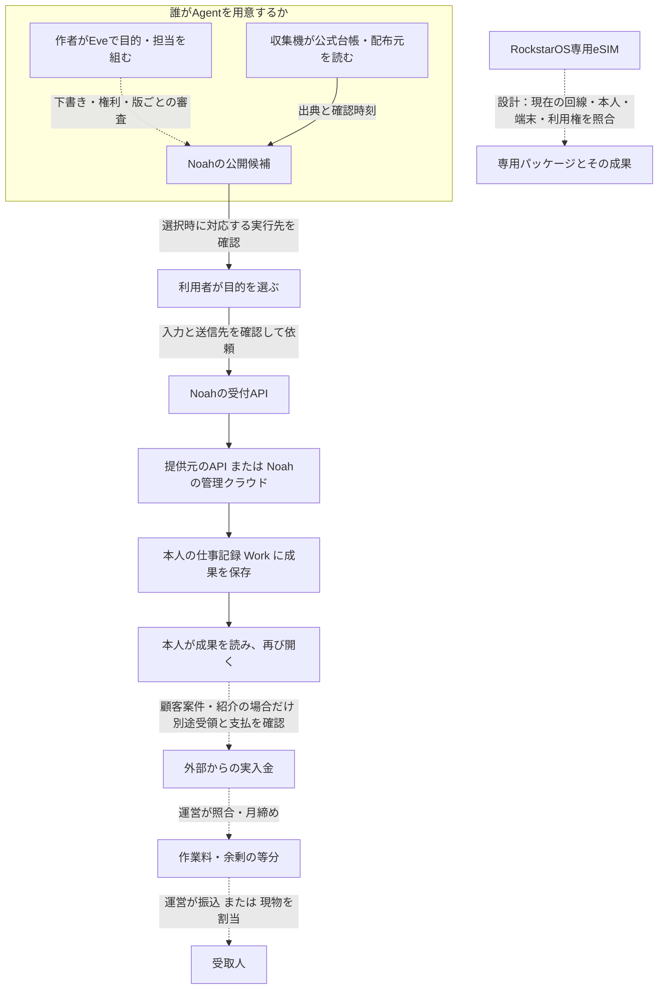
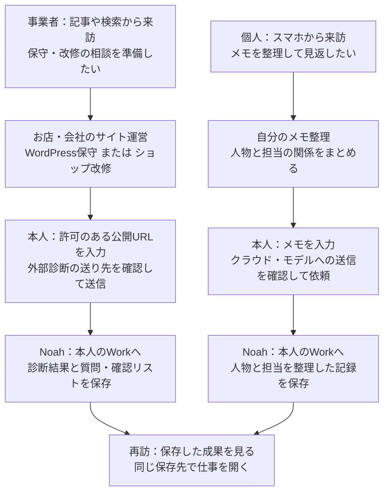
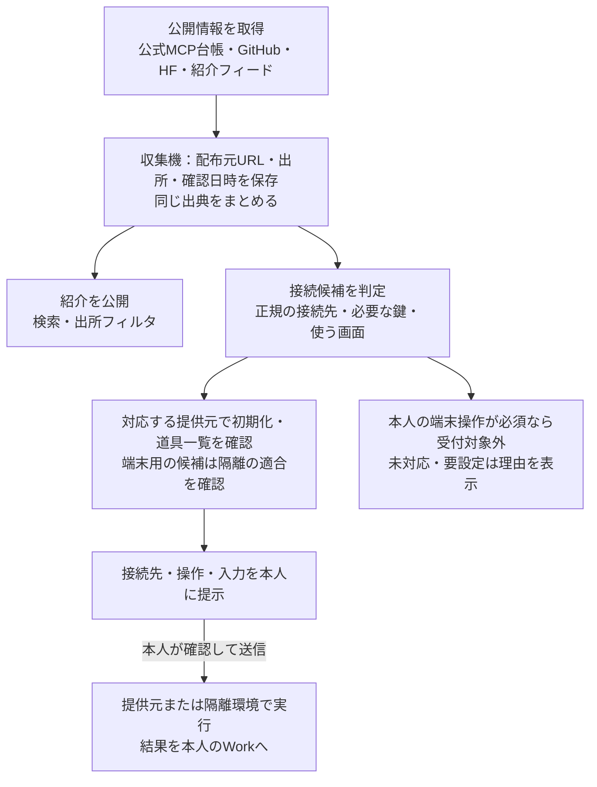
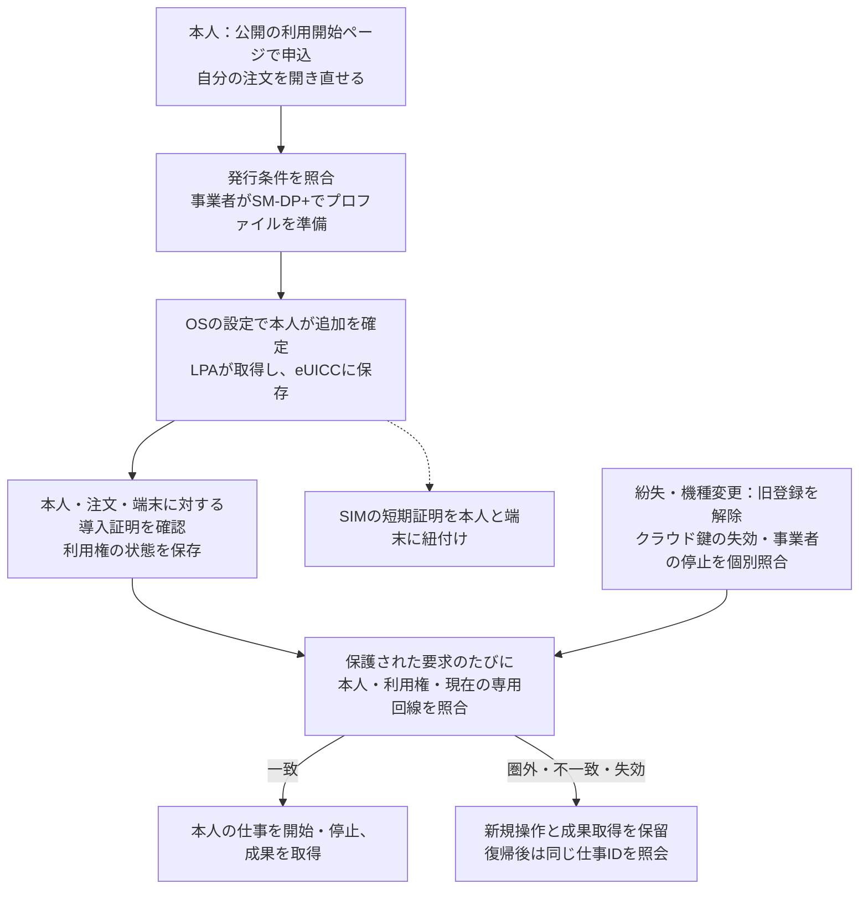
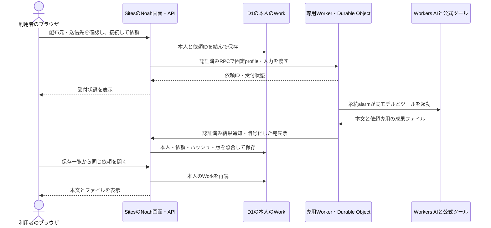
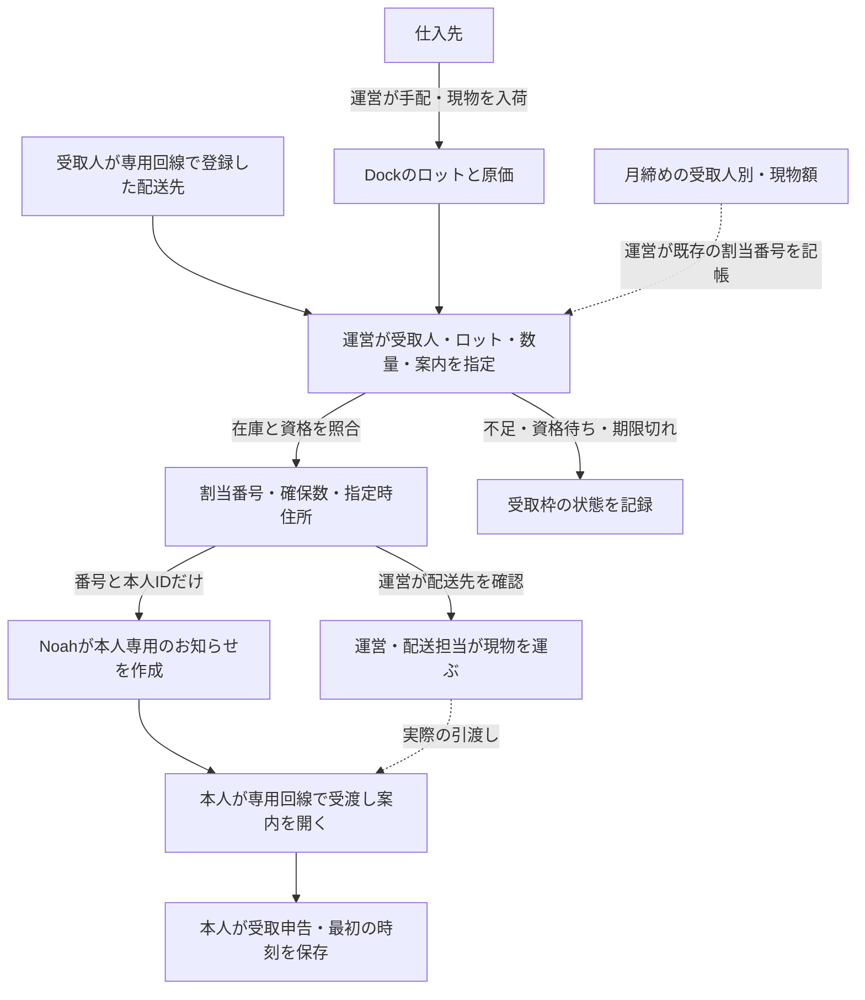
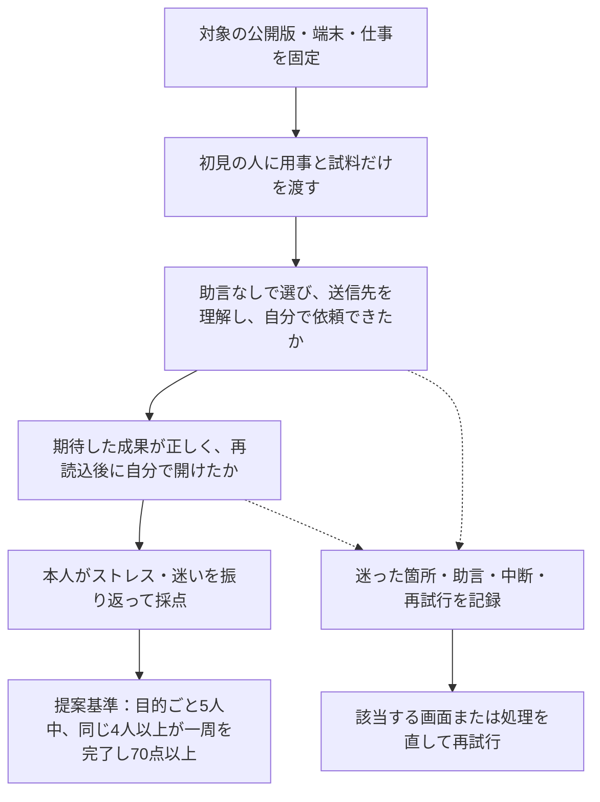

# Eve・Noah 図解設計書 ― 利用の流れ、実行仕様、事業スキーム

2026年11月23日版。**個人は整理したメモを、事業者は相談に使える資料を受け取る。** どちらも使う人が目的と送信先を確認する。作者、事業者、紹介先、運営、受取人の役割が重なる場面では、仕事の成果・売上の承認・銀行への着金・手渡した現物をそれぞれの証拠で確かめる。

**[図入りのPDFを開く](../assets/noah-illustrated-specifications.pdf)**。以下はコードや運用手順を参照できる編集版。図は8枚で、GitHub上で拡大できる。

| 読みたいこと | 図 |
| --- | --- |
| EveとNoahの関係、誰が何をするか | [1 全体設計](#atlas-1) |
| 法人・個人への案内と、使う人が判断する場面 | [2 初回利用](#atlas-2) |
| どこでAgentを見つけ、画面を占有せずに接続するか | [3 収集・接続・画面の保護](#atlas-3) |
| スマホとクラウドはどの回線でつながるか | [4 eSIM](#atlas-4) |
| 画面を閉じた後、誰が処理し、どこから結果を読み戻すか | [5 クラウドと保存](#atlas-5) |
| 誰が何にお金を払い、作者・作業者・利用者へどう分かれるか | [6 事業と報酬](#atlas-6) |
| 箱を誰が仕入れ、誰が割り当て、何をもって受領とするか | [7 定期便](#atlas-7) |
| 70点の利用体験と、本番開始の条件をどう判定するか | [8 受入](#atlas-8) |

## 図1　作者、使う人、運営を結ぶ全体設計

実線は公開Noahを対象とする処理の流れ。目的別の新しいホームはPR #24の開発版で、既存の診断・クラウドの本番受入とは版が異なる。実行可能な種類と受入済みの範囲は図2・3・5に記した。破線は利用者・運営・事業者の確認、または本番接続の残る工程を示す。**公開Noahには今のWi-Fiや主SIMで入れる。** eSIMはRockstarOSの専用パッケージへ入る際の条件で、公開Noahで個人の仕事を始める条件には含めない。

**責任と権限。** Eveが本人の言葉を目的・入力・期待する成果・予算にまとめ、内部のNoaが道具と実行先を組み、AMCが工程を管理し、Jevが独立に検収するのが設計上の分担。公開サービスのNoahは、本人が使える仕事の受付と成果の受け皿を担う。実行の許可は本人とBroker、費用の予約・精算はWalletで扱う。Eveから誰でも自動で公開できること、全依頼がこの内部工程を自動通過することは未受入。[役割と権限](../structure/04-eve-noa-amc-sky.md)・[EveからNoahに担当を載せる仕様](../../codex/tasks/80-eve-to-noah.md)・[公開Noahの単体構成](../services/noah-standalone-launch.md)

## 図2　お店の担当者と個人が、最初の成果を受け取るまで

店舗の担当者は、制作・保守会社と何を話せばよいか知りたい。個人は、行事のメモから誰が何を担当するかを後で見返したい。ホームでは「何をしたいですか？」に続けて、渡す情報と戻る成果を目的ごとに示す。

| 画面・API | 入出力と所有者 | 失敗・再開 |
| --- | --- | --- |
| `/noah#first-jobs` → `GET /api/noah/discover?firstJobs=1` → 目的付き詳細 | 公開カタログから実行先のある目的を選ぶ。詳細でも目的と候補を照合する。閲覧・選択の段階で外部送信は0件。 | 途中で候補が停止したら選び直せる。目的が全件休止しても「ほかの仕事を探す」「保存した成果を見る」を表示する。[入口と候補の判定](../../lib/noah-first-jobs.ts) |
| 診断の `POST /api/noah/provider`、メモの `POST /api/noah/cloud-agents` | 診断は管理を許可された公開HTTPS URLを、本人の同意後に対象の診断先へ送る。メモは本人が接続したNoahクラウドとCloudflareのモデルに渡す。成果は本人のWorkに保存する。WordPressの外部診断には公開履歴があり、Memoryの作業記憶はその依頼内で使う。 | 送信結果が不確かなときは「実行中」で受付済みの仕事を照会する。完了後は同じブラウザの保存先 `/noah/saved?tab=results` から再表示する。[診断のデータ境界](../services/noah-site-diagnostics.md)・[クラウドの実行と保存](../services/noah-cloud-agents.md) |

**実装・本番・受入**　目的別ホームはローカルの実Chromeで320・390・1280pxを確認した。3件すべて／サイトだけ／メモだけの計9条件で横あふれ0、該当見出しと成果画面への遷移を確認した。セッション・候補・保存一覧は模擬。既存経路の本番記録はSites208で両診断、Sites212でPixelのMemory一周。新しい入口の初見受入では、本人が補助なしで目的を選び、送り先を説明し、診断の既知項目またはメモの担当者2人を照合し、同じ成果を開き直せた人数を目的別に記録する。実利用者の評価・紹介成約は未集計。[初回受入手順](first-use-architecture.md)・[画面試験](../../tests/noah-first-job-ui.test.mjs)・[診断の受入](../../codex/tasks/101-noah-affiliate-agents.md)・[Pixel受入](https://github.com/iceiceice999/rock/pull/23)

## 図3　公開情報からAgentを見つけ、本人が使える仕事にする

| 段階・API | 入出力と所有者 | 失敗・再開 |
| --- | --- | --- |
| 運営による収集 → `GET /api/noah/collection` | 公開台帳や紹介から、配布先・更新日時・出所を取り出す。R2の公開用スナップショットと運営用の非公開収集状態を分ける。公式MCP・GitHub・Hugging Faceに取得記録、Hacker Newsに復旧後78→84件の本番記録がある。Product Huntは公開Atomの読取を実装。Xは公開ページから紹介を拾う経路で、7日連続の新着は未受入。 | 出所ごとの続き位置・ETag・次回時刻を保持する。失敗した出所は指定の待ち時間後に再開し、正常な他出所の掲載を続ける。正本への運用移行と復旧後24時間の鮮度確認が残る。[収集機と出所](../services/noah-agent-collection.md)・[本番復旧記録](../../codex/tasks/125-noah-scout.md) |
| 候補 → 接続 → 依頼 | 運営の署名付き `POST /api/noah/intake/import` は確認済み系列を一覧へ送る。提供元の道具一覧を読む握手は入力を実行しない。対応経路で本人が接続し、道具と送信内容を確認して `POST /api/noah/ask`、または提供元・クラウドの専用受付に送る。接続とWorkは本人のもの。 | 必要な鍵がなければ設定を案内。接続先や操作定義が変わったときは取り直し、本人の確認を経る。公開欄に紹介された件数は、依頼が完了した件数とは独立して記録する。[候補台帳](spec-85-intake.md)・[握手](spec-86-remote-mouth.md)・[接続計画](spec-96-connect-plan.md) |
| 画面を使う候補の判定 | 設計では実行時依存・import・コマンドから、遠隔／端末内CLI／ブラウザ／仮想画面／本人端末の操作を識別する。審査済みの画面なしCLIは隔離内の対応機能だけを扱う。本人の前面画面・入力・クリップボードは渡さない。ログインや人の判断が必要なら本人の操作を待つ。 | 専用の画面を必要とするものは対応環境を確認するまで準備待ち。本人端末そのものを操作する候補には実行先を与えない。分類関数はPR #22で実装、取り込みへの組込みはtask89。汎用クラウドブラウザは受入待ち。[画面の規則](spec-84-screenless.md)・[分類の実装](https://github.com/iceiceice999/rock/pull/22)・[専用ブラウザの受入条件](../../codex/tasks/91-noah-device-browser.md) |

**実装・本番・受入**　同じ候補を2回取り込んでも依頼0件、無権限の掲載署名は拒否、接続だけでは有料操作0件を検査する。隔離の18構成を監査し、制約を緩めた15例を拒否、画面を閉じた後のWork保存を回帰試験した。本番のココナラ限定経路ではMacで994回観測し、Agentの前面化と表示窓はいずれも0回。全Agentでの完走、Macでの前面・窓・クリップボード・権限の4項目同時観測は未受入。[取込試験](../../tests/noah-intake-import.test.mjs)・[隔離と保存の試験](../../codex/tasks/84-noah-screenless-rule.md)・[限定経路の受入](https://github.com/iceiceice999/rock/pull/11)

**収集の直近の運用記録。** 11月23日に、途中状態を保存するR2処理のタイムアウト修正がmainに統合され、Sites213に配備された。配備直後12:43（日本時間）の公開APIはHacker News 84件。新しい記事の掲載が再開したか、24時間にわたって2時間以内の間隔を保てたかは、それぞれ公開側の確認時刻で判定する。[タイムアウト修正と配備直後の観測](https://github.com/iceiceice999/rock/pull/26)

## 図4　eSIMの発行から専用サービスの利用・失効まで

公開NoahはWi-Fiや主SIMから開ける。以下の回線照合はRockstarOSの専用サービスに適用する。スマホの通常通信を保ちながら保護対象の通信だけを専用回線へ送れるかは、機種・通信事業者ごとの受入項目になる。

| 画面・API | 入出力と所有者 | 失敗・再開 |
| --- | --- | --- |
| `/connect` → 本人の `/api/esim/orders/{orderId}` 配下の発行・導入API | 注文と発行条件を確認後、事業者がプロファイルを発行。本人だけが追加手段を受け取る。iPhoneは対応する事業者リンク・QR、Androidは対応機種の設定で追加し、元の注文に戻る。今回のチャレンジ・注文・端末に結び付く信頼済み導入証明を照合する。 | 発行結果が不明なら同じ注文で照会し、二重発行を防ぐ。iPhoneの「追加した」申告や単なる事業者の開通通知だけでは端末の導入確認を完了しない。[端末別の導入仕様](../structure/03-esim.md)・[注文API](../../app/api/esim/orders) |
| `POST /api/devices/sim-proof` と専用 `/api/noah/cloud-work` | 前者は短期のEndorse証明を検証し、SIM・端末識別子を別々にHMAC化して本人に紐付ける。短期証明は発行後Wi-Fiでも提示できる。後者は要求ごとに事業者側の回線証拠を照合器 `LINE` に渡し、同じ本人に許された仕事・成果だけを返す。 | 回線不一致は403、照合器未設定・障害は503。紛失時は旧SIMの紐付け解除、クラウド鍵の失効、事業者での回線停止を個別に記録する。圏外中は承認済みの仕事を利用権・予算の範囲で継続でき、復帰後は同じIDで結果を取る。[SIMの検証と解除](../../lib/sim-proof-http.ts)・[専用Workerの要求照合](../../services/noah-test-runtime/src/cloud-entry.mjs) |

**実装・本番・受入**　0円の模擬回線で申込・専用経路照合・画面を閉じた後の受取を確認。PixelのUSB経由試験も模擬回線を使った。実回線の発行とiPhone／Android各1台での受入は未実施。各機種で同一注文再試行の発行1回、保護対象の仕事1件・成果1件、別所有者・回線切断・失効後の取得成功0件、復帰時の二重実行0件と通常通信の継続を確認する。[模擬回線試験](../../tests/esim-noah-free-trial.test.mjs)・[受入条件と復帰手順](../structure/03-esim.md)・[実回線試験の前提](../../codex/tasks/11-esim-first-live.md)

## 図5　ブラウザを閉じた後、クラウドの成果はどこに届くか

| 場面 | 契約と受入条件 |
| --- | --- |
| 選択・受付 | 詳細 `GET /api/noah/discover/project?id=…` で配布元・実行方式を示す。`POST /api/noah/cloud-agents` が本人、同一 Origin、許可、接続 ID と固定 profile を確認し、サーバー鍵で `POST /rpc`。無料枠は実行全体10件／UTC日、本人3件／日、同時2件。接続試験は100件／日で同時枠を共有する。超過時は429。1実行は240秒・モデル最大4回。[受付 API](../../lib/noah-cloud-api.ts)・[上限](../../lib/noah-cloud-contract.ts) |
| 実行・保管 | 専用 Worker の Durable Object が接続・予算・仕事を保持し、alarm が依頼専用の作業領域で公式ツールを動かす。`POST /api/noah/cloud-agents/result` はサーバー間認証と AES-GCM 宛先票を照合。D1 `work_jobs` に本人の本文 `payload.noahRemote.result` と添付 `cloud.files`（実体・名・バイト数・SHA-256）を版照合して保存する。R2 `noah/collection/v1/{source}.json` の用途は公開候補の目録。本人の添付は D1 から返す。[Worker](../../services/noah-cloud-agents/worker.mjs)・[成果保存](../../lib/noah-cloud-api.ts)・[目録](../../lib/noah-agent-directory.ts) |
| 再送・停止 | 同じ ID・入力の再送は既存の依頼を返し、内容の変更は409、別所有者からの読取は404。保存に失敗した場合は結果通知だけを10分ごと・最大30日再送する。停止後は追加のモデル／ツール操作と遅着結果の採用を閉じる。すでに提供元で動く推論の停止時刻は未観測。実行中の再起動や停止確認失敗は `unknown` として残す。[復旧と失敗時の扱い](../services/noah-cloud-agents.md) |

**本番の証拠。** Sites210 で Memory・Filesystem・Sequential Thinking を各1件送信し、Chrome 全終了後15秒間 HTTP を送らず D1 に成果が届いた。再表示・ダウンロード・ハッシュと、別件で停止・再送非実行・別所有者404を確認した。Sites211 は Memory の145バイトを再ダウンロード。Sites212 は実機 Pixel 10 で Memory の136バイトと記録を再読・照合した。固定した公式6種はARM64 Linuxの隔離環境で、それぞれ実モデルによる成功例を確認。6種すべてを同じ本番環境で使える段階には至っていない。Pixel は公開 Web の利用端末であり、有料 Linux Containers の本番稼働、端末上での Agent 実行、RockstarOS の実機合格はそれぞれ別の受入を要する。[実行の受領票](../../codex/tasks/125-noah-cloud-agents.md)・[Chrome の公開後受入](https://github.com/iceiceice999/rock/pull/21)・[Pixel の受入](https://github.com/iceiceice999/rock/pull/23)

## 図6　誰が何にお金を払い、誰にいくら渡るか

```mermaid
flowchart TD
    C[法人等の顧客] -->|依頼・条件・納品の受領| O[契約と納品に責任を持つ運営]
    C -->|請求に対する支払い| I[受領番号・円額を照合した実入金]
    B[有料商品の購入者] -->|審査済み商品を買い切り| S[決済元と注文を照合]
    S -->|商品売上の作者分| A[登録された作者の受取先]
    S -->|運営帰属分を入金照合| I
    V[診断利用者] -->|任意に広告主へ申込| H[広告主・ASP]
    H -->|対象媒体の承認後に支払・入金照合| I
    O -->|検収量と割当単価| F[寄与者に支払う作業料]
    I --> T[運営が月締め]
    X[返金・手数料・実費・支払済み作者分・予備] --> T
    F --> T
    T -->|正の余剰の所定割合| E[確認済みの対象者で等分]
    T --> K[運営の取り分または運営負担の不足額]
    F -->|現金| P[運営の振込・振込番号]
    E -->|現金の月| P
    E -->|現物の月| G[Dockの割当番号と対応]
```

| 入口 | 相手が受け取るもの／運営が確認する記録 |
| --- | --- |
| 法人等からの受託 | 顧客は契約で認めた範囲の成果を受け取る。運営が利用条件・納品・受領と、請求に対応する実入金を個別に確認。参加者には計算・人の確認・紹介のいずれかで検収された量に、割当時の単価を掛けた作業料が発生する。顧客の入金待ちの間も運営の債務として扱う。[受注と寄与の設計](../sky-work-loop.md)・[受注の計算](../../lib/sky-company-order.ts) |
| 有料商品の販売 | 作者の受取先、購入価格、注文 ID を固定。対象の円建て買い切りは売価の10%を円未満切捨てで運営手数料に、残りを処理費等控除前の作者分にする。決済元の通知と注文状態を突合し、返金・紛争後の遅い成功通知で権利を復活させない。月次では受領記録の帰属を照合し、同じ作者分を重ねて原資に入れない。[売買と受取先](../sky-network-economy.md)・[料金](../../lib/sky-marketplace-policy.ts)・[注文状態](../../lib/sky-commerce-store.ts) |
| 広告主・ASPからの紹介料 | 診断利用者は診断結果や準備票を受け取る。登録媒体の対象案件に進むかは本人が選ぶ。運営は ASP の案件・媒体・成果番号で保留／承認／否認を記録し、支払明細と銀行の振込元・円額・日付が一意に合った額を入金とする。否認、同一成果の再取込、候補が複数の着金を新たな収益として加算しない。媒体集計から個人への紹介料は決められない。[成果と帰属](../services/noah-revenue-combinations.md)・[銀行明細との照合](../../toolkits/noah-affiliate-agents/business-sources.mjs) |

**原価・指標・損失。** 月次の余剰は、実入金から返金・売り場手数料・外部実費（実行に使ったモデル等）・支払済み作者分・返金予備・作業料を引いた額。実費は受領記録で確定する。収益の進み方を読むときは、診断完了件数、ASPの承認件数・承認円額、照合できた入金円額、費用控除後の余剰円額を別々に集計する。受託は納品の検収と請求の入金、販売は返金後の受取額で追う。`goods` 月の等分は物に回し、作業料は現金のまま。**既存テストの赤字例**は入金1万円、実費2万円、検収済み作業料5千円。等分0円、会社負担の不足1万5千円、寄与者の作業料5千円になる。現金振込は運営が外部で実行し、一意の振込番号で記録する。[配分計算・赤字例](../../tests/noah-teikibin.test.mjs)・[定期便台帳](spec-124-teikibin-ledger.md)

**決定者と収益開始条件。** 外部受託は顧客との合意、販売は審査済みの作者・商品・決済、紹介は広告主・対象媒体の承認が各経路の前提。入金の実績には相手方の支払いと固有の受領記録が要る。月次分配の開始には、本人・運営による分配率（既定0）と有料価格（既定未設定）の決定、税務・法務の回答、規約・個人情報の扱い、本番 migration 0055 と鍵、実際の受領番号付き初回入金・費用、有効化が必要。現物の仕入先・評価額の基準も未決。PR #17 の最終 ASP 観測は11月22日22時50分（日本時間）で、WordPress／EC の各案件とも注文0・承認0。その後の額、初回分配、作者への本番払出しは未確認。[開始条件・未決事項](spec-124-teikibin-ledger.md#12-開ける前に要る事本人と運営)・[紹介の観測記録](https://github.com/iceiceice999/rock/pull/17)・[取引別の証拠](eve-distribution-and-rewards.md)

**黒字の計算例（既存試験）。** 同じ月に10万円の実入金があり、手数料1万円、実費2万円、作者への支払済み額1万円、予備1万円、検収済み作業料5千円を引くと、余剰は4万5千円。仮にその半分を3人で等分する試験では各7,500円となり、作業を担当した1人は作業料を合わせて12,500円を受け取る計算。分配率50%はこの試験の入力で、実際の支給額・分配率は未確定。[金額を照合するテスト](../../tests/noah-teikibin.test.mjs)

## 図7　定期便の物は誰が調達し、受け取りまでどう確かめるか

| 帳簿・担当 | 実施すること、例外と確認点 |
| --- | --- |
| 調達・入荷 | 運営が仕入先と条件を合意し、入荷後に仕入先管理名・品目・数量・単位・仕入額・送料を Dock の専用 D1 に記録する。未確定の費用は空欄。試行の受取人負担は0円。仕入先への発注と実際の発送は運営の作業。[ロット台帳](../../services/operator-dock/src/distribution-stock.ts)・[配給の設計](../structure/04-eve-noa-amc-sky.md#noahの配給) |
| 在庫・配送 | 割当時に配送先を固定し、運営の専用画面で当該指定の住所を開ける。定期計画は枠ごとに同一品目・単位の在庫、本人の住所・有効回線を再検査する。不足 `shortage`、資格／住所待ち `ineligible`、期限切れ `missed` を記録する。同じ計画・同じ枠の割当は1件。運営が配送を手配し、本人の申告を最初の受取時刻として残す。[割当と受取](../../services/operator-dock/src/distribution.ts)・[定期計画](../../services/operator-dock/src/distribution-plans.ts) |
| 通知・所有者 | 通知には割当番号と受取人 ID だけを渡す。再送時は同じ仕事を照会する。完了時は `notice:{割当番号}`、時刻、利用0円を照合。通常回線では更新の有無、本人専用回線では品目・数量・案内を示す。別人や失効した回線による詳細の照会は拒否する。通知完了と本人の受取申告はそれぞれ別の時刻を持つ。配送業者による配達証明は別途取得する。[通知再送](../../services/operator-dock/src/distribution-notices.ts)・[受取人の入口](../../lib/noah-distribution-routes.mjs) |

**二つの台帳をつなぐ残件。** 月次台帳の `goods_ref` は「この本人のこの月の現物額」に運営が割当番号を一度記す欄。Dock の実在するロット・受取人・確保数・評価額・受取済み状態との自動照合、仕入・送料の自動記帳、配送業者の追跡番号との突合はこの欄からは行えない。運営は月の明細→割当番号→ロット・指定時住所→受取時刻と、支払先への仕入・送料の証憑を照らし合わせる必要がある。未着・品不足に対する代替や返金をこの割当番号で自動処理する実装は確認できない。等分額に充てる現物の評価基準は未決。[現物の割当記録](../../lib/noah-teikibin-store.ts)・[開始前の未決事項](spec-124-teikibin-ledger.md)・[Dock の台帳](../../services/operator-dock/migrations/0004_distribution_fulfillment.sql)

**受入と証拠。** 架空ロット10箱で、残数3・受取待ち3・受取済み4の合計が10に一致する試験がある。同じ受取申告の再送で最初の時刻を保持し、別所有者・失効、同時割当と不足、通知の中断・再開を模擬環境で確認する。本番の仕入・発送・実回線での受取と、月の現物額まで照合した一巡の受領票は未確認。[在庫・受取試験](../../tests/esim-distribution-fulfillment.test.mjs)・[定期枠の試験](../../tests/esim-distribution-plans.test.mjs)・[Dock と通知の結合試験](../../tests/esim-distribution-bindings.test.mjs)

## 図8　受入判定 ― どこまで使えて、何を次に試すか

「改善の余地はあるがストレスなく使える」を70点と置いた本人評価。たとえば「葵さんは会場、蓮さんは案内状」と書いたメモなら、担当を逆にしていないかまで見る。公開URLの診断なら、管理許可を得た試験サイトの既知の状態に対し、観測した事実と提案を区別できるかを確かめる。各目的の開始人数を分母にし、中断・補助あり・評点未回答も残す。初見利用者によるこの試験は未実施。[課題文・判定案](first-use-architecture.md#7-低ストレスで使える70点の小さな受入手順提案未実施)

| 対象 | 記録で確認できた範囲 | 次の判定に要る証拠 |
| --- | --- | --- |
| 入口・収集・画面保護 | PR #24の目的別画面は3幅×3通りを模擬データで確認。出典確認・実行可否・本人の実行許可は個別に扱う | 公開版で目的別の一周、初見利用者の評価。収集は出所ごとの継続記録、画面保護は対象版・配置ごとの実行観測。[PR #24](https://github.com/iceiceice999/rock/pull/24)・[画面保護の試験](spec-84-screenless.md) |
| 専用eSIM | 模擬回線で発行から本人の成果受取まで確認 | 対応事業者の実プロファイル、iPhone・Android各1台の開通と経路照合、回線を外れた後に保護対象を取得できない記録。[回線の受入](../structure/03-esim.md) |
| 管理クラウド | 本番の無料3種でChrome終了後の保存・再表示・ファイル受取。実機Pixelの確認はMemoryでの実行・再読込まで | 他CLIの本番実行、有料Containersや自社設備に移す場合の受入。[無料3種](https://github.com/iceiceice999/rock/pull/21)・[Pixel](https://github.com/iceiceice999/rock/pull/23) |
| 報酬・定期便 | 月締めと本人別明細、模擬の入荷・割当・通知・受領を個別に確認 | 実入金・費用の照合、本人が決める分配率と開始条件、現金の振込記録。現物は仕入先、月別明細からロット割当・受取まで同一人で追える記録。[定期便仕様の開始条件](spec-124-teikibin-ledger.md#12-開ける前に要る事本人と運営) |
