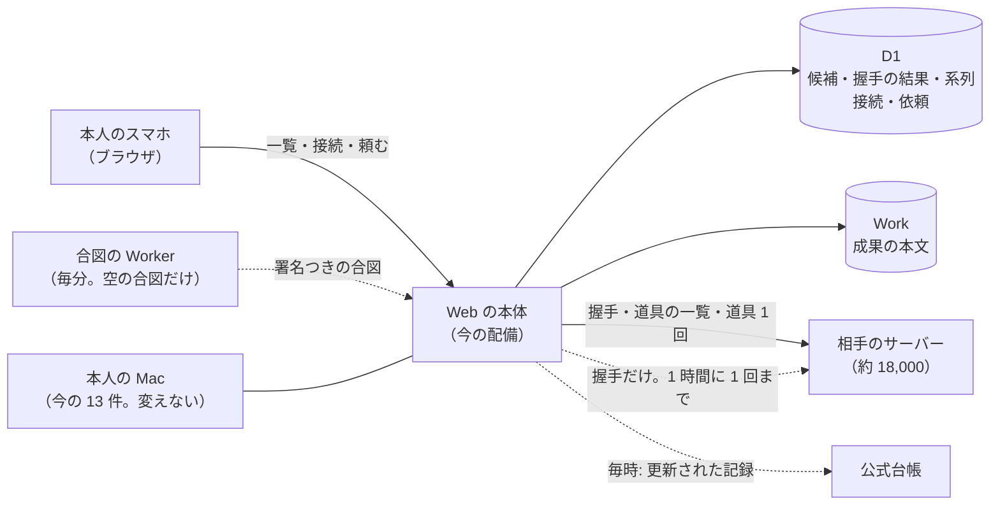
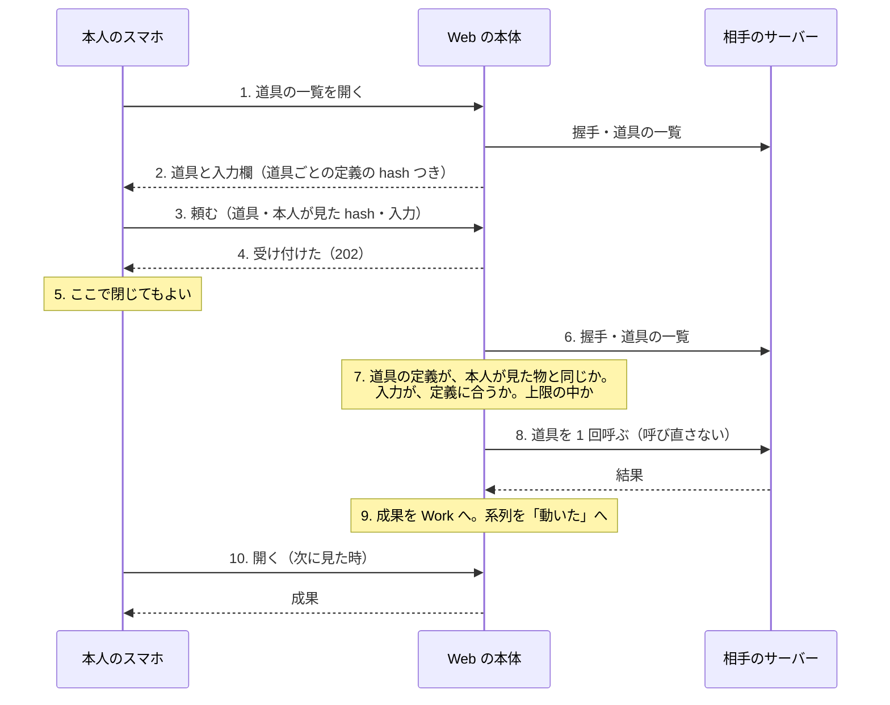

# Noah ローンチの最小限（MVP）— 線・作る順・出す前に確かめる事

2026-11-20。本人指示（11-20 19:17・19:19）: 「mvp の段階まで」「ローンチするのに最小限って意味の mvp」。
この文書は、[Noah の設計書（全体）](../noah-design.md) と [実装仕様書](README.md) の中に **「ここまで作れば出せる」の線**を引く。線の内側は、各仕様書の「ローンチの範囲」の章と、この文書の 6 章（作る順）だけを見れば実装できる所まで書いてある。線の外側は、設計は残すが、ローンチまでは作らない。

数値は全部、候補か実測。候補は本人が変える。実測は、取った日と取り方を書いてある（12 章）。

**何のために出すか（目的と、一番重く見る 3 つ）は [00 全体像](../structure/00-overview.md) の 0 章。** 最初の目的（教育と暮らし）に合わせて足す所は 13 章（提案）。

## 1. 何を出すか（1 文）

**スマホだけで、PC の前に座らずに、約 18,000（見込み）の Agent から選び、「接続」を 1 回押し、入力欄から頼み、成果を受け取り、切れる。**

- 動く所は、相手（提供者）のサーバー。本人の端末では何も動かない。だから、画面を取らない。Mac も要らない。
- 品揃えは、MCP の公式台帳に載っていて、鍵も許可も無しで応答する物。Noah が毎時読み、握手で確かめた物だけを並べる。
- 頼み方は、入力欄（道具を選んで、項目を埋める）。モデルを使わないので、頼むたびの費用が無い。本人への料金は無料。
- 今の「本人の Mac で動かす 13 件」（task 71）は、そのまま残す。入口を 1 つ足すだけで、今の画面と API は変えない。

「ローンチ」は、**招いていない人が、自分のスマホで上の一周を終えられる状態を、本番で開ける事**と決める（開ける操作は 2 つの切り替え。9 章）。

## 2. ローンチの日に、人がやる事（一周）

幅 390 のスマホ。左から、本人の操作・画面に出る物・裏で起きる事・仕様書。

| # | 本人 | 画面 | 裏 | 仕様書 |
| --- | --- | --- | --- | --- |
| 1 | `/noah/ready` を開く | 「動いた」と「まだ誰も動かしていない」の 2 段のカード。語で探す欄。「押すだけで試せる」の絞り込み | `GET /api/noah/intake`（サインイン不要） | [88](spec-88-mass-probe.md) 9 章 |
| 2 | カードを開く | 名前・提供者・説明（提供者の文のまま）・道具の数・最後に確かめた日・「入力は <host> へ送られます。」 | `GET /api/noah/intake?id=`、`GET /api/noah/connect-plan` | [96](spec-96-connect-plan.md) 9 章 |
| 3 | 「接続」を押す | 未サインインなら、パスキーの画面へ行って戻る（押し直さない）。「準備しています…」→「頼む」 | `POST /api/noah/connect`。Noah が相手と握手し、道具の一覧を読む（中央値 1.2 秒） | [74](spec-74-one-click-connect.md) 11 章 |
| 4 | 道具を選ぶ | 道具の名前と説明の先頭。「読み取りだけ」「押すだけ」の印 | `GET /api/noah/connect/[id]/tools` | [87](spec-87-tool-agent.md) 11 章 |
| 5 | 項目を埋めて「頼む」 | 必須の欄が先。任意の欄は「細かい設定」の中。読み取りだけと宣言していない道具は、最初の 1 回、内容を確かめる | `POST /api/noah/ask`。応答の後も、Noah が続けて呼ぶ（画面を閉じても進む） | 同上 |
| 6 | （閉じてもよい） | 仕事の一覧に「進んでいます」→ 成果の先頭 3 行 | 相手の道具を 1 回呼ぶ（待ち 20 秒まで）。成果は Work に入る | 同上 |
| 7 | 成果を開く | 「結果を受け取りました」と、成果の全文。全体が JSON の成果は、項目ごとの行にして出す（「元の形で見る」で戻せる） | 成果の正本は Work。相手が返した内容を、Noah が確かめた事にはしない | 同上 |
| 8 | 「切る」 | 「つながっているもの」から消える。成果は残る | `POST /api/noah/connect/[id]`（`disconnect`） | 74 |

この 8 段の合格条件は [仕様書 90](spec-90-phone-only-loop.md)。

構成（ローンチで動く物だけ。点線は、定期の動き）:

頼んでから成果まで（画面を閉じても、5 より後は進む）:

## 3. 線: 入れる物と、後にする物

「入れる」の基準は 1 つ: **それが無いと、上の一周が終わらないか、出してはいけない状態になるか。**

| 単位 | ローンチまでに入れる | 後にする | 入れる理由／後にする理由 |
| --- | --- | --- | --- |
| [84 画面を取らない](spec-84-screenless.md) | 起動引数の検査を `npm run verify` に入れる。「閉じても進む」の回帰試験 | 検査用の Mac での観測 | 今の Mac の道が、後の変更で緩まないようにする。観測は Mac が要る |
| [96 接続計画](spec-96-connect-plan.md) | 純関数の全部。取り込んだ系列の計画の API。カード | 今の 13 件のカードへの組み込み | 「接続」を押す前に、つながるか・何が足りないかを出す |
| [85 取り込み](spec-85-intake.md) | 公式台帳だけ。最初に全件、その後は毎時「更新された物だけ」 | Hugging Face の Space、ACP の台帳、日本語の 1 行説明 | 並べる物が無いと始まらない。Space は 66% が寝ている。ACP は端末で動かす物 |
| [86 リモートの口](spec-86-remote-mouth.md) | 握手・道具の一覧・道具の呼び出し・接続先の検査・握手までの巡回 | 相手の許可（OAuth）の全部 | 鍵なしで応答する物だけで約 18,000 ある。他人の token を預かる作りは、出した後に入れる |
| [87 頼む](spec-87-tool-agent.md) | 入力欄で頼む（道具を選ぶ画面を足す）。頼む前の上限 | 1 文で頼む（モデル・専用の Worker） | 入力欄で、実在の道具の 95.5% が使える（4 章）。モデルは、契約と費用と配備が要る |
| [74 つなぐ](spec-74-one-click-connect.md) | 相手のサーバーへの接続・その場のサインイン・Passport・切る・`/noah/ready` の 2 画面 | 家の端末を同じボタンでつなぐ。相手の許可の続き。見本の自動実行 | Mac の道は、今の `/noah/launch` がそのまま使える |
| [88 見回り](spec-88-mass-probe.md) | 本人の実行で付ける「動いた」。失敗が続いた物を外す。並びの引き直し。取り下げ。検索 | Noah が自動で道具を呼ぶ見本（`NOAH_PROBE_L2`） | 止まった物を並べ続けない。自動で他人の道具を呼ぶかは、本人が決める（7 章） |
| [89 ターミナルの口](spec-89-terminal-mouth.md) | 無し | 全部 | 実物の package を動かす確かめが、まだ無い。Mac が要る |
| [90 手元だけの一周](spec-90-phone-only-loop.md) | 全部（受入の試験と、実機の確かめの表） | — | 出してよいかの判定そのもの |
| [97 出すための運用](spec-97-launch-ops.md) | 巡回を起こす Worker、切り替え、取り下げの窓口、見張る数、戻し方 | 自動の通知 | 止め方と、相手からの申し出の受け方が無い物は出さない |
| 75・83・91・92・93・94・95、76〜82 | 無し | 全部 | 端末（雲・家）、続けて任せる、売り買い、作者の引き取り、mii。一周に要らない |

後にする物の順（出した後。上から）: ① 相手の許可（OAuth）— 401 を返す 34.8% が並ぶ。② 1 文で頼む。③ 家の端末を同じボタンで（今の 13 件と、端末で動かす配布）。④ Space と ACP。⑤ 見本の自動実行。それより後は [全体の設計書](../noah-design.md) の段の順。

## 4. なぜ、入力欄だけで足りるか（実測）

握手が通った実在の接続先 276 host の道具 3,699 個を、参照実装（[noah-form-v1.ts](../contracts/noah-form-v1.ts)）に全部通した。例外 0 件。

| 測った事 | 値 |
| --- | --- |
| 入力欄で使える道具 | 3,531（95.5%）。使えない 168 は、必須の入力が入れ子（object・object の並び）166、必須が 13 個以上 2 |
| 使える道具が 1 つ以上ある接続先 | 274／276（99.3%）。全部の道具が使える接続先は 206（74.6%） |
| 必須の入力の数 | 0 個 37.8%、1 個 44.2%、2 個 12.9%、3 個以上 5.1%。欄の数の中央値は 2、9 割は 7 以下 |
| 押すだけで頼める道具（読み取りだけ・必須なし）がある接続先 | 174（63.0%） |
| 最初の 1 回、確かめが要る道具（読み取りだけの宣言が無い） | 使える道具の 31.0%。全部の道具がそうである接続先は 70（25.4%） |
| 必須の欄の形 | 文字 2,476、選択 314、数 222、並び 77、真偽 16 |

入力欄だけにすると失う物: 「何をしたいか」を 1 文で言う頼み方、複数の道具をつなぐ仕事、入れ子の入力（道具の 4.5%）。
入力欄だけにすると要らなくなる物: モデルの契約と費用、専用の Worker の配備、仕込まれた指示への対策（道具の説明や結果を読むモデルが居ない）、「あなたの番」の往復（本人が画面に居る時に、本人が選んだ道具を呼ぶだけなので、送る前にその場で確かめる）。

前の案（道具が 1 つで入力が少ない時だけ入力欄）で使えるのは、多くても、道具が 1 つだけの 11 接続先（276 のうち）だった。道具を選ぶ画面を足すと 274 になる。**足す物は、選ぶ画面 1 つと、通信しない関数（入力欄を作る・入力を引数へ直す・道具を並べる・結果を文字にする）。関数は書いてあり、上の実測に通してある。**

## 5. 一覧に載せる条件と、載る数の見込み

載せる条件の正本は `noahListing`（[noah-intake-v1.ts](../contracts/noah-intake-v1.ts)）。同じ条件を SQL が持ち、検証キットが 24 行の表で両方を確かめている。

載せる: 公式台帳の記録で、口が「相手のサーバー」、本人の鍵の入力が要らず、握手が鍵も許可も無しで通っていて、入力欄で使える道具が 1 つ以上あり、量産の系列でない物。

| 段 | 条件 | 並び | カードの印 |
| --- | --- | --- | --- |
| 動いた | 人が動かして、成果が返った（L2） | 「動いた」になった時刻の新しい順（動かし直しても、上がらない） | 「1 クリック」 |
| まだ誰も動かしていない | 握手まで（L1） | 1 日 1 回引き直す並び。名前の順でも、台帳での更新の多さでも並べない | 「まだ誰も動かしていない」 |

見込み（2026-11-20 の台帳の全件と、握手の標本 500 host から）:

| 段階 | 件数 |
| --- | --- |
| 台帳の有効な記録 | 66,608 |
| 相手のサーバーで動き、入力の要らない候補 | 40,503（30,949 host） |
| うち、量産でない系列 | 31,433（29,384 host）。量産は 60 系列・9,070 件で、標本では 24 host のうち 5 host しか応答しない |
| 握手が通る見込み | 約 18,000（16,000〜19,000）。標本で、量産でない 522 系列のうち 301（57.7%）。別の host へ転送する相手（標本で 276 のうち 1）は載せないので、約 60 系列減る。幅の中 |
| うち、押すだけで試せる物がある | 約 11,400 |
| 出す日の「動いた」 | 0 から始まる。運営が自分で 100 件動かしてから出す（8 章の G2）。`NOAH_PROBE_L2` を開ければ、最大で約 7,000 |

載せない理由は 12 種（`NOAH_LISTING_REASONS`）。運営の画面に内訳を出す。大きい順の見込み: 相手の許可が要る（401、標本の 34.8%）、握手が通らない（9.2%）、量産、端末で動かす配布（18,158 件）、本人の鍵が要る（4,137 件）。

## 6. 作る順（PR ごと）

1 行が 1 PR。通信しない処理は、[docs/contracts/](../contracts/) の参照実装を**関数ごと移す**（書き直さない）。試験も移す。各 PR は、仕様書の「ローンチの範囲」の章の「完了の定義」で終わる。本番への migration・配備・切り替えは、どの PR も行わない（本人の許可の後。9 章）。

| 順 | PR | task | 入れる物 | 先に要る |
| --- | --- | --- | --- | --- |
| L1 | 画面を取らない検査 | 84 | `engineArgs()` の切り出し、`lib/noah-screenless-audit.mjs`、`scripts/check-noah-screenless.mjs`、`verify` の鎖、「閉じても進む」の回帰試験 | — |
| L2 | 接続要件と計画（純関数） | 96 | `lib/noah-connect-requirements.ts`、`lib/noah-connect-plan.ts`、試験 | — |
| L3 | 取り込みと一覧の土台 | 85 | migration（取り込みの 5 表）、`lib/noah-intake-draft.ts`・`-family.ts`・`-store.ts`（公式台帳、更新された物だけ、名寄せ、一覧・検索・集計）、`lib/noah-flags.ts`、巡回の入口（`/api/noah/intake/tick`）と `services/noah-patrol-wake/`、運営の画面の節 | L2 |
| L4 | 握手 | 86 | `lib/noah-mouth-mcp-remote.ts`、`lib/noah-form.ts`、`lib/noah-probe.ts`、巡回での握手（`lib/noah-intake-probe.ts`）、系列への写し。握手の結果を書く所なので、失敗が続いた物を外す・30 日で隠す・量産を握手の対象から外す、も、ここで入れた | L3 |
| L5 | つなぐ | 74・96 | migration（`noah_connections`）、`lib/noah-connect.ts`（相手のサーバー）、計画の API（`lib/noah-connect-source.ts`・`lib/noah-connect-plan-api.ts`）、道具の一覧の API、利用者の操作から始める握手（`lib/noah-user-handshake.ts`。接続先の枠・401 と 429 の扱い）、つないでいる人が居る系列を 24 時間ごとに確かめる（88 の 9.3）。画面（`noah-ready.tsx`・`noah-ready-detail.tsx`・`noah-card.tsx`・`noah-connect-button.tsx`・`noah-ask.tsx`（道具の一覧まで）、その場のサインイン、探す画面の入口 `noah-ready-entry.tsx`）。出す場所とサインインの扱いは、本人の返事を待ちながら、既定で作った（74 の 11.5 の最初の表） | L4 |
| L6 | 頼む | 87 | migration（`noah_asks`）、`WorkJob.noahRemote`、`lib/noah-remote-work.ts`、`lib/noah-ask.ts`・`lib/noah-ask-store.ts`（入力欄だけ）、`noah-ask.tsx`・`noah-work-list.tsx`、本人の実行で「動いた」を付ける、切った時に終わっていない依頼を止める。成果を「成果データ」「実行中」に出す所は、2026-11-21 に足した（87 の 11.9。成果データの書き出し・運営への提供には、まだ載せていない） | L5 |
| L7 | 見回りを保つ | 88 | 止まった依頼と接続の後始末（`lib/noah-sweep.ts`。巡回の合図の終わりに行う。migration は、つなぐ途中の接続を拾う索引 1 つ）、道具を呼ぶ直前の「相手へ送る」の印、つながると確かめた数（失敗が続いた物を外す・量産を握手の対象から外す は L4 で、並びの引き直し・取り下げと戻し は L3 で入った） | L6 |
| L8 | 出すための運用 | 97 | `/noah/help` の `#bot`（文と宛先は `lib/noah-bot-notice.ts`。宛先は 2026-11-21 に本人が決めた smash@avoado.si（D8）。宛先を null に戻すと、節も、一覧と詳細からの道も、出なくなる）、運営の画面の「見張る数」（`lib/noah-launch-status.ts`。切り替えの状態・台帳の巡回・まだ握手していない数・握手の結果・同じ接続先への握手・接続と依頼の数）、巡回を起こす Worker の配備と止め方の手順書（`services/noah-patrol-wake/README.md`）、切り替えを閉じた時の動きの試験（`tests/noah-launch-ops.test.mjs`）。**本番への配備・適用・切り替えは、行っていない** | L3 |
| L9 | 受入 | 90 | 一周の自動試験（`tests/noah-phone-loop.test.mjs`。画面が呼ぶのと同じ入口だけで、取り込む → つなぐ → 頼む 3 種 → 受け取る → 切る）、画面の決まりの試験（一周の全部の段で）、実機の確かめの表（手元の結果は [90](spec-90-phone-only-loop.md) の 9.4。**本番の結果は、まだ**）。表の通しで見つけた所を 1 つ直した（切った後も、その Agent の画面に成果を出す） | L6 |

L1 と L2 は並べて進められる。L8 は L3 の後ならいつでも。L7 までで機能は全部そろい、L9 が「出してよいか」を判定する。

移す先の対応（参照実装 → `lib/`）: `noah-connect-v1.ts` → `noah-connect-requirements.ts`・`noah-connect-plan.ts`（L2）。`noah-intake-v1.ts` → `noah-intake-draft.ts`・`noah-intake-family.ts`・`noah-intake-wake.ts`（L3）、`noahSampleCalls` は移さない（後）。`noah-flags-v1.ts` → `noah-flags.ts`（L3）。`noah-mouth-v1.ts` の握手・呼び出し・検査 → `noah-mouth-mcp-remote.ts`（L4）、相手の許可と起動の型紙は移さない（後）。`noah-form-v1.ts` → `noah-form.ts`（L4）。`noah-intake-v1.ts` の見回りの間隔（`nextNoahCheck`）→ `noah-probe.ts`（L4）。`noah-tool-agent-v1.ts` は移さない（後）。SQL は `noah-v1.sql` から、その PR の表だけを `drizzle/` へ。`noah-regroup-v1.sql` と `noah-listing-v1.sql` は、文字列のまま `lib/noah-intake-family.ts`・`lib/noah-intake-store.ts` へ。

## 7. 本人が決める事（既定つき。決まるまで、既定で進める）

| # | 決める事 | 既定 | 変えると |
| --- | --- | --- | --- |
| D1 | 取り込んだ道具を、Agent のカードとして並べるか | 並べる。カードに「道具 n 個」と出し、中は入力欄 | 並べないなら、ローンチは今の 13 件だけ（Mac が要る）になる |
| D2 | 握手だけの物（L1）も並べるか | 並べる。「まだ誰も動かしていない」と書き、「動いた」を先に出す | 並べないなら、出す日の品揃えは「動いた」の数（100〜）だけ |
| D3 | 「1 文で頼む」を後にするか | 後 | 先に入れるなら、モデルの契約・単価・`services/noah-relay` の配備が要る |
| D4 | Noah が自動で道具を呼ぶ見本（`NOAH_PROBE_L2`） | 閉 | 開けると、出す日の「動いた」が最大約 7,000。読み取りだけと宣言された、入力の要らない道具を、接続先ごとに最大 3 回呼ぶ |
| D5 | Cloudflare の契約 | **確かめが要る。** 巡回は Workers の有料の枠（CPU 時間・D1 の書き込み）が前提（[97](spec-97-launch-ops.md) 3 章） | 無料の枠のままでは、この線では出せない（CPU 時間と、D1 の書き込みの行数が足りない）。載せる数を大きく減らす、別の線が要る |
| D6 | 巡回を起こす Worker の配備と、合図の鍵 | 配備しない（手元でだけ動く） | 配備すると、本番で毎分の巡回が始まる |
| D7 | 本番 D1 への migration（4 本。L7 で、索引を足す 1 本が増えた） | 適用しない | 適用すると、L3・L5・L6・L7 が本番で動く |
| D8 | 取り下げ・報告の窓口の宛先 | **決定（2026-11-21、本人）: smash@avoado.si**（`lib/noah-bot-notice.ts` の `NOAH_REPORT_CONTACT`。件名「Noah: 一覧の取り下げ・報告」付きの `mailto:`。`/noah/help#bot` に出る） | 宛先を外す（null）と、節と、一覧・詳細からの道が出なくなる（8 章の G5 が偽になる）。巡回の名乗りが、この節の URL を持つ（[97](spec-97-launch-ops.md) の 5 章） |
| D9 | カードと道具の説明の言葉 | 提供者の原文のまま（英語が多い） | 訳すなら、モデルの契約が要る。Noah は文を作らない決まりも変わる |
| D10 | 頼む回数の上限 | 同時 8 件、1 分 10 回、24 時間 200 回、1 つの接続先へ全員で 1 分 30 回 | 数だけ変える（`NOAH_ASK_LIMITS`） |
| D11 | 量産の系列（60 系列・9,070 件）を載せないこと | 載せない | 載せるなら、1 枚のカードの中から 1 件ずつつなぐ画面が要る |
| D12 | Mac の受入（task 71 の残り）を、出す条件にするか | しない。スマホだけの一周で出す | 「自分の端末につなぐ」と外に言うのは、Mac の受入の後 |
| D13 | 画面に出す決まりの文（入力は相手へ送られる。Noah は作者でない。出どころ） | 2 章・10 章の文 | 文だけ変える |

## 8. 出す前に確かめる事（ゲート）

全部が真になったら、9 章の「開ける」へ進む。数は候補。

| # | 確かめる事 | 合格 | 確かめ方 |
| --- | --- | --- | --- |
| G1 | 一周 | 本番で、審査者の account と幅 390 の実機のブラウザで、3 種の Agent（押すだけ／入力あり／確かめが要る道具）の一周が、PC の前に座らずに終わる。接続は 1 タップ、入力は道具の項目だけ | [90](spec-90-phone-only-loop.md) 5 章の表 |
| G2 | 品揃え | 最初の握手の 1 巡が終わっている（まだ握手していない候補が 0）。載っている系列が 15,000 以上。「動いた」が 100 以上 | 運営の画面の数（97 の 6 章） |
| G3 | 守り | `npm run verify` が通る。接続先の検査・入力欄・上限・切り替え・画面を取らない検査の試験が、`tests/` で動いている。本番の Worker から、内部向けのアドレスを指す名前へ届かない事を、1 回確かめた（[86](spec-86-remote-mouth.md) の 10.3） | CI と、審査者の確かめ |
| G4 | 巡回 | 72 時間、人が触らずに動いた。合図の成功が 99% 以上。同じ接続先への握手が 1 時間に 1 回を越えた記録が 0 | 97 の 6 章の問い合わせ。「混んでいる」（429）を守る事は、試験（88 の 9.9）で確かめる |
| G5 | 窓口 | `/noah/help#bot` に、名乗り・何を読むか・取り下げと報告の宛先がある。取り下げの操作で、一覧・検索・詳細から消え、握手が止まる事を本番で 1 回確かめた | 97 の 5 章 |
| G6 | 止め方 | 切り替えを閉じると、一覧が審査者だけになり、新しい依頼が受け付けられない事を、本番で 1 回確かめた | 97 の 7 章 |
| G7 | 本人の許可 | D5〜D8 が決まっている | この文書の 7 章 |

出す条件にしない物: Mac の受入（task 71 の残り。D12）、通知、見本の自動実行。

## 9. 開ける順（本番。本人の許可の後）

| 段 | する事 | 見える変化 |
| --- | --- | --- |
| 0 | L1〜L9 を main へ。migration を適用。切り替えは全部閉 | 無し |
| 1 | `services/noah-patrol-wake` を配備。`NOAH_PATROL_WAKE_KEY` を両方に置く。`NOAH_PATROL_ENABLED=true`（手順は `services/noah-patrol-wake/README.md`。D8 の宛先は 2026-11-21 に入れた: 巡回の名乗りの URL を開いた提供者に、説明が出る） | 審査者にだけ `/noah/ready` が見える。台帳の全件（約 70 分）→ 握手の 1 巡（既定の毎分 8 件で約 3 日。この間だけ `NOAH_PATROL_BUDGET` で 16 件にすると約 1.5 日）が進む |
| 2 | 審査者が、本番で G1〜G6 を確かめる。運営が 100 件動かす | 「動いた」が増える |
| 3 | `NOAH_INTAKE_PUBLIC=true`、`NOAH_ASK_FORM=true`。navigation に「すぐ使える」が出る。開けた直後に、account を持っていない人の一周（[90](spec-90-phone-only-loop.md) の 5 章の 13）を確かめ、通らなければ閉じる | **ローンチ** |

戻す時は、段 3 の 2 つを閉じる（一覧は審査者だけに戻り、新しい依頼は受け付けない。つないだ記録と成果は残る）。巡回も止める時は、段 1 の `NOAH_PATROL_ENABLED` を閉じる。手順は [97](spec-97-launch-ops.md) の 7 章。

## 10. 危ない所と、ローンチでの手当て

| 危ない所 | ローンチでの手当て | 残る事（出した後） |
| --- | --- | --- |
| 悪意のある接続先が、成果に嘘の案内（偽のログイン先など）を書く | 成果は文字としてだけ出す（HTML として解釈しない）。成果の上に「<host> が返した内容です。」と出す。リンクは `https` だけを、行き先の host を見せて、新しい tab で開く。報告の窓口。運営の取り下げ。台帳が `deleted` にした記録は、次の巡回（1 時間以内）で外し、つないでいる人の新しい依頼も止める | 報告の数で自動で伏せる。評判 |
| Noah を踏み台にして、誰かの接続先へ大量に送る | 頼む前の上限 4 つと、つなぐ前の上限 3 つ（D10）。**1 つの接続先へ、利用者の操作から始める握手（接続・道具の一覧・依頼）は、全員合わせて 60 秒に 60 回まで。** 切ってつなぎ直す・道具の一覧を開き直す・失敗の後に押し続ける、のどれでも越えない。相手が「混んでいる」（429）と返したら、その時刻まで、巡回も利用者の操作も送らない。道具の呼び出しは 1 回だけで、呼び直さない。送り先は、台帳にあり、握手が通り、検査（HTTPS・公開の名前・転送のたびに検査）を通った URL だけ。本人が URL を入れる所は無い | 接続先ごとに違う上限。1 人が、1 つの接続先の枠を使い切る事への手当て |
| 承認した後に、道具の中身を差し替える | 本人が見た道具の定義の hash と、呼ぶ時の定義の hash が同じ時だけ呼ぶ。読み取りだけでない道具の確かめは、名前と hash の組で覚える（中身が変わったら確かめ直す）。ふつうの相手は、ほとんど変えない（実測: 1 時間で、3,563 個の定義のうち変わった物は 0）ので、この照合で本人が止められる事は少ない | 日や週の単位での変わり方を、巡回の記録で数える |
| 道具の説明や成果に、モデル向けの指示が仕込まれている | 入力欄で頼む道では、それを読むモデルが居ない。提供者の文は、文字として表示するだけ | 「1 文で頼む」を入れる時の対策（[87](spec-87-tool-agent.md) 6.4） |
| 本人の入力が、思わぬ相手へ送られる | 接続の前と、頼む欄の下に「入力は <host> へ送られます。」。相手が別の host へ転送しても、従わない（送り先は、見せた host だけ）。握手の時から従わないので、そういう相手は一覧に載らない（実測: 276 のうち 1） | 転送先を見せた上でつなぐ作り |
| 提供者が、Noah からの通信を望まない | 名乗り（`NoahBot/1` と説明の頁）。巡回の握手は、同じ接続先へ 1 時間に 1 回まで。429 と `Retry-After` を、巡回も利用者の操作も守る。取り下げの申し出で、握手も止める | — |
| 台帳が止まる・形が変わる | 巡回は、失敗したら間隔を伸ばして続ける（6 回続いたら、同じ印から読み直す）。形の違う記録は 1 件ずつ読み飛ばし、1 頁で 10 件を越えたら、その頁で止まる（合図は 500 を返し、失敗として残る）。全件の巡回で見えなくなった候補を取り下げるのは、持っている有効な候補の 9 割以上が見えた時だけ（半分だけ・空の一覧が何回続いても、取り下げない）。今ある一覧は、そのまま出し続ける（[85](spec-85-intake.md) の 5.1・11.8） | — |
| 一覧と検索を、機械で大量に読まれる | 読めるのは、台帳に公開されている記録と、Noah が確かめた印だけ（鍵・本人の情報は無い）。サインインしていない人への同じ問い合わせは、60 秒持つ。検索の語は 2 文字以上 | 配備先の側の回数制限。検索用の表 |
| 費用が増える | モデルを使わない。D1 の書き込みは月に約 700 万行の見込み（有料の枠に含まれる 5,000 万行の中。内訳は [97](spec-97-launch-ops.md) の 3 章）。握手は毎分 8〜16 件 | 利用が増えた時の上限 |
| 相手の道具が、読み取りだけと宣言しながら、何かを変える | 宣言を信じるのは「確かめを省く」所だけ。見本の自動実行（D4）は閉じたまま | — |

## 11. ローンチで確かめる仮説と、数える物

出す目的は、次の 5 つが本当かを、実際の人で確かめる事。数は `noah_connections` と `noah_asks` から数える（本人の ID と本文は出さない。問い合わせは [97](spec-97-launch-ops.md) の 6 章）。

| 仮説 | 数える物 | 続ける目安（候補） |
| --- | --- | --- |
| 「接続」1 回でつながる | 接続を押した数のうち、`connected` に届いた割合。届くまでの時間 | 9 割以上。中央値 3 秒以内 |
| 入力欄で、最初の成果まで行ける | つないだ人のうち、依頼が 1 件 `succeeded` になった割合。最初の依頼までの時間 | 5 割以上 |
| 握手が通った物は、頼んでも動く | 依頼の結果の内訳（成果・相手の誤り・時間切れ・結果不明） | 成果が 7 割以上。結果不明が 5% 以下 |
| 戻ってくる | 最初の成果の翌日以降に、もう 1 回頼んだ人の割合 | 2 割以上 |
| スマホで使われる | 依頼のうち、幅 600 未満の画面から来た割合（画面の幅の区分だけを数える） | 5 割以上 |

この最小限で確かめない事: 1 文で頼む価値、自分の端末で動かす価値、売り買い。答えは、3 章の「後にする物の順」を入れた時に出る。

7 つの問い（[全体の設計書](../noah-design.md) の 11 章）のうち、この最小限が答えを取りに行く物:

| 問い | この最小限で分かる事 | 分からない事（出した後） |
| --- | --- | --- |
| 隠れた真実 | 「道具は 6 万あるが、PC の前に座らない人が使える形では並んでいない。半分以上は、鍵なしで応答する」が、人に使われるか（仮説 1〜3） | — |
| 技術 | 1 回でつながるか。入力欄で足りるか。握手が通った物が、頼んでも動くか | 1 文で頼んだ時の、成果の質 |
| タイミング | 今、鍵なしで応答する割合（握手の表の内訳）。相手の許可へ移る速さは、401 の割合の変化で見る | — |
| 販売 | 一覧と詳細の頁から、登録して最初の成果まで行く人の割合 | 作る人の側（載せる・引き取る） |
| 持続性 | 始まる物: account に残る接続（Passport）、握手と実行で確かめた記録、戻ってくる人の割合 | それが、他へ移りにくさになるか |
| 独占・人材 | 分からない | 小さく始める場所（スマホだけの人）で、何割が残るかを見てから |

## 12. 実測の出どころ（2026-11-20）

| 何 | 取り方 |
| --- | --- |
| 台帳の全件 | 公式台帳の API を 678 頁読み、有効な 66,608 件を `draftFromRegistry` と `groupNoahFamilies` に通した |
| 握手（標本 500 host） | 鍵の宣言の無い接続先から 1 host 1 件を乱数で選び、参照実装の `noahMcpHandshake`（`initialize`・通知・`tools/list`）を通した。道具は呼んでいない。応答 276、401 が 174、402 が 4、応答しない 42（410 の 2 件を含む）、形が合わない 4 |
| 入力欄 | 上の 276 host の道具 3,699 個を `noahToolForm`・`noahFormSummary` に通した |
| 1 時間あけた 2 回目の握手 | 通った 276 host を、61〜63 分後にもう 1 回握手した。通った 274（残りの 2 は時間切れ）。道具 3,563 個の定義は、1 つも変わっていない（接続先の全部の hash が変わったのは 1。道具が 1 つ増えた）。最新の版を名乗り直して通った相手 2。別の host へ転送する相手 1。表は [86](spec-86-remote-mouth.md) の 10.2 |
| 台帳の「更新された物だけ」 | `/v0.1/servers?version=latest&updated_since=…` を実際に読んだ。直前の 1 時間に 109 件（2 頁）。`deleted` の記録を 1 件含む |
| 巡回の計算の重さ | 手元の機械で、台帳の 1 頁（100 件）の下書きと hash に CPU 約 27 ms。握手 1 回の計算は 1〜15 ms |

外の決まり（読んだ日: 2026-11-20）:

- 公式台帳の使い方: [MCP Registry Aggregators](https://modelcontextprotocol.io/registry/registry-aggregators)。「1 時間に 1 回ほど読み、自分の保存先に持つ」「`updated_since` で更新された物だけを読む」「`deleted` は、取り除くことを勧める」。
- 公式台帳の利用条件: [Terms of Service](https://modelcontextprotocol.io/registry/terms-of-service)。載っている記録（名前・説明・URL・識別子）は CC0。「このデータは Official MCP Registry から来ている」とは書ける。提携・公認と読める書き方はできない。道具の定義（握手で読む物）は台帳の記録ではないので、Noah は保存せず、公開の頁にも載せない（数だけ）。
- Cloudflare の上限: [Workers](https://developers.cloudflare.com/workers/platform/limits/)（無料は CPU 10 ms・外向きの通信 50 回。有料は CPU 30 秒・10,000 回。応答の後に続けられるのは 30 秒。同時に開ける外向きの接続は 6 本）、[D1](https://developers.cloudflare.com/d1/platform/limits/)（1 回の実行で query は無料 50・有料 1,000。1 文に結べる値は 100 個）、[D1 の料金](https://developers.cloudflare.com/d1/platform/pricing/)（書き込みは無料 1 日 10 万行、有料は月 5,000 万行まで含む。索引の書き込みも数える）。

## 13. 最初の目的（教育と暮らし）に合わせる所（提案。本人確認待ち）

本人の言葉（11-20 21:51）: 大きな目的は「みんなが agent を使って、より生活が豊かになる」。まずは「教育や身の回りの生活が少しでも便利や効率化される」事を目的に進める。正本は [00 全体像](../structure/00-overview.md) の 0 章。現状の実測と、理由は [全体の設計書](../noah-design.md) の 12.4・12.5。

今の線（1〜12 章）は、「鍵も許可も無しで応答する物を、全部並べる」。そのままだと、入口に並ぶのは開発者向けの道具が 6 割で、最初の目的が見えない。線の内側は変えずに、次を足す。

| 足す物 | 中身 | どの PR |
| --- | --- | --- |
| 入口の棚 | `/noah/ready` の一番上に「教育」「暮らし」の 2 段。棚に置くのは、運営が自分で動かして成果を確かめた系列だけ。約 18,000 の一覧（「動いた」「まだ誰も動かしていない」）は、その下に残す | L5（画面）と L8（運営の画面で、棚に入れる・外す） |
| 棚の持ち方 | 運営が選んだ系列の ID・棚の名前・並び・日本語の一言（何が便利になるか。運営の言葉。提供者の説明とは分けて出す）。小さな表 1 つ。取り下げた系列・握手が通らなくなった系列は、棚にも出さない | L8 |
| G2 の読み替え | 出す前に運営が動かす 100 件を、この 2 つの領域から選ぶ。領域ごとに、最低何件そろったら出すかは、本人が決める | 8 章の G2 |
| 数える物 | 11 章の 5 つを、棚ごとにも数える（棚から来た人が、最初の成果まで行く割合。翌日以降にもう一度使う割合） | L8 |

入れない物（出した後）: その人に合う物を当てる並び（予測）、目的のタグを機械で付ける事、続けて任せる（毎朝・毎週の形）。どれも、利用の記録が貯まってから。

決まっていない事: 「教育」は誰の何か。「暮らし」の最初の場面。最初の相手の国と言葉。棚の最低の件数。これが決まるまで、L1〜L4（検査・純関数・取り込み・握手）は、今の仕様のまま進められる（棚の影響を受けない）。

2026-11-21（L1〜L9 を main と合わせた時の記録）: L5（#342）と L8（#346）は、この章の棚を入れずに作った（この章が、本人の確認待ちのため）。入口は、約 18,000 の一覧（「動いた」「まだ誰も動かしていない」）のまま。棚は、本人が決めた後に、別の PR で足す（棚の設計の案は #343）。

**2026-11-21 に決めた事**（本人の決定と、任された既定）: 入口の棚は 2 段ではなく 3 段（「稼ぐ・仕事を省く」「教育」「暮らし」）。棚の持ち方は、カード `noah-package/1` と 2 つの表（`noah_packages`・`noah_package_steps`）。棚に置くのは、運営が動かして確かめた、相手のサーバーの道具 1 つのカード。棚の最低の件数は、棚ごとに 5 枚（候補）。教育は 18 歳以上の学生と社会人、相手は日本・日本語。作り方と完了の定義は [仕様書 110](spec-110-shelf.md) の 13 章（task 110。L5 と L8 に足す）。出した後の人への届け方と、数える物は [trial-300.md](trial-300.md)。L1〜L4 は、今の仕様のまま（棚の影響を受けない）。
