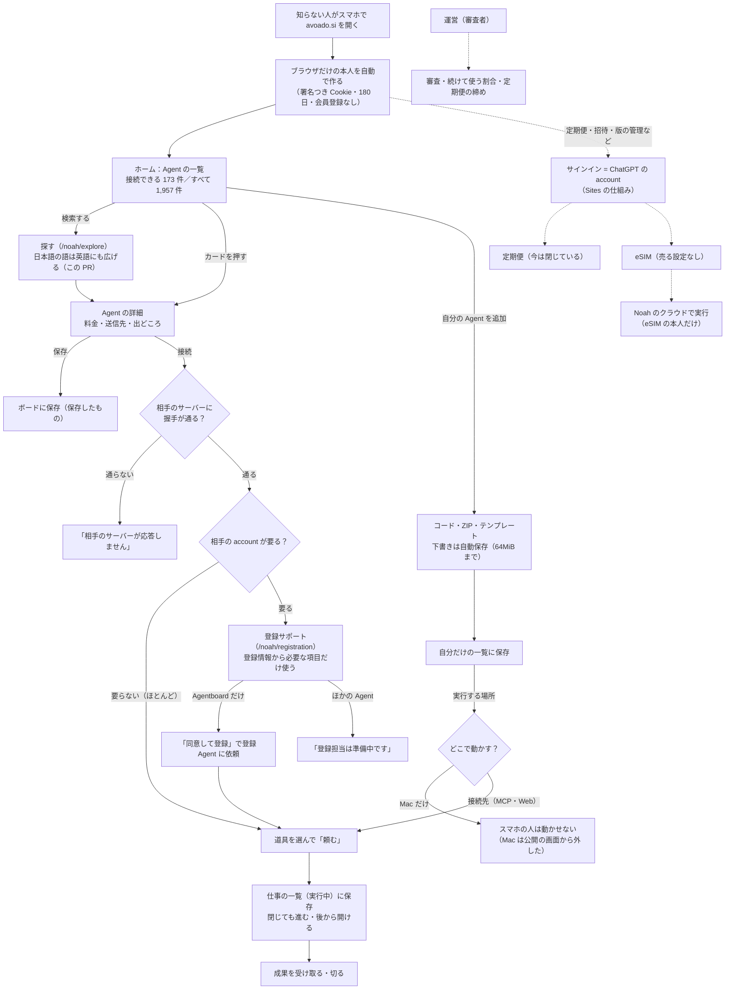

# Noah の使い勝手と抜け道の確かめ（2026-11-22）

本人の指示（2026-11-22 23:10）「ユーザーエクスピリエンスを辿ってデバグしてほしい。登録するところがスムーズかとか（エージェントが動く前提で）ほんとにエージェントの登録がボタン押せばできるようになってるかとか、配給のシステム（今は超初期だから初期設計に組み込む必要はないけど）ができてるかとか自前のサーバーを使うかクラウドを使うかとか、全部一個一個因数分解してちゃんといますぐ全機能が使えるか確かめて欲しい。（略）全体の流れをMD図で表して、言葉や矢印でも説明して。（略）抜け道があるかどうかとかぜんぶぜんぶ込みで第三者視点で調べて改善点を最終形までもってってね」。

調べた物: 本番（avoado.si、Sites 206。main 94d2c762 から公開）を、知らない人のスマホ（幅 390）と PC（幅 1280）で、**読むだけ**で開いた。書き込む操作は、同じ main（b310b319）を手元で本番と同じ形に build して確かめた。本番で書き込む確かめ（接続・依頼・ボード・登録情報）は、本人の許可を待っている（8 章）。

## 0. 結論

- **今すぐ使える**: 登録なしで始める（初めて開いた時に、ブラウザだけの本人が自動で作られる）。一覧を見る。英語で探す。Agent の詳細。173 件の「接続できる」Agent は、全部「相手のサーバー」で動く無料の物。
- **つまずく所（この PR で直した）**: 日本語で探すと 0 件だった（「画像」「翻訳」「要約」など。英語の image は 97 件）。「自分のAgentを追加」をテンプレートのまま保存すると、必ず失敗した。「保存したもの → Agent」に、ブラウザだけの人へ「サインインしてください。」と Mac の節が出ていた。スマホの頭の部分の押す所が 44px より小さかった。
- **今は使えない（作りの判断が要る。9 章）**: 追加した自分の Agent は Mac でしか動かない（Mac は公開の画面から外した）。外部への登録の代行は 1 件だけ（Agentboard）。定期便は閉じている。開いても ChatGPT のサインインが要る。お金・eSIM は設定されていない。Noah のクラウドで動かすのは eSIM の人だけで、eSIM は買えない。
- **抜け道**: ブラウザだけの本人は、いくらでも作れる。だから、本人ごとの上限（下書き 64MiB・Agent 100 件・依頼 1 日 200 回）は、全体の上限にならない（task 129 の D1）。一部の公開 API は、呼ぶたびに全件を読んで外へ取りに行っていた（この PR で 5 分の使い回しにした）。なりすまし（名前の見出しを外から付ける）は通らなかった。

## 1. 全体の流れ（図）

## 2. 言葉と矢印での説明

1. **入口 → 本人**: 知らない人が `/noah` を開く → 画面が `POST /api/noah/session` を呼ぶ → 署名つきの Cookie（`__Host-noah_access`）が付く。これが「ブラウザだけの本人」。DB には何も書かない。会員登録・ログインは無い。
2. **本人 → 一覧**: ホームは `GET /api/noah/discover` で、Agent のカードを並べる。「接続できる」は、握手が通った 173 件（全部、相手のサーバーで動く無料の物。実際に誰かが動かした物は 5 件）。「すべて」は 1,957 件。
3. **一覧 → 探す**: 検索語は、名前・説明・提供元に当てる。前は語を丸ごと 1 つの文字列として探したので、日本語では 0 件だった。今は語ごとに当て、日本語の語は英語の語幹にも広げる（`lib/noah-search-terms.ts`）。
4. **一覧 → 詳細 → 保存**: 「保存」でボードに入れる。ボードは本人のブラウザの物（`POST /api/noah/boards`）。
5. **詳細 → 接続 → 頼む**: 「接続」で相手のサーバーと握手する → 道具の一覧が出る → 道具を選んで「頼む」→ 仕事の一覧に入る。閉じても進む。1 つの相手には、Noah 全体で 1 分に 30 回まで。
6. **接続 → 登録が要る時**: 相手の account が要る Agent は、`/noah/registration` で、登録情報（`/noah/profile` に暗号化して保存した物）から必要な項目だけ使って、登録 Agent に依頼する。今、設定してある登録先は **Agentboard の 1 件だけ**。ほかは「登録担当は準備中です」になる。
7. **自分の Agent を追加**: コード・ZIP・テンプレートを下書きに保存 → 「自分のNoahに保存」で、自分だけの一覧に入る。コードを保存した Agent の実行場所は「このMacの隔離環境」で、スマホだけの人は動かせない。MCP・Web の接続先を書いた Agent は、5 と同じ道で使える。
8. **サインインが要る物**: 定期便・招待の受け取り・版の管理は、ブラウザだけの本人では使えない。サインインは「ChatGPT でサインイン」（Sites の仕組み。`/signin-with-chatgpt` → auth.openai.com）だけ。パスキーの新規設定は、今は出ない。
9. **お金と回線**: 定期便は切り替え（`NOAH_TEIKIBIN`）が閉。eSIM は「売る設定なし」（`catalog_not_configured`）。支払い（Stripe）は「未設定」。Noah のクラウドで動かす入口（`/api/noah/cloud-work`）は eSIM の本人だけ。
10. **運営**: 審査・続けて使う割合・定期便の締めは、審査者（`NOAH_REVIEWER_*`）だけ。知らない人には 401・404 を返す（確かめた）。

## 3. 機能ごとの確かめ

判定: ✅ 今使える／⚠️ 使えるがつまずく／❌ 今は使えない／🔧 この PR で直した。証拠は、2026-11-22 23:00〜01:00 の本番の読み取りと、手元の本番と同じ build。

| # | 機能 | 入口 | 今の状態 | 判定 |
| --- | --- | --- | --- | --- |
| 1 | 登録なしで始める | `/noah` | 初回に Cookie が付く。DB に書かない。180 日で切れる。ブラウザのデータを消すと戻せない（画面に書いてある） | ✅ |
| 2 | 一覧（ホーム） | `/noah` | 接続できる 173 件・すべて 1,957 件。ホームの先頭 3 件は Noah 自身の「広告を含む」案内で、提供元が `noah-revenue-agents.mr-kirin999.workers.dev` と出る。11-23: カードの下の行を「Noahの案内（広告を含む）」にした（Q4） | 🔧 |
| 3 | 日本語で探す | `/noah/explore?q=` | 前は「画像」「翻訳」「要約」「動画」「音楽」「天気」「税金」が全部 0 件。直した後は、同じ 1,957 件で 105・9・12・83・40・18・4 件 | 🔧 |
| 4 | Agent の詳細 | `/noah/discover/agent?id=` | 料金・送信先・出どころ・報告の窓口が出る | ✅ |
| 5 | 接続して頼む | 詳細の「接続」 | 173 件のうち 165 件は「まだ誰も動かしていない」。本番で押す確かめは許可待ち（8 章） | ⚠️ |
| 6 | 外部への登録の代行 | `/noah/registration` | 設定は Agentboard の 1 件だけ（入れる項目は名前だけ）。メニューの「登録サポート」から開くと、どの Agent の話か分からないまま Agentboard の表が出る | ⚠️ |
| 7 | 登録情報 | `/noah/profile` | 基本情報・活動・受取口座・本人確認を、暗号化してブラウザの本人に保存。共有の端末では、同じブラウザの人が見られる（画面に注意書きあり）。11-23: 受取口座と本人確認は、サインインした本人だけにした（Q3） | 🔧 |
| 8 | 保存（ボード） | `/noah/saved` | ホームの「保存」から作る。本番で押す確かめは許可待ち | ⚠️ |
| 9 | 保存 → Agent | `/noah/saved?tab=agents` | 前は「サインインしてください。」と「このMacに取り寄せたAgent」が出ていた。直した後は、ブラウザだけの人には出ない | 🔧 |
| 10 | 自分の Agent を追加 | `/noah/agents/new` | 前は、テンプレートのまま保存すると「固定テストで整理する実行先に接続できません」で必ず失敗。直した後は、そのまま保存できる | 🔧 |
| 11 | 追加した Agent を動かす | 追加した Agent の詳細 | 実行場所が「このMacの隔離環境」だけ。スマホの人は動かせない。11-23: 作りはこのまま（Q1）。追加の画面に、Mac で動く事とスマホから使う道を書いた | ❌（予定どおり） |
| 12 | 定期便 | `/noah/teikibin` | 「始まる時に、ここでお知らせします」。切り替えが閉。開いても、ブラウザだけの本人は入れない（サインインが要る） | ❌（予定どおり） |
| 13 | サインイン | 各画面の「サインイン」 | ChatGPT の account だけ。`/noah/account` は会員の表を外したので、すぐ元の画面へ戻る（サインインの代わりにならない） | ⚠️ |
| 14 | eSIM | `/noah/esim` | 「提供状況を再確認」だけ。売る設定なし | ❌（予定どおり） |
| 15 | Noah のクラウドで実行 | `/noah/free-cloud`・`/api/noah/cloud-work` | free-cloud は運営 1 人だけ（他の人は 401 の会話画面）。cloud-work は eSIM の本人だけ | ❌ |
| 16 | 利用状況 | `/noah/usage` | 前は、運営でない人にも「Noah全体」のボタンが出て、押すと 403。直した後は、運営にだけ出る | 🔧 |
| 17 | ココナラの仕事 | メニューの「ココナラの仕事」 | 「このMacに接続」だけ（#11 で入った Mac の機能）。スマホの人は先へ進めない。11-23: Mac で開いた時だけメニューに出す（Q5） | 🔧 |
| 18 | 月次請求のテスト | `/noah/billing` | 公開のまま。中の API は 404。リンクも sitemap も無い。既存の試験が `/sky/billing` と同じ画面として固定しているので、残した（11-23） | ⚠️ |
| 19 | 押す所の大きさ | 全部の画面の頭 | 前は、右上の「登録情報を見る」36px・「戻る」32px。直した後は 44px。登録情報の画面の文字のリンクも 44px にした | 🔧 |
| 20 | 横にはみ出す所 | 主な 9 画面（幅 390） | 無し | ✅ |
| 21 | 運営の画面 | `/noah/review` など | 知らない人には API が 401。見出し「Agentの審査」だけは出る | ✅ |

## 4. 抜け道（第三者の目で）

| # | 抜け道 | 何が起きるか | 重さ | 状態 |
| --- | --- | --- | --- | --- |
| S1 | ブラウザだけの本人は、Cookie を捨てるだけで何人でも作れる | 本人ごとの上限（下書き 64MiB・ファイル 512 個・Agent 100 件・依頼 1 日 200 回）が、全体の上限にならない。R2 と D1 が際限なく増える | 高（費用） | 🔧 ブラウザだけの本人を全員まとめた 1 日の上限（11-23、task 129 D1） |
| S2 | 1 つの相手への依頼は Noah 全体で 1 分 30 回まで。これを 1 人が使い切れる | 人気の Agent を、他の人が使えなくできる（「今こんでいます」） | 中 | 1 人は 1 分 10 回まで（相手の枠の 3 分の 1）。何人分にも分ける量は、D1 の 1 日の上限で抑えた。2026-11-27（task 129 D2）: 1 人が 1 つの相手へ頼める数も、相手の枠の 3 分の 1 にした（本人の 1 分の上限を上げても変わらない。`tests/noah-ask-host-share.test.mjs`）。1 分の中で何人分にも分ける使い方は、ブラウザだけの本人を作る時の人の確かめ（例: Cloudflare Turnstile）と一緒に直す（外の設定が要るので本人の判断） |
| S3 | `/api/noah/revenue/catalog` は誰でも呼べ、呼ぶたびに全件を読み、外へ取りに行っていた（448KB・`no-store`） | 繰り返し呼ぶだけで、DB と外向きの取得を増やせる | 中 | 🔧 5 分の使い回し |
| S4 | `/api/internal/rockstar/entitlement-deliveries` と `/api/sky/service-status` が、設定の有無を知らない人に返す | 何が未設定か（支払い・法務 AI など）が外から分かる | 低 | 🔧 前者は鍵の無い人に 401 だけ（11-23）。後者は Sky の画面が使う、意図した公開の前提の情報（秘密の値は返さない）なので、そのまま |
| S5 | 名前の見出し（`oai-authenticated-user-id`）を外から付けて、他人になりすます | 通らなかった（本番で、存在しない ID・読むだけの API で確かめた） | — | ✅ |
| S6 | ブラウザの本人の Cookie | HMAC の署名・HttpOnly・Secure・SameSite=Lax。書き込みは同じ origin だけ。使える API は決まった一覧だけ | — | ✅ |
| S7 | サインインの戻り先 | `/noah` の下だけ。外のサイトへは戻さない | — | ✅ |
| S8 | 登録の代行 | 1 人 1 日 10 件・全体 1 日 200 件・同じ origin だけ。登録先は環境変数の固定の一覧だけ（入力から送り先を作らない） | — | ✅ |
| S9 | 登録情報に、受取口座と本人確認の書類を、ブラウザの本人で置ける | 共有の端末では、同じブラウザの人が見られる。見る前の確かめ（パスキー・端末の鍵）が無い | 中（個人情報） | 🔧 ブラウザだけの本人には新しく置かせない（11-23、Q3。前に置いた物は読む・消すだけ） |
| S10 | Agent の説明に HTML を入れる | 画面は文字として出す（`dangerouslySetInnerHTML` は Noah の画面に無い） | — | ✅ |

## 5. 自前のサーバーか、クラウドか

決めは [compute-placement.md](../compute-placement.md) の 0.6（2026-11-21、本人「規定で進めて」）。**今は Cloudflare だけ（案 A）。従量の請求が、黒殿 1 ノードの電気代（月 約 3 万円）を 2 か月続けて超えたら、黒殿へ移す（案 B）。mii の出荷に合わせて家の端末へ（案 D）。**

| 置き場所（契約の値） | 何が動くか | 今、一般の人が使えるか |
| --- | --- | --- |
| `provider` 相手のサーバー | 接続できる 173 件の全部（MCP・Gradio） | ✅ 使える |
| `cloud` Noah のクラウド（Cloudflare） | 受付・保存・進行（Workers・D1・R2）。単発の実行は Containers の予定 | 受付・保存は ✅。実行の入口は eSIM の本人だけで ❌ |
| `home` 家の端末（本人の Mac → mii） | コードを保存した自分の Agent・ココナラの仕事 | ❌ 公開の画面から Mac を外した |
| 黒殿（`cloud` の中身の 1 つ） | 引き金の後に、モデル → 常駐 → 単発の順に移す | まだ（引き金の前） |

つまり「自前のサーバー（黒殿）を使うか」は、もう決まっている（引き金まで使わない）。決まっていないのは、**スマホだけの人が、自分で追加した Agent をどこで動かすか**（3 章の 11）。9 章の Q1 で本人に聞く。

## 6. この PR で直した事

| 直した事 | file | 試験 |
| --- | --- | --- |
| 日本語の検索語を、英語の語幹にも広げる。語ごとに当てる。短い英語は語の切れ目で当てる | `lib/noah-search-terms.ts`（新）・`lib/noah-agent-directory.ts` | `tests/noah-search-terms.test.mjs`（6 本） |
| 「自分のAgentを追加」で、検証の実行先が無い時は「固定テストで確認して整理する」を最初から外し、押せなくする | `components/noah-agent-upload-form.tsx` | `tests/noah-upload-account-ui.test.mjs` に 1 本 |
| 「保存したもの → Agent」の、版の管理（401・404）と Mac の取り寄せ（404）の節を、使えない人には出さない | `components/noah-instances.tsx`・`components/noah-managed-installation.tsx` | `tests/noah-library-public-sections.test.mjs`（2 本） |
| 利用状況の「Noah全体」を、運営にだけ出す | `components/noah-usage-dashboard.tsx` | `tests/noah-usage-operator-tab.test.mjs`（1 本） |
| 公開の紹介案件の一覧を、5 分だけ使い回す（失敗は使い回さない） | `lib/noah-revenue-catalog.ts` | `tests/noah-revenue-catalog-cache.test.mjs`（1 本） |
| スマホの頭（戻る・ロゴ・登録情報）と、登録情報の画面のリンクを 44px 以上に | `components/noah-service-shell.module.css`・`components/noah-profile.module.css` | 手元の build で寸法を測った |

どの試験も、直す前の file では落ち、直した後で通る事を確かめた。

## 7. Codex に任せる事

[task 129](../../codex/tasks/129-noah-ux-debug.md) に、細かく分けて書いた（D1〜D13）。1 つの小項目を 1 PR にする。

## 8. 本番で書き込む確かめ（本人の許可待ち）

[spec-90 の 5 章](spec-90-phone-only-loop.md) の表（1〜13）のうち、2〜11 は本番で押さないと言えない。本人に次の事を聞いた（2026-11-22 23:20）: 匿名のブラウザで、無料の Agent 2〜3 個に 1 回ずつ頼む・ボードを作って消す・登録情報に架空の名前を入れて消す・見本の Agent を下書きに入れて消す。Agentboard への登録の送信・お金・eSIM・定期便・公開や審査への提出はしない。

## 9. 本人に決めてほしい事

**2026-11-23 に決めた。** 本人「好きにしていいよ／だから早く完成品世に出したい」（21:43）で、判断を Claude に任された。決めた事は [07 の決定の記録](../structure/07-decisions-from-minutes.md) の 2026-11-23 の行。短く書くと: Q1 作りはこのまま、画面に Mac で動く事を書く。Q2 閉じたまま。Q3 ブラウザだけの本人には置かせない。Q4 出し続け、「Noahの案内（広告を含む）」と書く。Q5 Mac で開いた時だけメニューに出す。下は、聞いた時の文。

- **Q1** スマホだけの人が「自分の Agent を追加」した物を、どこで動かすか。(a) Noah のクラウド（Cloudflare Containers。費用は Noah が持つ。上限が要る）(b) 接続先（MCP・Web）を書いた Agent だけを受け付け、コードの保存は Mac の人だけにする (c) 今のまま（スマホでは動かない）。
- **Q2** 定期便に、ブラウザだけの本人で入れるようにするか。今は ChatGPT のサインインが要る。振込には本人の確かめが要るので、どこかで本人確認は要る。
- **Q3** 登録情報の「受取口座」「本人確認」を、ブラウザだけの本人に置かせ続けるか。置くなら、見る前にパスキーか端末の鍵で確かめるか。
- **Q4** ホームの先頭に、Noah 自身の「広告を含む」案内を出し続けるか。出すなら、提供元を `avoado.si` の名前にして、「Noah の案内（広告を含む）」と分かるようにするか。
- **Q5** メニューの「ココナラの仕事」（Mac だけ）を、スマホの人にも出し続けるか。

## 10. 確かめ方（同じ事をやり直す）

- 本番の読み取り: `scratchpad/ux/crawl.cjs`・`probe.cjs`・`taps.cjs`（Playwright。読むだけ。書き込む API は呼ばない）。GET を返す API 145 本を、知らない人とブラウザの本人の 2 通りで呼んだ: 200 が 60、401 が 178、404 が 41、400 が 5、503 が 4。500 番台の失敗は 503 の 4 本だけ（設定が無い所）。
- 手元の build: `npm run build` の後、`dist/server/.dev.vars` に試験用の値（`NOAH_PROFILE_KEYS` と `ROCKSTAR_LOCAL_DEVELOPMENT_USER_ID=""`）を入れて wrangler で動かし、Playwright で「自分のAgentを追加」と「保存したもの」を押した。
- 検索の比べ: 本番の「すべて」1,957 件を読んで、前と後の件数を数えた（3 章の 3）。
