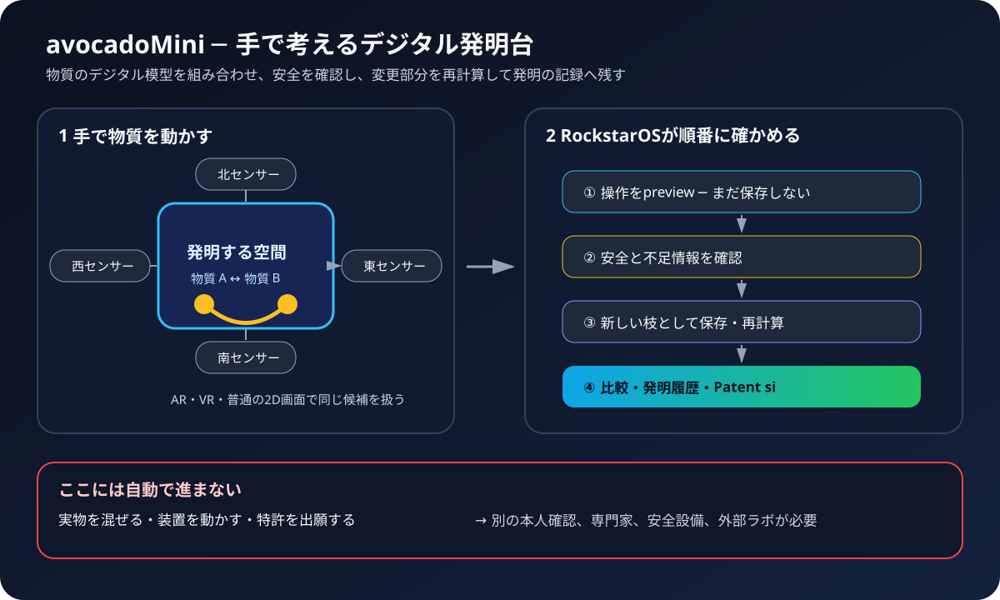

## 2026-10-23 — 正式表記はSmith

本人の明示訂正により、旧Sky／smisの製品表示は **Smith** とする。Eveで担当を作り、Smithが対象・能力・実行先をつなぐ責任は維持する。既存の `/sky`・`/api/sky`・`smis.*`・header・保存・権限scope・設計anchorは互換維持。以下の旧表記は経緯として残す。表示変更はPixel実機の一周や公開の合格を意味せず、一般公開は保留する。

## 目的から部品確認・担当作成へ（2026-10-23）

Eveの自由な目的から必要情報／処理／出力を本人確認し、Miniが実際に接続できる能力と照合する。Pixelの動きセンサーと文章を先行し、水分／重量／駆動／継続監視等は部品と対応処理を個別に準備する。Hey Eveの認識だけで承認を発行せず、同じOS仕事・保存・Thanks Eve停止へ接続する。実Mini／Pro・音声・実Pixelの受入は別に行う。 [詳細正本](sky-tools-complete-design.md#smis-object-purpose)。

## 再利用する電子本体と対象別の取り付け部分（2026-10-23）

本人が採用した[交換式部品の正本](sky-tools-complete-design.md#smis-removable-module)をMiniにも適用する。Eveで目的を作り、smisが必要な実入力と出力をつなぐ。共通OSの仕事・成果保存・Thanks Eve停止を再利用し、機器ごとの差はIO／電源／通信driverへ置く。Pixelの先行試作はmicro:bit V2の動きの単発観測と文章出力。Miniの実センサーや内蔵部品へは同じ観測／取り付け世代の契約を使うadapterを別途実装し、Web Bluetoothの成功をMini／Proやnative OS imageの受入に換算しない。自動着脱検出には接点付き台座等が必要。部品未所持・実機未受入、一般公開保留。

## OS内の統一を先に行う（2026-10-22本人訂正）

端末ごとの会話/担当/仕事/成果/料金/停止を増やさず、RockstarOS共通Coreと同じ既存store/workflowに統合する。[11項目の正本](rockstaros-complete-design.md#os-unified-interaction)。前段のMini音声は共通Core/画面と旧Pixel接続adapterへ分離し、native/account/runtimeの同じjobへの結合を次に行う。機種別には実入出力/電源/driverを実装し、一般ローンチ保留と既存データ保全を維持する。Core抽出だけで全経路/全実機の統合済みとはしない。

<a id="mini-hey-eve"></a>
## Hey Eveで始め、Thanks Eveで終える（2026-10-22本人指示）

1. **目的**: 用途はユーザー自身がEveで作る。Miniを声で起こし、Eveが依頼を役割/必要能力へ具体化し、smisが実行先・道具・出力へつなぐ共通体験を提供する。特定用途や新しい固定モデルに限定しない。
2. **利用体験**: 本人が音声待機を許可→「Hey Eve」→光/声/画面で受応答→依頼→聞き取った内容/担当/利用可能能力/実行先/料金/保存を確認→担当の作成または再利用→smisで同じ仕事を実行→成果を確認/持出し→「Thanks Eve」→この会話で始めた仕事の停止を照合→待機。呼びかけや音声認識だけで課金・外部操作を承認しない。
3. **責任**: Material Invention / avocadoMiniのROCK（MAT15、OS10/DSP01/SKY21連携）が会話状態・同じ仕事・許可・成果・停止を管理。EXTERNALはローカルASR/音声model/driverとMIC物理回路。JOINTはPixel実音声/実推論、後の同一Miniでの消費電力・誤起動・距離/雑音・MIC OFF受入。OWNERは音声待機、認識した依頼、保存、外部送信/料金を確認する。
4. **入出力**: 音声adapter→確定した認識文→共通session→既存の担当追加/実行/workflow/成果/指定job停止。Pixel先行候補は`lib/mini-local-speech.ts`と`lib/mini-voice-session.ts`、既存Pixel Linux UI内`components/mini-voice-panel.tsx`。初期処理は文章担当を依頼から設定する方式で、任意codeや物理能力を生成した証拠ではない。出力は同じ仕事の文章と状態、既存の文章export。Miniの光/音/機器出力は対応adapterと権限の実受入後に追加する。
5. **状態/電源**: disabled / standby / listening / review / creating / running / result / stopping / unknownを区別する。普段のoffは呼びかけ検出部を残す待機で、MAINの休止とMICの給電を別に測る。完全電源断/MIC物理OFFから声で起動したことにしない。Pixelの試験は前景2分間のローカルASRであり、Mini向け低消費電力wake-wordや画面消灯/常駐の受入ではない。
6. **保存**: 生音声は保存/外部送信せず、未確認の依頼は画面内だけ。確認済みの担当/依頼/成果は既存Pixel本人用保存へ。開始前に同じjob ID・担当/モデルhash・依頼をtab内へ記録する。ページを開き直してもそのIDを確認し、新しいjobで送り直さない。Thanks Eveで担当/成果を消さない。既存owner/鍵/履歴/料金台帳を作り直さない。
7. **失敗**: 端末内ASRと日本語データの確認に失敗したらマイクを始めず、Cloud ASRへ無断切替/言語model自動取得をしない。部分認識や文中の引用だけで起動/停止しない。AIが未準備・別仕事の稼働・保存不可では開始せず普通の言葉で案内する。開始応答喪失/停止未確認はunknownを保持し、待機/停止完了と偽らない。
8. **停止/復旧**: Thanks Eve/終了ボタンで遅延した担当作成/開始をfenceし、同じjobの結果を読み直して指定停止する。別の会話や端末全体の仕事へstop-environmentを送らない。完了済み文章は保持し、未完仕事は既存停止receiptを確認する。画面を離れる/2分経過/音声エラーでマイクを破棄して停止を要求する。ページ終了後の通信完了は保証せず、次の起動で記録から照合する。物理停止とタッチ/文字入力を代替として残す。
9. **承認/費用**: 最初のPixel試験は既存準備済みAIだけ、Cloud AI使用料0円、電気代/機器代は未計測。音声だけの自動download・外部共有・購入・Tool変更を許可しない。一般ローンチ保留、本人用localhost候補のみで配備/署名/実機受入と区別する。
10. **合格条件**: exact wake/stop、確認前0仕事、同じ担当/model hash/job、成果export、遅延/失敗/再読/停止未確認のfixture、型/lint/Pixel package/全verify。実受入は同一Pixelのロック解除・マイク表示/許可→実Hey Eve→実依頼→確認→実推論/同じ成果→実Thanks Eve→停止確認/待機→再呼びかけ、MIC OFF/背景/雑音/誤認/遮断も別記録する。合成認識文の注入を実音声の受入に数えない。
11. **未決定/次**: 現Pixelは公開RecognitionServiceがClaudeのみで端末内ASR未確認、画面操作接続も不通。既存のnative mTLS経路と旧5199ブラウザ転送を混同せず、音声adapter/日本語データの選定・利用条件/必要容量を示した準備と、現行native入口への接続を詰める。Miniでは専用wake-word/ASRの精度・AON電力・MIC切断回路/光や音の返答を同一個体で測る。Pixel先行コードをMini基板完成へ転用しない。

技術境界は[Web Speech仕様](https://webaudio.github.io/web-speech-api/#dom-speechrecognition-processlocally)と[Android端末内音声認識API](https://developer.android.com/reference/android/speech/SpeechRecognizer#createOnDeviceSpeechRecognizer(android.content.Context))を参照。仕様にAPIがあることと当該Pixelでの利用可能性は別に確認する。正式サイトはMiniが`avocadomini.si`、共通Eve/smisは`avoado.si`、Proは`avocadopro.si`のまま。

## Miniと共通RockstarOS/Eve package（2026-10-21）

## Mini起動・MCU・試験PCBの実装（MAT15）

本人の「基板はなし、そこの設計から」を受け、[開発sourceと受入条件](../systems/rock-star-os/targets/avocado-mini/README.md)を追加。CM5/CM5IO＋Pico 2は卓上参照構成で、Pico用C firmwareのcross-build、Linux USB CDC driver/systemd、既存Eveを同じowner/料金契約で開くclient起動部、76×62mmのKiCad接点/LEDキャリアを実装した。[通信契約](../contracts/avocado-mini-supervisor.json)と[検査証拠](evidence/avocado-mini-native-development.json)を参照。製品Miniのnative OS image、署名/復旧、衛星IP/AP、光学/生体/電池を含むmainboard、実機Eve、200mm同一閉箱の受入、量産releaseは未完了。GPIO flag代用接点やLEDの成功をその合格へ転用しない。


本人が内部回路とOS連携の実開発、続いてhardware共通packageと同じ料金体系を指定したため、[portable runtime](../packages/rockstaros-runtime/README.md)を追加。既存Eve履歴/仕事/認証/料金APIを使うclient実装と、[Mini回路側のOS接続納入条件](avocado-mini-r5/factory-development/electrical-architecture.md#7-工場側のos接続と納入条件共通runtime対応)を結ぶ。host試験と配布bundleが対象で、Miniのboot/driver/MCU/光学/衛星/同一閉箱受入は未完了。工場にはsource/hash付きの設計開発レビュー一式として渡し、製造リリースとは区別する。

## 最新再設計と端末・ブランドの統一（2026-10-20）

本人の明示訂正により、今のRockstarOS再設計を最新版とし、旧Buildroot OSは良い実装の選択再利用元とする。旧OS完成や旧QEMU合格を現商品の完成条件/証拠へ置き換えない。表示名RockstarOSと既存avokado会社ロゴを統一し、Pixel・avocadoMini・avocadoPro・吊り下げ相棒を共通owner/job/権限/契約/料金へ接続する。端末差は能力と入出力adapterで扱い、同一契約の端末追加による基本料重複を防ぐ。相棒のSOS/独立警報は通信/LLM/課金と分離する。[詳細正本](device-support-architecture.md#current-device-adaptation)。現段階の各実装・実機・請求受入は独立して記録する。

## avocadoMiniの工場向け電気設計開発入力

2026-10-19の明示指示で、R5 MAT15の[工場向け開発依頼R0](avocado-mini-r5/factory-development/README.md)を追加した。回路domain・停止境界と寸法/電力のふるい分け、正式回路/PCB/同一閉箱受入へのE0〜E3引渡し条件を示す。R0は開発見積用であり製造リリースではない。RockstarOS/Sky/Zemaの共通契約、Miniの一台自律・米国衛星Wi-Fi・空中着信の最低要求は維持する。

## Sky全体の表示と持出しの共通ルール（2026-10-18）

利用者の明示指示により、Skyの全機能で画面・進捗・成果・エラー・保存ファイルを普通の言葉にそろえる。最初に「何ができたか・何が残るか・次にすること」を示し、処理番号や専門的な記録は必要な人が開ける詳細へ置く。権限・費用・未確認・省略・停止の実態は隠さず、元の入力と成果は保持する。[共通の入出力・状態・保存・復旧・安全・合格条件](sky-tools-complete-design.md#sky-plain-language)。Zoom以外の接続や仕事、今後の端末表示にも適用する。一般公開は保留。

# RockstarOS × avocadoMini — 見て分かる空間発明システム設計書

2026-10-21の明示補足: 壁から外せるNest Thermostatの写真を一例に、さらに多くのデバイスを探す本人指示に従い、住宅・携行・Game・投影・非接触入力・衛星/携帯通信の[31件の製品・技術の公式資料比較](avocado-mini-r5/embedded-portable-connectivity.md#既製デバイスを参照する方法2026-10-21)へ拡張。壁面への納まり、持ち上げ、再充電、落下防止、pack交換、表面投影・light-field画面・空中像の差、手振りと本人認証の差、衛星messageと一般IPの差、衛星IP→Wi-Fi APの上空視界・電力・寸法条件を学ぶ。製品の形・部品・稼働時間・認証をMiniへ継承しない。Miniの空間光学、衛星Wi-Fi、RockstarOS/Eveの仕事継続は同一試作機の別gateで受け入れる。

2026-10-21の建築研究との接続: 利用者が示した200構想×5視点の研究は、Miniの[一つの現場での敷地根拠・実測・案比較・専門家判断・事後評価](avocado-mini-r5/phone-spatial-interface.md#23-建築構想を実際の場所へ結ぶ2026-10-21)という用途へ結ぶ。未選定の土地は研究のままとし、Miniの表示・sensorとRockstarOSの権限・SkyのTool・Zemaの同一jobを用いた実地一周は未受入。

2026-10-19の明示補足: Miniは空の場所に建築物／設計中の空間を視覚的に現し、触れずに周囲を歩いて確認・編集し、版付きCAD/BIMと実測へ戻す体験を担う。「トンネルの中の蝋燭」は招待した本人たちの限定された共同観察域で同じsceneが見え、外へ像を広げない目標の比喩。sensorの空間計測と表示の光学出力、本人／招待者の権限と実際の光漏れ、見た目と図面の精度を別判定する。[現行Miniの空間建築表示とAS01〜06](avocado-mini-r5/phone-spatial-interface.md#21-何もない場所に建築を見せそこで設計する)を参照。建物規模の裸眼像、複数人の一致、光学的秘匿、精密設計の物理受入は0件で、本書の四方向研究rigや近距離通知カードから達成へ換算しない。

2026-10-18の製品発明検討: [R5 Orbit候補](avocado-mini-r5/product-invention-r1.md)は、本人確認後だけ私的情報を出す近距離空中通知、手と物理入力の同一通話状態、dock着脱での場所権限切替、Mini本体の衛星上り下り・IPからWi-Fi共有、Game／Sky／Zemaの同一job継続を一つの候補本体にまとめる。追加の明示目的「PCの前に立たずものを作る、携帯を持たずやり取りする」を、dock中の制作brief→実Tool／Agent→途中修正→成果検収・保存と、着信・発信・短い送信のOI07受入にする。目的、利用体験、入力／出力、状態、保存、失敗と復旧、OI01〜07の受入、光学・RF・熱・費用の未決定条件を同文書に記録する。利用者指定の映像集を踏まえた追補では、最初の設置を手の届く乾いたアイランドdockとし、細い銀色の同じ可搬coreを`Stow→Ready→Carry`へ軸方向に切り替える。Place Passportはdockの位置・校正・設備候補を与えるが本人鍵を持たず、離脱時にはBrokerが場所scopeと旧入力座標を失効させる。Scene Contractは生活・連絡・Game・PCなし制作の入力、権限、結果、停止を既存runtimeへそろえる。Route Guardianは衛星の実IPとWi-Fi共有・費用上限を同じcoreで測る。均一D96mmの太径coreは工学比較案で、原本意匠の確定変更ではない。完全flushな位置では側面の光学窓が塞がるため、端面の空中像・近接入力とReadyでの露出を実部品で試す。近距離の平面空中像は元R5の全空間裸眼3Dを達成した証拠ではなく、実部品収納、直接衛星、通話、制作、光安全、製造は未受入。

2026-10-18の追加最低機能要求: R5は[携帯の新しい形と空間インターフェース](avocado-mini-r5/phone-spatial-interface.md)を現行Device Profileとして設計する。センサーと生体認識、RockstarOS／Sky／Zema、対応設備連動、Mini自身の衛星WANからのWi-Fi共有、dock外のポケットWi-Fi、空間の着信表示と手による応答を一体で扱う。sensor入力、光学出力、通話／通信、本人承認を別契約とし、目的・体験・責任・入出力・状態・保存・失敗復旧・MP01〜06・未決定の決め方は同設計を正本とする。本書の四方向Material Invention研究rigはR5の携帯代替機能の実証ではない。

2026-10-19の5時間発明後の研究選定: 利用者はMini衛星通信の最初の検証地域を**米国**と指定した。[Orbit L-Tの一ページ要約](avocado-mini-r5/README.md)と[候補比較・収束設計](avocado-mini-r5/product-invention-r1.md)で、銀色D76×H186mm仮core、黒いsensor帯、05乾式模擬アイランドの面一Stow→可動cupと一緒に約50mm上がるReady→同一本体のCarryを一つの研究構成にした。端面の匿名着信合図、Readyで本人確認後の一択ずつの裸眼空中カードとtap、電話・PCなし制作、同じjobの持出し、米国のMini本体から双方向衛星IP→Wi-Fi共有を最低条件のまま残す。core底からcup外底までの仮5mm（底壁込み、内部すき間未計上）・公差3mmで仮194mmという幾何だけが描けた段階であり、内部すき間`g`、coreとcupの遷移中の先行差`δ`、光学襟の軸伸び`e`には`g+δ+e≤6mm`の仮制約がある。光学・RF・保護電池・保持安全・通話・契約・FCC完成機・同一閉箱OI/MPは全て未受入。固定全長筒からの大strokeはR5の使用時200mmに抵触するため、旧L-A構想画を寸法証拠にしない。元R5の全空間裸眼3Dも別研究gateに残す。


2026-10-18の明示方針と訂正: avocadoMiniと**AI専用PCのavocadoPro**もRockstarOSの同じSI（スーパーインテリジェンス）サービス、Sky／Zemaの仕事・成果契約へ接続する。機種ごとの入力・出力・local処理は確認済みDevice Profileで変える。Mini R5の現行製品要求と、この文書の四方向Material Invention研究profileは区別する。ProはMiniの拡大型ではなく、PC本体のhardware仕様はこのrepositoryで未確認のため、Miniのsensorや表示、GrapheneOS／Terminalの搭載をProへ推定しない。[共通Coreと機種別出力の詳細契約](device-support-architecture.md#shared-si-device-profiles)。

版: 2.0 / 2026-09-18
状態: 既存Material Invention研究profileと共通契約の設計資料
注意: 現行avocadoMiniの製品要求は[R5統合基本設計](avocado-mini-r5/README.md)を優先する。本書の四方向発明台、AR、Full-scale/rack構成はこの研究profile内の設計であり、R5の完成外形・全空間裸眼表示・製造承認を示さない。

2026-10-14: avocadoは建築・インテリアの専門家・事業者と組み、architecture、interior、soundと自然なITで生活の質を豊かにする領域を産業上の根城とする。これは本書のMaterial Invention研究profileを廃止せず、avocadoMiniの将来Device ProfileとRockstarOS共通契約を実空間へ展開する上位製品方針である。

2026-10-14: 子供のランドセルへ吊り下げ、外して話せる防犯ベル程度のhardwareは、[avocado Companion（仮称）P0 Device Profile](avocado-schoolbag-safety-device.md)として設計を開始した。R5や本書の四方向Material Invention端末を縮小したものではなく、取り外す本体のlocal alarm、保護者側RockstarOS、中継会話、子供向け安全受入を別taskで扱う。

同日の手持ち小型screen参考を受け、PixelのPocket Console V0.2では二つの目と処理状態を一面で表示する。小型情報screenは比較候補であり、吊り下げ本体のdisplay、電池、警報、安全の合格や最終外観の確定ではない。詳細と未決事項は上記Device Profileを正本とする。

2026-09-24: R5は使用時200mm以内・1本自律・同型mini増設・別Edge Hub不要を目指す。表示・精密3D入力・実部品収納等は未成立/未確定。既存Coreや四方向入力schemaを変更済みとは扱わず、R5専用profileとadapterの実装・受入を別に行う。

2026-09-21 Mini200 E1追補: 利用者の最新の20cmゲーム機・日本語音声・README保存要求は[Mini200 E1設計](avocado-mini-mini200-e1/README.md)へ記録した。本書の四方向発明台は既存profileとして保持する。E1のゲーム入力からMaterial Coreへ接続するadapter、実ASR、console OS、実機、物理マイクOFFの受入は未完了であり、本書の「設計完成」をE1の製造完成へ拡張しない。

---

# A. まず製品を理解する

## 0. 建築・インテリア・サウンドを中核領域にする

### 目的と利用体験

avocadoMiniとRockstarOSは、生活者がITを操作する時間を増やすためではなく、建築、内装、音、光、温熱、道具、仕事が自然に調和する空間をつくり、維持するために使う。最初の体験は「空間について相談する→現状と希望を記録する→専門家とAgentが案を比較する→本人が費用と共有範囲を承認する→実測・専門家確認・施工を別々に検収する→完成後も変更履歴と復旧方法が残る」という一周を目標にする。

### 役割

| 担当 | 責任 |
| --- | --- |
| avocadoMini | 選定したDevice Profileの範囲で空間との物理接点を担う。入力・表示・音・local controlの候補を扱うが、未測定のsensor精度や設備制御を約束しない |
| RockstarOS | 本人性、権限、端末能力、Agent実行、保存、復旧、費用上限を強制する |
| Sky | 審査済みの建築・インテリア・音響Agent／Toolと外部専門家への接続条件を示す |
| Zema | 一つの空間projectの依頼、revision、承認、進捗、成果、支出、未解決事項を管理する |
| 建築・内装・音響の専門家／行政／施工者 | 実測、資格判断、法規、署名、許可、施工、検査、品質保証を担当する |
| OWNER | 対象空間、共有範囲、予算、採用案、外部送信、発注、設置、公開を決める |

### 入出力・状態・保存

- 入力候補は、本人の目的、空間情報、写真・図面・寸法、音環境、制約、予算、専門家の指摘。raw camera／audio、住所、生活patternは必要性・保持期間・共有先を決めるまで既定保存しない。
- 出力候補は、比較案、根拠付き制約、revision差分、見積範囲、専門家確認待ち、施工・検査記録。生成画像やsimulationを実測図面、法規適合、許可済み、施工済みと表示しない。
- project状態は少なくとも`DRAFT`、`MEASURE_PENDING`、`OPTION_REVIEW`、`PROFESSIONAL_REVIEW`、`OWNER_APPROVAL`、`PERMIT_OR_CONTRACT_PENDING`、`IN_PROGRESS`、`INSPECTION_PENDING`、`ACCEPTED`、`BLOCKED`を区別する。既存`lib/workflow.ts`へ実装する場合は同じ本人別revision競合判定を通す。
- 保存する場合はowner、space、source、版、測定／生成／専門家／行政／施工の区分、artifact digest、承認、費用を関連付ける。住宅・現場データを学習利用や別顧客へ転用しない。

### 失敗・復旧・承認

- sensor欠落、寸法不確実、音響測定不足、古い法規、資格者不在、Provider切断、結果不明、費用超過では成功へ進めず、不足と安全な再開点を示す。
- 自動再送、無断録音、常時監視、無断設備操作、無断発注を行わない。生活を妨げる場合は物理停止、手動fallback、ネットワークなしの安全状態へ戻せるようにする。
- AI提案、code候補、見積、設備操作、外部共有、発注、申請、施工開始、録音は別々に承認する。専門資格と行政権限をRockstarOSの本人承認で代替しない。

### 最初の合格条件と未決定事項

1. 一つの限定空間と一つの具体的な生活課題を選び、現行手順と所要時間・revision・復旧を比較する。
2. 同じspace/projectでarchitecture、interior、soundの少なくとも二分野を、責任者と成果schemaを分けてつなぐ。
3. MiniなしのWeb／既存端末fallbackと、選定したMini prototypeの両方で本人が同じprojectを確認できる。
4. 生成物、実測、専門家承認、許可、施工、検査を別証拠として再表示できる。
5. privacy、騒音、accessibility、電源・通信断、費用上限、撤去・復旧を同じpilotで受け入れる。

最初の住宅種別、部屋／建物範囲、国・地域、partner、Miniのsensor・speaker・表示・設備adapter、soundの設計／再生／測定範囲、価格、保守、データ保持は未決定。文書保存を提携、製造、施工、市場占有の合格にしない。

## 1. これは何？

**avocadoMiniは、まだ存在しない材料を、手で考えるための「デジタル発明台」である。**

机の中央に、物質のデジタル模型が浮かぶ。利用者は模型を手で持ち、近付け、組み合わせ、離し、割合や作り方を変える。

RockstarOSは操作のたびに、次の四つを行う。

1. 何を変えたか記録する。
2. 危険情報や条件不足を確認する。
3. 変更した部分だけ計算し直す。
4. 有望な案をPatent AIへ渡せる形に整理する。

最初に扱うのは実物ではない。コンピューターの中にある物質の模型である。実物を混ぜたり装置を動かしたりするのは、別の承認を通過した外部ラボだけである。



## 2. 目の前にあるもの

上から見ると、基本形はこうなる。

```text
                         北センサー
                              ↓
                 ┌────────────────────┐
                 │                    │
西センサー  →    │   発明する空間      │    ←  東センサー
                 │  Invention Volume  │
                 │                    │
                 └────────────────────┘
                              ↑
                         南センサー

                    利用者はここへ手を入れる
```

四方向から見る理由は、片方の手や物質模型がもう片方を隠しても、別方向のセンサーで補えるからである。

利用者が見る方法は三つある。

| 方法 | 見え方 | 主な利用場面 |
| --- | --- | --- |
| AR | 現実の机に模型が重なって見える | avocadoMiniの標準体験 |
| VR | 発明空間へ入り、模型を大きく広げて見る | 複雑な候補や共同検討 |
| 2D | 普通の画面でドラッグして操作する | headsetなし、片手操作、確認作業 |

AR、VR、2Dは別製品ではない。同じprojectと同じ候補を、違う見方で操作する。

## 3. 一つの利用例

ここでは「軽くて熱に強い部品材料を考える」を例にする。説明用なので、物質は仮名のAとBを使う。

### 場面1 — 目的を決める

```text
┌─────────────────────────────────────┐
│ 新しい発明project                    │
│                                     │
│ 目標    軽くて熱に強い材料           │
│ 禁止    登録した禁止物質を使わない   │
│ 上限    温度・圧力・費用を設定       │
│ 成功    重さ、耐熱予測、再現性で比較 │
│                                     │
│              [発明空間を開く]        │
└─────────────────────────────────────┘
```

分からない項目をAIが勝手に埋めることはない。必要な条件がなければ、Zemaが質問して止まる。

### 場面2 — 物質を置く

```text
┌─────────────────────────────────────────────┐
│  A                                      B  │
│ [物質A]                               [物質B]│
│ lot A-03                              lot B-11│
│ 安全情報あり                          安全情報あり│
│                                             │
│              ＋ 新しい物質                  │
└─────────────────────────────────────────────┘
```

同じ名前でもlot、純度、由来が違えば別の入力として扱う。

### 場面3 — 手で近付ける

二つを近付けただけでは、まだ保存しない。半透明のpreviewを出す。

```text
     手で移動
 A  ─────────→  B

 [接続の候補]
 意味: 混合 / 積層 / 表面接触  ← どれかを選ぶ
 割合: A 60% / B 40%
 状態: まだ未確定
```

「くっつける」が何を意味するかを確認する。画面上で重なっただけで、化学結合したことにはしない。

### 場面4 — 安全確認

確定前にRockstarOSが確認する。

```text
安全確認
├─ SDSはあるか                         OK
├─ 危険性が不明ではないか             OK
├─ 禁止条件に触れていないか           OK
├─ 割合と単位が比較できるか           OK
├─ 想定温度・圧力が上限内か           OK
└─ 必要な資格や設備が決まっているか   未設定

結果: デジタル候補として保存できる
      実物実験には進めない
```

危険情報が足りない場合は赤い`BLOCKED`になる。警告を消して先へ進む機能は作らない。

### 場面5 — 新しい案として保存する

確定すると、元の案を消さずに枝分かれする。

```text
候補 01  Aだけ
   ├─ 候補 02  A 60% + B 40%  ← 今の案
   ├─ 候補 03  A 40% + B 60%
   └─ 候補 04  AとBを積層
```

失敗した案も消さない。「何を試して駄目だったか」が次の発明材料になるからである。

### 場面6 — 変更部分を再計算する

```text
変更: Bの割合 40% → 45%

再計算するもの
├─ 重さの予測
├─ 耐熱性の予測
└─ 接触面の予測

再計算しないもの
└─ 変更と関係のない候補・測定結果
```

結果には必ず出所を表示する。

| 表示 | 意味 |
| --- | --- |
| 人が入力 | 利用者が直接決めた |
| AI提案 | AIが候補を出した |
| 文献 | 既存資料に書かれている |
| 予測 | simulationが計算した |
| 実測 | 承認された実験で測った |

`予測`を`実測`のように見せてはいけない。

### 場面7 — 案を比べる

```text
┌─────────┬─────────┬─────────┐
│ 候補02   │ 候補03   │ 候補04   │
├─────────┼─────────┼─────────┤
│ 軽さ  A  │ 軽さ  B  │ 軽さ  B  │
│ 耐熱  B  │ 耐熱  A  │ 耐熱  A  │
│ 安全  黄 │ 安全  緑 │ 安全  黄 │
│ 根拠 予測│ 根拠 予測│ 根拠 文献│
└─────────┴─────────┴─────────┘
```

数値だけで自動決定しない。不確かさ、安全、費用、再現性を並べ、人が次の案を選ぶ。

### 場面8 — Patent AIへ渡す

Patent AIは次を一つの下書きにまとめる。

- 解決したい問題
- 選んだ構成と工程
- 人が考えた部分
- AIが提案した部分
- 文献、予測、実測の区別
- 既存技術と違う可能性がある部分
- 公開、共同作業、demoの履歴
- 専門家に確認してほしい点

Patent AIは特許性、法的発明者、権利帰属を決めない。自動出願、電子署名、料金支払もしない。

## 4. できること／できないこと

### できること

- 物質のデジタル模型を手で接続・分離する
- 割合、並び、工程条件を変えて別案を作る
- 危険情報や条件不足を先に見つける
- 変更した部分をsimulationへ渡す
- 人、AI、文献、予測、実測を分けて残す
- 失敗を含む発明過程を版管理する
- Patent AIや外部ラボへ渡す資料を準備する
- headsetがなくても2D画面で同じ仕事を行う

### できないこと

- cameraだけで現実の物質を変化させる
- 手のgestureだけで実験装置を動かす
- 危険情報が不明な案を安全と判定する
- simulation結果を実験成功として扱う
- AIだけで特許性や発明者を確定する
- 本人確認なしに秘密情報を外部へ送る
- 設計段階の端末を完成品として販売する

## 5. 三つの世界を混ぜない

```text
① 考える世界                 ② 計算・整理する世界
avocadoMini / AR / VR / 2D  →  Safety / Simulation / Patent AI
       │                              │
       │ 仮説                         │ 予測・下書き
       └──────────┬───────────────────┘
                  │ 人による別承認
                  ↓
③ 現実で確かめる世界
資格を持つ人 / 適切な設備 / 外部ラボ / 署名付き測定結果
```

この境界が製品の最重要原則である。①と②がどれだけ滑らかでも、③を自動的に許可しない。

---

# B. 操作と画面を設計する

## 6. 手の操作

| 動作 | その場の反応 | 確定後に起きること |
| --- | --- | --- |
| つまむ | 対象が光る | まだ変更しない |
| 持って動かす | 半透明で追従する | まだ変更しない |
| 二つを近付ける | 接続previewを出す | まだ変更しない |
| 一定時間合わせる | 意味と条件を確認する | 新しい候補branchを作る |
| 引き離す | 分離previewを出す | 分離した新branchを作る |
| 手首を回す | 向きや工程をpreviewする | 確認後に新branchを作る |
| 手のひらを向けて止める | 保留中の操作を止める | 候補は変えない |
| undo / redo | 前後の案を表示する | 履歴は削除しない |

手が隠れた、別人の手が入った、暗い、反射が強い、範囲外、センサーが欠けた場合は確定しない。画面には「なぜ確定しなかったか」を普通の言葉で表示する。

## 7. 画面の構成

```text
┌────────────────────────────────────────────────────────┐
│ Project名     保存済み     Offline     camera作動中      │
├────────────┬───────────────────────────┬───────────────┤
│ 物質一覧    │                           │ 今の候補       │
│            │      発明する空間          │ A 60 / B 40   │
│ A          │                           │ 安全: 要確認   │
│ B          │        A  ↔  B            │ 根拠: 予測     │
│ C          │                           │               │
│            │                           │ [比較する]     │
│ +追加      │                           │ [AIへ相談]     │
├────────────┴───────────────────────────┴───────────────┤
│ 履歴: 01 目的設定 → 02 A追加 → 03 B追加 → 04 接続       │
└────────────────────────────────────────────────────────┘
```

常に見える情報:

- 今どのprojectと候補を操作しているか
- 保存済みかpreviewか
- 安全状態
- 情報が人・AI・予測・実測のどれか
- cameraや外部接続が動いているか
- 戻る、止める、2Dへ切り替える方法

## 8. 状態と色

色だけに頼らず、文字と形も一緒に使う。

| 状態 | 表示 | 意味 |
| --- | --- | --- |
| PREVIEW | 点線＋「未確定」 | 手を離しても保存されない |
| READY | 青＋「確定できます」 | 必須情報が揃っている |
| NEEDS_INFO | 黄＋「情報が必要」 | 質問へ答えるまで計算しない |
| BLOCKED | 赤＋停止記号 | 安全上または契約上進めない |
| CALCULATING | 動く輪＋「計算中」 | 操作は続けられる |
| PREDICTED | 紫＋「予測」 | 実測ではない |
| MEASURED | 緑＋「実測」 | receiptの範囲だけ確認済み |
| STALE | 灰＋「古い結果」 | 入力が変わったので使えない |

## 9. 誰も置いていかない操作

- 座ったまま使える
- 片手で使える
- hand、controller、touch、mouse、keyboardを選べる
- 音声内容には字幕を付ける
- 色だけで状態を伝えない
- 動きを減らすmodeを持つ
- 文字倍率と高contrastを選べる
- XRが使えなくても2Dで主要作業を完了できる
- 専門用語にはその場で短い説明を出す

---

# C. 製品の中身を設計する

## 10. 全体のつながり

```text
利用者
  ↓ 目的と手の操作
avocadoMini
  ├─ 四方向sensor
  ├─ 手の位置をまとめるSensor Fusion
  └─ AR / VR / 2D画面
  ↓ 「こう変えたい」という提案だけ
Material Invention Core
  ├─ 物質とlot
  ├─ 候補とbranch
  ├─ 工程条件
  ├─ 安全状態
  └─ 根拠と履歴
  ├────────→ Safety Gate
  ├────────→ Simulation Provider
  ├────────→ Patent AI
  └────────→ 承認された外部ラボ

RockstarOS
  └─ 利用者、権限、仕事、停止、保存、費用、receiptを全体で管理
```

## 11. 各部品の責任

| 部品 | 一言でいう役割 | やってはいけないこと |
| --- | --- | --- |
| RockstarOS | 全体の交通整理と安全管理 | UIやAIの申告だけで権限を与える |
| avocadoMini | 手の動きを操作候補にする | 実験装置を直接動かす |
| Material Invention Core | 発明候補の正しい記録を持つ | 予測を実測へ書き換える |
| Zema | 目的、質問、進捗、結果を一つの仕事にする | 足りない条件を勝手に決める |
| Sky | 材料DB、計算、Patent AI、ラボを接続する | 未確認Providerを安全と表示する |
| Simulation | 性能を予測する | 成功や安全を保証する |
| Patent AI | 発明説明と比較資料を下書きする | 特許性・発明者・権利を確定する |
| 外部ラボ | 承認された実物試験を行う | 承認外の工程や量へ変更する |

## 12. Coreが保存する記録

| 記録 | 普通の言葉 | 最低限必要な内容 |
| --- | --- | --- |
| MaterialRecord | 物質の名札と履歴 | 名前、組成、状態、純度、由来、lot、安全情報 |
| CompositionCandidate | 組み合わせ案 | 物質、割合、関係、元候補、版 |
| ProcessRecipe | 作り方案 | 順番、温度、圧力、時間、設備 |
| SafetyAssessment | 安全確認表 | 不明点、blocker、資格、廃棄、規制 |
| SimulationResult | 計算予測 | model版、入力、予測、誤差、適用範囲 |
| ExperimentReceipt | 実験の受領証 | 実施者、設備、校正、測定、署名 |
| SpatialSceneManifest | 空間表示の設計図 | 候補との結び付き、座標、安全表示 |
| SpatialInteractionEvent | 手操作の記録 | sensor、校正、動作、自信度、対象、提案 |
| InventionEventLedger | 発明過程の時系列 | 人／AI、変更、結果、失敗、共有範囲 |
| PatentAiPacket | 知財整理用の束 | 対象履歴、構成、効果、引用、公開状況 |

## 13. 一回の操作が処理される順番

```text
1. 手を認識
   ↓ 認識できない → 理由を表示して終了
2. previewを表示
   ↓ 利用者が取消 → 保存せず終了
3. project・候補・sceneの版を照合
   ↓ 古い／別project → VIEW_ONLY
4. 「混合・積層・接触」等の意味を確認
5. 新しい候補branchを一時作成
6. 単位・禁止条件・安全情報を検査
   ↓ BLOCKED → 記録だけ残し計算・実験へ進めない
7. 操作eventと候補を保存
8. 影響する計算だけ依頼
9. 結果をPREDICTEDとして保存
10. 比較画面とPatent AI用履歴を更新
```

同じ操作を二重に受け取っても、候補を二重作成しない。通信が切れて結果が分からない場合は、成功・失敗を推測せず`UNKNOWN`で止めて照合する。

## 14. センサー設計

四方向podの具体的なcamera方式やメーカーはまだ決めない。Full-scaleではcamera四台だけに固定せず、各podへ2〜3の光学viewpointをまとめた全体8〜12視点を初期候補とし、RGB、depth、IR等をprototypeで比較する。

現在の外観とscaleの共通資料は、[初期四方向concept](assets/rockstaros-spatial-table-v1.png)と[ビリヤード台規模concept](assets/rockstaros-spatial-table-full-scale-v2.png)である。画像は完成証拠ではなく、配置、人物scale、操作範囲、下部演算rack、保守性を検討するための設計資料とする。機構、光学、電気、演算、network、電力、熱、privacy hardware、校正、BOM、HVT受入は[Full-scaleハードウェア詳細設計](avocado-mini-hardware-design.md)を正本とする。

処理の順番:

1. sensor本体とfirmwareを識別する。
2. 各cameraの特性と四台の位置関係を校正する。
3. frameの時刻を合わせる。
4. 端末内で手のjointを推定する。
5. 四方向の結果を一つにまとめる。
6. confidenceが不足していれば確定しない。
7. gesture候補をCoreへ送る。raw映像は送らない。

prototypeの仮目標:

- Bench操作範囲: 一辺0.45〜0.8 mの机上
- Full-scale外形budget: 約3.0 m × 1.7 m × 高さ0.9 m
- Full-scale操作範囲budget: 約2.4 m × 1.2 m × 高さ1.3 m
- 手を動かしてから表示反応まで: p95 100 ms以下を目標
- commit confidence: 0.85から試験し、誤操作測定後に決め直す
- 四方向の時刻差: 1 display frame以内を目標
- 一台が見失っても、誤確定より停止を選ぶ

privacy:

- raw camera映像は既定保存しない
- room mesh、eye、hand、voice、身体寸法、正確な位置も既定保存しない
- camera作動中は物理LED等で知らせる
- 物理shutterまたは同等の停止手段を持つ
- 外部送信は対象、目的、送信先、保存期間を表示して別同意を取る

## 15. 安全と権限

次の場合はfail closed、つまり分からないまま進めない。

- SDSがない
- 危険性が不明
- 禁止物質または禁止危険分類
- 割合の単位が一致しない
- 温度、圧力、設備が許可範囲外
- 廃棄、輸送、規制条件が不明
- scene、marker、project、候補の版が一致しない
- sensor校正切れ、時刻ずれ、低confidence

XR、AI、cameraが持たない権限:

- Core DBへの直接書込み
- Walletの直接操作
- 任意shellやroot
- 実験装置の包括制御
- 物理実験の最終承認
- 外部共有の包括承認
- Patent出願、電子署名、料金支払

物理実験へ進むには、候補、量、工程、設備、実施者、停止条件、費用、廃棄、法規、承認内容を固定し、gestureとは別の信頼済み画面で本人確認する。

## 16. Offline、共有、復旧

通信なしで行えること:

- 保存済み物質・候補・工程を見る
- 手または2Dで操作する
- schema、単位、安全条件を検査する
- 端末内modelで可能な計算をする
- annotationと履歴を保存する

外部simulation、特許検索、ラボ予約は`WAITING_FOR_PROVIDER`で止める。再接続後、同じrequestか、結果が改変されていないかを照合する。

共同作業ではviewer、annotator、facilitatorを分ける。司会者をowner、実験承認者、法的発明者へ自動昇格させない。共有するproject、候補、相手、目的、期限を選び、秘密配合を含む公開linkを既定生成しない。

---

# D. 作る人が合流する

## 17. 現在どこまである？

| 項目 | 現在地 | 次の証拠 |
| --- | --- | --- |
| 製品の全体設計 | この文書で統合済み | 利用者5人が説明後に操作を言い直せる |
| 二物質sandbox Core | 実装済み、9 test | Zemaとsimulation fixtureへ接続 |
| XR scene契約 | 設計済み | 同じCore入力から同じsceneを生成 |
| hand event契約 | 設計済み | 合成poseで接続・分離を再現 |
| 四方向sensor | Bench／Full-scale設計とconcept画像まで | tabletop prototypeで誤操作を測り、その後Full-scale端部と遮蔽を測る |
| AR／VR表示 | 未実装 | view-only prototype |
| 2D fallback | 設計のみ | 同じ主要作業を2Dで完了 |
| simulation接続 | 未実装 | 署名またはhash付き合成receipt |
| Patent AI接続 | 未実装 | sourceを混ぜないpacket |
| 外部ラボ | 未接続 | 資格・設備・安全・契約を独立受入 |
| 新材料・特許・量産 | 未実証 | 実験と専門家判断が必要 |

## 18. 実装の順番

### Phase 1 — 画面だけで理解できる試作品

- 2Dで物質AとBを表示する
- dragで接続previewを出す
- 混合／積層／接触を選ぶ
- 安全状態と根拠を表示する
- branchを作って比較する

合格: 初見の利用者が説明なしで「これは実物操作ではなく仮説作成」と理解できる。

### Phase 2 — Coreと決定的につなぐ（MAT05）

- Core graphから毎回同じscene digestを作る
- lot、工程版、安全状態をsceneへ結び付ける
- 合成poseでconnect、separate、undoを作る
- stale、別project、改変、low confidenceを拒否する

合格: 同じ入力は同じ出力になり、古いsceneから新しい候補を変更できない。

### Phase 3 — 一台cameraから四方向Bench、Full-scaleへ（MAT06-A）

- 最初に一台で誤操作を測る
- 次に四方向Bench rig、校正、時刻同期を作る
- 遮蔽、別人、暗さ、反射、手袋、範囲外を試す
- privacy indicatorと物理停止を受け入れる
- Bench合格後にFull-scaleへ拡張し、中央だけでなく四辺、角、高さ上限、二人同時操作の誤commit率を測る

合格: 速さより、誤確定せず理由を説明して止まれる。

### Phase 4 — 計算とPatent AI（MAT06-B）

- 変更graphから必要な計算だけ選ぶ
- model、版、入力、費用、送信範囲を固定する
- stale、cancel、unknown resultを扱う
- 選択したevent範囲からPatent AI packetを作る

合格: 人、AI、文献、予測、実測を混ぜず、別lotや別modelの結果を流用しない。

### Phase 5 — 外部ラボ

非危険な合成fixtureから始める。契約、資格、設備、校正、事故責任、data保持、知財、廃棄、法規を確認し、物理実験を別gateで受け入れる。

## 19. 役割別の最初の仕事

| 参加する人 | 最初に作るもの | 最初の合格条件 |
| --- | --- | --- |
| Product / UX | 場面1〜8のclickable 2D prototype | 5人中5人が「予測と実測」を区別できる |
| Visual / UI | PREVIEW、BLOCKED、PREDICTED、MEASURED表示 | 色なしでも状態が分かる |
| XR / 3D | 物質2個と安全overlayのview-only scene | Core IDと表示対象が一致する |
| Sensor / CV | 合成four-view pose fixture | sensor欠落・低confidenceを拒否する |
| Core / Backend | graph→scene pure projection | 同じ入力から同じdigest |
| Material / Simulation | model manifestと合成receipt | 適用範囲と誤差を必ず表示する |
| AI / Agent | Zemaの質問と差分計算依頼 | 不足条件を勝手に埋めない |
| Patent / Legal | PatentAiPacket review | 発明者・特許性を断定しない |
| Security / Privacy | camera data flowとthreat model | raw映像が既定保存・送信されない |
| QA / Safety | 正常・異常・停止test matrix | unknown、stale、blockedを成功にしない |

## 20. 初参加者の最初の1時間

1. この文書のAだけを読む。
2. 場面1〜8を、自分の言葉で説明する。
3. [作業ストリーム](workstreams/11-material-invention-avocado-mini.md)を開く。
4. 上の役割表から一つ選ぶ。
5. [現在地](#17-現在どこまである)で未実装を確認する。
6. [安全と権限](#15-安全と権限)を読む。
7. MAT05またはMAT06の小さな成果物を一つ選ぶ。
8. 実装、fixture、simulation、実機、実材料のどこまでを合格させるか先に書く。

## 21. 製品全体の合格条件

### 説明の合格

- 初見の人が「デジタル発明台」と説明できる
- avocadoMiniとRockstarOSの違いを説明できる
- デジタル操作、simulation、実物実験の境界を説明できる
- 設計完成と製品完成を混同しない

### Softwareの合格

- 同じ入力と版から同じ候補・scene digestを作る
- project、owner、lot、工程、modelの取り違えがない
- 二重eventを二重反映しない
- stale、unknown、blockedを成功にしない
- 2Dでも主要作業を完了できる

### Hardware／XRの合格

- 校正切れ、sensor欠落、時刻ずれ、遮蔽を検出する
- 誤確定率、取消率、遅延を実測する
- raw映像が既定保存されない
- cameraが装置を直接制御しない
- privacy表示と物理停止が働く

### Research／Patentの合格

- 予測と実測を分ける
- 実験条件と測定receiptを再現できる
- 人とAIの寄与を追跡できる
- Patent AI出力を専門家がreviewできる
- 未検証の安全性、特許性、量産性を断定しない

## 22. 決まっていること／決まっていないこと

### 決まっている

- OS名はRockstarOS
- 端末concept名はavocadoMini
- Material Invention Coreが記録の正本
- avocadoMiniはCoreの標準操作体験
- 四方向sensorと2D fallbackを持つ
- 操作は仮説branchを作り、元を破壊しない
- simulationは実測ではない
- gestureは物理実験や出願の承認ではない
- Patent AIは補助で、法律判断を確定しない

### prototypeで決める

- sensorの種類、解像度、配置、高さ、メーカー
- AR表示方式とheadset候補
- 手追跡modelとconfidence閾値
- 実際の遅延、誤操作、疲労、酔いの合格値
- 最初のsimulation分野とProvider
- 最初の対象材料、外部ラボ、法域
- 端末価格、販売方法、量産構成

---

# E. 用語と詳細仕様

## 23. 最小用語集

| 言葉 | この設計での意味 |
| --- | --- |
| デジタルツイン | 物質の名前、lot、状態、安全、結果を結び付けたコンピューター上の模型 |
| Core | 正しい記録と規則を持つ中心部分 |
| branch | 元を消さずに作る別案 |
| scene | AR、VR、2Dへ表示する一場面 |
| gesture | 手の形や動きから推定した操作候補 |
| confidence | センサー推定の確からしさ。真実の保証ではない |
| simulation | 現実の振る舞いを計算で予測する仕組み |
| provenance | 情報を誰が、何から、どの版で作ったかという出所 |
| receipt | 実行内容と結果を後から照合する記録 |
| stale | 元データが変わり、古くてそのまま使えない状態 |
| fail closed | 分からない場合、安全側に止めること |
| Patent AI | 発明説明や先行技術比較を助けるAI。法律判断者ではない |

## 24. 変更してはいけない初期境界

- `physicalExecutionAllowed = false`
- `equipmentControlAllowed = false`
- gestureは`HYPOTHESIS_ONLY`
- simulationは実験証明ではない
- Patent AIは特許性・発明者・自動出願を確定しない
- raw cameraとbiometric streamは既定保存・送信しない
- blocked safety overlayを隠さない
- sceneが古い、不一致、追跡不能なら`VIEW_ONLY`へ落とす

## 25. 機械可読契約と詳細設計

- 製品要望: [product-baseline.md](product-baseline.md)
- Material Invention Core詳細: [material-invention-core.md](material-invention-core.md)
- VR／AR共通詳細: [material-invention-xr.md](material-invention-xr.md)
- avocadoMini端末詳細: [avocado-mini-spatial-invention.md](avocado-mini-spatial-invention.md)
- avocadoMiniハードウェア詳細: [avocado-mini-hardware-design.md](avocado-mini-hardware-design.md)
- 作業入口: [workstreams/11-material-invention-avocado-mini.md](workstreams/11-material-invention-avocado-mini.md)
- Material sandbox契約: [`contracts/material-invention.json`](../contracts/material-invention.json)
- XR scene契約: [`contracts/material-invention-xr.json`](../contracts/material-invention-xr.json)
- hand event契約: [`contracts/avocado-mini-spatial-interaction.json`](../contracts/avocado-mini-spatial-interaction.json)
- XR安全policy: [`data/material-invention-xr-policy.json`](../data/material-invention-xr-policy.json)

## 26. この文書の使い方

- 初めて知る人: Aだけ読む
- 画面を作る人: AとBを読む
- 技術を作る人: B、C、Dを読む
- 安全・知財担当: 4、5、15、21、24を読む
- project責任者: 全章と作業ストリームを読む

新しい仕様を追加するときは、「利用者のどの場面が変わるか」を先にAへ反映し、その後に画面、Core、契約、test、進捗を更新する。難しい仕様だけが増え、利用者の体験を説明できなくなる変更は受け入れない。


## Mini単体のWebゲーム設計（2026-10-15）

Game・制作・Material Inventionの今回の照合と実行順は[Game workstream](workstreams/08-game-market-fund.md#game-creation-material-20261020)と[Material workstream](workstreams/11-material-invention-avocado-mini.md#material-creation-20261020)を参照。Miniのsensor/pose、限定共同表示、光学的漏れ、CAD/BIM原本、物理試作はそれぞれ別の合格証拠を要する。ゲーム作者point、Wallet実資金、予測市場、ファンドは同じMini上に表示されても別gateを維持する。

利用者の追加指示により、主担当MAT15/JOINT、Game AI06連携として[R5ゲーム実行設計](avocado-mini-r5/game-runtime-design.md)を追加。1本自律・200mm以内・別Edge Hub不要を維持し、WASM/WebGPU、GPU driver、メモリ比較、電源/熱、OS/game focus、同一仕事IDの継続、原稿非公開、失敗/復旧、MG01〜07の合格条件を定義。Chrome拡張はMac参照adapterで、Mini本番はOS操作面/Brokerへ移植する。Mini実装・実機・FivePlay起動・裸眼表示・製造の合格ではない。原本packageは不変。


## 建築埋込・着脱・衛星経由の携帯Wi-Fi（2026-10-15）

利用者の画像と明示指示により、[R5着脱通信設計](avocado-mini-r5/embedded-portable-connectivity.md)を追加。建築/家具側dockと可搬core、取り外し後の電源、衛星WANとWi-Fi LAN、job継続と場所権限失効、給電/熱/通信の失敗復旧、DP01〜05を定義。従来の外部給電のみの前提を変更するが、battery部品・衛星方式は未選定。1本自律/200mm以内/別演算Hub不要を維持。画像は機構参考であり、屋内衛星通信・実機・施工・製造合格ではない。MAT15/18の設計追補、原本packageは不変。


## Mini専用OS画面（2026-10-22）

本人の訂正に従い、製品紹介ではなくavocadomini.siで操作するHome/Eve/仕事/通信/設定を追加。[OS操作画面の11項目契約](rockstaros-complete-design.md#mini-os-interface)を正本にする。ローカル描画・依頼文準備のみ実装、native boot/実機連携/本人仕事同期は未受入。料金変更なし。


## 空間全体でコンピュータユーズ（2026-10-22）

本人指定のreel Dc74JgZybZJは未視聴、要求文を根拠に[11項目の空間OS契約](rockstaros-complete-design.md#mini-spatial-computer-use)を追加。空間の対象選択から既存Broker/app adapter/Toolの操作・読戻し・保存へ接続する設計。最終体験を5画面UIに限定しない。実装/光学/実機受入の追加はなく料金は維持。


## 空間全体のComputer Use実現設計書

[avocadoMini 空間コンピュータOS実現設計書](avocado-mini-r5/spatial-computer-use-design.md)を詳細正本に追加。仮寸法、物理中身、光学未達、範囲と観察者別カバレッジ、座標/入力、既存Broker/app adapter、再開、計算、試験/工場引渡しを20章で定義。本文の仮値を製品保証値にしない。


## Mini空間操作・分散表示の開発更新（2026-10-23・MAT15／OS10／WEB04）

合成ray→候補固定→host承認→local draft移動→実app読戻しを実装。sourceは `systems/rock-star-os/targets/avocado-mini/spatial/`、詳細は `docs/avocado-mini-r5/spatial-computer-use-design.md` 21〜25章。Nodeはprivate journalへ保存し、browser/MCP transportを偽記録しない。browser Labはbuild済み、実browser受入は接続エラーにより未実施。実sensor・光学・Eveとの一周・native起動は未接続。

本人承認で複数表示部も比較。Miniが本人/job/権限を管理し表示部は校正済み領域を担当。4/8/16台の有限姿勢モデルに未達が残り、全範囲表示は未解決。光学必要条件・部品envelopeの再計算は `python3 docs/avocado-mini-r5/factory-development/optical-layout.py --output work/mini-spatial-engineering`。工場用RFQは未送信の設計開発依頼で、製造CAD/製造releaseではない。既存料金・OI/MP/AS gateは変更なし。次は配置最適化、光学/低眩しさの実測、実sensor/BSP、完全配線/熱/保護pack設計。build/typecheckのみ実行、unit/full suite未実行。


## Mini分散光学・実入力adapterの更新（2026-10-23・MAT15／OS10／WEB04）

[空間設計正本](avocado-mini-r5/spatial-computer-use-design.md)26〜28章を追加。3×3mサービス範囲は固定し4×4m設置も比較。仮1.2m角開口52台で24,336有限姿勢の必要条件は未達0だが、巨大・未実測・干渉未評価なので製品採用なし。連続全範囲/任意位置の空中表示は未解決。sensor-camera.mjsは既存smis画素契約と実カメラAPIを接続、実機未受入。display-coordinator.mjsはhost登録/校正/測定済み輝度/快適上限/health/frame承認とblackout要求を実装し、実表示adapter/通信/独立遮断は未接続。回路分割JSONとKiCad面積図を追加したが新しい配線済みmainboardではない。既存料金・本人/job経路を維持。次は設置制約と連続余裕付き探索、実光学/カメラ、native driverとengine選定、完全回路/PCB。実機/公開/購入なし。unit/full suite未実行。


## Mini少数表示部・実入力source・出力の詳細（2026-10-23・MAT15／OS10／WEB04）

[空間設計正本](avocado-mini-r5/spatial-computer-use-design.md)29〜34章を追加。52個は必要最小数ではない。研究の3基AIRRは大型光学/多数発光moduleを含む設置装置で、Miniや低眩しさの合格へ転用しない。4/8/16基の仮追従開口にも有限姿勢の未達が残り、像位置も移るため固定CADの解ではない。少数全範囲の最終方式は未選定。

Linux V4L2 stereo_marker_observer.pyとprivate子process/OS readerを追加。実カメラAPIのsourceだが実機なし。marker観測、露光/精度unknown、操作適格falseを維持。source-preview.mjsでlocal draftから元画像を描くLabをbuild。通知の平面像、2D透視図、真の立体/任意位置像を分けた。像源未選定なので新しい量産回路/配線済みmainboardは未完成。料金・まぶしさ・本人/job/保存は維持。次は一光学cellと同じ実sensorで光路/精度/露光/快適性を測り、連続配置/最終回路へ進む。


## Mini光学/像源の型番選定と5V配線source（2026-10-23・MAT15／OS10／WEB04）

E0はASKA3D-200NT＋Waveshare 5.5inch HDMI AMOLED/SKU16103＋D405を選定、CM5参照hostを再利用。少数全範囲の最終部品ではない。実部品寸法/45度仮光路の24,336姿勢で1/2/4cellの未達22,256/20,176/16,568、四枚案を全範囲として不採用。E1の立体像源候補はLooking Glass Go＋拡大LeAIRRで、中継適合・lens型番・視域・glare未受入。selected-cell.jsonとselected-cell-model.pyへ保存。

D405固有のSDK2.56.5取得sourceとprivate子process/OS readerを追加。実機なし、点観測だけ、位置誤差/時計対応不明、操作適格false。TPS22965DSGRの5V評価回路/28×23mm配線含むKiCad sourceを追加したが、ERC/DRC/DFM・実板未受入、dummy loadのみ。current limit/reverse isolation/watchdog/独立光学停止/HDMI回り込みは未対応。新しい最終Mini回路・配線済みmainboard完成ではない。料金維持、購入/公開なし。次は実光学/像源の光と停止、D405精度、E1光路を測り、全範囲と最終回路を閉じる。新共通ロゴをPDFへ参照。

## Mini E1 拡大LeAIRRと深度計画（MAT15 / OS10 / WEB04）

目的/体験: 本人指定Goの光線を空中像へ中継するE1を具体化。既存本人/job/保存/料金を再利用し、少数node全範囲は未受入。責任はROCKの光路/adapter設計、EXTERNALの部品図面/SDK、JOINTの光学・機構・実板受入、OWNERのcomfort上限。

入力/出力: e1-leairr-prescription.jsonにFRLN-300S-300P、FRLN-300S-150P、RF-ACと未送付BS特注要求、150/150/150/200mmを保存。e1-leairr-model.pyは一次開口診断のみ。leairr-prewarp.mjsは光学座標点→深度補正計画、実Go描画やaction権限を返さない。薄lens逆写像は校正済み多視点rendererの開発入力。

状態/保存/失敗: optical-coordinate-planとBridge/software/scanout/裸眼visibleを分離。7点水平区間±5.73度をeyeboxへ昇格させない。Go校正、光学→place、時刻/位置誤差がなければ実操作不可。校正/lease失効は既存coordinator停止経路、独立光学停止は未確定で再投入不可。sourceに秘密/生フレームを保存しない。

承認/料金/復旧: 出力は既存本人/場所/輝度/期限profileへ拘束、ToolはBrokerと既存workflow。nodeで料金を複製しない。Go5V3Aは既存2A couponへ未接続、USB逆給電/内蔵表示継続を含む停止・復旧を閉じてから実装。

合格/未決定: 詳細はspatial-computer-use-design.md章40〜43。BSはstock未選定、lensはcatalog候補・現行図面未受入。実測像質/視域/低glare、正確なhost/Bridge/Go、広域sensor、連続配置と独立停止で判断。最終mainboard/net/配線PCB/製造受入は未達。今回の計算や既存couponを完成証拠へ使わない。

## Mini E1 両眼光路とGo/D405の同一host接続（MAT15 / OS10 / WEB04）

目的/体験: 部屋全体を裸眼で使う条件を維持し、Go拡大AIRRの視域を両眼で再計算。ROCKは逆追跡/校正identity/hostコード、EXTERNALはGo/Bridge/光学/sensor、JOINTは同一実空間の光学・停止・操作、OWNERは撮影/表示mode/comfort/費用を担当。

入力/出力: e1-binocular-layout.pyで3×3mの507位置、両眼64mm・各瞳5点、同一20mm立体9点を追跡。小像の必要条件だけで製品要求は縮小しない。倍率/270〜900mm仮開口/1〜8基、48方位傾斜候補を比較し、少数全範囲の採用解なし。有限幾何/未評価の垂直cone・遮蔽・収差・glareを区別する。

状態/保存/失敗: Go observerは事前導入SDK/正確なnative library hashとexact serialを照合し、画素出力なしでscalar subsetを観測。完全校正/scanoutではない。go-depth-session.mjsとgo-d405-preview-host.mjsは同じcalibration ID/place epoch/owner profileへ拘束し、Go500ms/深度受信100ms、boot/sequence/期限/校正変更を検査。失敗で失効・両process停止、host12秒/SIGKILL猶予1.5秒。新しいsourceのみで実行未受入。serial/私用profile/生frameをGit保存しない。

承認/復旧/料金: local captureとSDK設定変更を明示flagで要求。SDK telemetryはdisableTracking=True。Go既存の自律再生を停止した保証はない。Tool権限なし、露光同期/手指/精度/光学受入まではspatialActionEligible=false。既存Broker/workflow/料金/本人別成果と停止を再利用し、nodeで月額を重複させない。

合格/未決定: spatial-computer-use-design.md章44〜46とspatial/GO-D405.md。全範囲の固定像を満たす光学部が未確定のため、最終回路/配線mainboard/製造releaseは未完成。能動pupil操舵は研究候補で、8mm移動の論文をroom全域の証拠へ転用しない。正確なGo描画・実sensor・独立光学停止・連続両眼/遮蔽/comfortを同一nodeで受け入れる。

## Mini参考2動画・板/膜なしの手入力と回路接続（MAT15 / OS10 / WEB04）

目的/利用体験: 本人指定の2動画を再生確認し、透ける像と手に連続反応するsceneをMiniへ反映。本人追加回答は像の場所に板/膜を置かない。ROCKはhand/source/OS/profile/接続表と光路計算、EXTERNALはcamera/model/光学/Bridge、JOINTは同一実機の可視性/精度/停止/基板、OWNERは撮影/実行/comfort/費用。Smithが最新表記で既存schema互換と料金を維持。

入力/出力: hand_landmark_observer.pyは事前導入MediaPipeとexact V4L2から画像xy21点を返すsource。モデルhash/版/本人profile/place/期限を束ね、自動取得なし。hand-preview.mjsの開く→つまむ→動かす→離す状態をhand-preview-host.mjsが既存createLocalDraftAppへrevision付きで適用/読戻しするsource。実行は未受入、room座標/空間tapへ昇格しない。

状態/保存/失敗/復旧: 子process pipeに限定、生画像/私用profileのGit保存なし。一時下書きだけで既存job/会話へ偽実行を記録しない。失踪/2手/急変/端/100ms欠落で取消、古い/改変/再起動/sequence違反は失効。host12秒、100frame、kill猶予1.5秒。profile再照合と開く動作から再開し、保存/権限は既存Broker/実appの受入へ残す。

承認/合格: local captureとlocal draftを明示flagへ限定。外部Tool/AI料金/光学通電は行わない。実camera/model、RGB/depth同期/位置誤差、対象/遮蔽、両眼の光学可視性、測定済みcomfort、独立停止が実操作の合格条件。動画のsensor/媒体/光学方式や画面の明るさは未確定。

回路/未決定: reference-interface-map.jsonに既存Pico2 module physical pin/harness/3V3接点とLEDのみのGP7を記録。GoはメーカーHDMI→USB-C active adapterを参照候補としexact host未受入、2A couponへGo5V3Aを接続しない。内部shutterは未選定候補。free-space-exit-bound.pyは4側面/光線角と焦点を理想化しても有限出口で未達が残る比較で、全方式の不可能性や必要台数証明ではない。最終光学/停止/電源/高速netが閉じておらず、新しい最終回路/配線mainboard/製造releaseは未完成。詳細章47〜50、手順HAND-PREVIEW.md。

## Mini上下の光学出口と参照CMの共通OS接続（MAT15 / OS10 / WEB04）

目的/体験: 像の場所へ板/膜を置かず上下も含む自由な観察と手操作を維持。参照CMチャット「avocado✖️architecture 🎬 (2)」の音楽copy/紙→Web/実寸配置をcomputer-use-scenarios.jsonへ対応づける。CMの部品寸法/表示性能は実装根拠ではない。ROCKは幾何/OS契約、EXTERNALは光学/像源/部品、JOINTは同一個体の可視性/低glare/入力/停止/回路、OWNERは同意/comfort/費用を担当。

入力/出力/状態: optical-exits.mjsへ内側の眼/対象、包囲boundsと各面の出口rect/guardを入力し、逆延長の境界面/位置と候補出口ID、geometricPathAvailableを返す。physicalVisible=falseを固定し、実driverやgrantを返さない。calculate-six-exits.mjsは3×3m領域/35,721組/18瞳点で上下を含む6面を計算。6面全体80㎡の理想条件は未達0、10mm guardで708未達。部品選定でも6小型Miniの合格でもない。

保存/失敗/復旧/承認: bounds/exitsをhostの校正profileへ登録する設計入力で、計算sourceに私用poseや原稿は保存しない。未登録/guard内は必要光線なし、範囲外や一致点は拒否。境界の再配置は再校正/lease失効、実測profileと既存Brokerを通すまで出力不可。光線の生成/迷光/家具と人体の遮蔽/縁/複数人の受入は別。旧入力leaseの失効、新nodeの校正と同一owner/job/scene/asset revision/anchor、実結果保存の照合で引継ぎ、料金を複製しない。

合格/未決定: 幾何の閉包を実光学の完成へしない。CM40mmと工学仮定76×186mm/Go幅80.4mmの収納相違を保持。章48/51、six-exits-result.jsonとcomputer-use-scenarios.jsonを参照。出射面積/継ぎ目/生成光線/像源/部品/独立停止が閉じてから最終回路/PCBを確定。今回新しい最終回路/配線mainboard/製造releaseなし。既存料金/まぶしさを維持。


### 最新EveのPixel先行接続（2026-10-23）

Mini/Proは同じ目的→担当→Smith実行→保存→停止契約を使う。Pixel用のUSB localhost接続は本人だけの開発adapterであり、Mini/Pro配備や音声/物理センサーの合格ではない。画面操作復旧とcode-only更新の保全は実Pixelで確認し、最新Eveの担当作成から停止までの受入は別記する。[詳細](sky-tools-complete-design.md#pixelで最新eveを試す接続2026-10-23--os10dsp01sky21)。一般公開保留。


#### 2026-10-24 Pixel本人用試用の保存先修正と実操作

本人が試用接続を承認。Root localhost5199の同じ目的/会話/担当/モデルをPixelへ渡し、担当登録、端末内推論、文章保存、別viewerでの開封、同じ仕事の停止と待機を確認した。初回の1961bytesは正規exportとSHA一致。ただし初回の返答は依頼に合わず内容品質を合格扱いしない。役割名は目的の先頭だけへ短縮し、本文を返す指示へ整理。「箇条書き」も文章依頼として候補照合し、未確認の操作を実行済みにしない/本人確認待ちの境界は保持する。試用moduleページは通常Eveと同じquery解析で担当/会話を復元し、会話変更でもmodule入口を保持する。

保存事故と復旧範囲：EvePortableAccountBindingのdefault constructorへ試用realmが適用されておらず、localhost用AADで通常サイトの端末credentialを開いた際に削除された。通常サイトの端末再ログインが必要で本人へ通知済み。サーバーアカウントは削除していない。中央constructorで専用領域へ分岐し全呼び出しへ適用、journalはexact localhostの明示opt-in constructorを追加した。通常HTTPSの既定検査を維持。実機の隔離保存試験1/1とJVM82/82を通過、新鍵発行/新しい認可は行わない。以前の「通常接続不変」は事故前の読戻しに限定し、今回の現在状態へ転用しない。

整理：同じSHAのアプリ内モデル原本を確認したうえで、Download内の重複GGUF2個だけ1,278,893,376bytesを削除。内部hardlink化はSELinuxに拒否され、内部ファイルの置換/削除なし。旧ロゴのBrokerは現行Shellが必要なため保持。新しいモデル/パッケージは取得しない。同期は30分枠で終了し、同じ承認済み接続の開始ボタンから再開する。同期停止と仕事停止を区別する。

証拠と未受入：docs/evidence/smis-object-purpose.jsonのfollowup20261024へ同じrequest/成果/停止/cleanupを追記。実機はローカル開発アカウントの試用であり本番本人確認・全OS・Mini/Pro・音声・実BLE・一般公開は未受入。通常接続の復旧と内容品質の再確認を残す。ローカル開発DBへ既存3migrationだけを追加、private backupを保持し無関係な課金migrationは適用しない。


停止修正の実機追記：1.5B試行では仕事がcancelledでも別sessionの計算子プロセスが残った。内部診断で同じjobを止め、既存managerでstop confirmedを再照合。worker子プロセスへLinuxの親死亡時SIGKILLと起動時の親PID照合を付け、同じfenceでcancelled/unconfirmedの仕事だけmanagerの実停止receiptを取り直せるよう修正。hostの境界試験16/16、Pixel内Linuxの小プロセス試験4/4（AI推論なし）、保護したcode更新で32仕事/2モデル/10担当/鍵を保持。旧28仕事と旧6担当の全内容・2モデル・鍵alias一致、実行中0をAndroidから照合した。1.5Bの有用な返答や、修正後の新AI推論の合格は主張しない。

本人の旧版混在の訂正により、本人用APKのMain/SkyLinux/EveLinux仕事画面はmanifestから除外。Eve主要入口・仕事ボタン・会話履歴を同じ最新Webへつなぎ、同じ試用接続を開くときは接続切替をやり直さない。旧X接続専用APKはowner userから取り外し、データと復元APKをGit管理外へ保持。試験APK2個と転送用folderは削除。通常サイト端末credential消失の再接続は未完、内容品質/実行時間も未合格。一般公開なし。
