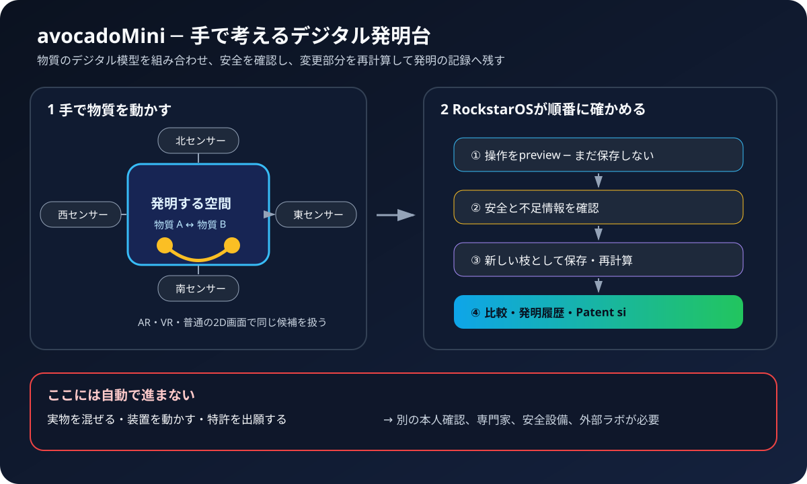

<a id="mini02-cone-aware-search"></a>
## MINI-02有限cone-aware探索（host研究の限定候補）

目的・利用体験: 旧maxflow/pose DFSを再利用し、全候補辺のうち有限cone内と判定できた辺だけで探索する。最初のwitnessがcone外だったことを、そのpose/exit全体の不合格や解なしへ読み替えない。少ない表示部・板膜なし・上下全範囲・低眩しさの要求は保持し、このhost関数の有限宣言を製品全域達成へ縮めない。CLIとJSONの研究APIであり、新しいToolや物理出力UIではない。

責任: ROCKは厳密parse/元幾何候補/制限mask/最大流/pose DFSと保守的な状態・証人照合。EXTERNALは将来の実測光学/放射/校正根拠、JOINTは同一hardwareの観測/停止/眼安全/製造受入、OWNERは物理試験の対象/条件を担う。synthetic label/digestを測定・署名・Broker権限へ昇格しない。

入出力・上限: 3入口はserialized JSONのみ。inspectJointCandidatesは正規化入力と候補edge/indexのdigestを返し、探索しない。runJointAllocationWithEdgeMaskは元入力/candidate digestと実在一意indexを再照合し、既存辺を除く制限だけを許す。空maskでも需要は残り、幾何的に届かない辺を復活させない。runConeAwareSearchは元joint request/全出口calibrationModels/coordinateFrame/clockDomainを検査してinside edgeを内部計算する。既存128demand・6device・各4pose・全96exit・16sourceとsearchLimit1〜1024を保持。未知field/外来index/古いbinding/関数・callback・shell等の権限入力を拒否する。

状態・根拠: inside辺の全需要割当が再照合できた場合だけfinite_cone_allocation_found。校正/時計/前提が欠けるとunavailable、探索上限はunknown/search_cutoff、角度境界が残る場合は保守的unknown/angular_boundary_unresolved。全前提既知・境界なし・全pose組探索済みの不成立だけfinite_cone_allocation_impossibleで、有限宣言内の証明に限る。全宣言出口は未選択/容量0/候補なしも含め有効校正を要求する新探索規則。mask自体はcone適格性の証明ではない。

保存・失敗・復旧・承認: host同期計算のみ、network/hardware/光出力/永続state/dispatchなし。同じ正当入力は正規化digestと同結果へ収束する。未知/期限切れ/時刻・scene/profile/pose/source不一致はfail closedで、修正したデータからcandidate/modelを再取得して検査する。停止はdeclared stopConfirmedであり実停止receiptではない。元資料/研究結果は呼出側が保持する。通常source revertは可能だが原本/historical evidenceを上書きしない。

互換・明示進化: 旧runJointAllocation無maskの全JSON出力/digest/順序を保持。旧inspectFiniteConeはjoint source pinとそれに依存するresult digestだけが明示変化し、128比較でその他差異0。Rootがjoint source/cone source/cone testの3既存進化を許可。旧12guardのjoint例外をnamed evolutionとして固定し、他11と歴史receipt計18uniqueをbyte保持する。新receiptだけ4一時path参照を論理IDへ置換し、原本はGit外backup/旧hashで保持。数学/fixture/doc5bytesは独立レビューと一致し、公開receipt新hashを旧review hash一致と呼ばない。

合格・未決定: 独立PASS_SCOPED/mustfix0、関連70pass、1728有限oracle/144角度grid/120独立斜面case、legacy432＋432全出力比較は別の証拠範囲で重複加算しない。固定全verify/同headCIとreceipt4参照の採用metadata検収は別gate。実可視/低眩しさ/眼安全/連続全域/同時実viewer/独立停止/実測校正/製造・物理dispatch・MINI02全体は未受入。同一物理候補で後続共同受入とOWNER条件を決める。

[研究API詳細](avocado-mini-r5/factory-development/mini-02-cone-aware-search.md)／[採用hash・検証・4参照差分](evidence/development-execution/mini-02-cone-aware-main-adoption.json)／[独立検収の適用範囲](evidence/development-execution/mini-02-cone-aware-main-review-summary.json)。

<a id="mini02-finite-cone-inspection"></a>
## MINI-02 有限出射角・校正witnessの検査（attempt2）

目的・体験・責任: 板膜なし・少ない表示部・上下の全需要・低眩しさを維持し、供給された完全witnessが宣言synthetic cone/errorの必要条件を満たすかhost検査する。外側なら代替witnessへ復旧でき、全解不成立とは言わない。ROCKは厳密入力/有限数値検査、EXTERNALは実部品/3D校正、JOINTは同一光学系の視認/停止、OWNERは用途/設置/予算。発光/dispatch/料金/権限なし。

入出力・状態: finite-cone-study/1、world座標/clock/frame/input hash/全demand/pose/assignment/calibrationModelsを厳密照合する。[詳細・全上限](avocado-mini-r5/factory-development/mini-02-finite-cone.md)を正本に、不正/未知誤差はunavailable、境界はunknown、外側はreallocation_required、全件必要条件のみ通過をfinite_cone_witness_passedとする。attempt1のacos近平行誤合格R1を、正規化atan2(norm(cross),dot)とunknown側64epsilon余裕で修正したattempt2のみ採用候補。

保存・失敗・再送・復旧・互換: hardware/network/storageを持たないpure host検査。input/result digestは同一入力照合用で実校正署名ではない。古い成功/部分witness/探索未完の成功昇格を拒否し、全入力と完全代替witnessで再検査する。旧solver/12hashと35721×18・0対708未達を保持。通常revert可能、永続migrationなし。

承認・合格・未決定: Pro独立r2はmustFix0、新4hash固定、関連56試験、独立scalar120/別式168/境界20条件で差0。[元reviewとr2の要約](evidence/development-execution/mini-02-finite-cone-review-summary.json)を参照。旧changes_requiredを上書きしない。実校正/連続全域/任意移動開口/実同時viewer/低眩しさ/眼安全/独立stop/PCB/製造/MINI02全体は未受入。実校正誤差とcone適格再割当探索は別候補・実測・OWNER条件で判断し、host成功から物理許可を作らない。一般公開保留。

<a id="mini02-finite-joint-allocation"></a>
## MINI-02 可動・切替出口の有限同時割当（2026-10-24）

目的・体験・責任: 板膜なし、少ない表示部、上下を含む全範囲、低眩しさを保持し、同じframeの有限demandへ排他的poseと共有sourceを同時に割り当てられるかをhostで調べる。ROCKは厳密入力/検証/有限探索/証人と反例を担当、EXTERNALは実source/relay/機構、JOINTは校正・SC01/02/04/08測定、OWNERは用途/予算/快適上限を判断する。

入出力・状態: 最大128KiB JSON、128demand/6device/各4pose/全96exit/16source、searchLimit1〜1024。profile/frame revision/hash、world-fixed scene、眼/target IDと座標、pose校正ラベル/整定/時刻/角度、宣言容量を入力する。1device/frame1poseを選びdemand→exit→共有sourceの整数flowで有限証人を出す。排他poseの和集合やsource容量の複製を同時成功にしない。foundは指定有限frameの証人、全探索impossibleは宣言有限仮定内のみ、search_incompleteは未決、unknown/stale/late/停止未確認はunsupported。

保存・失敗・復旧・互換: 関数はnetwork/device/永続stateなし。同じ正当入力はID正規化とdigestで同結果へ収束し、未知field/重複ID/非有限/過大入力、profile/scene不一致やsource hash改変を拒否。失敗時は呼出側が旧入力/証拠を保持する。宣言stop/calibration/slotはsyntheticで真正認証や実測ではない。既存study/Mini3/旧laneの8hashを維持し、別関数の35,721×18固定縮退でideal0/10mm708欠損を保持。有限128demandを連続全域や実viewer同時性へ換算しない。通常revertで戻せ、DBや物理復旧はない。

承認・合格・未決定: 全結果のphysicalVisible/lowGlare/continuousWholeDomain/simultaneousPhysicalViewers/independentStop/manufactured/grantsAuthorityはfalse。仮のsample容量を光束・明るさ・実同時光線へ換算しない。Pro独立reviewは13試験と432条件（98成立/334不成立）を再現し限定pass/指摘0。新統合候補で対象試験/固定verify/同SHA CIと統合検収を別に受ける。有限角度・軌道/整定・遮蔽・誤差/遅延、校正済み実source、実同時scene、放射/低眩しさ/人体、独立停止/残光/逆給電、PCB/製造は未受入。次の純host契約を別候補で定義し、未知を無制限や受入済みへ補完しない。料金/本人/job/保存と一般公開保留を維持する。

[詳細契約](avocado-mini-r5/factory-development/mini-02-joint-allocation.md)／[独立review](evidence/development-execution/mini-02-joint-allocation-review.json)／[main採用・検証](evidence/development-execution/mini-02-joint-main-adoption.json)。元4pathの「独立検収・Gitは後続」は保存時点の記述で、後続状況はreview/main採用receiptを参照する。

<a id="mini02-finite-optical-study"></a>
## MINI-02 固定domainの有限光学study（2026-10-24）

目的・体験・責任: 板膜なし、少ない表示部、上下を含む全範囲、まぶしくしない4要求を保持し、host CLI/関数で候補の幾何必要条件と反例を比較する。ROCKは厳密JSON、source/result digest、列挙、反証を担当。EXTERNALは実発光/relay/sensor、JOINTは校正・共同割当・実測、OWNERは部品/人体/製造/安全と予算を判断する。

入出力・状態・保存: 4×4×3m enclosure、3×3m service plane、243眼位置×147上下target×18 pupil rayを固定。入力検査→依存source hash照合→7候補評価/2候補unsupported→有限欠損/最初の反例/digestを返す。共通分母35,721 pairを縮めず、243眼位置を同時viewer数にしない。Gitにはsource/最小fixture/要約証拠を保存し、runtime永続state、権限、光源出力を作らない。active source・筐体・sensor数はaperture数と分離し未定をnullのまま扱う。

失敗・復旧・互換: domain変更/下方target除去/ceiling欠落/guard削除/測定値や同時性の捏造を拒否し、旧入力を保持する。同じ正当入力なら同digestへ収束。MINI-01 profile/test/geometry3hashを保持し、unknown engine/motionへfallbackしない。通常revertで戻せ、永続migrationや実機復旧操作はない。

承認・合格・未決定: ideal全面6面の欠損0は有限幾何必要条件であり、少数小型/連続全域/空中像成立ではない。10mm guardで708、30mmで1396 pair欠損。低眩しさ・光量/人体/熱電気/独立cutoff/PCB/製造/同時viewer/extended sceneは未受入。Pro独立reviewは全7候補35,721×18を再現し限定pass/指摘0。対象9＋Mini01既存11試験とlint/syntaxを確認し、固定候補verify・別PR/同SHA CIへ進む。新source/校正/姿勢/共同割当は別候補・別検収で決める。料金/権限/一般公開保留は維持する。

[詳細評価と次の測定契約](avocado-mini-r5/factory-development/mini-02-candidate-assessment.md)／[独立review](evidence/development-execution/mini-02-review.json)／[main採用・検証](evidence/development-execution/mini-02-main-adoption.json)。評価書とlane/元receiptの「検収前」は保存時点の記述で、後続検収はreview/main採用receiptから参照する。

<a id="reviewed-client-game-subsets"></a>
## 受入済みclient/Game subsetのmain採用（2026-10-24）

目的・体験: Miniの場所条件を厳密なJSONとして局所診断し、Proの旧browserノートを原文previewして本人が明示exportできるようにする。Web保全dialogはkeyboardで開閉し、処理後に起点へfocusを戻し、失敗時の入力/既存設定を維持する。Smithは保存済みAgentのID/revision/source Tool参照を既存mainリンクで保持。Gameは作者が提示したfile-setと権利/実行先の静的導入診断を返す。

責任・入出力: ROCKはJSON/hash/版・入力分離・有限上限・診断/UIを担当。Miniは眼/target領域、orientation、人数・光源・出口等の独立countsを入力し凍結済みprofile/幾何候補を出す。Proは既存2keyのraw文字列か有限export fileを入力し、旧doneをdraft provenanceとしてpreview、承認後に同一digest付きfileを出す。Webは既存diagnosticと暗号backupの処理状態を表示する。Gameはmanifest/package bytes/current registry grant/target/save metadataを入力し理由付きstatic-local診断を返す。EXTERNAL/JOINTは物理光学・実機/engine/provider、本物のowner/rights serverを受け入れ、OWNERは私有file保存・契約・公開・端末操作を決める。

状態・保存: Miniのsample/ray候補はphysicalVisible/physicalAccepted=falseでstorageも発光制御もない。Pro preview/export/cancelのepochで遅い応答を捨て、原keyを書換/削除せずaccount migrationを主張しない。Webは既存世代fenceをclose/reset/unmountまで保持し、quota失敗は元設定へrollback、同じdialogで明示retryする。背景とmodalの通知を重複させない。Game launch_candidateもisolation/launch/input/saveはunverified、測定値null。署名・法的権利・実行能力・通貨発行・実残高への昇格なし。schema/DB/権限APIを新設しない。

失敗・復旧・互換: 不正schema/未知field/重複path/改ざんhash/別owner/失効grant/上限超過は拒否。Proの長文や旧doneを切捨てず、私有previewはtextContentで表示し入力を実行しない。cancel後のfile読込・hash計算は再表示しない。Webの暗号化/復号が遅れても閉じた後にdownload/設定書換/成功表示をしない。mainのGame保持/履歴/重複命令/overflow guard、既存Pro商品/interest、Web release/Pixel根拠、Smith /chatを保持する。通常revertで戻せ、永続migrationなし。

承認・合格・未決定: 私有file exportはcheckboxとclick、実実行/課金は従来の別承認が必要。対象69 host試験とPro7試験、typecheck、局所lintを確認し、固定候補全verify・同SHA CI・統合差分独立検収へ進む。Pro browser download byte読戻し/file picker/認証server import、Web screen reader/zoom/touch/実更新、Mini光学/低眩光/快適性/独立cutoff、Game実process/資源隔離/launch/save/recoveryは未受入。未決定は各既存unitで実測とowner判断を記録し、fixtureを物理/本番へ転用しない。料金/権限/一般公開保留は維持する。

[採用hash・除外・復旧・検証](evidence/development-execution/client-game-adoption.json)。[95unit引継ぎ](../data/development-source-handoff.json)はmain2.08/RQ01〜50とRoot1.127/RQ01〜49を分け、23chat/42成果/180項目/10算法の過去監査を現在のruntime完成としない。Eve13等は別source保存branchの非実行`.source`として保全し、schema/runtimeの未受入部分を丸ごと移植しない。

## 製品目的の本人確定（2026-10-21）

Miniは暮らし・まちづくり、ProはAI専用PC事業と半導体・関連部品確保を目的とする。物理機能や地域導入、部品確保を実績として宣言しない。 [体験・責任・保存・失敗/復旧・承認・合格条件](service-design/03-product-profiles.md#mini-pro-purpose)。

## 統合サービスと現行ハードウェアprofile

利用者の今回の設計再構成では[各製品の役割](service-design/03-product-profiles.md)を共通入口にする。MiniはR5の単独空間端末、Proは既存P0の独立NVIDIA PC、rocketstarは独立工学program。共通OSの本人・job・Asset・版・権限・保存/復旧へ接続し、このMaterial研究profileの四方向台や旧HubをR5に適用しない。Mini通信の最新方針は国内LTE/IoT data SIMの任意option。2026-10-14の[建築一体型設置profile](avocado-mini-r5/README.md#建築一体型miniの設置profile2026-10-14)も同じR5 coreの任意取付であり、四方向台・建物管理Hubへ置き換えない。原本・実機0件・表示未成立と各受入境界を維持する。

2026-10-15の本人指示を[携帯を持たない制作/対話](service-design/01-service-experience.md#携帯を持たずpcや対象物の前にもいない制作体験)へ具体化する。対象物の前にいない時も、許可済み資料の由来/単位/版を追って案を作り、検査・本人承認・製作引渡し・測定を別に扱う。Miniは入口、Pro/cloudは任意計算先、lab/製作者は別の実作業主体であり、研究sceneや空間表示を現物製造の合格にしない。

# RockstarOS × avocadoMini — 見て分かる空間発明システム設計書

現行の有限採用: 開発用Mini message serviceとVIEW_ONLY camera/安全なmodel準備、Pixel/Linux test-only補足はPR238/main440fに通常統合しhead14/main13同SHA CI成功。元candidate/snapshotの未採用値は記録時履歴として保持し、物理/実回線/実金融/校正/Eve学習/wholeOS/P02は受入へ昇格しない。[現行受入](evidence/development-execution/prepared-device-mini-main-current.json)。

## 開発用bounded message serviceの限定採用候補

共通message adapterの上へ、peer credentialで照合するUnix local入口、固定operationのBroker/AP開発adapter、有限scheduler・停止・consumer受領確認を接続する。実製品signer/authorisationや実modem transport/Job保存へ昇格しない。既存byte/cost予約・単体表示4条件を保持し、owner・権限epoch・失効・期限を各作用前に検査する。詳細の状態/失敗/復旧/承認/未実行gateは[固定source契約](../systems/rock-star-os/targets/avocado-mini/tethering/MESSAGES.md)と[独立検収](evidence/development-execution/mini-08-message-service-review.json)を参照。

版: 2.0 / 2026-09-18
状態: 既存Material Invention研究profileと共通契約の設計資料
注意: 現行avocadoMiniの製品要求は[R5統合基本設計](avocado-mini-r5/README.md)を優先する。本書の四方向発明台、AR、Full-scale/rack構成はこの研究profile内の設計であり、R5の完成外形・全空間裸眼表示・製造承認を示さない。

2026-09-24: R5は使用時200mm以内・1本自律・同型mini増設・別Edge Hub不要を目指す。表示・精密3D入力・実部品収納等は未成立/未確定。既存Coreや四方向入力schemaを変更済みとは扱わず、R5専用profileとadapterの実装・受入を別に行う。

2026-09-21 Mini200 E1追補: 利用者の最新の20cmゲーム機・日本語音声・README保存要求は[Mini200 E1設計](https://github.com/k999ln/rock/blob/96845e6006c15e39ba5b45495f79c21bdff7399e/docs/avocado-mini-mini200-e1/README.md)へ記録した。本書の四方向発明台は既存profileとして保持する。E1のゲーム入力からMaterial Coreへ接続するadapter、実ASR、console OS、実機、物理マイクOFFの受入は未完了であり、本書の「設計完成」をE1の製造完成へ拡張しない。

---

# A. まず製品を理解する

## 1. これは何？

**avocadoMiniは、まだ存在しない材料を、手で考えるための「デジタル発明台」である。**

机の中央に、物質のデジタル模型が浮かぶ。利用者は模型を手で持ち、近付け、組み合わせ、離し、割合や作り方を変える。

RockstarOSは操作のたびに、次の四つを行う。

1. 何を変えたか記録する。
2. 危険情報や条件不足を確認する。
3. 変更した部分だけ計算し直す。
4. 有望な案をPatent siへ渡せる形に整理する。

最初に扱うのは実物ではない。コンピューターの中にある物質の模型である。実物を混ぜたり装置を動かしたりするのは、別の承認を通過した外部ラボだけである。



## 2. 目の前にあるもの

上から見ると、基本形はこうなる。

```text
                         北センサー
                              ↓
                 ┌────────────────────┐
                 │                    │
西センサー  →    │   発明する空間      │    ←  東センサー
                 │  Invention Volume  │
                 │                    │
                 └────────────────────┘
                              ↑
                         南センサー

                    利用者はここへ手を入れる
```

四方向から見る理由は、片方の手や物質模型がもう片方を隠しても、別方向のセンサーで補えるからである。

利用者が見る方法は三つある。

| 方法 | 見え方 | 主な利用場面 |
| --- | --- | --- |
| AR | 現実の机に模型が重なって見える | avocadoMiniの標準体験 |
| VR | 発明空間へ入り、模型を大きく広げて見る | 複雑な候補や共同検討 |
| 2D | 普通の画面でドラッグして操作する | headsetなし、片手操作、確認作業 |

AR、VR、2Dは別製品ではない。同じprojectと同じ候補を、違う見方で操作する。

## 3. 一つの利用例

ここでは「軽くて熱に強い部品材料を考える」を例にする。説明用なので、物質は仮名のAとBを使う。

### 場面1 — 目的を決める

```text
┌─────────────────────────────────────┐
│ 新しい発明project                    │
│                                     │
│ 目標    軽くて熱に強い材料           │
│ 禁止    登録した禁止物質を使わない   │
│ 上限    温度・圧力・費用を設定       │
│ 成功    重さ、耐熱予測、再現性で比較 │
│                                     │
│              [発明空間を開く]        │
└─────────────────────────────────────┘
```

分からない項目をsiが勝手に埋めることはない。必要な条件がなければ、Zemaが質問して止まる。

### 場面2 — 物質を置く

```text
┌─────────────────────────────────────────────┐
│  A                                      B  │
│ [物質A]                               [物質B]│
│ lot A-03                              lot B-11│
│ 安全情報あり                          安全情報あり│
│                                             │
│              ＋ 新しい物質                  │
└─────────────────────────────────────────────┘
```

同じ名前でもlot、純度、由来が違えば別の入力として扱う。

### 場面3 — 手で近付ける

二つを近付けただけでは、まだ保存しない。半透明のpreviewを出す。

```text
     手で移動
 A  ─────────→  B

 [接続の候補]
 意味: 混合 / 積層 / 表面接触  ← どれかを選ぶ
 割合: A 60% / B 40%
 状態: まだ未確定
```

「くっつける」が何を意味するかを確認する。画面上で重なっただけで、化学結合したことにはしない。

### 場面4 — 安全確認

確定前にRockstarOSが確認する。

```text
安全確認
├─ SDSはあるか                         OK
├─ 危険性が不明ではないか             OK
├─ 禁止条件に触れていないか           OK
├─ 割合と単位が比較できるか           OK
├─ 想定温度・圧力が上限内か           OK
└─ 必要な資格や設備が決まっているか   未設定

結果: デジタル候補として保存できる
      実物実験には進めない
```

危険情報が足りない場合は赤い`BLOCKED`になる。警告を消して先へ進む機能は作らない。

### 場面5 — 新しい案として保存する

確定すると、元の案を消さずに枝分かれする。

```text
候補 01  Aだけ
   ├─ 候補 02  A 60% + B 40%  ← 今の案
   ├─ 候補 03  A 40% + B 60%
   └─ 候補 04  AとBを積層
```

失敗した案も消さない。「何を試して駄目だったか」が次の発明材料になるからである。

### 場面6 — 変更部分を再計算する

```text
変更: Bの割合 40% → 45%

再計算するもの
├─ 重さの予測
├─ 耐熱性の予測
└─ 接触面の予測

再計算しないもの
└─ 変更と関係のない候補・測定結果
```

結果には必ず出所を表示する。

| 表示 | 意味 |
| --- | --- |
| 人が入力 | 利用者が直接決めた |
| si提案 | siが候補を出した |
| 文献 | 既存資料に書かれている |
| 予測 | simulationが計算した |
| 実測 | 承認された実験で測った |

`予測`を`実測`のように見せてはいけない。

### 場面7 — 案を比べる

```text
┌─────────┬─────────┬─────────┐
│ 候補02   │ 候補03   │ 候補04   │
├─────────┼─────────┼─────────┤
│ 軽さ  A  │ 軽さ  B  │ 軽さ  B  │
│ 耐熱  B  │ 耐熱  A  │ 耐熱  A  │
│ 安全  黄 │ 安全  緑 │ 安全  黄 │
│ 根拠 予測│ 根拠 予測│ 根拠 文献│
└─────────┴─────────┴─────────┘
```

数値だけで自動決定しない。不確かさ、安全、費用、再現性を並べ、人が次の案を選ぶ。

<a id="場面8--patent-aiへ渡す"></a>

### 場面8 — Patent siへ渡す

Patent siは次を一つの下書きにまとめる。

- 解決したい問題
- 選んだ構成と工程
- 人が考えた部分
- siが提案した部分
- 文献、予測、実測の区別
- 既存技術と違う可能性がある部分
- 公開、共同作業、demoの履歴
- 専門家に確認してほしい点

Patent siは特許性、法的発明者、権利帰属を決めない。自動出願、電子署名、料金支払もしない。

## 4. できること／できないこと

### できること

- 物質のデジタル模型を手で接続・分離する
- 割合、並び、工程条件を変えて別案を作る
- 危険情報や条件不足を先に見つける
- 変更した部分をsimulationへ渡す
- 人、si、文献、予測、実測を分けて残す
- 失敗を含む発明過程を版管理する
- Patent siや外部ラボへ渡す資料を準備する
- headsetがなくても2D画面で同じ仕事を行う

### できないこと

- cameraだけで現実の物質を変化させる
- 手のgestureだけで実験装置を動かす
- 危険情報が不明な案を安全と判定する
- simulation結果を実験成功として扱う
- siだけで特許性や発明者を確定する
- 本人確認なしに秘密情報を外部へ送る
- 設計段階の端末を完成品として販売する

## 5. 三つの世界を混ぜない

```text
① 考える世界                 ② 計算・整理する世界
avocadoMini / AR / VR / 2D  →  Safety / Simulation / Patent si
       │                              │
       │ 仮説                         │ 予測・下書き
       └──────────┬───────────────────┘
                  │ 人による別承認
                  ↓
③ 現実で確かめる世界
資格を持つ人 / 適切な設備 / 外部ラボ / 署名付き測定結果
```

この境界が製品の最重要原則である。①と②がどれだけ滑らかでも、③を自動的に許可しない。

---

# B. 操作と画面を設計する

## 6. 手の操作

| 動作 | その場の反応 | 確定後に起きること |
| --- | --- | --- |
| つまむ | 対象が光る | まだ変更しない |
| 持って動かす | 半透明で追従する | まだ変更しない |
| 二つを近付ける | 接続previewを出す | まだ変更しない |
| 一定時間合わせる | 意味と条件を確認する | 新しい候補branchを作る |
| 引き離す | 分離previewを出す | 分離した新branchを作る |
| 手首を回す | 向きや工程をpreviewする | 確認後に新branchを作る |
| 手のひらを向けて止める | 保留中の操作を止める | 候補は変えない |
| undo / redo | 前後の案を表示する | 履歴は削除しない |

手が隠れた、別人の手が入った、暗い、反射が強い、範囲外、センサーが欠けた場合は確定しない。画面には「なぜ確定しなかったか」を普通の言葉で表示する。

## 7. 画面の構成

```text
┌────────────────────────────────────────────────────────┐
│ Project名     保存済み     Offline     camera作動中      │
├────────────┬───────────────────────────┬───────────────┤
│ 物質一覧    │                           │ 今の候補       │
│            │      発明する空間          │ A 60 / B 40   │
│ A          │                           │ 安全: 要確認   │
│ B          │        A  ↔  B            │ 根拠: 予測     │
│ C          │                           │               │
│            │                           │ [比較する]     │
│ +追加      │                           │ [siへ相談]     │
├────────────┴───────────────────────────┴───────────────┤
│ 履歴: 01 目的設定 → 02 A追加 → 03 B追加 → 04 接続       │
└────────────────────────────────────────────────────────┘
```

常に見える情報:

- 今どのprojectと候補を操作しているか
- 保存済みかpreviewか
- 安全状態
- 情報が人・si・予測・実測のどれか
- cameraや外部接続が動いているか
- 戻る、止める、2Dへ切り替える方法

## 8. 状態と色

色だけに頼らず、文字と形も一緒に使う。

| 状態 | 表示 | 意味 |
| --- | --- | --- |
| PREVIEW | 点線＋「未確定」 | 手を離しても保存されない |
| READY | 青＋「確定できます」 | 必須情報が揃っている |
| NEEDS_INFO | 黄＋「情報が必要」 | 質問へ答えるまで計算しない |
| BLOCKED | 赤＋停止記号 | 安全上または契約上進めない |
| CALCULATING | 動く輪＋「計算中」 | 操作は続けられる |
| PREDICTED | 紫＋「予測」 | 実測ではない |
| MEASURED | 緑＋「実測」 | receiptの範囲だけ確認済み |
| STALE | 灰＋「古い結果」 | 入力が変わったので使えない |

## 9. 誰も置いていかない操作

- 座ったまま使える
- 片手で使える
- hand、controller、touch、mouse、keyboardを選べる
- 音声内容には字幕を付ける
- 色だけで状態を伝えない
- 動きを減らすmodeを持つ
- 文字倍率と高contrastを選べる
- XRが使えなくても2Dで主要作業を完了できる
- 専門用語にはその場で短い説明を出す

---

# C. 製品の中身を設計する

## 10. 全体のつながり

```text
利用者
  ↓ 目的と手の操作
avocadoMini
  ├─ 四方向sensor
  ├─ 手の位置をまとめるSensor Fusion
  └─ AR / VR / 2D画面
  ↓ 「こう変えたい」という提案だけ
Material Invention Core
  ├─ 物質とlot
  ├─ 候補とbranch
  ├─ 工程条件
  ├─ 安全状態
  └─ 根拠と履歴
  ├────────→ Safety Gate
  ├────────→ Simulation Provider
  ├────────→ Patent si
  └────────→ 承認された外部ラボ

RockstarOS
  └─ 利用者、権限、仕事、停止、保存、費用、receiptを全体で管理
```

## 11. 各部品の責任

| 部品 | 一言でいう役割 | やってはいけないこと |
| --- | --- | --- |
| RockstarOS | 全体の交通整理と安全管理 | UIやsiの申告だけで権限を与える |
| avocadoMini | 手の動きを操作候補にする | 実験装置を直接動かす |
| Material Invention Core | 発明候補の正しい記録を持つ | 予測を実測へ書き換える |
| Zema | 目的、質問、進捗、結果を一つの仕事にする | 足りない条件を勝手に決める |
| Sky | 材料DB、計算、Patent si、ラボを接続する | 未確認Providerを安全と表示する |
| Simulation | 性能を予測する | 成功や安全を保証する |
| Patent si | 発明説明と比較資料を下書きする | 特許性・発明者・権利を確定する |
| 外部ラボ | 承認された実物試験を行う | 承認外の工程や量へ変更する |

## 12. Coreが保存する記録

| 記録 | 普通の言葉 | 最低限必要な内容 |
| --- | --- | --- |
| MaterialRecord | 物質の名札と履歴 | 名前、組成、状態、純度、由来、lot、安全情報 |
| CompositionCandidate | 組み合わせ案 | 物質、割合、関係、元候補、版 |
| ProcessRecipe | 作り方案 | 順番、温度、圧力、時間、設備 |
| SafetyAssessment | 安全確認表 | 不明点、blocker、資格、廃棄、規制 |
| SimulationResult | 計算予測 | model版、入力、予測、誤差、適用範囲 |
| ExperimentReceipt | 実験の受領証 | 実施者、設備、校正、測定、署名 |
| SpatialSceneManifest | 空間表示の設計図 | 候補との結び付き、座標、安全表示 |
| SpatialInteractionEvent | 手操作の記録 | sensor、校正、動作、自信度、対象、提案 |
| InventionEventLedger | 発明過程の時系列 | 人／si、変更、結果、失敗、共有範囲 |
| PatentAiPacket | 知財整理用の束 | 対象履歴、構成、効果、引用、公開状況 |

## 13. 一回の操作が処理される順番

```text
1. 手を認識
   ↓ 認識できない → 理由を表示して終了
2. previewを表示
   ↓ 利用者が取消 → 保存せず終了
3. project・候補・sceneの版を照合
   ↓ 古い／別project → VIEW_ONLY
4. 「混合・積層・接触」等の意味を確認
5. 新しい候補branchを一時作成
6. 単位・禁止条件・安全情報を検査
   ↓ BLOCKED → 記録だけ残し計算・実験へ進めない
7. 操作eventと候補を保存
8. 影響する計算だけ依頼
9. 結果をPREDICTEDとして保存
10. 比較画面とPatent si用履歴を更新
```

同じ操作を二重に受け取っても、候補を二重作成しない。通信が切れて結果が分からない場合は、成功・失敗を推測せず`UNKNOWN`で止めて照合する。

## 14. センサー設計

2026-10-25の本人指示で、Miniのカメラ追跡・ジェスチャー入力を追加する。最初は手指の選択/移動/回転/停止を端末内で推定し、VIEW_ONLY候補として扱う。Eveの好み予測、本人の明示feedback、Smithの操作許可を分ける。単眼の画面座標を精密3D/全空間追跡の合格にせず、旧四方向契約や物理/金融承認を迂回しない。Mini単体と表示4条件を維持する。 [カメラ入力契約](../systems/rock-star-os/targets/avocado-mini/gesture/README.md)。

四方向podの具体的なcamera方式やメーカーはまだ決めない。Full-scaleではcamera四台だけに固定せず、各podへ2〜3の光学viewpointをまとめた全体8〜12視点を初期候補とし、RGB、depth、IR等をprototypeで比較する。

現在の外観とscaleの共通資料は、[初期四方向concept](assets/rockstaros-spatial-table-v1.png)と[ビリヤード台規模concept](assets/rockstaros-spatial-table-full-scale-v2.png)である。画像は完成証拠ではなく、配置、人物scale、操作範囲、下部演算rack、保守性を検討するための設計資料とする。機構、光学、電気、演算、network、電力、熱、privacy hardware、校正、BOM、HVT受入は[Full-scaleハードウェア詳細設計](avocado-mini-hardware-design.md)を正本とする。

処理の順番:

1. sensor本体とfirmwareを識別する。
2. 各cameraの特性と四台の位置関係を校正する。
3. frameの時刻を合わせる。
4. 端末内で手のjointを推定する。
5. 四方向の結果を一つにまとめる。
6. confidenceが不足していれば確定しない。
7. gesture候補をCoreへ送る。raw映像は送らない。

prototypeの仮目標:

- Bench操作範囲: 一辺0.45〜0.8 mの机上
- Full-scale外形budget: 約3.0 m × 1.7 m × 高さ0.9 m
- Full-scale操作範囲budget: 約2.4 m × 1.2 m × 高さ1.3 m
- 手を動かしてから表示反応まで: p95 100 ms以下を目標
- commit confidence: 0.85から試験し、誤操作測定後に決め直す
- 四方向の時刻差: 1 display frame以内を目標
- 一台が見失っても、誤確定より停止を選ぶ

privacy:

- raw camera映像は既定保存しない
- room mesh、eye、hand、voice、身体寸法、正確な位置も既定保存しない
- camera作動中は物理LED等で知らせる
- 物理shutterまたは同等の停止手段を持つ
- 外部送信は対象、目的、送信先、保存期間を表示して別同意を取る

## 15. 安全と権限

次の場合はfail closed、つまり分からないまま進めない。

- SDSがない
- 危険性が不明
- 禁止物質または禁止危険分類
- 割合の単位が一致しない
- 温度、圧力、設備が許可範囲外
- 廃棄、輸送、規制条件が不明
- scene、marker、project、候補の版が一致しない
- sensor校正切れ、時刻ずれ、低confidence

XR、si、cameraが持たない権限:

- Core DBへの直接書込み
- Walletの直接操作
- 任意shellやroot
- 実験装置の包括制御
- 物理実験の最終承認
- 外部共有の包括承認
- Patent出願、電子署名、料金支払

物理実験へ進むには、候補、量、工程、設備、実施者、停止条件、費用、廃棄、法規、承認内容を固定し、gestureとは別の信頼済み画面で本人確認する。

## 16. Offline、共有、復旧

通信なしで行えること:

- 保存済み物質・候補・工程を見る
- 手または2Dで操作する
- schema、単位、安全条件を検査する
- 端末内modelで可能な計算をする
- annotationと履歴を保存する

外部simulation、特許検索、ラボ予約は`WAITING_FOR_PROVIDER`で止める。再接続後、同じrequestか、結果が改変されていないかを照合する。

共同作業ではviewer、annotator、facilitatorを分ける。司会者をowner、実験承認者、法的発明者へ自動昇格させない。共有するproject、候補、相手、目的、期限を選び、秘密配合を含む公開linkを既定生成しない。

---

# D. 作る人が合流する

## 17. 現在どこまである？

| 項目 | 現在地 | 次の証拠 |
| --- | --- | --- |
| 製品の全体設計 | この文書で統合済み | 利用者5人が説明後に操作を言い直せる |
| 二物質sandbox Core | 実装済み、10 test。Sky/Zemaで2D候補比較・本人用保存・再開を追加 | 限定記憶、simulation fixture、外部labへ接続 |
| XR scene契約 | 設計済み | 同じCore入力から同じsceneを生成 |
| hand event契約 | 設計済み | 合成poseで接続・分離を再現 |
| 四方向sensor | Bench／Full-scale設計とconcept画像まで | tabletop prototypeで誤操作を測り、その後Full-scale端部と遮蔽を測る |
| AR／VR表示 | 未実装 | view-only prototype |
| 2D fallback | 設計のみ | 同じ主要作業を2Dで完了 |
| simulation接続 | 未実装 | 署名またはhash付き合成receipt |
| Patent si接続 | 未実装 | sourceを混ぜないpacket |
| 外部ラボ | 未接続 | 資格・設備・安全・契約を独立受入 |
| 新材料・特許・量産 | 未実証 | 実験と専門家判断が必要 |

## 18. 実装の順番

### Phase 1 — 画面だけで理解できる試作品

- 2Dで物質AとBを表示する
- dragで接続previewを出す
- 混合／積層／接触を選ぶ
- 安全状態と根拠を表示する
- branchを作って比較する

合格: 初見の利用者が説明なしで「これは実物操作ではなく仮説作成」と理解できる。

### Phase 2 — Coreと決定的につなぐ（MAT05）

- Core graphから毎回同じscene digestを作る
- lot、工程版、安全状態をsceneへ結び付ける
- 合成poseでconnect、separate、undoを作る
- stale、別project、改変、low confidenceを拒否する

合格: 同じ入力は同じ出力になり、古いsceneから新しい候補を変更できない。

### Phase 3 — 一台cameraから四方向Bench、Full-scaleへ（MAT06-A）

- 最初に一台で誤操作を測る
- 次に四方向Bench rig、校正、時刻同期を作る
- 遮蔽、別人、暗さ、反射、手袋、範囲外を試す
- privacy indicatorと物理停止を受け入れる
- Bench合格後にFull-scaleへ拡張し、中央だけでなく四辺、角、高さ上限、二人同時操作の誤commit率を測る

合格: 速さより、誤確定せず理由を説明して止まれる。

<a id="phase-4--計算とpatent-aimat06-b"></a>

### Phase 4 — 計算とPatent si（MAT06-B）

- 変更graphから必要な計算だけ選ぶ
- model、版、入力、費用、送信範囲を固定する
- stale、cancel、unknown resultを扱う
- 選択したevent範囲からPatent si packetを作る

合格: 人、si、文献、予測、実測を混ぜず、別lotや別modelの結果を流用しない。

### Phase 5 — 外部ラボ

非危険な合成fixtureから始める。契約、資格、設備、校正、事故責任、data保持、知財、廃棄、法規を確認し、物理実験を別gateで受け入れる。

## 19. 役割別の最初の仕事

| 参加する人 | 最初に作るもの | 最初の合格条件 |
| --- | --- | --- |
| Product / UX | 場面1〜8のclickable 2D prototype | 5人中5人が「予測と実測」を区別できる |
| Visual / UI | PREVIEW、BLOCKED、PREDICTED、MEASURED表示 | 色なしでも状態が分かる |
| XR / 3D | 物質2個と安全overlayのview-only scene | Core IDと表示対象が一致する |
| Sensor / CV | 合成four-view pose fixture | sensor欠落・低confidenceを拒否する |
| Core / Backend | graph→scene pure projection | 同じ入力から同じdigest |
| Material / Simulation | model manifestと合成receipt | 適用範囲と誤差を必ず表示する |
| si / Agent | Zemaの質問と差分計算依頼 | 不足条件を勝手に埋めない |
| Patent / Legal | PatentAiPacket review | 発明者・特許性を断定しない |
| Security / Privacy | camera data flowとthreat model | raw映像が既定保存・送信されない |
| QA / Safety | 正常・異常・停止test matrix | unknown、stale、blockedを成功にしない |

## 20. 初参加者の最初の1時間

1. この文書のAだけを読む。
2. 場面1〜8を、自分の言葉で説明する。
3. [作業ストリーム](workstreams/11-material-invention-avocado-mini.md)を開く。
4. 上の役割表から一つ選ぶ。
5. [現在地](#17-現在どこまである)で未実装を確認する。
6. [安全と権限](#15-安全と権限)を読む。
7. MAT05またはMAT06の小さな成果物を一つ選ぶ。
8. 実装、fixture、simulation、実機、実材料のどこまでを合格させるか先に書く。

## 21. 製品全体の合格条件

### 説明の合格

- 初見の人が「デジタル発明台」と説明できる
- avocadoMiniとRockstarOSの違いを説明できる
- デジタル操作、simulation、実物実験の境界を説明できる
- 設計完成と製品完成を混同しない

### Softwareの合格

- 同じ入力と版から同じ候補・scene digestを作る
- project、owner、lot、工程、modelの取り違えがない
- 二重eventを二重反映しない
- stale、unknown、blockedを成功にしない
- 2Dでも主要作業を完了できる

### Hardware／XRの合格

- 校正切れ、sensor欠落、時刻ずれ、遮蔽を検出する
- 誤確定率、取消率、遅延を実測する
- raw映像が既定保存されない
- cameraが装置を直接制御しない
- privacy表示と物理停止が働く

### Research／Patentの合格

- 予測と実測を分ける
- 実験条件と測定receiptを再現できる
- 人とsiの寄与を追跡できる
- Patent si出力を専門家がreviewできる
- 未検証の安全性、特許性、量産性を断定しない

## 22. 決まっていること／決まっていないこと

### 決まっている

- OS名はRockstarOS
- 端末concept名はavocadoMini
- Material Invention Coreが記録の正本
- avocadoMiniはCoreの標準操作体験
- 四方向sensorと2D fallbackを持つ
- 操作は仮説branchを作り、元を破壊しない
- simulationは実測ではない
- gestureは物理実験や出願の承認ではない
- Patent siは補助で、法律判断を確定しない

### prototypeで決める

- sensorの種類、解像度、配置、高さ、メーカー
- AR表示方式とheadset候補
- 手追跡modelとconfidence閾値
- 実際の遅延、誤操作、疲労、酔いの合格値
- 最初のsimulation分野とProvider
- 最初の対象材料、外部ラボ、法域
- 端末価格、販売方法、量産構成

---

# E. 用語と詳細仕様

## 23. 最小用語集

| 言葉 | この設計での意味 |
| --- | --- |
| デジタルツイン | 物質の名前、lot、状態、安全、結果を結び付けたコンピューター上の模型 |
| Core | 正しい記録と規則を持つ中心部分 |
| branch | 元を消さずに作る別案 |
| scene | AR、VR、2Dへ表示する一場面 |
| gesture | 手の形や動きから推定した操作候補 |
| confidence | センサー推定の確からしさ。真実の保証ではない |
| simulation | 現実の振る舞いを計算で予測する仕組み |
| provenance | 情報を誰が、何から、どの版で作ったかという出所 |
| receipt | 実行内容と結果を後から照合する記録 |
| stale | 元データが変わり、古くてそのまま使えない状態 |
| fail closed | 分からない場合、安全側に止めること |
| Patent si | 発明説明や先行技術比較を助けるsi。法律判断者ではない |

## 24. 変更してはいけない初期境界

- `physicalExecutionAllowed = false`
- `equipmentControlAllowed = false`
- gestureは`HYPOTHESIS_ONLY`
- simulationは実験証明ではない
- Patent siは特許性・発明者・自動出願を確定しない
- raw cameraとbiometric streamは既定保存・送信しない
- blocked safety overlayを隠さない
- sceneが古い、不一致、追跡不能なら`VIEW_ONLY`へ落とす

## 25. 機械可読契約と詳細設計

- 製品要望: [product-baseline.md](product-baseline.md)
- Material Invention Core詳細: [material-invention-core.md](material-invention-core.md)
- VR／AR共通詳細: [material-invention-xr.md](material-invention-xr.md)
- avocadoMini端末詳細: [avocado-mini-spatial-invention.md](avocado-mini-spatial-invention.md)
- avocadoMiniハードウェア詳細: [avocado-mini-hardware-design.md](avocado-mini-hardware-design.md)
- 作業入口: [workstreams/11-material-invention-avocado-mini.md](workstreams/11-material-invention-avocado-mini.md)
- Material sandbox契約: [`contracts/material-invention.json`](../contracts/material-invention.json)
- XR scene契約: [`contracts/material-invention-xr.json`](../contracts/material-invention-xr.json)
- hand event契約: [`contracts/avocado-mini-spatial-interaction.json`](../contracts/avocado-mini-spatial-interaction.json)
- XR安全policy: [`data/material-invention-xr-policy.json`](../data/material-invention-xr-policy.json)

## 26. この文書の使い方

- 初めて知る人: Aだけ読む
- 画面を作る人: AとBを読む
- 技術を作る人: B、C、Dを読む
- 安全・知財担当: 4、5、15、21、24を読む
- project責任者: 全章と作業ストリームを読む

新しい仕様を追加するときは、「利用者のどの場面が変わるか」を先にAへ反映し、その後に画面、Core、契約、test、進捗を更新する。難しい仕様だけが増え、利用者の体験を説明できなくなる変更は受け入れない。

## Mini単体と専用モデル（2026-10-05）

R5のMini単体動作はProを必須としない。専用モデルは端末内とcloudの両方を目標に、追加費用なしのhost学習試作を追加した。Mini実機や空間表示の合格を示すものではない。 詳細・責任・入出力・状態・保存・復旧・承認・合格条件は[専用モデル事前学習設計](avokado-llm-pretraining.md)を参照。


## avokadoProのNVIDIA搭載小型PC（2026-10-05）

[Proの構成・組立設計](avokado-pro-pc-design.md)を追加。siとPCゲーム、販売目標80万円/台、Miniなしの独立PC。ROCKが設計、EXTERNALがOEM/ODM供給、JOINTが熱・si・ゲーム・復旧受入、OWNERが見積後の購入/製造/販売を担当。MAT16で追跡し、MAT15のMini単体受入と混同しない。現段階は構成候補・筐体目標で、実機未組立。

## Mini本体SIMによる独立通信（2026-10-05）

利用者指定により[Mini cellular設計](avocado-mini-cellular.md)を追加。MAT15の通信サブ項目としてmodem/antenna/物理SIM、電源/熱、接続・保存復旧、Pro/PC/phone不要の実通信受入を追跡し、SIM01のcarrier/service権と区別する。R5のoffline基本動作、使用時200mm、設置中給電を維持し、最新の着脱追補では携帯電源も設計する。地域・回線未定、部品選定・内蔵・driver・実通信・cloud gamingは未受入。元R5配布原本は変更せず追加要求として読む。

## GTA VIプレイ入口（2026-10-05）

[Mini game client](mini-game-client.md)の診断/公式client起動をAI06サブ項目として追加。ROCKのdesktop試作であり、認証・映像・操作・復旧は公式clientへ委譲する。console、実タイトル、Miniの表示/入力はJOINTの未受入。ProのPC版対応は未確認のため起動を拒否。担当・入出力・状態・保存・失敗・受入・未決定事項は同設計を正本とする。

## 着脱Miniと月次請求

<a id="mini-tethering-control"></a>

日米のsi・メッセージ・小ファイル向け[共通message adapter](../systems/rock-star-os/targets/avocado-mini/tethering/MESSAGES.md)を追加。有限分割・認証付き再組立・再送・TTL・共通通信量/料金予約をhostで検証する。実transport/常駐scheduler/Job引渡し・実機は未受入。Mini単体、表示4条件と既存料金gateを維持。 現行採用はPR229/main a58c6ffa・全13同SHA CI成功、実transport/実機は別受入。[現行証拠](evidence/development-execution/mini-08-message-main-current.json)。

### MINI-08 単体衛星テザリング制御

2026-10-25の継続指示に基づく準備（要件変更なし）: 内蔵衛星modem・antenna・保護付き電池pack/セル・回線契約の[候補比較と実機試験準備](avocado-mini-r5/satellite-hardware-trial-plan.md)を追加。9770の一般IP、9704のIMT、NB-NTNのUDP主体通信を区別し、共有許諾・網側hard cap・同一閉箱の収納/電源/熱を採用前条件とする。初期地域は日本と米国、用途はsi・メッセージ・小さなファイルに本人確定（2026-10-25）。9704/NB-NTNの小容量通信を優先比較し、国別profileで受け入れる。数値目標・機種/契約は未確定、購入/契約/無線送信/実機合格は未実施。単体携帯、端末/通信量/料金上限と表示4条件を維持。

Mini単体の衛星→Wi-Fi共有について、端末許可/失効、送受信量と費用の事前予約、ドック離脱、停止/期限、SQLite保存と再起動復旧のhost制御prototypeを追加。架空回線の試験であり、実modem/AP/kernel強制・本人UI・Provider課金・同一閉箱は未接続。板/膜なし、少ない表示部、上下全範囲、低眩しさを保持する。

[実装と詳細契約](../systems/rock-star-os/targets/avocado-mini/tethering/README.md) / [証拠](evidence/development-execution/mini-08-tethering.json)。ownerの共通Broker認証とAgent/Wallet/Invoiceは既存契約を使い、通信予約を請求成立へ昇格しない。対象はMAT15/M1のROCK、実接続はJOINT、部品/回線/料金計量はEXTERNAL、回線と上限承認はOWNER。既定OFFから観測と承認後だけ予約、CAS/epoch/期限で旧grantを失効し、結果不明とoverrunは保留。SQLiteの保存成功後だけgrantを発行し、復旧は給電/通信unknown・共有OFFで始める。DP02/03/05、Linux packet試験、実回線の上限と同一閉箱の未完了を残す。

[Linux下位制御](../systems/rock-star-os/targets/avocado-mini/tethering/LINUX.md): Linux packet gate候補では、同一grantのIPv4/IPv6・送受信を共有quotaで強制し、停止・離脱・再起動時に旧許可を閉じる。隔離Linuxの実packet20件とcompiler4件に合格し、独立静的/host検収mustFix0。counterは最終確定とせず予約を保持する。実衛星/AP/Broker認証・Provider請求・電池の受入は別途必要。 namespace所有claimの破棄/再利用は自動解除せず、旧processと未確定予約の管理照合が必要。

[AP認証・網側上限](../systems/rock-star-os/targets/avocado-mini/tethering/ACCESS.md)の共通adapterを追加。端末固有鍵、管理下hostapdの世代/認証、網側HMAC/TLS予約をLinux転送前に確認する。事業者・modemは本人回答どおり未定。実無線/衛星/請求は未受入、単体携行と表示4条件を維持。

2026-10-15明示要求は[統合設計](service-design/08-mini-connectivity-and-billing.md)と[R5詳細](avocado-mini-r5/embedded-portable-connectivity.md)へ追加。固定dock/可搬core、携帯電源、衛星WAN/Wi-Fi LAN、場所権限、同一job継続、月次usage請求を分離して設計する。実機・本番未受入。
