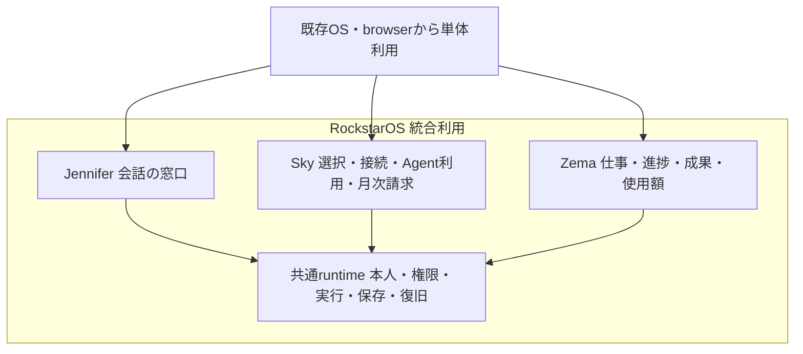

<a id="smith-local-agent-settings-rejection"></a>
## SmithのLocal Agent設定拒否応答を揃える（SMITH-02/SKY21・ROCK）

1. **目的**: Local Agent APIが元から拒否していたAgent設定不一致を、隣接estimate/text APIと同じstatus/codeで判別できるようにする。新しい実行許可や拒否fenceを追加したとは扱わない。

2. **利用体験**: 保存済みAgentの古いrevision・無効化・切断・別owner・model不一致・不正参照は、元の拒否を維持したまま設定確認が必要な応答になる。実owner UIの案内/原稿保持/再開は今回の受入ではない。

3. **責任**: ROCK/Smith02は既存error変換、既存storeは本人/現在版/有効/接続のbindingを担当。EXTERNALはmodel/host/Provider、JOINTは実認証UI/運転中race/実接続、OWNERは設定と個別実行/予算を選ぶ。Broker/本人承認の境界をmodel結果へ移さない。

4. **入出力**: POST `/api/llm/local-agent` の既存SkyAgentLibraryErrorだけを `code: AGENT_SETTINGS_CHANGED`、既存safe message、元status（409/404/400）とCache-Control:no-storeへ写す。既存request/返却成功schemaや他error変換は維持する。

5. **状態**: 認証/service scopeの拒否はbinding前、Agent不一致はbinding時点でrunner/model前に止まる順序を維持する。古い応答を成功へ昇格せず、自動再試行/代替model実行を追加しない。

6. **保存**: 新DB/schema/Agent設定/同意/価格/usage/権限を書き換えない。応答はno-storeで、素材や資格情報を追加保存しない。既存owner/revision/CASを再利用する。

7. **失敗**: SkyAgentLibraryErrorをgeneric INVALID_INPUTへ潰さず、元status/messageを保持する。一般不正入力、rate limit、認証、service scope、runner/modelの既存error境界は変更しない。拒否6fixtureはrunner/model0で実行済みではない。

8. **復旧**: 本人が既存管理/依頼経路で現在設定を確認して次の操作を判断する。routeはAgent修正/再実行/復旧成功を自動で作らない。通常Git revertでmapper/testを戻せ、データmigrationや保存資料の削除は不要。

9. **承認**: 応答codeは設定確認の診断でありTool成功/新権限/予算同意ではない。[LLM境界](llm-evaluation-architecture.md)の非信頼planner・Broker判定・本人承認を保持する。実Provider/本番課金/端末操作/公開を追加しない。

10. **合格条件**: exact3とRoot source PASS_SCOPED/実8試験、作者旧6fail/fixed28、中央関連28を層別記録。全verify/design/scan・固定metadata別検収・Git/HEAD/main同SHA CIを別gateにする。[採用記録](evidence/development-execution/smith-local-agent-settings-main-adoption.json)。

11. **未決定の決め方**: 実認証A/BのUI・原稿保持、long-running model/Tool中の権限変更/停止race、実host/provider/deviceは既存unitの同対象fixture/実環境で別検収する。response mapperの合格をwholeSMITH02や新規dispatch安全性の証明へ転用しない。

<a id="pro-existing-job-resume"></a>
## Proから保存済み仕事を開く（PRO-02・限定入口）

1. **目的**: 新規作成入口と別に、既に保存したWorkJobを同じIDで共通本人画面から確認できるようにする。local board cardをserver jobと取り違えない。

2. **利用体験**: Proで保存済みWorkJobのUUIDを入力→形式確認→本人の明示clickで固定avoado.siの別tabへ移る。遷移先の本人一覧に対象jobがある場合だけ、既存の資料・停止control・revision付き成果linkを表示する。自動実行/新規作成はしない。

3. **責任**: ROCK/Pro09は入口の文法・固定URL・失効、既存WorkCompositionWorkspace/APIはauth/owner/revision/同意/保存/停止/成果を担当。Git10は保存/CI、Rootはsource/metadataを別検収。EXTERNALはbrowser/配信、JOINTは実認証/配備/native受入、OWNERは遷移と各既存仕事操作を明示する。

4. **入出力**: lib/workflow.ts workIdと同じUUIDv1–5/variant8–bのみ受け、lowercaseへcanonical化。空白trimや任意URLは受けない。出力は `https://avoado.si/zema/compose?job=<id>` のjob一項目のみ。原文/notes/localカード/credentials/価格/権限/同意/fragmentを付加しない。Pro正式domainはavocadopro.si、miiはavocadomini.si、総合/Sky/仕事入口はavoado.siを保持する。

5. **状態**: 空/不正→linkなし、正規形式確認→明示lookup link、入力/change→即失効。古いqueued clickやhref改竄の通常clickは再検査で止める。形式確認を存在/owner確認へ昇格しない。noopener/noreferrer/no-referrer/prefetch=falseを使い入口自身はfetch/window.openしない。

6. **保存**: 入口は新規storage/DB/job/同意recordを保存せず、local notes/archiveも読まない。既存のowner別仕事・素材・成果・revision/CAS・応答不明復旧を再利用し、URLに本文を入れない。

7. **失敗**: 不明/foreign/signedoutでは要求した私有本文を返さず、自動POST/代替作成をしない。現在の遷移先は本人一覧に含まれるjobだけを選択し、100件上限外の古いjobをexact GETで復旧する機能はない。入力/account/一覧を本人が確認する。

8. **復旧**: 入力変更時はlinkを消して再確認。遷移先の接続/本人確認後は同jobの既存GETを使い、新IDの再作成・実行再送をしない。入口の退行は通常revertで戻せ、notes/archive/server保存資料を消さない。既存の新規mr-citations入口と原本archive入口を維持する。

9. **承認**: UUIDはlookup意図だけで本人性/実行/保存/素材利用/費用承認ではない。遷移後の保存・停止・成果取得は既存の本人権限/現在revision/明示操作に従う。実Provider/課金/端末導入/一般公開は追加しない。

10. **合格条件**: exact4 source/receiptとRoot source PASS_SCOPEDの一致、中央関連95（重複あり）、author local browserの空/正規/変更失効/不正、実common componentを合成owner/GET-onlyで通す試験を層別記録する。全verify・scanner・固定metadata別検収・Git/HEAD/main同SHA CIは別gate。[採用記録](evidence/development-execution/pro-existing-job-resume-main-adoption.json)。

検収fixture追補: PR252初回CIのEVE13停止応答喪失1failは、非同期fingerprintのPromise未追跡を35ms制御遅延で再現した。実製品/停止/同意を変えず、fixtureが実完了を待つよう修正し、5000ms上限の回帰を追加する。元assertion/12roundを維持し、Rootの別検収と新HEAD CIを通す。詳細は[fixture証拠](evidence/development-execution/eve13-confirmation-fixture.json)。

11. **未決定の決め方**: 古いjobのexact lookupは既存APIと一覧上限を別unitで検討し、今回へ黙って追加しない。実認証browserの保存/停止/export、配備の同source読戻し、実Pro/nativeとwholePRO02は同一対象・同意・失敗復旧を別受入する。fixture/入口の成功をそれらへ換算しない。

<a id="shared-service-access-binding"></a>
## 共有service accessの非同期authority結合（ESIM-01/04・ROCK）

目的・体験: 準備済みPixel/Pro/miiを同じ本人サービスへつなぐ既存server evaluatorで、暗号検証中の支払制限・予算取消・親利用権変更を見落として実行可能を返す反例を拒否する。UIや実配備を新規に有効化しない。実consumerはhost testsだけの既存契約受入repairで、実用体験の新規開通や他系統のhard runtime依存とは数えない。

責任: ROCKは渡された依頼とauthority objectの検査・結果を担当。EXTERNALはissuer/回線/決済、JOINTは実DB・認証adapter/Broker、OWNERは契約/費用上限/端末操作を担う。

入出力: 既存owner/workspace/deviceKeyThumbprint/requiredScope/requestDigestの5fieldをawait前に分離。readCurrent/resolveKeyはserver依存で、browser入力から受け取らない。readCurrentへは別の5fieldコピーを渡し、await後の検査に使う内部bindingをadapterへ共有しない。出力canDispatch/canRead/canExport/revisionは同じ。未知の追加request fieldはadapterへ転送しない。

状態: 初回snapshotをdetached化し既存の状態直積・署名を検査。完了時に渡されたlive objectを再cloneし、全snapshotのJSON比較が一致するときだけdispatchを許す。nested factsのobject差替えも拒否。telecom等の無害な変更も保守的に拒否するため、本人の明示retryは現authorityから再評価する。

保存: 新table/DB/schema/予約/台帳/キャッシュを作らず、snapshotはメモリ内。read/exportは初回と完了時の両方が認めた範囲だけ。完了時の本人失効は全拒否、dispatchだけの制限は現在有効なretentionを保持する。

失敗: clone/crypto/authority不正はfail closed。retained authority自体の欠落はrevisionもnull、既存の不正dispatchデータは独立に認証したretentionを消さない。Provider effectや追加課金/書込みを起こさない。

復旧・互換: signature wire/TTL/返却shape/DB/料金/workflowは維持。通常Git revertでhelper/testを戻せ、永続migrationやデータ削除は不要。既存PR248のattachment snapshotを再実装しない。

承認: この結果は再利用可能なdispatch permitではない。Brokerで同一revision/epochと既存予算予約を原子的に再確認・消費する別gateを維持する。新たなProvider/実機/実課金/一般公開の許可を与えない。

合格条件: 旧sourceの8leaf反例（aggregateを別計数）、R1の59焦点/全verify成功後に独立検収でcallback引数aliasの残件を確認。R2で内部bindingを別コピーから隔離し62焦点試験、型・lint、固定artifactのBilling/Astra独立検収と同SHA CI。DB読み直しや本番adapter/実機の受入と区別する。[証拠](evidence/development-execution/shared-service-access-binding.json)。

未決定の決め方: 親DBの変更、object外の変化、変更後の元値復帰は本検査の範囲外。現DB/Brokerの既存schema/transactionを別source確認し、独立retention ACL/期限とともに別受入する。測定や署名等の未知条件を形式試験から補わない。

<a id="esim-attachment-async-binding"></a>
## ESIM-04 非同期attachment検証の入力結合（host限定）

1. **目的**: 署名attachmentを非同期検証するとき、最初に検査した入力・署名byte・返却値を同じsnapshotへ結び、呼出元の後続変更を混入させない。

2. **利用体験**: 既存のservice setup/導入判定を維持する。正常な同一signed fieldsは従来どおり確認でき、待機中に渡されたfactsが不一致になった場合はdispatch可否を拒否する。既存read/export権限は別判定のまま保持する。

3. **責任**: ROCKはhelper検証と既存consumerの境界、作者04 Security/Identity、service文脈03、Git統合10。EXTERNALはissuer/Providerの事実供給、JOINTは実auth・DB・issuer統合、OWNERは端末・scope・費用等の個別承認。host factsを実parent DBの現在状態へ昇格しない。

4. **入出力**: 既存ServiceAttachment閉schemaとAttachmentFacts・resolveKey・評価nowを再利用。structuredCloneした入力と独立scope配列を検査・署名byte生成・返却へ用いる。結果は同じserialized fields/signatureを持つdetachedな通常のmutable snapshotまたはnull。API引数/type・field順/domain/wireを維持する。

5. **状態**: 入力→分離snapshot→従来shape/TTL/scope/facts検査→署名byte固定→鍵解決/import/実Ed25519 verify→渡されたfactsとの再照合→snapshotまたはnull。新しい永続job/state machineは追加しない。

6. **保存**: 新DB/migration/cache/鍵/credential/原稿は追加しない。snapshotは呼出しのメモリー内だけ。既存caller/store/Brokerのauthority read-set・revision・予約/台帳は不変。

7. **失敗**: clone不能/閉schema不一致/無効署名/鍵解決・crypto失敗はnull。元入力のscope/key/fields変更は検証済snapshotへ反映されず、完了時factsがowner/device/contract/parent epoch/audience/hash/allowed scopeと不一致ならnull。再送・権限拡大・課金へfallbackしない。

8. **復旧**: 元のsigned fieldsと現在の必要factsを用いて既存判定経路から再確認する。snapshotは再利用可能なdispatch permitではなく、呼出元は既存のfresh facts取得とatomic dispatch gateを引き続き通す。中間のDB失効履歴をこのhelperだけで観測したとはしない。

9. **承認**: helper成功を本人認証/新scope/親利用権/issuer lifecycle完了/Broker予約・実行許可へ置換しない。TTL・評価now・料金/利用権・同意を延長せず、既存server最終commit fenceを維持する。

10. **合格条件**: 固定source/test/原本receipt3と独立Astra verdictの一致、元10leaf反例（aggregate込み12failを区別）、焦点15/選択setup11、独立probe、中央full type/lint/verify/design、scanner/canary、別metadata検収、head/main同SHA CIをそれぞれ記録する。返却identity差は元strict equal→field deep equalと明示alias試験で検証する。

11. **未決定の決め方**: generic issue/renew/revokeの永続化・parent DB最新失効取得・outbox/並行crash・独立retention ACL/expiry・実eSIM profile/回線/認証/Provider/請求/productionD1/実機/公開は別gate。host helper受入をwhole ESIM04または全ESIM完成へ転用しない。

[検収・Git段階](evidence/development-execution/esim-attachment-async-binding-main-adoption.json)。

<a id="eve13-pending-recovery"></a>
## EVE-13 同操作確認先の再開（限定R4）

1. **目的**: composeとEve準備仕事で、応答不明の同job/operation確認先をpage消失後も保持する。再送可能なpayloadは保存しない。

2. **利用体験**: 現在の本人で再度開き、保存済み確認先を同じIDのGETだけで照合する。未保存原稿・見積・同意は復元しない。未確認中は別の操作を開始しない。

3. **責任**: ROCKはmetadata検証・owner隔離・lock待機後の再認証・業務契約、EXTERNALはbrowser機能、JOINTは実認証browser受入、OWNERは原稿/実行/費用の個別同意。serverの認証/owner/revision/Brokerを代替しない。

4. **入出力**: version1、owner、canonical UUIDのjobId/operationId、kind(create/composition/command)、revision、SHA256 fingerprintの閉じたrecord。createはoperationId=jobId/revision0。出力は既存owner-scoped APIの読戻し。

5. **状態**: 空→明示操作前に確認先保存→応答不明/再開はGET-only→同操作witness一致とfresh owner確認で完了。404/不一致/401/保存障害は未確認を維持し、TTL削除・別ID作成・自動再送をしない。

6. **保存**: readOwnerScope/pendingOwnerStatus/openZemaPrivateStorageを再利用し、localStorageのrockstaros.eve-pending-recovery.v1:ownerへmetadataのみ保存。原文/descriptor/quote/file/credential/note/approval/実行権限は保存しない。同origin Web Locksのowner別exclusive区間でsave/clearの比較・変更・読戻しを直列化する。account-server backup/別端末同期ではない。

7. **失敗**: 無効record/extra field/digest/revision、storage拒否/書込読戻し不一致、Web Locks非対応/拒否はmutation前に停止する。lock待機後は現在の認証ownerを再取得し、最後のawait後にhandoff結合と期限を再検査する。stale ownerのPOST/私有表示、期限切れの新規create/runを許可しない。

8. **復旧**: 同job GETと保存fingerprint/witnessを照合し、clear待機後にもfresh ownerを確認して私有状態を表示する。既にcommitされた歴史的操作は現在見積が期限切れでもGET-onlyで確認できる。真に未知の送信を期限切れで消さない。

9. **承認**: 復元metadataは非信頼の確認意図であり本人性/同意/新規実行権限ではない。新規書込は既存の明示同意・現在revision・見積期限・予算/API契約を通す。追加paid/provider/model実行はない。

10. **合格条件**: 固定R4 source4/receipt4と独立Astra再検収の一致を確認する。R1保存競合、R2本人変更/期限切れの失敗履歴を保持し、独立probe・関連試験・fullverify・scanner/canary・別metadata検収・Git/head/main同SHA CIをそれぞれ記録する。

11. **未決定の決め方**: 実browserのWeb Locks/localStorageはlocalhostの合成metadata・実2tab helperで競合1成功1拒否、reload同ID保持、誤clear拒否・一致clear成功を確認済み。実認証WorkJob UI、全Eve入口、native/実機/provider/金融/公開/whole EVE-13は追加gate。unsupported browserを無lock fallbackへ変えず、利用環境と復旧手順を個別受入する。

[採用・検収の段階](evidence/development-execution/eve13-pending-recovery-main-adoption.json)。

<a id="pro-private-work-entry"></a>
## Proから共通の私有テキスト仕事への入口（PRO-02限定候補）

目的・体験: avocadopro.siのPro商品ページsourceから、avoado.siの既存`/zema/compose?tool=mr-citations`へ本人が明示clickして進む。avocadomini.siのMini、Proのbrowser notes/私有archiveと役割を分け、原稿は自動転送せず本人が選んだtextだけを共通画面へ入力する。固定linkはTool選択だけで、account選択/仕事作成/原稿保存/実行/生成/課金を開始しない。

責任・入出力: ROCKは固定URL/privacy属性と既存の本人確認/owner・revision・workflow/保存/停止/成果取得を第一者API/storeで強制する。EXTERNALは外部接続やProvider応答、JOINTは実認証browser/往復/配備artifact、OWNERは利用accountと素材/実行/費用の明示同意を担う。入力はuser click、URL出力は正式HTTPS originとTool IDだけ。new tabはnoopener/noreferrer/no-referrer、Astro prefetchはfalse、原稿/本人/同意/戻り先をquery/fragmentへ入れない。

状態・保存・承認: 共通画面で目的/完了条件/素材を新しく入力し計画を確認して保存する。plan保存時のsourceはnull、別の素材保存同意を得た実行で初めて原稿/結果を保存する。接続済みsource-link処理のbudget0を、service月額/回線/他AI使用料へ拡張しない。既存WorkJobとlib/workflow.ts遷移を再利用し、新しいPro専用job/DB/API/schema/価格/権限を作らない。

失敗・復旧・互換: 応答不明は同じjob/操作/完全payloadを確認し、新jobや外部処理を自動再送しない。owner変更後の旧closureは送信せず本人の入力を別accountへ残さない。手順間の停止は後続を止め、保存原稿/成果を保持し、同owner/revisionを既存GET/downloadで再読込する。動作中外部処理の強制停止やnative Pro受入を主張しない。元notes/archive/sourceと既存harness/assert/Promise追跡を保持し、通常source revertで入口だけ戻せる。

合格・未決定: exact2source/testと元receiptを固定、独立109関連成功、旧ページは同じ入口欠落で3試験失敗（不具合3件とは数えない）。author local CUAのdesktop描画/HTMLと実component・合成owner/handler/storage契約、実routeのSQLite回帰を区別する。実認証browser/公開cross-domain click・本番仕事・Pro実機/wholePRO02は未受入。未決条件は同artifact/本人account/同意と既存gateの共同試験で決める。[採用・検証・残条件](evidence/development-execution/pro-work-entry-main-adoption.json)。

<a id="smith-saved-agent-reference"></a>
## Smith保存会話のAgent参照保持（SMITH-01限定候補）

目的・体験: 保存済み会話を開くだけの再保存で、既存UUID文法または現catalogのexact `tool:<id>` Agentのid/revisionを落とさず同じ参照で履歴へ戻る。表示用参照は現在のAgent有効性・本人承認・実行許可ではない。主担当05/ROCK、Git統合10、既存SKY21/G04。ROCKは第一者store/binderでcurrent Agent・owner・revision・disable/connectの有効性を強制する。EXTERNALはProvider応答と外部接続の事実を提供し、JOINTは実認証UI/往復/実保存を受け入れ、OWNERは接続・仕事・費用の明示同意を担う。

入出力・状態・保存: 入力は既存validatorを通ったZemaChatSession/1。catalog producer/store/linkの既存参照形式へ合わせ、前段のgeneric形状条件と既存UUID実効intersectionをそのまま維持して、後段ID判定に本bundleのcatalog exact allowlistだけを足す。session自身のUUID/Tool/時刻/件数/期限・safeintegerかつ非負revisionを維持し、任意prefix/unknown/cross-kind/過長/負revisionを拒否する。useSkyChatSessionはrestore/beginで任意agent参照をそのまま保持し、同threadのautosaveに同id/revisionを含め、resetで消去する。別thread/handoff/plain会話へ持ち越さず、自動upgrade/Agent選択/HTTP実行は追加しない。既存session UUID、Tool、createdAt、10分TTL、最大8会話、message上限、owner private storage cleanupを維持する。原文/本人情報をURLへ足さず、新schema/DB/API/権限は作らない。

失敗・復旧・承認・互換: 保存失敗は従来の同tab会話を保ち、自動再実行しない。running復元は従来のfailed案内と履歴確認へ戻す。invalid/expired/別ownerは既存validator/session cleanupが拒否し、保存参照だけで実行を再開しない。通常source revertで戻し、既存履歴を削除しない。費用承認は既存の別gateを通す。

合格・未決定: UUID参照の旧2反例を独立再現、関連34/34とbegin/reset独立2、Root別26（重複加算なし）で限定PASS。証拠は実hook/workspaceをcompileしたVM/storage harnessで、実browser/認証本番・cross-device・実Provider/wholeSMITHは未受入。tool:形式は別R2候補として検収し同じ有限unionへ採用する。R1で前段条件を除去しhyphen先頭36字IDが新規保存可能になったP2を独立再現し、Root初回PASSを撤回。R2は前段条件を元bytesのまま維持し、540形式/revision比較と29関連/旧3反例で修正を確認（各件数は重複あり）。未知/期限切れ等の不正保存は既存goodを残して拒否し、readでは不正だけを落とす。UUID hookとTool形式は別sourcehash/元receipt/検収を保持する。[採用・検証・残gate](evidence/development-execution/smith-session-main-adoption.json)。

<a id="webops03-install-compatibility"></a>
## 旧install URLの互換入口（WEBOPS-03限定候補）

責任・状態・復旧: 主担当05/ROCKは固定URLとdomain router、EXTERNALはDNS/TLS/hosting、JOINTは配備後の同artifact readback、OWNERは公開判断と既存導入同意。状態はsource候補/ローカル検証/ Git保存/main統合/公開配備を分ける。今回の保存対象にprofile/本人情報/原文/資格情報はなく、失敗時は既存/接続案内を再読込する。通常source revertで戻せ、外部installerや任意URLへ飛ばさない。未決定の公開source同一性・全site導線・一般ローンチは配備artifactと実描画の共同検収で決める。

Miniの既存導線と配布用sitemapが示す`https://avoado.si/install/`を、現在の利用開始案内`/connect`へ結ぶ。`app/install/page.tsx`は固定`/connect#`へ一時転送するだけで、既存の本人確認・利用権・機種適合・費用承認を代行しない。`services/sky-web/domain-router.mjs`は`/install`と`/install/`だけを本体へ通し、Miniへのproxyを避ける。似た名前や下層pathは変更しない。

入力は旧URLのGET/HEAD。queryや外部returnToを転送先に使用せず、空fragmentで旧fragmentのブラウザ継承も防ぐ。保存・購入・download・eSIM発行・OS導入は行わず、`/connect`の既存手順と同意を引き続き使う。末尾slashの既存framework正規化は308で同じ`/install`へ移り、その後307で固定先へ進む。この同一pathの正規化hopでは元queryが残るが、`/connect`へは渡さない。転送先の障害時に別installerや外部URLへ自動fallbackしない。

合格条件は実pageとdomain routerの限定試験、元router・外部target・query漏出の負例、実framework HTTP/ブラウザで固定先・query/fragment非継承を確認すること。[証拠](evidence/development-execution/webops03-domain-release-readback.json)は公開3domainのDNS/TLS/HTTP、描画後リンク、Sites管理metadata、ローカル候補を別層で記録する。公開応答にcommit/版がないため配信source同一性は未確認。今回の候補はmain統合・公開配備・一般ローンチの合格ではない。

<a id="wallet-legacy-db-recovery-fixture"></a>
## Legacy earning ledgerのSQLite fault/reopen fixture（WALLET-02限定試験候補）

目的・体験: 新しい金融runtimeを作らず、既存Billing Workerのlegacy fixture receipt/batch処理で、応答不明・処理中断を模擬した後の同一DB再open/同key再送が重複記帳しないことを確かめる。利用対象は開発者のhost合成試験。既存memory TestD1をfile-backed reopen/fault hookへ拡張するtests/billing-worker.test.mjsだけの変更で、製品UI/Worker/API/台帳/price/鍵/migrationは変えない。主担当03、Git統合10、WLT01/WLT02/WLT04/B03/GX00文脈のWALLET-02 overlayを使う。

責任・禁止authority: ROCKは既存SQL/既存fixtureへの有限試験・snapshot照合と後処理、EXTERNALはProvider/銀行/chain/Cloudflareの実際のfinality・永続性、JOINTは同一artifactの実provider/実DB/別端末/復旧の共同受入、OWNERは本人性・契約・実資金条件と費用同意を担当する。test HMAC/legacy earning credit/payout instructionは実収益・現金・available credit・実transferや本人承認の代替ではない。default ToCはSKY_FEE_POLICY_ON_HOLDで拒否したまま、888c/domain/署名issuer/価格/秘密値を変更しない。

入力・出力・ID: 元3testと既存signature helperをそのまま使い、同じnormalized synthetic alice/monthにliteral test keysで署名したreceiptを与える。deviceA/Bは同ownerの配送ラベルで、2認証端末や契約resolverではない。receipt ID/provider_reference/execution/owner/amount/currency/evidence/payout accountの既存bindingと、applied_at/元payout・fee instruction ID・全6table snapshotを確認する。provider reference一意性を一般chain eventの二重計上防止へ拡張しない。新価格やUSD16項目を足さない。

状態・故障境界: beforeBatchはWorker receipt INSERT後・BEGIN IMMEDIATE前、afterStatementはtransaction内、afterCommitはCOMMIT後rollback catch外へ置く。前者はunapplied receiptだけが残り、11statement位置の例外ではROLLBACKしてallocation0、後者ではcommit済み1allocationが残る。いずれも同fileを新DatabaseSync handleで再openし、同key replayがexact1allocationとimmutable instruction IDへ収束し、さらにreopen/replayしてsnapshotを変えないことを試験する。想定500/409/400はassertした負例で、失敗skipへ換算しない。

保存・cleanup・retry: TestD1の元defaultはmemory/migrate trueを保持。file fixtureは既存migrationを最初のopen時に一度だけ適用し、その後migrate falseで同SQLite/WALへ接続し直す。新save schema/DB/ledger/migration/storeは作らない。test after-hookで全handleを閉じ、所有tmp directoryとDB/WAL/SHMを削除し不存在までassertする。fixture以外の保存/hold/履歴をreset/restoreしない。製品のretention/backup/実DB災害復旧は未試験で、新backup契約として扱わない。

競合・復旧・互換: 2handleの要求がBEGIN前で重なる所まで観察し、batchを明示直列化して同receiptの201/200・同owner/monthの400+488=888とgross=cost+fee+payable、後続fee0を確認する。異なるowner/amount/evidence/payout/IDsの409、currency400でsnapshot不変。default WorkerのToC holdはlegacy前後・reopen後とも保持。既存provider provenance checker/creditAllowed/Wallet/ATM/Game/AI予約は未接続のまま。これは同時write transactionやCloudflare並行・実OS crash/process killを試したものではない。退行時は通常Git revertでtest差分だけを戻し、製品データの巻戻しは行わない。

合格証拠・由来: exact test1と元receiptの独立PASS_SCOPED/mustfix0、統合23（billing旧3+新6の9を含む）23pass0fail0skip・対象lint・通常typecheck。独立6群にrollback11位置/同receipt2handle/ack loss/reopen/400+488/既存default holdを含み、件数を足して誇張しない。元失敗/skipは空、想定注入例外は別記録。元receipt5347とportable新summaryは別hash、source testだけが元reviewのbyte同一性を引き継ぐ。raw DB/log/署名素材/私有pathはGit外で、最小summary/digestだけを保存する。

未決定・次の合格条件: 実Provider/chain finality/検証済現金収益、funded available credit、2認証端末/contract正規化、Cloudflare同時処理・durability、native/共通予約/跨台帳finality/reversal/backup・本番金融は未受入。wholeWALLET-02/公開はfalse。実装不変のfixture検証を本番権限へ転用せず、各既存gateで対象/同意/予算/実環境を決めて同一条件で受け入れる。local全体verifyは未実行、最終exact PRheadのLinux実npm run verify/全CIと独立採用metadata検収が必要。

[test1hash・runtime保護・検証・残gate](evidence/development-execution/wallet-ledger-db-recovery-main-adoption.json)／[独立検収要約](evidence/development-execution/wallet-ledger-db-recovery-main-review-summary.json)。

実行: `node --experimental-strip-types --test tests/billing-worker.test.mjs tests/earning-bridge.test.mjs tests/wallet-deposit-provenance.test.mjs`。これは合成testだけで、実Provider入金や支払命令の実行を行わない。

<a id="game-creator-host-fixture"></a>
## 作者向けknown-particle host fixture CLI（GAME-01 / GM01 / AI06、DX01文脈）

目的・体験: 既存static intake→既知particle sandbox→既存save/load/replayを一つのhost CLIへ結ぶ有限サンプル。作者本人の新規導入や任意engineの実行基盤を完成扱いしない。主担当08/ROCK、Git統合10。固定sessionだけでstart/read/resume/commandし、同save bytes/digestと操作ID/版を照合する。金融完成を待たず非金融fixtureを進めるが、実交換/現実WorkJob橋は別gate。

責任・禁止authority: ROCKは既存診断/engine呼出し・file境界/保存照合/失敗復旧、EXTERNALは実engine/platform・license/provenance、JOINTは外部作者/実target/本人別保存の同一条件検証、OWNERは対象機種/権利/導入と将来の個別金融同意を担当する。固定synthetic owner/Date.now grantはfixture入力で、OS/本人認証・作者のポイント発行・Wallet実記帳/888c/交換権限へ昇格させない。productionExchangeEnabled=false/authenticatedOwnerStorageAccepted=falseを維持する。

入出力・ID・制限: sourceは既存tests/fixtures/game-sandbox-session.jsonの固定SHA0df00814だけ、adapterはparticle-fixture/1だけ。既存diagnoseGameIntakeがmanifest/package/target/grantを診断し、deniedはlock/runtime/save前に止める。callerがengine/package/rights/任意scriptを上書きしない。CLIのoperation別allowlist、既知command ID/完全payload、整数revision0〜1000と4,000,000byte save上限を強制する。通常出力のdiagnosticと別のhostProofがsession/save/state digest、revision、readback、identical retry/recovered slotとhost elapsedを返す。PIDはhostの一時比較値で本人性ではない。

状態・保存: startは既知sessionの先頭操作、readは明示保存版、resumeは明示元版から既知残操作、commandは既知次操作または完全同一retryだけを扱う。changed sameID/stale new requestは既存409、受理済み同一retryは状態不変。既存createSandbox/applySandboxCommand/saveSandbox/loadSandbox/sandboxDigestとraw save形式/版/規則を再利用する。所有mode0700のrock-game-fixture-*ディレクトリをcanonical system tmp直下に作り、既知basenameのimmutable save-N.json(mode0600)をO_EXCLで発行。新DB/store/上書きlatest pointer/台帳やsave envelopeは作らない。fileとdirectoryをfsync後、同じbytesをreopen/load/digest照合する。

file/lock安全・失敗: source/save/lockをO_NOFOLLOW|O_NONBLOCKで開き、同FD fstat/有限readでregular/nlink/owner/mode/size/timeを確認。directory FDと現inodeを照合し、symlink/FIFO/hardlink/oversize/変化を拒否する。必要flagがなければfail closed。最小exclusive lockのrelease前にもinode/deviceを照合。private same-UID fixtureという前提で、悪意ある同UID・他OSuser・分散lockへの耐性は未証明。PID再利用/live/EPERM/未知はlockを残して拒否し、他processを停止しない。

重複・中断・復旧・互換: 別process start/resumeと同一元requestのlost-ack retryは、完全一致するknown session prefix/保存slotだけを復旧する。壊れた/partial/foreign/新版・規則違いslotは自動採用/上書き/削除しない。--recover-lockは明示指定し、安全に読めた同inodeのlockでprocess.kill(pid,0)がESRCHの時だけ除去する。旧受入saveと未知partial次slotを保持し、明示read/resumeで旧版を確認してownerが調査する。失敗をreset/返金/金融操作へ結ばない。退行時は通常Git revertでこのCLI/testを戻し、再利用5ファイル・既存save版や他の保存資料を変更しない。作成したfixture一時dirはownerの管理対象で、恒久backup/retention/認証owner storeの代替ではない。

診断とhost受入: 既存diagnosticのlaunch/input/save/isolationはunverified、導入/初回/成功/復旧measurementはnullのまま。別hostProof/単一hostの合成elapsedをその空欄へ移さず、外部作者の実測やproduction成功率にしない。独立source PASS_SCOPED/mustfix0、40focus（新17+既存23）/10独立probe、統合40pass0fail0skip・対象lint/2構文/通常typecheckを記録する。EPERM、UID fault injection、inode swap、symlink/FIFO/oversize、3CLI競合、実child midwrite SIGKILL、旧save保持とpartial非自動採用を確認し、独立owned tmp28件をcleanupした。UID差はfstat注入で、実別OSuser試験ではない。元receipt9936と新portable summaryは別hash、原本log/private path/PID出力はGit外に保つ。

未決定・次の合格条件: 外部作者のfresh導入/初回成功/復旧の実測、実browser/第三者engine隔離と資源制限、本人/projectの永続保存・共通WorkJob/Zema橋、license/provenance、Pixel/Mini/Pro/native実機、個別GX交換方向/rate/同意/provider/金融は未受入。wholeGAME01/GAME02/fullSDK/公開はfalse。対象を各既存gateで決め、同一buildの別process/実target/権限/復旧証拠で閉じる。今回local全体verifyは未実行で、最終exact PRheadのLinux実npm run verify/全CIと独立採用metadata検収を必須にする。

[採用2hash・再利用5・検証・残gate](evidence/development-execution/game-creator-fixture-main-adoption.json)／[独立検収要約](evidence/development-execution/game-creator-fixture-main-review-summary.json)。

利用例（作成した一時dirを印字し、その値をPRIVATE_TEMP_DIRへ指定）:

```sh
node --input-type=module -e "import {mkdtempSync} from 'node:fs'; import {tmpdir} from 'node:os'; import {join} from 'node:path'; console.log(mkdtempSync(join(tmpdir(), 'rock-game-fixture-')))"
node --experimental-strip-types scripts/game-creator-fixture.mjs start --directory PRIVATE_TEMP_DIR
node --experimental-strip-types scripts/game-creator-fixture.mjs read --directory PRIVATE_TEMP_DIR --revision 1
node --experimental-strip-types scripts/game-creator-fixture.mjs resume --directory PRIVATE_TEMP_DIR --revision 1
```

--helpで全optionを確認できる。実Owner/任意path/任意engineへ広げない。

<a id="eve-saved-source-estimate"></a>
## Eveの保存2資料に結ぶread-only料金見積（EVE-02限定候補）

目的・体験: 既存の無料2資料付き準備jobを本人が保存・読戻しした後、「保存した資料で料金を見積もる」で任意のmodel/currency/比較上限と別の資料利用consentを選び、「見積のみ確認」を明示押下する。復元時の見積自動取得は0。見積は既存signed-rateのitemized maximum ceilingと出典を表示するだけで、比較上限の内外/未指定を承認済み予算や無料料金へ変えない。panelの出力上限は1200token固定。現在pricing execution gatefalseのままで生成・quote・reserve・approve・sendを接続しない。

責任・禁止authority: ROCKはcanonical saved-source parser、既存estimate routeへの本人/revision binding、signed-rate検証と期限/表示/競合排除を担当。EXTERNALは実Provider料金・供給・認証基盤、JOINTは同一buildのtrusted-rate数値/期限の実browserと後続の本人別実接続、OWNERは資料利用の明示選択と将来の個別費用承認を担当する。資料内のsystem/role風文字列・model結果・単なるdisplay predicate・source digestを権限や著作者/issuer proofにしない。

入出力・ID・制限: 既存POST /api/llm/estimateへprovider openai、eveSource {jobId,revision}、consent trueとmodel/currency/maximumBudgetMinor/maxOutputTokensだけを受ける排他的branchを追加。callerのraw prompt/system/agent/owner/approval指定は拒否。既存owner-scoped workStoreがsaved review/completedの無料canonical2資料+goal・plan・passed compose-check artifactの完全一致を再構成し、job/revision/builder、source/two ordered material digests、deterministic prompt digestを返す。素材名/本文/promptは返さない。元codec・28000byte request・既存output/token/金額整数境界を保持し、legacy raw-prompt見積は別互換経路として残す。

状態・失敗・期限: unavailable/invalid/idle→明示consent→single-flight estimate→current result/denial、owner/job/revision/edit/clear/cancel/disabled/unmountで結果・consentを破棄しstale callback/responseを無視する。rate awaits後の最後のowner job再読取が完全snapshot一致しなければ409。さらにそのawait後のsafe nonnegative clockでsigned card effectiveAt/元expiresAtとceiling期限を照合し、同値/超過や無効clockは503で拒否。Eve専用client decoderとrenderは未来のinteger expiryを要求し、cleanup/epoch付きdeadline timerが早過ぎるcallbackだけ残時間で再予約、期限到達時は結果を消して明示再見積を促す。自動fetchや期限延長はしない。返答後のsource更新をlockする機能や時刻同期保証ではない。

保存・privacy: 新table/migration/store/ledger/quote/予約・承認を作らずstateless/no-store。無料jobのbudget0、review/completed、原本bytes/BOM/CRLF・artifact・履歴・owner/CASを維持。consentは見積の資料利用選択で外部送信の永続承認ではない。資料/見積表示stateはpanelだけで、restore時にconsent/resultを復活させず、既存owner保存から再確認する。新しいbackup/retention対象はない。見積失敗を既存paid holdの解放や自動再送へ接続しない。

offline・復旧・互換・巻戻し: 401/403本人/scope、404他owner/欠落、400不正資料/入力、409変更/通貨曖昧、413超過、503単価不明/失効を区別し、未知/切断はunavailableと明示再確認で復旧する。numeric/free fallbackや既定単価の捏造はしない。既存paid estimate readerのover-cap拒否・省略expiry互換、final service claim/unknown hold/late usage・888c/価格設定を保持。退行時は通常Git revertでこのsource/test差分を戻し、paid hold/usage/保存jobを削除しない。

承認・証拠・履歴: 元exact10source/testの独立r2 PASS_SCOPED/mustfix0、初回統合70対象試験70pass0fail0skip・通常typecheck/productlint。初回head27874885はLinux実npmverify2873pass0fail2skipだがCodeQLのtest正規表現1件で不合格。Root明示例外によりtests/eve-text-estimate-ui.test.mjsのpaid-call否定assertionだけをpathname比較へ修正し、quote本体/subpathとquery付きtextの検出を保持・拡張した。旧test2eb27と新2f638、限定diffと失敗check121015639703を保持し、9ファイル一致・product5不変＋test1機械例外と記録する。修正後UI8試験とendpoint10例成功、独立mechanical検収と新最終head全CIは別gate。Root UIの元10hashは当時の証拠で、現在runtime5不変を根拠に限定有効とし現在10全hash一致とは呼ばない。独立19probeには旧expiry反例3を含み、合算しない。旧r1のP2（13中3失敗）、rate fixture URL/VM walker/parent child-import/lint準備失敗、localD1 sandbox EPERMと別の承認済み1再試験を履歴として残す。元receiptの旧base2bea・当時pendingと新portable要約は別hash。source候補branchは未commit10hashを維持してmain7188へ通常FF同期し、.wranglerの合成localDBは触らない。Root実loopbackでは合成57/43bytes・BOM/CRLF原本hash、同job rev1復元/consentreset/autofetch0、comparison通貨検証、明示1estimate503/unavailable・quote/text HTTP0・4幅overflow0を限定確認した。HTTP観察を全DB no-write測定や数値見積成功へ置き換えない。画像/DOM/log/素材/jobID/私有pathはGit外、最小summary/digestのみ保存する。

未決定・次の合格条件: latest main7188のSmith navと同10hashの追加local UI証拠を受領しcommit保留を解除。合成same-job/rev1 restoreでconsent false/見積disabled、390pxのEve current/nav1、text focus nav0→checkbox/離脱nav1・比較値100保持、checkbox下端442.84/button下端520.63はnav上端788より上。320/390/700/701/1280のnav数1/1/1/0/0、overflow0、combined restoreでestimate/quote/text HTTP0を確認。元old-base UIのexplicit1estimate503と別contextで、combined正常数値や実expiryの成功ではない。最終Root UI summary d3b7と旧5286を別hashで保持する。実browserのtrusted-rate数値正常/expiry countdown、認証本番account/Provider、paid generation/same-job generated artifact、実keyboard/nonzero inset/200%zoom/native/公開は未受入。fixture正常系と実UI503を別に扱い、wholeEVE-02はfalse。将来のquote/reserve/approve/sendやpaid recoveryは別契約/予算/本人gateで決める。local全体verifyは未実行、最終exact PRheadのLinux実npm run verify/all CIと独立採用metadata検収を必須にする。

[10hash・保護・検証・残gate](evidence/development-execution/eve-source-estimate-main-adoption.json)／[独立検収要約](evidence/development-execution/eve-source-estimate-main-review-summary.json)／[最小実UI要約](evidence/development-execution/eve-source-estimate-ui-summary.json)。

<a id="smith-mobile-bottom-navigation"></a>
## Smith/Eve/コミュニティーの共通mobile入口（SMITH-01限定候補）

目的・体験: Homeと既存WorkspaceShellで、幅700px以下の下部入口をSmith /#timeline・Eve /chat・コミュニティー /#communitiesの3つに揃える。701px以上は従来のdesktop/tablet導線を保つ。Homeの旧5link下部navを置き換え、既存Moreには「見つける」/#catalogと「自分のSky」/sky/agentsの2linkだけを追加する。Agentの保存済みID/revision/tool queryを変えず、原本Home全体やos-shell.cssを転用しない。

責任: ROCKは共有nav/consumer/hash/focus/listenerと既存guardの維持、EXTERNALはbrowser/CSS/deviceの機能、JOINTは同一buildの実viewport・keyboard・認証後composer検証、OWNERは既存signin/依頼/保存・実行承認を担う。静的な移動linkは本人認証・Tool実行・課金の権限を与えない。主担当05、Git統合10、既存HOME01/WEB04/SKY21/OS10とSMITH-01の限定overlayを使う。

入力・出力: usePathnameとnative hashをpure route mappingへ渡し、現在の項目をaria-currentで示す。Homeは既存panel同期とclick captureからnavigationHashを制御値として渡す。silent pushState/replaceStateでもpanelと選択を揃え、defaultPrevented/modified/new-target clickでは現在panelを変えない。Shellはhash/popstate fallbackを使い、path変更/unmountでlistenerを除去する。/chatと既存/os prefix、/sky/agentsを認識し、無関係なworkspaceにactiveを捏造しない。

状態・保存: mount/route/hash/controlled Home hash/typing/runningを表示状態として扱う。新API・ownerデータ・fetch・localStorage・DB・model/Agent状態は追加しない。新下部3linkはprefetch=false。Eveの本人gate、保存前離脱・running/stop・owner/CASは元のconsumerが保持する。runningはpointerとEnter/Spaceの既定移動を阻止するが、実active job UIの合格は別gate。

表示・失敗・復旧: 56px+safeareaの不透明nav、44px以上のtarget、label/current/focusを持つ。Homeの既存62px+safearea予約を維持し、Shellだけ同値のbottom予約を追加する。input/textarea/contenteditable focus中はCSSでnavを隠し、blurを強制せずdraft/focusを保ち、focus離脱で戻す。hidden auth親・closed details内のDOM数を可視nav数へ換算しない。route移動失敗やsignin必要時は既存page/gateへ戻し、仕事・送信・課金を自動開始しない。

互換・offline・更新復旧: 項目ID stream/eve/communitiesと既存URLを維持し、保存job/AgentのID/revision/queryを移行しない。新たな永続データ・retention・backup対象はなく、reloadで表示stateだけを再計算する。offlineのroute読込失敗は既存routerの再読込/戻るで復旧し、モデル/Tool/jobのretryや送信を起こさない。表示退行時は既知main2beaのconsumer/styleと通常Git revertによる候補差分の巻戻しを使う。旧原本archive5のHome/CSSを復旧先へ直接転用しない。

承認・由来: Rootにより最終nav置換とhash同期/guard、既存mobile Moreの静的2link例外が承認済み。原本5.sourceはsource branch53e6ed46に保存され、今回のmain向け8source/testは別byte/hashの適応である。元実装receipt、portable要約、Root実UI summaryは別hashで保存し、元receiptの当時pending表示を完了済みに書き換えない。

合格証拠: attempt1の実UIでCommunity URL/Smith active不一致を再現しattempt2で修正。attempt2でmobile保存Agent導線消失を実UIで発見しattempt3の2More linksで修正し、両失敗履歴と負例試験を保持。exact8独立code PASS_SCOPED/mustfix0、17保護領域/ファイルの再構成証明、統合53対象試験・通常typecheck・product lintを記録する。Rootの同8hashの実loopback UIではHome/Shellの320/390/700で可視nav1、701/1024/1280で0、overflow0、hash click/BackForward/Enter、入力focus保持・Agent footer・既存passkey gate・More両link到達を限定確認した。17画像/DOM等の原本はGit外で、公開するのは最小summaryとdigestのみ。

未決定・次の受入: 実softkeyboard、非ゼロ実safearea、200% text/browser zoom、認証後Jennifer composer、実running job、2owner Agent save/read/CAS UI、native/実機/公開本番は未試験。既存機種/権限/公開gateで対象buildと同条件の実測を集める。限定local UIやVM/ソース試験をこれらへ転用せず、whole SMITH-01はfalse。最終exact PRheadのLinux実npm run verify/all CIと独立採用metadata検収が必要。今回local全体verifyは未実行と明示する。

[8hash・保護・検証・残gate](evidence/development-execution/smith-bottom-navigation-main-adoption.json)／[独立検収要約](evidence/development-execution/smith-bottom-navigation-main-review-summary.json)／[最小実UI要約](evidence/development-execution/smith-bottom-navigation-ui-summary.json)。

<a id="billing-required-service-authority"></a>
## required service scopeの最終remote text claim（BILL-02限定候補）

目的・体験: 既存WorkerのROCKSTAR_SERVICE_ENTITLEMENTS_REQUIRED設定が要求するrockstaros_accessを、初期precheckだけでなく外部送信直前の同じINSERT claimで確認する。見積/予約後にscopeが失効・取消されればfetchしない。これは現ownerのgeneric service scope確認で、特定SIM/order/key/receiptへの一致を追加するものではない。

責任・承認: ROCKはtrusted runtimeEnvのpolicy転送と既存atomic claim・hold/復旧、EXTERNALは実Provider/issuer/決済根拠、JOINTは本番schema/Worker lifecycleと外部結果照合、OWNERは既存価格/上限/依頼承認を担う。client intent/bodyやmodel結果をrequired flagのauthorityにせず、設定値そのものを変更しない。新価格/schema/migration/共通contract/issuer epochや新しい権限を作らない。

入力・policy: coordinatorはserver runtimeEnv文字列trueだけをrequired、falseまたは省略を既存previewとしてdispatch await前に捕捉する。null/boolean/空文字/未知/大文字表記はdispatch前に拒否し、await中のenv変更で既に捕捉したrequiredを下げない。store直接呼出はserver-onlyのrequired/preview enumで、不正値を拒否し既存fixtureの省略previewを保持する。previewを本番service受入とは呼ばず、参照table欠落のmigration bypassにも使わない。

入出力・保存: requiredでは同じowner_user_id・status active・JSON array内のtext rockstaros_accessと、null expiryまたはinteger expires_atがMAX(host now,DB clock,persisted execution updated_at)より厳密に後であるgrantの存在を、従来の最終INSERT SELECTへ結合する。malformed/non-array JSONは空配列として権限を与えず、他owner/失効/返金/期限切れや一致scopeなしはclaim0。同ownerの有効matching grantが別の無効履歴と共存しても既存意味論に従って許可する。旧owner/input/parent/rate/body/model/currency/held pool/cap/clock、一意claimとrecurring BEFORE INSERT例外は保持する。

状態・失敗・復旧: 既知のclaim拒否はfetch0/元hold保持/unreconciled。DB/authority table/claim永続化が不明ならUNCONFIRMEDでholdを保持し、commit済みclaimの応答喪失やmarker保存失敗も自動再送しない。既存取消はunreconciled holdを解放しない。trusted fixture復旧後は残予算内の別承認requestを実行できるが、unknown既存requestを自動再送しない。claim前commitのrevoke/expiryは拒否、claim後のrevoke/parent stopは既に認可したsendを遡及停止しない。正当なpriced late usageは親を再起動せず既存一回settleで照合する。

互換・限界: policyは各attemptのserver設定で、実行ごとの永続version/issuer epochではない。意図してpreviewにしたdeploymentをrequired SQLで保護したとは扱わない。strict expiryと最大clockはstale-hostを抑えるが同期時計の真正性を証明せず、未来skewは保守的拒否を起こす。署名済みrate/予算/888c・通貨/手数料/残高の数学とschema、元recurring exception contractは不変。通常source revertは可能だがclaim/hold/usageを消して再送しない。

合格・未決定: exact4独立PASS_SCOPED/mustfix0、53対象試験（SQLite/独立Worker connections/local Miniflare D1/mock fetch）と11独立probe、旧base2負例mocksend1→候補0を範囲別に記録する。本番Workflow全lifecycle/issuer provenance/Provider/決済/production D1/実機/公開、exact original order binding/common consent revision/issuer epoch/account-month集約・BILL02全体は未受入。元receipt7a52とportable要約a2cfは別hashで、source4だけの旧reviewを公開metadata同一性へ転用しない。最終同head CI実npmverifyと独立metadata採用検収、後続の同一候補共同受入で残gateを決める。

[採用4hash・検証・残gate](evidence/development-execution/billing-service-main-adoption.json)／[callerと独立検収要約](evidence/development-execution/billing-service-main-review-summary.json)。

<a id="esim-owner-response-disclosure"></a>
## eSIM/Linux保存本文のcurrent-owner HTTP開示（限定候補）

目的・体験: public Sky Linux GETとaccept/add/run/cancel/confirmの応答で、非同期grant照合を待つ間にowner/row/revision/payloadが変わった場合、以前に読んだworkspace本文を返さない。本人の保存データ読取と新しい実行許可は別の判断とし、grant失効時も安定した本人rowの保存済み読取を実行権限へ昇格しない。

責任: ROCKは既存storeのownerResponse投影とpublic routeの直前照合・bounded ack・fail closed、EXTERNALは既存auth/grant供給、JOINTは本番resolver/session/DB/HTTPの受入、OWNERは本人sessionと既存実行同意を担う。新table/migration・ACL engine・署名attachment・issuer epochや鍵を追加しない。商品/SIM/通信/LLM料金と888c・台帳/予約の契約は変えない。

入力・出力・状態: server requestUser由来owner、既存workspace ID/row owner/revision/raw JSON payloadを選ぶ。安全な非負revisionとrow/payload両owner・既存linuxOwnerAccess.canReadを検査する。必要時の非同期liveGrant照合後、同じID/kind=workspace/owner/revisionとpayload COLLATE BINARYの完全一致を最後のSQLで要求し、そのsnapshotだけを返す。HTTP clientが渡すowner/witnessはauthorityにしない。grant照合失敗はcanExecute falseにし、安定した本人のcanReadとは分ける。

失敗・復旧: rebind/delete/stale revision/revision維持のpayload差替え/空白bytes変更、null/不正payloadや読取不明はworkspace/access nullで、cached bodyへfallbackしない。GETはterms/catalog等のawaitを先に終え、本文投影を最後のawaitにする。これはSQL時点の開示witnessで、query後の変更をlockせず、既に配布済み/缓存本文を失効させる証明ではない。

保存・ack・承認: internal get/event/workerの業務経路は分けて維持する。既知の成功commit後に最終投影が拒否/不明なら、accepted true・saved revision・workspace/access null・reconciliation refresh_requiredだけのbounded ackを返し、本文を復活させない。acceptは成功INSERT後の既知結果をexpected versionとして渡し、後続readの衝突をcommit不成立へ変えない。commit前失敗やcommit acknowledgement不明は503/unknownで成功flagにせず、同request IDの読戻しで照合する。post-read拒否だけで削除やmutation再実行を行わない。

互換・限界: existing same-owner stable read/commandは保持し、raw bytes/revisionが変われば保守的拒否。独立したretained ACL/expiry/retention-start・汎用signed attachment・parent entitlement epoch binding・session revocation/本番resolverの受入ではない。単なるready/credential/fixture/local D1と本番成功を区別する。通常source revertは可能だが保存済みrow/receipt/予約を消さない。

合格・未決定: source3は独立PASS_SCOPED/mustfix0とbyte一致。一次146tests/145pass/1既定D1skip、別local D1 1pass、12独立probe（10leaf）/78回帰と旧base7distinct負例（親group込み8Node失敗）は範囲を分け重複加算しない。SQLite＋実transpiled HTTP route＋synthetic authと、Miniflare/workerdの実store SQLを検査し、D1-hosted本番appや実resolver/account/Provider・実課金/実機・一般公開を合格にしない。元fullreceipt4035のhashを保持したportable最小receipt579fは新metadataとして別検収し、元reviewと同hashと主張しない。固定全verify/同headCI/独立採用reviewと後続共同受入で残項目を決める。

[採用3hash・検証・残gate](evidence/development-execution/esim-owner-response-main-adoption.json)／[原本hashと独立検収要約](evidence/development-execution/esim-owner-response-main-review-summary.json)。

<a id="mini02-cone-aware-search"></a>
## MINI-02有限cone-aware探索（host研究の限定候補）

目的・利用体験: 旧maxflow/pose DFSを再利用し、全候補辺のうち有限cone内と判定できた辺だけで探索する。最初のwitnessがcone外だったことを、そのpose/exit全体の不合格や解なしへ読み替えない。少ない表示部・板膜なし・上下全範囲・低眩しさの要求は保持し、このhost関数の有限宣言を製品全域達成へ縮めない。CLIとJSONの研究APIであり、新しいToolや物理出力UIではない。

責任: ROCKは厳密parse/元幾何候補/制限mask/最大流/pose DFSと保守的な状態・証人照合。EXTERNALは将来の実測光学/放射/校正根拠、JOINTは同一hardwareの観測/停止/眼安全/製造受入、OWNERは物理試験の対象/条件を担う。synthetic label/digestを測定・署名・Broker権限へ昇格しない。

入出力・上限: 3入口はserialized JSONのみ。inspectJointCandidatesは正規化入力と候補edge/indexのdigestを返し、探索しない。runJointAllocationWithEdgeMaskは元入力/candidate digestと実在一意indexを再照合し、既存辺を除く制限だけを許す。空maskでも需要は残り、幾何的に届かない辺を復活させない。runConeAwareSearchは元joint request/全出口calibrationModels/coordinateFrame/clockDomainを検査してinside edgeを内部計算する。既存128demand・6device・各4pose・全96exit・16sourceとsearchLimit1〜1024を保持。未知field/外来index/古いbinding/関数・callback・shell等の権限入力を拒否する。

状態・根拠: inside辺の全需要割当が再照合できた場合だけfinite_cone_allocation_found。校正/時計/前提が欠けるとunavailable、探索上限はunknown/search_cutoff、角度境界が残る場合は保守的unknown/angular_boundary_unresolved。全前提既知・境界なし・全pose組探索済みの不成立だけfinite_cone_allocation_impossibleで、有限宣言内の証明に限る。全宣言出口は未選択/容量0/候補なしも含め有効校正を要求する新探索規則。mask自体はcone適格性の証明ではない。

保存・失敗・復旧・承認: host同期計算のみ、network/hardware/光出力/永続state/dispatchなし。同じ正当入力は正規化digestと同結果へ収束する。未知/期限切れ/時刻・scene/profile/pose/source不一致はfail closedで、修正したデータからcandidate/modelを再取得して検査する。停止はdeclared stopConfirmedであり実停止receiptではない。元資料/研究結果は呼出側が保持する。通常source revertは可能だが原本/historical evidenceを上書きしない。

互換・明示進化: 旧runJointAllocation無maskの全JSON出力/digest/順序を保持。旧inspectFiniteConeはjoint source pinとそれに依存するresult digestだけが明示変化し、128比較でその他差異0。Rootがjoint source/cone source/cone testの3既存進化を許可。旧12guardのjoint例外をnamed evolutionとして固定し、他11と歴史receipt計18uniqueをbyte保持する。新receiptだけ4一時path参照を論理IDへ置換し、原本はGit外backup/旧hashで保持。数学/fixture/doc5bytesは独立レビューと一致し、公開receipt新hashを旧review hash一致と呼ばない。

合格・未決定: 独立PASS_SCOPED/mustfix0、関連70pass、1728有限oracle/144角度grid/120独立斜面case、legacy432＋432全出力比較は別の証拠範囲で重複加算しない。固定全verify/同headCIとreceipt4参照の採用metadata検収は別gate。実可視/低眩しさ/眼安全/連続全域/同時実viewer/独立停止/実測校正/製造・物理dispatch・MINI02全体は未受入。同一物理候補で後続共同受入とOWNER条件を決める。

[研究API詳細](avocado-mini-r5/factory-development/mini-02-cone-aware-search.md)／[採用hash・検証・4参照差分](evidence/development-execution/mini-02-cone-aware-main-adoption.json)／[独立検収の適用範囲](evidence/development-execution/mini-02-cone-aware-main-review-summary.json)。

Pro統合候補のlint互換差分: tests/pro-account-import.test.mjsの登録呼出25箇所だけにvoidを明示。実行code5ファイル・テスト本体/assertion・保存/認証/暗号契約は不変。旧dd10 Linux lint25失敗とlocal listen EPERMを別々に保持し、新testhashの独立検収/同headCIは未完了。

<a id="pro-account-original-archive"></a>
## Pro原本の私有account archive（PRO-01限定候補）

目的・体験: `/account/import/pro`で本人が選んだ既存Pro exportをlocal previewし、保存先accountの確認と別の保存同意を経て、原本を既存Eve暗号化履歴へ保管する。全bytesとSHA256の一致を読戻してから元fileとしてdownloadする。既存Pro local preview/exportを再利用し、旧checkedはlegacy provenance/draftであり仕事の完了や実行権限ではない。

責任: ROCKはcodec・同意/owner UI・既存handler/storeへのadapterと照合、EXTERNALは既存hosting/auth供給、JOINTは実account/browser/配備先DBの受入、OWNERはfile選択・保存先確認・保存同意を担う。既存eveHistoryStoreと暗号化/owner binding/keyringを再利用し、新table/migration・暗号engine・鍵生成、WorkJob/model/Tool自動実行を追加しない。

入出力・上限: `pro-local-import/1`の選択fileをUTF-8で検査し、最大262,144 bytes、名前255文字以内でpath区切り/制御文字/不正surrogate/末尾dot・spaceを拒否。BOMはparse時のみ除き、元bytes・名前・full file SHAと既存content digest/operationIdを別々に保持する。Base64を3,000文字chunk、manifest1＋part最大117の計118messageへ固定IDで保存する。POST body400,000 bytes以下・1回最大16messageの既存CAS、最大file8writes。読戻しは既存100件pageを跨いで同revisionを再確認し、全bytesを再構成/検査して返す。

状態・保存・承認: requestUserだけを本人authorityとし、same-origin POST・ownerScopeとopaque Eve binding・正確なfield/expectedRevision/明示consentを要求する。owner+operationIdからarchive IDを決め、filename/bytes/digest変更や既存part差異を競合として拒否。missing/partial/completeを区別し、completeも原文fullSHA/bytesを照合する。暗号化履歴はremember false/ready/outcome null、実行jobを生成しない。既存keyring未設定はunavailableで、準備状態を実account受入へ昇格しない。

失敗・復旧: 応答喪失/UNKNOWNは後続書込みを止め、同一IDのGET成功と新しい同意後だけ残partを続行する。cancelはローカル継続意図を破棄し、既にcommitした暗号化partを全損/rollbackと呼ばない。削除済みhistoryはtombstoneを尊重する。他clientの変更/競合を上書きせずfalse completeにしない。blur/hiddenは同期DOM maskとcurrent intent失効、focus/visibleの本人再確認まで私有情報とsave/downloadを拒否する。同じownerは成功再確認後に復旧し、変更owner/unauthorizedは旧原文/同意/receiptを破棄。旧200/401/OWNER_CHANGED、遅延file/GET、unmount後callbackで新owner状態を消したり復活させない。

privacy・互換・復旧: 選択前にuploadせず、raw bytes/keyring/logをGitやURL/global storageへ置かない。元fileを本人が保管し、partialと保存済み範囲を示す。source revertでUI/API追加を戻せるが既存暗号化historyを消さない。既存Eve/chat/WorkJob/料金/権限は維持する。

合格・未決定: attempt2 exact6独立PASS_SCOPED/mustfix0。旧P1/P2の2反例検出と新13独立probe/46回帰、一次関連69passは重複加算しない。一次履歴の誤記は旧56/14 newと現69/27 newを原本hash付きで訂正し、6source不変。workerの生成module欠落3TS2307は失敗として保持し、統合は正規main pretypecheckで型検査成功、実原稿copy/手書stub無し。証拠はsynthetic UI lifecycle＋実handler/codec/file-backed SQLiteで、実browser/account認証、native/全移行・実機、モデル/Tool/Provider/課金・公開・PRO01全体は未受入。同候補全verify/CI/別metadata検収と後続共同受入で残項目を決める。

[exact6・検証・残gate](evidence/development-execution/pro-account-import-main-adoption.json)／[独立検収・履歴訂正要約](evidence/development-execution/pro-account-import-review-summary.json)。

<a id="eve-text-preparation"></a>
## Eveの資料付き依頼保存（EVE-02 / attempt2限定候補）

目的・利用体験: `/os/eve/remix`で2つの手元の文章とgoalを確認し、資料付き依頼を既存composition jobへ保存する。画面は「保存する準備」と「生成した草稿ではない」を区別し、モデル生成は未対応と表示する。既存compose-checkによる無料の形式検査だけを行い、保存成功から生成能力を推定しない。

責任: ROCKは入力codec・owner別UI・既存workflow/API/storeへの接続と照合、EXTERNALは将来のモデル等の根拠、JOINTは実browser/HTTPと配備先DBでの受入、OWNERは原文選択と保存同意を担う。新Tool、schema、Provider、usage/課金や外部実行権限は追加しない。表示判定isEveTextPlanは権限判定ではない。

入出力・上限: 手入力または選択したUTF-8ファイルを正確に2つ、名前160文字以内・素材合計8,000 JavaScript文字単位・goal500文字以内、選択fileは各48,000 bytes以内。BOM/CRLF/Unicodeを保持し、HT/LF/CR以外のC0とDEL、無効UTF-8、未知fieldや上限超過を拒否する。制御文字を削って成功扱いしない。versioned JSONのschema/materials/goalを既存source上限と80,000-byte run request上限内で保存し、0JPY/compose-check1手順のplanと同じ原文artifactを出力する。

状態・保存: 既存owner session/scope・job ID・revision・command ID/fingerprintを使用する。計画create時のsourceはnullで、素材保存の同意を伴う最初の成功runを原文固定境界とする。同一jobのGETでowner・source・artifactが一致してから保存確認を表示する。素材変更を別本文の同一commandへ昇格させず、cancel後rerunを拒否し、取消は保存済み原文/downloadを残す。明示erase後は古い応答で原文を復活させない。

失敗・復旧: 応答不明ではjob/command/pendingを保持し、一覧100件外でも既知IDのexact GETで照合する。reloadは実行しない。異なるownerの結果を隠し、元ownerで同一jobへ戻る。unknownなcancelをモデル停止receiptにしない。file読込は同期世代と現在の入力identityで、編集・再選択・空選択取消・owner/job切替・unmount後の古いcallbackを拒否し、新しい読込のloadingを解除させない。

承認・privacy・互換: 原文保存は明示同意と既存workflow遷移を通す。未保存原文はowner別tab memoryと離脱保護だけで、URLにはjob IDのみを置き、raw draft/global storageへ保存しない。tab破棄で未保存入力は失われる。既存compose経路・core schema/engine・料金を保持し、通常source revertで戻せるが保存済みjobを消さない。

合格・未決定: attempt2のexact6独立PASS_SCOPED/mustfix0、旧2P2反例を保持した8独立probe/47focusedと一次関連71passは重複加算しない。証拠はpure codec・VM UI/captured closure/deferred-file・実handlerとSQLite/synthetic authに限定する。今回main基点の関連71passは、全verify/同headCI/別metadata採用検収とは別gate。実browser scheduling/live HTTP、semantic Remix/LLM、durable外部効果claim/usage/paid実行、実機/全OS/一般公開・EVE02全体は未受入。残項目は各同一候補の共同受入で決める。

[exact6・検証・残gate](evidence/development-execution/eve-text-job-main-adoption.json)／[独立検収要約](evidence/development-execution/eve-text-job-review-summary.json)。

同4pathのrecurring互換delta: 同INSERTの既存0021 triggerで拒否例外を維持し、既知拒否と保存不明を区別。局所40pass、新hash独立再検収/全verify/CI待ち。


## Billing最終send claimの限定採用

[Billingの11項目契約](sky-billing.md#billing-final-send-claim)で、current parent/rate/time/held cap/ownerと既存opt-in recurringを同じ最終INSERT SELECTへ固定する。拒否/不明時はno-send/元hold維持、既存late usageと一回settleを保持。新migration/料金/Wallet/888c変更なし。共通authority・issuer epoch/consent revision adapterと本番D1/実Providerは未受入。[exact4採用証拠](evidence/development-execution/billing-final-send-main-adoption.json)。ROCK実装、EXTERNAL根拠、JOINT本番受入、OWNER同意/費用の分界を維持する。

<a id="esim-runtime-commit-authority"></a>
## eSIM利用権からLinux command保存までの現行権限fence

初回利用開始の追補（ESIM-03限定）: 目的はsetup/利用権を読んだ後の撤回・失効でserviceStartAtや最初のissuer windowを起算しないこと。本人の体験は既存ready→同じworkspaceの開始/再開のまま。ROCKはactivateSetupでsetupとliveGrantの固定SELECTを既存read-setへ捕捉し、同じpersist batchで再照合、workspace owner/revision/全payload CASを通す。入力は既存owner/setup ID/workspace ID/server時刻、出力は同じworkspace documentか拒否。grant期限をcall時刻と実SQL commit時刻の双方へ厳密な「>」で照合し、この遷移がissuer windowを追加する時はissuer期限との小さい方を使う。既存issuer predicateは維持し、inactive/既に期限切れのissuerに新windowを追加する方針へ変えない。

保存・失敗・復旧・承認: 否定/row差替え/revision競合/期限切れは同batchをrollbackし、serviceStartAt=null/window0、job/invoice/receiptを増やさない。外部のauthority更新そのものは残す。現在権限の明示修復後に同workspaceを一度だけ開始し、既開始retryは従来のno-write照合として保持する。未知の応答は同IDを読み戻し、自動課金/再発行しない。既存の本人同意・費用・機種適合gateを追加許可へ昇格させない。通常source revertで復旧できるが、保存workspaceを削除しない。

合格・未決定: exact3source/tests・receipt、独立検収123関連/追加込み18（重複加算なし）、旧5leaf反例を保存。owner/revision/同時開始/期限等号・SQL後段rollback/commit後ack喪失はhost合成SQLiteの証拠。全verify/最終headとmain同SHA CIは[今回の採用記録](evidence/development-execution/esim-webops-main-adoption.json)で別記録する。本番D1/HTTP/Provider/実金融/実機・汎用outbox/whole unitは未受入。外部根拠や一般利用可否は既存JOINT/OWNER gateと同一候補の試験で決める。

目的・体験: 既存購入/install/device-keyとsetup/catalogを読んだ後に失効や変更が起きても、新しいadd/run/claim/heartbeatを古い許可で保存しない。本人の依頼は既存予約/仕事/receiptへ一度だけ反映し、拒否時は保存データを保ったまま現在状態を読み直す。SIM/eSIM・利用権・回線profile・OS/client状態は別々に追跡し、SIMへOS binaryを格納する前提は作らない。

責任・禁止: ROCKは既存server auth/固定SQL read-set/同一D1 batch/CASと公開action境界、EXTERNALは決済/回線/鍵/registryの根拠、JOINTは本番migration/trigger・複数instanceと実HTTP往復、OWNERは同意/予算/接続を担う。clientのworker/currentGrant/owner/retention ACL/pricePolicyを信頼せず、新しいissuerやTool成功/課金許可を作らない。

入出力・版・上限: JSON POSTは既存48000byte上限とOrigin/auth/no-storeを維持。action別field集合と非負safe revisionを厳密照合し、通常POSTはadd/run/cancel/confirmのみ、claim/heartbeat/close-monthは従来worker認証側。dispatchは既存workspace/1とtyped limits/termsを検査しunknown形式をcast昇格しない。固定server SELECTのみを捕捉し、最大100read・結果1000rows/serialized1MBを超えたread-setは拒否。client SQL/列名は受け付けない。

現行authority: listingはcanonical review:<id>がちょうど1件で、他owner/reviewerを含む関連secondary rowとの矛盾を拒否。packageは否定を隠したpositive projectionでなく全reviewを捕捉し、最大server reviewed_at世代の全tieが同じpinをverifiedし、有効期限内であることを要求。unknown/不正/未来/矛盾や最新期限切れから古いpositiveへ戻らない。commit時刻でexpiryを再評価する。

状態・保存・失敗: 同一D1 batchの先頭でread多重集合とcurrent-timeを再SELECTし、workspace id/owner/revision/payloadを比較してから既存workspace/work_jobs/reservation/receiptを書き込む。削除/差替え/否定挿入/CAS不一致はbatch全体をrollback、job/lease/予約/effectを増やさない。既存schema/table/ledgerを再利用しmigrationや別entitlement/budget DBは追加しない。

offline・重複・不確定: 同じrequest/digestは元job/予約のまま、変更digest/別ownerは拒否。retryでも現行authorityを再照合し、否定が残る間は繰返し拒否する。取消と遅い署名CPU usageは既存経路で一度だけ照合し、失効後の再dispatch/lease延長をしない。新しい外部Provider呼出しや自動再送を追加しない。

保持・復旧・互換: 既存認証owner session＋row/payload owner一致でread/exportを判断し、dispatch形式不明やsetup不備だけで本人の保存データを消さない。これは独立した永続ACL/期限判断の受入ではない。不正reviewは既存reviewerの明示更新/新しいverified世代で修復する。secondary矛盾や本番修復APIは別gate。sourceの通常revertは可能だが、保存job/receiptを消したり再課金しない。

承認・合格・未決定: Smith/Astra r2は旧2P1を閉じmustFix0、独立17probe/局所44pass。exact6本文を変更せず最新mainへ採用し、関連122試験とmain型/lintを確認。既存local D1 query/assertionで否定挿入拒否・前後marker書込rollback・各3fresh retry拒否の原本digestを再確認した。fixture/SQL受入を汎用attachment/issuer-contract-device binding、独立retention ACL/期限、実HTTP、本番D1/trigger/複数instance信頼、accept/provision/outbox/collection、実課金・端末/全OS・一般公開へ昇格しない。未決定は各担当の同一候補試験とOWNER条件で決める。既存料金・月888c・owner/revision・予約・late CPU契約を維持する。

[exact6・保全・検証・残gate](evidence/development-execution/esim-runtime-main-adoption.json)。[独立review要約](evidence/development-execution/reviewed-runtime-main-integration.json)。

PR193の最終検証はexact83a Linux CIのnpm run verify成功で完了し、main9a617fabへ通常統合済み。旧「最終local verify待ち」は保存時点の計画で、Root明示の最終Eve判断に置き換わる。過去host timeoutと最終host未実行は保持し、host成功を主張しない。新package実機/背景/P02/full OSとMini実光学は未受入。

<a id="pixel-main-worker-diagnostics"></a>
## Pixel Linux workerの親寿命・任意診断（OS10 / PIXEL-MAIN-DIAGNOSTICS-01）

CodeQL owner競合の修正: 旧候補fb70cfb5のHigh1（ownerのlstat後path再open）は失敗として保持。既存ownerは存在probeをせずNOFOLLOW/NONBLOCKで直接openし、ENOENT時だけwxで排他作成する。作成競合はEEXISTからreadへ戻らず診断不明に留める。同一fdのfstatでregular/本人uid/private/単一link/36bytesを確認、最大37bytesだけreadしてUUID一致を照合する。publish前にもowner名のdev/inodeと私有regular条件を確認し、観測した差替えなら診断を更新しない。private親directoryの前提は維持し、悪意ある同uid書込者に対する全filesystemのatomic leaseとは主張しない。FIFO/非regular/増大/owner差替えは診断unknownのまま、既存stdout/error/stopを変えない。9実filesystem反例＋foreign uidのfstat fixture、新旧hash/旧失敗/新review gateは[修正証拠](evidence/development-execution/pixel-owner-toctou-fix.json)。旧検収を新hashの受入に流用せず、同head CodeQL/独立delta検収を通す。

目的・体験: 既存端末内文章jobを固定runnerで実行し、親worker終了時に計算子を残さず、停止/失敗の観測を同じjobの私有診断へ残す。診断の欠落を成功や許可へ換算しない。

責任・禁止: ROCKは固定argv/env・限度・PID/start/boot・once/cancel fence・任意診断、EXTERNALはkernel/runtime、JOINTは同一候補Linux/Pixel受入、OWNERは端末導入/本人接続/費用。modelにTool/network/shell/root/課金権限を与えない。manager/HTTPS allowlist/model schema/service/lifecycle/prepare/buildを変更しない。

入出力・版・上限: 既存jobId/input/instructions/modelSha256と任意modelIdは512tokens/180秒wall/170秒CPUの旧defaultを維持。追加契約はmaxOutputTokens整数1〜1024とdeadline整数を両方要求し、現在から120000ms以内・期限前を検証/guard後/直前spawnで再検査。不明field/片側指定を拒否。capabilitiesはlinux-text-capability/1、protocol1。公開manager action拡張なし。モデル/manifest実hash、core0/FSIZE1MiB/NOFILE128と固定実行を維持する。

状態・失敗: started/onceで重複拒否、cancelを先に永続化。childは別process group、PR_SET_PDEATHSIG(SIGKILL)と親PID再検査を限度設定前に実行、失敗は起動前拒否。期限/abort要求とexit/signalは別欄で、SIGXCPUやOOMから因果を断言しない。非zero/空/過大成果は失敗。stopは確認後output削除・stop receiptを優先し、診断用output読込/hashをしない。

保存・保持・削除: 既存私有job folderのworker diagnostics.jsonは16KiB、parent-diagnostics.jsonは8KiB、owner-only600/atomic rename。workerは非ブロックlockとregular/owner/mode/link/size/NOFOLLOW/NONBLOCKでFIFO/device/別ownerを拒否。parentは同一job owner claimで後続launcherの上書き拒否。入力/指示はbytes/hashのみ、raw本文/envなし。既存1MiB stdoutを同一inodeから最大64KiB/回・250ms間隔で有限観測、finish join50msで打切る。RSSは子履歴high-water、初回stdout観測はfirst-tokenではない。診断を復旧権威にせず、既存成果/backupの保持責任を拡張しない。

offline・再送・不確定: 取得/再推論を追加しない。診断破損/lock競合/非regular/IO失敗はunknownのまま、既存stdout/error/停止を妨げない。未reapは成功とせず、古い診断で再実行しない。

更新・互換・復旧・承認: 通常revertでsourceへ戻せるが既存jobを再実行/書換しない。旧default互換を試験する。選択移植serverは旧実機source/packageと別artifactで、worker一致から実機合格を継承しない。cache-only/native account/bridge/journalと端末更新は別batch。導入や外部作用はOWNER条件を満たすまで実施しない。

合格・未決定: host診断27中26pass/歴史artifact比較skip1、parent4中3pass/Linux kernel skip1、Node33中32pass/既存platform skip1、bridge4pass。実Linux parent4caseは標準Ubuntu CIで実行しstep上限3分。callback反例試験はcallback event必須/2秒期限へ安定化し、worker保存hashは不変。固定全verify/同head CI/独立reviewはPR/checkpointで別記する。背景/同一Pixel package/品質・性能一般化/P02全体/full OSは各担当の同一artifact実測とOWNER条件で判断する。一般公開保留。

[候補hash・保全・試験・未受入](evidence/development-execution/pixel-main-diagnostics-adoption.json)。

OS runtimeとMiniは別検収scope。[Mini契約](rockstaros-avocado-mini-complete-design.md#mini02-finite-cone-inspection)。

<a id="mini02-finite-joint-allocation"></a>
## MINI-02 可動・切替出口の有限同時割当（2026-10-24）

目的・体験・責任: 板膜なし、少ない表示部、上下を含む全範囲、低眩しさを保持し、同じframeの有限demandへ排他的poseと共有sourceを同時に割り当てられるかをhostで調べる。ROCKは厳密入力/検証/有限探索/証人と反例を担当、EXTERNALは実source/relay/機構、JOINTは校正・SC01/02/04/08測定、OWNERは用途/予算/快適上限を判断する。

入出力・状態: 最大128KiB JSON、128demand/6device/各4pose/全96exit/16source、searchLimit1〜1024。profile/frame revision/hash、world-fixed scene、眼/target IDと座標、pose校正ラベル/整定/時刻/角度、宣言容量を入力する。1device/frame1poseを選びdemand→exit→共有sourceの整数flowで有限証人を出す。排他poseの和集合やsource容量の複製を同時成功にしない。foundは指定有限frameの証人、全探索impossibleは宣言有限仮定内のみ、search_incompleteは未決、unknown/stale/late/停止未確認はunsupported。

保存・失敗・復旧・互換: 関数はnetwork/device/永続stateなし。同じ正当入力はID正規化とdigestで同結果へ収束し、未知field/重複ID/非有限/過大入力、profile/scene不一致やsource hash改変を拒否。失敗時は呼出側が旧入力/証拠を保持する。宣言stop/calibration/slotはsyntheticで真正認証や実測ではない。既存study/Mini3/旧laneの8hashを維持し、別関数の35,721×18固定縮退でideal0/10mm708欠損を保持。有限128demandを連続全域や実viewer同時性へ換算しない。通常revertで戻せ、DBや物理復旧はない。

承認・合格・未決定: 全結果のphysicalVisible/lowGlare/continuousWholeDomain/simultaneousPhysicalViewers/independentStop/manufactured/grantsAuthorityはfalse。仮のsample容量を光束・明るさ・実同時光線へ換算しない。Pro独立reviewは13試験と432条件（98成立/334不成立）を再現し限定pass/指摘0。新統合候補で対象試験/固定verify/同SHA CIと統合検収を別に受ける。有限角度・軌道/整定・遮蔽・誤差/遅延、校正済み実source、実同時scene、放射/低眩しさ/人体、独立停止/残光/逆給電、PCB/製造は未受入。次の純host契約を別候補で定義し、未知を無制限や受入済みへ補完しない。料金/本人/job/保存と一般公開保留を維持する。

[詳細契約](avocado-mini-r5/factory-development/mini-02-joint-allocation.md)／[独立review](evidence/development-execution/mini-02-joint-allocation-review.json)／[main採用・検証](evidence/development-execution/mini-02-joint-main-adoption.json)。元4pathの「独立検収・Gitは後続」は保存時点の記述で、後続状況はreview/main採用receiptを参照する。

<a id="mini02-finite-optical-study"></a>
## MINI-02 固定domainの有限光学study（2026-10-24）

目的・体験・責任: 板膜なし、少ない表示部、上下を含む全範囲、まぶしくしない4要求を保持し、host CLI/関数で候補の幾何必要条件と反例を比較する。ROCKは厳密JSON、source/result digest、列挙、反証を担当。EXTERNALは実発光/relay/sensor、JOINTは校正・共同割当・実測、OWNERは部品/人体/製造/安全と予算を判断する。

入出力・状態・保存: 4×4×3m enclosure、3×3m service plane、243眼位置×147上下target×18 pupil rayを固定。入力検査→依存source hash照合→7候補評価/2候補unsupported→有限欠損/最初の反例/digestを返す。共通分母35,721 pairを縮めず、243眼位置を同時viewer数にしない。Gitにはsource/最小fixture/要約証拠を保存し、runtime永続state、権限、光源出力を作らない。active source・筐体・sensor数はaperture数と分離し未定をnullのまま扱う。

失敗・復旧・互換: domain変更/下方target除去/ceiling欠落/guard削除/測定値や同時性の捏造を拒否し、旧入力を保持する。同じ正当入力なら同digestへ収束。MINI-01 profile/test/geometry3hashを保持し、unknown engine/motionへfallbackしない。通常revertで戻せ、永続migrationや実機復旧操作はない。

承認・合格・未決定: ideal全面6面の欠損0は有限幾何必要条件であり、少数小型/連続全域/空中像成立ではない。10mm guardで708、30mmで1396 pair欠損。低眩しさ・光量/人体/熱電気/独立cutoff/PCB/製造/同時viewer/extended sceneは未受入。Pro独立reviewは全7候補35,721×18を再現し限定pass/指摘0。対象9＋Mini01既存11試験とlint/syntaxを確認し、固定候補verify・別PR/同SHA CIへ進む。新source/校正/姿勢/共同割当は別候補・別検収で決める。料金/権限/一般公開保留は維持する。

[詳細評価と次の測定契約](avocado-mini-r5/factory-development/mini-02-candidate-assessment.md)／[独立review](evidence/development-execution/mini-02-review.json)／[main採用・検証](evidence/development-execution/mini-02-main-adoption.json)。評価書とlane/元receiptの「検収前」は保存時点の記述で、後続検収はreview/main採用receiptから参照する。

<a id="reviewed-client-game-subsets"></a>
## 受入済みclient/Game subsetのmain採用（2026-10-24）

目的・体験: Miniの場所条件を厳密なJSONとして局所診断し、Proの旧browserノートを原文previewして本人が明示exportできるようにする。Web保全dialogはkeyboardで開閉し、処理後に起点へfocusを戻し、失敗時の入力/既存設定を維持する。Smithは保存済みAgentのID/revision/source Tool参照を既存mainリンクで保持。Gameは作者が提示したfile-setと権利/実行先の静的導入診断を返す。

責任・入出力: ROCKはJSON/hash/版・入力分離・有限上限・診断/UIを担当。Miniは眼/target領域、orientation、人数・光源・出口等の独立countsを入力し凍結済みprofile/幾何候補を出す。Proは既存2keyのraw文字列か有限export fileを入力し、旧doneをdraft provenanceとしてpreview、承認後に同一digest付きfileを出す。Webは既存diagnosticと暗号backupの処理状態を表示する。Gameはmanifest/package bytes/current registry grant/target/save metadataを入力し理由付きstatic-local診断を返す。EXTERNAL/JOINTは物理光学・実機/engine/provider、本物のowner/rights serverを受け入れ、OWNERは私有file保存・契約・公開・端末操作を決める。

状態・保存: Miniのsample/ray候補はphysicalVisible/physicalAccepted=falseでstorageも発光制御もない。Pro preview/export/cancelのepochで遅い応答を捨て、原keyを書換/削除せずaccount migrationを主張しない。Webは既存世代fenceをclose/reset/unmountまで保持し、quota失敗は元設定へrollback、同じdialogで明示retryする。背景とmodalの通知を重複させない。Game launch_candidateもisolation/launch/input/saveはunverified、測定値null。署名・法的権利・実行能力・通貨発行・実残高への昇格なし。schema/DB/権限APIを新設しない。

失敗・復旧・互換: 不正schema/未知field/重複path/改ざんhash/別owner/失効grant/上限超過は拒否。Proの長文や旧doneを切捨てず、私有previewはtextContentで表示し入力を実行しない。cancel後のfile読込・hash計算は再表示しない。Webの暗号化/復号が遅れても閉じた後にdownload/設定書換/成功表示をしない。mainのGame保持/履歴/重複命令/overflow guard、既存Pro商品/interest、Web release/Pixel根拠、Smith /chatを保持する。通常revertで戻せ、永続migrationなし。

承認・合格・未決定: 私有file exportはcheckboxとclick、実実行/課金は従来の別承認が必要。対象69 host試験とPro7試験、typecheck、局所lintを確認し、固定候補全verify・同SHA CI・統合差分独立検収へ進む。Pro browser download byte読戻し/file picker/認証server import、Web screen reader/zoom/touch/実更新、Mini光学/低眩光/快適性/独立cutoff、Game実process/資源隔離/launch/save/recoveryは未受入。未決定は各既存unitで実測とowner判断を記録し、fixtureを物理/本番へ転用しない。料金/権限/一般公開保留は維持する。

[採用hash・除外・復旧・検証](evidence/development-execution/client-game-adoption.json)。[95unit引継ぎ](../data/development-source-handoff.json)はmain2.08/RQ01〜50とRoot1.127/RQ01〜49を分け、23chat/42成果/180項目/10算法の過去監査を現在のruntime完成としない。Eve13等は別source保存branchの非実行`.source`として保全し、schema/runtimeの未受入部分を丸ごと移植しない。

<a id="reviewed-service-contracts"></a>
## 受入済みservice契約のpure helper採用（2026-10-24）

目的・体験: 既存Linux契約の単価版と同意digestを同じsnapshotに固定し、月次draftとの対応を検証する。service accessは実行eligibilityと本人の成果のread/exportを分け、Walletは署名済み合成観測から記帳前のproposalを返す。既存画面/APIの動作は変えず、追加exportを自動接続しない。

責任・入出力: ROCKは純粋な検証と不変snapshotを担当。Billingはserver-owned terms/policy/consent、既存statement/revision、used/reserved/requested上限を受け、digest付きsnapshot・preview・draft bindingを返す。eSIMは注入されたcurrent server authorityとissuer鍵を読み、canDispatch/canRead/canExport/revisionを返す。canDispatchは再利用可能な許可証ではない。Walletは合成HMAC event/readbackと独立role鍵/current trust/checkpointを受け、global transfer/event key付きCAS提案を返す。EXTERNALは実issuer/決済/chain応答、OWNERは料金・上限・鍵・契約の明示同意、JOINTは本番adapterの縦断受入を担当する。

状態・保存: Billingのpending_owner_terms/defined、legacy/pending/started、preview_only/draft_onlyは予約・Invoice・収納を作らない。署名attachmentの失効・権限不一致でdispatchを拒否し、認証済みretention ACLが許すread/exportを保持する。Walletのpending/held/confirmed/arrival/reversal/replay候補は常にliveEnabled=false、creditAllowed=false、amountToCreditMinor=0。追加helperはメモリの結果のみでDB/APIの新設なし。既存owner/revision/台帳・usage・取消・tombstoneを変更しない。

失敗・復旧・互換: Callerの入力を暗号検証前にdetached snapshot化し、await中の改変で同意/通貨/期間/digestを混ぜない。不正schema、別owner、失効鍵、古いrevision、予算超過、異なる観測、reorg/返金の未対応を拒否する。未知job capはfail closed。再試行は現authorityから再評価し、再送のglobal uniquenessとCASは将来同一transactionへ接続する。追加機能を通常revertでき、永続migrationなし。月次DB read/save/集計は今回採用せず、sourceの旧draft/base0契約を記帳権限へ転用しない。

承認・料金・未決定: mainの140USD案とRootの既存Linux16USD/CPU termsは版・provenanceを保持し、新しい料金を選ばない。実adapterのpricePolicyはunresolvedのまま。previewはUTC/full_monthだけの試算で、billingDayの保存は締日計算の完成を意味しない。税・日割り・締日/期間・契約開始・追加meter・BYOK/外部費用は明示同意とBILL03/04受入で決める。既存888c fee policy、一般deposit、Linux基本料は独立。実課金・実残高・一般公開は有効にしない。

合格条件と残件: 対象113試験、typecheck、局所lintでRoot受入済みhelperのmain互換を確認。固定候補の全verify、同一SHA CIと統合差分検収を別に受ける。trusted consistent server adapter、setup order/契約link、保存同意/CAS、Brokerのrevision/epoch/予約消費、基本料/usage重複防止、provider/実機/本番は未受入。全DB unionの残件を独立helperのGit保存停止条件にしない。採用/除外hashと有限後続計画は[証拠](evidence/development-execution/service-contract-adoption.json)。

## 製品目的の本人確定（2026-10-21）

Miniは暮らし・まちづくりへの入口、Proは独立したAI専用PCと半導体・関連部品確保を目指す事業。共通OSの本人性・権限・仕事・保存/復旧に接続し、地域導入・供給契約は別受入とする。 [体験・責任・保存・失敗/復旧・承認・合格条件](service-design/03-product-profiles.md#mini-pro-purpose)。

<a id="redesign-thread-home-sky-eve"></a>
## RockstarOS本体の最新設計: Home/Sky/Eve

### Eve・Smith・miiの自由な担当と同じ仕事

目的と体験: 用途を決め打ちせず、本人がEveで担当の目的・入力・期待成果を保存し、Smithで必要能力と実行先候補を照合する。既存仕事のowner、担当ID/revision、job ID、入力hashとTool版を結び、miiソフト画面でも同じ仕事と保存された成果を読む。追加SDK Toolは同じ契約で参加する。

責任と入出力: ROCKは既存Agent/workflow/API、ローカルConnectorとmii表示adapterを担当し、EXTERNALはTool作者の実装、JOINTは実デバイスとサービス、OWNERは設定・選択・明示承認を担う。利用者入力とschema宣言を受け、照合候補・不足・仕事の状態・未検証成果を返す。Toolの宣言とmodel出力を権限へ昇格させない。

状態・保存・復旧: 仕事の版付き操作はpending→claimed→client観測未検証、またはclaim前取消／claim後停止要求に分ける。Connectorの一回claimと仕事の取消をCASで競合させ、応答消失時は自動再実行しない。結果は既存仕事に残してexportし、切断後は同一IDを読戻す。短命capabilityの原文や既存credentialを仕事・exportへ保存しない。mii合成観測は期限・boot・epoch・sceneを検査し、実機校正や物理停止を証明しない。

承認・合格・未決定: 実行前の本人確認、Tool版・schema・実行先、停止・再送・別owner、2種の担当と未対応要求を独立検収する。現在の実行経路は既存local-preview IDとloopbackの隔離環境に限る。一般account/eSIMの認可、実料金・Provider・実mii/Pixelの受入、UNKNOWNの最終照合は別途必要。[詳細](service-design/02-system-contracts.md#eve-smith-miiの同じ仕事)。

miiの合成文章入力を既存Tool確認へ渡すconsumerを追加。30秒観測と入力世代を再照合し、期限・追跡喪失・入力修正で失効する。送信前拒否とclaim後の停止未確認を分け、保存した未検証応答をEveの仕事にも表示する。[検証証拠](evidence/development-execution/mii-synthetic-input.json)。

Smith/MCPの[Package権限参照fixture](sky-tools-complete-design.md#work-tool-package-authority-fixture)は9項目の保存参照を同一job CASへ相関させるhost契約だけを検査する。本番WorkJob/発行root/通常account・eSIM実行authorityには接続せず、既存gateを開かない。

指定チャットの設計をRockstarOS本体の大元とする。以下のHome、Sky、Eve、利用者作成OS版を共通runtime上に置く。旧Buildroot/QEMU等の成果は適合した部分を再利用し、Pixel全OS受入とQEMU Developer Previewは別々に記録する。

目的と体験: Homeを投稿そのものの画面とし、ニュース、モデル、Agent、Tool、任意Wallet/Market、共有OS版を同じ発見経路から扱う。情報投稿は出典・取得日時・提供元・権利状態、機能投稿は作者・版・互換・料金・権限を示す。投稿から詳細、追加、設定、Eve下書きへ進む。追加、購入、仕事実行、外部送信、課金は別の本人承認と状態遷移を持つ。

入出力と責任: 投稿源API/MCPまたはSky投稿を受け、出典付き投稿と版付き機能を出力する。コミュニティーOSはルール・見た目・モデル・Agent宣言と専用参加鍵を入力とし、鍵検査後に追加・適用する。共有版はCore/Brokerの本人性、権限、費用上限、保存・復旧を変更できない。ROCKは表示、既存Sky Connector、owner別保存、Eve job引継ぎと版管理を担当。EXTERNALは実投稿供給元とCloud provider。OWNERは外部連携・料金・公開範囲・鍵の発行/失効。JOINTは本人アカウント、別端末、実Providerで受け入れる。

状態・保存・失敗・復旧: 投稿源は未接続→準備→本人承認→取得→表示→停止/失効、共有版は下書き→鍵付き共有→追加→適用→版更新/復帰。会話、投稿cache、接続token、参加鍵、OS版はownerとrevisionを分離し、秘密値は公開投稿やGitに置かない。429、権限失効、上限、provider不明応答、別owner参照、版競合ではcacheの出典と時刻を残し、再認可または明示再試行へ戻す。新しい版の失敗時は最後の成功版へ復帰し、Eveの仕事・成果を消さない。model出力やコミュニティールールはBroker承認へ昇格させない。

承認・合格・未決定: PC/スマホの同一版表示と投稿からEveまでの実操作、owner A/B分離、鍵なし・失効鍵・revision競合の拒否、停止と読戻し、実MCP投稿の出典照合、X本人投稿の実取得を別々に記録する。ローカル合成MCPとPixelの別X画面はnative HomeのX実投稿合格ではない。X For Youと自動同期も未受入。料金、実投稿供給元、OS版公開範囲は実Provider・契約・本人承認の証拠で決める。

2026-10-21 Web実装対応: `components/home-screen.tsx`を投稿型Homeとし、`/api/sky/social`、`/api/sky/community-os`、`/api/sky/hub`、`/api/sky/x-account`、`/api/sky/x-feed`がowner別の保存・取得を担う。DB 0022〜0029は設計上の保存契約であり、本番適用済みではない。X本人連携はread-only OAuthと明示した日次読取上限、取得不能時の失効/再接続を持つ。MCP投稿は署名・権限を自動付与せず、出典・期限・scopeを検査して表示する。Eveは既存の端末内会話保存に加え、本人認証と暗号鍵設定を条件とするアカウント履歴APIを持つ。実アカウントの別端末受入は別gate。旧X埋め込みwidgetはHomeから撤去する。合格根拠は合成試験と同一候補の全体verifyで、実Provider、別端末、公開、native OSの合格には転用しない。

2026-10-17本人指示: Skyは、みんなが使いたい能力を持ち寄り、ソフト・機器・家具・建築へ追加・交換するaddプラグインの入口。機能・作者・接続先を固定せず、公式専用枠を設けない。「公式」を必須条件や自動選択の優遇理由にしない。LLM/Agent/Tool/recipe/表示/host adapterは各能力契約で接続する。作者・版・互換・権限・費用・検証実績を共通条件で扱い、Pixel固定catalogは検証範囲として区別する。[目的・体験・責任・保存・状態・復旧・承認・未実行受入](sky-mcp-architecture.md#使いたいものを追加するaddプラグイン基盤)。

## Skyコード公開の共通境界（2026-10-09）

Sky 140の月次timerと既存Remote LLM/A2A予約・送信gateをopt-in Sandbox契約へ接続。Cloud usageの既存精算→100 USD枠表示・上限拒否も接続（合成受入、実Cloudは無料接続先未確認）。本番課金は無効。[契約・保存・停止復旧・未受入](sky-billing.md#sky-140の月次自動請求とagent停止復旧sandbox)。
2026-10-16: 米国向けSky 140（月額140 USD・利用枠100 USD）の設計条件を本人が確定。契約同意・継続回収・未払い制限・復旧を[米国向け契約請求](sky-billing.md#米国向けの契約に基づく月次請求)へ対応。契約stateとProvider入金と実行権限を分け、自動回収/停止の本番受入は未完。

Cloud確定usageの取込とStripe test adapterを追加。合成usage 1 USDのStripe sandbox請求・テスト決済・署名通知・Sky paid再取得は受入済み。実Cloud実行は接続/予算待ち。[責任・状態・失敗復旧と受入](sky-billing.md#cloud使用量とstripe-test接続)。本番課金は無効。

2026-10-15実装追補: Sky単体の出典整理Agent→月次請求のlocal fixtureを追加。既存workflow/work_jobsを再利用し、模擬料金/入金はsandbox専用。実Providerと本番課金は未受入。[起動・保存・失敗/復旧・検証・残条件](sky-billing.md#sky単体の月次請求ローカル実装2026-10-15)。

## RockstarOSへの統合と各サービスの単体利用

2026-10-15の本人指示により、**RockstarOSにはJennifer・Sky・Zemaを統合する。同時に3つはそれぞれ単体でも利用できる設計とする。** Jenniferは話しかける窓口、SkyはAgent/LLM/Toolの選択・接続・利用と月次請求、Zemaは仕事・進捗・承認・停止・成果・使用額の管理を担う。

**SkyだけでAgent利用から月次請求まで完結する。** JenniferやZema、native OS、Mini、SIMの導入を必須にしない。Zemaの使用額表示はSkyの同じ明細を参照し、請求の成立条件にならない。共通の本人・権限・Job/Run・成果・usage契約をadapter経由で利用し、全サービスの同一DB化や全経路の実装完了を意味しない。[請求責任・状態・保存・復旧・合格条件](sky-billing.md)を正本とする。



図は論理的な統合と利用入口を示す。単体利用時は必要な共通backend/adapterへ接続し、native RockstarOSのインストールは要求しない。独立配布・認証・実Provider連携の受入は各経路で別に行う。


Skyのタイムラインへ公開ソースの版付き保存を追加する。SPIDER標準／交換／取り外しはコード公開時の検査設定であり、Core/Brokerの本人性・権限・料金・実行承認を変更しない。単体SPIDERのmemory-only検査と明示的な一般公開送信を分離する。[詳細契約](sky-tools-complete-design.md#skyタイムラインのエージェントコードと交換可能な保護)。

# RockstarOS 全体詳細設計

現行の有限採用: 開発用Mini message serviceとVIEW_ONLY camera/安全なmodel準備、Pixel/Linux test-only補足はPR238/main440fに通常統合しhead14/main13同SHA CI成功。元candidate/snapshotの未採用値は記録時履歴として保持し、物理/実回線/実金融/校正/Eve学習/wholeOS/P02は受入へ昇格しない。[現行受入](evidence/development-execution/prepared-device-mini-main-current.json)。

現行製品の要望・料金・未受入gateは[製品ベース](product-baseline.md)を正本とし、全体の読み始めは[サービス統合設計](service-design/README.md)。

## 通信・端末OS・クラウドを分ける基盤

2026-10-15の[基盤設計](native-os-integration.md)に従い、eSIM通信＋si利用権商品を入口とし、account・回線profile・device鍵・OS image・cloud実行・請求を別々に照合する。GrapheneOS改変は対応Pixelのdevice profileであり、Linux/QEMU、Mini、Proのimageと合格を共用しない。

## ソフト・家具・建築へ開くマーケットプレイスとハブ

2026-10-15の本人指示でSkyはAgent/LLMのマーケットプレイス兼ハブを製品の中心定義とする。RockstarOS以外のapp/Web/機器/家具/インテリア/建築へ、共通の能力宣言と本人/データ/費用/停止契約で接続する。Miniは空間の任意host、Pixelは第一者端末、Pro/cloudは選べる計算先。ソファー例は実センサー→荷重adapter→Sky→有効性/本人確認→ヘルスケアAgentの記録/傾向表示とし、計測・校正・共有同意を分ける。[詳細・責任・未実行SF01〜05](sky-mcp-architecture.md#家具建築まで開くskyの融合)を参照。catalog掲載や製品名だけで実機接続・健康計測・協業契約の成立にしない。

## Skyの実行先選択と共通runtime

Pixelの有限計画は[モデル導入とJennifer契約](native-os-integration.md#pixel-local-jennifer)と[公開モデル/作業別選択](llm-evaluation-architecture.md#pixel-discovered-model-install)に従う。旧0.6Bの内容不合格を保持し、Native8/API4の検証済みhashと署名profile General6/Coder5/Creative2を仕事ごとに固定する。現在APKの実300下書き/auto・手動Coder/通知・公開検索・保存readbackは[限定実機台帳](evidence/pixel-discovered-models.json)で確認する。内容品質・無介入/一般background・full OSは未受入。

[選択契約](llm-evaluation-architecture.md#skyでmodelとagent実行先を選ぶ)に従い、Skyでmodel/Agent/Toolと実hostを選び、Zemaの同Job/版/grant/見積へ固定する。model推論先とAgent runnerを分け、local/cloud/明示組合せを対応能力の範囲で提示する。全選択肢の実装/本番受入は未完了で、Brokerの承認/予算/停止と無断fallback禁止を維持する。


<a id="eve-estimate-rate-unit"></a>
### Eve見積の単価単位表示

目的・利用体験は各単価の100万token当たりを1回だけ表示すること。ROCKの既存formatter出力へrendererが加えていた重複単位のみ除く。入出力・見積期限・一時保存・失敗/復旧・owner/同意・上限比較・料金版と実行承認は従来契約を保持する。独立19試験と旧renderer反例、新hashの実Chrome合成UIを限定合格とし、最終head CI/metadata検収で採用を決める。実Provider/費用承認/課金/実機/公開は別gate。[証拠](evidence/development-execution/eve-rate-unit-main-adoption.json)。

## Pixel先行とiOSのservice client

[多機種契約](device-support-architecture.md#pixel先行とiosへの機能追加)に従い、最初の物理商品はPixelの独自OS統合。iOSはeSIM商品＋client/Web/対応native連携の後続経路として同じJob/Artifact/予算/Receiptへ接続する。回線profile、利用権、client版、device sessionとOS権限を分離し、Pixel専用権限をiOSへ継承しない。Pixelが不在でもcloud接続できる設計とし、実装/実機受入は別に記録する。

## si専用端末の参照profile

[Pixel実装設計](native-os-integration.md#pixel-si専用端末の実装設計)で再利用・改変・追加の8 moduleを定義する。既存Brokerには通信とdevice transportがあり、Shellは10-16にHOME候補・4画面・明示端末内音声adapterを実装。VoiceInteractionService/常時待受と全OS受入は別。SpeechServices v3はTTSとして確認、日本語ASR/TTSは追加受入。local Android正本とcloud D1正本を一つのroot authorityへ対応し、未受入のrealm間adapterを完成扱いしない。plan/account上限/後払い・独自署名OTA・全損復旧を含むPX01〜12を既存DT/SC/P0〜P7/C1/C2へ結ぶ。根拠は[公開コード調査](evidence/grapheneos-source-audit.json)。

Pixel参照機はunlock後のsi HomeからJenniferへ依頼し、Skyの能力、Zemaの進捗/成果/費用、Brokerの承認/停止へつなぐ。[専用端末の詳細契約](native-os-integration.md#si専用端末の利用体験と実装境界)を正本とする。[Pixelアプリ実装](native-os-integration.md#pixel-terminal-implementation)の受入範囲を実装台帳へ記録する。 [Pixelの仕事操作・通知](native-os-integration.md#pixel-intuitive-experience)はHome→確認準備→優先一覧/一件の詳細→成果表示/保存を同じBrokerへ結ぶ。通知は明示許可後の読取りと詳細入口だけで、仕事の実行/本人承認を持たない。HOME候補・有限Tool・保存/再開の部分受入と、DT01〜06の全体受入を区別する。設定/復旧/mute/手動停止を確保し、Miniの同Job引継ぎと一般app方針の未決定を保持する。

## 制作場所と計算場所を分ける共通runtime契約

[携帯を持たない制作/対話](service-design/01-service-experience.md#携帯を持たずpcや対象物の前にもいない制作体験)は、Mini/対応hostの入力・応答、離れた計算先、確定版の製作先を既存Job/Artifact/Receiptへ接続する。声/在室を本人承認へ昇格させず、非電話の本人確認、recipient/版/grant/上限/失効をBrokerで確認する。端末移動は同じ仕事の再取得で、承認済み版変更や応答喪失からの二重実行を拒否する。実機・自然文理解・製作作用は別受入。

## 既存端末への機能追加（2026-10-06、HOME01 / SYS01 / WEB14）

利用者の追加指示に基づき、Sky・データ回収・LLMを既存OS上のWeb/PWAから選んで使う。目的は端末交換やOS書込を要求せず同じ入口を提供すること。主担当はWeb / PWA / Sites、ROCK。SIM/eSIMの通信・利用権と、機能の表示設定は独立し、追加操作だけで権限・課金・Provider接続を成立させない。

- 利用体験: Homeの「追加」から `/add` を開く。Skyは標準機能、データ回収とLLMは明示操作でHomeへ追加／解除する。LLMは既存Zema `/chat` の接続・見積・予算・承認を利用し、モデルbinaryを新規導入する操作ではない。
- 入出力と保存: `/add/data` は本人が選択した最大20ファイルとメモ（合計2 MiB、メモ64 KiB以内）だけを読み、AES-256-GCM／PBKDF2-SHA256（310000回）の `.rockdata` を端末へ書き出す。Sky・LLM成果は各画面で取得済みのファイルを手動選択する。自動履歴取得・端末走査・LLMへの自動送信はしない。
- 状態: 機能IDだけを `rockstaros.addons.v1` に保存し、既存の暗号化設定バックアップにも含める。データ本文・パスフレーズはブラウザーのメモリ内だけで処理し、再読込／明示消去で表示を破棄する。追加設定はブラウザー単位でありaccount entitlementではない。
- 失敗と復旧: 保存失敗時は追加表示を成功へ更新しない。容量／形式／名前／重複ID／SHA-256／GCM認証に失敗したarchiveは取り出さない。復元は同じパスフレーズで検証後、ファイル・メモを個別取得する。処理中の消去や画面離脱では遅延結果を表示・ダウンロードしない。パスフレーズ再発行はできない。既存設定backupのv1形式は維持する。
- 承認: ファイル選択・書出し・復元は本人操作。外部送信・有料LLM・Provider権限は既存Workflowの個別承認を維持する。このutilityは新しい仕事実行APIを作らない。
- 合格条件: 追加／解除・再読込・Home反映、暗号化round-trip、誤password／改竄／別形式／容量超過拒否、既存設定backup互換を検証する。全体 `npm run verify` と画面操作は検証記録で区別する。実端末・native OS・local model・production Providerの受入は別gate。
- 未決定: 「回収」の対象を本人へ確認中。外部サービスの自動取得や端末全体backupが必要なら、対象／同意／owner／保存先を確定して既存adapterへ追加する。現段階でその機能を実装済みとはしない。


版: 1.0 / 2026-09-18
対象: RockstarOS Core、Web／PC、Linux／QEMU、Android／Pixel、Sky、Zema、Local si、Tool、Wallet、運用、更新・復旧。

> 2026-09-24更新: rocketstar、A-LINK、avokado、colonyまで含む最新の統合設計基準は[RockstarOS 設計書完全版 v1.0](rockstaros-complete-design-v1.0.pdf)。本Markdownはrepository実装、既存component、詳細正本への入口として保持する。PDFの全文検索用[抽出テキスト](rockstaros-complete-design-v1.0.txt)と[完全性記録](../data/rockstaros-complete-design-v1.0.json)を同じ版として参照する。PDFの「完全版」は設計範囲の被覆であり、実装・実機・飛行・量産の完成宣言ではない。

2026-09-24追加保存: [rocketstar完全版 R1.0・全付録](rocketstar-design/README.md)は、44ページ・35章のロケット統合設計と、A-LINK、OS、コロニー、端末ボタンの設計履歴をまとめる。ロケットの製造・実機・飛行受入は未完了。これらは設計資料であり、このrepositoryのOS componentやToolを追加した記録ではない。

[OS v1.0付録原本](rocketstar-design/outputs/RockstarOS_Complete_Design_v1_0/README.md)を今回受領し、既存PDFとのSHA-256一致と付録manifest 59件を確認した。7 schema、DDL、例、要求台帳、構造検査・再現記録を設計アーカイブとして保存する。当初の「付属原本未受領」は受領済みに更新するが、runtime導入や追加の実機受入は行っていない。原本のE3・別Hub前提は[現行R5](avocado-mini-r5/README.md)へ適用せず、R5 Device Profile・adapter統合は未完了のまま保持する。

この文書は「OSに何が入っているか」だけでなく、利用者の操作がどのcomponentを通り、どこへ保存され、失敗時にどう止まり、どの証拠で合格するかを一続きに説明する。各機能のfield単位・機種単位の正本はリンク先に置き、この文書を全体の読み方と依存方向の正本とする。

## 1. 一言でいうと

現行の主商品入口は、2026-10-15の本人選択による通信＋si利用権bundle。無料avokadoアカウントは本人/契約/仕事/成果/費用の正本として維持し、Skyのlocal/cloud選択と外部host連携を使う。無料試用と既存client/browserは維持し、実発行/販売/有料実行はpartner・配布・課金の受入まで開始しない。MiniのIoT回線は任意の機器option。正確な機種で署名済みOS・boot/保存/復旧が受け入れられた場合だけnative OS、その他は既存OS上のclient/browserへ案内する。

**RockstarOSは、本人・有限権限・仕事・費用・成果・保存/復旧を共通化するruntimeである。** サービス全体は[統合基本設計](service-design/README.md)、共通責任と11必須項目の具体化は[共通システムと契約](service-design/02-system-contracts.md)を参照する。設計の統一は、Web/native/cloudの認証・DB・履歴を共有済みにする意味ではない。

Jenniferは利用者が話す全体の統括窓口、Skyは能力を発見・接続する場所、ZemaはJenniferの裏の仕事・承認・停止・成果・費用system、Platform Coreは許可された仕事だけを動かす中心。[JenniferのGit正本](https://github.com/k999ln/rock/blob/3349c2475468443bc7ecd94a4e3782343f514a8f/docs/jennifer-coordination.md)はmain統合済みsourceで確認し、真正検収/context/実Providerの残条件を[製品profile](service-design/03-product-profiles.md)へ記録する。

## 2. 利用者の一周

最初の客は文章を納品する個人事業主。既存の引用整理・無料記事・CSV・結合・検査を使い、有料siの接続を待たずに素材から成果取得とレシピ再利用までを一周する。有料の審査済みPackage購入は既存Stripe/Commerceを使う別の条件確認で、アカウント作成、接続、実行承認と区別する。

```text
SkyまたはHomeを開く（SIM購入は不要）
  ↓ 対応するゲスト下書き、または無料アカウントへサインイン
目的・素材・完成条件を揃える
  ↓ SkyでTool/Agentと対応環境・条件を選ぶ
Zemaの同じ仕事で有限手順を確認する
  ↓ 送信先・価格・上限・停止能力、必要な承認を確認
Coreが本人・版・権限・予算を検査して実行
  ↓ 端末 / PC / Cloud / Providerの許可済みadapter
進捗・途中成果・必要確認を見て、必要なら停止を要求
  ↓ 外部の停止/結果不明は同じoperationを照合
成果を検査・保存し、本人がreview/完了を確認
  ↓ ファイル取得、原成果を残した修正、新素材でレシピ再利用
実行receipt・項目別usage・納品/入金の証拠を別々に扱う
```

native OS/client/browserの分岐はexact deviceの受入へ従う。通信bundleの購入claim、Mini通信option、clientの無料試用は別の契約/状態として照合し、通常Skyの試用にSIM購入を必須化しない。回線開通、本人/service entitlement、OS導入、Agent権限を独立に表示する。通信＋si商品の設計と、実eSIM発行/販売・本番課金の受入を分ける。[利用体験の全体](service-design/01-service-experience.md)。

利用者の会話中の「はい」だけで、送金、外部投稿、広告、DM、物理実験、出願等を承認しない。承認画面には対象、変更内容、送信先、費用上限、期限を固定して表示する。

## 2026-10-02 共通契約の実装統合

Webと公開PreviewのSky→Zemaは、公開package内の`handoff.js`を共通sourceとして使用する。v1のTool ID、本文上限、local provider正規化とsession上限を共有し、WebのUUID/一回消費/10分TTLはhostが強制する。不正・期限切れの保存は除去し、再依頼で復旧する。公開Previewは既存の`local`表記を維持し、remote・不正timestampは共通validatorで拒否する。双方の契約試験と公開packageの試験をroot verifyに含める。UIのセッションがready/completedであることは、Broker権限・本人承認・実機受入の代わりにはならない。

si通信、MCP、owner/revision保存、Stripe通信の共通化も同じ原則で行う。業務状態や商品別価格/在庫を共通helperへ埋め込まず、[Tool詳細の共通基盤](sky-tools-complete-design.md#共通基盤の統合2026-10-02g04)と[統合記録](git-consolidation.md#2026-10-02-共通実装の統合g04)を実装入口とする。DB migration、OS image変更、backup format変更はない。既存schema/versionとPR revertを復旧経路にし、Node/mockの合格をnative/Provider/本番の合格へ昇格させない。

## 3. 三つの実装を一つと呼ばない

### Web／PC

現在のHome、Sky、Zema、CSV、Wallet、Market、Studio、Settings、各APIを提供する。認証された利用者ごとにD1へ仕事状態や台帳を保存し、原稿・相談本文・秘密鍵は必要以上にserver保存しない。PC ToolはMCP Connectorを介して本人PCで実行する。

SkyのココナラToolは応募前チェックと本人用案件台帳を一つの画面で提供する。代表者の受注と制作担当者への発注・支払を別の記録にし、固定報酬・支払期日・権利・修正範囲・顧客説明・規約確認の参照を担当開始前に保存する。見込収支と手入力の入出金を分離し、ココナラの実取引、外部送金、Walletの検証済み収益には接続しない。[Tool詳細](sky-tools-complete-design.md#9-ココナラ)。

### Linux／QEMU

Buildroot、read-only rootfs、書込みdata disk、専用UID、local IPC、署名Tool、Registry、Runner、Wallet、A/B更新、backup、復旧のnative契約を検証する。QEMU合格はPixel合格ではない。

### Android／Pixel

Pixelの端末内モデル導入とJennifer有限計画は[詳細契約](native-os-integration.md#pixel-local-jennifer)へ接続する。private Shell API 22→Broker→Local si API v4→既存Tool/成果保存を用い、署名catalog・明示導入/再読込み・job pin・停止fenceを追加する。実機の有限計画/2 Tool受入と一般品質・全OS受入を区別する。[手動/自動model選択と公開検索](llm-evaluation-architecture.md#selectable-models-and-automatic-default)は同じBrokerへ接続し、公開候補へ実行権を付けない。公開検索はSky先頭に配置し、長い導入詳細を通らず探せる。API v2やLLMなしの過去合格を現v4へ転用しない。

検索からの対応model導入と記事以外の文章成果はNative8/Binder API4のclosedな `local-work@1/output-v1` とideas-N-v2で実装。生成コードは文字列として保存し、実行しない。既存Job/停止/確認/成果契約を保ち、現APKの実300件・2回の明示復旧・同bytes readbackと内容上の不足は[限定実機証拠](evidence/pixel-discovered-models.json)を参照する。


`dev.rock.shell`を利用者UI、`dev.rock.automation`をheadless Broker、Local si、Tool、Operator Agentを別APK／別UIDにする。現在は既存Android上の試験署名APK受入までで、Pixel向けRockstarOS full imageは未完成。

#### 全OS buildと同一成果物の受入

Pixel 10のcompile元は署名検証済み`2026100200`へ固定する。ROCKのbuild runnerは実行固有番号をOS propertyへ埋め、target-files／otatoolsを生成して、機種・variant・必須アプリ・release禁止flagを検査する。成果物と入力manifestの証拠は実行単位で保存し、失敗時は古い成功表示を残さず再buildする。ZIP hashを実機受入へ引き継ぐが、compile／構造検査だけでは正式署名・boot・復旧・flashを許可しない。入出力、状態、保存、失敗復旧、OWNER予算と未確定条件は[Device Previewの全OS compile成果物検査](phone-preview-20260911.md#全os-compile成果物の検査os11--rls02)を正本とする。

#### eSIM device entitlement gateway

端末はeSIMチップ内でRockstarOSを実行せず、Sky注文で指定された初期Agent Packの利用権を、検証済みprofile導入証拠と注文ownerに結び付ける。Workerの5分challengeにはowner、order、profile digest、device ref、install receipt hash、starter pack ID/version/manifest hashをまとめた`receiptContext`を含める。Android Coreの`EsimDeviceEntitlement`はそのchallengeと、privileged installer adapterから受けた同一profileの`verified + installedEnabled`証拠を照合し、hardware-backed P-256鍵だけでdomain-separated ES256 receiptを署名する。署名はAndroid JCAのDERからWebCryptoの64-byte P1363へ変換し、server canonical field orderで送る。profile secret、ICCID、EID、SIM状態一覧を読む処理は含まず、`READ_PHONE_STATE`も要求しない。

Brokerは署名APIを本人の認証済み注文へだけ結び、serverは一度だけentitlementを保存する。challenge期限切れ、owner/order/profile/device/install hash不一致、installer証拠なし、software/revoked/non-P-256 key、package hash driftは停止し、key/installer authorityの受入前にactive表示へ昇格しない。鍵と証拠はclient側へ永続保存せず、serverは署名対象hashと利用権状態を注文と共に保持する。同じ注文の再送は既存状態照合にし、二重有効化しない。

Android Shell API v5は、サインイン済み注文画面から受け渡されたchallenge JSONをexact-package/signer検査済みShellからBrokerへ渡し、BrokerがUUID、5分以内の期限、canonical 32-byte nonce、Google attestation authority、`dev.rock.automation`を検査してnonce由来aliasのAndroidKeyStore P-256鍵を準備するsource経路を持つ。同じnonceでの応答消失・再試行では同じalias/keyを再利用し、公開鍵と上限付きDER証明書チェーンをShellへ返す。結果は常に`pending_server_and_install_proof_verification`であり、回線・利用権を有効化しない。AIDLにowner IDを書き込む引数は設けない。Brokerがchallenge JSON内のowner値を本人確認に使うこともなく、Workerの認証owner・challenge store・server verifierが最終判断を続ける。現在のShell操作は開発用の貼り付け手順であり、ブラウザ認証からアプリへの自動handoffやAIDLからWorkerへの投稿ではない。

Android Core JUnit 51件とJava／TypeScript共有canonical vector、Worker/D1 API 424 assertions、隔離JVM verifierのunit/upstream試験は合格。これはJVM／host fixture受入である。今回AIDL v5、Broker nonce-bound key preparation、Shell開発UI、同一challenge retry sourceを追加し、OS source-contract／Android architecture checksは通過したが、Android SDK platform/build-toolsがなく、AIDL/APK compileとinstrumentationは未実施。OEM/carrier eUICC install evidence source、challenge自動handoff、receiptを伴うサーバーsubmit、private TLS verifier ingress、provider sandbox、実機利用権表示は未受入。完成条件は同じowner・注文・profile・device・starter packを結ぶattested hardware-key receiptと実機profile install evidenceを契約sandboxで受け入れ、署名失効・端末交換・再起動・再送を検証すること。詳細は[Android/device workstream](workstreams/07-android-device-local-ai.md#esim-device-entitlement-gateway)と[provider contract readiness](provider-contract-readiness-20260930.md)を参照する。

## 4. component構造

| component | 持つ責任 | 持たない権限 |
| --- | --- | --- |
| Device Support Package | boot、driver、電源、熱、hardware鍵、AVB、OTA、純正復旧 | Toolや特定modelの業務判断 |
| Shell / Home | 画面、入力、accessibility、信頼済み承認画面への導線 | DB、鍵、Wallet、任意Toolへの直接権限 |
| Platform Core / Broker | owner、component認証、capability、承認、仕事、receipt、保存、更新gate | UIの都合による権限省略 |
| Local si Adapter | 選択されたmodelを読み、閉じたschemaのplanを返す | Tool直接実行、権限付与、台帳書込み |
| Agent Runtime | plan検証、有限step、queue、停止、再開 | manifest外の操作、無制限自律実行 |
| Sky | Tool発見、比較、接続、実行場所選択 | Broker管理権限、秘密の無断送信 |
| Zema | 依頼、質問、計画、進捗、停止、結果、履歴 | 会話だけによる高risk承認 |
| Tool | 宣言した個別処理 | 他Tool、他owner、OS内部への横断アクセス |
| MCP Connector | 本人PCのMCPを認証付きで接続 | 任意host・任意commandの暗黙実行 |
| Provider Adapter | 外部serviceのcapabilityとreceiptを共通化 | 未宣言機能の擬似実装 |
| Optional Android Jev Provider | public-only typed TypeSafe advisoryをboundedに取得 | Tool authority、Broker／Shell／Local si権限、keyの保存・発行 |
| Wallet | 収益、費用、hold、取消、精算の照合 | seed保管、包括送金、推定収益の残高化 |
| Operator Agent | 端末状態、限定命令、監査 | 任意shell、私的内容、Wallet、backup鍵 |

依存方向は`UI → Broker → Runtime → Tool／Provider`。ToolやUIがCore DBへ直接書く逆方向を作らない。

## 5. identityとauthority

混同してはいけないID:

- `ownerRef`: データと仕事の所有者。
- `deviceRef`: 実行端末。
- `componentId`: Shell、Broker、Tool、Provider等。
- `workId`: 利用者が確認する一つの仕事。
- `runId`: 一回の実行。
- `attemptId`: retryを含む一回の試行。
- `operationId`: 外部作用を重複させないID。
- `artifactId`: 入力・成果の参照。
- `receiptId`: 実行や照合の証拠。

componentはpackage、署名者、UID、version、API range、capabilityをBrokerが実体と照合する。表示名やmanifestの自己申告だけを信頼しない。ownerは認証gatewayまたは端末の信頼済みidentityから決め、request本文のowner IDを採用しない。

## 6. capabilityとTool接続

Toolは少なくとも次を宣言する。

- Tool ID、版、作者、署名、license
- 入力・出力schemaと最大size
- 必要な権限と外部送信先
- 実行場所: device、PC、Sky Cloud、Provider
- effect: `local-pure`、`remote-read`、`external-write`
- timeout、停止、retry、結果不明の照会方法
- 料金、費用上限、課金単位
- 成功確認とreceipt形式
- 保存内容、保持期間、削除方法
- offline可否、resource上限、対応Core/API範囲

導入時と実行直前の両方でcapabilityを確認する。古いcache、未知の必須capability、署名・版不一致では動かさない。

<a id="os02-capability-observation-freshness"></a>

現行採用: PR237/head ef13a7b5全8CI、main bb432fd9全7CI（Android prototypeを含む）成功。新時刻guardの実機表示やP02/wholeOSは未受入。[現行証拠](evidence/development-execution/os02-capability-freshness-main-current.json)。

### Shellのlocal capability観測時刻（OS-02 / OS10）

目的・体験: 未来時刻の観測を新鮮な端末情報として表示しない。Shellの既存 `applyDeviceCapabilities` がBroker応答の観測時刻をelapsed realtimeで検査し、無効なら既存のunknown/未評価表示へ戻す。端末全体の適合や本人性・実行権限を追加証明する機能ではない。

責任・入出力: ROCK/07はconsumerと純粋Java helper、EXTERNALは時計/Android、JOINTは同一APKの実機表示検証、OWNERは導入と利用を担当する。入力は既存 `now` / `observedAtElapsedMs` / `expiresAtElapsedMs`（long）、出力はfreshの真偽。条件は `0 <= observedAt <= now < expiresAt`、`expiresAt-observedAt <= 30000ms`。非負・順序制約後の減算なのでoverflowしない。欠落値-1、schema3/local_observation、profile/source/delivery/enum/localInference検査は既存のまま。

状態・保存・失敗・復旧: 新しい永続化・schema・producer変更はない。未来/欠落/期限切れ/逆転/過大TTLでは既存expiryを解除して未評価にし、次のBroker読戻しを待つ。有効時は既存の残存期限timerを維持する。推測fallbackや古い観測の延長はしない。戻す場合もconsumer/helperの組を同一版で扱い、API/producerへ新しい権限を渡さない。

承認・合格条件・未決定: 同helper/actual consumer guardの23境界・既存default/未知表示を2 unittestで検査。独立旧consumer反例と別BigInteger境界probeは重複非加算。既存JDK17直後のAndroid CIで明示実行し、Python/Java fixtureだけの変更でも発火させる。標準全verifyと同head Android compile/emulator/全CIを別確認する。実機/Android runtime/P02/全OSは同一artifactの別受入まで未実施。署名/鍵/SKU/OS imageの未決定は既存release gateで決め、host成功を転用しない。[固定source・検収・採用段階](evidence/development-execution/os02-capability-freshness-main-adoption.json)。

## 7. 仕事の状態

現行Web親仕事は `lib/workflow.ts` の `active / review / completed / cancelled`。生成時active、必須stepの合格後review、本人完了でcompleted、取消でcancelledになる。編集成果は原成果を保持した新しい仕事で再検査する。

```text
active → review → completed
   └────────┴→ cancelled
```

下書き、準備完了、承認/通信/資源/Provider待ち、step失敗、外部結果不明は、UI projectionまたは子処理の状態として表示する。親の保存状態へ新しい値を追加済みとしない。A2A委任、native Runner、PC receiverはそれぞれの既存schemaを使う。親のcancelledだけで外部停止や予算解放を確定しない。

`uncertain / indeterminate` は外部で成立したか分からない状態であり、自動再送しない。同じoperationを照合し、完了stepを別の結果で上書きせず、新しいrevision/仕事/取消eventを契約に従って作る。[状態、費用、保存、失敗/復旧、承認、受入、未決定事項](service-design/02-system-contracts.md#4-状態を混ぜない)。

### native Runnerの取消と結果不明（2026-10-11）

ROCKの`os/platform/runner_control.py`は、送信claim前の取消をローカルで確定し、claim後は同じkey・owner・endpoint・request hashの照合を継続する。`found: false`はその照会時点の不在であり、通信層で遅延した元submitを将来拒否する証拠ではない。取消要求後の不在応答は`unknown`と`cancel_requested`を永続化し、既存の有界backoffでmetadata照会だけを続ける。入力の再送、新keyへの切替、別実行場所へのfallbackは行わない。

再接続／daemon再起動後に同じ仕事が見つかった場合、queued／runningには取消を要求し、既に成功していればその実結果を回収する。照合済みterminalの確定時に既存の入力／package消去を行う。不在のまま確定できない仕事は未確認と表示し、現protocolにない取消tombstoneを推測しない。hostの実SQLite・署名済み元要求による遅延配送fixtureで、再起動、再送0、取消時実行0回と既成功時1回を検査する。実機、Linux隔離実行、外部Providerの受入は別である。

### PC receiverの終端保存（2026-10-11）

ROCKはPC receiverの結果を同時callbackから保護する。入力は既存job ID・状態・結果、保存は既存SQLite。読み取ったstatus/result/updated_atに対するCASで最初の確定結果を保持し、完全一致の再送は元の行を返す。不一致は競合として利用者に再読込を求める。権限・保存形式・承認・実行回数を変更しない。受入は実SQLiteの競合3回帰と既存HTTP試験、Linux全体の同一SHA CIを分ける。詳細は[既存native検証](native-os-validation.md)と[Core outboxの再照合](ai-native-os-architecture.md)を参照。

### Web端末設定の復元失敗（2026-10-13）

既存AES-GCM端末設定backup v1のHome／addon 2キーを維持する。入力検査後に原値と欠如を保持して復元し、容量・読取・途中削除／書込失敗を成功にしない。元値へrollbackし、復旧書込も失敗した場合は同じタブに原snapshotを保持して再試行する。明示reset成功後に古い復旧memoryを戻さない。保存形式、対象キー、Walletやサーバー履歴の除外を維持する。多キーatomic、別タブCAS、強制reload後のmemory保持、サーバー対backupの受入とは別である。[詳細と保存境界](data-storage-boundaries.md#webの端末設定とサーバー復旧を分ける)と[候補検証](evidence/work-composition-development.json)を正とする。

### Webの複数Tool仕事とレシピ（2026-10-13）

Web版は既存workflowのWorkJob／owner別JSON／revision/CASへcomposition計画・途中成果・検査・操作ID・sanitized recipeを追加する。接続済みのeffect-free処理だけを予算0で実行し、外部Agent、Broker承認、Provider receipt、native能力への昇格は行わない。目的・入力・条件・状態・保存・失敗復旧・承認・互換・合格条件・未決事項は[仕事の組み立てとレシピ](sky-tools-complete-design.md#仕事の組み立てとレシピ2026-10-13web04--g04)を参照。Webの受入をAndroid/nativeの同一契約受入へ転用しない。

<a id="eve-multi-material"></a>

現行採用: PR232/main `fb604256`に2〜4資料の互換拡張を限定統合。原R1/R2・採用前snapshotを保持し、追加3/4実React合成UIは別documentary検収として記録する。実Provider/課金・本番保存・wholeEVE・公開の受入にはしない。[現行証拠](evidence/development-execution/eve-multi-material-main-current.json)。
### 2〜4資料の互換拡張（EVE-02）

目的・利用体験: 既存の資料付き依頼に3番目・4番目の資料を加え、同じ仕事で無料準備・原文保存・復元・見積比較を行う。「資料を追加」「資料Nを外す」は通常buttonでkeyboard操作できる。最低2・最大4、本文合計8,000 JavaScript文字単位、依頼500文字、名前160文字、選択file各48,000 bytesと既存80,000-byte run request上限を維持する。資料数を増やしても入力総量・生成能力・予算は増やさない。

責任・入出力: ROCKは既存codec/workflow/owner別UIと全資料の照合を担う。OWNERが資料の選択・固定・保存同意・見積同意を別々に行う。EXTERNALの信頼できる単価がなければ従来どおり見積を拒否する。2資料は`eve.text-preparation/1`・既存plan・`eve.text-estimate/1`をbyte互換で保持し、3・4資料だけ`eve.text-preparation/2`と対応plan・`eve.text-estimate/2`にする。材料順序を含むcanonical envelopeとprompt digest、全2〜4本文のordered SHA256を照合し、見積replyの欠落・追加・順序変更・旧builder混在を拒否する。schemaと資料数が食い違う保存も拒否する。

状態・保存・失敗・復旧: 既存compositionのcreate→同意付きrun→review、owner/job/revision/command照合と原文artifactを再利用する。別engine/DB/migrationは追加しない。資料追加・削除は未保存入力だけを変え、保存済み原文は変更しない。入力identityとfile世代を再照合し、古い追加/削除・名前/本文/依頼編集callbackや読込で新入力・別ownerを上書きしない。過大入力や不正UTF8/controlは切捨てず拒否し、既存入力を保つ。restoreはGETのみで自動再実行・自動見積しない。新形式を知らない旧readerは拒否するため、rollbackは旧版で3・4資料を開けない旨を示し、新版へ戻して復元する。保存済みjobを削除して回避しない。

承認・合格条件・未決定: 保存と見積の明示同意を維持し、pricing execution gatefalse・budget0・quote/reserve/approve/sendなし。2資料互換、3・4資料の同job保存/復元、全hashの比較、8,000/500/48,000/80,000境界、不正schema/count/owner/revision、後着読込・入力差替えをhost/API/VMで検査する。modelによる草稿/意味検収、実Provider/請求、実browser全操作、別端末/実機/一般公開は別gate。合格証拠は[限定受入記録](evidence/development-execution/eve-multi-material.json)へ残し、固定候補の独立検収・Git採用は実施した段階だけ更新する。

<a id="game-work-draft"></a>
### 非金融Game結果から既存WorkJobへの明示下書き（GAME-02限定）

目的・体験: 既存known-particle host fixtureのJSONと本人の依頼を仕事画面へ明示入力し、「仕事の下書きに入れる」で内容・申告版・入力hashを確認する。取り込みはlocal formだけで、「仕事を作成」が既存本人createを行う唯一の保存点。生成した仕事もactive/未実行で、完了・実行・予算の承認にはしない。既存GAME-01 CLI（PR205/main08669893）は維持し、fullGAME02や双方向bridgeへ拡張しない。

責任・権限: ROCK/08は入力変換と既存Web consumer、共通workflow/API/store/owner resolverは既存契約を維持する。Gameのowner名・digest・hostProofは未検証の申告。本人の認証・capability・Tool成功・費用承認へ昇格しない。EXTERNALの任意engineや本番Providerは接続しない。OWNERの明示createと既存owner再読込を必須にする。

入出力: strictな既存Game reportのfield集合、UTF8最大16000bytes、依頼最大400JS units、現UI owner contextを受ける。不明field、承認/完了/予算flagの昇格、不正UTF8/制御文字/過大入力は拒否。出力は本人scope、申告revision、貼付けたexact bytesのSHA256、最大120unitsのtitle、article template、既存WorkPlan(schemaVersion1/objective最大1000)。raw JSON、Game側owner、pidや実行commandを永続planへコピーしない。

状態・保存: Game入力/下書きはReactの一時memory。localStorage/URL移送や自動再開をしない。編集・template変更・破棄・新owner再読込でprovenanceを無効化する。既存createはowner/ID/title/template/optional planを同じpending Creationへ捕捉し、既存API/SQLite保存・revision/CASを使う。新たなpersisted draft status/schemaは追加しない。意図的に新規createした別jobをGame全体で重複排除する仕様ではない。

失敗・復旧: epoch/current-input reference/mounted guardで古いcallbackと遅いdigestを拒否する。unknown保存結果は元ID/planを保持し、自動POST/PATCHを行わず、本人再読込後の明示確認で同じ要求だけ再照合する。応答plan不一致は未確認を維持。owner変更は実際のserver-context再読込で判定し、fixtureの未購読ownerイベントを即時本人切替の証拠にしない。既存仕事は破棄操作で消さない。

承認・費用: 取り込み/prepareは保存・実行・課金0。保存済jobの実行、Tool権限、予算上限、Provider receiptは既存の別gateを通す。金額、Wallet/GX、実game残高を動かさない。

受入: 固定4sourceの新17群+既存復旧39群（56）、別担当旧base上の追加7probe、Rootの実React UI（合成fetch/RAM保存・layout未受入）を別々に記録する。最新Zod4.6.7下のRoot preflight56成功は旧7probeやfullverifyの代用にしない。標準private生成/型/全verify、同head CI、独立integration metadata、通常main統合とmerge同SHA CIを採用gateとする。原fulltscのgenerated-private欠落3件とtype-only stub試験は履歴保持し、stubを製品へ入れない。

未決定・次の決め方: 実Game import、Work→Game、限定memory、外部作者のfresh SDK導入計測、production auth/storage/identityイベント、OS/実機/本番金融・公開は別受入。各既存AI06/GM01/DX01とphaseGateで対象・本人権限・同一artifact・失敗復旧の証拠を固定して決める。wholeGAME02はfalse。[採用証拠](evidence/development-execution/game-work-draft-main-adoption.json)。

## 8. 一回の実行

1. owner、Tool selection、request hash、revisionを保存する。
2. Local siまたは有限recipeが閉じたschemaでplanを作る。
3. BrokerがTool、入力、権限、effect、費用、実行先を再検証する。
4. 必要なら信頼済み承認画面でapprovalを発行する。
5. transaction内でattempt、boot identity、期限、fencing tokenを保存する。
6. Toolへ最小入力だけをdispatchする。
7. callbackのowner、run、token、generation、入力hash、実UIDを照合する。
8. artifact、receipt、状態、次queue、eventを一transactionで確定する。
9. 利用者が成果をreviewする。
10. 外部収益は別の署名済みEarning Receiptを受けて初めてWalletへ進む。

停止は新規dispatchを止め、tokenを失効し、協調停止を要求する。既に成立した外部作用を「停止済み」と消さず、Provider照会または補償操作へ進める。

<a id="9-local-aiとmodel"></a>

## 9. Local siとmodel

OSへ組み込むLocal si APKは、上流commitに加えてbase overlayと順序付きextensionのSHA-256をartifact lockへ結合する。stageとbuild直前のverifyで現行sourceと一致しないAPK、版・権限・署名用途を貼り替えたstage metadataを拒否し、同一sourceからの再build・検査・レビューで復旧する。旧v2実機受入はv4の受入に流用しない。入出力・保存・承認・合格条件は[APK/overlay一致契約](local-ai-os-integration-20260915.md#apkとoverlay版の一致2026-10-05)を参照する。


`ModelProfile`はmodel ID、版、weight・tokenizer・template hash、license、形式、context、plan schema、RAM／storage、測定条件、品質結果を一組にする。仕事開始時にprofileを固定し、途中でmodelを差し替えない。

更新順は`download → hash/license/容量/API検査 → 隔離試験 → 待機時切替 → health確認`。失敗時は互換性を確認した旧profileへ戻す。失効modelへは戻さず仕事を停止し、新modelでのreplanを新revisionにする。

現在のAndroid Local siは固定package、version、API、署名と一つのQwen構成による限定受入。汎用model/runtime交換、二profile比較、共通長期記憶は未実装である。

## 10. Agentの記憶

記憶を三つに分ける。

| 種類 | 内容 | 規則 |
| --- | --- | --- |
| 仕事記録 | request、plan、step、attempt、結果、event | 状態の正本。消してはならない |
| 短期context | 現在の会話や検索結果 | cache。消えても権限・完了は変わらない |
| 長期記憶 | 本人確認済みの好み、手順、参照 | 出所、用途、期限、訂正、削除を持つ |

model固有tokenやembeddingはprojection cache。canonical記憶としない。siの推測を本人の事実や承認へ昇格させない。credential、seed、秘密鍵を記憶本文へ入れない。

暗号化記憶のhost storeはcipherのseal/open失敗を内容を含まない固定`MemoryUnavailable`へ変換し、原因例外を通常tracebackに連結しない。seal失敗時は既存revision・projectionを変更せず、callerへ失敗を返す。これはAI03／ROCKの保存・診断境界であり、実OS鍵・Android／Zema接続は未受入。[責任・入出力・復旧・合格条件](ai-memory-architecture.md)とhost回帰`systems/rock-star-os/tests/test_memory_store.py`を参照する。

## 11. 実行場所とnetwork

| 実行場所 | 利用条件 | 通信断時 |
| --- | --- | --- |
| device | 導入済みTool、端末capability、resource余裕 | `local-pure`は継続可能 |
| PC | Connection Passport、本人PC、fresh health | 接続不明で停止。別PCへ自動移送しない |
| Sky Cloud | 認証owner、配備版、送信同意 | requestを再照合し、完了を推測しない |
| Provider | adapter、scope、費用、idempotency、照会 | `uncertain`から照会で解消する |

Cloud／PC fallbackで送信先が変わる場合は別同意を必要とする。local不足を理由に自動で外部送信しない。

## 12. external-write

外部投稿、広告、DM、請求、送金、出願、物理実験等は`external-write`である。

状態は`prepared → dispatched → confirmed | rejected | uncertain`。送信前にoperation ID、payload hash、対象、費用、approval ID／期限、Provider idempotency keyを永続化する。同じkeyで異なるpayloadを拒否する。

送信直後に切断しても「失敗」と決めて再送しない。Provider referenceまたは同じkeyで照会する。照会も冪等再送も保証されない場合は`uncertain`で止め、人またはProviderへ解決を求める。

## 13. artifactとreceipt

artifactは原稿、CSV、画像、候補graph等の成果。receiptは「誰が、どの版で、何を実行し、どうなったか」を照合する記録である。成果物の内容と実行証拠を同じfieldへ混ぜない。

receiptには少なくともowner、work、run、Tool／Provider、version、input digest、output digest、environment、時刻、outcome、費用、署名または照合根拠を持たせる。environmentはfixture、sandbox、Web、QEMU、emulator、試験署名実機、OS image、本番を区別する。

## 14. 保存とdatabase

保存の原則:

- owner IDを全読書きの条件にする。
- 原記録を上書きせず、revision、event、取消で変更する。
- request keyと内容hashを組にし、同じkeyの別内容を拒否する。
- 私的本文、原稿、raw camera、秘密、credentialを既定telemetryへ入れない。
- serverに不要な入力・成果は端末memoryまたはowner領域に限定する。
- 金額は浮動小数でなく最小通貨単位の整数を使う。
- migrationは旧reader互換、backup、rollback可能性を検査する。

WebのD1、Android SQLite、Linux data diskは別の正本であり、自動的に同期済みとは扱わない。同期機能を追加するときはauthority deviceとwriter epochを固定する。

## 15. backupと復旧

backupはowner、schema、generation、artifact hash、authority状態を含み暗号化する。復元時は空のtarget、所有者phrase、integrity、schema rangeを検査し、新しいKeystoreへ再bindingする。

復元後は仕事をpausedにし、旧tokenをrotateし、active approvalを停止する。旧端末と復元端末を同時writerにしない。物理wipe、鍵喪失、clone拒否、owner再結合を別々に試験する。

現在はAndroid emulatorでtransactional import、所有Pixelで非破壊exportまで確認済み。物理wipe後の全損復元は未完了。

## 16. updateとrollback

OS、runtime、model、Tool、policyを別の更新単位にする。

| 更新 | 主な検査 | rollback |
| --- | --- | --- |
| OS image | AVB、partition、SELinux、API、data migration | Virtual A/Bとrollback index |
| runtime | signer、API range、対応profile、health | 前の互換runtime |
| model | 全hash、license、容量、品質profile | 検査済み旧profile |
| Tool | author署名、manifest、権限差分、schema | Tool単位の旧版 |
| policy | signer、generation、期限、対象 | 既知の安全policy。失効版へ戻さない |

OSのtrial slotではmark-good前にhardware rollback indexを進めない。bootだけで健康とせず、UI challenge、必要service、保存、権限、rollback可能性を確認する。

## 17. UIとaccessibility

HomeはSky、Zema、Wallet、Market、Settingsへの入口。仕事はZemaへ集め、専用Tool画面からも同じwork／receiptへ戻る。

Web Previewのvisual contractは、avokado製品Siteと同じグラファイトのshellとHome、銀色の文字・面、淡い青のfocus／選択手掛かりを基準にする。Sky、Wallet、Market、Settings、CSVなど情報量の多い画面には冷たい白い面を使い、Zema会話とStudioは暗い操作面を維持する。Homeの旧既定黄緑accentだけを新既定色へ移行し、利用者が選んだ別色は保持する。Tool固有アイコン、成功／警告／失敗の意味色はブランドaccentと分け、色だけで状態を伝えない。狭い画面でもHome導線、主要操作、実際の接続状態が見え、横方向のページはみ出しを起こさない。これらはWeb表示の設計であり、native OS・Provider接続・本番公開の完了を意味しない。

全画面で表示するもの:

- 実行場所と最終確認時刻
- offline／接続不明／Provider待ち
- 入力中、実行中、停止要求、停止確認、review、完了、失敗、結果不明
- 料金と外部送信範囲
- 使用Tool／model／版
- fixture、sandbox、実機、本番の区別

keyboard、touch、screen reader、文字倍率、色以外の状態表現、動きを減らすmodeを画面ごとに受け入れる。会話だけを唯一の操作方法にしない。

<a id="smith-running-workspace-landmark"></a>
### 処理中のページ内スキップ導線

running時の同頁landmark修復（SKY21 / SMITH-01）: 既存の`#workspace-main`だけはshellのclick guardを通し、Tab→Enterで`tabIndex=-1`のmainへ移れる。他route/別fragmentの抑止、navのaria-disabled、running/beforeunloadとconsumerのonClickCaptureは維持する。consumerが追加でpreventDefaultする条件を解除せず、hash移動をjob停止・再送・承認・本人切替へ接続しない。入出力は既存running/anchor hrefとbrowserの同頁focusだけ、新API/保存/復旧データなし。退行時は通常Git revertでshell差分を戻し、保存jobを削除しない。局所10試験と実Reactを使う合成Chrome390/1280fixtureで旧抑止→新focus/遷移抑止/draft保持を確認した。実keyboard/非zero inset/zoom/認証後composer/real job/native/本番の合格は別でwhole SMITHはfalse。[修正証拠](evidence/development-execution/smith-running-skip-link.json)。

### 接続案内と現行方針（2026-10-11）

Homeと接続案内は既存のaccountEntryDecisionに合わせ、アカウント利用を先に示す。SIM購入をWeb利用の前提にせず、既存の署名済み購入claim・端末コード・キー管理の経路を保持する。eSIMの新規発行/販売は保留を明示し、この文言修正で機能を有効化しない。合格条件はHome→接続→Sky/Zema導線、既存claim契約検査、PC/390pxでの操作確認。新しい料金・認証方式・販売開始は決めない。

## 18. Wallet、収益、Fund

Tool完了、販売成立、Provider入金確認、Earning Receipt、Wallet反映、払出しを別状態にする。自己申告、予測、PAPER損益、simulation PnLを残高へ入れない。

Rock利用料はProvider確認済み収益から実費を引いた残額を基礎に月最大888 USD cents。売上0なら請求0、未達分を債務化・翌月繰越しない。秘密鍵や利用者資産を保管せず、外部Wallet／Providerへの指図と照合だけを行う。

Fundは複数Toolの検証済み純実績が蓄積するまでPAPER。LIVE運用、利回り保証、自動再投資は行わない。

## 19. Securityとprivacy

基本規則:

- least privilege、別UID、別署名、入力上限、allowlist。
- platform鍵を第三者Toolへ渡さない。
- 任意shell、root、任意URL、任意host pathを共通Tool APIにしない。
- 取得data内の命令を権限変更として実行しない。
- secretは専用保管参照で扱い、log、memory、URL、artifactへ埋め込まない。
- telemetryはcategory別同意、目的、保持、送信先、削除、撤回を持つ。
- raw job、私的会話、写真、連絡先、鍵、credential、正確な位置を既定収集しない。

Operator DockはOS外、端末Agentはlauncher非表示・限定scope。管理serverだけでは有効命令を作れず、利用者確認済みWebAuthn署名、端末側検証、単調counter、追記監査を必要とする。

### 19.1 Spider Guard — OS本体の継続検査と送信前保護

2026-10-02の利用者指定により、Spider Guardの常駐先はRockstarOS本体とする。既存Security領域のPlatform機能として追加し、独立したSky catalog ToolやOperator Dockの管理権限へ変更しない。詳細正本は[Spider Guard](spider-guard.md)、作業は`SYS15`（ROCK・`in_progress`）。この追加は原本PDFや過去の受入を変更せず、同一image boot・Pixel実機・24時間運転の新しい成功を意味しない。

| 設計項目 | OSへの接続契約 |
| --- | --- |
| 目的・利用者 | 本人の秘密コード・個人情報の候補を継続検査し、対応する外部送信を実行前に拒否する |
| 操作体験 | boot→Platform内の監視開始→固定範囲を検査→本人native画面で実結果と最終検査を表示。クモの演出と保護状態を分ける |
| 責任・禁止権限 | Platform UID 1002で実行し、root権限、任意filesystem、他UIDのWallet保存域、運営による私的本文取得を追加しない |
| 入出力・版・上限 | 固定state `/data/platform`の許可した平文fileを既定30秒周期で検査。本文でscan rootを変更できない。`v:1`の`security.status`を認証済みowner UI UID 1000へ返す。file／pass／深さ／候補上限は詳細正本と実装に固定する |
| 状態・失敗 | `starting`／`scanning`／`watching`／`error`／`stopped`、実workerの生存`workerAlive`、monotonic鮮度`fresh`、最終検査、`coverageLimited`、省略件数を示す。制限・失敗・停止を検出0件や保護成功へ換算しない |
| 保存・保持・削除・backup | guardは原本を変更せず、検出値を保存・送信しない。結果最大300件と最新30eventはmemory内。restartでcounter／eventをresetし再走査。診断に原文を含めない |
| Offline・再試行・重複・不明 | 検出は端末内。Platform MCP prepare／submitとRunnerControl prepare／初回send claimでtext・manifest・recipe・key／endpoint metadataを検査し、送信済みの不明結果は既存のmetadata照会・取消で回復する。署名・承認digest・transport credentialの既存検証は維持する |
| 更新・互換・復旧 | `sensitive_guard.py`と`supervisor.py`を`install-target.sh`で同梱し、`S50rockplatform`へ接続する。同じ非root UIDで終了したPlatformをbackoff再起動し、PDEATHSIGとsubreaperでleaderと孤児process groupを終了・reapする。同じimageのboot・停止・再起動・rollbackは別受入 |
| 安全・privacy・承認 | owner認証、capability、送信先allowlist、本人承認は維持。検出0件は承認でなく、拒否時にも値を返さない。画面の演出停止で検査を無効化しない |
| 受入環境・証拠 | host検出器・実file/thread fixture、Linux UID/IPC、QEMU同一image boot、Pixel実機、24時間運転を別に記録。host試験だけでOS常駐受入を完了にしない |
| 未決定と決め方 | 実負荷・検査遅延・再起動監督・復旧時間は同一image試験で決める。Pixel/AOSP移植は既存Core契約・機種gateで判定し、QEMU sourceのpath移植で代用しない |

Web si送信前検査とMCP Connectorは補助系統として保持する。これらの成功をOS本体の常駐・24時間受入へ振り替えない。OS全体のpacket interceptionや任意アプリの全内容検査を本機能の実装範囲とはしない。

2026-10-02 native表示改訂: 利用者の追加映像参照と作業継続指示により、細い発光関節脚、青い足先の輪、小さなpink／cyan coreを使い、実finding行へ移動して重点対象を囲む動きへ改訂する。拒否反応は新たな実`blocked` counter増加時だけに限り、初回の過去累計やresetを新規事件として再生しない。stale／dead／error／missing／disconnected時は停止する。API・UID・保護判定を変更せず、描画からIPCを起動しない。参照、状態遷移、counter境界の受入は[詳細設計](spider-guard.md#nativeアニメーション改訂)に記録する。保存版`a7cfca3`の試験を変更後rendererの合格へ転用せず、新しい描画試験と目視結果を別記録する。Linuxのnative build・描画・counter／health境界、合成fixtureの目視、source hashだけを更新したPIN profileの確認は記録済み。

同日Security Agent役割追加: 利用者の明示により、認証済み`security`状態へ`agent`（id `spider`、role `security`、scope `platform-data`、duties `watch_platform_data`／`inspect_outbound`／`deny_sensitive_outbound`／`report_health`）を接続する。状態は実workerの生存・鮮度とfinding、`lastAction`は最新の実拒否の値を含まないmetadataから導く。healthを優先し、健全時は実拒否後30秒の`recent_block`、候補があれば`sensitive_data_detected`、なければ`watching`。最新拒否はallowlist化した境界・件数・分類・時刻だけをmemory内で保持し、再起動でresetする。走査周期・順序は変えない。native security panelに役割と監視状態・検出候補・直近の送信拒否を示す。固定scope、UID、owner認証、送信前検査と原本非変更は維持する。再起動後に過去の行動を生成せず、stale／dead／errorは稼働成功と表示しない。役割追加のLinux Python 26件、native build・描画、PIN readiness 11／source profile 1とWallet／ATM描画fixtureは成功し、前段階と別のsource hash・証拠へ記録した。OS全体overlayへの表示拡大は未選択であり、現在のsecurity panelを維持する。

### 19.2 Spiderの明示入力コード検査

2026-10-09: 同じ検出器をSky catalogの`rockstar-spider`からZemaへ接続する。Web Workerで明示入力だけを静的検査し、原文／ファイル名／検出値は送信・保存しない。入力変更時に古い結果を破棄し、停止・失敗は未完了として表示する。仕事状態は既存workflowの画面内契約を再利用し、owner保存・nativeの権限／常駐範囲を変更しない。[入出力・状態・復旧・合格条件](sky-tools-complete-design.md#spider--skyのセキュリティ検査)。

追加の利用者指定により、編集したsourceを自動検査するoffline HTMLと、native owner限定`security.inspectCode`を既存Security領域へ接続する。catalog Toolや実行権限は追加しない。詳細と配布物の使い方は[Spider Guard](spider-guard.md#自分のコードを貼って検査する)。

| 設計項目 | 接続契約 |
| --- | --- |
| 目的・体験 | 本人がsourceを貼る・編集する→静的検査→実指摘をクモと一覧で確認する |
| 責任・入力・出力 | ROCKが共通検査module、offline UIとowner限定APIを担当。owner UID 1000のexact request `{v:1,op:security.inspectCode,source,language}`で明示sourceを入力。言語はjavascript／python／text、64 KiB／2,000行。出力schemaVersion 1は値を含まない候補最大100件と位置・分類・制限。native Python AST上限20,000。詳細schemaは正本に固定する |
| 状態・失敗 | 編集後の最新入力に結果を対応させ、空入力・検査中・完了・入力上限・失敗を区別する。未完了や0件を安全保証へ変換しない |
| 保存・削除・復旧 | コードを実行・外部送信・永続保存せず、表示sessionだけで保持する。reload／再入力で再検査し、過去の結果を新入力へ流用しない |
| 権限・承認 | nativeは本人UIDの認証を維持し、任意file path・shell・remote providerを入力にしない。既存の監視root・送信前拒否・承認は変更しない |
| 受入・未決定 | JSとnativeのfixture、schema・上限・認証・非永続化、生成HTMLの編集追従を検証する。今回Node 14件、native host 23件とloopback HTTPのブラウザ動作が成功。native Linux、file URL、OS起動の受入は未実施。対象ruleの見逃し・誤検出は明示し、runtime interceptionや24時間保護の受入とは分ける |

## 20. Device Support Package

共通Coreと機種固有driver／firmware／partition／power／thermal／camera等を分離する。DSPは対応Core範囲とhardware capabilityを宣言し、未確認機種を同型として扱わない。

Android Broker snapshot v3は、Androidが報告するeUICC機能・管理有効状態・複数profile同時有効機能に加えて、このBrokerがAndroid 15以降のDevice Owner／Profile Ownerに登録済みか、組織所有端末で自動profile有効化APIの条件を満たすかを読み取り専用で返す。有効期限は30秒。これは端末上で管理tierを判別する材料であり、carrier privilege、LPA対応、空きport、対象プラン・profileの適合、導入成功を示さない。Profile Ownerが個人所有端末である場合はmanaged-subscription管理適格と自動有効化適格を分離する。eUICC非対応、管理無効、確認不能も別状態にする。profile導入状態、契約プランとの一致、データ接続、機種向けRockstarOS imageの適合はこの表示から推論せず、別のOS/DSP受入が必要である。subscriber identifierを取得せず、診断結果を保存・送信しない。汎用Capability APIはBrokerが所有し、端末の測定値と試験保証範囲を版付きで返す。

最初の物理対象はPixel 10、model GL066、product `frankel`。Google stock factory imageとfull OTA、vendor inventory、正式署名、full build、flash、SELinux、CTS/VTS、OTA rollback、純正復旧が揃うまで完成対応を表示しない。

## 21. 運用と診断

利用者画面、開発診断、運営緊急保護を分離する。診断bundleには版、component health、失敗code、receipt参照、resource状態を含められるが、私的入力・成果・秘密を既定含有しない。

重大incidentは検知、影響範囲、失効、停止、利用者表示、復旧、証拠保全、再発防止の順に扱う。運営が不在でも端末は期限切れ命令を拒否し、基本offline機能と利用者による停止・exportを維持する。

## 22. application systems

| system | Coreとの接続 | 独立受入 |
| --- | --- | --- |
| Sky / Zema | Tool selection、work、approval、event、artifact | 一台／多端末、Web／nativeを分ける |
| Wallet / Fund | receipt、Earning Receipt、reconciliation | 実Provider、実資金、地域ごと |
| Game / IP | owner、job、artifact、save、receipt | game本体、金融交換、動画、VRを分ける |
| Material Invention / avocadoMini | work、Tool、safety、evidence、Patent si | XR、sensor、simulation、lab、材料、特許を分ける |
| Business Tools | 共通Tool contractとZema | Toolごとに入力、外部作用、品質を受け入れる |

応用systemをCore bootの必須依存へ入れない。応用が未完成でもCoreを試験でき、Core合格だけで応用完成とも呼ばない。

## 23. 代表的な失敗と挙動

| 失敗 | 表示・状態 | 自動でしてはいけないこと |
| --- | --- | --- |
| modelをloadできない | model利用不可、仕事を保持 | Cloudへ送る、入力を削除する |
| Tool署名・版不一致 | 実行拒否 | 警告だけで続行 |
| PC接続が古い | 接続不明 | onlineと表示、別PCへ移送 |
| 通信切断 | waiting／uncertain | 外部作用を失敗として再送 |
| callback重複 | 既存receiptを返す | 二重成果・二重課金 |
| 保存容量不足 | 開始前拒否または安全停止 | 旧modelや成果を勝手に削除 |
| backup復元 | paused、token rotate | 旧端末と同時writer |
| update失敗 | trial拒否、旧slotへ戻る | 壊れた版をmark-good |
| Provider未確認収益 | pending | Wallet残高へ記帳 |
| sensor／siの低confidence | preview／needs info | 確定操作へ昇格 |

## 24. 合格matrix

| gate | 必須証拠 |
| --- | --- |
| host test | pure logic、schema、異常入力、決定性 |
| Web | 認証、owner分離、revision、API、build、asset closure |
| QEMU | boot、UID、IPC、保存、再起動、更新、rollback、backup |
| Android emulator | Binder、UID、DB、backup import、異常callback |
| 試験署名Pixel APK | 機内モード、実再起動、熱、hardware Keystore、非破壊export |
| RockstarOS Pixel image | full build、AVB、SELinux、CTS/VTS、OTA、stock recovery、wipe restore |
| Provider sandbox | auth、冪等性、照会、返金、結果不明、失効 |
| production | 正式鍵、契約、地域、監視、incident、復旧訓練、本人の公開判断 |

一つのgateの合格を別gateへ転用しない。

## 25. 現在未確定の設計値

| 未確定 | 決める方法 | 決定前の挙動 |
| --- | --- | --- |
| 比較採用するLocal si model | 同じ入力、品質、p95、電池、熱で比較 | 現行固定runtime以外を対応表示しない |
| 一般Tool capability schemaの最終版 | SDK、native、MCPのfixtureを相互変換 | P1固定contract外を拒否 |
| 多端末writer移送transport | offline競合、fencing、旧端末停止を試験 | 自動移送しない |
| production identity／key ceremony | owner、HSM、別人検証、復旧訓練 | test鍵を本番扱いしない |
| 最初の外部収益Provider | 契約、sandbox、返金、照会を受入 | fixture収益だけを表示 |
| Pixel OS hardware budget | full build後に容量、RAM、電池、熱を実測 | 仮目標を出荷値にしない |

## 26. 詳細正本

- [siネイティブOS共通設計](ai-native-os-architecture.md)
- [RockstarOS 1.0構成](rockstaros-1.0-architecture.md)
- [Platform Core](platform-core.md)
- [Android production architecture](android-production-architecture.md)
- [Device Support Package](device-support-architecture.md)
- [Native OS統合](native-os-integration.md)
- [Sky／Zema／全Tool詳細設計](sky-tools-complete-design.md)
- [保存境界](data-storage-boundaries.md)
- [backup・復旧](android-backup-recovery.md)
- [緊急保護](security-incident-response.md)
- [Material Invention／avocadoMini](rockstaros-avocado-mini-complete-design.md)
- [release gate](release-minimum-gates.md)

## 27. Web画面とAPIの配置

| 入口 | 責任 | 正本・境界 |
| --- | --- | --- |
| `/` | Home、主要systemへの入口、現在状態 | `components/home-screen.tsx` |
| `/sky` | Tool発見、比較、選択、Zema引継ぎ | `components/sky-workspace.tsx` |
| `/sky/network` | 接続経済、MCP／Provider状態 | `components/sky-network.tsx` |
| `/sky/publish` | ToB掲載、Package、診断 | `components/sky-publisher-form.tsx` |
| `/chat` | Zema、MCP bot、方向修正、停止、結果 | `components/sky-chat-workspace.tsx` |
| `/work` | 仕事作成、step、review、履歴 | `lib/workflow.ts`、`lib/work-store.ts` |
| `/activity` | 実行・仕事の確認 | event／job APIのread model |
| `/csv` | CSV Tool専用受付・成果取得 | CSV設計とjob store |
| `/wallet` | owner別残高、売上、経費、取消 | Wallet API。秘密鍵を持たない |
| `/market` | typed PAPER market | LIVE取引なし |
| `/polymarket` | 公開市場read-onlyとbacktest | 注文・秘密鍵なし |
| `/fund` | PAPER fund構成と測定 | LIVE運用なし |
| `/income/mercari` | 出品draftと収益loop | 外部操作は本人／Connector別承認 |
| `/studio` | Tool Package生成、登録、MCP公開 | [Sky Tool SDK](sky-tool-sdk.md) |
| `/settings` | 利用者設定、接続、privacy入口 | 権限付与はBroker／Provider側で再検査 |
| `/settings/system` | backup、更新、診断等のsystem操作 | `components/system-maintenance.tsx` |
| `/rockstaros` | Developer Preview説明 | 実装環境とgateを過大表示しない |
| `/rockstaros/guide` | 導入・利用案内 | release状態に応じる |

APIは領域別に分ける。

- 仕事: `/api/jobs`、`/api/work-jobs`、`/api/runs`、`/api/tool-controls`。
- Sky: `/api/sky/connections`、`developer-tokens`、`mcp/inspect`、`submissions`、`tool-events`、`tool-packages`、`tool-publications`、`tool-registry`。
- Tool固有: `/api/csv-jobs`、`legal-guidance`、`patent-research`、`revenue/mercari`、`markets/analysis`、`markets/bot/assess`。
- 金融: `/api/wallet`、`earnings/receipts`、`billing/token`、`fund`、`automation-funds`、`market`。
- 端末・運用: `/api/devices`、`operations`。

更新APIは認証ownerとsame-originを必須にし、body size、未知field、revision、idempotencyを検査する。routeがあることを本番Provider接続やOS機能完成の証拠にしない。

Walletの2画面は`use-wallet-ledger`を共有し、読取・記録・取消と復旧を一箇所で扱う。未確認保存は元owner／ID／payloadを固定し、明示再確認で同じ操作へ戻す。完全な表示モデルを検証してから一覧を更新し、本人未確認・別ownerでは旧一覧と私的入力を隠す。元ownerへ戻った時にだけ元の入力を復元する。未送信入力も移動から保護し、明示破棄で解除する。取消は元記録を消さず既存の追記型台帳へ一度だけ記録する。通信失敗・401・不完全応答・二重クリック・別owner・取消応答喪失の回帰を合格条件とし、実送金やProvider受入を含めない。下書きはメモリ内であり、強制終了後のbackupを保証しない。

## 28. Android package配置

| package／module | 役割 | 現在地 |
| --- | --- | --- |
| `dev.rock.shell` | Home、Sky、Zemaの薄いUI | 試験署名APK。広い権限なし |
| `dev.rock.automation` | Platform Broker、owner DB、仕事、Tool dispatch、Wallet fixture | emulator／所有Pixel限定受入 |
| Local si package | API v2で閉じたplanを返す | 固定runtime／model |
| `dev.rock.tools.article` | citationsとfree-article固定2工程 | P1専用。同署名、INTERNETなし |
| `dev.rock.operator.agent` | 限定緊急命令の端末側検証 | 本番credential／Device Owner未受入 |
| `dev.rock.jev.provider` | TypeSafe `state`／`model`／`questions`のpublic-only advisory source | manifest disabled、product既定除外、key provisioning・Gradle／Soong／実機未受入 |
| `shell-api` | ShellからBrokerへの署名限定AIDL | API v5。Sky selection、owner recovery、開発用eSIM nonce-bound key preparation。実ビルド・Binder受入待ち |
| `tool-sdk` | BrokerからToolへのP1 AIDLと型 | 第三者公開SDKではない |

最終OS imageではpackage、privapp許可、SELinux domain、signer、UID、version、permissionを同じbuild artifactで検査する。Jev providerは`ROCK_JEV_PROVIDER_MODE=optional`を明示した場合だけ候補へ入り、application disabledと専用`rock_jev_provider_app` domainを維持する。単体APKの成功だけでproduct imageへの搭載を主張しない。

## 29. Linux／QEMU service配置

| service領域 | 役割 |
| --- | --- |
| `platform` / `core` | local IPC、identity、state、receipt |
| `registry` | catalog、署名、hash、revision、失効 |
| `runner` | Tool隔離、limit、result |
| `service_access` / `mcp_broker` | owned serviceとMCP接続 |
| `wallet_backend` / `wallet_auth` | owner台帳、資格、reconciliation |
| `settlement` / `atm` | 合成精算、ATM simulator |
| `game_exchange` | GX00／GX01の合成交換 |
| `ai_routes` | local／cloud／PC route policy |
| `update` / `system` | A/B、health、rollback、電源、backup |
| `operations` / `security` | 診断、保護、監査 |
| `ui` | framebuffer native UI |

各serviceを専用UIDと有限IPCで接続し、UIへdatabase socketやroot権限を渡さない。QEMUのservice配置をAndroidへpath単位で移植せず、契約とfixtureを比較してplatform固有実装へ写す。

## 2026-10-05 旧PRと現行Coreの互換統合

AI02〜AI06の旧host fixtureを現行のSIM/eSIM・署名付きPlatform Coreへ併存させる。`ModelProfiles` の試験用schemaは `fixture_model_*` に分離し、署名・失効・版固定を持つ `PlatformStore` の製品registryを置き換えない。限定記憶、external-write outbox、単一executorのfixtureは入力版・owner/project・operation keyを照合し、競合や結果不明を実行成功へ変換しない。既存の共通DBを使い、復旧時は同じ仕事とkeyを照合する。host SQLite/JUnitの成功とAndroid Binder/実機受入は別に記録する。実機のモデル交換・記憶移行・外部作用の本番運用は受入が残る。

非金融Game fixtureはseed固定・粒子world・保存再読込を検証する試験基盤であり、外部ゲームの残高や資金を変更しない。Decision FabricのRouter/Harnessと任意Jev providerは提案だけを返し、Brokerの権限や本人承認を付与しない。Agent Control Plane公開APIは認証済みdry-runのみを受け付け、見積・owner予算予約・冪等dispatch・Provider receiptの接続までremote起動を拒否する。詳細は[LLM境界](llm-evaluation-architecture.md)と[Agent Control Plane](agent-control-plane.md)を参照する。

統合対象・除外理由・検証環境は[PR統合証拠](evidence/pr-consolidation-20261005.json)に保存する。旧仕様へのrollbackはmerge履歴から追跡し、現行署名registry、SIM entitlement、本人別保存、課金上限を失う一括巻戻しをしない。

### Androidの認証保存と応答期限（2026-10-11、OS10）

一時的なKeystore/file読取失敗では連携を利用不可として扱い、暗号化sessionを削除しない。保存内容の不正や恒久的な鍵無効化が確認された場合だけ破棄する。Home・認証・Broker登録・Wallet handoffの本文readerはread前後とEOFで既存期限を検査し、期限切れ応答を成功へ変換しない。この4経路のbyte上限と期限検査、および6箇所のJSON header／厳密UTF-8変換は `AndroidJsonResponse` に集約する。各transportが従来の期限起算、error prefix、status／401、署名、JSON構造、close／byte消去を引き続き管理する。service originの純粋な正規化は `RockstarServiceOrigin` に置き、暗号化SessionStoreはHTTP transportに依存しない。caller固有の完全一致・長さ制限は維持する。HTTP header/TLS/framingを含む全通信の強制停止は未受入。復旧・実Android試験条件は[Android workstream](workstreams/07-android-device-local-ai.md)を正本とする。

### Androidの精算済みWallet読戻し（2026-10-11、OS10）

Cloud上のterminal仕事を開いたとき、既存SQLite予約が`SETTLED`でも、active予約用の照合を使って「未確認・保留中」と表示していた。`readSettledA2ABudget`はowner・delegation・承認条件・現在の信頼設定で再検証した署名usageと、保存済みreceipt digest／元ledger記帳を同じ読取transactionで照合する。held 0、精算額、解放額と通貨まで一致した場合だけBrokerが`wallet_settled`を返し、Shellは精算結果を表示する。読戻しからreserve／dispatch／settle／releaseは行わない。

欠落・改変・別owner／job・失効した証明では未確認を維持し、保留額があるとも推測しない。4種類のterminal状態から読戻せるが、再承認や予算解放の操作は出さない。実SQLiteの保存・close/reopen・receipt／ledger改変回帰をhostで検証した。最新統合sourceのAndroid instrumentation、実機、全OS受入は別の検証段階とする。

### native MCPのHTTPSとCA境界（SYS15）

ROCKの`MCPHttpClient`は、明示選択した入力とbearerを固定originへ送る前に接続設定を検査する。HTTPSでは明示した空でないCAを必須とし、欠落・空文字・false相当のCAでclientを生成しない。無効なCAは接続・送信前に失敗し、平文へのfallbackや自動再試行を行わない。正しいCA設定へ直した後にclientを作り直す。CAの内容は既存のTLS context生成で読み込み、証明書・hostname検証と全通信共通deadlineを維持する。

平文HTTPの例外は既存の`allow_http_fixture=True`と正確な`127.0.0.1`の組合せだけに限定する。今回、providerの選択・購入資格・一回同意・receipt・保存状態を追加または変更しない。既存runtimeの使用先は合成HTTP providerで、任意の外部設定から空CAを渡す経路や実credentialの露出は確認していない。別実装の`HubClient`は開発用固定HTTPS gatewayと公開fixture credentialの範囲を維持する。

合格条件は、旧sourceの合成loopback再現、空CA各形態で接続呼出0の回帰、正当なPath CAで既存TLS通信が成功し、期限切れ・半応答・id不一致を引き続き拒否すること。同じSHAのnative Linux source検査を照合し、hostの成功をOS boot・実機・外部provider受入へ転用しない。sourceと試験・制約は[SPIDER改善記録](evidence/spider-improvement-cycle.json)で追跡する。

### native CIの再実行と証拠選択（SYS15）

source検査の結果はrun／head／partition／attemptへ結び、再実行では各区分の最新attemptを明示IDで取得する。最新FAILを古いPASSへ戻さず、未取得・曖昧な重複・期限切れを成功にしない。元ログ・source inventory・全discoveryの照合と全job成功gateを維持し、過去の失敗artifactを削除しない。ROCKが同一SHAの部分再実行と集計で確認し、OS bootや実機合格とは区別する。[収集上限・拒否条件・復旧と受入](native-os-validation.md#ci再実行の結果選択sys152026-10-03)。

### 仮想OS画面の秘密受渡し（SYS15）

Mac launcherは、現在のlive sessionに結びつくVNC credentialを既存のprivate SSH応答で取得し、memory内のURL fragmentでbrowser viewerへ渡す。UI体験は起動ファイルから既定browserで実OS画面を開く操作のまま。ROCKがhandoffを実装し、本人のVM／端末状態の変更や実機受入はこのsource修正へ含めない。

入力は固定loopback host・index.html・有効なport・8文字のsession credentialだけで、script文字列・改行・外部URLを拒否する。browser起動は固定argvのosascriptへ標準入力で渡す。秘密をargv・環境変数・一時ファイル・通常resultへ出さず、viewerはfragmentを依存module読込前に消す。`--no-open`は秘密を取得しない。非browser VNCの既存経路とguestの秘密ファイル／peer境界は維持する。

起動成功時だけ通常のcredentialなしdisplay URLを返す。起動失敗・10秒timeout・実行file欠落は固定errorとし、秘密付きargvへfallbackしない。既存OSと接続を保持し、復旧後に本人が同じlauncherを再実行する。試験はprivate stdin受渡し、URL注入拒否、例外とstdout／stderrの非漏出、no-openを確認し、同一SHAのLinux source検査と分けて記録する。Macの実browser／QEMU接続、別UIDでのprocess観測、browser内部や特権memoryの保護は別受入である。[契約と検証](../systems/rock-star-os/os/desktop/README.md)。

### Platform検証guestの明示起動（SYS15）

通常imageに含まれる検証scriptはToolやsimulator状態を変更するため、ROCKがboot wrapperとscript本体で検証専用起動を確認する。本体はroot／ARM64に加えkernel command lineの正確な `rock.platform.verify=1` 1個を要求し、未指定・無効値・重複ではinventory・IPC・権限・業務操作前に停止する。default local-fullと明示game-isolationの既存scopeを保持し、未取得の結果をPASSとして出力しない。

新しい永続設定や資格情報は保存しない。拒否時は既存データを変更せず、適合artifactを使う `verify-platform.py` から新しい検証guestを起動して復旧する。一時DAC緩和によるpeer拒否試験と本番service認証は維持する。専用起動を明示する条件であり、rootからの隔離や新OS imageの受入を意味しない。[入力・失敗・復旧・回帰と未実行範囲](native-os-validation.md#platform検証guestの起動条件sys152026-10-03)を正本とする。

### Game復旧のsource検証（SYS15）

Gameの通信結果が不明な場合、処理試行の戻り値を成功へ昇格させず、永続claimのoperation／resultと署名済みterminal receiptで復旧を確認する。source試験は未適用の停滞・statusのUNKNOWN・元要求の遅延適用を別々のprivate fixtureで制御し、照合前の保留維持と照合後の正確な解除、二重付与なしを確認する。期限・権限・金額を変更せず、予期しない状態は試験失敗として残す。入力、失敗、復旧、非対象は[OS検証](native-os-validation.md#gameの不確定応答からの復旧試験sys152026-10-03)へ集約し、実Provider・OS imageの受入とは分ける。

## 2026-10-01 決済・Walletの追加設計

Sky Marketの既存型・JPY買い切り・10%配分に合わせた[統合設計](sky-commerce-design.md)と[Wallet画面/台帳境界](wallet-commerce-design.md)を参照する。金銭事実・購入権・MCP実行権・銀行受取を分離し、旧月額8.88 USD案は今回の対象外。設計草案の検証と実Provider・実機の受入は分ける。


## 専用モデルの追加工程（2026-10-05）

Local si / AI02にrandom-initの学習・保存・再開・CPU推論の研究toolkitを追加。OSの権限境界や既存model profileは変更せず、Mini実機・cloud配備は未受入。 詳細・責任・入出力・状態・保存・復旧・承認・合格条件は[専用モデル事前学習設計](avokado-llm-pretraining.md)を参照。

## avokadoProのNVIDIA搭載小型PC（2026-10-05）

[Proの構成・組立設計](avokado-pro-pc-design.md)を追加。siとPCゲーム、販売目標80万円/台、Miniなしの独立PC。ROCKが設計、EXTERNALがOEM/ODM供給、JOINTが熱・si・ゲーム・復旧受入、OWNERが見積後の購入/製造/販売を担当。MAT16で追跡し、MAT15のMini単体受入と混同しない。現段階は構成候補・筐体目標で、実機未組立。

## Mini本体SIMによる独立通信（2026-10-05）

Miniのカメラ入力はR5単体の端末内手指追跡prototypeを追加する（2026-10-25本人要望）。明示開始・停止と有限sessionを持つVIEW_ONLY候補として選択/移動/回転/取消を扱い、映像を保存/外部送信しない。校正済み空間操作・本人性・物理実行・Eveの好み/承認へ昇格させず、詳細と失敗/復旧/合格条件は[入力契約](../systems/rock-star-os/targets/avocado-mini/gesture/README.md)を参照する。Mini単体と表示4条件は維持する。

利用者指定により[Mini cellular設計](avocado-mini-cellular.md)を追加。MAT15の通信サブ項目としてmodem/antenna/物理SIM、電源/熱、接続・保存復旧、Pro/PC/phone不要の実通信受入を追跡し、SIM01のcarrier/service権と区別する。R5のoffline基本動作、使用時200mm、外部給電を維持する。地域・回線未定、部品選定・内蔵・driver・実通信・cloud gamingは未受入。元R5配布原本は変更せず追加要求として読む。

後続の本人指定では、衛星通信の初期地域を日米、用途をsi・メッセージ・小ファイルとする。[Mini message service](../systems/rock-star-os/targets/avocado-mini/tethering/MESSAGES.md)は既存の開発用ServiceAccess/Broker本人・端末binding、AP認証、共通byte/cost台帳を接続する。有限schedulerでTTL掃除・再送を行い、予約後のAP/本人/期限を再確認する。再起動は無効から始め、失効鍵を削除する。実modem/provider、製品本人認証、同一閉箱・電池・実機常駐の受入は未実施。Mini単体と表示4条件を維持する。


## GTA VIプレイ入口（2026-10-05）

[Mini game client](mini-game-client.md)の診断/公式client起動をAI06サブ項目として追加。ROCKのdesktop試作であり、認証・映像・操作・復旧は公式clientへ委譲する。console、実タイトル、Miniの表示/入力はJOINTの未受入。ProのPC版対応は未確認のため起動を拒否。担当・入出力・状態・保存・失敗・受入・未決定事項は同設計を正本とする。
## SPIDER: simulation observerの診断出力

O1 / SYS02（診断共有の秘密非出力）、ROCK、主stream Security / Identity / Compliance。既存ARM64開発guestのentitlement observerは、認証済みWallet socketからmembership・billing status・snapshotの3読取りだけを行う。simulation-only・USD 888 minorの歴史的fixtureを検査する診断であり、現行料金の請求・同意・利用権付与・実資金操作を行わない。

出力は既存の固定fieldを維持する。registration_statusはHANDOFF_REQUIRED／REGISTRATION_REQUIRED／REGISTEREDの3値、worker_aliveは厳密なboolean、wallet_billed_minorはbooleanを除く非負整数に限定する。応答container・history row・年月形式を検査し、historyは既存上限12を維持する。未知の追加fieldは診断へ含めず、想定外の値を文字列化して救済しない。

不正な応答やread中の例外ではレポートとPASS markerを出す前に停止し、mainは固定の失敗メッセージだけを返す。恒久的な保存先、追加credential、再送・自動修復を増やさない。復旧は既存serviceのschemaと正常応答を確認して同じ読取りを再実行する。認証・fee・identity・paid bill・ledger照合は維持する。VNCの認証プロトコルは対象外。

合成値を使ったhost試験と既存SQLite Wallet回帰を合格条件とし、通常応答の互換性、想定外のprivate文字列／objectの拒否、無出力の失敗、追加fieldの非転送を確認する。同一SHAのCodeQL再解析は別証拠であり、host成功をguest boot・実機・24時間・本番受入へ転用しない。実serviceによる秘密漏洩を観測したとは主張しない。[検証記録](evidence/spider-observer-output-schema.json)とPRの再解析結果を参照する。

統合受入補足: observerの年月は検証後の年/月整数からYYYY-MMへ再構成し、worker_aliveは固定booleanへ変換して出力する。応答object/文字列を直接診断へ転送しない。既存13 privacy＋22 Wallet host試験と同一候補CodeQLを再確認する。実guest受入とは別。

## eSIM導入確認後のクラウド利用権（2026-10-06統合）

既存注文・署名済みinstall/device proof・Package審査・本人性を再利用し、期限付きキーの開始、再発行、失効を購入履歴へ接続する。目的、利用体験、責任、入力、出力、状態、保存、失敗・復旧、承認、合格条件と契約未決定事項は[詳細](service-design/02-system-contracts.md)を正本とする。秘密はHttpOnly cookieとDB hashへ分離し、Cloud keyは支払い・管理・本人承認へ昇格しない。実Provider・実端末・本番請求の受入は別gate。


<a id="esim-ack-reconciliation"></a>
### eSIMサービス保存ack後の現在状態再照合

目的・利用体験: 保存応答の直後に読込が失敗しても、以前の契約や私有情報を操作可能として残さない。保存revisionを案内し、明示の状態再確認はGETだけを行う。初回の本当の未契約は既存同意導線を保つ。

責任・入出力: ROCKの既存UIはaccepted/requestId/revisionを一時的な照合情報として扱う。Broker・serverの本人/owner権限、workflow、料金、支払いclaimは従来の契約を維持する。EXTERNALの応答やclient ackは実行権限へ昇格しない。OWNERは現状態を確認して意図した操作だけを選ぶ。

状態・保存: loading/ready/pending/unavailable/signin/changedと既知/不明の照合状態を使う。同owner/workspace/order/device、ack以上revision、対象requestIdをfresh GETで確認してから現時点の権限に沿って復帰。private bodyやcredentialを新たに永続保存しない。null/500/401/403/別owner/古い応答では私有情報・export・invoice・新契約・mutationを隠す。非表示でgenerationとflightを無効化し、復帰時はfresh GETだけを実行する。

失敗・復旧・承認: 不明POST結果を自動再送しない。同時操作lockとcurrent view照合で古いhandlerを拒否。late POST/GETは権限を復活させない。既知validationエラーも現権限を再読込してから入力を戻す。保存ackは課金・job完了・契約有効・端末導入の証明ではない。

合格条件・未決定: 元8反例と追加3 lifecycle、component41、関連回帰/type/lint、実React合成browserのnull/500/403と同context回復を限定検収。実browser hidden遷移は未検証でありfixture結果と区別。最新main採用後の独立metadata検収、全verify、同head/mergeSHA CIでGit受入を決める。実Provider/金融/実機/一般公開は別gate。[証拠](evidence/development-execution/esim-ack-main-adoption.json)。


## 着脱Miniと請求の共通契約

[Mini通信・月次請求](service-design/08-mini-connectivity-and-billing.md)に本人、場所scope、携帯電源、WAN能力、usage/請求/制限/復旧を統合。OSによる銀行口座凍結は行わず、本番gateと旧料金保留を維持する。


## Pixelの動的LLM・Agent追加

Skyはowner別の固定版定義を追加し、対応GGUFの導入と宣言型local Agentの依頼へ接続する。目的・体験・責任・入出力・状態・保存・失敗・復旧・承認・合格条件と未対応範囲は[動的追加の共通契約](llm-evaluation-architecture.md#pixelでのllmagentの動的追加)。private Shell API 25、runtime Binder 4/package8。作者署名ありと本人による版/hash固定を区別し、platform鍵で第三者を署名しない。実機受入は専用証拠へ分離する。追加Agentの実Tool経路は[入出力・状態・保存・失効・承認・合格条件](llm-evaluation-architecture.md#pixelの追加agentから実toolを使う)に従い、宣言した順の端末内文書Toolだけを実行する。

## Pixelの公開モデル導入・有限文書生成

[導入と実行契約](llm-evaluation-architecture.md#pixel-discovered-model-install)をOS local model componentの現行詳細とする。目的は公開open weightをPixelで使い、要約/翻訳/code下書き/計画/アイデアを同じ仕事管理で保存すること。入力は署名profile ID・owner同意・依頼、出力はhash検証済weightと非信頼の下書きartifact。Sky/Broker/既存runtimeの責任・入出力・状態・保存・失敗・停止/復旧・承認・合格条件・未対応modelの判断手順は同契約に従う。runtime package5/API4、Shell21、Engine schema4を区別し、3→4 migrationは既存job/artifactを保持する。最初の実利用は本人指定のサービスアイデア300件。新APKと実weightを照合する実機受入が必要であり、全OSや一般品質の成功にはしない。

## 作業別のモデル自動選択（2026-10-17）

本人の明示変更「LLMを選べるように、デフォルトは作業に合うものを自動選択」により、Skyの会話モデルは自動を初期値とし、手動Provider/モデルID指定を残す。Codex専用の契約ではない。Toolの自動ルーティングとモデル選択は別で、Agent配置・権限・料金承認をモデル選択から昇格させない。

入力は依頼文と保存済み選択モード。サーバーで本人・利用権を確認し、設定済みloopbackのモデル一覧（Ollama tags / OpenAI互換models）を読み取る。モデル一覧にある候補のうちコード作業ならcoder系、その他なら一般系を優先する決定的な初期ヒューリスティック。性能比較による「世界で一番」の実証ではない。返すProvider/モデルID/理由を当該依頼に固定し、会話モデル設定に表示する。自動選択に失敗したら依頼文を保持し、接続設定後に再送する。別Providerへの実行時フォールバックは行わない。

無料枠のみという現在の条件では自動対象をローカルに限定。Cloudの資格情報・無料利用権・料金契約は未確認で、自動Cloud送信は未受入。手動のOpenAI/Anthropic/Google/互換接続先とモデルIDは選択できるが、実行の料金gate・同意・対応coordinatorは別条件である。Cloud実利用が有効になる場合も既存Sky140の予約/確定usage/$100停止を経由し、選択API自体は予算や請求を変更しない。

選択モードと手動指定は既存provider draftへ本人別保存し、選択理由は画面内のみ。資格情報は応答・ログに出さない。一覧取得は2.5秒で停止し、redirectを拒否。未接続/不正一覧は候補に加えない。主担当Web/Sky（ROCK、SKY07）、Cloud利用権はEXTERNAL/OWNER、料金境界BIL02はJOINT。合格条件は作業別選択、一覧由来の候補のみ、未接続停止、外部URL除外、手動指定維持、型・全体試験。Cloud能力比較と無料利用権の接続は未解決で、確認済みの契約ごとに追加する。

実装: `lib/sky-model-routing.ts`、`app/api/llm/select/route.ts`、`components/sky-chat-workspace.tsx`。試験: `tests/sky-model-routing.test.mjs`。


## 無料Cloud拡張の途中保存（2026-10-17）

本人の「Cloudも自動選択、無料枠で実応答検証」に基づきSKY07/ROCKを主担当、BIL02/JOINTの既存契約停止に接続する試作を追加。続く「ここまでをGitへ」により途中保存する。`lib/sky-free-cloud.ts` はPollinations Classicの匿名モデル一覧を取得し、同意・owner限定flag・有効なSandboxプランを確認して一回だけ送信する。入力は依頼ID/本文/選択モデル、出力は本文/Provider参照/実token usage/無料費用0。既存workStoreの本人別保存・revision CASとworkflowのreview状態を使い、独立した金銭台帳は作らない。資格情報・Wallet・x402支払い・有料APIへのfallbackは使わず、402/429・欠落usage・未知の完了はunconfirmedに保持して再送しない。モデル結果はTool成功や本人の承認に昇格させない。

公式仕様 https://raw.githubusercontent.com/pollinations/pollinations/master/APIDOCS.md は無料/匿名・30秒間隔・best effortを記載。2026-10-17の実モデル一覧はopenai-fast（GPT-OSS 20B）。実POSTは1件行ったが完了/usageの厳密検査で停止したため、実応答受入は未合格。これはProviderへの接続と完了を区別する記録。次はProvider実応答形式の確認、使用量整合、select APIと会話UIのCloud同意/実行配線、100 USD停止/並列/再送試験、認証済みUI受入。API/画面へのCloud候補接続はまだない。`tests/sky-free-cloud.test.mjs`の合成試験を実応答成功に転用しない。本番課金・公開gateは閉じたまま。


## 無料Cloudの自動選択と実応答受入（2026-10-17）

本人の継続指示により、前項の途中保存からCloud候補・実行API・画面を接続した。`tool_calls: []`をTool実行と誤判定した原因を修正し、匿名tier/stop/本文/Provider ID/実token usageの整合を確認する。非空Tool呼出し・usage欠落・有料tierは拒否する。

`selectSkyModel`はローカル一覧に、本人がCloud送信に同意し、owner限定flagと既存Sky140契約の有効性・残り枠を満たすときだけ公式匿名Cloud一覧を加える。選択はコード向け/一般向けの初期ヒューリスティック。現在の匿名Cloud候補は1モデルで、複数Cloud間の最適性能を実証した意味ではない。会話のチェックボックスはその会話画面内だけ保持し、送信するのは現在の依頼文のみ（過去会話/Tool成果を追加しない）。手動指定にも同じ無料coordinatorを使い、既存有料料金gateは開けない。

入力は依頼ID・選択モデル・本文・同意。`/api/llm/free-cloud`は既存認証・origin/rate limit・service scopeを通す。owner限定環境変数 `SKY_FREE_CLOUD_ENABLED=true` / `SKY_FREE_CLOUD_OWNER_ID` と既存Sandbox契約が必要。送信直前にもプランを確認し、$100枠到達や未払い時に停止する。workflowの本人別仕事とrevision CASを一回送信の根拠にし、Provider参照・本文・token usage・費用0を保存する。モデル結果はreviewに留めて本人承認やTool成功へ昇格しない。無料0円の試験で$100を実消費したとしない。

402/429、タイムアウト、usage欠落、保存競合では結果未確認を保持し、同じIDでは再送しない。画面の「新しい依頼」で本人が明示的に再試行する。x402支払い、Wallet接続、クレジット購入、有料APIへのfallbackは実装しない。無料プランはbest effort/待機制限あり。

`/sky/free-cloud`は共通React確認画面。`node --experimental-strip-types scripts/sky-free-cloud-preview.mjs`は127.0.0.1:5227限定で同じReact panel/selector/HTTP handlerを動かすMac専用harness。合成Sandbox契約をGit管理外SQLiteへ置き、Host/Origin/HttpOnlyセッションcookieでPOSTを制限し、Stripeには接続しない。実Cloudの応答「2 + 3 は 5 です。」、入力331/出力118 tokens、無料$0.00をブラウザで確認。同一依頼再押下の追加POST0。証拠は `docs/evidence/sky-free-cloud-live.json`。認証済み本体会話UIはcomponent回帰で確認、実パスキーsessionでの受入は別条件。

主担当SKY07/ROCK、BIL02/JOINT。`tests/sky-free-cloud.test.mjs` は未払い、$100予約到達、同意なし/別owner、並列一回送信、未知結果の再送防止を確認し、`tests/sky-chat-session-recovery.test.mjs` は会話から無料APIへの同意付きUUID送信と表示を確認する。Cloud利用権/匿名APIの提供継続はEXTERNAL、実アカウントのパスキーはOWNER。一般公開/本番課金のgateは別受入を必要とする。


### 実アカウントでの無料Cloud検証と公開Sky互換移行

公開Sky (`appgprj_6abdfad4c5648191bcae957913bd02fa`) はColumbiaとは別のsource/DB/0000・0001 migration系列である。既存50テーブル144行を読み取り退避し、ローカルSQLiteへの行再構成と追加migration後の全行一致・integrity_checkを検証する。非原子的な行snapshotを物理D1 backupと呼ばない。既存SQLを変更せず、未作成work_jobsとsandbox契約表だけを追加し、配備後に既存行を再照合する。失敗時はversion 56へWorkerを戻し、追加表は残す。既存表をdrop/restoreで上書きしない。

`/sky/free-cloud` は実ログインの本人IDを確認し、明示同意で1時間の合成契約を開始する。`/api/llm/free-cloud/account` のGETは本人と接続・プラン状態を返す。POSTは `SKY_FREE_CLOUD_ENABLED=true`、完全一致 `SKY_FREE_CLOUD_OWNER_ID`、`SKY_FREE_CLOUD_SANDBOX_SETUP=true` と `synthetic-free-only-v1` 同意をすべて要求する。既存契約は上書きも延長もしない。Stripe/支払いAPIは呼ばず、月額契約の成立としない。期限切れは停止し、継続は新たな検証判断とする。

モデル候補取得・実行・保存・再送防止は共通コードを使う。公開Sky adapterは既存Sites認証/4引数scope検査を保持し、mainはdevice/passkeyも含む既存認証/6引数scope検査を保持する。read-only利用枠projectionを `lib/sky-recurring-plan.ts` へ分離し、無料配備へ有料実行/請求adapterを持ち込まない。owner以外・同意なし・設定なし・期限切れ・枠不足はCloud送信前に停止する。合格証拠は同一公開source/versionの実アカウントUI→自動候補選択→実Cloud応答→token/$0保存→再送0と既存行照合。実アカウントでも合成契約であることを表示し、本番課金・実契約受入へ転用しない。

Cloudflare Workersではfetchのredirect:errorが未対応のため、metadata/生成ともredirect:manualを使い、3xxを不成功として停止する。リダイレクト先へ再送しないことを試験する。

### 月次契約の無料Cloud統合Sandbox

月額140 USD・利用枠100 USDの月次契約を無料Cloud自動選択/実行の共通gateへ接続する。枠切れ・未払いで停止し、入金照合と期間更新を区別して復旧する。目的/体験/入力/状態/保存/失敗/復旧/承認/受入/未決条件は[月次Cloud統合契約](sky-billing.md#月額プランと無料cloudの統合sandbox2026-10-17)、証拠は[Sandbox受入](evidence/sky-monthly-free-cloud.json)。公開アカウント移行と本番課金の受入には転用しない。

公開実アカウントの月次Sandbox移行では、旧契約履歴・専用合成usage・本人限定操作・署名通知・送信前照合を追加する。[目的/体験/責任/入出力/状態/保存/失敗/復旧/承認/合格/未決条件](sky-billing.md#公開実アカウントの月次sandbox移行2026-10-17)。本番課金/無人schedulerは未受入。

無料Cloudの402/429は契約未払いと区別し、Providerが数値Retry-Afterを返した場合だけ待機秒数を表示する。未指定なら無料枠の利用可否確認を案内する。同じ依頼IDは結果未確認のまま保持し、再送・有料切替をしない。検証はtests/sky-free-cloud.test.mjsのcooldown/refusal試験と公開UIで行う。

Pixelの端末内モデル選定・導入・実機証拠は[LLM正本](llm-evaluation-architecture.md#pixel-discovered-model-install)と[受入台帳](evidence/pixel-discovered-models.json)へ集約する。発想の1.5Bは内容不合格として自動対象外。Native8と4Bの固定定義を再受入中であり、一般品質や実300の完了を宣言しない。

発想の現保存/prompt契約はcheckpoint v5、raw ideas-v2（48文字headroom、Broker各案96 UTF-8 bytes）、実5件ごとに保存、plan180秒/lease240秒、最大60生成+seal。旧checkpoint v1〜v4は本文を維持して読み、未完了の旧契約の再実行は明示再計画。制御記号/不足/完全重複は拒否・純粋発想だけ有限3再生成。Skyのソフト単体も含め、家具/環境との連動は課題解決に必要な案だけとする。過去の実300試験は内容不備を発見し25件保存で中止、最新実機受入は別に記録する。

## 無料Cloudの待機と自動続行（2026-10-17）

本人の追加指示により、従来の「すべての402で自動再送なし」を限定更新する。依頼送信時の「無料枠の待機後、同じ依頼を自動で続行する」を有効にした場合、HTTP 402・error.code=FREE_LIMIT・1〜300秒の数値Retry-Afterがすべて確認できた生成前拒否だけをwaitingとして保存する。単なる402/429、通信切断、timeout、usage欠落、保存失敗はunconfirmedで停止し、再送しない。有料fallback・決済呼出しを追加しない。

既存WorkJobのowner/id/requestDigest/modelを固定し、revision CASでwaiting→sendingを一人だけが獲得する。retryAtまでは外部呼出しなし。再開前に同意・無料接続設定・月次契約・残枠・モデル無料対象を再確認する。最大5送信試行（拒否を含む）、最初の依頼から10分以内に限定。待機記録の永続化失敗では再送不可。同じ完了IDは保存済み応答だけを返す。請求明細は増やさず、成功時も匿名無料の実トークン/$0を記録する。

画面は残り秒数、依頼ID、試行回数、同じモデルの結果を表示する。チェック解除で自動続行を停止できる。旧version65ではタブ終了で停止した。現行の画面外継続は下記の永続ジョブ仕様に従う。未確定要求の解放や別IDへの自動置換はしない。最大回数・期限到達は手動調査へ進み、成功を偽装しない。

受入はtests/sky-free-cloud.test.mjsで同時再開・早期再送拒否・同意撤回・未払い・期限・回数・異常応答・一仕事/請求追加0を確認する。公開実accountでは実FREE_LIMIT→カウントダウン→同ID実応答、再押下同じ応答ID/試行回数、既存月次請求維持を検証する。Providerの無料枠が回復しなければその条件を未受入と記録する。


## 無料Cloudの画面外継続

2026-10-17の本人指示により、画面内タイマー限定を永続ジョブに変更する。目的は、本人が送信・保存・画面外続行へ同意した依頼を、タブを閉じても待機・実行し、再訪時に同じアカウントで成果を読むこと。Sky（SKY07/ROCK）がジョブと無料モデル実行を所有し、Web（WEB01/JOINT）が認証・保存・公開UIを担当する。

入力は依頼ID、prompt、選択済み無料model、送信/保存/画面外続行の明示同意。D1の既存WorkJob JSONにprompt・同意・期限を追加保存する。DB移行や既存行の書換えは不要。GET /api/llm/free-cloud/jobs は本人の最新20件と保存成果を返し、promptを返さず、実行もしない。再訪はGETだけ。POSTの再押下は同一ID/同一digestなら既存記録を返す。

queued → sending → completed、生成前FREE_LIMITとRetry-Afterを確認できた場合だけwaiting → sending。1分周期の専用Cloudflare Workerが署名付きwakeを送り、Siteは固定ownerの保存済み依頼から1件を処理する。Workerにはprompt・本人情報を渡さない。timestamp/HMAC/固定bodyでwakeを検証し、owner/revision CASを唯一の送信権とする。複数wakeの重複配信でも送信権は1件。各送信前にservice scope、月次契約、100 USD利用枠、無料model eligibilityを再確認する。有料切替はない。

最大5試行・開始から10分。待機秒数は次回確認の目安であり成功保証ではない。停止はqueued/waitingをCASでcancelledにする。送信中の取消は受理しない。通信断・結果不明・保存不明・期限切れは自動再送しない。sendingでプロセスが失われた場合も成果不明として手動確認し、勝手に送信権を戻さない。モデル出力はレビュー待ちでありTool成功や本人承認ではない。

運用設定はservices/sky-free-cloud-wake/README.md。secretはGit外。enabled flagは配備設定であり常設Worker稼働の証明とは区別する。合格条件は実アカウントでタブを閉じた期間のcron処理、再訪成果、同ID再押下で試行不変、Sandbox請求の件数/invoice不変。合成の並列・停止・期限・署名試験と実Provider結果を分けて docs/evidence/sky-free-cloud-background.json に記録する。本番課金は無効のまま。

現行のNative8/API4・Shell22・checkpoint6は、同じ仕事の実300件を保存し、全prefix/hash連鎖・Broker再起動後同bytesを限定受入。30件compact復旧1回と220件通常UI retry1回、拒否返答の自動再生成3回が必要だった。内容品質・無介入完走・一般background・full OSは未受入。[現行契約](llm-evaluation-architecture.md#pixel-discovered-model-install)と[同artifactの実機証拠](evidence/pixel-discovered-models.json)を優先し、旧candidateの現在形を並列に保たない。

### 待機中の契約停止・翌月復旧のSandbox受入

本人指示（2026-10-18）で、既存の公開Sandboxを履歴保持のまま繰り返し試験できるようにする。restoredからのcapは現在契約の期間へ合成100 USDを適用し、close-monthは既存の失敗用テスト支払方法で対象月を締める。payは対象期間の請求1件だけを選択し、以前の請求や旧契約JSONを削除しない。復旧時計は実時間と試験月初の遅い方に固定し、未来月の試験でも期限外扱いにしない。本人限定flag・test鍵・Stripe account照合・livemode=false・既存leaseとidempotency keyを維持する。DB移行なし。

保存済みqueued/waitingは毎回の送信前に同じ月次契約と利用枠を再確認する。quota_exhaustedまたはpayment_or_contract_blockedの間はProvider送信を行わず、試行回数を消費しない。10分の同意期限内に入金照合と翌月更新が完了すれば同じIDを続行する。期限を越えた古い依頼は復旧後も自動再送せず、新しい明示依頼が必要。入金だけで同月の使用額を消さない。送信済み・結果不明を自動的にqueuedへ戻さない。画面終了中の公開実account受入と合成並列試験を分けてdocs/evidence/sky-background-plan-gates.jsonへ記録する。本番課金なし。


<a id="unmerged-runtime-integration"></a>
## 未統合runtimeの現行設計への統合

目的・利用体験: Homeで能力を発見し、Skyの担当設定からEveへ渡す。Eveの「アカウントに保存した会話」で明示保存・一覧・再表示・削除を行い、成果画面から本人の仕事をHTMLへ持ち出す。履歴を開くだけで仕事・送信・課金を再実行しない。

責任・入出力: ROCKは既存mainのworkflow、owner認証、revision、費用上限を保持する。履歴はowner/thread/message、暗号化envelope、revision、記憶対象の同意を受け取り、保存版・一覧・検索引用を返す。成果exportはowner/job/revisionと既存の保存成果だけを読み、CSP付きHTMLを返す。EXTERNALのLLM/実行Linux/決済とOWNERの鍵・接続・予算設定は別。モデルや履歴を承認へ昇格させない。

状態・保存: 履歴は未設定→本人確認→保存→版競合/再読込→削除。EVE_HISTORY_KEYRINGが未設定なら503で保存済みと表示しない。owner別HKDF派生鍵とAES-GCM、検索語のHMACを使う。書込みは読取り時のopaque account bindingを照合し、保存途中のアカウント変更を409で拒否する。明示保存以外は既存tab保存を維持し、アカウント変更時にprivate cacheを破棄する。読戻しは記録だけであり、activeRequest/coordinationの実行権限を復元しない。

失敗・復旧・承認: owner不一致は読めず、競合は409、削除後は410、鍵不足は503。入力と既存成果を保持して再認証・同じ履歴の再読込・鍵復旧へ戻す。削除は本人確認操作を通す。Linux service/setupは署名、本人、契約、予算、使用量を既存workflowへ結び、実運営受入まで既定無効。mainの月140 USD案と旧branch月16 USD案の相違は未解決であり、本統合で料金を決定しない。

合格条件: 暗号化・owner分離・版競合・削除・再送・権限非復元、成果hashとexport拒否条件、fresh/main DBの移行、全verifyと同一SHA CI。Pixel/AVFコードとLabは開発sourceとして保存し、host合格を実機・全OS・provider・一般公開へ転用しない。未決定は個別workstreamで対象/料金/鍵/実Providerの証拠を揃えて決める。


<a id="pro-original-archive-entry"></a>
## Pro原本exportから私有archiveへの入口

目的・利用体験: Proで書いたbrowser内draft/boardを失わず、既存の本人別暗号化原本archiveへ手動で渡す。Proの「Move private notes safely」でpreviewし、file exportへ同意してdownloadする。固定`https://avoado.si/account/import/pro`を本人が開き、sign in後にfileを手動で再選択し、保存先account確認と別の保存同意を経て原本を保管・全bytes/SHA読戻しする。avocadopro.siはPro、avocadomini.siはMini、avoado.siは総合/Sky入口。

責任・入出力: ROCKは既存export/parser、通常anchor、状態文言と既存archiveの認証/owner/revision/暗号化を再利用する。入力は現在browserのdraft/boardまたは選択export、出力はlocal fileと既存archiveへの入口。元helperのnot_connectedはlocal previewがaccount移行を行わないことを表す。EXTERNALは公開hosting/auth基盤、OWNERは選択file/保存先/二つの個別同意。

状態・保存: 未preview→preview→export同意→local downloadを分ける。linkはquery/fragmentなし、new tab/noopener/noreferrer/no-referrer/prefetch=false。linkを開いてもnotes、cookies、owner情報を転送しない。元localStorage keys・epoch fencing・file形式・archive schema/crypto/Keyringは不変。export/downloadはaccount保存成功を意味せず、原本fileと元browser記録を保持する。

失敗・復旧: 不正file/size/遅延preview/取消/保存不可ではexportを成立させず、取消はpreviewと同意を消してexportを無効にする。account側のunknownは既存同ID読戻しと新しい同意で扱い、この入口で自動再送/別archive作成/削除を行わない。新job・model・payment・native installは開始しない。

承認・合格条件: file export同意は保存同意に代用しない。検収済み3source/test、関連40と独立5群、localChrome1512/390 overflow0・preview/cancel・固定link表示を限定証拠とする。初回preview server失敗は記録し、後続Astro dev表示と分ける。公開先の実click、認証済server保存、実原稿upload、DNS/TLS/配備、native/実機、wholePRO01は未受入。最終head Linux actualverify/全CIと独立metadata検収がmerge前gate。

未決定の決め方: 実account/browser保存は権限・Keyring準備と本人の個別同意を確認した同candidateで受け入れる。公開は各domain/build SHAのreadback gate、native移行は別SKU/保存復旧gateで決める。入口の案内を実配備成功にしない。[採用証拠](evidence/development-execution/pro-archive-entry-main-adoption.json)、[95unit引継ぎ](evidence/development-execution/all-lanes-main-handoff-summary.json)。


<a id="pixel-cache-only-main-port"></a>
## Pixel cache-only準備と固定payload更新fence

目的・利用体験: 取得済みbytesでローカルmodelの準備状況を確認する。明示accepted/cacheOnlyを伴うcache inventory/prepare/status/cancelだけを既存managerへ追加する。cache準備は固定検証済みllama-cliのversionとworker capabilitiesを読むだけで、推論・download・apt・extract・修復を行わない。通常prepareは既存の明示取得経路として保持し、cache失敗から自動移行しない。

責任・入出力: ROCKは既存local owner/manager lock、runtime/model検証、guardと固定11payload updaterを維持する。入力は原requestId/scopeSha256/modelId/modelSha256とexact action項目。scopeはopaqueな既存束縛値で、本人性やBroker権限を新たに付与しない。出力はinventory、preparing、ready、cancelled、failed、unknownの有限結果と同tuple読戻し。EXTERNALは端末/上流runtime、OWNERは既存導入・操作・実機更新条件、JOINTは同packageの物理確認。

状態・保存: 最大256件の原tuple台帳は追出さず、満杯・不完全legacy・異なるtupleは拒否する。A/B/Aと再起動後も同じ結果を返し、新prepareを再実行しない。再起動時preparingはunknown。requestのfile/parent directory同期前に効果を開始せず、terminal同期が確認できるまで成功結果を公開しない。write不明はunknown/fenceで止める。closeはadmitted処理完了までmanager lockを保持する。active/prepare/stop要求/未確定stop/unknownは新効果を拒否し、既存同tupleのstatus/取消は別jobを止めない。

更新・失敗・復旧: update.lockとdurable transaction pointer/terminalを前後で確認する。updaterは固定11payloadと既存2serviceだけを扱い、cutover前の拒否ではservice操作0。途中失敗は既知backupへ戻すかunknown fenceを残す。既存job/model/鍵/state/cache ledgerを保持し、不明なpointerを自動削除して再実行しない。固定worker ABI1/Linux arm64/上限検査をhealth probeとし、任意shell/root/portable executor/socket共通APIを追加しない。

承認・合格条件: Mainの固定download URL検証、同FD/非symlink/限定bytesのprivate-owner launcher、既存worker/model/runtime lockとlegacy job上限を保持する。独立c9c795は9sourceとhost/package限定合格。99hostpass3Macskip・独立80pass1Linuxskipは重複を含む。CIの専用synthetic stepでPython cache6/update23がLinux上で実行されたことを各exit/件数で確認し、実npmverify/全CIと独立metadata検収がmerge前gate。

未決定の決め方: 同一package SHAによるPixel10 GL066/frankelの非破壊確認はsoleOS担当の別lease・復旧条件で受け入れる。Gitは端末へ書かず、旧実機やhost fixtureを新候補のphysical/P02/fullOS/一般公開へ転用しない。実inferは別承認で、今回追加しない。[採用証拠](evidence/development-execution/pixel-cache-main-adoption.json)。

### Wallet process強制終了のhost fixture

既存legacy accountingの試験だけを拡張。目的/入力出力/責任/状態/保存/失敗復旧/承認/合格条件/未決定は[共通契約](sky-billing.md#wallet-process-recovery-fixture)を参照。新Tool/API/権限/料金はなく、default ToC holdを維持する。actual POSIX child SIGKILLをlocal SQLiteで検証してもCloudflare/停電/実資金/wholeWalletの受入にはしない。


<a id="pixel-update-guard-toctou-fix"></a>
### PR209 update metadata読込競合の修正（2026-10-25）

旧head06dac1bbではCodeQL集約がconfiguration不足neutralからHighのfile raceへ更新され、receiptのlstat後にsymlinkへ差し替えるhost反例が成立した。旧独立PASSはこの修正の合格証拠へ転用しない。pointer/receiptをO_RDONLY|O_NOFOLLOW|O_NONBLOCKで開き、同FDのfstatで所有者・private mode・regular file・単一link・容量を検査し、同FDから最大262145bytesだけ読む。親directoryも非追従FDで保持し、返却前に全FDと各pathのinode/device・mode・所有者・size・更新時刻を照合する。変化・読込失敗・上限超過はPIXEL_UPDATE_PENDING。全経路でFDを閉じる。

再現試験は旧実装のreceipt差し替え反例、regular置換、pointer再公開、親directory置換、読込中増大/同容量書換、読込失敗とFD解放を含む。新HEADのCodeQL集約と全CIを確認する。修正はhost metadata読込だけで、実機操作・追加推論・新権限はない。証拠は`docs/evidence/development-execution/pixel-update-guard-toctou-fix.json`。

<a id="billing-recurring-quote-binding"></a>

## 新規見積の既存recurring契約への固定（2026-10-27・限定候補）

- 目的・利用体験: 承認した見積が別契約へ移らないよう、serverが返すowner-scoped見積データに、現在の契約ID・account・同意版、または契約なしを固定する。差替後は元見積の再利用を拒否し、別requestの新規見積・承認へ戻る。
- 責任: ROCKの既存RemoteAiTextStoreがowner別の現在契約を読む。OWNERが既存の見積承認を行う。Stripe/Providerへの新APIや外部契約は追加しない。
- 入出力: 既存quote/親job/上限/保存同意を入力し、既存quote_jsonにserver由来のsky.recurring-quote-binding/1（none/recurring）を保存する。approval/2 digestへ同じbindingを含め、価格quoteDigest・単価・最大額を変えない。callerのbindingは捨てる。
- 状態: createのINSERT SELECT、reserve pool作成と状態更新、dispatch、最終send-claimの各commitで同じ保存条件と現在DBを照合する。存在・不在の読取後競合は新規rowなしで拒否する。
- 保存: 既存の見積不変trigger、owner/request一意、保存済approvalを再利用する。同request再送で契約を付け替えたり再価格計算しない。schema/migration/Walletは不変。
- 失敗: reserve前の不一致はpool/holdなし。予約後・送信直前の差替/削除/同意版変更は新送信を拒否し、既存reserved/unknown holdを保守的に維持する。
- 復旧: 新requestの別承認は元の共有親予算の残額内だけで可能。送信済の真正な遅延利用量は既存claimに対し一度だけ精算し、停止した親を再開しない。自動解放・再送はしない。
- 承認: 同じID/account/consentの契約更新・payment_revision変更は既存契約として扱う。別契約への承認転用を防ぎ、現在のaccess/status/rate/owner/parent/cap/DB clock/required権限検査も維持する。
- 合格条件: 固定3sourceの独立74試験と追加3群、旧main5反例を確認。SQLite別接続と実local Miniflare D1の合成範囲。統合候補の全verifyと同SHA CIは別gate。
- 未決定の決め方: 真に旧形式でfieldがない見積は従来のunbound互換を保持し、null/不正objectを旧扱いしない。旧見積移行・再同意はOWNER/中央設計で別決定する。単調epoch/ABA履歴は追加せず、同じ保存3fieldへの復元は同じ表現上の文脈とする。
- 受入範囲: BILL-02全体、共通16USD契約・account-month/issuer epoch、production D1・実請求・公開は未受入。既存10000/14000 sandbox額、888c、外部実費を混同しない。

統合・検収段階は[billing-eve-os-game-main-adoption.json](evidence/development-execution/billing-eve-os-game-main-adoption.json)を参照。

<a id="eve-text-handoff"></a>

## 見積条件から予算0の準備仕事へ（2026-10-27・限定候補）

- 目的・利用体験: 保存した2/3/4資料の見積結果で別の準備同意と明示上限を確認し、「この条件で準備仕事を作成」へ進む。新仕事は予算0のcompose-checkだけで、原文は元の仕事へ保持する。
- 責任: ROCKはclientの準備意図とfresh同owner GETを検査し、既存認証API/workflow/storeを再利用する。ownerScopeは意図tokenで、本人認証は既存serverだけが行う。EXTERNALへの有料実行は追加しない。
- 入出力: eve.text-handoff/1へownerScope、元job/revision、順序付き資料hash/promptDigest、model/currency/rate/card/期限/最大額、明示比較上限と2同意を正規化しSHA256で固定する。原稿本文をdescriptorへ複写しない。
- 状態: 既存createはplan/source=null、別saveMaterial同意後の既存runが参照descriptorを保存しreviewへ進む。実行許可・予約・生成の完了は表さない。
- 保存: 新jobの既存owner別保存・revision/fingerprint CAS・GET復元を使う。未保存descriptorは当該page memoryのみで、tabを閉じる前の永続復旧は保証しない。元仕事は更新しない。
- 失敗: 新規write前の本人/元job/版/資料/条件/期限不一致を拒否する。失効見積は表示と準備操作から除く。変更後の古いcallback、連打、同意撤回を無効化する。
- 復旧: write試行済で結果不明なら同job/commandとpayloadを保持する。子GET404と元GET404は書込拒否の証拠にせず、次の同ID GETで照合する。期限後も既存保存の照合はGETだけで可能、新しい失効writeは拒否する。
- 承認: 準備同意と既存保存同意を分ける。比較capは予算grantではなく、preparationOnly=true/executionAuthorized=false/Provider未送信を固定する。
- 合格条件: final6の独立最終9検査、R1 unknown404反例、同意切替後の自然失効3反例、既存UI/client回帰を通す。Rootのlocal画面照合と、認証済実HTTP保存を別に記録する。
- 未決定の決め方: fresh GETからwriteまでの間隔はcross-job atomic authorityではない。将来の有料処理は新たなserver source/service/rate検証、見積承認、原子的予約/最終claim、usage照合の設計と別受入を必要とする。
- 受入範囲: client/合成UI/既存予算0 workflowだけ。EVE-02全体、意味的生成、実Provider、料金予約、本番本人保存、実機、公開の合格へ転用しない。

統合・検収段階は[billing-eve-os-game-main-adoption.json](evidence/development-execution/billing-eve-os-game-main-adoption.json)を参照。

<a id="pixel-input-binding-recovery"></a>

## Linux managerの最初の保存と入力の結び付け（2026-10-27・限定候補）

- 目的・利用体験: worker呼出境界でmanager processが終了しても、同ID/同じ元入力の照合に必要なhashを最初の保存から保持する。再開は停止・保存結果の照合で、推論を再送しない。
- 責任: ROCKのhost managerが既存stateと停止検査を管理する。EXTERNAL kernel/Pixel lifecycle、OWNER導入/端末操作、JOINT実機受入は別の既存責任を保つ。
- 入出力: 既存requestId/agentId/元入力bytes/model識別を入力し、既存run.inputSha256をrunAgentの最初のpersist前に設定する。dispatch後の同じ代入だけを除く。
- 状態: active rowの永続化後にguest-home/workerへ進む。途中終了後のreopenは既存の中断仕事cancelとstop確認を使い、同IDは同じ保存rowへ照合する。
- 保存: state.jsonの既存書込経路を使い、schema/API/export/agent/model/cacheを変えない。空白・改行を含む元入力bytesをhash化する。
- 失敗: 同IDの異なる入力、失効した実行許可、停止未確認での新依頼は既存拒否を維持する。
- 復旧: 旧rowにhashがなければ欠落を保持し、正規化済inputから推測・補完しない。既存保存成果とexport bytesを維持する。
- 承認: 既存admission/権限guardはそのまま適用し、新権限・自動実行・新推論の許可を作らない。
- 合格条件: 合成adapterの初回worker境界で自分のNode子processだけをSIGKILLし終了を待ち、同storeをreopenする7試験。既存lifecycle/cache回帰も確認し、同候補Linux CIへつなぐ。
- 未決定の決め方: これはhost process死の窓の修正。停電耐久性、Pixel背景実行、P02、品質、全OSは各同一artifactの既存gateで判断する。
- 受入範囲: worker/model/実機を起動しないhost fixture。既存実機証拠や単体APKを今回の物理受入として合算しない。

統合・検収段階は[billing-eve-os-game-main-adoption.json](evidence/development-execution/billing-eve-os-game-main-adoption.json)を参照。

<a id="game-intake-path-tree"></a>

## Game file-setのファイル／親ディレクトリ衝突拒否（2026-10-27・限定候補）

- 目的・利用体験: digestと権利条件が一致する持込manifestでも、同じpathがファイルと他ファイルの親を兼ねる不正なtreeを静的診断で拒否する。
- 責任: ROCKの既存純粋intakeが構造検査を行う。callerの本人・registry権利・実bytesの供給責任と、実engine/OS isolationの受入は既存境界を保つ。
- 入出力: 既存128asset/240文字上限のfile-set pathを小文字化した集合へ取り、slashごとの祖先が完全なfile pathとして存在すれば既存invalid_manifest/file_directory_collisionを返す。
- 状態: duplicate検査の直後に判定し、不正treeをlaunch_candidateやadapter候補へ昇格させない。順序・大文字小文字・深い祖先で同じ結果にする。
- 保存: 副作用のない診断だけ。manifest・source bytes・save形式・入力objectを変更せず、解凍・実行・保存はしない。
- 失敗: 直接/深い/大小文字違い/辞書順に別名が挟まる衝突を拒否し、checksはunverified、measurementsはnull、adapterCandidateはnullのままにする。
- 復旧: 作者が衝突するpathを修正し、既存package index/digest/権利bindingで再診断する。入力を自動改名しない。
- 承認: 診断のlaunch_candidateは実行権限・資金・ポイント記帳権限を付与しない。既存owner、capability、resource契約は不変。
- 合格条件: 衝突7配列、共有directory/単なる文字prefix等の正常6配列と入力非変更を検査。旧mainのlaunch_candidate反例を独立再現し、既存作者fixture/sandbox/WorkJob/Workbench回帰を通す。
- 未決定の決め方: Unicode/任意archive/外部engine拡張はこのportable namespace以外の新設計として決める。実作者の導入時間/成功率/復旧時間は対象を確定して別計測する。
- 受入範囲: RQ14/GM01/AI06の静的構造検査だけ。GAME-01全体/full SDK、実game isolation、認証済保存、Wallet/実交換、実機、公開は未受入。

統合・検収段階は[billing-eve-os-game-main-adoption.json](evidence/development-execution/billing-eve-os-game-main-adoption.json)を参照。

<a id="pro-archive-unknown-recovery"></a>

## Pro原本archiveの結果不明と同ID復旧（2026-10-27・限定候補）

- 目的・利用体験: 原本の保存結果が不明な間、新しいfile選択で読戻し先を失わない。先に「Read back same archive」で同じ保存IDを照合し、その後の明示選択・同意へ進む。
- 責任: ROCK/09とWeb05が既存clientの意図と私有表示を保護し、既存serverだけが本人・owner・Origin・暗号保存・revision CASを決める。統合は10/G04。OWNERが原本と保存先を確認し、別の保存同意を行う。
- 入出力: 既存Pro export、ownerScope/binding、operationIdからのtarget、receipt/revisionを再利用する。新しい認証情報・保存schema・upload経路は作らない。
- 状態: written+busyまたはneedsReadback中はfile inputと同期live guardの双方で置換を止め、queue済callbackも拒否する。確定GETでunknownを解決した後は既存のfile選択へ戻る。
- 保存: 既存Eve暗号履歴とowner別archive ID、最大256KiB/既存分割CASを使う。元file/ブラウザnotesは保持する。今回のunknown情報はcurrent-page memoryだけで、新しい永続outboxは追加しない。
- 失敗: 認証確認中のcancelでも書込試行済/未照合ならowner/context/targetを維持する。同時にfile/verifiedと選択inputを消し、既存identity gateで私有内容を隠す。
- 復旧: focus/visibilityで同じownerを再確認し、元のtargetだけをGETする。GET失敗は置換lockを維持し、別ownerへ切り替わった時は既存のprivate state消去を維持する。cancel反復・遅れた旧応答でも二つ目のarchiveを作らない。
- 承認: 読戻しは自動POSTや保存同意ではない。部分保存からの継続には既存の現在revisionと新しい明示同意が必要。file選択・account確認・保管・仕事化・native導入を別状態に保つ。
- 合格条件: 固定Pro2の独立component/実合成handler31、既存local取込7、独自のFile未読込・cancel反復/offline2検査、旧base4反例を照合。Root別source/31試験を保持し、これらの件数は重複加算しない。
- 未決定の決め方: tab/process終了を越えるunknown保存、実本人auth/production D1/browserとnative Pro移行は別設計・同artifact受入で決める。原本の自動転送や新ownerへの再結合は推測しない。
- 受入範囲: 合成eventと既存codec/暗号化file-backed SQLiteだけ。wholePRO01、実アカウント保存・本番公開・実機・実収益・Providerを受入へ昇格させない。

統合・検収は[evidence](evidence/development-execution/pro-recovery-eve-drain-main-adoption.json)を参照。
